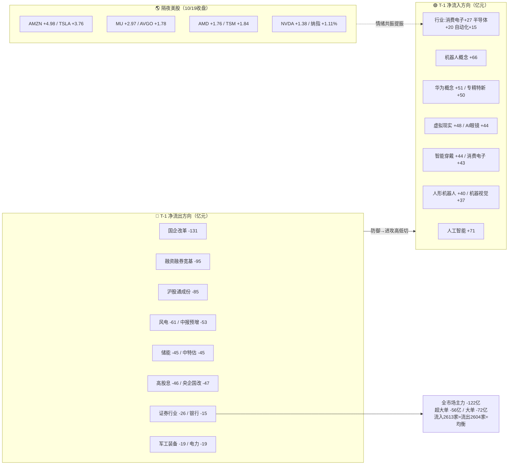

# 2026年10月21日（周三） · **资金面**

> **数据源新鲜度**: ok（主源 T-1 新鲜，三维度降级）
> **降级状态**: true（北向无净买入口径 / vibe-trading 缺 / ETF 期货缺）
> **置信度**: 0.70
> **数据归属交易日**: 2026-10-20（T-1）· staleness = **ok**

## 一句话结论

🟢 **科技反抽第二日获资金确认 + 隔夜美股半导体共振**：10/20 人工智能 +71 亿/机器人 +66 亿/华为 +51 亿全线回流，防御（国企改革 -131 亿/券商 -26 亿/银行 -15 亿）被抽血；但**主力净流出 122 亿、超大单 -56 亿、炸板率 34.9% 卡 35% 红线**，反弹是存量高低切不是增量入场——**做科技只做龙头弱转强，4 板吉大正元主力 -7.5 亿这类涨停诱多一律拦截**。

## 资金流向总图

## 时序资金流：三个关键时间序列

**① 全市场主力（近6日，亿元）**

| 日期 | 10/13 | 10/14 | 10/15 | 10/16 | 10/19 | 10/20 |
|---|---:|---:|---:|---:|---:|---:|
| 主力净额 | +67 | **-751** | -442 | -341 | +222 | **-122** |
| 超大单 | -18 | -171 | -351 | +2 | -31 | **-56** |
| 流入/流出家数 | 2508/2704 | 989/4225 | 1127/4088 | 2186/3030 | 2343/2870 | **2613/2604** |

读法：10/19 的 +222 亿反抽日之后，10/20 指数微红（沪 +0.12%/深 -0.14%）但资金重回净流出，**价涨资缩 = 反抽第二日资金没有追加反而在兑现**；好的一面是流出家数与流入家数首次打平（2613:2604），恐慌性抛售结束，进入结构性轮动而非系统性下跌。

**② 北向（成交额口径，⚠️ 净买入已停止披露）**：10/20 成交 209 亿，较 10/16 的 225 亿缩量 7%，10/19 沪深股通休市。连续两日低于 230 亿中枢，外资观望，没有在反抽日加仓。**只能解读交投情绪，不能当作净买入。**

**③ 主题资金时序（亿元，10/14→10/20）**

| 主题 | 14 | 15 | 16 | 19 | 20 | 5日累计 |
|---|---:|---:|---:|---:|---:|---:|
| 人形机器人 | -71 | -42 | -16 | +72 | **+40** | -17 |
| 机器人概念 | -135 | -107 | -54 | +86 | **+66** | -144 |
| 人工智能 | — | — | — | — | **+71** | 全市场第一 |
| CPO | -115 | -38 | -39 | +51 | +22 | -119 |
| 算力(东数西算) | -90 | -53 | -57 | +29 | +21 | -150 |
| AI眼镜 | -52 | -10 | -27 | +21 | **+44** | -24 |
| 消费电子概念 | -99 | -35 | -53 | +20 | **+43** | -124 |
| 存储芯片 | -79 | 0 | -19 | +1 | **-22** | -119 |
| 军工 | -67 | -82 | +4 | +21 | **-22** | -146 |
| 证券(行业) | — | — | — | — | **-26** | — |

关键结构：科技主线是**连续两日（10/19、10/20）资金净流入**，且 10/20 扩散到 AI 终端（眼镜/穿戴/MR/消费电子），不是单点脉冲；但所有科技主题 5 日累计仍为负，说明这是**深跌后的回补，不是趋势反转的增量市**。存储芯片 10/20 再度转出 -22 亿，是科技内部唯一掉链子的子方向——隔夜美光 +2.97% 今日要直面资金背离的考验。军工一日游被坐实（+21→-22）。

## 隔夜美股核心个股 → A股传导

| 指数/个股（10/19收盘） | 涨跌 | 映射 A 股 10/21 |
|---|---:|---|
| 纳指 IXIC | **+1.11%** / 标普 +0.41% | 成长/科技风险偏好提振 |
| 美光 MU | **+2.97%** | 存储链（但 A 股存储资金 -22 亿背离，竞价验证） |
| 博通 AVGO +1.78 / 台积电 TSM +1.84 | — | CPO/光模块/代工（中际旭创/天孚） |
| AMD +1.76 / 英伟达 NVDA +1.38 | — | AI 算力/芯片（乐鑫/寒武纪/全志） |
| AMZN **+4.98** / META -0.55 / GOOGL +1.05 | — | 云算力开支叙事正面，应用端分化 |
| TSLA **+3.76** | — | 机器人/车链情绪 |
| AAPL -0.15 | — | 果链中性（A股AI眼镜/消费电子靠自身资金） |
| ⚠️ 韩国 KOSPI（10/20） | **-3.73%** / 恒指 -1.32% | 亚太风险偏好转弱，外盘不是单边乐观 |

**传导结论**：美股半导体方向与 10/20 A 股资金回流科技**方向一致（共振）**，今日 AI 硬件/消费电子/机器人高开有外盘依据。但要注意三点：①美股快照是 10/19 周一收盘，10/20 美股当夜表现本快照未覆盖（数据生成于北京 06:03，美股未收盘）；②韩国 -3.73% 是级别不小的亚太警报；③美光 10/21 技术会=明牌兑现节点，A 股存储资金已提前流出，**利好高开低走风险大于追涨价值**。

## 昨日主力净流入前十 · 5日追踪（核心表）

| 代码 | 名称 | 行业 | 10/20净额 | 5日累计 | 5日涨跌 | 超大单 | 资金性质判定 |
|---|---|---|---:|---:|---:|---:|---|
| 688018 | 乐鑫科技 | 半导体 | **+5.66亿** | +7.6亿 | **+14.9%** | 强 | 🟢量价资齐强，龙虎榜净买2.57亿+机构+3.47亿，AIoT芯片真金 |
| 688256 | 寒武纪 | 半导体 | +5.43亿 | +3.4亿 | -0.9% | 强 | 🟡大票回补，10/20价跌-0.81%资流入=分歧承接，非加速 |
| 002241 | 歌尔股份 | 元器件 | +5.13亿 | +2.0亿 | +7.4% | 强 | 🟢AI眼镜/声学，资金回流+板块+3.54%共振 |
| 600276 | 恒瑞医药 | 化学制药 | +4.17亿 | +6.5亿 | +4.3% | — | 🟢防御中带进攻，创新药独立逻辑 |
| 300458 | 全志科技 | 半导体 | +4.14亿 | +2.5亿 | +3.5% | — | 🟢10/20 +11.27%放量，端侧AI芯片，跟随乐鑫 |
| 300394 | 天孚通信 | 通信设备 | +3.92亿 | **-11.1亿** | **-10.7%** | — | 🟡CPO左跌右买第2日，隔夜AVGO/TSM正面，仍属接刀 |
| 002472 | 双环传动 | 汽车配件 | +3.83亿 | +3.3亿 | **+13.2%** | — | 🟢机器人减速器，量价资齐，连涨2日(+8.55/+8.07) |
| 301536 | 星宸科技 | 半导体 | +3.37亿 | -1.1亿 | -7.9% | — | 🟡反抽首日，趋势未修复 |
| 600519 | 贵州茅台 | 白酒 | +3.33亿 | **+32.6亿(5/5)** | +3.6% | — | ⚪避险锚，5日全红但日波动低，不进进攻池 |
| 002475 | 立讯精密 | 元器件 | +3.23亿 | +7.0亿 | +5.9% | — | 🟢果链/AI终端中军，连续2日流入，容量承接位 |

**推理深度三问**：

- **乐鑫科技（688018）—— top1 资金对象**
  - **大资金意图**：10/20 +16.86% 放巨量，主力 +5.66 亿、龙虎榜净买 2.57 亿、机构专用净买 3.47 亿，三路资金在同一只 20cm AIoT 芯片票上达成一致，是 10/20 科技反抽里**资金质量最高的标的**。
  - **为什么走强**：端侧 AI/AI 眼镜硬件叙事 + 半导体行业资金 +20 亿 + 隔夜美股芯片共振，板块 β 与个股 α 同向。
  - **逻辑够不够硬**：产业逻辑中等偏硬，但 5 日已 +14.9%、单日 +16.86%，**追高盈亏比恶化**；今日竞价高开 >8% 不追，只接受分歧换手后回封/均线承接。

- **天孚通信（300394）—— 左侧接刀型**
  - **大资金意图**：5 日主力累计 -11.1 亿、股价 -10.7%，10/19、10/20 连续两日小流入（+0.5/+3.9），是 CPO 深跌后的试探性回补而非反转确认。
  - **为什么走强（流入）**：CPO 景气未破坏 + 隔夜 AVGO/TSM 涨，资金接下跌中的硬逻辑龙头。
  - **逻辑够不够硬**：弹性大但风险对称——同板块中际旭创 10/20 仍 -1.57 亿、5 日 -6.5%，板块内部没有一致。**只低吸不追高，低开低走即证伪**。

- **双环传动（002472）—— 机器人线资金质量第二**
  - **大资金意图**：连续两日 +8.55%/+8.07%、主力两日 +1.6/+3.8 亿，减速器核心，机器人主线里**量价资三者最整齐**的趋势票。
  - **为什么走强**：人形机器人概念连续两日 +72/+40 亿，板块 β 确认。
  - **逻辑够不够硬**：比高标宇树（10/22 大会明牌兑现）盈亏比好，但已连涨两日，今日只做分歧低吸/回踩承接，不追加速。

**R2 候选池资金核验（10/20）**：兆威机电 +1.18 亿（+7.96%）✅、步科股份 +0.44 亿（+11.76%）✅、宇树科技 +3.18 亿（+6.07%，龙虎榜净买 2.33 亿+机构 +1.59 亿）✅、浙江荣泰 -0.51 亿（二板，⚠️板上流出）、三花智控 -0.67 亿（中军滞涨）、亨通光电 **-2.74 亿（+3.62% 未封板，60 万手封单次日即散）**、中际旭创 -1.57 亿、澳弘电子 -0.97 亿、润泽科技 +1.24 亿、**协创数据 -5.50 亿（375 亿公告次日 -7.14%，硬公告被当出货，该线今日直接降级/剔除）**。

## 🚨 龙虎榜诱多识别（今日重点风险）

> 口径：涨停（limit=U）+ 当日主力净流出，辅以机构席位/龙虎榜净额背离。

| 代码 | 名称 | 板型 | 主力净额 | 机构净额 | 龙虎榜净额 | 开板 | 判定 |
|---|---|---|---:|---:|---:|---:|---|
| 003029 | **吉大正元** | **4连板(最高板)** | **-7.52亿** | — | +0.35亿 | 4次 | 🔴头号诱多：全市场流出第一+最高板，封单1.12亿全是板上换手，游资接力散户 |
| 002242 | **九阳股份** | 首板 | **-5.47亿** | +0.40亿 | +1.05亿 | 5次 | 🔴烂板出货：开板5次，主力大撤、游资对倒 |
| 603236 | 移远通信 | 首板 | -2.76亿 | — | — | 3次 | 🔴通信模组借板派发 |
| 002181 | 粤传媒 | 首板 | -2.76亿 | — | — | 0次 | 🔴缩量一字板上流出，无承接 |
| 002724 | 海洋王 | 3连板 | -1.98亿 | — | — | 3次 | 🔴高位板开3次+流出，接力风险 |
| 300244 | 迪安诊断 | 20cm首板 | -1.68亿 | +0.59亿 | +1.45亿 | **12次** | 🔴12次烂板，AI医疗借人气出货 |
| 603626 | 科森科技 | 2连板 | -1.06亿 | +0.58亿 | +0.97亿 | 1次 | 🟡消费电子二线，机构接货但主力撤，观察 |
| 600148 | 长春一东 | 3连板 | -0.65亿 | -0.29亿 | -2.68亿 | 4次 | 🔴兵装高位板：机构+龙虎榜双卖 |
| 603119 | 浙江荣泰 | 2连板 | -0.51亿 | +0.47亿 | +7.96亿* | 1次 | 🟡R2龙二：游资大额承接但主力小撤，看龙一兆威脸色 |
| 603278/600860 | 大业股份/京城股份 | 3连板一字 | 未进流出榜 | — | — | 0-2次 | ⚠️封单强(2.28/0.58亿)但3板一致后接力盈亏比差 |

\* 浙江荣泰龙虎榜净额为多席位合并值。**炸板+流出**另需规避：新北洋 -2.95 亿、昭衍新药 -2.85 亿、泰晶科技 -1.27 亿、博敏电子 -1.23 亿。

**首推风险票思维链（以吉大正元为反面教材）**
- **追板理由（诱饵）**：全场最高 4 连板、信创/网安题材、早盘 9:25 封板看似强势、龙虎榜净买为正。
- **风险点**：涨停当日主力净流出 **7.52 亿（全市场第一）**、开板 4 次，板上全部是换手筹码；板块（软件开发行业仅 +9 亿）根本撑不起一个 4 板高标的抱团，这是典型**高标末段游资互相收割 + 散户接力**。
- **止损条件**：持有者竞价封单明显缩水或低开，集合竞价即走，不等开盘。
- **可验证假设**：今日开盘 30 分钟若再开板且主力资金续流出 → 天地板/大面风险兑现，拦截正确。

**龙虎榜正向（可与资金流交叉确认，非买入信号）**：海天瑞声净买 3.53 亿（机构 +3.33 亿）、凡拓数创 2.84 亿（机构 +4.59 亿，20cm 二板）、乐鑫 2.57 亿、长盈精密 2.41 亿、宇树 2.33 亿、恒玄科技 1.64 亿（AI 眼镜芯片，外资席位在列）。**反向**：思源电气 -3.70 亿、蔚蓝锂芯 -2.02 亿、超声电子（机构 -4.67 亿）、慈文传媒 -1.03 亿（3 日 3 次上榜+净卖，传媒派发延续）。

## 板块跷跷板

1. **防御/国改 → 科技进攻（强）**：国企改革 -131、高股息 -46、中特估 -45、银行 -15、证券 -26 全线失血，人工智能 +71/机器人 +66/消费电子 +43 承接。10/19 护盘的银行单日 +48 亿次日即 -15 亿，**防御锚本周第二次失效，仓位不能再靠大金融托底**。
2. **新能源 → AI 终端（中）**：风电 -61/储能 -45/氢能 -35/锂电 -33 流出，AI 眼镜 +44/智能穿戴 +44/MR +28/果链 +25，资金沿"硬件创新"叙事做低位切换。
3. **军工 → 机器人自动化（中）**：军工概念 +21→-22 一日游，自动化设备连续两日 +17/+15，同属"制造"，资金从事件驱动（军演/航展明牌）切向产业趋势（物理AI）。

## 数据源审计

| 源 | 状态 | 数据归属 | 记录数 | 备注 |
|---|---|---|---|---|
| tushare 个股资金流 | 🟢 ok | 10/20 | 33451 | 本地 token 全市场，万元口径 |
| tushare 概念/行业资金流 | 🟢 ok | 10/20 | 2856 | 同花顺口径，亿元 |
| tushare 涨跌停 | 🟢 ok | 10/14-20 | 438 | 10/20 U54/Z29/D6，炸板率34.9% |
| tushare 龙虎榜/机构席位 | 🟢 ok | 10/16-20 | 2508 | 金额为元口径 |
| tushare 北向 | 🟡 口径受限 | 10/20 | 5日 | 仅成交额，净买入停止披露 |
| tushare 两融 | 🟡 stale | 10/19 | 6000 | 10/20未出 |
| overseas_snapshot | 🟢 ok(时点受限) | 美股10/19 | 16 | 10/20美股夜盘未覆盖；商品缺 |
| vibe-trading | 🔴 error | — | 0 | profile无MCP，大宗/两融交叉降级 |
| ETF/期货/期权 | ⚪ stale | — | 0 | 维度缺 |

## 不确定性 / 反证

1. **反弹质量存疑**：指数收红但主力 -122 亿、超大单 -56 亿，10/19 入场资金 10/20 没有追加；若今日科技高开后资金不转正（尤其是 AI 眼镜/消费电子两个新扩散方向），则本轮仍是 10/15-16 式"反抽次日埋人"的第三次重演。
2. **美股共振有时差缺口**：本快照止于 10/19 美股收盘，10/20 夜盘（北京今日凌晨）表现未知；韩国 -3.73% 提示亚太并不稳，竞价前需以最新外盘修正。
3. **存储背离**：美光涨 vs A 股存储 -22 亿，两种解读——资金提前埋伏等美光会议（利好），或资金不认可景气（借高开出货），今日竞价定生死，不预判。
4. **诱多判定的局限**：无大宗交易/两融合仓数据（vibe 降级），"涨停+主力流出"在强情绪日也可能是游资换手续涨（如浙江荣泰龙虎榜 +8 亿）；硬拦截只给最高板+最大流出双命中（吉大正元），其余按竞价封单二次确认。
5. 北向无净额，外资真实方向不可验证。

## 与其他 R/D/E 的关系

- **依赖**：`data/raw/20261021/manifest.json`(severity=2)、`mcp_health.json`、`overseas_snapshot.json`；参照 `data/research/20261020/R2_main_sectors.json` 候选池做逐票资金核验。
- **被消费**：R2（主线资金约束）、R5（个股画像取 top10/诱多）、R6（诱多名单可作反证证据）、D1（仓位与拦截）。
- **对 D1 的一句话**：科技反抽第二日+美股共振，可维持进攻但**不得加仓追高**——只做机器人/AI终端龙头的分歧弱转强（双环/兆威/乐鑫量级），协创数据硬公告出货线剔除，存储等竞价，4板吉大正元及一切"涨停+主力大流出"名单拦截；金融防御锚失效，炸板率34.9%贴线，候选数按一半执行。

## Sub-Agent 元数据

- skill: analyze_capital_flow_v1@1.3
- artifact: data/research/20261021/R7_capital_flow_20261021.json（+ R7_capital_flow.json 兼容副本）
- 原始缓存: data/research/20261021/_r7_data/
- 生成耗时: 约 28 分钟（本地 tushare token 六日全量拉取 + 三表交叉）
- model: ark-code-latest
