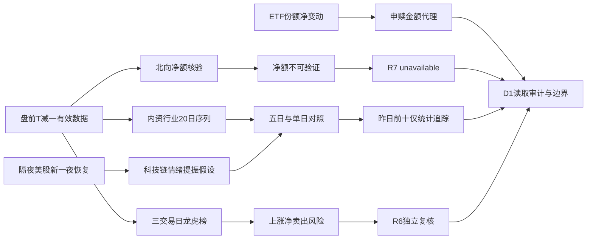

# 2026年10月22日 · 资金面

> **数据源新鲜度**: partial · **降级状态**: true · **置信度**: 0
> A股资金数据归属 2026-10-21，盘前正常最新；美股最新归属 2026-10-21。
> 北向净流量不可验证，staleness_status=unavailable；不是把正常T-1误判为过期。

## 🧭 一句话结论
**观察：科技昨日回流不等于多日趋势逆转；北向缺数，R7不提供开仓确认。**

## 📊 详细分析：先认市场，再认资金
沿用manifest的高位震荡定位，不代替R1定风格。R1/R2尚未就绪，主线及主模板均未确认，不自行选股；无今日核心/主线补涨/计划内试错资格的标的不进入候选。这里的净流入前十是客观资金统计，不是候选或首推票，因此不生成买卖时点、板型认定、RR或止损价，也不触发逐候选大宗/两融调用。禁止清单由下游正式候选环节执行。

电子昨日回流但五日仍净流出，不能把一天大额正流量解释为中期机构建仓。东财口径包含父子行业层级，电子/半导体/数字芯片设计等不可加总，行业净流量不能相加冒充全市场净额。

北向三条路径均未得到可核验净买入：Tushare字段数值缺少净流量计量依据；东财实时全null且历史为空；问财把北向误解析成龙虎榜净买入额。全部拒绝代入北向。无值记null/空序列，不记0，不把成交额替换为净流量。

具名席位三交易日重复买入只形成未完成风险筛查的观察记录。机构专用不能当成同一机构；同一股票的单日榜、三日累计榜以及买卖两侧重复记录不能直接相加。未核验公告与封板状态，不发布有效synergy_flags。

## 📈 板块时序资金（亿元）
| 板块 | 昨日净流入 | 五日累计 | 十日累计 | 二十日累计 | 态度 |
|---|---:|---:|---:|---:|---|
| 电子 | 58.3467 | -62.3759 | -640.9474 | -1187.2362 | 观察 |
| 数字芯片设计 | 26.1816 | 4.6648 | -197.7507 | -284.7724 | 观察 |
| 元件 | 19.6784 | -31.3410 | -119.6693 | -414.4369 | 观察 |
| 印制电路板 | 18.5079 | -12.3042 | -54.5921 | -275.3762 | 观察 |
| 通信设备 | 15.4860 | -52.6848 | -312.1358 | -559.4731 | 观察 |
| 通信 | 15.0899 | -56.2452 | -329.4891 | -582.1591 | 观察 |
| 通信网络设备及器件 | 13.1574 | -59.2342 | -237.2831 | -321.4908 | 观察 |
| 光学光电子 | 12.2447 | -2.7710 | -49.2978 | -11.9710 | 观察 |
| IT服务Ⅲ | 11.4307 | -4.4528 | -45.0199 | -98.4645 | 观察 |
| IT服务Ⅱ | 11.4307 | -4.3194 | -44.8865 | -98.3311 | 观察 |

来源：本会话实时调用Tushare moneyflow_ind_dc，原单位元；覆盖2026-09-16至2026-10-21共20个交易日、496板块。按净流量排序仅为资金事实，不是R2主线排序。

### 电子：资金三问
- **大资金意图**: 昨日净流入58.3467亿元只说明大单侧回流，不能识别最终持有人或确认建仓意图。
- **为什么走强**: 板块当日涨跌0.29%，与五日资金-62.3759亿元需同时检验；资金正流入不等于股价必涨。
- **逻辑够不够硬**: 只有东财行业资金一套底源，硬业绩/政策未在R7核验，态度=观察，不给开仓确认。

### 数字芯片设计：资金三问
- **大资金意图**: 昨日净流入26.1816亿元只说明大单侧回流，不能识别最终持有人或确认建仓意图。
- **为什么走强**: 板块当日涨跌0.91%，与五日资金4.6648亿元需同时检验；资金正流入不等于股价必涨。
- **逻辑够不够硬**: 只有东财行业资金一套底源，硬业绩/政策未在R7核验，态度=观察，不给开仓确认。

### 元件：资金三问
- **大资金意图**: 昨日净流入19.6784亿元只说明大单侧回流，不能识别最终持有人或确认建仓意图。
- **为什么走强**: 板块当日涨跌-0.63%，与五日资金-31.3410亿元需同时检验；资金正流入不等于股价必涨。
- **逻辑够不够硬**: 只有东财行业资金一套底源，硬业绩/政策未在R7核验，态度=观察，不给开仓确认。

## 🔎 昨日资金净流入前十：最近五个交易日追踪
单位：万元；按2026-10-21全市场返回6029标的的net_amount降序取十只，无人工补票。五日明确为2026-10-15、16、19、20、21；不是自然日。来源Tushare moneyflow_dc。下表均为统计对象，不是候选池。

| 昨日排名 | 标的 | 10-15 | 10-16 | 10-19 | 10-20 | 10-21 | 五日累计 | 判定 |
|---:|---|---:|---:|---:|---:|---:|---:|---|
| 1 | 利通电子 603629.SH | -16277.58 | -8741.65 | -4452.78 | 82.66 | 83711.02 | 54321.67 | 观察：五日净流入但连续性不足 |
| 2 | 杰瑞股份 002353.SZ | -19016.53 | -7607.93 | -2694.04 | 1696.50 | 82260.65 | 54638.65 | 观察：五日净流入但连续性不足 |
| 3 | 天孚通信 300394.SZ | -55850.93 | -69939.46 | -54748.27 | -22414.10 | 76012.23 | -126940.53 | 观察：昨日回流但五日仍净流出 |
| 4 | 兆易创新 603986.SH | -58719.14 | 50606.82 | 56623.26 | 16618.07 | 68947.36 | 134076.37 | 观察：连续四日净流入 |
| 5 | 平潭发展 000592.SZ | -642.17 | 9569.11 | -20217.63 | 191.51 | 57981.04 | 46881.86 | 观察：五日净流入但连续性不足 |
| 6 | 沪电股份 002463.SZ | 14760.91 | -19354.87 | -17461.60 | -34847.41 | 54755.91 | -2147.06 | 观察：昨日回流但五日仍净流出 |
| 7 | 利亚德 300296.SZ | -1167.89 | 1078.26 | -1442.85 | 3670.41 | 52711.16 | 54849.09 | 观察：五日净流入但连续性不足 |
| 8 | 澜起科技 688008.SH | -41117.47 | 43139.25 | -3126.01 | 11460.72 | 49734.04 | 60090.53 | 观察：五日净流入但连续性不足 |
| 9 | 光库科技 300620.SZ | -9734.39 | 12421.87 | 8748.85 | 10128.46 | 45793.54 | 67358.33 | 观察：连续四日净流入 |
| 10 | 云南锗业 002428.SZ | -19636.47 | -16678.33 | -9788.44 | 13701.08 | 45690.49 | 13288.33 | 观察：五日净流入但连续性不足 |

天孚通信、沪电股份即使昨日净流入进入前十，五日累计仍负；不可用昨日名次抹去此前资金流出。兆易创新与光库科技连续四日为正，连续性比单日脉冲更强，但R7不据此认定龙头或直接推荐。

### 利通电子：统计对象三问
- **大资金意图**: 昨日净流入83711.02万元；大单回流是事实，机构建仓意图未证实。
- **为什么走强**: 五日2日净流入、累计54321.67万元，五日净流入但连续性不足；未调用位置/催化画像，不能归因于硬事件。
- **逻辑够不够硬**: 东财两通道同底源不算双独立共识，昨日金额差0.9347%；态度=观察，非候选，不输出买入理由或虚构止损。

### 杰瑞股份：统计对象三问
- **大资金意图**: 昨日净流入82260.65万元；大单回流是事实，机构建仓意图未证实。
- **为什么走强**: 五日2日净流入、累计54638.65万元，五日净流入但连续性不足；未调用位置/催化画像，不能归因于硬事件。
- **逻辑够不够硬**: 东财两通道同底源不算双独立共识，昨日金额差0.0855%；态度=观察，非候选，不输出买入理由或虚构止损。

### 天孚通信：统计对象三问
- **大资金意图**: 昨日净流入76012.23万元；大单回流是事实，机构建仓意图未证实。
- **为什么走强**: 五日1日净流入、累计-126940.53万元，昨日回流但五日仍净流出；未调用位置/催化画像，不能归因于硬事件。
- **逻辑够不够硬**: 东财两通道同底源不算双独立共识，昨日金额差-0.8515%；态度=观察，非候选，不输出买入理由或虚构止损。

### 兆易创新：统计对象三问
- **大资金意图**: 昨日净流入68947.36万元；大单回流是事实，机构建仓意图未证实。
- **为什么走强**: 五日4日净流入、累计134076.37万元，连续四日净流入；未调用位置/催化画像，不能归因于硬事件。
- **逻辑够不够硬**: 东财两通道同底源不算双独立共识，昨日金额差15.6668%；态度=观察，非候选，不输出买入理由或虚构止损。

### 平潭发展：统计对象三问
- **大资金意图**: 昨日净流入57981.04万元；大单回流是事实，机构建仓意图未证实。
- **为什么走强**: 五日3日净流入、累计46881.86万元，五日净流入但连续性不足；未调用位置/催化画像，不能归因于硬事件。
- **逻辑够不够硬**: 东财两通道同底源不算双独立共识，昨日金额差0.5862%；态度=观察，非候选，不输出买入理由或虚构止损。

### 沪电股份：统计对象三问
- **大资金意图**: 昨日净流入54755.91万元；大单回流是事实，机构建仓意图未证实。
- **为什么走强**: 五日2日净流入、累计-2147.06万元，昨日回流但五日仍净流出；未调用位置/催化画像，不能归因于硬事件。
- **逻辑够不够硬**: 东财两通道同底源不算双独立共识，昨日金额差1.7386%；态度=观察，非候选，不输出买入理由或虚构止损。

### 利亚德：统计对象三问
- **大资金意图**: 昨日净流入52711.16万元；大单回流是事实，机构建仓意图未证实。
- **为什么走强**: 五日3日净流入、累计54849.09万元，五日净流入但连续性不足；未调用位置/催化画像，不能归因于硬事件。
- **逻辑够不够硬**: 东财两通道同底源不算双独立共识，昨日金额差0.7433%；态度=观察，非候选，不输出买入理由或虚构止损。

### 澜起科技：统计对象三问
- **大资金意图**: 昨日净流入49734.04万元；大单回流是事实，机构建仓意图未证实。
- **为什么走强**: 五日3日净流入、累计60090.53万元，五日净流入但连续性不足；未调用位置/催化画像，不能归因于硬事件。
- **逻辑够不够硬**: 东财两通道同底源不算双独立共识，昨日金额差-0.6685%；态度=观察，非候选，不输出买入理由或虚构止损。

### 光库科技：统计对象三问
- **大资金意图**: 昨日净流入45793.54万元；大单回流是事实，机构建仓意图未证实。
- **为什么走强**: 五日4日净流入、累计67358.33万元，连续四日净流入；未调用位置/催化画像，不能归因于硬事件。
- **逻辑够不够硬**: 东财两通道同底源不算双独立共识，昨日金额差0.9309%；态度=观察，非候选，不输出买入理由或虚构止损。

### 云南锗业：统计对象三问
- **大资金意图**: 昨日净流入45690.49万元；大单回流是事实，机构建仓意图未证实。
- **为什么走强**: 五日2日净流入、累计13288.33万元，五日净流入但连续性不足；未调用位置/催化画像，不能归因于硬事件。
- **逻辑够不够硬**: 东财两通道同底源不算双独立共识，昨日金额差-9.5743%；态度=观察，非候选，不输出买入理由或虚构止损。

## ⚠️ 龙虎榜诱多识别：仅风险提示，硬否决归R6
上涨但龙虎榜净卖出，是兑现/诱多的风险线索，不足以证明操纵或认定出货。三日累计净额不能写成昨日单日净卖出。同票不同上榜理由不重复相加；龙虎榜为选定席位样本，不是全市场主力净额。

| 标的 | 当日涨幅 | 榜单净额（万元） | 榜单统计窗口 | 态度 |
|---|---:|---:|---|---|
| 兆讯传媒 301102.SZ | 19.9790% | -3107.78 | 单日 | 观察，提交R6 |
| 三维天地 301159.SZ | 20.0000% | -961.77 | 单日 | 观察，提交R6 |
| 凡拓数创 301313.SZ | 11.5385% | -1082.09 | 单日 | 观察，提交R6 |
| 慈文传媒 002343.SZ | 2.9268% | -6900.85 | 单日 | 观察，提交R6 |
| 果麦文化 301052.SZ | 4.8780% | -6601.54 | 单日 | 观察，提交R6 |
| 闽东电力 000993.SZ | 3.8670% | -11820.59 | 单日 | 观察，提交R6 |
| 移远通信 603236.SH | 9.9987% | -14494.83 | 连续三日累计 | 观察，提交R6 |
| 海洋王 002724.SZ | 10.0432% | -1890.84 | 连续三日累计 | 观察，提交R6 |
| 泰尔股份 002347.SZ | 9.9849% | -1044.36 | 连续三日累计 | 观察，提交R6 |
| 永达股份 001239.SZ | 10.0000% | -636.30 | 连续三日累计 | 观察，提交R6 |

- **大资金意图**: 净卖出与上涨并存，可能存在获利兑现，但席位样本不能推出全部资金意图。
- **为什么走强**: 价格上涨与榜单卖出可以由其他买方承接同时造成，不能把价格上涨当作资金全面买入。
- **逻辑够不够硬**: 龙虎榜与东财冗余仅校验渠道；缺少热榜霸榜/公告/分时证据，不能认定诱多。有效协同flags为空，另存29条未完成风控核验的重复净买入观察。

## 🌎 外部传导：隔夜美股核心个股
必读overseas_snapshot实际美股日期为2026-10-20，不能直接称作昨夜。Tushare最新MU/SOX拉空后，改用实时vibe-trading Yahoo恢复2026-10-21日线。下表涨幅由相邻两日收盘计算，美股收盘单位美元，指数单位点；股票源标注split_dividend复权。旧快照保留在证据附件且未修改原文件。

| 标的 | 10-21收盘 | 较10-20涨跌 | 传导判断 |
|---|---:|---:|---|
| MU | 913.6700 | 1.9641% | 存储提振 |
| NVDA | 221.9700 | 2.5408% | 算力/CPO/半导体情绪提振 |
| AVGO | 337.8000 | 1.0258% | 算力/CPO/半导体情绪提振 |
| AMD | 552.7200 | 3.3624% | 算力/CPO/半导体情绪提振 |
| TSM | 431.8900 | 1.6021% | 算力/CPO/半导体情绪提振 |
| AAPL | 343.9900 | 1.3225% | 外部背景，不代替A股资金确认 |
| MSFT | 532.9500 | 0.2031% | 外部背景，不代替A股资金确认 |
| META | 697.5200 | 0.4710% | 外部背景，不代替A股资金确认 |
| GOOGL | 334.7600 | -1.6222% | 外部背景，不代替A股资金确认 |
| AMZN | 262.3700 | -0.0990% | 外部背景，不代替A股资金确认 |
| TSLA | 386.4700 | 3.4144% | 外部背景，不代替A股资金确认 |
| INTC | 92.9600 | 1.3851% | 外部背景，不代替A股资金确认 |
| GLW | 134.9200 | 2.0112% | 外部背景，不代替A股资金确认 |
| MRVL | 244.7600 | 1.8052% | 算力/CPO/半导体情绪提振 |
| SPX | 7757.1699 | 0.5783% | 外部背景，不代替A股资金确认 |
| IXIC | 26702.8574 | 1.0522% | 外部背景，不代替A股资金确认 |
| SOX | 11505.5557 | 1.9652% | 算力/CPO/半导体情绪提振 |

- **大资金意图**: 半导体核心股与SOX同涨体现境外风险偏好改善，但收盘涨幅不是资金净流入，不推算A股机构买入金额。
- **为什么走强**: MU/NVDA/AVGO/AMD/TSM均上涨，能够给存储/CPO/半导体开盘情绪提振；本次未核验业绩或硬政策催化，不能把联动当确定产业事实。
- **逻辑够不够硬**: 新一夜价量由Yahoo单源恢复，国内科技链多日资金仍流出，若今日A股不承接则外部传导假设证伪；态度=观察。

## 🧮 ETF与期货
四ETF使用份额变化乘同日收盘价估算净申赎金额，不是成交额，也不是一级市场实际现金流水，更不是全市场ETF总流量。问财原始字段明确为“份”和“元”。

| ETF | 10-20份额（份） | 10-21份额（份） | 收盘价（元） | 净申赎代理（亿元） |
|---|---:|---:|---:|---:|
| 科创50ETF华夏 588000.SH | 73718668200 | 74765668200 | 1.418 | 14.846460 |
| 中证500ETF南方 510500.SH | 6110568600 | 6099768600 | 6.864 | -0.741312 |
| 创业板ETF易方达 159915.SZ | 27343454936 | 29204454936 | 2.713 | 50.488930 |
| 沪深300ETF华泰柏瑞 510300.SH | 29400787700 | 30199087700 | 4.185 | 33.408855 |

四只合计代理=98.002933亿元。IF2611收盘4076.2、沪深300同日4111.9325，基差=-35.7325点（-0.8690%）。这是指定次月合约、未调整持有成本，不是主力连续或精确套利判断。ETF申购代理正值与期货贴水并存，不得概括为全面风险偏好共振。A股期权隐波缺失：真实get_options_chain只支持US期权，不发送伪A股参数。

## 🔁 跷跷板与时序边界
默认行业资金绝对值前20构成统计universe，不是主线推荐。20个交易日逐日对齐、190对检验，无缺失点；没有同时满足Pearson<-0.6与最近五日相对前五日反转的组合，seesaw_pairs=[]。这不等于市场没有轮动，也不补造配对。

## 📌 关键证据
- 行业20交易日完整序列9920条，昨日净流入板块与中期累计方向分离；来源Tushare DC。
- 昨日前十逐票五日追踪50条，Tushare DC与实时东财金额存在差异，不强行平均或视作独立共识。
- 原海外快照为旧一夜，最新14只美股与3个指数已通过Yahoo MCP恢复；不能沿用旧一夜涨跌方向。
- 问财北向响应返回“龙虎榜净买入额”，语义错误即使HTTP成功也拒绝使用。

## 数据源审计
| 源 | 日期 | 状态 | 记录数 | 备注 |
|---|---|:--:|---:|---|
| manifest | 2026-10-22 | 🟢 | 1 | global_severity=2; 前置情绪=高位震荡 |
| mcp_health | 2026-10-22 | 🟢 | 1 | 盘前健康不等于当前业务可用；DataPro实际4013 |
| overseas_snapshot | 2026-10-22 | 🟡 | 12 | 美股核心与美股指数数据归属20261020，不能冒充20261021隔夜 |
| preferences | 2026-10-22 | 🟢 | 1 | 只读；不扩候选池；不输出仓位调整 |
| human_thesis | 2026-10-22 | 🟢 | 0 | 目录为空，无active thesis |
| R1 | 2026-10-22 | 🔴 | 0 | 当次检查未就绪，不自行判风格 |
| R2 | 2026-10-22 | 🔴 | 0 | candidate_pool_unavailable；无候选不自行选股 |
| tushare.trade_cal | 2026-10-22 | 🟢 | 22 | 交易日历确认T-1=20261021，五日=15/16/19/20/21 |
| tushare.moneyflow_hsgt | 2026-10-22 | 🔴 | 20 | 字段有数但无可核验净买入语义；不纳入净流量、不用成交额替代 |
| vibe.northbound | 2026-10-22 | 🔴 | 0 | 20日/30日两次history=[]且实时全null |
| tushare.hk_hold | 2026-10-22 | 🔴 | 0 | 指定沪股通兆易创新近5日为空；季度持股不推每日净流量 |
| vibe.iwencai | 2026-10-22 | 🔴 | 0 | 北向/ETF请求均key_not_configured |
| iwencai.northbound | 2026-10-22 | 🔴 | 2 | 两次查询均错映射龙虎榜净买入额，拒绝代入北向 |
| tushare.moneyflow_ind_dc | 2026-10-22 | 🟢 | 9920 | 先超SSE上限，减字段分4窗恢复20交易日×496板块；金额元；层级重叠不可加总 |
| tushare.moneyflow_dc | 2026-10-22 | 🟢 | 6079 | 先超SSE上限，减字段恢复昨日6029标的及10只×5日；金额万元 |
| tushare.top_list | 2026-10-22 | 🟢 | 69 | 含可转债；风险样本保留一日/三日榜原口径，不叠加重复榜 |
| tushare.top_inst | 2026-10-22 | 🟢 | 2310 | 三交易日席位；重复side/reason去重，连续三日榜不作独立日复购 |
| vibe.dragon_tiger | 2026-10-22 | 🟢 | 68 | 东财全市场20261021，排除可转债；与Tushare同底源不算独立资金共识 |
| vibe.fund_flow | 2026-10-22 | 🟢 | 50 | 首轮5日10只成功；拓展15日后全票代理连接失败；保留已成功原始5日证据 |
| vibe.fund_flow_15d | 2026-10-22 | 🔴 | 0 | 东财代理断开；服务端TUSHARE_TOKEN未配置，非全域vibe DOWN |
| xtick.money | 2026-10-22 | 🟢 | 7 | all截面仅保留1277条（文本截断），本报告只用4只已覆盖+3只逐票补查；元；与DC不直接拼接 |
| datapro | 2026-10-22 | 🔴 | 0 | 三种查询均4013：Agent Plan失效或无席位；与health表状态冲突 |
| iwencai.etf_futures | 2026-10-22 | 🟢 | 6 | 重写NL后四ETF份额/收盘、IF2611/沪深300同日收盘恢复；份/元/点；TLS证书校验关闭 |
| tushare.us_daily_index_global | 2026-10-22 | 🔴 | 0 | MU及SOX指定20261021返回空，换Yahoo通道恢复 |
| vibe.yahoo | 2026-10-22 | 🟢 | 34 | 14美股+3指数×2收盘，日期20261020/21；收益按close比值计算 |
| A_share_options | 2026-10-22 | 🔴 | 0 | 真实schema仅US上市期权，技能文字与工具不匹配，不发无效A股调用 |

审计日期是本会话实际调用/读取日期，不是行情归属日期。精确时区归集时间及请求窗口见frontmatter/JSON；MCP未返回独立服务端抓取时刻，不伪造每次调用时间。DataPro健康探测与业务查询可用性冲突，以实际4013失败为准。XTick全市场输出截断不作为完整全市场样本；只用已完整返回个股并补查三只。问财备用通道关闭TLS证书校验，存在传输认证风险，已纳入降级审计。

## 🧯 缺数原因 / 不确定性 / 反证
- northbound_net_flow_unavailable。
- candidate_pool_unavailable:R2_not_ready。
- R1_style_not_ready。
- candidate_block_trades_margin_15d_not_applicable_without_R2。
- synergy_announcement_and_limit_close_risk_screen_unverified。
- A_share_options_chain_schema_not_supported。
- datapro_subscription_4013。
- vibe_15d_fundflow_extension_proxy_failed。
- full_vibe_success_response_not_persisted_only_explicit_field_projection。
- USDCNH_20261021_not_recovered。

北向不可得使整体置信度强制为0；原始三因子0.75×0.7×0.5=0.2625，hard_override明确列出，不伪装成公式正常结果。manifest severity=2的0.5上限亦满足。D1按unavailable跳过R7资金维度，不能因为部分段落有真实数据就忽视顶层状态。

候选池缺失不代表零机会，也不代表vibe全域DOWN；只表示R7无权自行补选。大宗交易/15日两融的逐候选硬调用当前无对象，明确记not_applicable_without_R2，不用空数组声称已完成候选核验。未持久化完整成功vibe原始报文，仅保留显式字段投影；该缺口写入missing_items，不宣称原报文完整。

## 🔗 与其他R/D/E的关系
依赖：manifest、mcp_health、overseas_snapshot、只读preferences、active thesis（空）；R1/R2当次未就绪。消费者：R2/R5、R6、D1、E1。R7仅输出资金约束与观察，不输出买卖时点、不直接调整持仓，不替代R6硬否决。

## Sub-Agent 元数据
- skill: analyze_capital_flow_v1；链式子skill：hot_money_synergy_v1、detect_seesaw_pairs_v1（inline执行，无delegation）
- artifact: data/research/20261022/R7_capital_flow_20261022.json
- evidence: data/research/20261022/R7_live_evidence_20261022.json
- model: gpt-6.1-sol
