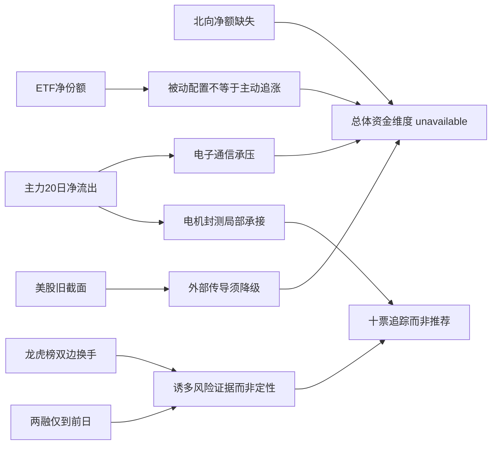

# 2026年10月23日 · 资金面
> **数据源新鲜度**：partial；**降级状态**：true；**置信度**：0。
> A股数据截至2026-10-22；正常T-1不算时间错位。北向净额不可得，整体资金维度 unavailable；可读证据不等于可供D1正常消费。
> ⚠️ 本日海外文件实际美股 asof 为2026-10-21，并非2026-10-22最新隔夜。

## 🧭 一句话结论
主力持续净流出，局部承接未成全面共振；北向缺失，整体资金维度不可用。

## 📊 详细分析
全市场东财主力近五、十、二十日净额均为负，且最近五日全部净流出。昨日超大单与大单净额同时为负，而小单净额为正，说明按该拆单口径承接更多落在小单；这不等于能够识别实际投资者身份，也不是全市场现金真实流出的会计口径。

电子、通信的大额流出与电机、封测子行业的局部流入同时出现。父行业和子行业有成分重叠，不能把金额相加；局部强度不能升格成R2的主线结论。德明利在东财和XTick之间方向相反，这种分歧必须显式保留，不能只展示有利数据。

ETF五日净申购份额体现被动资金配置，但宽基申购可能包括申赎套利及逆势配置，不能直接推成次日上涨。两融仅到2026-10-21，其中八票有十五个观测，两票无记录；北向持股仅季度截面，也不能替代每日净买入。

### 全市场时序（东财经Tushare，本次实时请求）
| 窗口 | 起止交易日 | 主力净额（亿元） | 净流出日 |
|---|---|---:|---:|
| 5日 | 20261016—20261022 | -1016.36 | 5/5 |
| 10日 | 20261009—20261022 | -2639.67 | 10/10 |
| 20日 | 20260917—20261022 | -5278.00 | 17/20 |

昨日主力净额为 -632.52 亿元，其中超大单 -358.11 亿元、大单 -274.41 亿元；小单 +482.53 亿元。来源：实时 `tushare.moneyflow_mkt_dc`，数据日2026-10-22。

- **大资金意图**: 按拆单净额更像持续去风险与局部承接，并非可证明的全体机构统一行为。
- **为什么走强**: 本节并未发现全市场资金走强，不能把少数个股反弹外推到全市场。
- **逻辑够不够硬**: 主力序列完整，但北向净额、期现基差缺失，整体四维共振没有成立。

## 🔎 昨日前十：先定义榜单，再追溯五日
榜单为 `tushare.moneyflow_dc` 返回的2026-10-22全日主力净流入额排名，单位万元；全市场返回6029只、按股票代码去重后净额降序取十。不是北向前十、不是龙虎榜前十，也不是R2候选。R2本轮未就绪，不生成推荐或执行池。

五日是截至榜单日向后追溯：2026-10-16、19、20、21、22；不是未来五日已实现收益。N通则只有首日有效记录，上市前四槽不适用。

| 名次 | 股票 | 昨日主力（亿元） | 5日 / 10日 / 20日（亿元） | XTick昨日（亿元） |
|---:|---|---:|---|---:|
| 1 | 华天科技 `002185.SZ` | 11.397 | 9.785 / 3.010 / -9.314 | 17.479 |
| 2 | N通则 `301718.SZ` | 6.052 | 不适用 / 不适用 / 不适用 | 2.904 |
| 3 | 德明利 `001309.SZ` | 4.269 | 13.280 / 6.595 / -7.658 | -1.296 |
| 4 | 百亚股份 `003006.SZ` | 4.160 | 18.348 / 30.100 / 55.951 | 0.792 |
| 5 | 长江电力 `600900.SH` | 4.147 | 4.828 / -0.970 / 5.727 | 3.214 |
| 6 | 贵州茅台 `600519.SH` | 3.560 | 12.922 / 22.900 / 19.169 | 7.313 |
| 7 | 沈鼓集团 `601091.SH` | 3.482 | 2.517 / 1.615 / -11.780 | 10.601 |
| 8 | 中国平安 `601318.SH` | 3.110 | 1.599 / -2.832 / 6.868 | 2.729 |
| 9 | 鸣志电器 `603728.SH` | 3.100 | 2.880 / 2.867 / 2.756 | 5.124 |
| 10 | 大洋电机 `002249.SZ` | 3.076 | 3.296 / 2.792 / 2.268 | 3.856 |

### 1. 华天科技 · 002185.SZ（仅追踪）
- **大资金意图**: 封测方向单日修复的解释较合理；此前连续资金流出，不能解释为二十日持续建仓。
- **为什么走强**: 昨日涨9.12%，五日资金由昨日大额流入扭正；封测子行业净流入而电子总行业净流出，属于局部相对强。
- **逻辑够不够硬**: 东财与XTick当日同向，但二十日累计仍负、融资余额下降，趋势证据不够硬。

| 交易日 | 主力（万元） | 收盘 | 当日涨跌幅 | 龙虎榜 | 融资余额（亿元） |
|---|---:|---:|---:|---|---:|
| 20261016 | -7610.73 | 14.03 | -0.99 | 未上榜（不代表无风险） | 23.11 |
| 20261019 | -2258.32 | 13.89 | -1.00 | 未上榜（不代表无风险） | 22.80 |
| 20261020 | 4306.10 | 14.35 | 3.31 | 未上榜（不代表无风险） | 23.01 |
| 20261021 | -10553.62 | 14.25 | -0.70 | 未上榜（不代表无风险） | 22.80 |
| 20261022 | 113966.10 | 15.55 | 9.12 | 未上榜（不代表无风险） | 不适用 |
两融十五日：15个观测，实际asof 20261021；2026-10-22未公布，不是零余额。
大宗30自然日：两源核验，返回0笔；无成交记录不等于没有分销风险。
- **买入理由**: 不适用，本票未进入首推/执行池；资金承接证据与产业映射仅为研究上下文，不构成荐股。
- **风险点**: 短期单日流入集中；中期融资余额回落与资金持续性冲突。
- **止损条件**: 不输出交易指令或执行价。研究假设出现资金反向或来源分歧时须重新评价，具体执行规则归D1。
- **可验证假设**: 未来可得两个交易日分别核验主力净流入是否仍为正；任何一天转负即削弱持续承接假设。

### 2. N通则 · 301718.SZ（仅追踪）
- **大资金意图**: 首日定价与换手，不等同于成熟趋势资金。
- **为什么走强**: 发行价基准涨171.54%，但从开盘78元到收盘72.99元回落6.42%，上涨标签掩盖日内兑现。
- **逻辑够不够硬**: 龙虎榜净买入为正、买方前五为拉萨席位，但只有一个有效交易日，不足证明机构持续配置。

| 交易日 | 主力（万元） | 收盘 | 当日涨跌幅 | 龙虎榜 | 融资余额（亿元） |
|---|---:|---:|---:|---|---:|
| 20261016 | 不适用 | 不适用 | 不适用 | 上市前不适用 | 不适用 |
| 20261019 | 不适用 | 不适用 | 不适用 | 上市前不适用 | 不适用 |
| 20261020 | 不适用 | 不适用 | 不适用 | 上市前不适用 | 不适用 |
| 20261021 | 不适用 | 不适用 | 不适用 | 上市前不适用 | 不适用 |
| 20261022 | 60521.88 | 72.99 | 171.54 | 有上榜 | 不适用 |
两融十五日：0个观测，实际asof None；2026-10-22未公布，不是零余额。
大宗30自然日：两源核验，返回0笔；无成交记录不等于没有分销风险。
- **买入理由**: 不适用，本票未进入首推/执行池；资金承接证据与产业映射仅为研究上下文，不构成荐股。
- **风险点**: 短期高点到收盘回撤17.85%；中期缺历史与两融，无法验证持续资金。
- **止损条件**: 不输出交易指令或执行价。研究假设出现资金反向或来源分歧时须重新评价，具体执行规则归D1。
- **可验证假设**: 未来两个可得交易日观察资金符号及龙虎榜席位是否延续；上市前零价行一律不计连续净流入。

### 3. 德明利 · 001309.SZ（仅追踪）
- **大资金意图**: 存储链回流假设有东财近五日改善支持，但不同资金拆单口径的方向相反。
- **为什么走强**: 近五日三次净流入并上涨，不能外推为整个半导体行业强；电子总行业昨日仍大幅流出。
- **逻辑够不够硬**: XTick当日大单加超大单净额为负，与东财正净额矛盾，融资余额十五日下降，结论必须保留分歧。

| 交易日 | 主力（万元） | 收盘 | 当日涨跌幅 | 龙虎榜 | 融资余额（亿元） |
|---|---:|---:|---:|---|---:|
| 20261016 | -12374.33 | 206.01 | -2.39 | 未上榜（不代表无风险） | 51.66 |
| 20261019 | 60710.55 | 219.19 | 6.40 | 未上榜（不代表无风险） | 51.78 |
| 20261020 | -1451.46 | 219.55 | 0.16 | 未上榜（不代表无风险） | 52.02 |
| 20261021 | 43217.97 | 233.81 | 6.50 | 未上榜（不代表无风险） | 51.68 |
| 20261022 | 42694.20 | 243.17 | 4.00 | 未上榜（不代表无风险） | 不适用 |
两融十五日：15个观测，实际asof 20261021；2026-10-22未公布，不是零余额。
大宗30自然日：vibe 4笔，Tushare 5笔；逐笔日期、金额、折溢价和买卖席位见JSON。德明利多一笔边界日交易，不硬凑一致。
- **买入理由**: 不适用，本票未进入首推/执行池；资金承接证据与产业映射仅为研究上下文，不构成荐股。
- **风险点**: 短期跨源资金方向冲突；中期融资去杠杆，历史未复权价格断点不宜直接算长周期收益。
- **止损条件**: 不输出交易指令或执行价。研究假设出现资金反向或来源分歧时须重新评价，具体执行规则归D1。
- **可验证假设**: 未来两个交易日交叉看东财与XTick是否同号；仍异号则持续标记资金口径分歧。

### 4. 百亚股份 · 003006.SZ（仅追踪）
- **大资金意图**: 防御性承接是候选解释，不是已确认机构增持。
- **为什么走强**: 二十日东财连续正净流入，但近三日价格走弱，资金与价格不一致。
- **逻辑够不够硬**: XTick昨日也为正，但量级不同；两融两源均无记录，不能认定没有杠杆风险。

| 交易日 | 主力（万元） | 收盘 | 当日涨跌幅 | 龙虎榜 | 融资余额（亿元） |
|---|---:|---:|---:|---|---:|
| 20261016 | 19143.78 | 24.09 | 5.57 | 未上榜（不代表无风险） | 不适用 |
| 20261019 | 42968.50 | 24.40 | 1.29 | 未上榜（不代表无风险） | 不适用 |
| 20261020 | 36923.50 | 23.16 | -5.08 | 未上榜（不代表无风险） | 不适用 |
| 20261021 | 42838.95 | 22.86 | -1.30 | 未上榜（不代表无风险） | 不适用 |
| 20261022 | 41604.56 | 22.27 | -2.58 | 未上榜（不代表无风险） | 不适用 |
两融十五日：0个观测，实际asof None；2026-10-22未公布，不是零余额。
大宗30自然日：两源核验，返回0笔；无成交记录不等于没有分销风险。
- **买入理由**: 不适用，本票未进入首推/执行池；资金承接证据与产业映射仅为研究上下文，不构成荐股。
- **风险点**: 短期净流入不推升价格；中期持续正值的统计口径偏差需警惕。
- **止损条件**: 不输出交易指令或执行价。研究假设出现资金反向或来源分歧时须重新评价，具体执行规则归D1。
- **可验证假设**: 未来两个交易日若净流入仍正而价格仍跌，承接有效性继续被削弱。

### 5. 长江电力 · 600900.SH（仅追踪）
- **大资金意图**: 低波动权重获得相对承接，并不能据此把其升格为进攻主线。
- **为什么走强**: 昨日涨0.85%与资金流入同向，五日转正而十日仍负，更多是短期避险配置解释。
- **逻辑够不够硬**: 两资金口径同向，十五日融资余额下降，不是全面增量共振。

| 交易日 | 主力（万元） | 收盘 | 当日涨跌幅 | 龙虎榜 | 融资余额（亿元） |
|---|---:|---:|---:|---|---:|
| 20261016 | -12253.27 | 29.38 | -0.74 | 未上榜（不代表无风险） | 119.55 |
| 20261019 | 11774.73 | 29.54 | 0.54 | 未上榜（不代表无风险） | 119.97 |
| 20261020 | 6042.84 | 29.69 | 0.51 | 未上榜（不代表无风险） | 119.42 |
| 20261021 | 1250.69 | 29.57 | -0.40 | 未上榜（不代表无风险） | 118.89 |
| 20261022 | 41466.70 | 29.82 | 0.85 | 未上榜（不代表无风险） | 不适用 |
两融十五日：15个观测，实际asof 20261021；2026-10-22未公布，不是零余额。
大宗30自然日：两源核验，返回0笔；无成交记录不等于没有分销风险。
- **买入理由**: 不适用，本票未进入首推/执行池；资金承接证据与产业映射仅为研究上下文，不构成荐股。
- **风险点**: 短期低波动与进攻目标不符；中期资金持续性未跨过十日验证。
- **止损条件**: 不输出交易指令或执行价。研究假设出现资金反向或来源分歧时须重新评价，具体执行规则归D1。
- **可验证假设**: 未来两个交易日观察十日资金合计能否转正；未转正则不支持持续资金回归。

### 6. 贵州茅台 · 600519.SH（仅追踪）
- **大资金意图**: 消费权重承接假设，比全市场风险偏好回升更符合现有证据。
- **为什么走强**: 五、十、二十日主力累计都正，但昨日价格仅涨0.67%，不能按金额大判为短线龙头。
- **逻辑够不够硬**: XTick同向、大宗零折溢价仅表明成交安排，融资余额十五日仍降。

| 交易日 | 主力（万元） | 收盘 | 当日涨跌幅 | 龙虎榜 | 融资余额（亿元） |
|---|---:|---:|---:|---|---:|
| 20261016 | 46866.12 | 1329.00 | 1.22 | 未上榜（不代表无风险） | 164.51 |
| 20261019 | 31408.96 | 1324.97 | -0.30 | 未上榜（不代表无风险） | 166.21 |
| 20261020 | 6085.28 | 1331.88 | 0.52 | 未上榜（不代表无风险） | 166.35 |
| 20261021 | 9263.25 | 1309.69 | -1.67 | 未上榜（不代表无风险） | 166.28 |
| 20261022 | 35596.69 | 1318.49 | 0.67 | 未上榜（不代表无风险） | 不适用 |
两融十五日：15个观测，实际asof 20261021；2026-10-22未公布，不是零余额。
大宗30自然日：两源核验，返回2笔；无成交记录不等于没有分销风险。
- **买入理由**: 不适用，本票未进入首推/执行池；资金承接证据与产业映射仅为研究上下文，不构成荐股。
- **风险点**: 短期资金与价格弹性不匹配；中期融资去杠杆削弱强配置结论。
- **止损条件**: 不输出交易指令或执行价。研究假设出现资金反向或来源分歧时须重新评价，具体执行规则归D1。
- **可验证假设**: 未来两个交易日核验资金连续性，不能用大宗平价成交单独证明机构增持。

### 7. 沈鼓集团 · 601091.SH（仅追踪）
- **大资金意图**: 活跃营业部短线换手与近三日修复，不能认定锁仓。
- **为什么走强**: 昨日涨9.99%、换手48.25%，龙虎榜净买1.7041亿元，五日资金转正但二十日仍负。
- **逻辑够不够硬**: 两资金口径正向、十五日融资余额增幅大；总部席位不是同一游资，宁波席位前日卖额未披露，协同未确认。

| 交易日 | 主力（万元） | 收盘 | 当日涨跌幅 | 龙虎榜 | 融资余额（亿元） |
|---|---:|---:|---:|---|---:|
| 20261016 | -19166.24 | 19.37 | -6.11 | 有上榜 | 2.51 |
| 20261019 | -2910.27 | 18.65 | -3.72 | 未上榜（不代表无风险） | 2.71 |
| 20261020 | 3498.26 | 18.90 | 1.34 | 有上榜 | 3.00 |
| 20261021 | 8925.59 | 19.62 | 3.81 | 有上榜 | 2.92 |
| 20261022 | 34819.39 | 21.58 | 9.99 | 有上榜 | 不适用 |
两融十五日：15个观测，实际asof 20261021；2026-10-22未公布，不是零余额。
大宗30自然日：两源核验，返回0笔；无成交记录不等于没有分销风险。
- **买入理由**: 不适用，本票未进入首推/执行池；资金承接证据与产业映射仅为研究上下文，不构成荐股。
- **风险点**: 短期高换手及席位双向交易；中期融资累积放大筹码兑现风险。
- **止损条件**: 不输出交易指令或执行价。研究假设出现资金反向或来源分歧时须重新评价，具体执行规则归D1。
- **可验证假设**: 未来两个可得交易日关注龙虎榜净额是否转负，以及融资余额是否继续增长；不据此输出执行时点。

### 8. 中国平安 · 601318.SH（仅追踪）
- **大资金意图**: 权重承接而非明确上攻；当日主力净入不能抵消十日资金偏弱。
- **为什么走强**: 昨日价格跌0.51%，主力净入为正但十日合计负，存在价资背离。
- **逻辑够不够硬**: 两资金口径同向，十五日融资余额仅小幅增加；平价大宗不具有方向性证明力。

| 交易日 | 主力（万元） | 收盘 | 当日涨跌幅 | 龙虎榜 | 融资余额（亿元） |
|---|---:|---:|---:|---|---:|
| 20261016 | 7120.84 | 51.88 | 0.19 | 未上榜（不代表无风险） | 359.93 |
| 20261019 | 11015.07 | 51.67 | -0.40 | 未上榜（不代表无风险） | 360.71 |
| 20261020 | -34718.87 | 51.20 | -0.91 | 未上榜（不代表无风险） | 361.04 |
| 20261021 | 1466.83 | 51.20 | 0.00 | 未上榜（不代表无风险） | 359.72 |
| 20261022 | 31104.81 | 50.94 | -0.51 | 未上榜（不代表无风险） | 不适用 |
两融十五日：15个观测，实际asof 20261021；2026-10-22未公布，不是零余额。
大宗30自然日：两源核验，返回4笔；无成交记录不等于没有分销风险。
- **买入理由**: 不适用，本票未进入首推/执行池；资金承接证据与产业映射仅为研究上下文，不构成荐股。
- **风险点**: 短期净流入未转化价格强度；中期十日累积仍弱。
- **止损条件**: 不输出交易指令或执行价。研究假设出现资金反向或来源分歧时须重新评价，具体执行规则归D1。
- **可验证假设**: 未来两个交易日核验十日净额能否转正且价格不再走弱，否则承接解释仍需降级。

### 9. 鸣志电器 · 603728.SH（仅追踪）
- **大资金意图**: 电机方向的单日资金加速，有局部板块支持但历史积累并不厚。
- **为什么走强**: 昨日涨10%，前四个交易日东财合计偏弱，五日主要靠昨日贡献。
- **逻辑够不够硬**: XTick正向；融资余额十五日下降，缺龙虎榜不能当成安全证明。

| 交易日 | 主力（万元） | 收盘 | 当日涨跌幅 | 龙虎榜 | 融资余额（亿元） |
|---|---:|---:|---:|---|---:|
| 20261016 | 8.21 | 44.23 | 0.48 | 未上榜（不代表无风险） | 2.84 |
| 20261019 | -48.47 | 47.35 | 7.05 | 未上榜（不代表无风险） | 2.74 |
| 20261020 | -1074.83 | 49.76 | 5.09 | 未上榜（不代表无风险） | 2.80 |
| 20261021 | -1085.02 | 49.52 | -0.48 | 未上榜（不代表无风险） | 2.79 |
| 20261022 | 30996.56 | 54.47 | 10.00 | 未上榜（不代表无风险） | 不适用 |
两融十五日：15个观测，实际asof 20261021；2026-10-22未公布，不是零余额。
大宗30自然日：两源核验，返回0笔；无成交记录不等于没有分销风险。
- **买入理由**: 不适用，本票未进入首推/执行池；资金承接证据与产业映射仅为研究上下文，不构成荐股。
- **风险点**: 短期单日集中流入；中期缺连续杠杆与席位确认。
- **止损条件**: 不输出交易指令或执行价。研究假设出现资金反向或来源分歧时须重新评价，具体执行规则归D1。
- **可验证假设**: 未来两个交易日资金若转负，单日加速转为持续承接的假设即受损。

### 10. 大洋电机 · 002249.SZ（仅追踪）
- **大资金意图**: 电机链局部承接增强，不足据此给板块排序或生成候选。
- **为什么走强**: 昨日涨9.97%，五日四次净流入，主力新增集中在昨日。
- **逻辑够不够硬**: 东财与XTick昨日同向，融资余额十五日下降，不能说融资与主力同向加仓。

| 交易日 | 主力（万元） | 收盘 | 当日涨跌幅 | 龙虎榜 | 融资余额（亿元） |
|---|---:|---:|---:|---|---:|
| 20261016 | 1295.56 | 6.12 | 1.32 | 未上榜（不代表无风险） | 7.76 |
| 20261019 | 1170.40 | 6.31 | 3.10 | 未上榜（不代表无风险） | 7.72 |
| 20261020 | -965.07 | 6.36 | 0.79 | 未上榜（不代表无风险） | 7.70 |
| 20261021 | 693.41 | 6.42 | 0.94 | 未上榜（不代表无风险） | 7.65 |
| 20261022 | 30761.53 | 7.06 | 9.97 | 未上榜（不代表无风险） | 不适用 |
两融十五日：15个观测，实际asof 20261021；2026-10-22未公布，不是零余额。
大宗30自然日：两源核验，返回0笔；无成交记录不等于没有分销风险。
- **买入理由**: 不适用，本票未进入首推/执行池；资金承接证据与产业映射仅为研究上下文，不构成荐股。
- **风险点**: 短期资金集中度高；中期两融下降与主力净入背离。
- **止损条件**: 不输出交易指令或执行价。研究假设出现资金反向或来源分歧时须重新评价，具体执行规则归D1。
- **可验证假设**: 未来两个交易日核验大单资金是否连续为正，若否，则不支持持续扩散。

## ⚠️ 龙虎榜诱多识别：证据与风险，不代替R6否决
| 对象 | 窗口与证据 | 能说明什么 / 不能说明什么 |
|---|---|---|
| N通则 | 2026-10-22发行价基准涨171.54%，开盘至收盘 -6.42%，高点至收盘 -17.85%，龙虎榜净买1.0105亿元 | 高波动与筹码兑现风险；不能因拉萨买方集中就断言诱多 |
| 沈鼓集团 | 2026-10-22换手48.25%，榜买2.8501亿、榜卖1.1461亿 | 高频双边换手，不是锁仓证明 |
| 天洋新材 | 2026-10-22涨10.01%，单日龙虎榜净卖0.7064亿 | 价资背离；三日榜净卖0.3051亿不能与单日榜相加 |
| 粤传媒 | 2026-10-21三日榜净买2.5354亿；2026-10-22跌9.96%、单日净卖1.5288亿 | 兑现反证，但两种窗口不可当成连续单日净额求和 |

游资协同步骤已执行：近五交易日席位去除多日榜重叠及买卖侧重复后核验最近三日。沈鼓宁波桑田路前日卖额未披露，不能证实连续两日净买；华泰总部不能视作同一游资。因此协同标志为空，不将“没确认”写成“没有协同”。近三交易日沈鼓公告实调为空，仅表明本次未检到公告。

## 🔄 板块跷跷板
R2未就绪，取同级行业2026-10-22主力绝对流量前20构建计算域；每行业20个交易日完整对齐，无填充。190个配对的最低Pearson相关约 -0.4593，未满足严格 `< -0.6`，所以不输出配对，也没有可继续确认五日方向翻转的候选。这只是该计算域内未命中，不宣称全市场不存在跷跷板。

## 🌐 外部传导
本日 `overseas_snapshot` 文件生成于2026-10-23（精确生成时间保存在JSON），美股抓取批次也是本日，但真实行情asof为 **2026-10-21**；不能改写为最新隔夜。

| 美股核心股 | 实际行情日 | 涨跌幅 | 对A股的研究传导 |
|---|---|---:|---|
| AAPL | 2026-10-21 | +1.32% | 消费电子情绪背景；非本日隔夜确认 |
| MSFT | 2026-10-21 | +0.20% | 云计算需求情绪背景；非本日隔夜确认 |
| NVDA | 2026-10-21 | +2.54% | 算力、光互联历史正向背景；非本日隔夜确认 |
| GOOGL | 2026-10-21 | -1.62% | 云/AI需求情绪分化；非本日隔夜确认 |
| AMZN | 2026-10-21 | -0.10% | 云/消费情绪偏弱；非本日隔夜确认 |
| META | 2026-10-21 | +0.47% | AI资本开支情绪背景；非本日隔夜确认 |
| TSLA | 2026-10-21 | +3.41% | 汽车机器人情绪背景；非本日隔夜确认 |
| MU | 2026-10-21 | +1.96% | 存储情绪历史正向背景；非本日隔夜确认 |
| AVGO | 2026-10-21 | +1.03% | CPO/交换芯片历史正向背景；非本日隔夜确认 |
| AMD | 2026-10-21 | +3.36% | 算力半导体历史正向背景；非本日隔夜确认 |
| TSM | 2026-10-21 | +1.60% | 半导体制造链历史正向背景；非本日隔夜确认 |
| GLW | 2026-10-21 | +2.01% | 光通信材料情绪背景；非本日隔夜确认 |

SPX +0.5783%、IXIC +1.0522%也均为2026-10-21；SOX、INTC、MRVL未提供。MU/NVDA/AVGO/AMD/TSM旧截面同涨，仅支持历史方向性情绪背景；而2026-10-22国内电子主力净流出163.45亿元、通信净流出91.28亿元，内外资金并未形成已证实共振。外部背景可能提振存储、CPO、半导体情绪，但最新隔夜缺失使今日传导强度无法确认。

## 🧺 ETF / 期货
同花顺官方OpenAPI以 `is_cache=0` 实时请求，返回1712行与code_count一致，窗口2026-10-16至2026-10-22。宽基份额增加不等于全市场主动资金转向，净份额也不是净金额。

| ETF | 五日净份额（亿份） | 窗口 |
|---|---:|---|
| 科创50ETF华夏 588000.SH | 99.600 | 2026-10-16—2026-10-22 |
| 沪深300ETF华泰柏瑞 510300.SH | 72.450 | 2026-10-16—2026-10-22 |
| 创业板ETF易方达 159915.SZ | 58.350 | 2026-10-16—2026-10-22 |
| 上证50ETF华夏 510050.SH | 53.802 | 2026-10-16—2026-10-22 |
| 沪深300ETF嘉实 159919.SZ | 29.160 | 2026-10-16—2026-10-22 |

例如机器人ETF富国五日净赎回1.41亿份，而科创半导体ETF华夏净申购4.56亿份，基金申赎与个股主动拆单口径不能等同。股指期现基差未取得；50ETF/300ETF隐波问句无匹配。vibe期权工具只支持美股，未把美股期权错当成A股ETF期权。

## 🔑 关键证据
- 主力20/10/5日全部累计为负，最新日2026-10-22；来源本次实时Tushare东财历史窗口。
- 十票各完成大宗、两融、龙虎榜调用；只有N通则历史不足，详细日槽不零填。
- 北向日净额：vibe空、Tushare语义无法确认、问财仅龙虎榜股通代理；三个问题都不能用零替代。
- ETF1712条完整返回，海外真实asof为2026-10-21。

## 数据源审计
| 源 | 日期 / asof | 状态 | 记录数 | 备注 |
|---|---|:--:|---:|---|
| tushare.trade_cal | 2026-10-22 | 🟢 | 20 | 最新已收盘T-1；最近20交易日按实时日历对齐 |
| tushare.moneyflow_mkt_dc | 2026-10-22 | 🟢 | 20 | 单位元；20/10/5日完整 |
| tushare.moneyflow_ind_dc | 2026-10-22 | 🟢 | 9920 | 初次SSE超限；字段压缩并拆窗恢复20日，每日496个分类条目，禁止跨层级相加 |
| tushare.moneyflow_dc | 2026-10-22 | 🟢 | 6029 | 全市场主力净流入排序；单位万元；十票历史本次实时逐票请求 |
| tushare.moneyflow_hsgt | 2026-10-22 | 🟡 | 31 | 时间新，但北向净流量语义不可信；原始北向字段保留20条投影不作净流入 |
| tushare.hk_hold | 2026-09-30 | 🟡 | 2089 | 仅季度持股，不可替代日净流量 |
| tushare.top_list_top_inst | 2026-10-22 | 🟢 | 3720 | 近5交易日全市场统计及席位实调；条目含双边与多日榜重复，禁止直接求和 |
| xtick.hot_money | 2026-10-22 | 🟢 | 10 | 全市场响应内部截断，四票定向实时补回；十票当日均覆盖 |
| xtick.hot_bk | 2026-10-22 | 🟢 | 68 | 仅返回板块名和成分；不是可用的资金排名，资金排名以东财为准 |
| datapro | 2026-10-23（请求日） | 🔴 | 0 | 4013订阅失效或未分配席位；实调两次均失败 |
| vibe.get_fund_flow | 2026-10-23（请求日） | 🔴 | 0 | 顶层ok但十票均ProxyError，不能按成功源使用 |
| vibe.get_block_trades | 2026-10-22 | 🟢 | 10 | 逐票30自然日调用；德明利边界差异记录 |
| vibe.get_margin_trading | 2026-10-21 | 🟡 | 120 | 逐票15日；8票有记录2票无记录，非全域DOWN |
| tushare.margin_detail | 2026-10-21 | 🟡 | 120 | 15个交易日逐日实时拉取与vibe余额核对；昨日尚未更新 |
| vibe.get_dragon_tiger | 2026-10-22 | 🟢 | 75 | 全市场75条appearance（非75只股票）加十票逐票核实；与Tushare东财同源 |
| vibe.get_northbound_flow | 2026-10-23（请求日） | 🔴 | 0 | realtime三字段null、history空；不是零流入 |
| vibe.iwencai_search | 2026-10-23（请求日） | 🔴 | 0 | MCP缺VIBE_TRADING_IWENCAI_KEY；官方OpenAPI独立回退有效 |
| iwencai.official.etf | 2026-10-22 | 🟢 | 1712 | 实时is_cache=0；1712行与code_count一致；净份额非净金额 |
| iwencai.official.northbound | 2026-10-22 | 🟡 | 10 | 解析为龙虎榜沪深股通席位净买入，仅局部代理非全市场北向 |
| iwencai.official.options | 2026-10-22 | 🔴 | 0 | 隐波问句无匹配；vibe options仅支持美股，不冒用作A股ETF期权 |
| overseas_snapshot | 2026-10-21 | 🟡 | 12 | 本日文件但美股实际asof为20261021；SOX/INTC/MRVL缺失 |
| tushare.anns_d | 2026-10-23 | 🟢 | 0 | 沈鼓20261020至20261023公告实调为空，不扩展为无风险 |

精确工具请求时间未由调用回包暴露，审计不编造秒级抓取时间，JSON captured_at 为null并保存实际行情日、请求日与上游已有真实时间。manifest/mcp_health为本日输入且只读：全局severity=2；健康检查成功不代表实际DataPro订阅可用。

## 🧪 不确定性 / 反证
1. 主力拆单是统计口径，不是识别真实账户；东财与vibe同源，不累计成两个独立确认。德明利跨XTick方向相反，不选择性忽略。
2. 北向主源净额不可用，按R7硬契约整体staleness_status=unavailable、confidence=0。共享公式原始值0.2625仅留审计，硬覆盖优先，不伪造常规置信度。
3. 正常T-1主力/龙虎榜trading_gap=0；两融T-2、海外缺最新隔夜分别降级，小时差只作注释不驱动状态。
4. N通则四个上市前槽不适用；两票两融无记录不等于零或全域DOWN；无龙虎榜不等于无风险。
5. 20日相关矩阵只覆盖所列20同级行业；零命中不代表全市场无跷跷板。
6. vibe快照保留已观察字段投影及失败，不是完整原样payload；全量独立历史与可读证据保存在审计侧车。

## 🔗 与其他 R/D/E 的关系
依赖：本日manifest、mcp_health、overseas_snapshot；用户偏好与human_thesis只读，active目录为空。R1/R2本轮未就绪，不凭空生成候选。
被消费：R2看资金约束；R5看逐票资金与两融；R6看风险证据；D1须按unavailable跳过R7整体资金维度，不从十票追踪池临时荐股。具体仓位/买卖时点不在本报告范围。

## Sub-Agent 元数据
- skill: analyze_capital_flow_v1；归档横切：hot_money_synergy_v1、detect_seesaw_pairs_v1。
- artifact: data/research/20261023/R7_capital_flow_20261023.json；兼容路径为同目录软链接。
- evidence: data/research/20261023/R7_live_evidence_20261023.json。
- 模型: gpt-6.1-sol；分析由R7 LLM完成，Python仅计算、归一化、渲染与校验。
- 执行状态: partial / degraded；数据不可得项已明确列出，不宣称四维全量成功。
