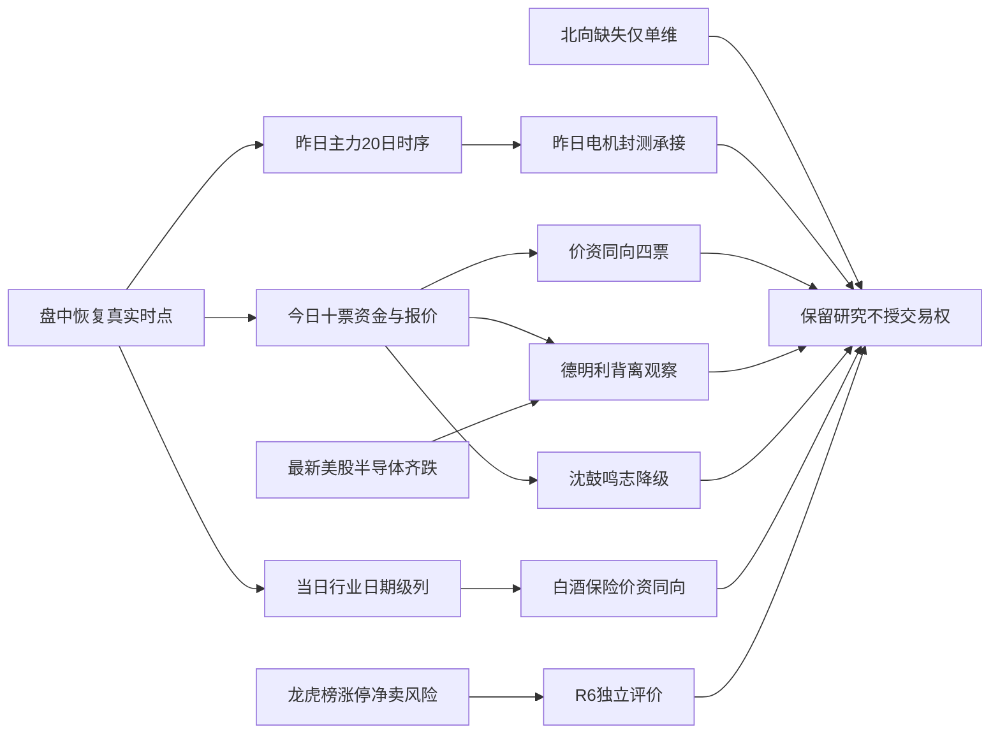

# 2026年10月23日 · 资金面 · intraday_recovery
> **盘中生产恢复补跑，不是盘前重建。** 本次从12:57启动，保留实际生成时间；不得用于证明早晨预测正确。
> **研究分析已完成；数据覆盖仍为 partial。** 北向净额缺失仅限该维度，不整体归零、不触发北向原因的全局 R7_STALE、不抬预算。
> **情绪=震荡/主跌**：这是昨日R1主跌及炸板率41.07%的风险基线，不冒充今日全市场情绪重算。十票固定追踪保留，研究核心上限由10减至5；执行候选为0。
> 最新个股报价观察约13:03；资金逐票约13:01；当日行业列有日期但无源内时刻，仅能作日期级研究。

## 🧭 一句话结论
观察：白酒保险承接较实，芯片净买仍伴价格走弱；电机与封测昨日强势未全面延续。

## 📊 市场在为什么付钱
资金证据更支持“选择性承接”，不是全面进攻。问财当日行业列中，白酒净买8.686亿元、涨1.8233%；保险净买2.474亿元、涨1.4731%，净买与价格方向一致。数字芯片设计、半导体净买居前，但价格仍跌，属于承接线索而非已经走强。板块来源未提供精确观察时刻，不授予盘中交易资格。
昨天电机Ⅲ净买10.937亿元、集成电路封测净买10.279亿元，今天问财电机与封测列转负，不能把昨天局部热点直接搬成今天主线。不同分类、不同资金拆单口径、不同时间窗口只能并列核验，不能相减造出资金迁移量。
逐票当前资金里，华天科技、大洋电机、百亚股份、中国平安的净额与价格同向；德明利价格上涨但XTick主力净额为负，只保留分歧观察。鸣志电器与沈鼓集团转弱，降级；长江电力与贵州茅台作为权重对照保留完整追踪，不靠金额大或低价认龙头。
R7仅给资金侧约束，不替R2判主线/龙头，不替R5做完整画像，不替R6硬否决，也不替D1生成止损、目标、仓位或买点。旧R2的leaders为空并非本次不研究的理由；本次真实资金对象仍交给后续研究消费者。
- **大资金意图**: 白酒、保险的价资同向可解释为选择性承接；芯片净买与价格下行并存不能解释为主升确认。拆单统计不是机构真实身份。
- **为什么走强**: 个股强弱必须看本次资金与本次价格，不以昨日榜首代替今日承接。
- **逻辑够不够硬**: 尚不足授予独立交易资格：RR、板型、龙头、禁止清单均未完整核验；北向不作为必要条件，但其他真实缺口保留。

## ⏳ 全市场时序资金流
口径：东财主力拆单净额，经本次Tushare在线返回；不是全市场现金净流出会计概念。历史截至2026-10-22，为最新已完成日，不伪装为今日收盘数据。
| 窗口 | 起止交易日 | 净额（亿元） | 净流出日 |
|---|---|---:|---:|
| 5日 | 20261016—20261022 | -1,016.363 | 5/5 |
| 10日 | 20261009—20261022 | -2,639.675 | 10/10 |
| 20日 | 20260917—20261022 | -5,278.004 | 17/20 |

昨日主力净额 -632.517亿元，其中超大单 -358.107亿元、大单 -274.410亿元，小单 +482.534亿元。小单承接不能反推为散户接盘的身份事实。

| 研究方向 | 昨日主力（亿元） | 5日（亿元） | 10日（亿元） | 20日（亿元） |
|---|---:|---:|---:|---:|
| 电机Ⅲ | 10.937 | 11.044 | 5.059 | 2.844 |
| 集成电路封测 | 10.279 | 5.826 | -21.297 | -82.967 |
| 美容护理 | 4.388 | 14.509 | 23.742 | 47.252 |
| 水力发电 | 2.687 | 1.707 | -4.103 | -0.943 |
| 银行Ⅱ | -2.508 | -5.708 | -27.083 | -62.544 |
| 半导体 | -54.644 | -23.504 | -225.148 | -696.978 |
| 通信 | -91.282 | -56.900 | -321.117 | -778.882 |
| 电子 | -163.454 | -90.499 | -571.357 | -1,577.719 |

父子行业有重叠，表中金额禁止相加；行业排名是资金统计，不是R2主线排序。

## 🔎 昨日前十：五日回溯与今日实际追踪
定义：2026-10-22全市场主力净流入额前十，源为本次在线moneyflow_dc；6029个代码去重后按净额降序排序。不是龙虎榜前十、北向前十或买入名单。
五日窗口为2026-10-16、19、20、21、22；这是回溯，不是已经实现的未来五日收益。N通则只有上市首日有效；数据商给的上市前零槽已剔除为null，不计资金为零。当前名称C通则康威与昨日N通则同代码，不改动原始名称。
| 排名 | 股票 | 昨日主力（亿元） | 5日主力（亿元） | 今日XTick（亿元） | 当前涨幅 | 态度 |
|---:|---|---:|---:|---:|---:|---|
| 1 | 华天科技 002185.SZ | 11.397 | 9.785 | 1.100 | 4.630% | 观察，研究核心 |
| 2 | N通则 301718.SZ | 6.052 | 未知/不适用 | -0.003 | 5.494% | 降级，诊断对照 |
| 3 | 德明利 001309.SZ | 4.269 | 13.280 | -1.054 | 3.092% | 观察，研究核心 |
| 4 | 百亚股份 003006.SZ | 4.160 | 18.348 | 0.472 | 2.964% | 观察，研究核心 |
| 5 | 长江电力 600900.SH | 4.147 | 4.828 | -1.375 | 0.000% | 不进，诊断对照 |
| 6 | 贵州茅台 600519.SH | 3.560 | 12.922 | 7.340 | 1.265% | 不进，诊断对照 |
| 7 | 沈鼓集团 601091.SH | 3.482 | 2.517 | -1.599 | -6.627% | 降级，诊断对照 |
| 8 | 中国平安 601318.SH | 3.110 | 1.599 | 2.419 | 1.060% | 观察，研究核心 |
| 9 | 鸣志电器 603728.SH | 3.100 | 2.880 | -0.150 | -2.387% | 降级，诊断对照 |
| 10 | 大洋电机 002249.SZ | 3.076 | 3.296 | 1.331 | 3.683% | 观察，研究核心 |

今日XTick为超大单与大单净额，人民币元；昨日日资金为东财万元。两者时间不同且口径不同，不合计、不用正负反转直接证明同口径资金流出。

### 五只研究核心与独立交易条件
研究核心：华天科技、德明利、百亚股份、中国平安、大洋电机。仅资金与辨识度观察，未授予龙头地位。德明利保留的是反证型观察，不是假称资金确认。
五只均为research_only=true、execution_eligible=false。每票已列实时取价；目标与允许亏幅缺证，RR原始比值为未知。既有SOUL的RR<2及止损距<5%规则仅作可追溯引用，本次用户没有选择新统一门槛，也不凭单票RR未知停止其他股票研究。
流通市值按2026-10-22万元转亿元核验：20亿元为硬线，20—50亿元仅逐票风险审查，不用50亿元作统一硬剔除。N通则与沈鼓集团落在20—50亿区间，仍保留诊断追踪，不当执行候选。
主线=未由本次R2确认；持续性=未知；封板率=未知；次日预期=未定，不把资金榜替写成可交易主线。主模板也未由本次R2确认，R7不拼装多套打法。

### 1. 华天科技 · 002185.SZ · 观察
- **大资金意图**: 昨日封测局部承接，今日价格与XTick净额同向，但五日资金主要来自昨日单日。仅资金侧假设，不识别真实账户意图。
- **为什么走强**: 当前报价16.27元、相对昨收4.630%；XTick净额1.100亿元，价资同向承接。
- **逻辑够不够硬**: 不足以开仓。融资余额有15个有效观测，首末余额变动-11.328%；大宗30自然日返回0笔。两融最新为2026-10-22，不倒填为今日盘中。

| 日期 | 主力净额（万元） | 收盘 | 当日涨幅 |
|---|---:|---:|---:|
| 20261016 | -7,610.73 | 14.03 | -0.99 |
| 20261019 | -2,258.32 | 13.89 | -1.00 |
| 20261020 | 4,306.10 | 14.35 | 3.31 |
| 20261021 | -10,553.62 | 14.25 | -0.70 |
| 20261022 | 113,966.10 | 15.55 | 9.12 |

板型：未知；龙头认定/过纪律条数：未知，交R2；RR：未知（取价16.27元，目标/止损未核验）；禁止清单命中：未完成全量核验，不等于零命中。流通市值517.20亿元，passes_20yi_only_not_full_entry。
- **买入理由**: 当前不进执行。研究理由一是表内真实资金时序，理由二是本票产业方向映射与当日价资表现；产业催化未逐票证实，不当完整买入逻辑。
- **风险点**: 海外半导体齐跌；融资余额十五观测下降；交易地位、板型、止损目标和完整禁止清单尚未取得。
- **止损条件**: 未生成交易止损价，不能据报告下单。研究承接假设的证伪条件是后续同一口径净额转负且价格不再强于本次基准；这是研究失效条件，不是越权交易指令。
- **可验证假设**: 在下一个可得交易日，核验该票XTick超大单加大单净额是否>0且收盘不低于本次取价；两者同时不满足则承接假设失败，不把未知补成通过。

### 2. N通则 · 301718.SZ · 降级
- **大资金意图**: 上市第二日仅作完整性追踪，不把发行价累计涨幅当成当日资金确认。仅资金侧假设，不识别真实账户意图。
- **为什么走强**: 当前报价77元、相对昨收5.494%；XTick净额-0.003亿元，承接不一致或转弱，不称全面走强。
- **逻辑够不够硬**: 不足以开仓。融资余额有1个有效观测，首末余额变动未知/不适用%；大宗30自然日返回0笔。两融最新为2026-10-22，不倒填为今日盘中。

| 日期 | 主力净额（万元） | 收盘 | 当日涨幅 |
|---|---:|---:|---:|
| 20261016 | 未知/不适用 | 未知/不适用 | 未知/不适用 |
| 20261019 | 未知/不适用 | 未知/不适用 | 未知/不适用 |
| 20261020 | 未知/不适用 | 未知/不适用 | 未知/不适用 |
| 20261021 | 未知/不适用 | 未知/不适用 | 未知/不适用 |
| 20261022 | 60,521.88 | 72.99 | 171.54 |

板型：未知；龙头认定/过纪律条数：未知，交R2；RR：未知（取价77元，目标/止损未核验）；禁止清单命中：上市初期无涨跌幅限制风险。流通市值25.23亿元，20_to_50yi_risk_review。
- **买入理由**: 当前不进执行。研究理由一是表内真实资金时序，理由二是本票产业方向映射与当日价资表现；产业催化未逐票证实，不当完整买入逻辑。
- **风险点**: 无涨跌幅限制阶段；五日只有1个有效收盘；当日高低振幅大；交易地位、板型、止损目标和完整禁止清单尚未取得。
- **止损条件**: 未生成交易止损价，不能据报告下单。研究承接假设的证伪条件是后续同一口径净额转负且价格不再强于本次基准；这是研究失效条件，不是越权交易指令。
- **可验证假设**: 在下一个可得交易日，核验该票XTick超大单加大单净额是否>0且收盘不低于本次取价；两者同时不满足则承接假设失败，不把未知补成通过。

### 3. 德明利 · 001309.SZ · 观察
- **大资金意图**: 五日主力净入与今日价格上行，但XTick当日净卖出，保留资金价量背离。仅资金侧假设，不识别真实账户意图。
- **为什么走强**: 当前报价250.69元、相对昨收3.092%；XTick净额-1.054亿元，承接不一致或转弱，不称全面走强。
- **逻辑够不够硬**: 不足以开仓。融资余额有15个有效观测，首末余额变动-8.408%；大宗30自然日返回4笔。两融最新为2026-10-22，不倒填为今日盘中。

| 日期 | 主力净额（万元） | 收盘 | 当日涨幅 |
|---|---:|---:|---:|
| 20261016 | -12,374.33 | 206.01 | -2.39 |
| 20261019 | 60,710.55 | 219.19 | 6.40 |
| 20261020 | -1,451.46 | 219.55 | 0.16 |
| 20261021 | 43,217.97 | 233.81 | 6.50 |
| 20261022 | 42,694.20 | 243.17 | 4.00 |

板型：未知；龙头认定/过纪律条数：未知，交R2；RR：未知（取价250.69元，目标/止损未核验）；禁止清单命中：未完成全量核验，不等于零命中。流通市值565.17亿元，passes_20yi_only_not_full_entry。
- **买入理由**: 当前不进执行。研究理由一是表内真实资金时序，理由二是本票产业方向映射与当日价资表现；产业催化未逐票证实，不当完整买入逻辑。
- **风险点**: MU隔夜下跌；不同日/不同拆单口径不可相加；交易地位、板型、止损目标和完整禁止清单尚未取得。
- **止损条件**: 未生成交易止损价，不能据报告下单。研究承接假设的证伪条件是后续同一口径净额转负且价格不再强于本次基准；这是研究失效条件，不是越权交易指令。
- **可验证假设**: 在下一个可得交易日，核验该票XTick超大单加大单净额是否>0且收盘不低于本次取价；两者同时不满足则承接假设失败，不把未知补成通过。

### 4. 百亚股份 · 003006.SZ · 观察
- **大资金意图**: 五日逐日净入，今日价格与XTick净额同向，保留消费承接研究。仅资金侧假设，不识别真实账户意图。
- **为什么走强**: 当前报价22.93元、相对昨收2.964%；XTick净额0.472亿元，价资同向承接。
- **逻辑够不够硬**: 不足以开仓。融资余额有0个有效观测，首末余额变动未知/不适用%；大宗30自然日返回0笔。两融失败不是零余额。

| 日期 | 主力净额（万元） | 收盘 | 当日涨幅 |
|---|---:|---:|---:|
| 20261016 | 19,143.78 | 24.09 | 5.57 |
| 20261019 | 42,968.50 | 24.40 | 1.29 |
| 20261020 | 36,923.50 | 23.16 | -5.08 |
| 20261021 | 42,838.95 | 22.86 | -1.30 |
| 20261022 | 41,604.56 | 22.27 | -2.58 |

板型：未知；龙头认定/过纪律条数：未知，交R2；RR：未知（取价22.93元，目标/止损未核验）；禁止清单命中：未完成全量核验，不等于零命中。流通市值95.44亿元，passes_20yi_only_not_full_entry。
- **买入理由**: 当前不进执行。研究理由一是表内真实资金时序，理由二是本票产业方向映射与当日价资表现；产业催化未逐票证实，不当完整买入逻辑。
- **风险点**: 此前资金流入而价格回落，不能按正净额宣称吸筹成功；两融缺失；交易地位、板型、止损目标和完整禁止清单尚未取得。
- **止损条件**: 未生成交易止损价，不能据报告下单。研究承接假设的证伪条件是后续同一口径净额转负且价格不再强于本次基准；这是研究失效条件，不是越权交易指令。
- **可验证假设**: 在下一个可得交易日，核验该票XTick超大单加大单净额是否>0且收盘不低于本次取价；两者同时不满足则承接假设失败，不把未知补成通过。

### 5. 长江电力 · 600900.SH · 不进
- **大资金意图**: 仅作防御权重资金对照，今日XTick转负，不列进攻研究核心。仅资金侧假设，不识别真实账户意图。
- **为什么走强**: 当前报价29.82元、相对昨收0.000%；XTick净额-1.375亿元，承接不一致或转弱，不称全面走强。
- **逻辑够不够硬**: 不足以开仓。融资余额有15个有效观测，首末余额变动-7.044%；大宗30自然日返回0笔。两融最新为2026-10-22，不倒填为今日盘中。

| 日期 | 主力净额（万元） | 收盘 | 当日涨幅 |
|---|---:|---:|---:|
| 20261016 | -12,253.27 | 29.38 | -0.74 |
| 20261019 | 11,774.73 | 29.54 | 0.54 |
| 20261020 | 6,042.84 | 29.69 | 0.51 |
| 20261021 | 1,250.69 | 29.57 | -0.40 |
| 20261022 | 41,466.70 | 29.82 | 0.85 |

板型：未知；龙头认定/过纪律条数：未知，交R2；RR：未知（取价29.82元，目标/止损未核验）；禁止清单命中：未完成全量核验，不等于零命中。流通市值7,296.42亿元，passes_20yi_only_not_full_entry。
- **买入理由**: 当前不进执行。研究理由一是表内真实资金时序，理由二是本票产业方向映射与当日价资表现；产业催化未逐票证实，不当完整买入逻辑。
- **风险点**: 低波动不满足主线进攻研究辨识度；不以高股息标签判定永远不可研究；交易地位、板型、止损目标和完整禁止清单尚未取得。
- **止损条件**: 未生成交易止损价，不能据报告下单。研究承接假设的证伪条件是后续同一口径净额转负且价格不再强于本次基准；这是研究失效条件，不是越权交易指令。
- **可验证假设**: 在下一个可得交易日，核验该票XTick超大单加大单净额是否>0且收盘不低于本次取价；两者同时不满足则承接假设失败，不把未知补成通过。

### 6. 贵州茅台 · 600519.SH · 不进
- **大资金意图**: 今日XTick与价格同向，作为权重承接对照，不据绝对金额认定短线龙头。仅资金侧假设，不识别真实账户意图。
- **为什么走强**: 当前报价1335.17元、相对昨收1.265%；XTick净额7.340亿元，价资同向承接。
- **逻辑够不够硬**: 不足以开仓。融资余额有15个有效观测，首末余额变动-5.060%；大宗30自然日返回2笔。两融最新为2026-10-22，不倒填为今日盘中。

| 日期 | 主力净额（万元） | 收盘 | 当日涨幅 |
|---|---:|---:|---:|
| 20261016 | 46,866.12 | 1,329.00 | 1.22 |
| 20261019 | 31,408.96 | 1,324.97 | -0.30 |
| 20261020 | 6,085.28 | 1,331.88 | 0.52 |
| 20261021 | 9,263.25 | 1,309.69 | -1.67 |
| 20261022 | 35,596.69 | 1,318.49 | 0.67 |

板型：未知；龙头认定/过纪律条数：未知，交R2；RR：未知（取价1335.17元，目标/止损未核验）；禁止清单命中：未完成全量核验，不等于零命中。流通市值16,482.20亿元，passes_20yi_only_not_full_entry。
- **买入理由**: 当前不进执行。研究理由一是表内真实资金时序，理由二是本票产业方向映射与当日价资表现；产业催化未逐票证实，不当完整买入逻辑。
- **风险点**: 涨幅与交易弹性有限；融资余额下降；交易地位、板型、止损目标和完整禁止清单尚未取得。
- **止损条件**: 未生成交易止损价，不能据报告下单。研究承接假设的证伪条件是后续同一口径净额转负且价格不再强于本次基准；这是研究失效条件，不是越权交易指令。
- **可验证假设**: 在下一个可得交易日，核验该票XTick超大单加大单净额是否>0且收盘不低于本次取价；两者同时不满足则承接假设失败，不把未知补成通过。

### 7. 沈鼓集团 · 601091.SH · 降级
- **大资金意图**: 昨日龙虎榜净买入未延续成今日承接，今日价格与XTick均转弱，降级。仅资金侧假设，不识别真实账户意图。
- **为什么走强**: 当前报价20.15元、相对昨收-6.627%；XTick净额-1.599亿元，承接不一致或转弱，不称全面走强。
- **逻辑够不够硬**: 不足以开仓。融资余额有15个有效观测，首末余额变动57.693%；大宗30自然日返回0笔。两融最新为2026-10-22，不倒填为今日盘中。

| 日期 | 主力净额（万元） | 收盘 | 当日涨幅 |
|---|---:|---:|---:|
| 20261016 | -19,166.24 | 19.37 | -6.11 |
| 20261019 | -2,910.27 | 18.65 | -3.72 |
| 20261020 | 3,498.26 | 18.90 | 1.34 |
| 20261021 | 8,925.59 | 19.62 | 3.81 |
| 20261022 | 34,819.39 | 21.58 | 9.99 |

板型：未知；龙头认定/过纪律条数：未知，交R2；RR：未知（取价20.15元，目标/止损未核验）；禁止清单命中：未完成全量核验，不等于零命中。流通市值45.57亿元，20_to_50yi_risk_review。
- **买入理由**: 当前不进执行。研究理由一是表内真实资金时序，理由二是本票产业方向映射与当日价资表现；产业催化未逐票证实，不当完整买入逻辑。
- **风险点**: 昨日榜净买不是锁仓保证；流通市值20—50亿风险区间；交易地位、板型、止损目标和完整禁止清单尚未取得。
- **止损条件**: 未生成交易止损价，不能据报告下单。研究承接假设的证伪条件是后续同一口径净额转负且价格不再强于本次基准；这是研究失效条件，不是越权交易指令。
- **可验证假设**: 在下一个可得交易日，核验该票XTick超大单加大单净额是否>0且收盘不低于本次取价；两者同时不满足则承接假设失败，不把未知补成通过。

### 8. 中国平安 · 601318.SH · 观察
- **大资金意图**: 今日价格与XTick同向，作为保险权重回流研究对象而非静态防守股。仅资金侧假设，不识别真实账户意图。
- **为什么走强**: 当前报价51.48元、相对昨收1.060%；XTick净额2.419亿元，价资同向承接。
- **逻辑够不够硬**: 不足以开仓。融资余额有15个有效观测，首末余额变动0.244%；大宗30自然日返回4笔。两融最新为2026-10-22，不倒填为今日盘中。

| 日期 | 主力净额（万元） | 收盘 | 当日涨幅 |
|---|---:|---:|---:|
| 20261016 | 7,120.84 | 51.88 | 0.19 |
| 20261019 | 11,015.07 | 51.67 | -0.40 |
| 20261020 | -34,718.87 | 51.20 | -0.91 |
| 20261021 | 1,466.83 | 51.20 | 0.00 |
| 20261022 | 31,104.81 | 50.94 | -0.51 |

板型：未知；龙头认定/过纪律条数：未知，交R2；RR：未知（取价51.48元，目标/止损未核验）；禁止清单命中：未完成全量核验，不等于零命中。流通市值5,430.24亿元，passes_20yi_only_not_full_entry。
- **买入理由**: 当前不进执行。研究理由一是表内真实资金时序，理由二是本票产业方向映射与当日价资表现；产业催化未逐票证实，不当完整买入逻辑。
- **风险点**: 昨日价资背离；大宗平价且重复笔不能证明新增配置；交易地位、板型、止损目标和完整禁止清单尚未取得。
- **止损条件**: 未生成交易止损价，不能据报告下单。研究承接假设的证伪条件是后续同一口径净额转负且价格不再强于本次基准；这是研究失效条件，不是越权交易指令。
- **可验证假设**: 在下一个可得交易日，核验该票XTick超大单加大单净额是否>0且收盘不低于本次取价；两者同时不满足则承接假设失败，不把未知补成通过。

### 9. 鸣志电器 · 603728.SH · 降级
- **大资金意图**: 昨日强势今日XTick与价格转负，降级资金持续性解释。仅资金侧假设，不识别真实账户意图。
- **为什么走强**: 当前报价53.17元、相对昨收-2.387%；XTick净额-0.150亿元，承接不一致或转弱，不称全面走强。
- **逻辑够不够硬**: 不足以开仓。融资余额有15个有效观测，首末余额变动-0.775%；大宗30自然日返回0笔。两融最新为2026-10-22，不倒填为今日盘中。

| 日期 | 主力净额（万元） | 收盘 | 当日涨幅 |
|---|---:|---:|---:|
| 20261016 | 8.21 | 44.23 | 0.48 |
| 20261019 | -48.47 | 47.35 | 7.05 |
| 20261020 | -1,074.83 | 49.76 | 5.09 |
| 20261021 | -1,085.02 | 49.52 | -0.48 |
| 20261022 | 30,996.56 | 54.47 | 10.00 |

板型：未知；龙头认定/过纪律条数：未知，交R2；RR：未知（取价53.17元，目标/止损未核验）；禁止清单命中：未完成全量核验，不等于零命中。流通市值228.17亿元，passes_20yi_only_not_full_entry。
- **买入理由**: 当前不进执行。研究理由一是表内真实资金时序，理由二是本票产业方向映射与当日价资表现；产业催化未逐票证实，不当完整买入逻辑。
- **风险点**: 单日集中流入后承接不足；机器人题材归属须由R2核验；交易地位、板型、止损目标和完整禁止清单尚未取得。
- **止损条件**: 未生成交易止损价，不能据报告下单。研究承接假设的证伪条件是后续同一口径净额转负且价格不再强于本次基准；这是研究失效条件，不是越权交易指令。
- **可验证假设**: 在下一个可得交易日，核验该票XTick超大单加大单净额是否>0且收盘不低于本次取价；两者同时不满足则承接假设失败，不把未知补成通过。

### 10. 大洋电机 · 002249.SZ · 观察
- **大资金意图**: 昨日涨停附近表现与今日净额及价格同向，保留电机方向研究。仅资金侧假设，不识别真实账户意图。
- **为什么走强**: 当前报价7.32元、相对昨收3.683%；XTick净额1.331亿元，价资同向承接。
- **逻辑够不够硬**: 不足以开仓。融资余额有15个有效观测，首末余额变动-6.075%；大宗30自然日返回0笔。两融最新为2026-10-22，不倒填为今日盘中。

| 日期 | 主力净额（万元） | 收盘 | 当日涨幅 |
|---|---:|---:|---:|
| 20261016 | 1,295.56 | 6.12 | 1.32 |
| 20261019 | 1,170.40 | 6.31 | 3.10 |
| 20261020 | -965.07 | 6.36 | 0.79 |
| 20261021 | 693.41 | 6.42 | 0.94 |
| 20261022 | 30,761.53 | 7.06 | 9.97 |

板型：未知；龙头认定/过纪律条数：未知，交R2；RR：未知（取价7.32元，目标/止损未核验）；禁止清单命中：未完成全量核验，不等于零命中。流通市值132.13亿元，passes_20yi_only_not_full_entry。
- **买入理由**: 当前不进执行。研究理由一是表内真实资金时序，理由二是本票产业方向映射与当日价资表现；产业催化未逐票证实，不当完整买入逻辑。
- **风险点**: 融资余额十五观测下降；并非已确认板块总龙；交易地位、板型、止损目标和完整禁止清单尚未取得。
- **止损条件**: 未生成交易止损价，不能据报告下单。研究承接假设的证伪条件是后续同一口径净额转负且价格不再强于本次基准；这是研究失效条件，不是越权交易指令。
- **可验证假设**: 在下一个可得交易日，核验该票XTick超大单加大单净额是否>0且收盘不低于本次取价；两者同时不满足则承接假设失败，不把未知补成通过。

## ⚠️ 龙虎榜诱多风险识别
本次检查涨价但龙虎榜净卖的背离，不把“有大买席位”自动解释为吸筹。单日榜与三日榜重叠，不能相加；同股多个上榜事由也不能当多次独立进场。
| 股票 | 昨日涨幅 | 榜净额（亿元） | 窗口 | R7态度 |
|---|---:|---:|---|---|
| 天洋新材 603330.SH | 10.010% | -0.706 | 单日榜 | 观察风险证据，非硬否决 |
| 三峡新材 600293.SH | 10.105% | -0.057 | 单日榜 | 观察风险证据，非硬否决 |
| 信通电子 001388.SZ | 5.511% | -0.188 | 三日榜 | 观察风险证据，非硬否决 |
| 慧辰股份 688500.SH | 4.633% | -0.182 | 三日榜 | 观察风险证据，非硬否决 |
| 中塑股份 301686.SZ | 7.929% | -0.013 | 单日榜 | 观察风险证据，非硬否决 |
| 肯特股份 301591.SZ | 6.830% | -0.084 | 单日榜 | 观察风险证据，非硬否决 |

天洋新材最直观：昨日涨10.0099%，单日榜买1.2748亿元、卖1.9812亿元，净卖0.7064亿元；三日榜净卖0.3051亿元另列，不相加。名列买方的国泰海通总部在单日榜买3502.9393万元、卖7678.766647万元，买方大席位不等于净买。
沈鼓集团则是另一种反证：昨日榜净买1.7041亿元，今日XTick净卖1.5994亿元且价格跌约6.63%，表明昨日榜买不能保证次日承接；但这是不同资金口径，不相减生成“出货总量”。N通则上市历史短，不能按发行价涨幅认定诱多已经证实。
三日席位初筛保留15条明确营业部同票至少两日净买线索，剔除匿名机构、股通、总部/分公司及已知ST/退。公告与当日封板未核验，最终synergy_flags为空；这表示协同未确认，不表示没有协同。无协同也不排除事件驱动研究。
R7不产生任何hard_reject。以上证据交给本次R6只读上游独立评价，不声称已经完成R6，也不把空硬否决写成全票通过。

## 🔄 板块跷跷板
按昨日绝对净额选取20个东财行业分类，对齐20个有效交易日、无填充，实算190对。最低相关系数-0.176789，未达到严格小于-0.6，因此输出空配对；五日方向反转条件也没有可授予配对。
计算域含父子行业，非正交同级行业全集；这是明确的覆盖局限，不外推为全市场不存在跷跷板。不能因为今日白酒承接而没有历史相关检验就造出科技—白酒跷跷板。

## 🌐 外部传导：旧快照与最新隔夜必须分开
只读overseas_snapshot实际美股日期为2026-10-21，虽文件在今天生成，也不是最新隔夜。本次另经在线us_daily补查2026-10-22十二只个股；新旧截面同时保留。
| 美股 | 旧快照日期 | 旧涨幅 | 本次在线日期 | 最新涨幅 |
|---|---|---:|---|---:|
| MU | 2026-10-21 | 1.960% | 2026-10-22 | -6.260% |
| NVDA | 2026-10-21 | 2.540% | 2026-10-22 | -4.400% |
| AVGO | 2026-10-21 | 1.030% | 2026-10-22 | -4.310% |
| AMD | 2026-10-21 | 3.360% | 2026-10-22 | -8.100% |
| TSM | 2026-10-21 | 1.600% | 2026-10-22 | -4.520% |
| AAPL | 2026-10-21 | 1.320% | 2026-10-22 | 1.230% |
| MSFT | 2026-10-21 | 0.200% | 2026-10-22 | -2.230% |
| META | 2026-10-21 | 0.470% | 2026-10-22 | -6.980% |
| GOOGL | 2026-10-21 | -1.620% | 2026-10-22 | -3.150% |
| AMZN | 2026-10-21 | -0.100% | 2026-10-22 | -4.570% |
| TSLA | 2026-10-21 | 3.410% | 2026-10-22 | -3.080% |
| GLW | 2026-10-21 | 2.010% | 2026-10-22 | -8.100% |

MU -6.26%、NVDA -4.40%、AVGO -4.31%、AMD -8.10%、TSM -4.52%，五只核心半导体最新隔夜同跌，存储、CPO、算力半导体的外部风险偏好受压。GLW -8.10%强化光通信风险线索，不能沿用旧快照“五只同涨”作为今日提振。AAPL +1.23%，消费电子与AI算力不能一概同向。
SPX/IXIC旧快照仍为2026-10-21，SOX/INTC/MRVL未取得；不把个股补查完成说成海外全覆盖。外部价格只是情绪传导，不直接证明A股资金流入或流出。

## 🧺 ETF与期货
vibe问财MCP缺key后，正式同花顺OpenAPI回退成功：本次is_cache=0，五日窗口2026-10-16—22，返回1712条且与code_count一致。仅用带日期的份额字段，不用无日期“最新价”混入历史。
| ETF | 五日净份额（亿份） |
|---|---:|
| 科创50ETF华夏 588000.SH | 99.600 |
| 沪深300ETF华泰柏瑞 510300.SH | 72.450 |
| 创业板ETF易方达 159915.SZ | 58.350 |
| 上证50ETF华夏 510050.SH | 53.802 |
| 沪深300ETF嘉实 159919.SZ | 29.160 |
| 创业板50ETF华安 159949.SZ | 20.890 |
| 沪深300ETF华夏 510330.SH | 19.089 |
| 中证1000ETF南方 512100.SH | 17.380 |

宽基净申购可能包含逆势配置、申赎套利等，不能独立证明主力主动进攻。etf_net_flow金额设null，不能用总份额或成交额代替净金额。期现基差问财无匹配，DataPro订阅失效；50ETF/300ETF隐波不可得，vibe期权仅支持美股，故均保留null。

## 🔑 关键证据
- 东财市场主力5/10/20日累计均负，最新收盘日2026-10-22；历史是最新T-1，不是今天终值。
- 十票五槽共46个有效股票日；新股上市前4槽不适用，未当零值。十票实时资金与带时点报价均实调。
- 两融8票各15行，新股1行，百亚失败；大宗十票均调用。DataPro和vibe资金代理错误如实保留。
- 北向实时与历史均缺可信净额，单维null；ETF五日份额回退取得；十二只美股补到最新隔夜。

## 数据源审计
| 源 | 来源日期 | 状态 | 记录数 | 口径与缺口 |
|---|---|:--:|---:|---|
| tushare.moneyflow_dc | 2026-10-22 | 🟢 | 30139 | 全市场五日；个股净额单位万元 |
| tushare.moneyflow_ind_dc | 2026-10-22 | 🟢 | 9920 | 拆窗恢复20日；父子行业不相加 |
| tushare.moneyflow_mkt_dc | 2026-10-22 | 🟢 | 20 | 市场主力净额20日投影，单位元 |
| tushare.top_list | 2026-10-22 | 🟢 | 75 | 75条上榜事由记录，不等于75只股票 |
| tushare.top_inst | 2026-10-22 | 🟢 | 2260 | 三日原始席位行，重复事由及买卖侧去重 |
| xtick.hot_money | 2026-10-23 | 🟢 | 10 | 十票定向补全；全市场截断不用于汇总 |
| xtick.hot_bk | 2026-10-23 | 🔴 | 68 | 只返回板块成分，无行情/资金/观察时间，不能构造实时板块净流 |
| tushare.rt_k | 2026-10-23 | 🟢 | 10 | 13:03附近逐票带交易时间；不是成交或下单 |
| tushare.daily_basic | 2026-10-22 | 🟢 | 5570 | 流通市值万元转亿元，仅核20亿门槛 |
| vibe.get_block_trades | 2026-10-22 | 🟢 | 10 | 十票各调30自然日；平安两笔无唯一ID不强行合计 |
| vibe.get_margin_trading | 2026-10-22 | 🟢 | 121 | 8票15观测、新股1观测、百亚失败，按票分层 |
| vibe.get_fund_flow | 无有效日期 | 🔴 | 0 | 顶层ok但十票均代理错误；不能算独立确认 |
| vibe.get_dragon_tiger | 2026-10-22 | 🟢 | 75 | 全市场及天洋逐票实调；与Tushare东财同源 |
| vibe.get_northbound_flow | 无有效日期 | 🔴 | 0 | realtime全null、history空，仅北向缺口 |
| vibe.iwencai_search | 无有效日期 | 🔴 | 0 | MCP访问key未配置；官方OpenAPI回退成功 |
| iwencai.official.etf | 2026-10-22 | 🟢 | 1712 | is_cache=0；返回1712且与code_count一致，五日份额不是金额 |
| iwencai.official.sector | 2026-10-23 | 🟡 | 320 | 日期列为当日；未提供源内观察时刻，仅作盘中研究描述不作执行新鲜度证明 |
| iwencai.official.basis | 无有效日期 | 🔴 | 0 | 问句无匹配；不把指数涨幅换算基差 |
| datapro | 无有效日期 | 🔴 | 0 | 4013订阅失效/未分配席位；第二次触发熔断 |
| overseas_snapshot | 2026-10-21 | 🟡 | 12 | 本日文件不是最新隔夜；只读保留，非本次结论依据 |
| tushare.us_daily | 2026-10-22 | 🟢 | 12 | 本次在线补查12只，覆盖五只核心半导体；SOX等仍缺 |

实时请求范围与精确逐票观察时刻保存在JSON。历史数据源未提供源内时刻时captured_at设null，不编造采集秒数；generated_at仅代表本次报告生成时间，不代表行情时刻。

## 🧪 不确定性 / 反证
1. 研究分析完成不等于数据完整：北向、基差、隐波、百亚两融和板块源内时点仍缺。主力与游资/ETF各自评价，不因北向缺口整体unavailable或归零。
2. 顶层staleness_status=ok只说明本次主资金时间血缘正常，既有T-1符合可得性；data_quality=partial及逐维状态另列，不允许据此读成全源实时。
3. 源内时间缺失的当日板块列不能作为执行新鲜度证明；十票当前报价/资金有时点，但二者并非同秒，不用于跨源净额求和。
4. 东财经Tushare与vibe是同一底层源，不累计独立确认；拆单不识别实际机构。平安大宗重复笔保留但不合计。
5. 每票RR都是未知，不是计算后不合格；R7没有足够证据填写可执行止损与目标。完整逐票门禁、R6完整性和真实预算均不被本次授权放宽。
6. 模拟授权不等于模拟成交。未调用QMT/IB/账户、下单或撤单，不读私人实盘持仓，不写计划/执行/runtime，不推送。

## 🔗 与其他 R/D/E 的关系
依赖：本日manifest、mcp_health、overseas_snapshot；旧R1/R2仅保留原生成时刻作为上下文，不声称其已intraday_recovery完成。R2后续可读本次research_candidates及完整十票资金诊断，R5对真实研究对象继续画像，不以禁新仓为skipped理由。
消费：R2判主线/龙头、R5画像、R6独立反证、D1按预算和逐票门禁处理、E1追踪。R7不修改其他单元，不重写研究汇总或交易权限。

## Sub-Agent 元数据
- skill: analyze_capital_flow_v1；横切hot_money_synergy_v1、detect_seesaw_pairs_v1。
- artifact: data/research/20261023/R7_capital_flow_20261023.json；R7_capital_flow.json保留现有兼容软链接。
- evidence: data/research/20261023/R7_intraday_recovery_evidence_20261023.json。
- analysis_status: complete；status: partial；data_quality: partial；confidence: 0.45。
- CHZL_RESEARCH_RUN_ID: 当前环境未设置，JSON为null，未编造run id。
- model: gpt-6.1-sol；判断由R7 LLM完成，Python仅归一化、计算、渲染和校验。
- 原件备份沿用主控既存目录，不另写越权的.md.bak；本次未修改代码、配置、技能、SOUL、模型或cron。
