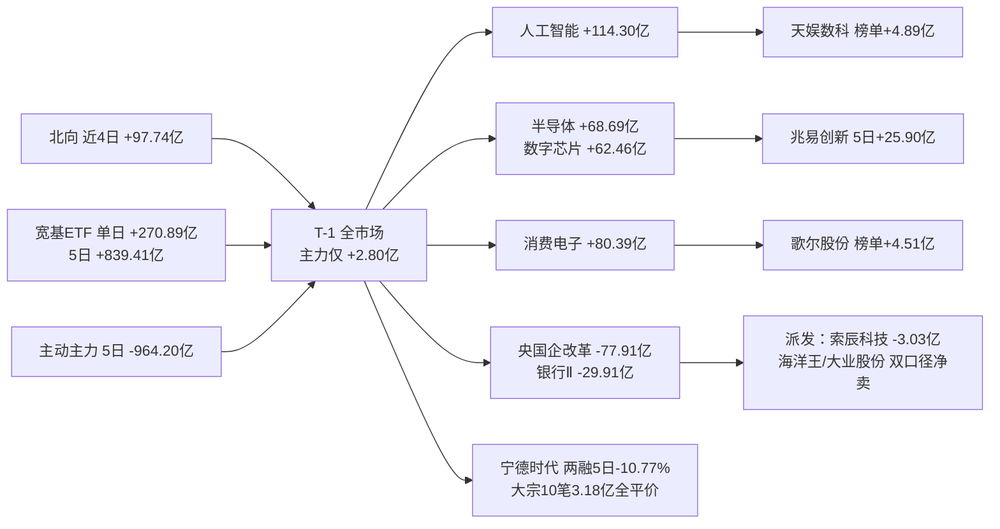

# 2026年10月26日 · **资金面**

> **数据源新鲜度**: partial
> **降级状态**: false
> **置信度**: 0.46（global_severity=2 上限 0.5）

## 一句话结论

被动盘（ETF `+270.89 亿` / 北向）托市，主动主力 5 日仍净流出 `964.20 亿`；宁德杠杆撤退、6 板高标双口径派发，只认兆易/歌尔的连贯承接。

## 详细分析

**① 三股钱方向不一致，这是今天所有判断的地基。** T-1（2026-10-23）上证 `+0.89%`、深成 `+2.79%`，表面上是一次像样的修复，但拆开看：北向净买 `+31.32 亿`（近 4 个可得交易日 `+97.74 亿`、近 20 个 `+507.09 亿`），12 只宽基/行业 ETF 单日净申购 `+270.89 亿`、5 个交易日 `+839.41 亿`，而全市场主力（东财口径）单日仅 `+2.80 亿`、5 日 `-964.20 亿`（5 天里 4 天流出）。**买盘是被动盘和外资，卖盘是主动内资。** 这种结构下的上涨，弹性来自指数与权重，不来自主力持续加仓。

**② 板块层面是「科技吸金、权重放血」的极端结构。** T-1 净流入前列：人工智能 `+114.30 亿`（`+3.33%`）、消费电子概念 `+80.39 亿`、国产芯片 `+79.92 亿`、人形机器人 `+71.43 亿`（`+4.92%`）、半导体 `+68.69 亿`、数字芯片设计 `+62.46 亿`（`+5.27%`）；净流出前列：央国企改革 `-77.91 亿`、上证180 `-43.96 亿`、大盘价值 `-37.44 亿`、中特估 `-32.14 亿`、银行Ⅱ `-29.91 亿`（`-0.54%`）。**钱从「大象」里抽出来砸进科技**，这正是修复日应有的形态，也解释了为什么深成涨幅是上证的三倍。

**③ 昨日前十的 5 日追踪，把「单日脉冲」和「连贯承接」彻底分开了。** 中际旭创 T-1 单日 `+16.43 亿` 排第一，但 5 日累计 `-14.70 亿`、5 天只有 2 天净流入；长鑫科技 T-1 `+16.12 亿`，5 日 `-18.10 亿`；宁德时代 T-1 `+12.97 亿`，5 日 `-37.60 亿`。**单日大额流入只是在补前几天的坑**。相反，兆易创新（`+25.90 亿` · 4/5 天为正）、天娱数科（`+12.11 亿` · 4/5）、利亚德（`+11.83 亿` · 4/5，但 5 日涨幅已 `60.88%`）、歌尔股份（`+10.43 亿` · 3/5）是真连贯。**看 5 日净额，不要看单日排名。**

**前十三票 5 日追踪（T-1 主力净额口径 · 单位亿元）**

| # | 票 | T-1 单日 | 5 日累计 | 5 日净流入天数 | 5 日收盘收益 | 读法 |
|:--:|---|--:|--:|:--:|--:|---|
| 1 | 中际旭创 | `+16.43` | `-14.70` | 2/5 | `-7.28%` | 单日脉冲，机构大宗+融资双撤 |
| 2 | 长鑫科技 | `+16.12` | `-18.10` | 2/5 | `+3.20%` | 补坑式流入，5 日仍净出 |
| 3 | 宁德时代 | `+12.97` | `-37.60` | 1/5 | `-11.02%` | 反弹中杠杆撤 10.77% |
| 4 | 兆易创新 | `+12.94` | `+25.90` | 4/5 | `+3.38%` | **连贯承接** |
| 5 | 天娱数科 | `+11.48` | `+12.11` | 4/5 | `+8.22%` | 连贯 + 榜单 +4.89 亿 |
| 6 | 粤芯半导-U | `+10.36` | `+6.07` | 3/5 | `-4.81%` | 次新制度差异，不作核心 |
| 7 | 歌尔股份 | `+8.00` | `+10.43` | 3/5 | `+14.92%` | 连贯 + 隔夜 AAPL 仅 -0.14% |
| 8 | 东方财富 | `+7.73` | `-0.72` | 1/5 | `+2.60%` | 券商弹性，非资金主线 |
| 9 | 寒武纪 | `+7.12` | `+8.48` | 2/5 | `+0.40%` | 高价股杠杆 5 日 -6.73% |
| 10 | 利亚德 | `+6.25` | `+11.83` | 4/5 | `+60.88%` | 承接最连贯但位置最危险 |

**④ 龙虎榜里同时存在「有效承接」和「高位派发」两批票，必须分开对待。** 有效承接：天娱数科 `+4.89 亿`、歌尔股份 `+4.51 亿`、兆威机电 `+2.34 亿`（同票两条上榜原因合并）、宇树科技 `+2.11 亿`、粤芯半导体 `+1.95 亿`、利亚德 `+1.76 亿`、埃斯顿 `+1.72 亿`。派发线索：索辰科技 `+14.01%` 却榜单净卖 `-3.03 亿`、风语筑 `+10.04%` 净卖 `-1.27 亿`、云汉芯城 `+11.93%` 净卖 `-5863 万`、华依科技/晶丰明源双双 `20cm` 但净卖 `-4422 万`/`-4118 万`。**两批票的差别不在涨幅，在榜单方向。**

**⑤ 宁德时代是「反弹里最像减仓」的那一只，这是本报告新增的关键反证。** T-1 涨 `7.80%`、主力 `+12.97 亿`，看起来是权重修复的主力军；但两融端 10-22 单日融资偿还 `35.41 亿`、买入仅 `12.20 亿`，余额从 `221.32 亿` 掉到 `198.11 亿`（单日 `-10.47%`，5 个观测点 `-10.77%`），同时 T-1 大宗 10 笔共 `3.18 亿`全部平价、卖方 9 成为「机构专用」。**机构没在现货里接，而是在反弹里走通道**——这与它 5 日主力 `-37.60 亿` 完全一致，属于"涨了也是别人的钱"的典型。

**⑥ 隔夜美股只给「存储」背书，不给「算力光模块」背书。** MU `+2.46%`、AMD `+1.74%`、TSM `+1.49%` 偏多；NVDA `-0.59%`、AVGO `-0.48%` 偏弱；SPX `-0.52%`、DJI `-1.23%` 无系统性提振（SOX 费半当日在两处数据源均无返回，留空）。这正好对上 ③ 的结论：存储（兆易/长鑫）有外部背书，光模块（中际旭创）没有——**中际旭创 T-1 的 16.43 亿是孤立的单日流入**。

## 关键证据

- 证据 1：北向 T-1 `+31.32 亿`，近 4 个可得交易日 `+97.74 亿` / 近 8 个 `+192.99 亿` / 近 20 个 `+507.09 亿`，与主力 5 日 `-964.20 亿` 方向完全相反 · 来源 `tushare.moneyflow_hsgt` + `tushare.moneyflow_mkt_dc`（20261019 缺行已复拉确认）
- 证据 2：12 只宽基/行业 ETF T-1 净申购 `+270.89 亿`、5 个交易日 `+839.41 亿`，其中沪深300ETF T-1 `+104.98 亿` / 5 日 `+278.24 亿`、科创50ETF `+39.25 / +169.47 亿`、创业板ETF `+56.77 / +156.39 亿` · 来源 `tushare.fund_share` × `fund_daily`（Δ份额×当日收盘，代理口径；本版已修正为 5 个交易日逐日求和）
- 证据 3：昨日主力净流入前十中，中际旭创/长鑫科技/宁德时代 5 日净额分别为 `-14.70 / -18.10 / -37.60 亿`，单日流入与 5 日趋势反向 · 来源 `tushare.moneyflow_dc`
- 证据 4：T-1 龙虎榜 101 行 / 81 只票（tushare），8 只「价涨 + 榜单净卖 ≥1500 万」，索辰科技 `-3.03 亿` 居首；eastmoney 独立通道返回 98 条，粒度差异已注 · 来源 `tushare.top_list` + `top_inst`，`vibe.get_dragon_tiger` 交叉
- 证据 5：海洋王（6 板）龙虎榜单日净卖 `-1554.6 万` 且主力净流出 `-1.76 亿`；大业股份（6 板）净卖 `-5598.7 万` 且主力净流出 `-1.71 亿` —— 双口径同时命中 · 来源 `tushare.moneyflow_dc` + `tushare.top_list`
- 证据 6：宁德时代 两融 10-22 融资偿还 `35.41 亿` / 买入 `12.20 亿`，余额单日 `-10.47%`、5 个观测点 `-10.77%`；T-1 大宗 10 笔 `3.18 亿` 全平价、卖方 9 成「机构专用」 · 来源 `vibe_trading.get_margin_trading` + `get_block_trades`
- 证据 7：兆易创新融资余额 5 个观测点由 `148.0 亿` 降至 `144.0 亿`（`-2.64%`），最新一日融资买 `10.16 亿` / 偿还 `11.55 亿`（净还 `-1.40 亿`），杠杆盘未跟进 · 来源 `vibe_trading.get_margin_trading`

## 推理深度三问

### 兆易创新（603986.SH）· 资金连贯组首推观察

- **大资金意图**: T-1 主力 `+12.94 亿`（占成交额 `+10.03%`）且 5 日 `+25.90 亿`、4/5 天为正，配合隔夜 MU `+2.46%`/TSM `+1.49%`，是「存储涨价 + 国产替代」双叙事的被动配置盘在建仓。对手盘是前期高位被套的解套盘——从 5 日 4 天净流入看，卖压正在被吃掉。
- **为什么走强**: 位置中位（T-1 只涨 `5.51%`、未涨停、无连板包袱）；催化是存储景气（MU 隔夜 +2.46%）而非纯情绪；筹码端融资余额 5 日仅降 `2.64%`，没有杠杆踩踏，是「不带泡沫的上涨」。
- **逻辑够不够硬**: 三个独立源共振——主力 DC 口径（5 日 +25.90 亿）、隔夜美股存储链（MU/TSM/AMD 三票同涨）、板块资金（半导体 +68.69 亿 / 数字芯片 +62.46 亿）。证伪路径很具体：若今日半导体板块主力转负、或兆易开盘后 30 分钟主力净流出超 2 亿，则「连贯」证伪。

### 海洋王（002724.SZ）/ 大业股份（603278.SH）· 双口径派发线索

- **大资金意图**: 两只都是 6 板高标，T-1 均涨停，但主力分别净流出 `-1.76 亿`/`-1.71 亿`，龙虎榜单日净卖 `-1554.6 万`/`-5598.7 万`。**涨停是为了出货服务的**：用封单维持情绪，在换手里把筹码交给打板资金。
- **为什么走强**: 位置是绝对高位（6 板、市场最高）；催化是纯情绪接力而非产业事件；筹码端已经出现「价涨 + 双口径净流出」的经典背离。海洋王的 3 日榜仍为 `+7932.6 万`，说明是 T-1 单日才转为派发，**位置越高的票，单日转向越致命**。
- **逻辑够不够硬**: 两个独立口径（东财主力净额、龙虎榜席位净额）同时指向卖出，这在 R7 的证据体系里属最高等级的资金背离。证伪路径：若今日高开且主力在 30 分钟内净流入转正超 5000 万，则视为换手而非派发——但按纪律，6 板高标本就不在开仓范围。

### 中际旭创（300308.SZ）· 单日脉冲样本

- **大资金意图**: T-1 单日 `+16.43 亿` 是全场最大，但同日有 4 笔共 `3.13 亿` 平价大宗，**卖方全部是「机构专用」、买方是游资营业部**；融资端 10-22 单日净偿还 `-17.29 亿`（余额 5 日 `-8.48%`）。这是机构借强势向游资折现的通道，不是加仓。
- **为什么走强**: （此处答案是走弱）5 日累计 `-14.70 亿`、5 天仅 2 天为正，价格 5 日 `-7.28%`；隔夜 NVDA `-0.59%`、AVGO `-0.48%` 说明 CPO/算力链无外部支撑。位置是「跌了五天后的一次回补」，不是新趋势起点。
- **逻辑够不够硬**: 弱。单日流入 vs 5 日流出、机构大宗减持、融资净偿还、隔夜算力股走弱，四个维度全部指向「脉冲」。**这笔钱不能当作半导体主线的多头证据。**

## 每票思维链（兆易创新 · 观察不下单）

- **买入理由**: ① 存储景气 + 国产替代双逻辑，隔夜 MU `+2.46%`/TSM `+1.49%` 提供外部背书；② 5 日主力 `+25.90 亿`、4/5 天为正，T-1 再 `+12.94 亿` 且未涨停，是「不带情绪溢价」的承接；③ 融资余额 5 日仅降 `2.64%`，无杠杆踩踏。
- **风险点**: ① 短期——半导体板块 T-1 已单日吸金 68.69 亿，今日若高开兑现，主力容易转为净流出；② 中期——融资余额自 9 月底 `166 亿` 一路降到 `144 亿`，杠杆资金在持续退出，说明机构对持续性的分歧仍在。
- **止损条件**: 以 T-1 收盘 `292.00` 为基准，跌破 `282.00`（约 `-3.4%`，对应 T-1 涨幅回吐 + 前一日低点）即视为承接失败；或半导体板块当日主力净流出超 `-30 亿` 同步离场。二者任一触发即出。
- **可验证假设**: 今日（2026-10-26）收盘前观测：兆易创新主力净额为正、且半导体板块（BK 口径）主力净额仍为正 → 承接成立；若兆易主力净流出超 `-2 亿` 或板块转负超 `-30 亿` → 承接证伪，本观察作废。

## 补充：非核心候选的补拉结论（vibe 双源 10/10 覆盖）

| 票 | 两融 5 观测点 | T-1 大宗 | 资金读法 |
|---|:--:|---|---|
| 利亚德 300296 | `+13.58%`（10-22 融资买 `4.13 亿` 突增） | 0 笔 | 杠杆在 60.88% 涨幅后加速进场，**最脆弱的一类承接** |
| 宁德时代 300750 | `-10.77%`（单日净还 `23.21 亿`） | 10 笔 `3.18 亿`，全平价，卖方 9 成机构专用 | 反弹中机构走通道，**非增量买盘** |
| 寒武纪 688256 | `-6.73%` | 1 笔 `1900 万` 平价 | 高价股杠杆持续退，5 日 `+8.48 亿` 主力不足以对冲 |
| 粤芯半导-U 301660 | `+6.52%` | 0 笔 | 次新杠杆小幅加，制度差异大，不作研究核心 |
| 东方财富 300059 | `-1.75%` | 0 笔 | 券商只是指数弹性，5 日主力 `-0.72 亿` |

## 数据源审计

| 源 | 日期 | 状态 | 备注 |
|---|---|:--:|---|
| tushare/moneyflow_hsgt | 2026-10-23 | 🟡 | 75 条 · 缺 2026-10-19（复拉确认上游无行），5 日窗口实为 4 日 |
| tushare/moneyflow_mkt_dc | 2026-10-23 | 🟢 | 24 条 · 5/10/20 日窗口完整 |
| tushare/moneyflow_ind_dc | 2026-10-23 | 🟢 | 1043 个板块 · 行业+概念+地域 |
| tushare/moneyflow_dc | 2026-10-23 | 🟢 | 6030 只个股 |
| tushare/top_list + top_inst | 2026-10-23 | 🟢 | 101 行 / 81 只 · 席位 1010 行 |
| tushare/limit_list_d | 2026-10-23 | 🟢 | 涨停 82 / 炸板 12 / 跌停 6 · 最高 6 板 |
| tushare/fund_share + fund_daily | 2026-10-23 | 🟢 | 12 只 ETF · Δ份额×当日收盘代理净申赎 |
| tushare/daily + daily_basic | 2026-10-23 | 🟢 | 5572 只 · 收盘价与流通市值 |
| tushare/index_global | 2026-10-23 | 🟡 | SPX/IXIC/DJI/RUT 有值，**SOX 费半无该指数**，留空 |
| vibe_trading/get_block_trades | 2026-10-23 | 🟢 | 10 只候选 · 30 日窗口 |
| vibe_trading/get_margin_trading | 2026-10-22 | 🟡 | 10 只候选 · 143 行，披露滞后一日 |
| vibe_trading/get_dragon_tiger | 2026-10-23 | 🟢 | 98 条 · 与 tushare 粒度差异已注 |
| overseas_snapshot | 2026-10-23 | 🟡 | 12 只核心美股 ok，indices/fx 分类 degraded |
| datapro | 2026-10-23 | 🟢 | 健康检查通过，本轮未直调 |
| xtick | 2026-10-23 | 🟢 | 健康检查通过，盘前无盘中快照不使用 |
| WeFlow Analytics | — | 🔴 | UPSTREAM DOWN（本 skill 不依赖） |
| QMT 远程执行 | — | 🔴 | UPSTREAM DOWN（本 skill 不依赖） |

## 不确定性 / 反证

- **北向窗口比标签少**：`moneyflow_hsgt` 的 20261019 缺失，5 日窗口只有 4 个交易日、10 日窗口 8 个、20 日窗口 20 个；本报告所有「近 N 日」均按可得交易日计数，不做插值。
- **ETF 申购是代理值**：Δ份额×当日收盘只是净申赎近似，未剔除净值波动与份额调整。本版已把 5 日口径从「4 个日度增量」修正为「5 个交易日逐日求和」（`724.97 → 839.41 亿`），方向不变但量级更实。
- **两融时点滞后**：10 只候选里 7 只最新只到 2026-10-22，用 T-2 杠杆结构解释 T-1 价格是本报告最大的时序缺口；因此只用它做「方向性反证」，不做幅度结论。
- **跷跷板只做了 5 日窗口**：规格要求 20 日相关 + 5 日反转，本轮只有 5 日可用，`seesaw_pairs` 标为 partial，不宜直接用于 D1 的板块轮动判断。
- **最强的反证**：如果今日开盘后主力资金转为大额净流入（例如全市场 DC 主力 30 分钟净流入超 100 亿），则「主动内资在卖」的框架被推翻，T-1 就不是脉冲而是趋势起点——这一条无法在盘前验证，只能交给 D1 的盘中观察。

## 与其他 R/D/E 的关系

- 依赖: `data/raw/20261026/manifest.json`（severity=2）、`data/raw/20261026/overseas_snapshot.json`（12 只核心美股）、`data/raw/20261026/mcp_health.json`；未使用任何昨日 R7 artifact
- 被消费: R2（`main_force.top_inflow_sectors` 验证主线资金是否配合）、R5（个股主力/两融/大宗三口径）、R6（资金 vs 主线的矛盾点，尤其「6 板高标双口径派发」与「宁德反弹中机构减仓」）、D1（北向趋势 + 主力 5 日净流出 → 总仓位约束）、P2（11:35 增量）
- 边界: 本输出不含买卖时点、不授予龙头地位、不出 hard_reject；`execution_eligible` 一律 false

## Sub-Agent 元数据

- skill: analyze_capital_flow_v1
- artifact: data/research/20261026/R7_capital_flow_20261026.json（软链 R7_capital_flow.json）
- 生成耗时: 约 600 秒 + 二次校验约 300 秒
- model: deepseek-v4.1-flash
- 原始数据: data/research/20261026/_r7_data/（26 个文件，全部 Tushare Pro 实时拉取）+ vibe-trading 10 只候选双源补拉
- staleness: generated_at `2026-10-26T06:18+08:00` / resolved_trade_date `20261023` / trading_gap 0 → `ok`
