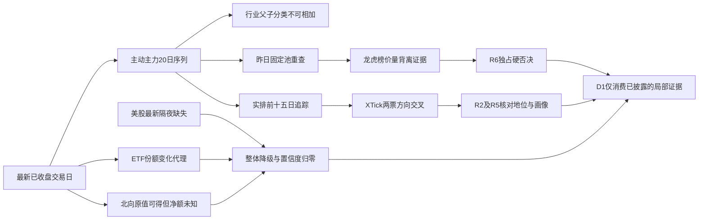

# 2026年10月27日 · 资金面

> 数据源新鲜度：partial；降级状态：true；置信度：0.0。
> 境内资金归属 2026-10-26 收盘，T-1 正常，交易日缺口为 0。并非 2026-10-27 盘中数据。
> ⚠️ 海外快照美股实际为 2026-10-23，最新隔夜 2026-10-26 缺失，overseas_stale=true。

## 🧭 一句话结论

降级：主力五日仍净流出，ETF申购代理与主动资金背离；北向净额及最新隔夜未确认。

## 🔎 详细分析

主动资金流与ETF申购代理不能相互抵消。本次全市场资金序列有20个交易日，单日与中期窗口都应分别看：ETF份额增加不证明主动资金回流，也不能证明某一机构在护盘。

当日R1/R2在本批抓取启动时未产出，因此R7不认定市场风格、不授予板块主线或个股龙头地位，也不生成开仓或卖出计划。主模板留待R2选择。跟踪名单是资金事实样本，不是候选池；所有执行资格均为false。

北向原始返回虽有最新交易日行，但净额口径及单位未经认证。本次官方问财成功返回的是龙虎榜股通席位净额子集，不是全市场北向净额；因此不换算、不求净流入总和、不把空值写成0。整体unavailable及confidence=0由R7 v1.2北向缺失硬规则触发，并非将正常T-1误判过期。

### 时序资金流（亿元）

| 窗口 | 主力净额 | 有效日/要求日 | 态度 |
|---|---:|---:|---|
| 最新T-1单日 | -278.67 | 1/1 | 观察主动资金流出 |
| 5d | -1126.66 | 5/5 | 观察负向资金约束 |
| 10d | -2386.48 | 10/10 | 观察负向资金约束 |
| 20d | -5653.72 | 20/20 | 观察负向资金约束 |

来源：本次Tushare moneyflow_mkt_dc，窗口 20260921—20261026。行业资金原始元、个股资金原始万元，分别折算亿元，禁止错用同一除数。

### 板块资金截面与持续性（不是R2主线排序）

| 板块 | 单日亿元 | 5日亿元 | 10日亿元 | 20日亿元 |
|---|---:|---:|---:|---:|
| 汽车 | +11.60 | -17.09 | -41.10 | -44.94 |
| 汽车零部件 | +10.23 | +10.73 | +2.57 | -20.01 |
| 数字芯片设计 | +9.90 | +81.26 | -8.23 | -333.18 |
| 电子 | -146.16 | -174.15 | -397.34 | -1729.23 |
| 元件 | -66.31 | -137.90 | -163.11 | -478.54 |
| 印制电路板 | -50.85 | -113.77 | -111.19 | -327.31 |

来源：本次Tushare moneyflow_ind_dc，496个多层板块；父子分类重叠，不横向相加。汽车父板块与汽车零部件资金方向不能简单等同，数字芯片设计局部承接也不能代表整个电子板块。

### 汽车零部件：局部承接

- **大资金意图**: 单日与5日净流入同向，只能提出局部承接假设，不能认定全行业风险偏好回升。
- **为什么走强**: 该细分资金为正而父板块汽车五日仍负；万向钱潮与模塑科技出现单日正向资金，是局部聚集而非全板块普涨。
- **逻辑够不够硬**: 资金与个股价格有锚，但缺当日R2主线及完整四工具；5日净额转负或个股承接反向即证伪。

### 数字芯片设计：回补与中期流出并存

- **大资金意图**: 5日流入而20日仍流出，可能是阶段回补；不能据此推定机构长期配置。
- **为什么走强**: 寒武纪单日正流入与XTick方向一致；来源日涨幅为正，但半导体父板块当日流出，扩散效应未证实。
- **逻辑够不够硬**: Tushare东财与vibe东财并非独立上游；XTick仅验证部分标的方向。海外最新隔夜及两融最新一档缺失，仍须降级。

### ETF与主动资金：双向证据

- **大资金意图**: 份额增加反映申购代理为正，不知道申购者身份；禁止写成国家队或机构护盘事实。
- **为什么走强**: 创业板及科创篮子份额增加，主动主力却净流出，说明不同口径在分化，而非相互证明。
- **逻辑够不够硬**: 4只ETF不代表全市场；估值代理与连续合约基差只能作方向证据，不能直接生成仓位或套利计划。

## 🧾 昨日前十的五日追踪

口径一：下表是2026-10-26收盘按主力净额实排前十（本次拉取6030条全市场记录）。五日窗口为2026-10-20、21、22、23、26；收益基准为2026-10-19收盘，包含完整五个交易日。并非当日R2候选。

| 研究对象 | 单日净额亿 | 5日净额亿 | 正流入日 | 5日收益% | 资金态度 |
|---|---:|---:|---:|---:|---|
| 寒武纪 688256.SH | +13.02 | +13.52 | 2/5 | +4.25 | 观察 |
| 胜宏科技 300476.SZ | +7.25 | +7.07 | 3/5 | +6.31 | 观察 |
| 长鑫科技 688825.SH | +6.60 | +3.38 | 3/5 | +2.75 | 观察 |
| 万向钱潮 000559.SZ | +5.90 | +9.36 | 4/5 | +28.25 | 观察 |
| 百亚股份 003006.SZ | +4.40 | +20.39 | 5/5 | -6.93 | 观察 |
| 沐曦股份-U 688802.SH | +3.77 | +9.12 | 4/5 | +16.65 | 观察 |
| 中国石油 601857.SH | +3.70 | +3.10 | 2/5 | +5.35 | 观察 |
| 模塑科技 000700.SZ | +2.70 | +5.26 | 4/5 | +25.07 | 观察 |
| 瑞芯微 603893.SH | +2.65 | +8.44 | 3/5 | +22.32 | 观察 |
| 亿纬锂能 300014.SZ | +2.57 | -3.61 | 2/5 | +4.82 | 降级 |

百亚股份五日资金为正但股价五日为负，明确属于量价背离，不升级为趋势确认。单日排名仅表示提供商大单分类净差，不代表真实机构账户净买入。

口径二：昨日R7 artifact固定池（原榜单实际归属2026-10-23），只继承代码和名称。下列全部资金与价格已在本次重新查询，不继承旧结论。

| 昨日固定对象 | 单日净额亿 | 5日净额亿 | 正流入日 | 资金态度 |
|---|---:|---:|---:|---|
| 中际旭创 300308.SZ | -0.99 | -18.12 | 1/5 | 降级 |
| 长鑫科技 688825.SH | +6.60 | +3.38 | 3/5 | 观察 |
| 宁德时代 300750.SZ | +0.62 | -32.08 | 2/5 | 降级 |
| 兆易创新 603986.SH | -8.56 | +11.68 | 3/5 | 降级 |
| 天娱数科 002354.SZ | -3.53 | +8.07 | 3/5 | 降级 |
| 粤芯半导-U 301660.SZ | -6.95 | -2.84 | 2/5 | 降级 |
| 歌尔股份 002241.SZ | -0.13 | +10.30 | 2/5 | 降级 |
| 东方财富 300059.SZ | -1.47 | -0.63 | 1/5 | 降级 |
| 寒武纪 688256.SH | +13.02 | +13.52 | 2/5 | 观察 |
| 利亚德 300296.SZ | -6.19 | +5.78 | 4/5 | 降级 |

两组各50个有效股票日观测。R7不把榜单对象升级为研究候选：板型取当日涨停表或未知；龙头认定未做；盈亏比未知；禁止清单未运行（不是空命中）。JSON逐对象保留这些字段。

### 寒武纪：资金方向共振，但不等于开仓资格

- **大资金意图**: 东财单日净差+13.02亿元，近五日+13.52亿元；只能推断大单分类买方相对占优，不能定位真实机构身份。
- **为什么走强**: 当日涨幅+3.84%，XTick超大与大单买卖差代理+6.86亿元，同向但金额不可直接比较；五日只有2日为正，承接集中在最近两日。
- **逻辑够不够硬**: 两个独立提供商方向一致，但两融仅到2026-10-23，完整15日工具返回不等于最新交易日已覆盖；全市场榜单无其记录，不能以“未上榜”证伪或确证。

- **买入理由**: 不产出买入结论；本节只保留正向资金证据，不提供产业锚或授予执行资格。
- **风险点**: 五日正流入集中；融资余额最新一档缺失；境外半导体最新隔夜无证据。
- **止损条件**: R7不设价格止损；资金假设失效条件是下一完整交易日两个独立提供商同转净流出，交D1决定交易动作。
- **可验证假设**: 未来1—3个完整交易日重新查大单净差，至少2日为正才能支持持续承接；否则不确认趋势。

### 中际旭创：历史强榜对象的资金假设降级

- **大资金意图**: 五日净流出-18.12亿元，不能把此前单日流入延伸成趋势配置。
- **为什么走强**: 最新一日并未走强：股价-2.96%，XTick买卖差代理-6.92亿元，与东财负向一致，但分桶差异使净额大小不同。
- **逻辑够不够硬**: 境内价量与独立方向一致，支持“承接未持续”的证据判断；不代表基本面恶化，也不是R6硬否决。

- **买入理由**: 不产出买入结论；旧榜单身份不足以构成今日资格。
- **风险点**: 最近五日仅1日正流入；未完成完整大宗两融核验，不能用缺失当无风险。
- **止损条件**: 不设置价格计划；仅将下一完整交易日仍为净流出作为资金持续性假设的进一步反证。
- **可验证假设**: 后续1—3个交易日需连续2日两个提供商同为正向，才重新评价资金承接；本次态度为降级。

## 🧯 龙虎榜疑似诱多证据（交R6，不作操纵定性）

筛查条件：日涨幅至少5%但单日榜单净卖出；或股价上涨但可识别机构席位净卖出。排除连续多日事由，按同一股票/席位/买卖金额去重，避免多事由与买卖两侧重复计算；“机构专用”只作匿名机构记录，不认定同一机构。

| 对象 | 涨幅% | 单日榜净额亿 | 机构净额亿 | 证据态度 |
|---|---:|---:|---:|---|
| 襄阳轴承 000678.SZ | +9.98 | -0.46 | +0.16 | 观察，交R6 |
| 天娱数科 002354.SZ | +1.49 | -3.70 | -0.64 | 观察，交R6 |
| 林州重机 002535.SZ | +9.90 | -0.40 | -0.16 | 观察，交R6 |
| 百洋股份 002696.SZ | +10.05 | +0.56 | -0.25 | 观察，交R6 |
| 金溢科技 002869.SZ | +9.99 | -0.40 | -0.13 | 观察，交R6 |
| 锋龙股份 002931.SZ | +9.99 | -0.06 | -0.41 | 观察，交R6 |
| 奥雅股份 300949.SZ | +20.00 | +0.41 | -0.17 | 观察，交R6 |
| 达瑞电子 300976.SZ | +20.00 | +0.05 | -0.17 | 观察，交R6 |
| 凡拓数创 301313.SZ | +10.43 | -1.25 | -1.06 | 观察，交R6 |
| 科瑞思 301314.SZ | +20.01 | +0.28 | -0.01 | 观察，交R6 |
| 世纪恒通 301428.SZ | +17.74 | +0.32 | -0.06 | 观察，交R6 |
| 华阳智能 301502.SZ | +20.00 | -0.38 | -0.19 | 观察，交R6 |
| 洛轴股份 301699.SZ | +1.44 | -0.93 | -0.72 | 观察，交R6 |
| 兰生股份 600826.SH | +10.04 | +0.20 | -0.05 | 观察，交R6 |
| *ST华鹏 603021.SH | +10.12 | -0.01 | 未知 | 观察，交R6 |
| 永创智能 603901.SH | +10.04 | -0.04 | -0.41 | 观察，交R6 |
| 华依科技 688071.SH | +11.83 | -0.66 | -1.37 | 观察，交R6 |
| 江苏北人 688218.SH | +15.98 | -0.01 | 未知 | 观察，交R6 |
| 泛亚微透 688386.SH | +20.00 | +0.51 | -0.21 | 观察，交R6 |
| 中邮科技 688648.SH | +20.01 | +0.23 | -0.21 | 观察，交R6 |
| 宇树科技 688836.SH | +7.69 | -2.60 | +2.49 | 观察，交R6 |
| 大鹏工业 920091.BJ | +8.12 | -0.21 | 未知 | 观察，交R6 |
| 南方乳业 920196.BJ | +5.81 | -0.00 | 未知 | 观察，交R6 |

本次Tushare原始89条出现记录、73只股票；单日去重后62组金额记录，命中23只。vibe东财全市场返回87条出现记录，与Tushare89条存在2条差异，不能声称完全一致。席位反复净买原始候选40组，尚未逐票完成ST/公告/封板和真实游资身份映射，不输出“确认游资合力”。

## 🧮 ETF、期货与跷跷板

| ETF | 份额变化万份 | 申赎估值代理亿 |
|---|---:|---:|
| 510300.SH | +20430.00 | +8.54 |
| 510500.SH | -24960.00 | -16.85 |
| 159915.SZ | +245200.00 | +65.00 |
| 588000.SH | +293700.00 | +40.56 |

4只篮子估值合计+97.25亿元，采用份额增减乘收盘价，不是实际一级市场资金流水。IF主力连续减沪深300收盘基差-54.54点，未扣融资成本与分红，不能视为套利信号；境内ETF期权隐波未知（工具仅支持美股期权）。

跷跷板以单日绝对资金强度前20个行业层级板块为研究宇宙，逐对检验20日Pearson<-0.6及最近5日相对前5日方向反转；190对均有20日数据，本宇宙完整命中0对。空数组不是“全市场没有跷跷板”，且父子板块重叠会影响解释；R2未就绪，未按其主线指定宇宙重算。

## 🌐 外部传导

| 美股核心对象 | 快照实际日期 | 快照涨跌%（非最新隔夜） | 最新隔夜态度 |
|---|---|---:|---|
| MU | 2026-10-23 | +2.46 | 观察：2026-10-26未取得 |
| NVDA | 2026-10-23 | -0.59 | 观察：2026-10-26未取得 |
| AVGO | 2026-10-23 | -0.48 | 观察：2026-10-26未取得 |
| AMD | 2026-10-23 | +1.74 | 观察：2026-10-26未取得 |
| TSM | 2026-10-23 | +1.49 | 观察：2026-10-26未取得 |
| INTC | 未知 | 未知 | 观察：2026-10-26未取得 |
| GLW | 2026-10-23 | -0.24 | 观察：2026-10-26未取得 |
| MRVL | 未知 | 未知 | 观察：2026-10-26未取得 |
| AAPL | 2026-10-23 | -0.14 | 观察：2026-10-26未取得 |
| MSFT | 2026-10-23 | +0.66 | 观察：2026-10-26未取得 |
| GOOGL | 2026-10-23 | -1.24 | 观察：2026-10-26未取得 |
| AMZN | 2026-10-23 | -0.95 | 观察：2026-10-26未取得 |
| META | 2026-10-23 | -0.96 | 观察：2026-10-26未取得 |
| TSLA | 2026-10-23 | -0.63 | 观察：2026-10-26未取得 |

美股SPX/IXIC快照亦为2026-10-23，SOX未取得；本次三指数与14只核心股定向补查2026-10-26均空。MU/NVDA/AVGO/AMD/TSM到A股存储/CPO/半导体的最新提振或压制方向未知，不能用旧MU涨幅为今日存储承接背书。汇率只保留原快照的新鲜度标记，不参与确定性资金结论。

## 🕸️ 资金证据传导图

## 🔗 关键证据

- 证据1：主力近5/10/20日净额分别-1126.66/-2386.48/-5653.72亿元，来源本次moneyflow_mkt_dc。
- 证据2：ETF篮子+97.25亿元代理与主动主力方向相反，不能相加解释。
- 证据3：炸板23、涨停55，炸板率29.49%，未触发35%强制减半；只提供事实，不代R1定阶段。
- 证据4：北向问财返回列及chunks_info明确为龙虎榜股通席位子集，拒绝跨口径替代；历史R7的北向净额解释不沿用。

## 数据源审计

| 源 | 日期 | 状态 | 记录数 | 备注 |
|---|---|:--:|---:|---|
| tushare.trade_cal | 2026-10-26 | 🟢 | 56 | 本次真实检索，窗口见JSON |
| tushare.moneyflow_hsgt | 2026-10-26 | 🟢 | 24 | 原始字段可得但北向净额口径未认证 |
| tushare.moneyflow_mkt_dc | 2026-10-26 | 🟢 | 20 | 本次真实检索，窗口见JSON |
| tushare.moneyflow_dc | 2026-10-26 | 🟢 | 6030 | 本次真实检索，窗口见JSON |
| tushare.top_list | 2026-10-26 | 🟢 | 89 | 本次真实检索，窗口见JSON |
| tushare.top_inst | 2026-10-26 | 🟢 | 890 | 本次真实检索，窗口见JSON |
| tushare.hk_hold | 2026-10-26 | 🔴 | 0 | 本次真实检索，窗口见JSON |
| tushare.fut_daily | 2026-10-26 | 🟢 | 1 | 本次真实检索，窗口见JSON |
| tushare.index_daily | 2026-10-26 | 🟢 | 1 | 本次真实检索，窗口见JSON |
| tushare.moneyflow_ind_dc | 2026-10-26 | 🟢 | 9920 | 20交易日各496行，来源标行业但含父子多层分类，不汇总相加 |
| tushare.fund_share+fund_daily | 2026-10-26 | 🟢 | 28 | 4只ETF代理，非全市场真实申赎 |
| tushare.limit_list_d | 2026-10-26 | 🟢 | 78 | 涨停与炸板列表去重；非R1风格判定 |
| datapro | 2026-10-27 | 🔴 | 未知 | 实调4013订阅失效，与manifest健康ping不一致 |
| xtick.hot_bk | 2026-10-26 | 🟢 | 未知 | 返回板块成分列表，不能当资金流；hot_money才用于金额交叉 |
| xtick.hot_money | 2026-10-26 | 🟢 | 2 | 先YYYYMMDD报日期解析错；ISO日期重试成功，两票定向核验；全市场回执在工具层截断，不宣称完整覆盖 |
| vibe.get_dragon_tiger | 2026-10-26 | 🟢 | 87 | 全市场87出现记录，Tushare89，非独立上游一致性证明 |
| vibe.get_block_trades | 2026-10-26 | 🟢 | 6 | 仅历史跟踪对象寒武纪；保留首条原始记录投影，不代表当日候选覆盖 |
| vibe.get_margin_trading | 2026-10-23 | 🟡 | 15 | 仅寒武纪，数据至20261023，比最新已收盘日缺一档 |
| vibe.get_fund_flow | 2026-10-26 | 🔴 | 未知 | 十票逐符号ProxyError；顶层ok=true不可当成功 |
| vibe.iwencai | 2026-10-27 | 🔴 | 未知 | 远端key缺失；已回退官方OpenAPI |
| official_iwencai | 2026-10-27 | 🟢 | 34 | 返回股通龙虎榜席位子集，拒绝替代北向净额 |
| overseas_snapshot | 2026-10-23 | 🟡 | 12 | 美股实际20261023；补查20261026空，overseas_stale=true |
| ETF_options_IV | 2026-10-27 | 🔴 | 未知 | vibe期权工具仅美股，境内50ETF/300ETF隐波不支持，未错误调用 |
| manifest+mcp_health | 2026-10-27 | 🟢 | 2 | global_severity=2；健康ping不能覆盖具体数据接口失败 |

## ⚠️ 不确定性 / 反证

置信度为0不是“全部资金数据无效”：一般三因子乘积为0.2625，因北向净额不可得，被R7 v1.2硬规则覆盖为0；不应绕过降级门禁。T-1缺口为0与整体资金维度unavailable是两个不同维度。

主力分桶净流入不是真实机构净持仓；ETF估值不能推断申购者身份。榜单属于被选择样本，匿名机构、不同日事由及同席位身份都存在局限。股价上涨与净卖出共存只能提示筹码交换，不能宣称诱多、对倒或操纵事实；硬否决留给R6。空值不代表0，未上榜不代表没有资金。

当日R2候选缺失：逐票大宗30日、两融15日、龙虎榜及资金流四工具均未形成当日候选覆盖，缺口数量未知。寒武纪补查不能代替全候选覆盖；其余固定对象未查齐两融大宗，不隐瞒，也不把vibe局部失败冒充全域DOWN。研究候选及执行候选均为空，无开仓授权。

## 🤝 与其他 R/D/E 的关系

- 依赖：当日manifest、mcp_health、overseas_snapshot；R1/R2本批启动时未就绪。preferences与human_thesis只读；active下无有效文件。
- 被消费：R2筛主线时核对持续性；R5核画像时补逐票四工具；R6审查背离证据；D1按unavailable降级消费，不将本报告视为资金维度放行。
- 主模板：不在R7选定，等待R2；无板块优先级、价格买卖计划或硬否决输出。

## Sub-Agent 元数据

- skill: analyze_capital_flow_v1@1.3
- model: gpt-6.1-sol
- artifact: data/research/20261027/R7_capital_flow_20261027.json
- evidence: R7_live_evidence_20261027.json / R7_computed_evidence_20261027.json / R7_iwencai_evidence_20261027.json
- 生成耗时：以JSON meta.elapsed_seconds记录本批抓取开始至组装完成，不预填虚构耗时。
- Pydantic：写盘前已实际执行R7嵌套契约与frontmatter模型校验。
- 仓库校验：实际命令、退出码与输出归档在同目录R7_validation_20261027.json；结构校验通过不代表源完整。
