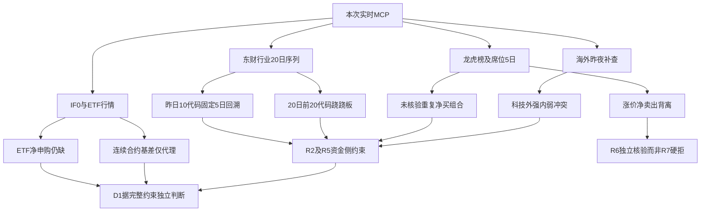

# 2026年10月28日 · 资金面

> 🟡 本报告是盘前资金约束，不是买卖计划；A股观察日为2026-10-27，五日窗口为10-21、10-22、10-23、10-26、10-27。
> **状态：partial / degraded=true；置信度：0.1925。** 已取得证据交易日gap=0不等于适用维度全部齐全。

## 🧭 一句话结论
银行回流尚未扭转五日流出，电机与光学较持续；科技外强内弱，龙虎榜涨价净卖出需警惕。

## 🧮 口径与边界

所有板块金额表用亿元，龙虎榜及个股交叉表也统一亿元；原始单位保留在JSON。东财板块`net_amount`为元，Tushare个股订单桶金额为万元，主力用大单和超大单买卖差，不以`net_mf_amount`冒充主力。

按昨日行业净流入排序固定10个代码，回看同一队列五日，不拿每天不同的前十拼接。共有496个行业代码，含父子层级，并非互斥行业：银行/银行Ⅱ、电机Ⅱ/电机Ⅲ五日数值分别完全一致，**保留原始代码作审计，但不能相加**。银行子行业亦包含在银行父行业内；电子与半导体同理，不计算重叠板块的市场总净流。

R2在本次范围冻结时未就绪，因此没有为凑6—15只造观察池；下文两股只是龙虎榜风险样本，不是观察/执行候选。北向`not_required / review_reference_only`，未知null，本次不调用，完全排除评分分子分母。不授予开仓资格，不输出买卖点，不作hard_reject。

## 📊 昨日前十行业固定队列：五日追踪

| 昨日序位 | 代码 / 板块 | 10-21 | 10-22 | 10-23 | 10-26 | 10-27 | 五日累计 | 净流入天数 |
|---|---|---:|---:|---:|---:|---:|---:|---:|
| 1 | BK1283.DC 银行 | -2.85 | -2.51 | -29.91 | +0.77 | +7.70 | -26.81 | 2/5 |
| 2 | BK0475.DC 银行Ⅱ | -2.85 | -2.51 | -29.91 | +0.77 | +7.70 | -26.81 | 2/5 |
| 3 | BK1307.DC 电机Ⅲ | -0.69 | +10.94 | +2.17 | -2.12 | +7.25 | +17.54 | 3/5 |
| 4 | BK1030.DC 电机Ⅱ | -0.69 | +10.94 | +2.17 | -2.12 | +7.25 | +17.54 | 3/5 |
| 5 | BK1610.DC 股份制银行Ⅲ | -0.62 | -0.13 | -11.17 | -3.87 | +6.77 | -9.02 | 1/5 |
| 6 | BK1611.DC 国有大型银行Ⅲ | -1.52 | -1.83 | -14.61 | +3.76 | +3.54 | -10.66 | 2/5 |
| 7 | BK1334.DC 光学元件 | +3.01 | -2.53 | +2.85 | +1.03 | +3.22 | +7.58 | 4/5 |
| 8 | BK1600.DC 医疗研发外包 | -1.17 | -12.46 | -2.32 | +3.48 | +2.95 | -9.52 | 2/5 |
| 9 | BK1287.DC 工业金属 | -7.52 | -16.39 | -5.91 | -14.44 | +2.82 | -41.44 | 1/5 |
| 10 | BK1613.DC 铝 | -2.73 | -1.66 | +1.82 | -0.40 | +2.72 | -0.25 | 2/5 |

来源：本次实时MCP `tushare.moneyflow_ind_dc`，行业口径，观察截至2026-10-27。排序只描述净额，不替R2评主线；完整496代码×20交易日在JSON。

### 🏦 银行族：一日回流不等于五日趋势转多
- **大资金意图**: 银行昨日流入7.70亿元、涨1.34%，可提出权重再配置假设；但五日仍流出26.81亿元，只能证明近两日回流，无法证明机构建立长期底仓。
- **为什么走强**: 价格上涨与净流入同向，属于截面资金支持。股份制银行昨日6.77亿元、五日-9.02亿元；国有大型银行昨日3.54亿元、五日-10.66亿元，说明回流不能抹去此前撤出。具体业绩/政策催化与相对位置未核验，不补故事。
- **逻辑够不够硬**: 仅东财板块经济源；银行和银行Ⅱ是同一组数，不是双源共振。若后续再次转流出，回流连续性假设就被削弱；本报告不把它定为进攻主线。

### ⚙️ 电机Ⅱ/Ⅲ：累计为正，但中间存在回撤
- **大资金意图**: 五日累计+17.54亿元、三日为正，支持资金阶段性集中这一有限解释，不证明资金身份或统一操盘。
- **为什么走强**: 昨日+7.25亿元、板块涨1.38%，与五日累计同向；但10-26曾流出2.12亿元，不能称持续五日吸筹。行业硬催化尚未在本职数据中核验。
- **逻辑够不够硬**: 两个层级代码是相同序列，不能把17.54亿元重复成35亿元或当两条独立主线。个股龙头、板型与承接须由R2/R5补证，非R7授予。

### 🔬 光学元件：净额较持续，价格却未同步
- **大资金意图**: 五日+7.58亿元、4/5日净流入，表现出局部承接；是吸筹还是下跌中的换手，不能仅靠订单桶定性。
- **为什么走强**: **这里不是价格走强**：昨日板块跌2.33%，尽管净流入3.22亿元。资金与价格背离应保留为反证，不写成“资金买入必涨”。
- **逻辑够不够硬**: 单源且缺个股纯度/产业硬事件，暂只称“净额持续性相对较好”；后续价格与广度若不改善，承接转趋势的假设不成立。

### 🧪 医疗研发外包：回流与超大单方向不一致
- **大资金意图**: 昨日净流入2.95亿元但超大单净额为负，意味着大单与超大单拆分不能合称机构共识；资金意图未知。
- **为什么走强**: 昨日板块跌4.29%，五日累计-9.52亿元，最近两日回流仍不能逆转窗口撤离；未核验业绩/政策触发点。
- **逻辑够不够硬**: 价格、五日累计和超大单不构成同向证据，只保留反弹承接观察，不升级为主力持续流入结论。

### 🏗️ 工业金属：一天转正，四天流出底色未改
- **大资金意图**: 昨日+2.82亿元可描述为局部回补，但五日-41.44亿元且仅1/5日为正，不足以说资金开始系统性配置。
- **为什么走强**: 昨日价格仍跌1.42%，不是“资源全面走强”；上游价格或利润催化本次未核验。
- **逻辑够不够硬**: 主要证据仍指向五日撤离。不能因为排进昨日流入前十，就忽略更长窗口反证；同时不可与铝等子行业相加。

### 🪙 铝：短窗接近平衡，不是持续净买
- **大资金意图**: 昨日+2.72亿元、五日-0.25亿元，净额接近抵消，仅可提出轮动回补假设，不推断机构吸筹。
- **为什么走强**: 昨日价格跌1.52%，五日仅2日净流入；净额回流未兑现为价格强度。供需/库存催化未核验。
- **逻辑够不够硬**: 单源且量价分歧，五日累计没有转正，强度不足以给R2提供持续流入背书。

## 🔁 科技链时序反证与跷跷板

| 板块 | 昨日净额 | 五日累计 | 正流入天数 |
|---|---:|---:|---:|
| 电子 | -150.36 | -335.12 | 2/5 |
| 半导体 | -76.47 | -101.63 | 2/5 |
| 计算机 | -62.27 | -73.84 | 1/5 |
| 印制电路板 | -30.16 | -148.65 | 1/5 |
| 通信 | -23.64 | -146.00 | 2/5 |

电子、半导体、计算机昨日分别流出150.36、76.47、62.27亿元，**不能把这三项相加**，行业层级有重叠。海外修复对情绪有提振，但不改变昨日内资订单桶撤离事实，更不是今日已流入。

跷跷板对昨日行业流入前20代码，采用2026-09-22至2026-10-27的20个实际交易日，20条完整序列、190个代码对，无填充。阈值为Pearson<-0.6，另要求最近五日相对前五日双方方向翻转且近期符号相反；本窗口**无满足条件配对**。这一结果只适用于该20代码集合，不代表全市场没有跷跷板；层级重复不能制造配置分散性。

## 🐉 龙虎榜诱多风险：背离是事实，诱多仍是假设

去重原则：单日榜和三日榜分别保留，不能相加。相同成交在不同上榜原因出现不是两次独立买入；`top_inst`的买/卖side重复披露也不重复求和。

| 风险样本（非推荐） | 昨日涨幅 | 榜单窗口 | 席位净额 | 已证实事实 / 未证实事项 |
|---|---:|---|---:|---|
| 襄阳轴承 000678.SZ | +10.03% | 单日 | -1.3046 | 收涨但该窗口席位净卖；不证明诱多/操纵 |
| 皇台酒业 000995.SZ | +6.81% | 单日 | -0.8023 | 收涨但该窗口席位净卖；不证明诱多/操纵 |
| 科瑞思 301314.SZ | +20.00% | 单日 | -0.2833 | 收涨但该窗口席位净卖；不证明诱多/操纵 |
| 兰生股份 600826.SH | +9.98% | 三日累计 | -0.4165 | 收涨但该窗口席位净卖；不证明诱多/操纵 |
| 上海九百 600838.SH | +10.00% | 三日累计 | -0.2597 | 收涨但该窗口席位净卖；不证明诱多/操纵 |
| 百大集团 600865.SH | +10.03% | 三日累计 | -0.5612 | 收涨但该窗口席位净卖；不证明诱多/操纵 |
| 国芳集团 601086.SH | +10.03% | 单日 | -0.1870 | 收涨但该窗口席位净卖；不证明诱多/操纵 |
| 赛福天 603028.SH | +10.01% | 三日累计 | -0.0070 | 收涨但该窗口席位净卖；不证明诱多/操纵 |
| 杰克科技 603337.SH | +2.78% | 三日累计 | -0.4260 | 收涨但该窗口席位净卖；不证明诱多/操纵 |
| 天娱数科 002354.SZ | +1.10% | 单日 | -0.5251 | 收涨但该窗口席位净卖；不证明诱多/操纵 |
| 果麦文化 301052.SZ | +3.51% | 单日 | -0.1476 | 收涨但该窗口席位净卖；不证明诱多/操纵 |
| 统一股份 600506.SH | +2.38% | 单日 | -0.0830 | 收涨但该窗口席位净卖；不证明诱多/操纵 |

### ⚠️ 襄阳轴承、科瑞思：价格涨停与席位/订单桶净流出并存
- **大资金意图**: 无法从净卖出判定资金动机。襄阳轴承单日榜净卖1.30亿元、科瑞思净卖0.28亿元，只证明所披露席位卖出大于买入，不能证明全体机构一致撤离。
- **为什么走强**: 两股昨日分别涨10.03%/20.00%，涨幅和龙虎榜净额相反；可能存在场外接力或持筹约束，但未获得逐笔、封单或完整席位连续持仓，均是待验证解释。
- **逻辑够不够硬**: Tushare和东财龙虎榜来自相同交易所披露，数值吻合只是通道冗余。订单桶主力也转负，但XTick主动大单代理为正，必须保留口径冲突；没有热榜第一、长上影与公告完整链，不认定L4霸榜出货，不给hard_reject。

| 样本 / 2026-10-27 | Tushare大单+超大单 | 东财主力 | XTick主动大单代理 | 结论 |
|---|---:|---:|---:|---|
| 000678.SZ | -0.9854 | -1.0077 | +6.5639 | 方向冲突，不平均、不择源凑共振 |
| 301314.SZ | -0.3179 | -0.3236 | +0.5399 | 方向冲突，不平均、不择源凑共振 |

两只风险样本均已调用大宗30自然日和两融15交易日：大宗返回空数组是本次接口未返回交易，不外推为“没有风险”；两融均只更新到2026-10-26，缺最新一个交易日，`gap=1`。科瑞思东财返回“最近5条”包含10-08/09/12，目标窗口10-21/22/23无行；JSON保留null而非零。Tushare同三日桶值为接口原始零，未据此臆断停牌。

三交易日席位重复净买共22个原始组合，排除泛化“专用”标签，按席位+股票+日期去重，非按多上榜原因凑次数。澳弘电子两组席位出现3日重复净买，但它昨日跌8.67%，再说明“有席位买”不是看涨充分条件。公告风险与今日封板状态尚未核验，故**合格`synergy_flags=[]`**；原始结果只放`unverified_repeat_buy_flags`，不作为正向加分资格。

本报告无首推票，四段买入/止损模板不适用；不为满足写作形式编造产业逻辑、止损点或RR。两只风险样本的板型、龙头认定、RR、禁止项均为null / 未评估，不代表通过。

## 🌐 外部传导：明确读取原快照，再补真实隔夜

本次`overseas_snapshot.json`虽于2026-10-28生成，12只美股实际都是2026-10-26，SPX/IXIC同样少一交易日，SOX缺失；INTC/MRVL也不在原12股内。**原文件仍保持stale，不把其中涨跌贴成昨夜。** 另调实时MCP `vibe.get_market_data/yfinance`取得14只美股及3指数的2026-10-27收盘，用同一源10-26收盘计算隔夜涨跌，未修改raw。

| 标的 | 美国观察日 | 隔夜涨跌 | 资金侧映射边界 |
|---|---|---:|---|
| SPX | 2026-10-27 | +0.60% | 跨市场情绪参考，不是A股订单证据 |
| IXIC | 2026-10-27 | +1.18% | 跨市场情绪参考，不是A股订单证据 |
| SOX | 2026-10-27 | +3.60% | 半导体/存储情绪提振，不等于A股资金流入 |
| MU | 2026-10-27 | +2.77% | 半导体/存储情绪提振，不等于A股资金流入 |
| NVDA | 2026-10-27 | +0.90% | 半导体/存储情绪提振，不等于A股资金流入 |
| AVGO | 2026-10-27 | +4.00% | 半导体/存储情绪提振，不等于A股资金流入 |
| AMD | 2026-10-27 | +5.45% | 半导体/存储情绪提振，不等于A股资金流入 |
| TSM | 2026-10-27 | +2.95% | 半导体/存储情绪提振，不等于A股资金流入 |
| AAPL | 2026-10-27 | +0.93% | 跨市场情绪参考，不是A股订单证据 |
| MSFT | 2026-10-27 | -0.24% | 跨市场情绪参考，不是A股订单证据 |
| META | 2026-10-27 | -1.64% | 跨市场情绪参考，不是A股订单证据 |
| INTC | 2026-10-27 | +3.61% | 半导体/存储情绪提振，不等于A股资金流入 |
| MRVL | 2026-10-27 | +4.19% | 半导体/存储情绪提振，不等于A股资金流入 |
| GOOGL | 2026-10-27 | +1.19% | 跨市场情绪参考，不是A股订单证据 |
| AMZN | 2026-10-27 | +1.61% | 跨市场情绪参考，不是A股订单证据 |
| TSLA | 2026-10-27 | +4.04% | 跨市场情绪参考，不是A股订单证据 |
| GLW | 2026-10-27 | -1.13% | 跨市场情绪参考，不是A股订单证据 |

- **大资金意图**: 美国半导体多数收涨提供风险偏好修复线索，不足以证明A股机构今日会买同链条。资金身份、财报原因和持仓变化未核验。
- **为什么走强**: SOX、AMD、AVGO、MU同向，芯片/存储方向有跨标的价格支持；但GLW下跌，META/MSFT也偏弱，所以CPO/算力不能机械推广为全链同涨。
- **逻辑够不够硬**: 海外价格已补齐真实上一美股交易日，但国内电子/半导体五日净额为负，形成“外部提振—内资撤离”的待解冲突。只有后续国内资金与价格方向核验后才可由R2/D1定级；本职不提前授予资格。汇率仍仅旧快照且未核验，未知变动不补数。

## 🧺 ETF与期货：有价格/代理，不冒充完整资金证据

| ETF | A股观察日 | 收盘 | 涨跌 | 净申赎 |
|---|---|---:|---:|---|
| 159915.SZ | 2026-10-27 | 2.563 | -3.32% | 未取得（null） |
| 510300.SH | 2026-10-27 | 4.123 | -1.34% | 未取得（null） |
| 510500.SH | 2026-10-27 | 6.537 | -3.16% | 未取得（null） |
| 588000.SH | 2026-10-27 | 1.320 | -4.42% | 未取得（null） |

四只ETF行情说明价格压力分布，**不是一级市场资金流**。本次问财MCP密钥缺失，DataPro订阅失效，未取得份额/净申购，因此`etf_net_flow=null`并降级，绝不以跌幅或成交额替代净流出。

| 日期 | IF0连续合约收盘 | 沪深300收盘 | IF0-现货（点） |
|---|---:|---:|---:|
| 2026-10-21 | 4047.60 | 4111.9325 | -64.3325 |
| 2026-10-22 | 3970.00 | 4036.2966 | -66.2966 |
| 2026-10-23 | 4055.00 | 4105.3286 | -50.3286 |
| 2026-10-26 | 4049.00 | 4103.5432 | -54.5432 |
| 2026-10-27 | 3991.20 | 4049.5516 | -58.3516 |

IF0代理基差为-58.3516点（-1.4409%），较前日贴水扩大，但连续合约并非已核验的IF2611近月持仓：缺交割月合约确认、持仓量和分红资金成本修正。**负基差不能单独证明空头净开仓。** 当前`get_options_chain`工具实际只支持US期权，不把A股50/300ETF伪装成US ticker；A股期权IV为null。

## 🗺️ 资金约束传导图

## 🔎 关键证据

- 固定队列银行五日-26.81亿元而昨日+7.70亿元，不能把回流贴成持续流入；电机五日+17.54亿元但层级重复，不双计。来源：实时Tushare/DC行业序列。
- 半导体昨日-76.47亿元、五日-101.63亿元，与美国SOX隔夜上涨构成待核验冲突，不是国内已反转。来源：Tushare/DC与实时vibe/yfinance。
- 襄阳轴承与科瑞思单日龙虎榜净卖、订单桶主力转负，XTick代理却为正，必须向下游传递冲突而非挑选有利一边。来源：三路MCP；不等同三路同口径独立一致。

## 数据源审计

| 源 | 日期 | 状态 | 记录数 | 审计结论 |
|---|---|:--:|---:|---|
| tushare.moneyflow_ind_dc | 2026-10-27 | 🟢 | 9920 | 行业496代码截面；20交易日；分段拉取，10月9日补齐；父子行业有重叠 |
| tushare.trade_cal | 2026-10-27 | 🟢 | 22 | SSE 20260921-20261028开市日，本期末20261027 |
| tushare.top_list | 2026-10-27 | 🟢 | 87 | 记录数为vibe同日披露快照reported_count；龙虎榜原始单日与三日榜禁止相加 |
| tushare.top_inst | 2026-10-27 | 🟢 | 880 | 20261027席位明细；side/reason重复不重复求和 |
| tushare.hm_detail | 2026-10-27 | 🟢 | 1424 | 五交易日原始数据，3日滚动按席位+股票+日期去重 |
| xtick.hot_money | 2026-10-27 | 🟢 | 7 | 两只风险样本共7条；与东财方向冲突，不能当确认 |
| xtick.hot_money.all | 2026-10-27 | 🔴 | 1274 | 返回截断，仅恢复完整对象，禁止全市场/板块汇总 |
| xtick.hot_bk | 2026-10-27 | 🟢 | 68 | sw1返回68个板块成员列表，没有板块净额字段 |
| vibe.get_dragon_tiger | 2026-10-27 | 🟢 | 87 | 东财同一交易所披露，通道冗余不算经济证据独立双源 |
| vibe.get_fund_flow | 2026-10-27 | 🟢 | 10 | 两股各5条，科瑞思其中3条不在目标窗口，按日期排除 |
| vibe.get_block_trades | 2026-10-27 | 🟢 | 0 | 两股30自然日均返回空，不等于未来无大宗风险 |
| vibe.get_margin_trading | 2026-10-26 | 🟡 | 30 | 均截至20261026，距离应有T-1缺1交易日 |
| tushare.moneyflow | 2026-10-27 | 🟢 | 10 | 两股各5交易日，金额万元；主力采用大单+超大单而非net_mf_amount |
| tushare.fund_daily | 2026-10-27 | 🟢 | 2166 | 仅行情截面，四宽基价格不能替代净申购 |
| vibe.get_market_data/akshare | 2026-10-27 | 🟢 | 5 | IF0连续合约5日，非IF2611、无持仓量 |
| tushare.index_daily | 2026-10-27 | 🟢 | 5 | 沪深300同日收盘，IF0-现货仅代理基差 |
| vibe.get_market_data/yfinance | 2026-10-27 | 🟢 | 34 | 14股票+3指数，各2日收盘，补齐20261027；原始快照仍stale |
| datapro | 2026-10-27 | 🔴 | 0 | 4013订阅失效；ETF查询被熔断暂停 |
| vibe.iwencai_search | 2026-10-27 | 🔴 | 0 | 未配置专用访问密钥；未调用北向 |
| overseas_snapshot | 2026-10-26 | 🟡 | 12 | 明确读取本次文件，12股均20261026；SOX/INTC/MRVL缺，另用实时MCP补齐 |

审计表日期为主要数据观察日；区间源完整窗口、真实证据汇编时点及请求错误在JSON。DataPro在原健康快照为ok，但本次实际返回4013，以本次结果为准。主源缺失和独立核验不足已令degraded=true，不因北向不必需而恢复旧分数。

## 🧯 不确定性 / 反证

1. 板块主力只有东财一个经济源。Tushare转发东财、vibe转发东财不是双源；XTick成员列表没有板块净额，市场全量资金响应又截断，不能偷偷用不完整个股求和重建。
2. 昨日前十是行业含层级口径，不覆盖全部概念主题；父子板块重复导致“十个代码”不是“十个独立机会”。资金分类本身为估计模型，不等同真实机构账户净头寸。
3. 时效分离：已取得A股核心证据为正常T-1，staleness_status=ok / gap=0；两融T-2 / gap=1、ETF净申购无日期 / gap=null。**整体status仍partial，ok不是齐全证明。**
4. 龙虎榜正负只覆盖披露席位，三日榜和单日涨幅时间窗口不同。未有足够证据证明操纵、诱多或榜首出货，不做硬否决。
5. 本报告不调整持仓/仓位，不授予开仓资格；缺失观察候选资料不补造。R2晚就绪应由下游显式按新候选补核验，而不是拿本报告风险案例充数。

## 🤝 与其他R/D/E的关系

- 依赖：本次manifest、mcp_health、明确要求读取的overseas_snapshot；preferences只读，active thesis目录为空，未以历史artifact替代本次实时数据。
- 供R2/R5：行业固定队列、持续性、单位和重叠警示；不替代主线排序或个股画像。
- 供R6：涨价/席位净卖的事实及跨源冲突，是否hard_reject由R6专权核验。
- 供D1：ETF缺失、期货代理、两融滞后与低置信度；不得把北向未知变成整体零分/禁新，也不得抬高其他有效零预算。
- 供E1：可用本次固定10代码和22个未核验组合追踪兑现，不把原始组合当已合格正向协同。

## 🧾 校验与Sub-Agent元数据

- skill：analyze_capital_flow_v1；model：gpt-6.1-sol；专职R7，未委派其他Agent。
- artifact：data/research/20261028/R7_capital_flow_20261028.json。
- 置信度公式：`min(0.5, clamp(0.55 × 0.7 × 0.5, 0.05, 0.95)) = 0.1925`；北向不进分子分母，海外价格不抬高国内资金独立源数。
- 已检查src/schemas与trading/schema，无专用R7 Pydantic类；按文档契约在环境临时目录构造运行时Pydantic v2模型，不修改仓库代码或skills。
- 实际发布前命令：`python /Users/chenyang/.hermes/profiles/canghai-research/cache/scratch/r7_validate_publish_20261028.py`。
- 实际输出：`Pydantic R7Report PASS; 496 sector series x20 sessions; fixed10 x5; northbound excluded; confidence 0.1925; role boundaries PASS`。
- 实际输出：`Atomic JSON publication PASS; compatibility symlink PASS; readback Pydantic PASS`。
- 写作自检：前置元数据、固定队列与单位、顶级对象三问、非候选不伪造四段买卖逻辑、≥8节点mermaid、三色审计表及反证边界齐全；脚本检查结果另存R7_validation_20261028.json。
