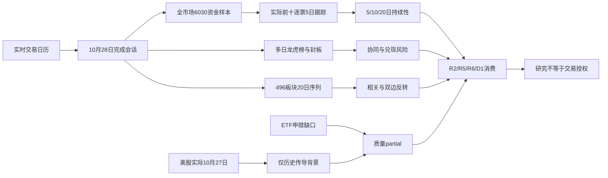

# 2026年10月29日 · 资金面

> A股数据归属2026-10-28，盘前最新已完成交易日；美股实际2026-10-27，缺最新隔夜。
> 数据质量：🟡 partial / degraded=true；置信度0.2625。研究交付与交易授权分层。

## 🧭 一句话结论
**科技资金单日回流，不等于中期净流出扭转；美股隔夜与ETF申赎证据不足。**

## 📊 详细分析
主力净额按交易分桶定义，不能解释为全市场真实资金从外部净进入。昨日DC大盘主力转正，但5/10/20日累计依然需要观察；行业父子分类重叠，不把电子、半导体和数字芯片金额相加。
光模块和PCB的单日资金改善与过去20日流出并存，中际旭创、兆易创新的短窗改善比新易盛更明显；这只是资金侧差别，不授予龙头身份。寒武纪5/10/20日均为正，但融资余额下降，资金持续性与杠杆买盘不能画等号。
招商银行在全市场前十，不能因为静态防御标签剔除研究；但DC净流入与XTick大额单净流出方向相反、收盘下跌，是待核验的分歧，而非机械判定防御主线。
ETF申购缺失并不否认现有A股资金证据；期货贴水只提供期现约束。北向完全不参与盘前置信度、时效或禁新门禁，未知值保持null。

## 🧮 大盘时序与口径
单位：亿元；来源：本次实时Tushare moneyflow_mkt_dc（原始元）。
| 窗口 | 起日 | 末日 | 主力累计 |
|---|---|---|---:|
| 5交易日 | 20261022 | 20261028 | -1149.2234 |
| 10交易日 | 20261015 | 20261028 | -2168.3786 |
| 20交易日 | 20260923 | 20261028 | -5668.7851 |

昨日大盘主力净额 `230.2998` 亿元。数据时间不是本文件生成时间。

## 🔟 昨日全市场资金前十：逐票五交易日追踪
实际查询6030个证券代码，对照实时上市表5576只全部覆盖，前十全部为当前上市股票。非热榜、非自选、非人工热门池。排名字段为DC `net_amount` 主力净流入，原始万元；不是全部资金净额，也不是Tushare `net_mf_amount`。vibe与Tushare DC同属东财，不能算两独立源。
五日逐日原值统一为万元；日期明确为10月22、23、26、27、28日；正负号不做平滑、不以无榜填0。
| 名次/代码/名称 | 10-22 | 10-23 | 10-26 | 10-27 | 10-28 | 5日亿元 | 10日亿元 | 20日亿元 |
|---|---:|---:|---:|---:|---:|---:|---:|---:|
| 1. 300308.SZ 中际旭创 | -229442.23 | 164299.60 | -9909.58 | 52560.79 | 319706.80 | 29.7215 | 9.0560 | -101.4409 |
| 2. 603986.SH 兆易创新 | -12583.88 | 129382.86 | -85603.87 | -13253.94 | 176357.99 | 19.4299 | 33.9177 | -56.6472 |
| 3. 300502.SZ 新易盛 | -259625.59 | -7347.25 | -76255.25 | -49881.41 | 148429.82 | -24.4680 | -49.0101 | -139.7038 |
| 4. 300394.SZ 天孚通信 | -62307.76 | -6591.11 | -5375.15 | -18976.49 | 89642.03 | -0.3608 | -13.1196 | -36.3847 |
| 5. 601138.SH 工业富联 | -47486.54 | 28286.23 | -47009.27 | -21013.41 | 84909.27 | -0.2314 | -1.7248 | -45.3770 |
| 6. 600036.SH 招商银行 | 18610.77 | -38099.65 | -22779.23 | 21549.49 | 74385.96 | 5.3667 | 6.8030 | 1.1334 |
| 7. 300223.SZ 君正股份 | -12260.03 | 6020.11 | -10613.25 | -10059.02 | 67953.51 | 4.1041 | 7.0048 | -2.1578 |
| 8. 002463.SZ 沪电股份 | -76224.45 | -23944.59 | -60388.33 | 3177.46 | 66080.77 | -9.1299 | -9.2494 | 0.2567 |
| 9. 600601.SH 方正科技 | -36375.53 | 4290.49 | -6236.28 | -4325.48 | 63300.90 | 2.0654 | -1.3182 | -0.6317 |
| 10. 688256.SH 寒武纪 | -36145.28 | 71221.05 | 130165.97 | -70991.12 | 62811.48 | 15.7062 | 17.2102 | 17.5328 |

来源：Tushare moneyflow_dc全市场+逐票历史，vibe get_fund_flow逐票20日核对。JSON保留日期、源、口径、原值和20日完整资金序列。300223.SZ名称按本次stock_basic返回“君正股份”原样保留，不凭旧称擅自替换。

## 🏭 行业资金时序（统计排序，不是R2主线排序）
| 行业 | 昨日亿元 | 5日亿元 | 10日亿元 | 20日亿元 |
|---|---:|---:|---:|---:|
| 电子 | 149.8638 | -243.5995 | -305.9754 | -1627.9756 |
| 通信 | 80.1979 | -80.8903 | -137.1356 | -759.3043 |
| 通信设备 | 78.5283 | -72.1867 | -124.8715 | -722.5870 |
| 半导体 | 68.9079 | -42.2440 | -77.3298 | -756.0719 |
| 通信网络设备及器件 | 66.0196 | -19.2211 | -78.4553 | -443.6698 |
| 数字芯片设计 | 57.2743 | 79.6433 | 84.3081 | -324.8555 |
| 元件 | 50.3140 | -144.1113 | -175.4524 | -466.8171 |
| 印制电路板 | 47.0233 | -120.1355 | -132.4397 | -330.6734 |
| 机械设备 | 36.8079 | -21.1024 | -55.1776 | -305.0809 |
| 汽车 | 26.5918 | 28.5443 | 6.8691 | -23.5253 |

## 🔍 资金top对象明示态度与推理三问
以下是可复核的研究判断，不披露隐含思维过程，不构成买卖指令；所有资金前十逐票给出态度。

### 1. 中际旭创（300308.SZ）
**态度：积极观察回流，但不认定主升恢复。**
- **大资金意图**: 可检验解释为光通信交易回流；昨日DC主力31.9707亿元、5日29.7215亿元。分桶金额不识别真实机构账户或其动机。
- **为什么走强**: 10月28日收盘涨跌10.2773%，五日收盘从590.11到636.30；XTick当日大额单净额32.7596亿元。跨口径方向一致，但不是金额一致。价格/资金是实证，催化与筹码身份本次未验证。
- **逻辑够不够硬**: 单日流入第一，但20日仍明显流出；需区别修复与持续增配。20日-101.4409亿元，不能仅凭昨天排名推断主升；缺硬业绩、政策时间锚或龙头资格时不外推。
- **买入理由**: 本报告不首推、不授权买入。研究保留理由有两项：全市场排名客观入围，以及资金与价格可在随后交易日复核；产业映射仅作为假设，未作为硬催化。
- **风险点**: 短期大额单回流可被次日兑现；中期单日流入第一，但20日仍明显流出；需区别修复与持续增配。两融截至10月27日，30日大宗平价转让也不能等同净买。
- **止损条件**: 仅定义研究逻辑失效，不设交易止损价：随后两个交易日同一DC口径主力累计≤0，则撤销“回流持续”假设；若数据口径不一致，结论退回未核验。交易止损由D1按真实入场和风控推导。
- **可验证假设**: 未来24–72小时内，用随后两个完整交易日DC主力净额之和>0验证持续性；≤0即证伪。需另看价格与封板承接，不拿单日大涨代替资金。

### 2. 兆易创新（603986.SH）
**态度：保留资金正向证据，等待持续性。**
- **大资金意图**: 可检验解释为存储/数字芯片回流；昨日DC主力17.6358亿元、5日19.4299亿元。分桶金额不识别真实机构账户或其动机。
- **为什么走强**: 10月28日收盘涨跌7.7701%，五日收盘从276.75到289.88；XTick当日大额单净额19.5480亿元。跨口径方向一致，但不是金额一致。价格/资金是实证，催化与筹码身份本次未验证。
- **逻辑够不够硬**: 5日与10日转正而20日仍负，较单日脉冲更有连续性但不证明业绩催化。20日-56.6472亿元，不能仅凭昨天排名推断主升；缺硬业绩、政策时间锚或龙头资格时不外推。
- **买入理由**: 本报告不首推、不授权买入。研究保留理由有两项：全市场排名客观入围，以及资金与价格可在随后交易日复核；产业映射仅作为假设，未作为硬催化。
- **风险点**: 短期大额单回流可被次日兑现；中期5日与10日转正而20日仍负，较单日脉冲更有连续性但不证明业绩催化。两融截至10月27日，30日大宗平价转让也不能等同净买。
- **止损条件**: 仅定义研究逻辑失效，不设交易止损价：随后两个交易日同一DC口径主力累计≤0，则撤销“回流持续”假设；若数据口径不一致，结论退回未核验。交易止损由D1按真实入场和风控推导。
- **可验证假设**: 未来24–72小时内，用随后两个完整交易日DC主力净额之和>0验证持续性；≤0即证伪。需另看价格与封板承接，不拿单日大涨代替资金。

### 3. 新易盛（300502.SZ）
**态度：仅作为反弹观察，不将单日强流入当趋势。**
- **大资金意图**: 可检验解释为光模块超跌修复；昨日DC主力14.8430亿元、5日-24.4680亿元。分桶金额不识别真实机构账户或其动机。
- **为什么走强**: 10月28日收盘涨跌8.0811%，五日收盘从258.01到256.79；XTick当日大额单净额13.5360亿元。跨口径方向一致，但不是金额一致。价格/资金是实证，催化与筹码身份本次未验证。
- **逻辑够不够硬**: 5日和20日累计仍显著为负。20日-139.7038亿元，不能仅凭昨天排名推断主升；缺硬业绩、政策时间锚或龙头资格时不外推。
- **买入理由**: 本报告不首推、不授权买入。研究保留理由有两项：全市场排名客观入围，以及资金与价格可在随后交易日复核；产业映射仅作为假设，未作为硬催化。
- **风险点**: 短期大额单回流可被次日兑现；中期5日和20日累计仍显著为负。两融截至10月27日，30日大宗平价转让也不能等同净买。
- **止损条件**: 仅定义研究逻辑失效，不设交易止损价：随后两个交易日同一DC口径主力累计≤0，则撤销“回流持续”假设；若数据口径不一致，结论退回未核验。交易止损由D1按真实入场和风控推导。
- **可验证假设**: 未来24–72小时内，用随后两个完整交易日DC主力净额之和>0验证持续性；≤0即证伪。需另看价格与封板承接，不拿单日大涨代替资金。

### 4. 天孚通信（300394.SZ）
**态度：观察修复，不给持续增仓确认。**
- **大资金意图**: 可检验解释为光器件资金回补；昨日DC主力8.9642亿元、5日-0.3608亿元。分桶金额不识别真实机构账户或其动机。
- **为什么走强**: 10月28日收盘涨跌6.7914%，五日收盘从197.00到201.43；XTick当日大额单净额5.9527亿元。跨口径方向一致，但不是金额一致。价格/资金是实证，催化与筹码身份本次未验证。
- **逻辑够不够硬**: 5日累计接近零但仍为负，20日流出未扭转。20日-36.3847亿元，不能仅凭昨天排名推断主升；缺硬业绩、政策时间锚或龙头资格时不外推。
- **买入理由**: 本报告不首推、不授权买入。研究保留理由有两项：全市场排名客观入围，以及资金与价格可在随后交易日复核；产业映射仅作为假设，未作为硬催化。
- **风险点**: 短期大额单回流可被次日兑现；中期5日累计接近零但仍为负，20日流出未扭转。两融截至10月27日，30日大宗平价转让也不能等同净买。
- **止损条件**: 仅定义研究逻辑失效，不设交易止损价：随后两个交易日同一DC口径主力累计≤0，则撤销“回流持续”假设；若数据口径不一致，结论退回未核验。交易止损由D1按真实入场和风控推导。
- **可验证假设**: 未来24–72小时内，用随后两个完整交易日DC主力净额之和>0验证持续性；≤0即证伪。需另看价格与封板承接，不拿单日大涨代替资金。

### 5. 工业富联（601138.SH）
**态度：观察回流，不确认为资金持续接力。**
- **大资金意图**: 可检验解释为服务器产业链回流；昨日DC主力8.4909亿元、5日-0.2314亿元。分桶金额不识别真实机构账户或其动机。
- **为什么走强**: 10月28日收盘涨跌5.9233%，五日收盘从47.91到48.64；XTick当日大额单净额10.0329亿元。跨口径方向一致，但不是金额一致。价格/资金是实证，催化与筹码身份本次未验证。
- **逻辑够不够硬**: 5日累计仍略负，20日亦负。20日-45.3770亿元，不能仅凭昨天排名推断主升；缺硬业绩、政策时间锚或龙头资格时不外推。
- **买入理由**: 本报告不首推、不授权买入。研究保留理由有两项：全市场排名客观入围，以及资金与价格可在随后交易日复核；产业映射仅作为假设，未作为硬催化。
- **风险点**: 短期大额单回流可被次日兑现；中期5日累计仍略负，20日亦负。两融截至10月27日，30日大宗平价转让也不能等同净买。
- **止损条件**: 仅定义研究逻辑失效，不设交易止损价：随后两个交易日同一DC口径主力累计≤0，则撤销“回流持续”假设；若数据口径不一致，结论退回未核验。交易止损由D1按真实入场和风控推导。
- **可验证假设**: 未来24–72小时内，用随后两个完整交易日DC主力净额之和>0验证持续性；≤0即证伪。需另看价格与封板承接，不拿单日大涨代替资金。

### 6. 招商银行（600036.SH）
**态度：保留分歧证据，不贴进攻或防御标签。**
- **大资金意图**: 可检验解释为银行承接/主动性口径分歧；昨日DC主力7.4386亿元、5日5.3667亿元。分桶金额不识别真实机构账户或其动机。
- **为什么走强**: 10月28日收盘涨跌-2.0005%，五日收盘从41.82到42.13；XTick当日大额单净额-2.1532亿元。方向冲突，不能称走强或统一吸筹。价格/资金是实证，催化与筹码身份本次未验证。
- **逻辑够不够硬**: DC流入但股价下跌，XTick大额单净额为负，不能跨源相加。20日1.1334亿元，不能仅凭昨天排名推断主升；缺硬业绩、政策时间锚或龙头资格时不外推。
- **买入理由**: 本报告不首推、不授权买入。研究保留理由有两项：全市场排名客观入围，以及资金与价格可在随后交易日复核；产业映射仅作为假设，未作为硬催化。
- **风险点**: 短期大额单回流可被次日兑现；中期DC流入但股价下跌，XTick大额单净额为负，不能跨源相加。两融截至10月27日，30日大宗平价转让也不能等同净买。
- **止损条件**: 仅定义研究逻辑失效，不设交易止损价：随后两个交易日同一DC口径主力累计≤0，则撤销“回流持续”假设；若数据口径不一致，结论退回未核验。交易止损由D1按真实入场和风控推导。
- **可验证假设**: 未来24–72小时内，用随后两个完整交易日DC主力净额之和>0验证持续性；≤0即证伪。需另看价格与封板承接，不拿单日大涨代替资金。

### 7. 君正股份（300223.SZ）
**态度：正向资金观察，防单日大涨后回吐。**
- **大资金意图**: 可检验解释为半导体方向集中交易；昨日DC主力6.7954亿元、5日4.1041亿元。分桶金额不识别真实机构账户或其动机。
- **为什么走强**: 10月28日收盘涨跌18.3721%，五日收盘从100.89到111.98；XTick当日大额单净额14.7329亿元。跨口径方向一致，但不是金额一致。价格/资金是实证，催化与筹码身份本次未验证。
- **逻辑够不够硬**: 5/10日正向但20日仍负，涨幅大不等于封板；名称按实时证券代码映射。20日-2.1578亿元，不能仅凭昨天排名推断主升；缺硬业绩、政策时间锚或龙头资格时不外推。
- **买入理由**: 本报告不首推、不授权买入。研究保留理由有两项：全市场排名客观入围，以及资金与价格可在随后交易日复核；产业映射仅作为假设，未作为硬催化。
- **风险点**: 短期大额单回流可被次日兑现；中期5/10日正向但20日仍负，涨幅大不等于封板；名称按实时证券代码映射。两融截至10月27日，30日大宗平价转让也不能等同净买。
- **止损条件**: 仅定义研究逻辑失效，不设交易止损价：随后两个交易日同一DC口径主力累计≤0，则撤销“回流持续”假设；若数据口径不一致，结论退回未核验。交易止损由D1按真实入场和风控推导。
- **可验证假设**: 未来24–72小时内，用随后两个完整交易日DC主力净额之和>0验证持续性；≤0即证伪。需另看价格与封板承接，不拿单日大涨代替资金。

### 8. 沪电股份（002463.SZ）
**态度：观察PCB修复，不认定持续吸筹。**
- **大资金意图**: 可检验解释为PCB回流；昨日DC主力6.6081亿元、5日-9.1299亿元。分桶金额不识别真实机构账户或其动机。
- **为什么走强**: 10月28日收盘涨跌5.4133%，五日收盘从106.96到104.57；XTick当日大额单净额7.3894亿元。跨口径方向一致，但不是金额一致。价格/资金是实证，催化与筹码身份本次未验证。
- **逻辑够不够硬**: 5日仍负，20日接近零；大宗平价转让不等于机构净增配。20日0.2567亿元，不能仅凭昨天排名推断主升；缺硬业绩、政策时间锚或龙头资格时不外推。
- **买入理由**: 本报告不首推、不授权买入。研究保留理由有两项：全市场排名客观入围，以及资金与价格可在随后交易日复核；产业映射仅作为假设，未作为硬催化。
- **风险点**: 短期大额单回流可被次日兑现；中期5日仍负，20日接近零；大宗平价转让不等于机构净增配。两融截至10月27日，30日大宗平价转让也不能等同净买。
- **止损条件**: 仅定义研究逻辑失效，不设交易止损价：随后两个交易日同一DC口径主力累计≤0，则撤销“回流持续”假设；若数据口径不一致，结论退回未核验。交易止损由D1按真实入场和风控推导。
- **可验证假设**: 未来24–72小时内，用随后两个完整交易日DC主力净额之和>0验证持续性；≤0即证伪。需另看价格与封板承接，不拿单日大涨代替资金。

### 9. 方正科技（600601.SH）
**态度：观察封板承接，不外推龙头身份。**
- **大资金意图**: 可检验解释为PCB链回流和封板；昨日DC主力6.3301亿元、5日2.0654亿元。分桶金额不识别真实机构账户或其动机。
- **为什么走强**: 10月28日收盘涨跌10.0213%，五日收盘从10.16到10.32；XTick当日大额单净额9.1841亿元。跨口径方向一致，但不是金额一致。价格/资金是实证，催化与筹码身份本次未验证。
- **逻辑够不够硬**: 5日转正但10/20日仍负，融资余额较早期下降。20日-0.6317亿元，不能仅凭昨天排名推断主升；缺硬业绩、政策时间锚或龙头资格时不外推。
- **买入理由**: 本报告不首推、不授权买入。研究保留理由有两项：全市场排名客观入围，以及资金与价格可在随后交易日复核；产业映射仅作为假设，未作为硬催化。
- **风险点**: 短期大额单回流可被次日兑现；中期5日转正但10/20日仍负，融资余额较早期下降。两融截至10月27日，30日大宗平价转让也不能等同净买。
- **止损条件**: 仅定义研究逻辑失效，不设交易止损价：随后两个交易日同一DC口径主力累计≤0，则撤销“回流持续”假设；若数据口径不一致，结论退回未核验。交易止损由D1按真实入场和风控推导。
- **可验证假设**: 未来24–72小时内，用随后两个完整交易日DC主力净额之和>0验证持续性；≤0即证伪。需另看价格与封板承接，不拿单日大涨代替资金。

### 10. 寒武纪（688256.SH）
**态度：资金持续性相对较强，仍需R2定位。**
- **大资金意图**: 可检验解释为数字芯片方向净流入；昨日DC主力6.2811亿元、5日15.7062亿元。分桶金额不识别真实机构账户或其动机。
- **为什么走强**: 10月28日收盘涨跌4.9311%，五日收盘从883.94到958.00；XTick当日大额单净额12.1557亿元。跨口径方向一致，但不是金额一致。价格/资金是实证，催化与筹码身份本次未验证。
- **逻辑够不够硬**: 5/10/20日均正，但融资余额下降且没有RR或龙头资格验证。20日17.5328亿元，不能仅凭昨天排名推断主升；缺硬业绩、政策时间锚或龙头资格时不外推。
- **买入理由**: 本报告不首推、不授权买入。研究保留理由有两项：全市场排名客观入围，以及资金与价格可在随后交易日复核；产业映射仅作为假设，未作为硬催化。
- **风险点**: 短期大额单回流可被次日兑现；中期5/10/20日均正，但融资余额下降且没有RR或龙头资格验证。两融截至10月27日，30日大宗平价转让也不能等同净买。
- **止损条件**: 仅定义研究逻辑失效，不设交易止损价：随后两个交易日同一DC口径主力累计≤0，则撤销“回流持续”假设；若数据口径不一致，结论退回未核验。交易止损由D1按真实入场和风控推导。
- **可验证假设**: 未来24–72小时内，用随后两个完整交易日DC主力净额之和>0验证持续性；≤0即证伪。需另看价格与封板承接，不拿单日大涨代替资金。

## 🏦 逐票大宗、两融与跨源冲突
大宗窗口30自然日；两融15个交易日。全部10票实际调用；空大宗为成功返回0笔，不是null或接口失败。金额亿元，最新两融观察日均为2026-10-27。
| 个股 | 大宗上游笔数/保留笔数 | 融资余额 | 窗口首尾余额变化 | XTick昨日大额净额 | DC与XTick方向 |
|---|---:|---:|---:|---:|---|
| 中际旭创 | 27/3 | 208.6805 | -113.8500 | 32.7596 | 一致 |
| 兆易创新 | 0/0 | 144.1992 | -19.6279 | 19.5480 | 一致 |
| 新易盛 | 9/2 | 131.7677 | -65.3150 | 13.5360 | 一致 |
| 天孚通信 | 3/3 | 57.9915 | -10.1872 | 5.9527 | 一致 |
| 工业富联 | 0/0 | 65.8669 | -4.8257 | 10.0329 | 一致 |
| 招商银行 | 6/2 | 91.3739 | -4.2853 | -2.1532 | 冲突 |
| 君正股份 | 0/0 | 28.9154 | -2.5525 | 14.7329 | 一致 |
| 沪电股份 | 3/3 | 47.1245 | -1.4384 | 7.3894 | 一致 |
| 方正科技 | 0/0 | 16.1839 | 0.4821 | 9.1841 | 一致 |
| 寒武纪 | 6/1 | 148.2523 | -25.0670 | 12.1557 | 一致 |

大宗与两融不是同一个资金池。中际旭创大宗可见机构卖给机构及券商席位，平价转让不能净化为“机构抢筹”；天孚通信10月20日成交价203.93、收盘204.54，折价幅度以JSON计算保留。大宗仅摘录代表成交，未保留所有27笔等完整席位响应；融资保留全部15日余额，其他列只摘录最新值，空值是未摘录，不冒充上游未知。

## ⚠️ 龙虎榜诱多/兑现风险（不是hard_reject）
全市场vibe龙虎榜实际返回78条上榜原因事件，不能当成78只股票；Tushare五个交易日top_list/top_inst与hm_detail交叉。买卖两侧重复、多个原因和滚动三日榜不可累加；机构专用匿名席位不同买卖金额分别保留，股通专用不参加R7置信度。

### 冰山冷热 000530.SZ：🟡 风险提示
10月22-26日机构日榜连续净卖出，股价从9.53降至7.48；28日榜单净买不等于止跌，存在承接失败风险
| 日期 | 收盘 | 机构日榜净额万元 | 可见游资净额万元 | 封板/跌停状态 |
|---|---:|---:|---:|---|
| 20261022 | 9.49 | -1770.39 | -7566.72 | U |
| 20261023 | 9.53 | -3700.66 | -5677.69 | not_in_limit_list |
| 20261026 | 8.58 | -3155.52 | -2740.60 | D |
| 20261027 | 8.20 | 未上榜/无对应行 | 1192.16 | not_in_limit_list |
| 20261028 | 7.48 | 822.38 | 810.25 | not_in_limit_list |

### 天娱数科 002354.SZ：🟡 风险提示
机构净买卖连续换向，28日机构转净卖且总榜净流出2.7654亿元，股价未延续此前涨停；短线兑现风险
| 日期 | 收盘 | 机构日榜净额万元 | 可见游资净额万元 | 封板/跌停状态 |
|---|---:|---:|---:|---|
| 20261022 | 7.30 | 未上榜/无对应行 | 未上榜/无对应行 | not_in_limit_list |
| 20261023 | 8.03 | 6738.89 | 44175.30 | U |
| 20261026 | 8.15 | -6354.57 | -35027.18 | Z |
| 20261027 | 8.24 | 9769.26 | 6932.08 | not_in_limit_list |
| 20261028 | 8.18 | -6514.03 | -27654.07 | not_in_limit_list |

### 茂业商业 600828.SH：🟡 风险提示
27-28日价格连续涨停而28日日榜净卖1786.21万元，三日榜亦净卖；强封板与席位撤退并存，非硬否决
| 日期 | 收盘 | 机构日榜净额万元 | 可见游资净额万元 | 封板/跌停状态 |
|---|---:|---:|---:|---|
| 20261022 | 3.97 | 未上榜/无对应行 | 未上榜/无对应行 | not_in_limit_list |
| 20261023 | 3.97 | 未上榜/无对应行 | 未上榜/无对应行 | not_in_limit_list |
| 20261026 | 4.06 | 未上榜/无对应行 | 未上榜/无对应行 | not_in_limit_list |
| 20261027 | 4.47 | 未上榜/无对应行 | 1335.59 | U |
| 20261028 | 4.92 | 未上榜/无对应行 | -123.76 | U |

### 福莱新材 605488.SH：🟡 风险提示
价格连续走强但28日三日榜净卖3377.62万元；累计榜不能伪造为28日单日净卖，属于中等强度分歧
| 日期 | 收盘 | 机构日榜净额万元 | 可见游资净额万元 | 封板/跌停状态 |
|---|---:|---:|---:|---|
| 20261022 | 34.68 | 未上榜/无对应行 | 未上榜/无对应行 | not_in_limit_list |
| 20261023 | 38.15 | 未上榜/无对应行 | 18853.18 | U |
| 20261026 | 41.97 | 未上榜/无对应行 | 未上榜/无对应行 | U |
| 20261027 | 44.19 | 未上榜/无对应行 | 未上榜/无对应行 | not_in_limit_list |
| 20261028 | 48.61 | 未上榜/无对应行 | -3377.62 | Z |

### 华瓷股份 001216.SZ：🟡 风险提示
23日机构净买后27日机构转卖，价格28.12降至20.50；28日日榜净买与三日榜净卖口径相反，不能简单求和
| 日期 | 收盘 | 机构日榜净额万元 | 可见游资净额万元 | 封板/跌停状态 |
|---|---:|---:|---:|---|
| 20261022 | 25.56 | 未上榜/无对应行 | 未上榜/无对应行 | Z |
| 20261023 | 28.12 | 5368.12 | -1823.21 | U |
| 20261026 | 25.31 | 未上榜/无对应行 | 未上榜/无对应行 | D |
| 20261027 | 22.78 | -2965.37 | -7547.27 | D |
| 20261028 | 20.50 | 未上榜/无对应行 | -9275.80 | D |

### 西安奕材 688783.SH：🟡 风险提示
28日榜单净卖7.0719亿元且收盘跌17.1981%；先前新股阶段存在涨跌幅制度差异，不把无榜当净额0
| 日期 | 收盘 | 机构日榜净额万元 | 可见游资净额万元 | 封板/跌停状态 |
|---|---:|---:|---:|---|
| 20261022 | 20.70 | 未上榜/无对应行 | 未上榜/无对应行 | not_in_limit_list |
| 20261023 | 21.25 | 未上榜/无对应行 | 未上榜/无对应行 | not_in_limit_list |
| 20261026 | 20.08 | 未上榜/无对应行 | 未上榜/无对应行 | not_in_limit_list |
| 20261027 | 19.13 | 未上榜/无对应行 | 未上榜/无对应行 | not_in_limit_list |
| 20261028 | 15.84 | 未上榜/无对应行 | -32689.27 | not_in_limit_list |

### 襄阳轴承 000678.SZ：🟡 风险提示
27日涨停但日榜净卖1.3046亿元、机构日榜净买，28日仍涨停；席位分歧并未证实诱多，需观察后续兑现
| 日期 | 收盘 | 机构日榜净额万元 | 可见游资净额万元 | 封板/跌停状态 |
|---|---:|---:|---:|---|
| 20261022 | 12.03 | -1352.68 | 4597.46 | U |
| 20261023 | 13.23 | 未上榜/无对应行 | 6337.73 | U |
| 20261026 | 14.55 | 1580.94 | -3076.60 | U |
| 20261027 | 16.01 | 3015.45 | 3885.72 | U |
| 20261028 | 17.61 | 未上榜/无对应行 | 未上榜/无对应行 | U |

### 桂发祥 002820.SZ：🟡 风险提示
26-27日上涨后28日跌7.6717%，28日机构净卖7422.96万元；接力失败风险，不做R6硬否决
| 日期 | 收盘 | 机构日榜净额万元 | 可见游资净额万元 | 封板/跌停状态 |
|---|---:|---:|---:|---|
| 20261022 | 9.43 | 未上榜/无对应行 | 未上榜/无对应行 | not_in_limit_list |
| 20261023 | 9.26 | 未上榜/无对应行 | 未上榜/无对应行 | not_in_limit_list |
| 20261026 | 10.19 | 未上榜/无对应行 | 未上榜/无对应行 | U |
| 20261027 | 11.21 | 未上榜/无对应行 | 4373.13 | U |
| 20261028 | 10.35 | -7422.96 | -8477.25 | not_in_limit_list |

### 上海九百 600838.SH：🟡 风险提示
股价连续上涨后28日未封、日榜净卖4013.85万元；高位换手与兑现同步，存在价格强而资金弱风险
| 日期 | 收盘 | 机构日榜净额万元 | 可见游资净额万元 | 封板/跌停状态 |
|---|---:|---:|---:|---|
| 20261022 | 10.00 | 未上榜/无对应行 | 2044.09 | U |
| 20261023 | 11.00 | 未上榜/无对应行 | 未上榜/无对应行 | U |
| 20261026 | 12.10 | 未上榜/无对应行 | 未上榜/无对应行 | U |
| 20261027 | 13.31 | 未上榜/无对应行 | -815.66 | U |
| 20261028 | 13.99 | 未上榜/无对应行 | 3218.54 | not_in_limit_list |

## 🤝 游资协同
具名营业部同票在最近三个完成交易日中至少两个不同交易日净买；不是同一天多原因重复计数。机构专用不当成同一游资实体。公告筛查只覆盖10月28–29日，因此保留partial，不假称风险已排除。
通过基础筛查17条、剔除7条；状态是二级辅助而非开仓信号。
| 个股 | 席位 | 日期 | 次数 | 累计万元 | 级别 | 状态 |
|---|---|---|---:|---:|---|---|
| 冰山冷热 | 国信证券股份有限公司浙江互联网分公司 | 20261026、20261028 | 2 | 741.79 | medium | no_limit_event，公告核验不全 |
| 冰山冷热 | 东方财富证券股份有限公司山南香曲东路证券营业部 | 20261026、20261027 | 2 | 402.06 | medium | no_limit_event，公告核验不全 |
| 慈文传媒 | 国信证券股份有限公司浙江互联网分公司 | 20261026、20261027 | 2 | 3501.95 | medium | no_limit_event，公告核验不全 |
| 凡拓数创 | 方正证券股份有限公司杭州新塘路证券营业部 | 20261026、20261027 | 2 | 3509.63 | medium | no_limit_event，公告核验不全 |
| 科瑞思 | 国新证券股份有限公司北京分公司 | 20261026、20261027 | 2 | 863.48 | medium | no_limit_event，公告核验不全 |
| 时代万恒 | 国信证券股份有限公司浙江互联网分公司 | 20261026、20261027 | 2 | 2345.11 | medium | no_limit_event，公告核验不全 |
| 时代万恒 | 中信证券股份有限公司上海分公司 | 20261026、20261027 | 2 | 2969.18 | medium | no_limit_event，公告核验不全 |
| 时代万恒 | 国泰海通证券股份有限公司总部 | 20261026、20261027 | 2 | 4084.07 | medium | no_limit_event，公告核验不全 |
| 三峡新材 | 国信证券股份有限公司浙江互联网分公司 | 20261026、20261027 | 2 | 2848.06 | low | no_limit_event，公告核验不全 |
| 三峡新材 | 东方财富证券股份有限公司拉萨金融城南环路证券营业部 | 20261026、20261027 | 2 | 1921.85 | low | no_limit_event，公告核验不全 |
| 华正新材 | 国泰海通证券股份有限公司上海分公司 | 20261026、20261027 | 2 | 52932.14 | medium | no_limit_event，公告核验不全 |
| 睿能科技 | 东方财富证券股份有限公司拉萨东环路第二证券营业部 | 20261026、20261027 | 2 | 1793.91 | medium | no_limit_event，公告核验不全 |
| 龙版传媒 | 国信证券股份有限公司浙江互联网分公司 | 20261026、20261028 | 2 | 833.21 | medium | no_limit_event，公告核验不全 |
| 龙版传媒 | 东方财富证券股份有限公司拉萨金融城南环路证券营业部 | 20261026、20261028 | 2 | 710.58 | medium | no_limit_event，公告核验不全 |
| 宇特光电 | 上海证券有限责任公司苏南分公司 | 20261026、20261028 | 2 | 652.78 | medium | no_limit_event，公告核验不全 |
| 大业股份 | 瑞银证券有限责任公司上海花园石桥路证券营业部 | 20261027、20261028 | 2 | 3522.24 | medium | no_limit_event，公告核验不全 |
| 宇特光电 | 光大证券股份有限公司重庆大坪正街营业部 | 20261027、20261028 | 2 | 1368.98 | medium | no_limit_event，公告核验不全 |

## ⚖️ 板块跷跷板
默认昨日行业净流入top20共190对，没有ρ<-0.6配对；R2未就绪，不据此造主线。扩展496板块全量可得20日序列（无填充）后，只有同时满足ρ<-0.6和近5日相对前5日双边翻转者保留。重复父子行业的同序列配对去重；小板块多重检验有假阳性，不能拔高为科技/银行的市场级跷跷板。
扩展检验122760对，负相关阈值候选210对，双边翻转原始10对，去重后7对。
| A ↔ B | 20日ρ | A前5→近5亿元 | B前5→近5亿元 |
|---|---:|---:|---:|
| 照明设备Ⅱ ↔ 广告媒体 | -0.6175 | 4.5816 → -2.6725 | -1.1092 → 0.6704 |
| 照明设备Ⅱ ↔ 其他黑色家电 | -0.7044 | 4.5816 → -2.6725 | -0.1626 → 1.2501 |
| 照明设备Ⅱ ↔ 水产养殖 | -0.6095 | 4.5816 → -2.6725 | -0.3542 → 0.4211 |
| 燃料电池 ↔ 油品石化贸易 | -0.6512 | 0.0258 → -0.1557 | -0.4469 → 0.7623 |
| 印刷包装机械 ↔ 多业态零售 | -0.6499 | -0.2707 → 2.8851 | 0.4549 → -4.1692 |
| 其他建材Ⅲ ↔ 水产养殖 | -0.6305 | 0.2619 → -1.3595 | -0.3542 → 0.4211 |
| 其他专业服务 ↔ 铝 | -0.6364 | 0.4450 → -0.5597 | -8.4077 → 1.1533 |

## 🌐 外部传导
**不能把10月27日当10月28日隔夜。** 必读overseas_snapshot的真实美股观察日均为2026-10-27；文件在29日生成，不改变原数据归属。以下仅为历史背景，不能声称昨夜涨幅，也不能作今晨科技链新催化。
| 美股 | 实际观察日 | 源内涨跌幅 | A股传导假设 | 可用范围 |
|---|---|---:|---|---|
| MU | 2026-10-27 | +2.77% | 存储芯片/存储设备 | 🟡历史背景；缺2026-10-28 |
| NVDA | 2026-10-27 | +0.90% | AI服务器/光模块/CPO | 🟡历史背景；缺2026-10-28 |
| AVGO | 2026-10-27 | +4.00% | ASIC/高速互联/PCB | 🟡历史背景；缺2026-10-28 |
| AMD | 2026-10-27 | +5.45% | 算力芯片/服务器 | 🟡历史背景；缺2026-10-28 |
| TSM | 2026-10-27 | +2.95% | 晶圆制造/半导体设备 | 🟡历史背景；缺2026-10-28 |
SPX +0.5969%、IXIC +1.1786%同样属于10月27日；SOX缺失。历史半导体上涨可与国内回流方向比较，但不能形成最新隔夜共振证据。

## 📉 ETF与期现
IF2611的10月28日日收盘4054.60，沪深300现货收盘4083.87，收盘近似基差为 `-29.27`点（-0.7167%）。现货实际走腾讯回退，期货走akshare；不是可执行同刻价差，不能据贴水直接推导看空持仓。
510300与510050的二级市场大单净流入不能替代ETF净申购份额。一级申赎未知为null，不填0。
| ETF | 昨日二级大单亿元 | 5日亿元 | 10日亿元 | 20日亿元 |
|---|---:|---:|---:|---:|
| 510300.SH | 1.4127 | -19.0527 | -55.0964 | -108.0536 |
| 510050.SH | 0.4844 | 0.9622 | -6.6436 | -14.9207 |

## 🔗 证据传导图

## 🔎 关键证据与证据审计
- E1：全市场6030行实际降序筛选，上市5576只全覆盖，排名主文件和证据JSON可重算。
- E2：十票200行20日主力原值，五日逐日值与三档累计完整；DC和vibe同源，XTick另口径单列。
- E3：496板块×20日实际值，遇5000条截断后补抓10月14日，不靠填充制造相关。
- E4：龙虎榜五日具名席位、游资分类、封板列表；未上榜保持null，三日榜不和单日榜相加。
- E5：美股真实观察日期10月27日；ETF一级申赎实际调用失败，期现仅收盘近似。

## 数据源审计
| 源 | 日期 | 状态 | 备注 |
|---|---|:--:|---|
| tushare.moneyflow_dc | 2026-10-28 | 🟢 | 全市场按主力净流入降序前十，万元；已对照5576只实时上市列表全覆盖 |
| tushare.moneyflow_ind_dc | 2026-10-28 | 🟢 | 元；20交易日×496板块；5000行截断已补抓；父子行业重叠不可加总 |
| tushare.top_inst/top_list/hm_detail | 2026-10-28 | 🟢 | 五交易日榜单；机构/游资去重；日榜与三日榜分开；股通席位不进入资金置信度 |
| xtick.hot_money | 2026-10-28 | 🟢 | 10票×20交易日真实返回；产物保留每票最新大额桶原字段；招商银行与DC方向不同 |
| vibe.fund_flow/block_trades/margin/dragon_tiger | 2026-10-28 | 🟢 | 10票资金20日；逐票大宗30自然日/两融15交易日；全市场龙虎榜78条上榜事件，不等于78只股票 |
| vibe.margin_15d | 2026-10-27 | 🟡 | 按最新已披露日期单列；业务披露滞后一日，非接口失败 |
| DataPro | 未核验/不适用 | 🔴 | 健康探针与业务查询相冲突，以实际错误为准 |
| vibe.iwencai | 未核验/不适用 | 🔴 | ETF净申购查询失败，未补造数值 |
| vibe.ETF secondary flow / IF2611 / CSI300 | 2026-10-28 | 🟢 | ETF20日二级资金×2；IF2611两日行情；沪深300腾讯回退两日行情 |
| overseas_snapshot | 2026-10-27 | 🟡 | 实际观察日不是生成日；美股缺20261028；不重新贴日期 |
| manifest/mcp_health | 2026-10-29 | 🟢 | global_severity=2，置信度上限0.5；不以健康探针替代业务证据 |
| user_preferences/human_thesis | 未核验/不适用 | 🟢 | 只读；active目录存在且无文件；无活跃人工thesis可消费 |

## 🧩 不确定性 / 反证与缺口披露
- ETF一级市场净申购/份额变化不可用，etf_net_flow=null；二级市场大额单不是净申购。
- MU/NVDA/AVGO/AMD/TSM以及SPX/IXIC实际观察日20261027，缺最新完成的美股20261028；SOX缺失，不能宣称隔夜科技共振。
- 两融最新仅20261027；截至生成时刻10月28日尚未披露到这两个通道，不能把27日余额贴成28日。
- DataPro实时调用4013订阅/席位错误；manifest健康ok不等于业务查询成功。
- vibe问财缺key；未安装依赖或启用会写Cookie的浏览器CLI，ETF申赎保持缺口。
- R1/R2本轮读取时尚未就绪；本报告不因此停止研究，不替R1定风格或R2排主线。
- 大宗仅保留原返回的代表成交，不保留全部历史营业部明细；融资15日保留全部余额，但其他字段只保留最新行；明确摘录列覆盖，不能声称全量原响应留存。
- 公告风险复核只覆盖本轮raw中10月28-29日，协同窗口26-28日尚缺26-27日完整公告核验。
- 全市场资金样本6030行含非当前上市条目；5576只当前上市股票全部覆盖且前十均在上市表，不以热榜或自选替代。
- XTick大额单定义与DC不同；招商银行方向相反，单日排名不能等同增量资金、实际机构账户或龙头资格。
- 期货和现货为各通道日收盘近似基差，不是同一毫秒的可交易价差；合约期限成本未校正。

## 🛡️ 研究与交易分层
本产物仅为R7研究。R1定风格、R2排主线、R6作硬否决，D1/execute承担真实授权与入场纪律。研究不因未授权开仓停摆，但R7不改现有零预算、风控、偏好、预案或持仓；不编造RR、目标价、止损价和龙头身份。资金风险提示全部不是hard_reject。
北向not_required / review_reference_only，未知净额null；不补抓，不进入置信度分子分母、时效或全局交易门禁。

## 🔄 与其他 R/D/E 的关系
依赖：当日manifest/mcp_health/overseas_snapshot；只读偏好与空active人工thesis；R1/R2读取时未就绪，不阻塞本次研究。
被消费：R2验证资金支持、R5资金侧画像、R6反证、D1约束评估、E1跟踪假设；不单凭本报告进入execution_pool。

## Sub-Agent 元数据
- skill: analyze_capital_flow_v1，inline执行hot_money_synergy_v1与detect_seesaw_pairs_v1；未委派其他Agent。
- artifact: data/research/20261029/R7_capital_flow_20261029.json
- evidence: data/research/20261029/R7_evidence_20261029.json
- schema: data/research/20261029/R7_schema_20261029.json
- model: gpt-6.1-sol
- 置信度：0.75 × 0.7 × 0.5 = 0.2625；severity上限0.5未触发截断，北向不参加计算。
- 从原始pipeline起点到生成耗时：751.1秒；目标08:30仅observe_only。
- Token用量：未计量，保持null，不声明0；未声称完成5000万token目标。
