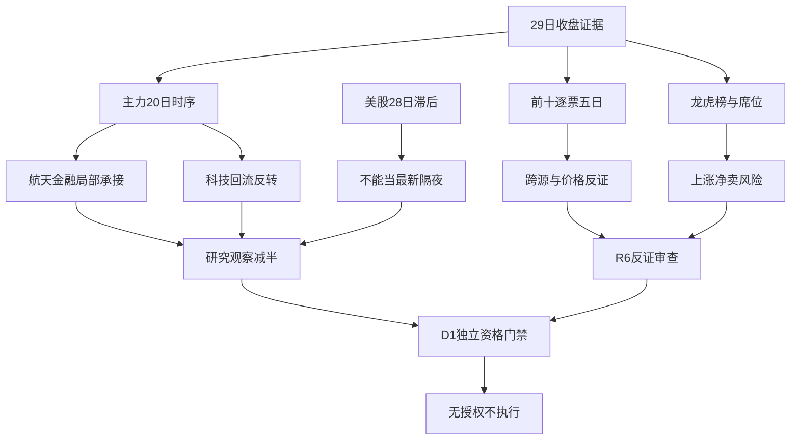

# 2026年10月30日 · 资金面

> **数据源新鲜度**: partial ｜ **降级状态**: true ｜ **置信度**: 0.2625
> A股证据截至2026-10-29，为正常盘前T-1；美股实际截至2026-10-28，非最新隔夜。

## 一句话结论

**观察局部航天与金融承接；科技昨日回流8/10反转，资金证据不足以放行新仓。**

## 详细分析

### 🧭 先认市场，再认个股

1. **市场在为什么付钱**：29日航天装备净入、金融承接，但电子与通信大额流出。这里描述流向，不替R2排主线。
2. **现在处在哪一段**：上游情绪周期为高位震荡；炸板率超过35%，强制显式标注 **情绪=震荡/主跌**。不把一次反抽当主升。
3. **谁有地位**：R2尚未就绪；全市场资金前十不是龙头认定，任何观察票均未获得执行资格。
4. **今天做什么/不做什么**：只做资金研究、观察和R6反证；不交易、不改仓位，不突破有效零预算与既有保护。

主线=未确认（归R2确权）；持续性=未核验；封板率=60.94%（全市场，不能冒充板块封板率）；明日预期=分歧（条件推演，非主线排名）。
研究观察展示数从10减半至5；10只统计追踪仍全量保留，避免为了减半漏掉反证。没有主模板确认，不把五套打法焊成超级策略。

### 📉 主力5/10/20日：28日回流未扭转存量流出

| 窗口 | 净额（亿元） | 解释 |
|---|---:|---|
| 5个交易日 | -1215.07 | 截至29日，窗口完整；非未来预测 |
| 10个交易日 | -2231.43 | 截至29日，窗口完整；非未来预测 |
| 20个交易日 | -5972.30 | 截至29日，窗口完整；非未来预测 |

| 日期 | 主力净额（亿元） | 超大单净额（亿元） | 小单净额（亿元） |
|---|---:|---:|---:|
| 2026-10-23 | +2.80 | +81.03 | +131.47 |
| 2026-10-26 | -278.67 | -161.17 | +298.19 |
| 2026-10-27 | -471.14 | -185.28 | +370.83 |
| 2026-10-28 | +230.30 | +251.98 | -29.74 |
| 2026-10-29 | -698.36 | -380.58 | +505.63 |

- **大资金意图**: 从29日主力与超大单净卖、小单净买的组合看，更接近减风险与局部防守承接；这是行为推断，不是账户穿透结论。
- **为什么走强**: 28日上证与深证反弹，但29日科技前排资金大幅翻负，说明回流缺少持续性，不能线性外推。
- **逻辑够不够硬**: 大盘、逐票、板块三个视角可互证方向，但东财底层相同不能算三独立源；XTick也不是全票一致。

### 🧩 板块时序约束：不把父子行业叠加成总额

| 板块 | 29日净额（亿） | 5日（亿） | 20日（亿） | 资金结论 |
|---|---:|---:|---:|---|
| 航天装备Ⅲ | +10.00 | +10.92 | -5.20 | 观察局部承接 |
| 国防军工 | +8.75 | -39.59 | -116.90 | 观察局部承接 |
| 风电设备 | +8.19 | -0.28 | -40.17 | 观察局部承接 |
| 风电零部件 | +7.05 | +2.97 | -21.17 | 观察局部承接 |
| 国有大型银行Ⅲ | +5.77 | +2.62 | +7.74 | 观察局部承接 |
| 保险Ⅲ | +4.72 | +2.65 | -23.96 | 观察局部承接 |
| 电子 | -309.22 | -389.37 | -1881.45 | 降级，流出反证 |
| 半导体 | -136.40 | -124.00 | -850.59 | 降级，流出反证 |
| 通信 | -113.95 | -103.55 | -804.86 | 降级，流出反证 |
| 通信设备 | -111.15 | -97.38 | -767.48 | 降级，流出反证 |
| 元件 | -90.04 | -170.01 | -552.35 | 降级，流出反证 |

- **大资金意图**: 航天装备当日吸金，但国防军工5日仍净流出；保险和大行出现承接，不因传统行业标签静态排除。
- **为什么走强**: 航天细分资金集中和金融相对强势是已见事实；新增订单、政策与产业催化未在R7内核验，不补造因果。
- **逻辑够不够硬**: 航天装备20日仍为负、保险20日仍为负，所以只给观察，不给“已确立主升”。半导体/电子的净卖构成科技修复的强反证。

跷跷板：20板块、190对、20完整交易日检验，没有达到ρ<-0.6并满足双边5日反转的配对。日内金融强科技弱不等于20日统计跷跷板，不伪造相关系数。

## 🧮 昨日前十：逐票五日追踪

选取基准为2026-10-29全市场东财主力净入前十；回溯窗口为2026-10-23、26、27、28、29。以下不是“选中后的未来五日收益”。单位均为亿元；括号后的价格收益只描述已发生走势。

| 代码/名称 | 23日 | 26日 | 27日 | 28日 | 29日 | 5日合计 | 净入天数 | 5日价格% | XTick29日 | 态度 |
|---|---:|---:|---:|---:|---:|---:|---:|---:|---:|---|
| 600118.SH 中国卫星 | -0.12 | -0.45 | -0.34 | +0.67 | +6.64 | +6.40 | 2/5 | +11.40 | +10.87 | 观察 |
| 002149.SZ 西部材料 | -0.31 | -0.07 | -0.17 | +0.83 | +5.00 | +5.28 | 2/5 | +12.46 | +4.78 | 观察 |
| 601318.SH 中国平安 | +0.51 | +1.13 | -0.57 | +2.12 | +4.19 | +7.38 | 4/5 | +4.44 | +8.15 | 观察 |
| 000530.SZ 冰山冷热 | -0.74 | -2.06 | -1.84 | +0.27 | +3.85 | -0.52 | 2/5 | -13.28 | +5.36 | 降级 |
| 000858.SZ 五 粮 液 | +1.18 | +0.69 | -1.11 | -2.90 | +3.48 | +1.34 | 3/5 | +0.77 | +1.25 | 降级 |
| 002865.SZ 钧达股份 | -0.40 | -0.04 | +1.24 | +0.37 | +3.04 | +4.21 | 3/5 | +7.88 | +3.63 | 观察 |
| 601398.SH 工商银行 | -4.59 | +1.18 | +1.78 | +1.65 | +3.02 | +3.03 | 4/5 | +2.21 | +4.57 | 降级 |
| 002565.SZ 顺灏股份 | -0.05 | +0.26 | -0.55 | +0.45 | +2.80 | +2.91 | 3/5 | +1.12 | +4.25 | 观察 |
| 003006.SZ 百亚股份 | +3.86 | +4.40 | +2.53 | +2.81 | +2.79 | +16.38 | 5/5 | -0.13 | -0.49 | 降级 |
| 601288.SH 农业银行 | -2.00 | +1.83 | +1.49 | +0.88 | +2.72 | +4.93 | 4/5 | +2.16 | +0.91 | 降级 |

50/50股票日观测齐全。东财与XTick当日9/10同向，但金额阈值不同，不能平均成“真实主力资金”。百亚股份是反例：东财净入、XTick净出且股价跌，降级而非只挑利好源。
冰山冷热虽29日涨停吸金，5日净额仍为负、5日价格跌13.28%，板型是首板不代表位置低。五粮液与银行等仅作轮动参照，没有R2确认就不凭资金榜授予主线地位。

### 🔄 再查上一轮前十：科技脉冲的次日兑现

| 28日资金前十 | 28日净额（亿） | 29日净额（亿） | 是否翻负 |
|---|---:|---:|---|
| 300308.SZ 中际旭创 | +31.97 | -9.65 | 是 |
| 603986.SH 兆易创新 | +17.64 | -7.67 | 是 |
| 300502.SZ 新易盛 | +14.84 | -11.55 | 是 |
| 300394.SZ 天孚通信 | +8.96 | -21.72 | 是 |
| 601138.SH 工业富联 | +8.49 | -10.68 | 是 |
| 600036.SH 招商银行 | +7.44 | +0.80 | 否 |
| 300223.SZ 君正股份 | +6.80 | +0.55 | 否 |
| 002463.SZ 沪电股份 | +6.61 | -12.84 | 是 |
| 600601.SH 方正科技 | +6.33 | -3.98 | 是 |
| 688256.SH 寒武纪 | +6.28 | -6.12 | 是 |

28日前十合计由 +115.36 亿转为29日 -82.85 亿，8/10翻负。此表同时保留每票5日历史在JSON中，不假定是同一批账户由科技转向金融。

## 🧪 五只资金研究观察：不是买入名单

共同门禁：板型只按29日事实描述；龙头认定通过条数=0（未授予资格，不是认定为杂毛）；RR和止损距离未知；全部不进execution。机会类型待D1判定，不把“待核验计划内试错”写成已有交易计划。

### 🟡 中国卫星（600118.SH）｜观察

板型：首板；龙头认定：未确认/通过0条；盈亏比：未核验；禁止清单命中项：已核子集未命中，完整14项尚未通过。

- **大资金意图**: 航天装备当日资金支撑，但20日仍略净流出，不把单日爆发当主升确认。
- **为什么走强**: 29日主力净额+6.64亿，五日+6.40亿，20日-0.34亿；航天装备Ⅲ单日+10.00亿、5日+10.92亿；不含财务/订单核验。
- **逻辑够不够硬**: 资金方向不等于产业催化与龙头身份；即便跨源同向，R2地位、R5事件与R6反证未完成仍不进。

**买入理由**：当前不具备买入资格。研究理由①当日净流入与价格响应有数据锚；②对应行业资金已取证，但产业逻辑尚未完成R5核验。不是以资金数据代替两条完整买入理由。

**风险点**：①炸板率39.06%下次日承接可能失效；②新增基本面催化与主线排名未证实，行业流入可能只是轮动。

**止损条件**：未开仓，无交易止损价；不编造entry/stop/target。研究撤销条件为下一可用交易日主力大单加超大单净额转负且对应板块亦转负；已有持仓仍服从原D1退出规则，不被本报告覆盖。

**可验证假设**：未来24—72小时的下一可用收盘，个股主力净额>0且板块主力净额>0，才保留资金正向观察；任一不满足即降级。龙头与RR仍须另过门禁。

### 🟡 西部材料（002149.SZ）｜观察

板型：首板；龙头认定：未确认/通过0条；盈亏比：未核验；禁止清单命中项：已核子集未命中，完整14项尚未通过。

- **大资金意图**: 20日净流入为正，29日上涨获得两资金口径正向确认。
- **为什么走强**: 29日主力净额+5.00亿，五日+5.28亿，20日+8.10亿；资金可支持军工材料方向研究；军工行业5日仍流出，不做全板块背书。
- **逻辑够不够硬**: 资金方向不等于产业催化与龙头身份；即便跨源同向，R2地位、R5事件与R6反证未完成仍不进。

**买入理由**：当前不具备买入资格。研究理由①当日净流入与价格响应有数据锚；②对应行业资金已取证，但产业逻辑尚未完成R5核验。不是以资金数据代替两条完整买入理由。

**风险点**：①炸板率39.06%下次日承接可能失效；②新增基本面催化与主线排名未证实，行业流入可能只是轮动。

**止损条件**：未开仓，无交易止损价；不编造entry/stop/target。研究撤销条件为下一可用交易日主力大单加超大单净额转负且对应板块亦转负；已有持仓仍服从原D1退出规则，不被本报告覆盖。

**可验证假设**：未来24—72小时的下一可用收盘，个股主力净额>0且板块主力净额>0，才保留资金正向观察；任一不满足即降级。龙头与RR仍须另过门禁。

### 🟡 中国平安（601318.SH）｜观察

板型：非涨停板；龙头认定：未确认/通过0条；盈亏比：未核验；禁止清单命中项：已核子集未命中，完整14项尚未通过。

- **大资金意图**: 4/5日净流入，配置型承接强于单日情绪脉冲。
- **为什么走强**: 29日主力净额+4.19亿，五日+7.38亿，20日+5.08亿；保险当日+4.72亿但20日-23.96亿；传统防守标签不能替代当日资金。
- **逻辑够不够硬**: 资金方向不等于产业催化与龙头身份；即便跨源同向，R2地位、R5事件与R6反证未完成仍不进。

**买入理由**：当前不具备买入资格。研究理由①当日净流入与价格响应有数据锚；②对应行业资金已取证，但产业逻辑尚未完成R5核验。不是以资金数据代替两条完整买入理由。

**风险点**：①炸板率39.06%下次日承接可能失效；②新增基本面催化与主线排名未证实，行业流入可能只是轮动。

**止损条件**：未开仓，无交易止损价；不编造entry/stop/target。研究撤销条件为下一可用交易日主力大单加超大单净额转负且对应板块亦转负；已有持仓仍服从原D1退出规则，不被本报告覆盖。

**可验证假设**：未来24—72小时的下一可用收盘，个股主力净额>0且板块主力净额>0，才保留资金正向观察；任一不满足即降级。龙头与RR仍须另过门禁。

### 🟡 钧达股份（002865.SZ）｜观察

板型：首板；龙头认定：未确认/通过0条；盈亏比：未核验；禁止清单命中项：已核子集未命中，完整14项尚未通过。

- **大资金意图**: 5/10/20日累计均为净流入，资金侧比一次性修复更连续。
- **为什么走强**: 29日主力净额+3.04亿，五日+4.21亿，20日+5.03亿；光伏电池组件当日+2.68亿；未取得新增产业催化证据，不编造订单。
- **逻辑够不够硬**: 资金方向不等于产业催化与龙头身份；即便跨源同向，R2地位、R5事件与R6反证未完成仍不进。

**买入理由**：当前不具备买入资格。研究理由①当日净流入与价格响应有数据锚；②对应行业资金已取证，但产业逻辑尚未完成R5核验。不是以资金数据代替两条完整买入理由。

**风险点**：①炸板率39.06%下次日承接可能失效；②新增基本面催化与主线排名未证实，行业流入可能只是轮动。

**止损条件**：未开仓，无交易止损价；不编造entry/stop/target。研究撤销条件为下一可用交易日主力大单加超大单净额转负且对应板块亦转负；已有持仓仍服从原D1退出规则，不被本报告覆盖。

**可验证假设**：未来24—72小时的下一可用收盘，个股主力净额>0且板块主力净额>0，才保留资金正向观察；任一不满足即降级。龙头与RR仍须另过门禁。

### 🟡 顺灏股份（002565.SZ）｜观察

板型：首板；龙头认定：未确认/通过0条；盈亏比：未核验；禁止清单命中项：已核子集未命中，完整14项尚未通过。

- **大资金意图**: 5/10/20日均为净流入且当日涨停，资金侧可作研究参考。
- **为什么走强**: 29日主力净额+2.80亿，五日+2.91亿，20日+8.77亿；纸包装板块当日+2.61亿；公司题材归属和主业纯度交R2/R5，不自行贴科技标签。
- **逻辑够不够硬**: 资金方向不等于产业催化与龙头身份；即便跨源同向，R2地位、R5事件与R6反证未完成仍不进。

**买入理由**：当前不具备买入资格。研究理由①当日净流入与价格响应有数据锚；②对应行业资金已取证，但产业逻辑尚未完成R5核验。不是以资金数据代替两条完整买入理由。

**风险点**：①炸板率39.06%下次日承接可能失效；②新增基本面催化与主线排名未证实，行业流入可能只是轮动。

**止损条件**：未开仓，无交易止损价；不编造entry/stop/target。研究撤销条件为下一可用交易日主力大单加超大单净额转负且对应板块亦转负；已有持仓仍服从原D1退出规则，不被本报告覆盖。

**可验证假设**：未来24—72小时的下一可用收盘，个股主力净额>0且板块主力净额>0，才保留资金正向观察；任一不满足即降级。龙头与RR仍须另过门禁。

## 🕵️ 龙虎榜诱多风险：先去重，再看涨价与净卖背离

原始75条披露，涉及69只股票；不是75只。上涨诱多风险9只，另有下跌/高换手分配风险3只。所有结论为风险筛查，不认定操纵或真实卖方意图。

| 股票 | 涨跌% | 换手% | 榜单净额（亿） | 已披露机构净额（亿） | 窗口 | 风险项 |
|---|---:|---:|---:|---:|---|---|
| 002249.SZ 大洋电机 | +3.24 | 17.97 | +0.10 | +0.05 | 多日累计 | 上涨但东财主力净流出至少1500万元 |
| 002343.SZ 慈文传媒 | +2.99 | 38.72 | -0.56 | -0.23 | 单日 | 上涨但龙虎榜净卖出至少1500万元；上涨但机构专用净卖出至少1500万元；换手至少30%且榜单净卖 |
| 002696.SZ 百洋股份 | +4.93 | 36.20 | -1.06 | -0.58 | 单日 | 上涨但龙虎榜净卖出至少1500万元；上涨但机构专用净卖出至少1500万元；换手至少30%且榜单净卖；上涨但东财主力净流出至少1500万元 |
| 002708.SZ 光洋股份 | +9.98 | 27.90 | +0.74 | +0.34 | 单日 | 上涨但东财主力净流出至少1500万元 |
| 002943.SZ 宇晶股份 | +10.00 | 18.05 | -0.06 | -0.42 | 多日累计 | 上涨但机构专用净卖出至少1500万元 |
| 301232.SZ 飞沃科技 | +17.09 | 29.50 | -0.84 | +0.09 | 单日 | 上涨但龙虎榜净卖出至少1500万元 |
| 600558.SH 大西洋 | +4.98 | 14.43 | -0.16 | +0.00 | 单日 | 上涨但龙虎榜净卖出至少1500万元 |
| 600715.SH 文投控股 | +10.19 | 17.97 | -1.05 | +0.00 | 单日 | 上涨但龙虎榜净卖出至少1500万元；上涨但东财主力净流出至少1500万元 |
| 920220.BJ 朗信电气 | +2.56 | 24.56 | -0.30 | -0.08 | 单日 | 上涨但龙虎榜净卖出至少1500万元 |
| 301052.SZ 果麦文化 | -6.13 | 35.43 | -1.08 | -0.52 | 单日 | 换手至少30%且榜单净卖 |
| 301686.SZ 中塑股份 | -3.36 | 31.20 | -0.19 | -0.18 | 单日 | 换手至少30%且榜单净卖 |
| 600838.SH 上海九百 | -2.57 | 35.60 | -0.21 | +0.00 | 单日 | 换手至少30%且榜单净卖 |

- **大资金意图**: 慈文传媒、百洋股份等上涨伴随榜单及披露机构净卖，存在借强势兑现的解释；不能把净买榜外观当所有资金都在做多。
- **为什么走强**: 涨幅与换手可能由情绪/交易推动，榜单净卖是反证；若是多日榜，只说明该累计窗口，不能写成当日机构卖出。
- **逻辑够不够硬**: 价、榜单、机构和主力分类提供多个证据面，但非全市场持仓穿透；机构专用同名席位不能当成同一主体。

**降级**上述风险票并交R6逐票审查，R7不输出hard_reject。果麦文化、中塑股份、上海九百是下跌高换手风险，不强称“当日上涨诱多”。
游资协同：按最近三日同营业部同票至少两次正净买、单日榜去重及封板/ST过滤，合格信号0。没有协同不排除事件票；公告风险尚未核验，不伪装通过。

## 🏦 ETF与期货：一级申赎、二级流向各归各位

| ETF | 份额观察日 | 28日份额变化（万份） | 28日估计申赎代理（亿） | 29日二级主力（亿） |
|---|---|---:|---:|---:|
| 510300.SH | 2026-10-28 | +13950.00 | +5.79 | -3.32 |
| 510500.SH | 2026-10-28 | +6600.00 | +4.40 | -0.53 |
| 159915.SZ | 2026-10-28 | -24100.00 | -6.38 | -24.03 |
| 588000.SH | 2026-10-28 | -64200.00 | -8.69 | -18.18 |

28日篮子份额×收盘估计合计-4.88亿；29日二级主力合计-46.06亿。两者日期、语义不同，29日真实一级净流量仍是未知/null。不能把成交额、订单净额或旧份额估算改名为当日申购。
IF2611收盘4010.4，沪深300收盘4041.8376，基差-31.4376点；只是同日方向代理，非扣除分红与资金成本后的套利基差。ETF隐波未核验。
两融：29日实查空，28日可得；9票各取15交易日，百亚主备源均无记录，字段空列表伴unavailable状态，不填零、不写完整。

## 🌏 外部传导：美股文件已读，但不是最新隔夜

| 标的/指数 | 实际观察日 | 源文件涨跌% | A股映射/边界 |
|---|---|---:|---|
| MU | 2026-10-28 | +5.86 | 存储，滞后一晚 |
| NVDA | 2026-10-28 | -1.17 | AI算力/CPO，滞后一晚 |
| AVGO | 2026-10-28 | +2.77 | AI芯片/互连，滞后一晚 |
| AMD | 2026-10-28 | +3.24 | AI芯片，滞后一晚 |
| TSM | 2026-10-28 | +0.60 | 半导体制造，滞后一晚 |
| GLW | 2026-10-28 | +3.88 | 光通信材料，滞后一晚 |
| AAPL | 2026-10-28 | -0.94 | 消费电子，滞后一晚 |
| MSFT | 2026-10-28 | -0.06 | 云/AI，滞后一晚 |
| META | 2026-10-28 | -1.24 | 平台AI，滞后一晚 |
| GOOGL | 2026-10-28 | +1.34 | 平台AI，滞后一晚 |
| AMZN | 2026-10-28 | +0.59 | 云/消费，滞后一晚 |
| TSLA | 2026-10-28 | -0.80 | 汽车/机器人，滞后一晚 |
| SPX | 2026-10-28 | +0.28 | 滞后一晚 |
| IXIC | 2026-10-28 | +0.27 | 滞后一晚 |
| SOX | 缺失 | 未核验 | 无记录，不填0 |

- **大资金意图**: 无最新美股资金或账户证据，只能描述28日价格分化；不从旧涨跌断言29日美国大资金行为。
- **为什么走强**: MU、AMD、AVGO在28日源记录上涨，而NVDA下跌；缺少催化文本，不把变动自动归因财报。
- **逻辑够不够硬**: 期待US会话为29日，文件只到28日；A股29日半导体净出136.40亿、通信净出113.94亿是已发生反证。最新隔夜方向未核验，不能据旧数据放行科技。
INTC与MRVL未包含在本次文件中；SOX未返回。已保留缺口，不用SPX或IXIC替代SOX，不补造14票全覆盖。

## 关键证据

- 主力20日累计-5972.30亿，29日主力净出698.36亿、超大单净出380.58亿。来源：Tushare moneyflow_mkt_dc。
- 上一轮资金前十8/10翻负，29日科技回流缺少持续承接。来源：两日全市场moneyflow_dc及逐票五日序列。
- 炸板25、封板39，炸板率25/(25+39)=39.0625%，情绪=震荡/主跌，研究候选减半。来源：Tushare limit_list_d。
- XTick与东财前十9/10同向，百亚反向；10票身份与同日收盘价匹配，保留金额口径差。
- 北向未主动查询，不参加置信度/时效分母，不影响任何已有交易预算。

## 数据源审计

| 源 | 日期 | 状态 | 抓取日期 | 记录数 | 备注 |
|---|---|:--:|---|---:|---|
| tushare.moneyflow_mkt_dc | 2026-10-29 | 🟢 | 2026-10-30 | 20 | 元转亿元；20个交易日齐全 |
| tushare.moneyflow_ind_dc | 2026-10-29 | 🟢 | 2026-10-30 | 9920 | 20日×496行；层级重叠，不相加；逐日查询规避行上限 |
| tushare.moneyflow_dc | 2026-10-29 | 🟢 | 2026-10-30 | 6031 | 个股接口单位万元，与大盘/板块元不同；6031原始条目并非6031只当前上市A股 |
| tushare.daily/stock_basic/daily_basic | 2026-10-29 | 🟢 | 2026-10-30 | 5570 | 日线5570、上市表5577；资金表454条不在当前上市表，不能直接作候选；前十10只名称/收盘匹配 |
| tushare.moneyflow | 2026-10-29 | 🟢 | 2026-10-30 | 50 | 10票×5日；只拿大单+超大单与主力净额比较；不混用net_mf字段 |
| tushare.top_list/top_inst | 2026-10-29 | 🟢 | 2026-10-30 | 431 | 五日全量；连续三日榜与单日榜严格分开，席位去重 |
| xtick.hot_money | 2026-10-29 | 🟢 | 2026-10-30 | 200 | 10票实查20日，JSON对象流逐段解析；9/10同向、百亚反向；阈值口径不同不平均 |
| vibe.get_block_trades | 2026-10-29 | 🟢 | 2026-10-30 | 10 | 10票30自然日逐票实调；空记录=接口成功无成交，不是未调 |
| vibe.get_margin_trading | 2026-10-28 | 🟡 | 2026-10-30 | 135 | 9票15日、百亚无记录；29日未到披露时点，不冒充最新交易日完整 |
| tushare.margin_detail | 2026-10-28 | 🟡 | 2026-10-30 | 4485 | 29日实查为空，28日4485条可得；百亚单票主备源均无记录 |
| vibe.get_dragon_tiger | 2026-10-29 | 🟢 | 2026-10-30 | 75 | 75条披露，与Tushare同底层东财，不额外算独立来源 |
| vibe.get_fund_flow.stock | 未核验 | 🔴 | 2026-10-30 | 未知 | 10票分项均ProxyError；缩至2票重试仍失败；顶层ok=true不代表子项成功 |
| vibe.get_fund_flow.etf | 2026-10-29 | 🟢 | 2026-10-30 | 20 | 4只ETF二级订单净额，不是一级净申购 |
| tushare.fund_share/fund_daily | 2026-10-28 | 🟡 | 2026-10-30 | 20 | 份额5日×4只至28日；份额差×价格仅估计代理，29日一级申赎未知 |
| vibe.get_market_data.akshare.IF2611 | 2026-10-29 | 🟢 | 2026-10-30 | 2 | IF2611非连续合约；收盘基差方向代理，不是公允套利基差 |
| tushare.index_daily | 2026-10-29 | 🟢 | 2026-10-30 | 1 | 沪深300同日收盘 |
| datapro.dataPro_search | 未核验 | 🔴 | 2026-10-30 | 未知 | code=4013，订阅失效或未分配席位；健康握手正常不等于业务查询正常 |
| vibe.iwencai_search | 未核验 | 🔴 | 2026-10-30 | 未知 | access key not configured；ETF份额改由Tushare实时查询补足已披露日期，不改凭证 |
| overseas_snapshot | 2026-10-28 | 🟡 | 2026-10-30 | 12 | 期待29日，美股实际28日；SOX/INTC/MRVL未返回，不能标作最新隔夜 |
| manifest | 2026-10-30 | 🟢 | 2026-10-30 | 1 | 启动severity以mcp_health.global_severity=2为准 |
| mcp_health | 2026-10-30 | 🟢 | 2026-10-30 | 1 | 对缺口逐业务验证，非简单继承握手状态 |

置信度公式：0.75 × 0.7 × 0.5 = 0.2625，且受severity≥2上限0.5约束。两家MCP供应同一东财底层不重复计数；XTick不是全票共振，保守按单独一源确认因子。北向完全排除，不用排除北向恢复历史高分。

## 不确定性 / 反证

- 金融/航天相对强不等于资金已经确立新主线；20日累计负额和旧科技次日反转均反对简单追涨。
- 行业父子层级重叠，去掉完全相同向量仍不是互斥行业体系，禁止把展示数加总成全市场。
- 个股资金原始6031条与当前上市5577只口径不同，454条不在当前上市表；必须按身份过滤。前十全部验证身份/同日价格匹配，不把全表当6031只可买股票。
- 真正一级ETF申赎未知、份额/两融滞后、百亚两融缺、美股旧日、个股vibe跨源失败；本报告必须partial/degraded，不因结构校验通过标complete。
- 资金分类是供应商算法推断，不是实名账户穿透；“诱多”仅风险模式，不是市场操纵认定。
- 若下一可用交易日科技核心与板块同步转正且封板承接恢复，应由R2/D1重新评估；本次负面资金事实不延伸为永久行业黑名单。

## 与其他 R/D/E 的关系

- 依赖：当日manifest、mcp_health、overseas_snapshot；参考emotion_cycle。R1/R2主artifact在取证时未就绪，不借昨日结论冒充今日。
- 被消费：R2用板块流向确权、R5用逐票资金和两融缺口、R6用出货/诱多反证、D1保留独立资格与RR门禁、E1后续回填验证。
- 本报告不给买卖时点、不改仓、不发hard_reject、不豁免R6，既有零预算与不交易决定保持。

## Sub-Agent 元数据

- skill: analyze_capital_flow_v1
- artifact: data/research/20261030/R7_capital_flow.json
- 日期命名实体: data/research/20261030/R7_capital_flow_20261030.json
- evidence: data/research/20261030/R7_evidence_20261030.json
- 生成耗时: 752 秒
- model: gpt-6.1-sol
- 运行: 单阶段唯一研究者；仅确定性数据辅助，无CLI/模型再包装、无delegation。
- 实际生成时间见frontmatter；本次非回放，来源观察日逐维保留。
- usage: usage_unknown，未知不按0；5000万为连续任务努力目标，非硬限/新额度；08:30为observe_only目标，不作成功替代。
