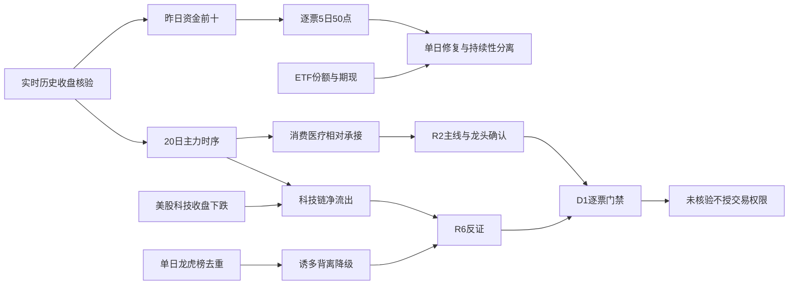

# 2026年11月2日 · **资金面**

> **数据源新鲜度**: partial；主力/游资最新已收盘日为2026-10-30，周一使用上周五属正常T-1。
> **降级状态**: true · **置信度**: 0.2625 · **情绪=震荡/主跌**（炸板阈值纪律标签，非替代R1阶段判断）。
> **时点披露**: 本轮在交付目标后启动，实际生成与知识截止见frontmatter；未用今日盘中行情，不冒充08:30前预测。

## 🧭 一句话结论

**观察承接、降级追涨：五日主力净流出1614.53亿，白酒相对承接，科技外压未解除。**

## 🔎 详细分析

资金在为相对承接付钱，而不是为全市场扩张付钱。10月30日大盘口径主力净流出396.66亿元，五日只有1个净流入日、20日只有3个净流入日。食品饮料、白酒与医疗研发外包的净流入说明局部有买盘，但不能把相对抗跌、低位或资金名次直接等同于R2确认的主线。

时间尺度改变结论。宁德时代单日位居资金前十之首，五日却仍净流出6.42亿元，属于单日修复而非持续吸筹已确认。10月29日前十到30日仅剩1只仍在前十，4只转为净流出；截至30日倒选的榜单不能冒充29日已知的选股结果。

榜单买入不等于全市场合力。金安国纪单日主力净流入8.18亿元，同时单日机构席位去重净卖1.30亿元；澳洋健康存在重复游资映射买入，但当天主力净流出0.93亿元且龙虎榜净卖。两种证据可同时为真，处理为降级，不以“有游资”覆盖反证。

ETF份额变化与股票订单流指向不同层面：四ETF份额乘价格代理约130.48亿元，三只可取得的二级主力订单流小计却为-34.86亿元。前者可能体现承接需求，后者体现交易盘卖压，不能相抵后宣称资金转多。IF2611同日贴水25.501点，市场两融余额一日减少418.29亿元，继续要求承接有连续性。

R7今日只交付资金约束和研究观察，不进execution。正式R2主线/龙头与主模板未交付，RR和禁止清单完整门禁也未核验；缺北向不会触发整体失效，但其他有效零预算、R6否决及已有交易保护完全不变。

## 📊 主力时序与板块承接

| 窗口 | 主力净额/亿元 | 净流入日 | 净流出日 |
|---|---:|---:|---:|
| 5日 | -1614.53 | 1 | 4 |
| 10日 | -2578.73 | 2 | 8 |
| 20日 | -5716.81 | 3 | 17 |

| 近5日 | 主力/亿元 | 超大单净额/亿元 | 大单净额/亿元 |
|---|---:|---:|---:|
| 2026-10-26 | -278.67 | -161.17 | -117.49 |
| 2026-10-27 | -471.14 | -185.28 | -285.86 |
| 2026-10-28 | +230.30 | +251.98 | -21.68 |
| 2026-10-29 | -698.36 | -380.58 | -317.78 |
| 2026-10-30 | -396.66 | -165.51 | -231.15 |

板块资金接口单位为元，除以1e8得到亿元；个股资金接口单位为万元，除以1e4。行业Ⅱ/Ⅲ和父子行业重复覆盖，不得相加。以下为资金统计，不是R2板块优先级。

| 统计板块 | 10月30日净额/亿元 | 5日净额/亿元 | 涨跌/% |
|---|---:|---:|---:|
| 食品饮料 | +30.05 | +27.72 | +0.83 |
| 医药生物 | +26.49 | -3.10 | -0.61 |
| 白酒Ⅲ | +25.00 | +27.91 | +5.15 |
| 白酒Ⅱ | +25.00 | +27.91 | +5.15 |
| 医疗服务 | +16.36 | +34.90 | +1.58 |
| 医疗研发外包 | +14.39 | +28.86 | +3.37 |
| 电子 | -112.43 | -568.32 | -4.62 |
| 通信 | -58.76 | -163.69 | -5.48 |
| 半导体 | -56.14 | -248.83 | -5.45 |

### 食品饮料/白酒：观察，不用静态“防守股”标签排除
- **大资金意图**: 食品饮料单日流入30.05亿元，白酒子行业约25.00亿元；假设是从成长高波动转向相对低位承接，而非已证明同一批资金迁移。
- **为什么走强**: 白酒单日资金转入且泸州老窖收涨10.01%，存在板块效应；硬政策/业绩催化在R7未核验，不为上涨补写故事。
- **逻辑够不够硬**: 国内资金截面支持相对承接，但大盘仍净流出；必须由R2确认持续性、封板质量和龙头，不能以传统行业身份否决或放行。

### 医疗研发外包：观察，分清行业买盘与个股背离
- **大资金意图**: 行业单日净流入14.39亿元、五日净流入约28.86亿元，较宽泛医药行业更有持续承接特征。
- **为什么走强**: 净额窗口支持相对吸纳，但上游研究池中的东方海洋、澳洋健康并非因为属于医疗叙事就自动获资金确认。
- **逻辑够不够硬**: 单一东财主干分发不构成多源产业共振；个股涨停而主力流出时先降级，真实产业映射和催化归R4/R5。

### 半导体/通信：降级，外部下跌与国内出流同向
- **大资金意图**: 电子单日流出112.43亿元、半导体56.14亿元、通信58.76亿元，价格承压中的减风险解释比全面吸筹更符合资金证据。
- **为什么走强**: 未确认行业走强；个别涨停例外只说明局部资金博弈，不能反推整条科技链已经修复。
- **逻辑够不够硬**: 国内主力流出与美国核心科技下跌方向一致，但不能推断因果比例；若国内连续净流入并出现封板承接，当前压制假设可被证伪。

## 🧾 昨日前十 · 完整5日追踪

选择日为2026-10-30，窗口为10月26日至30日；50/50个股票日齐全，XTick对这10票也取得50/50个日点。数字是回看持续性的研究，不是事前收益样本。五日收益按30日收盘对23日收盘计算。名称保留数据源原文。

| 代码/名称 | 26日 | 27日 | 28日 | 29日 | 30日 | 5日合计/亿元 | 资金态度 |
|---|---:|---:|---:|---:|---:|---:|---|
| 300750.SZ 宁德时代 | +0.62 | -4.83 | -12.90 | -0.21 | +10.90 | -6.42 | 降级 |
| 002636.SZ 金安国纪 | -2.48 | +0.43 | +5.84 | -2.73 | +8.18 | +9.23 | 降级 |
| 000858.SZ 五 粮 液 | +0.69 | -1.11 | -2.90 | +3.48 | +7.37 | +7.53 | 观察 |
| 002747.SZ 埃斯顿 | -0.81 | -0.96 | +0.79 | -1.75 | +5.33 | +2.60 | 降级 |
| 000568.SZ 泸州老窖 | +0.73 | -0.23 | -1.04 | +0.42 | +5.29 | +5.17 | 观察 |
| 600519.SH 贵州茅台 | -1.35 | +2.56 | +0.97 | +0.17 | +4.94 | +7.29 | 观察 |
| 600036.SH 招商银行 | -2.28 | +2.15 | +7.44 | +0.80 | +4.87 | +12.99 | 观察 |
| 300223.SZ 君正股份 | -1.06 | -1.01 | +6.80 | +0.55 | +4.11 | +9.39 | 观察 |
| 603002.SH 宏昌电子 | -0.44 | -0.00 | +0.39 | -0.34 | +3.94 | +3.54 | 降级 |
| 002031.SZ 巨轮智能 | -0.67 | +0.31 | +0.63 | -0.64 | +3.01 | +2.64 | 降级 |

前一轮名单审计：10月29日前十合计`37.54`亿元，到30日为`9.20`亿元；`4/10`转出，`1/10`仍在前十。此表与昨日名单回看分开，不把轮动当作同一笔资金换仓。

### 顶部5只研究观察 · 情绪纪律减半

炸板31只、封板47只，炸板率为31/(47+31)=39.7436%。研究展示由10只减为5只；统计追踪和全部上游候选风险审查不减。以下均无开仓资格；禁止清单命中数组为空只代表未完成核验，不代表通过。

### 宁德时代 `300750.SZ` · 降级
板型：未涨停；龙头认定：未确认，纪律通过0条；RR：未知，止损距未知，execution=false；禁止清单：未完整核验，不能解释成0命中放行。
- **大资金意图**: 单日净额`+10.90`亿元、五日`-6.42`亿元，锂电方向单日回流，但电池板块五日仍在净流出，不能把单日大额买盘当主升确权。
- **为什么走强**: 昨日涨跌`+1.68%`、真实五日收益`-1.97%`。资金解释只到订单分类净额，不推断真实买方身份。
- **逻辑够不够硬**: 同源东财两通道不是两份独立共识；产业/事件硬锚、R2地位、计划类别和RR尚缺，态度不升级为“进”。

**买入理由**：本段不构成买入建议。研究理由一是该产业方向是否得到板块资金承接，二是该票昨日净额`+10.90`亿元与五日净额的持续性差异；产业纯度和硬事件须由R5/R4取证，未核验不拼补理由。

**风险点**：五日资金仍负、融资余额15点窗口降幅较大，存在反弹后再流出的可能；海外科技风险偏好下行也可能牵连成长估值。

**止损条件**：这里只定义研究论点失效，不输出实盘买卖时点。若上述资金连续性条件被证伪，停止正向资金观察；无D1计划入场价与止损价，不生成虚构价位或RR。实盘必须保留原退出规则，且止损距5%—10%、RR≥2及其他门禁独立生效。

**可验证假设**：未来1—3个交易日主力连续两日净流入且滚动五日转正，才支持资金持续性假设；若再次单日净卖超过0.15亿元，停止正向观察。

### 金安国纪 `002636.SZ` · 降级
板型：涨停(1)；龙头认定：未确认，纪律通过0条；RR：未知，止损距未知，execution=false；禁止清单：未完整核验，不能解释成0命中放行。
- **大资金意图**: 单日净额`+8.18`亿元、五日`+9.23`亿元，单日首板与资金净额共振，但机构方向与全体主力方向相反，应把分歧放在显著位置。
- **为什么走强**: 昨日涨跌`+10.00%`、真实五日收益`+5.36%`。资金解释只到订单分类净额，不推断真实买方身份。
- **逻辑够不够硬**: 同源东财两通道不是两份独立共识；产业/事件硬锚、R2地位、计划类别和RR尚缺，态度不升级为“进”。

**买入理由**：本段不构成买入建议。研究理由一是该产业方向是否得到板块资金承接，二是该票昨日净额`+8.18`亿元与五日净额的持续性差异；产业纯度和硬事件须由R5/R4取证，未核验不拼补理由。

**风险点**：单日机构去重净卖1.30亿元；行业电子整体出流，个股上涨可能是局部交易而非板块扩散。

**止损条件**：这里只定义研究论点失效，不输出实盘买卖时点。若上述资金连续性条件被证伪，停止正向资金观察；无D1计划入场价与止损价，不生成虚构价位或RR。实盘必须保留原退出规则，且止损距5%—10%、RR≥2及其他门禁独立生效。

**可验证假设**：未来1—3个交易日主力保持正净额且下一次单日机构披露不再大额净卖，才弱化背离；机构持续净卖或开板失败，保留降级。

### 五 粮 液 `000858.SZ` · 观察
板型：未涨停；龙头认定：未确认，纪律通过0条；RR：未知，止损距未知，execution=false；禁止清单：未完整核验，不能解释成0命中放行。
- **大资金意图**: 单日净额`+7.37`亿元、五日`+7.53`亿元，白酒承接有板块资金配合，单日净额与五日累计均为正，但没有涨停并不等于自动具有龙头地位。
- **为什么走强**: 昨日涨跌`+3.35%`、真实五日收益`+1.14%`。资金解释只到订单分类净额，不推断真实买方身份。
- **逻辑够不够硬**: 同源东财两通道不是两份独立共识；产业/事件硬锚、R2地位、计划类别和RR尚缺，态度不升级为“进”。

**买入理由**：本段不构成买入建议。研究理由一是该产业方向是否得到板块资金承接，二是该票昨日净额`+7.37`亿元与五日净额的持续性差异；产业纯度和硬事件须由R5/R4取证，未核验不拼补理由。

**风险点**：XTick与东财分类阈值不同，金额不能相互替代；白酒若只是单日防御切换，次日追高的T+1接力仍可能失败。

**止损条件**：这里只定义研究论点失效，不输出实盘买卖时点。若上述资金连续性条件被证伪，停止正向资金观察；无D1计划入场价与止损价，不生成虚构价位或RR。实盘必须保留原退出规则，且止损距5%—10%、RR≥2及其他门禁独立生效。

**可验证假设**：未来1—3个交易日个股主力连续两日不转负且白酒行业滚动五日保持正额，才支持承接延续；行业转出并伴个股净卖则停止正向观察。

### 埃斯顿 `002747.SZ` · 降级
板型：炸板；龙头认定：未确认，纪律通过0条；RR：未知，止损距未知，execution=false；禁止清单：未完整核验，不能解释成0命中放行。
- **大资金意图**: 单日净额`+5.33`亿元、五日`+2.60`亿元，机器人方向存在个股回流，但昨日炸板未证明封板承接，资金排名不能修复板型缺陷。
- **为什么走强**: 昨日涨跌`+2.96%`、真实五日收益`+0.21%`。资金解释只到订单分类净额，不推断真实买方身份。
- **逻辑够不够硬**: 同源东财两通道不是两份独立共识；产业/事件硬锚、R2地位、计划类别和RR尚缺，态度不升级为“进”。

**买入理由**：本段不构成买入建议。研究理由一是该产业方向是否得到板块资金承接，二是该票昨日净额`+5.33`亿元与五日净额的持续性差异；产业纯度和硬事件须由R5/R4取证，未核验不拼补理由。

**风险点**：炸板后隔日承接可能断层；五日流入不大且产业硬催化未核验，无法凭低价或反弹授予低位前排身份。

**止损条件**：这里只定义研究论点失效，不输出实盘买卖时点。若上述资金连续性条件被证伪，停止正向资金观察；无D1计划入场价与止损价，不生成虚构价位或RR。实盘必须保留原退出规则，且止损距5%—10%、RR≥2及其他门禁独立生效。

**可验证假设**：未来1—3个交易日重新出现有效封板并且主力净额为正，才进入重新核验；再次炸板且主力转负，继续降级而非下调标准。

### 泸州老窖 `000568.SZ` · 观察
板型：涨停(1)；龙头认定：未确认，纪律通过0条；RR：未知，止损距未知，execution=false；禁止清单：未完整核验，不能解释成0命中放行。
- **大资金意图**: 单日净额`+5.29`亿元、五日`+5.17`亿元，白酒板块相对承接叠加个股首板，属于需要R2确认是否为今日核心的研究对象，不是R7自行宣布龙头。
- **为什么走强**: 昨日涨跌`+10.01%`、真实五日收益`+10.12%`。资金解释只到订单分类净额，不推断真实买方身份。
- **逻辑够不够硬**: 同源东财两通道不是两份独立共识；产业/事件硬锚、R2地位、计划类别和RR尚缺，态度不升级为“进”。

**买入理由**：本段不构成买入建议。研究理由一是该产业方向是否得到板块资金承接，二是该票昨日净额`+5.29`亿元与五日净额的持续性差异；产业纯度和硬事件须由R5/R4取证，未核验不拼补理由。

**风险点**：封板与单日龙虎榜买盘仍可能仅是一日切换；五日累计包含大幅日间波动，融资余额窗口回落，不是全体资金一致加仓。

**止损条件**：这里只定义研究论点失效，不输出实盘买卖时点。若上述资金连续性条件被证伪，停止正向资金观察；无D1计划入场价与止损价，不生成虚构价位或RR。实盘必须保留原退出规则，且止损距5%—10%、RR≥2及其他门禁独立生效。

**可验证假设**：未来1—3个交易日白酒保持正净额且个股主力连续两日为正，支持接力需求；若板块转出、个股开板并净卖超过0.15亿元，停止正向观察。

## 🧪 上游10票资金约束 · 不缩减风险覆盖

来源为R5_candidate_pool研究对象，不是R7替R2重排主线。已对10票全部补查大宗30日、两融15点及资金20日；与统计前十和前一日名单并集共28票，56次大宗/两融MCP调用均有结果。非两融标的或无大宗时保留真实空集合，不用null冒充未查。

| 对象 | 昨日净额/亿元 | 5日/亿元 | 板型 | 态度 | 资金侧约束 |
|---|---:|---:|---|---|---|
| 001219.SZ 青岛食品 | -0.20 | +0.37 | 涨停(5) | 降级 | 股价上涨但昨日主力净卖至少1500万元 |
| 000568.SZ 泸州老窖 | +5.29 | +5.17 | 涨停(1) | 观察 | 未见本规则资金背离；完整门禁仍未核验 |
| 603198.SH 迎驾贡酒 | +1.08 | +1.26 | 涨停(1) | 观察 | 未见本规则资金背离；完整门禁仍未核验 |
| 002172.SZ 澳洋健康 | -0.93 | +2.66 | 涨停(3) | 降级 | 上涨但主力净卖至少1500万元；上涨但单日龙虎榜净卖至少1500万元；股价上涨但昨日主力净卖至少1500万元 |
| 002086.SZ 东方海洋 | -0.31 | +2.20 | 涨停(2) | 降级 | 上涨但主力净卖至少1500万元；上涨但单日龙虎榜净卖至少1500万元；股价上涨但昨日主力净卖至少1500万元 |
| 002275.SZ 桂林三金 | +0.66 | +1.51 | 涨停(2) | 观察 | 未见本规则资金背离；完整门禁仍未核验 |
| 603131.SH 上海沪工 | +0.52 | +2.24 | 涨停(3) | 观察 | 未见本规则资金背离；完整门禁仍未核验 |
| 003032.SZ 传智教育 | +0.66 | +1.83 | 涨停(2) | 观察 | 未见本规则资金背离；完整门禁仍未核验 |
| 603703.SH 盛洋科技 | +0.22 | +1.41 | 涨停(2) | 观察 | 未见本规则资金背离；完整门禁仍未核验 |
| 600261.SH 阳光照明 | +0.67 | +1.82 | 涨停(2) | 观察 | 未见本规则资金背离；完整门禁仍未核验 |

上表每票均保留JSON中的板型、龙头认定、RR、禁止清单状态。龙头通过数均为0（未获R2认定，不是判断“杂毛”），RR与完整禁止清单未知；不为凑数造票，不把研究观察转换成可交易候选。

## 🚧 龙虎榜诱多/出货风险 · 单日与多日分离

单日去重后识别`9`只上涨资金背离票，另有`3`只下跌高换手净卖票。原始龙虎榜96条含重复上榜及不同统计窗口；`21`条非单日记录单独保存，不与单日相加。机构买卖榜重复经济记录已去重，未上榜机构净额为未知而不是0。

| 上涨背离对象 | 股价/% | 换手/% | 龙虎榜净额/亿 | 机构单日去重/亿 | 主力/亿 | 处理 |
|---|---:|---:|---:|---:|---:|---|
| 000823.SZ 超声电子 | +4.05 | +26.72 | -0.59 | -0.95 | +2.54 | 降级 |
| 002086.SZ 东方海洋 | +10.12 | +27.18 | -0.62 | 未核验 | -0.31 | 降级 |
| 002172.SZ 澳洋健康 | +10.06 | +29.99 | -0.24 | +0.00 | -0.93 | 降级 |
| 002432.SZ 九安医疗 | +9.99 | +4.65 | +1.33 | -0.28 | +2.10 | 降级 |
| 002636.SZ 金安国纪 | +10.00 | +9.20 | +1.32 | -1.30 | +8.18 | 降级 |
| 301079.SZ 邵阳液压 | +8.21 | +44.03 | -0.78 | +0.38 | -1.20 | 降级 |
| 301132.SZ 满坤科技 | +20.01 | +17.30 | -0.42 | +0.02 | +1.23 | 降级 |
| 603278.SH 大业股份 | +9.17 | +32.94 | +0.32 | -0.18 | -0.01 | 降级 |
| 688137.SH 近岸蛋白 | +16.45 | +15.90 | -1.25 | 未核验 | +0.93 | 降级 |

超声电子、东方海洋、澳洋健康、邵阳液压、满坤科技、近岸蛋白存在上涨而单日榜单净卖；金安国纪与九安医疗属于机构与全体主力方向背离。不同风险机制不能合并成“全部出货”的确定性结论。

| 下跌高换手对象 | 涨跌/% | 换手/% | 单日榜单净额/亿 |
|---|---:|---:|---:|
| 000530.SZ 冰山冷热 | -3.77 | +43.22 | -1.21 |
| 000678.SZ 襄阳轴承 | -3.57 | +37.05 | -1.35 |
| 301428.SZ 世纪恒通 | -3.55 | +32.27 | -0.24 |

**大资金意图**只能作为假设：上涨出流可能是派发，也可能是不同投资者正常换手；龙虎榜只覆盖披露席位，并非全市场。“诱多”在这里是反证筛查名，不是操纵定性。R7不发布hard_reject，逐票证据交给R6。

## 🤝 游资协同与板块跷跷板

5日席位历史齐全，滚动3日按同一营业部至少两日正净买筛出`7`项暂定协同。通用机构名、量化策略名、负净卖重复出现不计正向协同；ST、非当前上市及炸板另行剔除。公告风险与窗口唯一性未核验，全部partial观察。

| 对象 | 映射营业部 | 正净买日数 | 正净买累计/万元 | 约束 |
|---|---|---:|---:|---|
| 002172.SZ 澳洋健康 | 国泰海通证券武汉紫阳东路 | 2 | 14,089.12 | 仅观察，公告/多日窗口待复核 |
| 002172.SZ 澳洋健康 | 平安证券浙江分公司 | 3 | 4,529.59 | 仅观察，公告/多日窗口待复核 |
| 002172.SZ 澳洋健康 | 国泰海通证券上海长宁区江苏路 | 2 | 4,079.07 | 仅观察，公告/多日窗口待复核 |
| 601091.SH 沈鼓集团 | 华鑫证券深圳益田路 | 2 | 2,322.45 | 仅观察，公告/多日窗口待复核 |
| 600261.SH 阳光照明 | 国泰海通证券上海松江区中山东路 | 2 | 1,371.42 | 仅观察，公告/多日窗口待复核 |
| 600261.SH 阳光照明 | 东莞证券南京分公司 | 2 | 1,060.53 | 仅观察，公告/多日窗口待复核 |
| 920296.BJ 文峰光电 | 中信建投证券北京东城分公司 | 3 | 915.61 | 仅观察，公告/多日窗口待复核 |

澳洋健康的协同与资金背离同时成立，态度仍为降级。营业部映射不证明同一实际账户，也不证明资金锁仓；供应商hm_detail可能汇入多日榜数据，不能把7项当成7个独立强买信号。

跷跷板用20个完整交易日、20个板块测试`190`对；严格要求Pearson<-0.6且相邻两段5日各自反向，确认`0`对。没有确认对不是工具未调；近两日消费强、科技弱只可称截面轮动，不能冒充20日统计负相关。

## 🏦 ETF、期现与杠杆

| 维度 | 真实观察日 | 数值 | 解释边界 |
|---|---|---|---|
| IF2611收盘/沪深300收盘 | 2026-10-30 | 3960.000 / 3985.501 | 同日收盘，不是今日盘中 |
| 期现基差 | 2026-10-30 | -25.501点 / -0.6398% | 未扣分红/资金成本，不作套利定价 |
| 四ETF份额代理 | 2026-10-30 | +130.48亿元 | 份额差×价格，非真实一级流水 |
| 三ETF二级主力小计 | 2026-10-30 | -34.86亿元 | 3/4覆盖；510300重试仍缺 |
| 真实一级净申购/隐波 | 未取得 | 未核验 | null，不填0或neutral |
| 沪深北两融余额 | 2026-10-30 | 23431.32亿元 | 三交易所完整 |
| 两融余额单日/5日变化 | 2026-10-30 | -418.29 / -886.27亿元 | 去杠杆证据，不是个股卖出唯一原因 |

北向适用性为not_required，用途仅review_reference_only；未知净额保留null。不主动补抓，不参与本轮置信度分母或交易资格。两融从早轮披露不全恢复为三交易所齐全，但ETF一级与期权仍缺，不能因此自动把整体标complete。

## 🌎 外部传导 · 隔夜美股核心

技能必读overseas_snapshot的原始观察日为2026-10-30，周一最新已收盘美股就是上周五。12只快照逐只与本次实时us_daily核对收盘与涨幅一致；另补INTC、MRVL，合计14只。核对是同源时点校验，不宣称独立第二信息源。

| 美股核心 | 观察日 | 涨跌/% | 数据路径 |
|---|---|---:|---|
| AAPL | 2026-10-30 | -1.23 | overseas_snapshot + 本轮同源核验 |
| MSFT | 2026-10-30 | -1.55 | overseas_snapshot + 本轮同源核验 |
| NVDA | 2026-10-30 | -4.22 | overseas_snapshot + 本轮同源核验 |
| GOOGL | 2026-10-30 | -1.40 | overseas_snapshot + 本轮同源核验 |
| AMZN | 2026-10-30 | -1.41 | overseas_snapshot + 本轮同源核验 |
| META | 2026-10-30 | -1.53 | overseas_snapshot + 本轮同源核验 |
| TSLA | 2026-10-30 | -0.87 | overseas_snapshot + 本轮同源核验 |
| MU | 2026-10-30 | -5.30 | overseas_snapshot + 本轮同源核验 |
| AVGO | 2026-10-30 | -5.48 | overseas_snapshot + 本轮同源核验 |
| AMD | 2026-10-30 | -10.88 | overseas_snapshot + 本轮同源核验 |
| TSM | 2026-10-30 | -5.95 | overseas_snapshot + 本轮同源核验 |
| GLW | 2026-10-30 | -4.32 | overseas_snapshot + 本轮同源核验 |
| INTC | 2026-10-30 | -28.58 | 本轮us_daily补充，非原快照 |
| MRVL | 2026-10-30 | -10.05 | 本轮us_daily补充，非原快照 |

标普500`-1.8174%`，纳指`-2.8556%`。SOX缺失，不用核心股等权代理冒充费半。HSCEI/HSTECH/DXY及汇率传导未独立核验。

- **大资金意图**: 美国核心科技收盘呈广谱减风险，国内科技流出与其同向；这只能支持风险偏好压制假设，不证明境外账户在A股减仓。
- **为什么走强**: 未确认科技走强。MU -5.30%映射存储链压力，NVDA/AVGO/MRVL映射算力与CPO风险，AMD/TSM映射半导体压力；INTC -28.58%为单票异常大跌，硬事件待R4核验，不外推为行业均值。
- **逻辑够不够硬**: 最新收盘日期与快照一致，但缺SOX和独立资金源；若A股科技随后出现连续资金净流入和有效封板，外部压制假设可被国内强势独立性证伪。

## 🔗 关键证据

- 证据1：20/20市场日、行业20日×496行，五日主力合计-1614.53亿元。来源：本轮Tushare直接API，市场最新日另经MCP核对。
- 证据2：昨日前十50/50个股日，统计未因候选减半丢失；前一日名单4只次日转流出。来源：moneyflow_dc + daily/daily_basic。
- 证据3：9只单日上涨资金背离，3只下跌高换手净卖。来源：单日top_list/top_inst去重，非多日榜累加。
- 证据4：四ETF份额代理与三只二级净流出分存，未相抵；IF2611与沪深300同日对齐。
- 证据5：海外12只快照同源核对、2只实查补充；快照生成时点与市场观察日分别记录。

## 数据源审计

| 源 | 日期 | 状态 | 记录数 | 备注 |
|---|---|:--:|---:|---|
| tushare.moneyflow_mkt_dc | 2026-10-30 | 🟢 | 20 | 元→亿元；20个交易日齐全 |
| tushare.moneyflow_ind_dc | 2026-10-30 | 🟢 | 9920 | 元/1e8，20交易日×496，父子行业重叠不得相加 |
| tushare.moneyflow_dc | 2026-10-30 | 🟢 | 6031 | 个股接口单位万元；原始接口覆盖含非当前上市条目 |
| tushare.daily / daily_basic / stock_basic | 2026-10-30 | 🟢 | 11148 | 日线 5571 条 · 上市表 5577 条 |
| tushare.top_list / top_inst / hm_detail | 2026-10-30 | 🟢 | 6123 | 五交易日原始记录已取；单日榜去重，三日协同按实际营业部正净买 |
| tushare.limit_list_d / limit_step | 2026-10-30 | 🟢 | 169 | 涨停 47 · 跌停 82 · 炸板 31 · 炸板率 39.7436% |
| tushare.margin | 2026-10-30 | 🟢 | 30 | 三交易所10日均披露，最近20261030，非早轮仅沪市 |
| tushare.fund_share / fund_daily | 2026-10-30 | 🟢 | 80 | 份额截止20261030；四ETF份额代理，不是真实一级流水 |
| akshare.futures_zh_daily_sina | 2026-10-30 | 🟢 | 24 | IF2611 date字段同日对齐；历史收盘代理 |
| vibe-trading.get_block_trades / get_margin_trading | 2026-10-30 | 🟢 | 56 | 28只统计/上游对象逐票大宗+两融调用；空集合与失败分开 |
| vibe-trading.get_dragon_tiger | 2026-10-30 | 🟢 | 93 | 全市场龙虎榜快照，1 次调用复用 |
| vibe-trading.get_fund_flow | 2026-10-30 | 🟡 | 640 | 28只个股资金有返回；ETF仅3/4，510300重试仍空 |
| vibe-trading.iwencai_search | 未知 | 🔴 | 0 | 融资增幅/ETF净申购问句未取到；CLI 降级亦无返回 |
| vibe-trading.get_options_chain | 未知 | 🔴 | 0 | A股 ETF 期权隐波不可得 |
| xtick.xtick_hot_money | 2026-10-30 | 🟢 | 95 | 逐票逐日 5 日主力净额，区间调用只返回末日已修正 |
| xtick.xtick_market_emotion | 2026-10-30 | 🟢 | 1 | 涨停/跌停/炸板/连板高度，与 Tushare 口径存在差异仅作方向交叉 |
| datapro.dataPro_search | 未知 | 🔴 | 0 | 本会话直调实际返回4013，未沿用旧轮错误 |
| data/raw/20261102/overseas_snapshot.json | 2026-10-30 | 🟢 | 12 | 原快照12只，最新已收盘美股10月30日；INTC/MRVL本轮实查补足；SOX等仍缺 |
| data/raw/20261102/manifest.json | 2026-11-02 | 🟢 | 未知 | global_severity=2 |
| tushare.margin_detail | 2026-10-30 | 🟢 | 4486 | 本轮实查；原始调用参数、时点和返回已存证 |
| tushare.us_daily live validation | 2026-10-30 | 🟢 | 14 | 本轮实查；原始调用参数、时点和返回已存证 |
| mcp_health | 2026-11-02 | 🟢 | 未知 | 启动健康表只作上下文；DataPro业务实查4013优先于ping |
| upstream research candidate pool | 2026-11-02 | 🟢 | 10 | 只读取得研究对象，不据此继承任何交易许可 |
| R2 formal mainline artifact | 未知 | 🔴 | 未知 | 本次读取时正式产物未就绪；R2_analysis仅作上下文，不复制其资金金额 |

注：Tushare批量历史由既有SDK直接访问上游API，非本地缓存；市场最新日与龙虎榜另作MCP直查。vibe和XTick走MCP直查。只有技能强制要求的overseas_snapshot及启动/上游文件作为具名输入消费。DataPro无可验证返回时点，审计时间保留null，不补造抓取秒数；本轮实际返回4013。

## ⚠️ 不确定性 / 反证

“大单”是供应商订单分类，不等于某个确定机构。东财经Tushare与vibe分发依然同源；XTick阈值不同，方向相同也不意味着金额可比。例如300223.SZ的XTick与东财最新方向不一致，保持源分歧，不用平均值掩盖。身份与价格按本轮stock_basic/daily交叉，保留原始名称；这不是公司产业纯度背书。

ETF一级真实净额缺失、510300二级缺失、A股ETF隐波不可得和DataPro业务失败构成本轮降级；不是北向缺口。三交易所两融已完整恢复。置信度公式为0.75×0.7×0.5=0.2625，severity≥2上限0.5，不靠排除北向恢复旧分数。

若白酒单日强势无次日合力，或医疗行业流入无法传到个股，当前相对承接假设失效；若科技资金转入并建立板块封板效应，外部压力的优先级必须下降。R7只移交反证，不冒用R6硬否决权。

## 🔄 与其他 R/D/E 的关系

- 依赖：manifest、mcp_health、overseas_snapshot、R5_candidate_pool；R2_analysis仅作上下文，正式R2主线/模板仍待交付。
- 被消费：R2确认板块资金连续性；R5逐票资金画像；R6核验9项上涨背离与3项下跌高换手；D1独立执行RR/止损/禁止清单；E1回填可验证假设。
- 无交易接口调用、无下单、无改仓位、无预算放宽。北向不参与开仓门禁，其他资金缺口与有效零预算原样保留。

## Sub-Agent 元数据

- skill: analyze_capital_flow_v1
- artifact: data/research/20261102/R7_capital_flow.json
- dated artifact: data/research/20261102/R7_capital_flow_20261102.json
- model: gpt-6.1-sol
- run: single-stage / no delegation / after-delivery-target
- 生成耗时: 1041 秒（从本轮真实启动计）
- 状态: partial/degraded；结构与写作检查通过不等于数据完整或交易放行。
