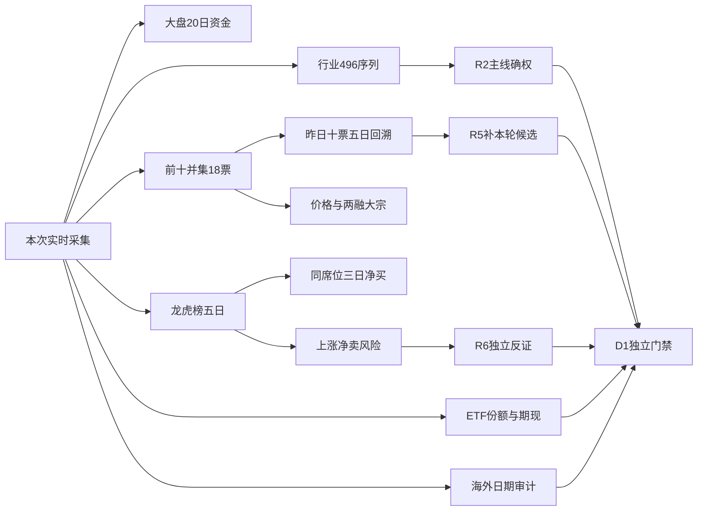

# 2026年11月3日 · **资金面**

> **数据源新鲜度**：partial；**降级状态**：true；**置信度**：0.2625
> 国内实际数据日为2026-11-02（正常T-1）；海外个股实际为2026-10-30，不能称最新隔夜。

## 一句话结论
**观察：传媒、半导体与非银获回流，但五日资金仍流出；美股个股隔夜证据滞后。**

## 📌 详细分析
昨日上证涨1.08%、深成指涨1.63%，大盘主力净流入117.43亿元，超大单净流入而大单仍净流出。这是资金侧单日修复，不是五日主升已确认；不继承旧研究的防御方向或市场性停买。
板块资金和个股资金分列。传媒、半导体、非银有可核净流入，银行、公用事业流出；行业父子层级重复，不能把这些金额加总成市场总额。主线确权、优先级与龙头归R2，本轮不代判。
本轮在R2/R5之前，仅核昨日与前日资金前十并集18只，以及全市场龙虎榜。10只昨日榜做逐票五日回溯；不是已知未来五日兑现，也不是本轮候选全覆盖。没有读取旧R5池。
ETF份额与两融停在2026-10-30，IF近月与现货已核同日。缺项局限于对应证据，不能因DataPro断联、辅助缺数、北向不适用而全盘禁买；账户真实硬预算仍独立有效。

## 💰 市场时序：一天转正不是趋势确认
| 窗口 | 起止 | 净流入/亿元 | 正流入日 |
|---|---|---:|---:|
| 5日 | 2026-10-27—2026-11-02 | -1218.43 | 2/5 |
| 10日 | 2026-10-20—2026-11-02 | -2345.09 | 3/10 |
| 20日 | 2026-09-29—2026-11-02 | -4685.38 | 4/20 |

昨日涨停125、炸板28、跌停8，炸板率 `18.30%`（炸板/涨停加炸板）。未触发35%候选减半阈值；这不是R1周期结论。XTick范围不同，不将其原始zbl直接当同口径炸板率。

## 🧭 板块合力：资金名次不等于主线排序
| 板块 | 昨日净流/亿元 | 昨日涨幅 | 5日净流/亿元 | 20日净流/亿元 |
|---|---:|---:|---:|---:|
| 传媒 | 55.49 | 8.49% | -2.94 | -61.11 |
| 电子 | 53.19 | 2.72% | -368.96 | -1388.23 |
| 半导体 | 46.08 | 2.77% | -154.02 | -614.10 |
| 非银金融 | 31.61 | 3.91% | -25.04 | -162.52 |
| 证券Ⅲ | 28.38 | 4.48% | -28.04 | -129.59 |
| 计算机 | 23.65 | 5.48% | -132.96 | -277.31 |
| 银行 | -19.49 | -0.84% | -3.91 | -73.30 |
| 公用事业 | -12.56 | 1.26% | -45.31 | -132.07 |
| 电力 | -12.05 | 1.39% | -43.63 | -124.63 |
| 城商行Ⅲ | -8.22 | -1.48% | -14.73 | -39.06 |

### 传媒：观察，等待持续性
- **大资金意图**: 昨日净流入55.49亿元，显示订单分类下大额买方回流；无法识别真实账户意图，不把统计标签当机构实名。
- **为什么走强**: 板块涨8.49%且资金同向，但近5日合计-2.94亿元；当前仅确认修复当日，硬催化与核心地位未由R2/R4核定。
- **逻辑够不够硬**: 价格与资金同属东财体系，不算两独立来源；若开盘后板块净流转负或前排不再带动扩散，回流假设证伪，不授主线资格。

### 电子：观察，等待持续性
- **大资金意图**: 昨日净流入53.19亿元，显示订单分类下大额买方回流；无法识别真实账户意图，不把统计标签当机构实名。
- **为什么走强**: 板块涨2.72%且资金同向，但近5日合计-368.96亿元；当前仅确认修复当日，硬催化与核心地位未由R2/R4核定。
- **逻辑够不够硬**: 价格与资金同属东财体系，不算两独立来源；若开盘后板块净流转负或前排不再带动扩散，回流假设证伪，不授主线资格。

### 半导体：观察，等待持续性
- **大资金意图**: 昨日净流入46.08亿元，显示订单分类下大额买方回流；无法识别真实账户意图，不把统计标签当机构实名。
- **为什么走强**: 板块涨2.77%且资金同向，但近5日合计-154.02亿元；当前仅确认修复当日，硬催化与核心地位未由R2/R4核定。
- **逻辑够不够硬**: 价格与资金同属东财体系，不算两独立来源；若开盘后板块净流转负或前排不再带动扩散，回流假设证伪，不授主线资格。

## 🔎 昨日前十五日回溯：全50个股票日
选样日2026-11-02；回溯2026-10-27—2026-11-02。下表只为资金证据，不是交易名单；交易计划归属与RR均未知。
| 对象 | 昨日净流/亿元 | 五日合计/亿元 | 五日正流天数 | XTick昨日/亿元 | 态度 |
|---|---:|---:|---:|---:|---|
| 东山精密 002384.SZ | 13.44 | -0.35 | 2/5 | 16.75 | 观察 |
| 东方财富 300059.SZ | 12.30 | 0.01 | 1/5 | 12.88 | 观察 |
| 兆易创新 603986.SH | 9.41 | 9.30 | 2/5 | 5.71 | 观察 |
| 北方华创 002371.SZ | 8.03 | 3.58 | 3/5 | 2.75 | 观察 |
| 宁德时代 300750.SZ | 7.43 | 0.39 | 2/5 | 6.04 | 观察 |
| 君正股份 300223.SZ | 7.00 | 17.45 | 4/5 | -0.33 | 观察 |
| 长飞光纤 601869.SH | 5.56 | -1.44 | 2/5 | 4.98 | 观察 |
| 中际旭创 300308.SZ | 5.36 | 29.44 | 3/5 | 0.96 | 观察 |
| 中微公司 688012.SH | 5.32 | -3.32 | 2/5 | 5.57 | 观察 |
| 国芳集团 601086.SH | 5.29 | 4.84 | 3/5 | 5.77 | 观察 |

前一交易日榜（2026-10-30）到昨日验证，7/10只转为净流出，最新前十重叠2只。仅是榜单行为，不证明同一笔资金换仓。

### 东山精密：观察，非本轮候选资格
板型：炸板；龙头认定：未确认、纪律通过条数未知；盈亏比：未知；禁止清单：未完成全项审核，已知命中项未发现不等于通过。
- **大资金意图**: 昨日DC净流13.44亿元，XTick同日16.75亿元；只是分类订单事实，不推断实名建仓或锁仓。
- **为什么走强**: 昨日涨跌7.13%，五日累计资金-0.35亿元；未核硬事件及板块龙头地位，不能由前十名次推出走强原因。
- **逻辑够不够硬**: 仅资金与价格证据，产业催化尚未建立；跨源分类阈值不同，方向冲突时保留冲突而不选有利数字。
- **买入理由**: 未建立买入资格；一，行业产业逻辑尚待本轮R2/R5核验；二，资金净流事实可以支持研究但不能单独支持开仓。
- **风险点**: 一，单日修复可能被次日兑现；二，海外个股证据滞后且未完成财务合规/禁止清单，不把辅助缺口包装成已核风险通过。
- **止损条件**: 未建立仓位、不编造价位；若后续D1授予资格，必须先定5%—10%止损距与RR≥2；24—72小时内出现主力连续两日净流出则资金持续性假设失效，交D1/R6复核。
- **可验证假设**: 未来两个完整交易日，至少一日主力净额>0且两日合计>0；否则不确认本次回流持续。不替代真实交易止损规则。

### 东方财富：观察，非本轮候选资格
板型：未涨停；龙头认定：未确认、纪律通过条数未知；盈亏比：未知；禁止清单：未完成全项审核，已知命中项未发现不等于通过。
- **大资金意图**: 昨日DC净流12.30亿元，XTick同日12.88亿元；只是分类订单事实，不推断实名建仓或锁仓。
- **为什么走强**: 昨日涨跌6.31%，五日累计资金0.01亿元；未核硬事件及板块龙头地位，不能由前十名次推出走强原因。
- **逻辑够不够硬**: 仅资金与价格证据，产业催化尚未建立；跨源分类阈值不同，方向冲突时保留冲突而不选有利数字。
- **买入理由**: 未建立买入资格；一，行业产业逻辑尚待本轮R2/R5核验；二，资金净流事实可以支持研究但不能单独支持开仓。
- **风险点**: 一，单日修复可能被次日兑现；二，海外个股证据滞后且未完成财务合规/禁止清单，不把辅助缺口包装成已核风险通过。
- **止损条件**: 未建立仓位、不编造价位；若后续D1授予资格，必须先定5%—10%止损距与RR≥2；24—72小时内出现主力连续两日净流出则资金持续性假设失效，交D1/R6复核。
- **可验证假设**: 未来两个完整交易日，至少一日主力净额>0且两日合计>0；否则不确认本次回流持续。不替代真实交易止损规则。

### 兆易创新：观察，非本轮候选资格
板型：未涨停；龙头认定：未确认、纪律通过条数未知；盈亏比：未知；禁止清单：未完成全项审核，已知命中项未发现不等于通过。
- **大资金意图**: 昨日DC净流9.41亿元，XTick同日5.71亿元；只是分类订单事实，不推断实名建仓或锁仓。
- **为什么走强**: 昨日涨跌3.05%，五日累计资金9.30亿元；未核硬事件及板块龙头地位，不能由前十名次推出走强原因。
- **逻辑够不够硬**: 仅资金与价格证据，产业催化尚未建立；跨源分类阈值不同，方向冲突时保留冲突而不选有利数字。
- **买入理由**: 未建立买入资格；一，行业产业逻辑尚待本轮R2/R5核验；二，资金净流事实可以支持研究但不能单独支持开仓。
- **风险点**: 一，单日修复可能被次日兑现；二，海外个股证据滞后且未完成财务合规/禁止清单，不把辅助缺口包装成已核风险通过。
- **止损条件**: 未建立仓位、不编造价位；若后续D1授予资格，必须先定5%—10%止损距与RR≥2；24—72小时内出现主力连续两日净流出则资金持续性假设失效，交D1/R6复核。
- **可验证假设**: 未来两个完整交易日，至少一日主力净额>0且两日合计>0；否则不确认本次回流持续。不替代真实交易止损规则。

### 北方华创：观察，非本轮候选资格
板型：未涨停；龙头认定：未确认、纪律通过条数未知；盈亏比：未知；禁止清单：未完成全项审核，已知命中项未发现不等于通过。
- **大资金意图**: 昨日DC净流8.03亿元，XTick同日2.75亿元；只是分类订单事实，不推断实名建仓或锁仓。
- **为什么走强**: 昨日涨跌5.28%，五日累计资金3.58亿元；未核硬事件及板块龙头地位，不能由前十名次推出走强原因。
- **逻辑够不够硬**: 仅资金与价格证据，产业催化尚未建立；跨源分类阈值不同，方向冲突时保留冲突而不选有利数字。
- **买入理由**: 未建立买入资格；一，行业产业逻辑尚待本轮R2/R5核验；二，资金净流事实可以支持研究但不能单独支持开仓。
- **风险点**: 一，单日修复可能被次日兑现；二，海外个股证据滞后且未完成财务合规/禁止清单，不把辅助缺口包装成已核风险通过。
- **止损条件**: 未建立仓位、不编造价位；若后续D1授予资格，必须先定5%—10%止损距与RR≥2；24—72小时内出现主力连续两日净流出则资金持续性假设失效，交D1/R6复核。
- **可验证假设**: 未来两个完整交易日，至少一日主力净额>0且两日合计>0；否则不确认本次回流持续。不替代真实交易止损规则。

### 宁德时代：观察，非本轮候选资格
板型：未涨停；龙头认定：未确认、纪律通过条数未知；盈亏比：未知；禁止清单：未完成全项审核，已知命中项未发现不等于通过。
- **大资金意图**: 昨日DC净流7.43亿元，XTick同日6.04亿元；只是分类订单事实，不推断实名建仓或锁仓。
- **为什么走强**: 昨日涨跌3.12%，五日累计资金0.39亿元；未核硬事件及板块龙头地位，不能由前十名次推出走强原因。
- **逻辑够不够硬**: 仅资金与价格证据，产业催化尚未建立；跨源分类阈值不同，方向冲突时保留冲突而不选有利数字。
- **买入理由**: 未建立买入资格；一，行业产业逻辑尚待本轮R2/R5核验；二，资金净流事实可以支持研究但不能单独支持开仓。
- **风险点**: 一，单日修复可能被次日兑现；二，海外个股证据滞后且未完成财务合规/禁止清单，不把辅助缺口包装成已核风险通过。
- **止损条件**: 未建立仓位、不编造价位；若后续D1授予资格，必须先定5%—10%止损距与RR≥2；24—72小时内出现主力连续两日净流出则资金持续性假设失效，交D1/R6复核。
- **可验证假设**: 未来两个完整交易日，至少一日主力净额>0且两日合计>0；否则不确认本次回流持续。不替代真实交易止损规则。

### 君正股份：观察，非本轮候选资格
板型：未涨停；龙头认定：未确认、纪律通过条数未知；盈亏比：未知；禁止清单：未完成全项审核，已知命中项未发现不等于通过。
- **大资金意图**: 昨日DC净流7.00亿元，XTick同日-0.33亿元；只是分类订单事实，不推断实名建仓或锁仓。
- **为什么走强**: 昨日涨跌3.09%，五日累计资金17.45亿元；未核硬事件及板块龙头地位，不能由前十名次推出走强原因。
- **逻辑够不够硬**: 仅资金与价格证据，产业催化尚未建立；跨源分类阈值不同，方向冲突时保留冲突而不选有利数字。
- **买入理由**: 未建立买入资格；一，行业产业逻辑尚待本轮R2/R5核验；二，资金净流事实可以支持研究但不能单独支持开仓。
- **风险点**: 一，单日修复可能被次日兑现；二，海外个股证据滞后且未完成财务合规/禁止清单，不把辅助缺口包装成已核风险通过。
- **止损条件**: 未建立仓位、不编造价位；若后续D1授予资格，必须先定5%—10%止损距与RR≥2；24—72小时内出现主力连续两日净流出则资金持续性假设失效，交D1/R6复核。
- **可验证假设**: 未来两个完整交易日，至少一日主力净额>0且两日合计>0；否则不确认本次回流持续。不替代真实交易止损规则。

### 长飞光纤：观察，非本轮候选资格
板型：炸板；龙头认定：未确认、纪律通过条数未知；盈亏比：未知；禁止清单：未完成全项审核，已知命中项未发现不等于通过。
- **大资金意图**: 昨日DC净流5.56亿元，XTick同日4.98亿元；只是分类订单事实，不推断实名建仓或锁仓。
- **为什么走强**: 昨日涨跌8.15%，五日累计资金-1.44亿元；未核硬事件及板块龙头地位，不能由前十名次推出走强原因。
- **逻辑够不够硬**: 仅资金与价格证据，产业催化尚未建立；跨源分类阈值不同，方向冲突时保留冲突而不选有利数字。
- **买入理由**: 未建立买入资格；一，行业产业逻辑尚待本轮R2/R5核验；二，资金净流事实可以支持研究但不能单独支持开仓。
- **风险点**: 一，单日修复可能被次日兑现；二，海外个股证据滞后且未完成财务合规/禁止清单，不把辅助缺口包装成已核风险通过。
- **止损条件**: 未建立仓位、不编造价位；若后续D1授予资格，必须先定5%—10%止损距与RR≥2；24—72小时内出现主力连续两日净流出则资金持续性假设失效，交D1/R6复核。
- **可验证假设**: 未来两个完整交易日，至少一日主力净额>0且两日合计>0；否则不确认本次回流持续。不替代真实交易止损规则。

### 中际旭创：观察，非本轮候选资格
板型：未涨停；龙头认定：未确认、纪律通过条数未知；盈亏比：未知；禁止清单：未完成全项审核，已知命中项未发现不等于通过。
- **大资金意图**: 昨日DC净流5.36亿元，XTick同日0.96亿元；只是分类订单事实，不推断实名建仓或锁仓。
- **为什么走强**: 昨日涨跌-0.54%，五日累计资金29.44亿元；未核硬事件及板块龙头地位，不能由前十名次推出走强原因。
- **逻辑够不够硬**: 仅资金与价格证据，产业催化尚未建立；跨源分类阈值不同，方向冲突时保留冲突而不选有利数字。
- **买入理由**: 未建立买入资格；一，行业产业逻辑尚待本轮R2/R5核验；二，资金净流事实可以支持研究但不能单独支持开仓。
- **风险点**: 一，单日修复可能被次日兑现；二，海外个股证据滞后且未完成财务合规/禁止清单，不把辅助缺口包装成已核风险通过。
- **止损条件**: 未建立仓位、不编造价位；若后续D1授予资格，必须先定5%—10%止损距与RR≥2；24—72小时内出现主力连续两日净流出则资金持续性假设失效，交D1/R6复核。
- **可验证假设**: 未来两个完整交易日，至少一日主力净额>0且两日合计>0；否则不确认本次回流持续。不替代真实交易止损规则。

### 中微公司：观察，非本轮候选资格
板型：未涨停；龙头认定：未确认、纪律通过条数未知；盈亏比：未知；禁止清单：未完成全项审核，已知命中项未发现不等于通过。
- **大资金意图**: 昨日DC净流5.32亿元，XTick同日5.57亿元；只是分类订单事实，不推断实名建仓或锁仓。
- **为什么走强**: 昨日涨跌1.36%，五日累计资金-3.32亿元；未核硬事件及板块龙头地位，不能由前十名次推出走强原因。
- **逻辑够不够硬**: 仅资金与价格证据，产业催化尚未建立；跨源分类阈值不同，方向冲突时保留冲突而不选有利数字。
- **买入理由**: 未建立买入资格；一，行业产业逻辑尚待本轮R2/R5核验；二，资金净流事实可以支持研究但不能单独支持开仓。
- **风险点**: 一，单日修复可能被次日兑现；二，海外个股证据滞后且未完成财务合规/禁止清单，不把辅助缺口包装成已核风险通过。
- **止损条件**: 未建立仓位、不编造价位；若后续D1授予资格，必须先定5%—10%止损距与RR≥2；24—72小时内出现主力连续两日净流出则资金持续性假设失效，交D1/R6复核。
- **可验证假设**: 未来两个完整交易日，至少一日主力净额>0且两日合计>0；否则不确认本次回流持续。不替代真实交易止损规则。

### 国芳集团：观察，非本轮候选资格
板型：涨停；龙头认定：未确认、纪律通过条数未知；盈亏比：未知；禁止清单：未完成全项审核，已知命中项未发现不等于通过。
- **大资金意图**: 昨日DC净流5.29亿元，XTick同日5.77亿元；只是分类订单事实，不推断实名建仓或锁仓。
- **为什么走强**: 昨日涨跌9.97%，五日累计资金4.84亿元；未核硬事件及板块龙头地位，不能由前十名次推出走强原因。
- **逻辑够不够硬**: 仅资金与价格证据，产业催化尚未建立；跨源分类阈值不同，方向冲突时保留冲突而不选有利数字。
- **买入理由**: 未建立买入资格；一，行业产业逻辑尚待本轮R2/R5核验；二，资金净流事实可以支持研究但不能单独支持开仓。
- **风险点**: 一，单日修复可能被次日兑现；二，海外个股证据滞后且未完成财务合规/禁止清单，不把辅助缺口包装成已核风险通过。
- **止损条件**: 未建立仓位、不编造价位；若后续D1授予资格，必须先定5%—10%止损距与RR≥2；24—72小时内出现主力连续两日净流出则资金持续性假设失效，交D1/R6复核。
- **可验证假设**: 未来两个完整交易日，至少一日主力净额>0且两日合计>0；否则不确认本次回流持续。不替代真实交易止损规则。

## ⚠️ 龙虎榜诱多识别：风险证据不是操纵结论
昨日原始榜单81条、73只；识别上涨资金背离17只（19条榜单窗口证据），下跌高换手净卖5只。
逐榜因区分日榜/多日榜，同一机构席位买卖侧去重；无机构披露记未知，不能填零。多日榜与当日主力不宣称同窗独立共振。
| 对象 | 涨跌 | 榜净流/亿元 | 当日主力/亿元 | 窗口 | 态度 |
|---|---:|---:|---:|---|---|
| 沈阳机床 000410.SZ | 10.06% | 0.20 | -1.44 | 多日榜 | 降级 |
| 青岛食品 001219.SZ | 9.98% | -0.29 | -0.78 | 多日榜 | 降级 |
| 澳洋健康 002172.SZ | 9.98% | -0.09 | 0.17 | 日榜 | 降级 |
| 澳洋健康 002172.SZ | 9.98% | 0.06 | 0.17 | 多日榜 | 降级 |
| 光洋股份 002708.SZ | 7.99% | -0.72 | 2.05 | 日榜 | 降级 |
| 润建股份 002929.SZ | 10.00% | 0.23 | 1.88 | 日榜 | 降级 |
| 华阳国际 002949.SZ | 10.00% | -0.40 | 0.20 | 多日榜 | 降级 |
| 芒果超媒 300413.SZ | 20.00% | -0.53 | 3.09 | 日榜 | 降级 |
| 亿田智能 300911.SZ | 9.23% | -0.09 | -0.27 | 日榜 | 降级 |
| 华是科技 301218.SZ | 19.99% | -0.40 | 1.22 | 日榜 | 降级 |
| 华是科技 301218.SZ | 19.99% | -0.63 | 1.22 | 多日榜 | 降级 |
| 万邦医药 301520.SZ | 4.38% | -1.64 | 0.43 | 日榜 | 降级 |
| 联亚药业 301569.SZ | 5.82% | -0.32 | 0.06 | 日榜 | 降级 |
| 泉阳泉 600189.SH | 9.95% | -0.33 | -0.44 | 多日榜 | 降级 |
| 百花医药 600721.SH | 1.53% | -0.52 | -0.03 | 日榜 | 降级 |
| 天洋新材 603330.SH | 1.17% | -0.58 | -1.49 | 日榜 | 降级 |
| 安集科技 688019.SH | 16.87% | 0.29 | -0.41 | 日榜 | 降级 |
| 正帆科技 688596.SH | 19.99% | -0.91 | 0.41 | 日榜 | 降级 |
| 南方乳业 920196.BJ | 6.88% | -0.03 | 0.09 | 日榜 | 降级 |
| 慈文传媒 002343.SZ | -2.60% | -0.71 | -0.71 | 日榜 | 降级 |
| 传智教育 003032.SZ | -3.92% | -0.76 | 0.04 | 日榜 | 降级 |
| 邵阳液压 301079.SZ | -7.34% | -0.10 | -0.33 | 日榜 | 降级 |
| 世纪恒通 301428.SZ | -5.59% | -0.30 | -0.28 | 日榜 | 降级 |
| 百瑞吉 920201.BJ | -7.09% | -0.14 | -0.05 | 日榜 | 降级 |

- **大资金意图**: 上涨伴净卖提示兑现风险，不足以认定诱导散户或操纵。
- **为什么走强**: 榜单仍可能显示涨幅为正，但高换手与净卖可削弱继续接力假设；三日涨幅不冒充末日涨幅。
- **逻辑够不够硬**: 属软反证，R6独立判断；没有个股hard_reject由R7产生。

具名实际营业部三日重复净买，经末日封板/ST过滤后4条待核旗标；公告风险未核统一降一级，不将净卖日算作正协同。被排除13条保留于JSON。

## ⚖️ 跷跷板与ETF/期货
20个完整交易日、190对测试，严格相关<-0.6且相邻两个五日两侧翻向确认0对；负相关未确认翻向3对。短期银行转出/科技回流不能冒充统计跷跷板已成立。
IF2611.CFX同日收盘4002.00，沪深300 4016.92，基差-14.92点。不扣分红/融资成本，不能直接预测次日涨跌。
ETF真实一级净申购未知。份额代理是滞后万份变化乘同日收盘价，不是二级订单流，更不是一级真实现金流水。
| ETF | 份额实际日 | 最新份额变化/万份 | 估值代理/亿元 |
|---|---|---:|---:|
| 510300.SH | 2026-10-30 | 139140.00 | 56.56 |
| 510500.SH | 2026-10-30 | 10560.00 | 6.66 |
| 159915.SZ | 2026-10-30 | 161700.00 | 39.37 |
| 588000.SH | 2026-10-30 | 227100.00 | 27.89 |

## 🌎 外部传导：个股滞后不称隔夜
指数快照SPX -0.51%、IXIC -1.07%实际为2026-11-02；SOX缺失。美股个股快照12只为2026-10-30，本轮实时MCP补查14只仍仅返回该日。不能把周五跌幅重复当作周一晚的新冲击。
| 美股核心 | 实际观察日 | 该日涨跌 | A股映射与限制 |
|---|---|---:|---|
| MU | 2026-10-30 | -5.30% | 存储/半导体/算力或消费科技；不是最新隔夜 |
| NVDA | 2026-10-30 | -4.22% | 存储/半导体/算力或消费科技；不是最新隔夜 |
| AVGO | 2026-10-30 | -5.48% | 存储/半导体/算力或消费科技；不是最新隔夜 |
| AMD | 2026-10-30 | -10.88% | 存储/半导体/算力或消费科技；不是最新隔夜 |
| TSM | 2026-10-30 | -5.95% | 存储/半导体/算力或消费科技；不是最新隔夜 |
| AAPL | 2026-10-30 | -1.23% | 存储/半导体/算力或消费科技；不是最新隔夜 |
| MSFT | 2026-10-30 | -1.55% | 存储/半导体/算力或消费科技；不是最新隔夜 |
| GOOGL | 2026-10-30 | -1.40% | 存储/半导体/算力或消费科技；不是最新隔夜 |
| AMZN | 2026-10-30 | -1.41% | 存储/半导体/算力或消费科技；不是最新隔夜 |
| META | 2026-10-30 | -1.53% | 存储/半导体/算力或消费科技；不是最新隔夜 |
| TSLA | 2026-10-30 | -0.87% | 存储/半导体/算力或消费科技；不是最新隔夜 |
| INTC | 2026-10-30 | -28.58% | 存储/半导体/算力或消费科技；不是最新隔夜 |
| GLW | 2026-10-30 | -4.32% | 存储/半导体/算力或消费科技；不是最新隔夜 |
| MRVL | 2026-10-30 | -10.05% | 存储/半导体/算力或消费科技；不是最新隔夜 |

最新指数为科技链承接带来情绪压制背景，但个股最新强弱无法确认。存储看MU、GPU看NVDA/AMD、CPO与互联看AVGO/MRVL/GLW、晶圆链看TSM；当前仅映射研究方向，不授予A股开仓资格，也不因旧海外跌幅机械否决昨日内资回流。

## 关键证据
- 大盘20日资金：data/research/20261103/R7_evidence_20261103.json::calls.market。
- 行业20日×496原始序列：data/research/20261103/R7_evidence_20261103.json::calls.sector_*；单位元转亿元。
- 昨日前十50/50股票日及其XTick逐日交叉：data/research/20261103/R7_evidence_20261103.json；原始返回全量保留。
- 龙虎榜日/多日榜与席位：data/research/20261103/R7_evidence_20261103.json::calls.lhb_20261102、data/research/20261103/R7_evidence_20261103.json::calls.inst_20261102。
- 海外原文件：data/raw/20261103/overseas_snapshot.json；实时补查观察日仍滞后。

## 数据源审计
| 源 | 日期 | 状态 | 记录数 | 备注 |
|---|---|:--:|---:|---|
| tushareMcp.block_trade | 2026-11-02 | 🟢 | 86 | 实时MCP查询，实际观察日独立保留；同一底层东财不算多独立源 |
| tushareMcp.daily | 2026-11-02 | 🟢 | 5931 | 实时MCP查询，实际观察日独立保留；同一底层东财不算多独立源 |
| tushareMcp.daily_basic | 2026-11-02 | 🟢 | 360 | 实时MCP查询，实际观察日独立保留；同一底层东财不算多独立源 |
| tushareMcp.fund_daily | 2026-11-02 | 🟢 | 80 | 实时MCP查询，实际观察日独立保留；同一底层东财不算多独立源 |
| tushareMcp.fund_share | 2026-10-30 | 🟡 | 76 | 实时MCP查询，实际观察日独立保留；同一底层东财不算多独立源 |
| tushareMcp.fut_daily | 2026-11-02 | 🟢 | 20 | 实时MCP查询，实际观察日独立保留；同一底层东财不算多独立源 |
| tushareMcp.hm_detail | 2026-11-02 | 🟢 | 1405 | 实时MCP查询，实际观察日独立保留；同一底层东财不算多独立源 |
| tushareMcp.index_daily | 2026-11-02 | 🟢 | 20 | 实时MCP查询，实际观察日独立保留；同一底层东财不算多独立源 |
| tushareMcp.limit_list_d | 2026-11-02 | 🟢 | 161 | 实时MCP查询，实际观察日独立保留；同一底层东财不算多独立源 |
| tushareMcp.limit_step | 2026-11-02 | 🟢 | 11 | 实时MCP查询，实际观察日独立保留；同一底层东财不算多独立源 |
| tushareMcp.margin_detail | 2026-10-30 | 🟡 | 304 | 实时MCP查询，实际观察日独立保留；同一底层东财不算多独立源 |
| tushareMcp.moneyflow_dc | 2026-11-02 | 🟢 | 12422 | 实时MCP查询，实际观察日独立保留；同一底层东财不算多独立源 |
| tushareMcp.moneyflow_ind_dc | 2026-11-02 | 🟢 | 9920 | 实时MCP查询，实际观察日独立保留；同一底层东财不算多独立源 |
| tushareMcp.moneyflow_mkt_dc | 2026-11-02 | 🟢 | 20 | 实时MCP查询，实际观察日独立保留；同一底层东财不算多独立源 |
| tushareMcp.stock_basic | 2026-11-02 | 🟢 | 5577 | 实时MCP查询，实际观察日独立保留；同一底层东财不算多独立源 |
| tushareMcp.top_inst | 2026-11-02 | 🟢 | 4180 | 实时MCP查询，实际观察日独立保留；同一底层东财不算多独立源 |
| tushareMcp.top_list | 2026-11-02 | 🟢 | 418 | 实时MCP查询，实际观察日独立保留；同一底层东财不算多独立源 |
| tushareMcp.trade_cal | 2026-11-02 | 🟢 | 95 | 实时MCP查询，实际观察日独立保留；同一底层东财不算多独立源 |
| tushareMcp.us_daily | 2026-10-30 | 🟡 | 14 | 实时MCP查询，实际观察日独立保留；同一底层东财不算多独立源 |
| xtick.xtick_hot_money | 2026-11-02 | 🟢 | 58 | 10票逐日五日+其他8票末日；四只ETF空返回不计覆盖 |
| xtick.xtick_market_emotion | 2026-11-02 | 🟢 | 1 | 实调返回 |
| xtick.xtick_hot_bk | 2026-11-02 | 🔴 | 未知 | 仅返回板块成分股，无可比资金字段 |
| datapro.dataPro_search | 2026-11-02 | 🔴 | 未知 | 4013 Agent Plan订阅已失效或未分配席位；trace_id=17d28dd995674de0b07f8de8d9221a28 |
| overseas_snapshot | 2026-10-30 | 🟡 | 12 | 指数最新，12只美股全为20261030 |

## 不确定性 / 反证
- DataPro实调4013订阅失效，板块无独立第二资金源。
- overseas_snapshot美股12只均为20261030，实时Tushare补查14只仍止于20261030；不能据此推断20261102隔夜个股涨跌。
- SOX未取到；指数SPX/IXIC在快照为20261102，不能代替个股最新隔夜。
- ETF份额/个股两融最新20261030，ETF真实一级净流未知；XTick四只ETF未返金额字段。
- 游资风险公告未核，正向协同降一级为待核；无北向必要性缺口。
- 尚无本轮R2/R5候选交付；本批统计对象不是本轮候选全覆盖。
- 置信度=0.75×0.7×0.5=0.2625，是证据一致性评分，不是盈利概率；北向不参与。
- 大盘连续性仍弱于单日修复，若未来两日修复回吐应降级持续性判断；不能用今天排名倒推未来。
- 板块与大盘金额为元，个股DC为万元，分别转亿元；已用个股净流率与日成交额做量纲校验，避免板块放大一万倍。

## 与其他 R/D/E 的关系
- 依赖：当日manifest、mcp_health、overseas_snapshot；没有消费本轮R2/R5，也未读旧R5池。
- R2：消费板块资金事实并独立确认主线与核心地位；R7不做板块交易优先级。
- R5：对后续本轮真实候选补必要资金和价格，不要求另开R7或指定provider；未覆盖=未知。
- R6：消费软风险证据，唯一硬否决权不变；D1：独立审核计划内分类、RR和真实预算。
- 真实用户/账户停买、有效硬预算（含零）、T+1及人工确认均不修改；R7不下单、不发全局禁买。

## Sub-Agent 元数据
- skill: analyze_capital_flow_v1
- artifact: data/research/20261103/R7_capital_flow.json
- schema: R7_capital_flow_v1；补充Pydantic契约写盘前已通过
- model: gpt-6.1-sol
- 生成耗时: 764 秒
- 运行：盘前实时取证，非回放；真实生成时刻在frontmatter，源观察日逐维列明
- token用量: usage_unknown，不当零、不保证低于连续任务努力目标
