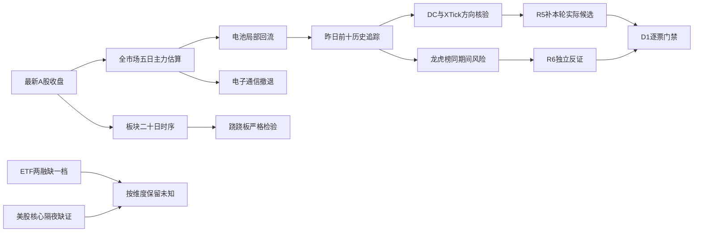

# 2026年11月4日 · 资金面

> 数据归属：A股最新收盘为 **2026-11-03**；盘前不是当日盘中资金。
> **情绪=震荡/主跌**；**数据新鲜度=partial**；**降级=true**；本轮不授予开仓资格。

## 一句话结论
**观察电池局部回流；电子通信资金仍撤退，单日净买不能替代核心地位与承接。**

## 📊 详细分析：市场在为什么付钱

主力估算资金呈现“回流一天、撤退再现”，不是稳定的全市场主升。资金向电池及部分保险集中，而电子与通信继续承压。此处只陈述资金奖励与局部修复阶段，不替代 R1 风格或 R2 主线排序。

| 交易日 | 已核股票数 | 主力估算净额（亿元） | 净入/净出股票数 |
|---|---:|---:|---:|
| 2026-10-28 | 5570 | +237.03 | 2431/3079 |
| 2026-10-29 | 5570 | -703.81 | 1760/3763 |
| 2026-10-30 | 5571 | -396.66 | 1960/3569 |
| 2026-11-02 | 5571 | +119.45 | 2540/2983 |
| 2026-11-03 | 5570 | -574.10 | 2054/3460 |

五日累计主力估算净额 **-1318.10亿元**。这是成交分类估算，不是全市场真实资金出入账。昨日涨停 48、跌停 17、炸板 34，炸板率 **41.46%**；下游若仍采用此情绪窗口，候选规模减半。这里完整保留十只历史追踪，不把它们充当十只可交易候选。

## 🧭 板块资金与合力：只列事实，不给主线排位

| 板块 | 昨日净额（亿元） | 五日累计（亿元） | 五日净流入天数 | 资金态度 |
|---|---:|---:|---:|---|
| 电力设备 | +34.32 | -34.34 | 2/5 | 观察回流，不等于主线确认 |
| 电池 | +25.32 | +2.56 | 3/5 | 观察回流，不等于主线确认 |
| 光伏设备 | +8.50 | +5.30 | 3/5 | 观察回流，不等于主线确认 |
| 保险Ⅱ | +7.60 | +16.62 | 5/5 | 观察回流，不等于主线确认 |
| 游戏Ⅲ | +4.25 | +7.48 | 3/5 | 观察回流，不等于主线确认 |
| 传媒 | -11.26 | -1.31 | 2/5 | 降级资金持续性主张 |
| 电子 | -236.26 | -454.86 | 2/5 | 降级资金持续性主张 |
| 半导体 | -131.43 | -208.98 | 2/5 | 降级资金持续性主张 |
| 通信 | -103.02 | -182.93 | 2/5 | 降级资金持续性主张 |
| 印制电路板 | -52.17 | -86.27 | 2/5 | 降级资金持续性主张 |

行业表有父子层级，电力设备/电池、电子/半导体/PCB、保险Ⅱ/Ⅲ彼此重叠，**禁止相加当成多路独立资金**。全量 496 个分类只作覆盖，不把“前十净入板块”当成 R2 的主线顺序。

### 电池与电力设备：观察回流，不进执行
- **大资金意图**: 电池连续三个已收盘交易日净入，资金有修复集中配置的迹象；电力设备五日累计仍负，不能解释为全面增仓。
- **为什么走强**: 昨日电池上涨与净流入同向，宁德时代和圣阳股份提供个股资金样本；催化硬度及板块龙头地位尚未由本轮R2/R4确认。
- **逻辑够不够硬**: 对“昨日回流”足够，对“新主线主升”不足。若下一交易时段电池主力转负且核心承接失败，修复持续性假设即降级。

### 电子/通信：降级旧强势链持续性主张
- **大资金意图**: 五日电子、通信累计大幅净出，更符合撤退或风险再分配的资金表象，不推断具体机构真实意图。
- **为什么走强**: 本轮并非走强；昨日电子、通信与PCB主力继续净出，中芯国际单票净入不能替代板块广度。
- **逻辑够不够硬**: 同口径板块时序支持资金偏弱；美股最新个股缺证，不能用前夜旧跌幅加重“昨夜利空”，也不能用纳指上涨宣告CPO修复。

## 🔎 昨日前十 · 向后回看五日追踪

定义为 **2026-11-03 东财个股主力净额降序前十**；回看窗口 **2026-10-28 至 2026-11-03**。不是旧R5池，不是本轮R2候选，也不是未来五日收益预测。昨日主力额来自东财，XTick为不同分单口径的方向交叉，**不平均、不加总**。

| 排名 | 股票 | 五日主力净额（亿元） | 昨日DC / XTick（亿元） | 五日收益 | 明确态度 |
|---:|---|---:|---:|---:|---|
| 1 | 宁德时代 300750.SZ | +18.07 | +12.85 / +7.98 | +7.00% | 观察，非开仓候选 |
| 2 | N皇冠 001381.SZ | 未知（仅1个有效日） | +7.41 / +6.98 | 未知 | 降级，非开仓候选 |
| 3 | 中国平安 601318.SH | +12.61 | +5.60 / +14.17 | +3.76% | 观察，非开仓候选 |
| 4 | 阳光电源 300274.SZ | +1.99 | +5.41 / +3.65 | +10.96% | 观察，非开仓候选 |
| 5 | 中芯国际 688981.SH | +7.36 | +4.54 / +7.27 | +2.11% | 观察，非开仓候选 |
| 6 | 贵州茅台 600519.SH | +11.99 | +4.30 / +23.01 | +9.15% | 观察，非开仓候选 |
| 7 | 圣阳股份 002580.SZ | +3.55 | +3.96 / +4.77 | +14.89% | 观察，非开仓候选 |
| 8 | 百亚股份 003006.SZ | +14.74 | +3.72 / -0.34 | -8.64% | 降级，非开仓候选 |
| 9 | 紫金矿业 601899.SH | +3.70 | +3.37 / +8.87 | -1.44% | 观察，非开仓候选 |
| 10 | 慈文传媒 002343.SZ | +1.94 | +3.23 / +4.97 | -5.90% | 降级，非开仓候选 |

| 股票 | 板型 | 龙头认定 / 纪律§2 | RR | 禁止清单命中或缺口 |
|---|---|---|---|---|
| 宁德时代 | 非已核涨停板型；不从涨幅推断板型 | 未核，不以资金名次认龙；通过条数未知 | 未知，观察不进execution | 必要门禁未审，未知不当通过 |
| N皇冠 | 非已核涨停板型；不从涨幅推断板型 | 未核，不以资金名次认龙；通过条数未知 | 未知，观察不进execution | 新股上市初期无涨跌幅限制；普通涨停模式不适用 |
| 中国平安 | 非已核涨停板型；不从涨幅推断板型 | 未核，不以资金名次认龙；通过条数未知 | 未知，观察不进execution | 必要门禁未审，未知不当通过 |
| 阳光电源 | 非已核涨停板型；不从涨幅推断板型 | 未核，不以资金名次认龙；通过条数未知 | 未知，观察不进execution | 必要门禁未审，未知不当通过 |
| 中芯国际 | 非已核涨停板型；不从涨幅推断板型 | 未核，不以资金名次认龙；通过条数未知 | 未知，观察不进execution | 必要门禁未审，未知不当通过 |
| 贵州茅台 | 非已核涨停板型；不从涨幅推断板型 | 未核，不以资金名次认龙；通过条数未知 | 未知，观察不进execution | 必要门禁未审，未知不当通过 |
| 圣阳股份 | 首板（未开板） | 未核，不以资金名次认龙；通过条数未知 | 未知，观察不进execution | 必要门禁未审，未知不当通过 |
| 百亚股份 | 非已核涨停板型；不从涨幅推断板型 | 未核，不以资金名次认龙；通过条数未知 | 未知，观察不进execution | 主力口径冲突且价跌；禁止以大单净额独立授予开仓资格 |
| 紫金矿业 | 非已核涨停板型；不从涨幅推断板型 | 未核，不以资金名次认龙；通过条数未知 | 未知，观察不进execution | 必要门禁未审，未知不当通过 |
| 慈文传媒 | 非已核涨停板型；不从涨幅推断板型 | 未核，不以资金名次认龙；通过条数未知 | 未知，观察不进execution | 五日收益为负、近三日资金累计偏弱；不以单日反抽授予核心地位 |

全部对象的 in_today_plan 与机会归类均为未知，**不是false**。没有止损、目标与本轮核心地位，RR不可计算，因此无一只被授予执行资格。N皇冠只有上市首日真实日线，供应商此前的零资金占位全部改记未知，不拼凑五日历史。

### 百亚股份：降级“净流入即吸筹”的解释
- **大资金意图**: 东财五日持续大单净入只是分类结果；XTick昨日净出，不能由此认定机构吸筹。
- **为什么走强**: 实际未走强，五日收益为负且昨日下跌，收盘接近日低，资金分类与价格反应存在冲突。
- **逻辑够不够硬**: “价弱+双口径冲突”可核；“一定出货”不可核。先交R5/R6补同口径成交、事件及承接，不把未知两融资格当作非标的。
- **买入理由**: 当前不成立；东财净入只能作为研究线索，产业催化和R2核心地位均未确认。
- **风险点**: 短期资金口径反向；中期价格未验证净入叙事，空的两融返回不能解释为无融资风险。
- **止损条件**: 未建仓，无交易止损指令；研究假设在下一交易日不能收复昨日22.40元前不升级，跌破昨日21.00元则继续降级修复解释。实际止损与5%-10%约束由D1独立设定。
- **可验证假设**: 下一至三个交易日核验收盘是否重返22.40元、DC与XTick同日主力方向是否同为正；任一不满足，维持降级。

### 宁德时代 / 圣阳股份：观察合力，但不代替R2认龙
- **大资金意图**: 两票昨日主力方向经DC与XTick同向确认，支持电池回流，不证明整个题材进入主升。
- **为什么走强**: 宁德五日价格与净额同向，圣阳昨日首板且未开板，存在资金与价格联动；二者板型不同，不能焊接为一套固定打法。
- **逻辑够不够硬**: 只对已收盘合力成立。宁德不是因资金第一便自动总龙，圣阳不是因首板便自动补涨龙；下一交易日仍须核板块赚钱效应与承接。

## ⚠️ 龙虎榜诱多识别：保留风险，不伪造意图

日榜与三日累计榜必须分列，同一股票不同上榜理由不能重复相加。上涨同时龙虎榜净卖出，只能是风险线索：龙虎榜仅部分席位，不能覆盖全市场资金，更不能直接证明“诱多”。

| 股票 | 观察期 | 涨幅 | 龙虎榜净额（亿元） | 同日DC（亿元） | 结论 |
|---|---|---:|---:|---:|---|
| *ST西旅 000610.SZ | 三日累计 | +7.36% | -0.142 | +0.050 | 观察席位净卖出；未确认诱多 |
| 襄阳轴承 000678.SZ | 日榜 | +1.86% | -0.044 | -0.153 | 观察席位净卖出；未确认诱多 |
| 东方海洋 002086.SZ | 三日累计 | +9.97% | -0.371 | -0.427 | 观察席位净卖出；未确认诱多 |
| ST豆神 300010.SZ | 日榜 | +19.94% | -0.047 | +0.219 | 观察席位净卖出；未确认诱多 |
| ST豆神 300010.SZ | 三日累计 | +19.94% | -0.035 | +0.219 | 观察席位净卖出；未确认诱多 |
| 海看股份 301262.SZ | 日榜 | +2.59% | -0.397 | -0.089 | 观察席位净卖出；未确认诱多 |
| 昆船智能 301311.SZ | 日榜 | +18.08% | -0.023 | +0.637 | 观察席位净卖出；未确认诱多 |
| 金健米业 600127.SH | 日榜 | +3.27% | -2.114 | +0.252 | 观察席位净卖出；未确认诱多 |
| 阳光照明 600261.SH | 三日累计 | +10.00% | -0.554 | -5.944 | 观察席位净卖出；未确认诱多 |
| *ST实达 600734.SH | 三日累计 | +9.77% | -0.083 | -0.240 | 观察席位净卖出；未确认诱多 |
| *ST闻泰 600745.SH | 三日累计 | +6.29% | -0.258 | +0.381 | 观察席位净卖出；未确认诱多 |
| 上海九百 600838.SH | 日榜 | +6.81% | -0.387 | +0.740 | 观察席位净卖出；未确认诱多 |
| 电魂网络 603258.SH | 三日累计 | +10.02% | -0.680 | +0.098 | 观察席位净卖出；未确认诱多 |
| 澳弘电子 605058.SH | 日榜 | +6.35% | -0.104 | +0.917 | 观察席位净卖出；未确认诱多 |
| 澳弘电子 605058.SH | 三日累计 | +6.35% | -0.874 | +0.917 | 观察席位净卖出；未确认诱多 |
| 力王股份 920627.BJ | 日榜 | +17.50% | -0.081 | +0.258 | 观察席位净卖出；未确认诱多 |

金健米业日榜净卖出与全市场DC净入相反，且收盘位于日内区间中部偏下，是需保留的分歧；昆船智能大涨但日榜小幅净卖，不能仅凭负净额夸大为强出货。电魂网络、阳光照明为三日榜，不能拿累计净卖额当作昨日全天净卖。

- **大资金意图**: 部分披露席位在上涨时卖出，可表述减仓或换手线索，不推断操纵意图。
- **为什么走强**: 价格上涨可能来自其他席位、封板交易或题材接力，必须与同期间价格及资金核验。
- **逻辑够不够硬**: 缺少盘口撤单、完整席位和可比事件前后证据，不足确认诱多；后续R6是唯一逐票硬否决来源。

近三日（日榜去重、排除通用专用席位和累计榜）形成 **23 条暂定营业部重复净买线索**。未将营业部自动映射为知名游资，公告风险未核，不能写成已确认协同，也不能单独进执行。ST/退市/昨日炸板或非A股的重复买入另列剔除审计。

## 🏦 ETF、两融与期货：分维度记时效

ETF 份额最新仅到 **2026-11-02**，相对本次应有的2026-11-03缺一交易档。昨日ETF净申购资金保持未知，不以成交额、旧份额或0代替。

| ETF | 份额日期 | 最近可核份额变动×当日收盘代理（亿元） | 本次昨日申赎 |
|---|---|---:|---|
| 510300.SH | 2026-11-02 | +103.53 | 未知 |
| 510500.SH | 2026-11-02 | +66.19 | 未知 |
| 159915.SZ | 2026-11-02 | +28.86 | 未知 |
| 588000.SH | 2026-11-02 | +69.85 | 未知 |

上述仅四只ETF代理，合计 **+268.43亿元**，日期为2026-11-02，不能写成全市场或昨日一级申赎流水。IF2611昨日收盘 4003.40、沪深300 4008.8748，未调整期现基差 **-5.4748点**；不是扣除分红与持有成本后的套利价差。

逐票辅助核验覆盖十只追踪票及四只龙虎榜风险票，共14只；大宗窗口2026-10-05至2026-11-03，两融请求最近15交易日，非空对象仅返回14日且最新为2026-11-02。大宗无同日可比收盘时折溢价为未知；空两融结果不能当作已核非两融标的，也不连带阻塞已核主力事实。

## 🌏 外部传导：隔夜美股核心个股

overseas_snapshot 的个股只有 **2026-11-02**，不是最近完成的美股 **2026-11-03**。已对14个核心标的重试最新日Tushare，均无数据，NVDA另经MCP查询也为空。SOX缺失；INTC、MRVL在原快照缺失。**昨夜核心个股涨跌全部未知。**

| 快照标的 | 实际观察日 | 历史涨跌 | A股映射与边界 |
|---|---|---:|---|
| MU | 2026-11-02 | -5.78% | 存储/算力/CPO/半导体或科技情绪；仅历史背景，非昨夜方向 |
| NVDA | 2026-11-02 | -1.26% | 存储/算力/CPO/半导体或科技情绪；仅历史背景，非昨夜方向 |
| AVGO | 2026-11-02 | -1.18% | 存储/算力/CPO/半导体或科技情绪；仅历史背景，非昨夜方向 |
| AMD | 2026-11-02 | -7.52% | 存储/算力/CPO/半导体或科技情绪；仅历史背景，非昨夜方向 |
| TSM | 2026-11-02 | -1.85% | 存储/算力/CPO/半导体或科技情绪；仅历史背景，非昨夜方向 |
| AAPL | 2026-11-02 | -1.83% | 存储/算力/CPO/半导体或科技情绪；仅历史背景，非昨夜方向 |
| MSFT | 2026-11-02 | -2.83% | 存储/算力/CPO/半导体或科技情绪；仅历史背景，非昨夜方向 |
| META | 2026-11-02 | -1.34% | 存储/算力/CPO/半导体或科技情绪；仅历史背景，非昨夜方向 |

快照中SPX、IXIC有2026-11-03的腾讯回退报价，分别上涨0.36%、0.83%，可支持“美股大盘科技情绪修复”的有限主张；不能据此填补MU/NVDA/AVGO/AMD/TSM涨跌，更不能确认今日A股存储、CPO或半导体资金回流。旧个股下跌仅是前一日压力背景，不能重复计作今日新增利空。

## 🔀 跷跷板与资金传导

对昨日绝对资金流前20个行业分类，核足2026-09-30至2026-11-03共20交易日、190个板块对；未发现相关系数严格小于-0.6且最近五日相对前五日反转的合格配对。结果只限该样本，不代表全市场不存在轮动；不用10日序列冒充20日检验。

## 关键证据
- 板块回流与撤退：R7_live_evidence_20261104.json 中 industry_日期；东财父子行业不相加。
- 昨日前十五日主力与价格：同证据文件 moneyflow_dc_日期 与 daily_日期；上市前零占位排除。
- 龙虎榜：top_list_日期 与 top_inst_日期；累计榜、日榜分开且同理由去重。
- XTick：R7_mcp_evidence_20261104.json；全市场返回中段截断，单票补查修复四只缺口，十只追踪票昨日均有实际返回。
- 大宗、两融和份额：R7_supplement_evidence_20261104.json；每一条保留真实请求窗口与返回日期。

## 数据源审计
| 源 | 日期 | 状态 | 备注 |
|---|---|:--:|---|
| Tushare Pro / Eastmoney sector and stock flow | 2026-11-04 | 🟢 | 40074条；实际日期与窗口见机读证据 |
| Tushare Pro / exchange LHB top_list + top_inst | 2026-11-04 | 🟢 | 4631条；实际日期与窗口见机读证据 |
| XTick MCP / fund flow | 2026-11-04 | 🟢 | 3220条；all-market transport truncated; recovered 3216 records, 4 single-symbol calls added; top10 all covered; no full-market claim |
| XTick MCP / hot_bk | 2026-11-04 | 🔴 | 68条；returned membership only, no sector fund-flow fields; excluded from sector conclusions |
| DataPro | 2026-11-04 | 🔴 | 未知条；4013 subscription expired/unassigned seat |
| Tushare Pro / ETF shares | 2026-11-04 | 🟡 | 24条；latest 20261102, one-session gap; not 20261103 flow |
| Tushare Pro / futures and index | 2026-11-04 | 🟢 | 10条；实际日期与窗口见机读证据 |
| overseas_snapshot | 2026-11-04 | 🟡 | 12条；US stock observations 20261102, latest completed US session 20261103 unavailable; SOX missing |
| Tushare Pro / block and margin | 2026-11-04 | 🟡 | 212条；margin latest 20261102, empty results are not eligibility exclusions |

调用路径如实记录：最新板块先用Tushare MCP核验，批量历史序列与辅助项由项目既有TushareResearchClient实时直连SDK取得；这是本次在线查询，不是缓存，也不伪称全部经MCP。DC和XTick是同一成交带上的不同分类，不当成独立经济证据加分。北向盘前不抓取，not_required / review_reference_only，未知数值为null，不计置信度。

置信度按保守单底层成交源计算：**0.75 × 0.7 × 0.5 = 0.2625**；manifest severity=2的上限0.5未触及。主力/龙虎榜/期货时效正常，整体partial来自仍适用ETF缺档与外部资料缺证，不归因于北向。

## 不确定性 / 反证

“电池回流”不等于“电池已是唯一主线”，五日累计与单日可给出相反结论；保险有持续性也不因传统行业标签被预先剔除。单票榜首不能替代板块赚钱效应，分单净额与价格反应冲突必须保留。没有实际账户预算来源，预算为未知，不抬高为正、不继承旧市场研究的零仓意见；本轮不更改真实停买、有效零预算、T+1、授权和R6逐票否决。

当前资金假设仅适用于2026-11-03收盘至2026-11-04盘前；当日已核新资金、封板与承接证据到来后，由R1/R2/R5/D1重评，不无限沿用。未知不是阴性，不以单源缺失全局禁买。没有已核当前交易候选，首推/执行票均为空，不为满足数量造票。

## 与其他 R/D/E 的关系
- 依赖：本日manifest、mcp_health、overseas_snapshot；本次未读取旧R5池或同日旧R2作本轮输入。
- R2：消费板块资金事实，独立决定主线与龙头；资金流名次不是龙头名次。
- R5：由既有生产者对本轮真实候选补必要资金和可比价格，不要求再开R7、不绑定特定provider。
- R6：独立审查已保留的风险与逐票反证；R7不替其判断通过，也不发hard_reject。
- D1：先认市场，再核核心、RR与执行门禁；计划尚未形成时in_today_plan保持未知。

## Sub-Agent 元数据
- skill: analyze_capital_flow_v1；链式子能力本会话内执行，无新模型会话。
- artifact: data/research/20261104/R7_capital_flow_20261104.json；兼容路径R7_capital_flow.json为同目录软链接。
- model: gpt-6.1-sol
- 生成方式：真实盘前在线取证；非回放、无未来收益，真实生成时刻见frontmatter。
- 状态：partial；交付文件已生成，但不声称ETF/两融/美股隔夜缺口已补全。
- 生成耗时: 738 秒（按本次真实启动时点计算）。
