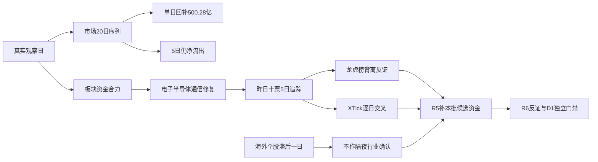

# 2026年11月5日 · **资金面**

> **数据源新鲜度**: partial · **降级状态**: true · **置信度**: 0.2625
> 业务日为2026-11-05；A股资金主观察日为2026-11-04，正常盘前T-1。ETF/两融及美股个股另行标日，不能按文件名视为当日资金。

## 一句话结论
**观察科技链修复：单日回补500.28亿元，但5日仍流出1048.73亿元，不授予开仓权限。**

## 🧭 实际范围与纪律顺序
先问市场为什么付钱：昨日资金为科技链大阳修复付钱；再问处在哪一段：资金证据只能支持修复，不能单凭一日流入确认主升。谁有地位须由R2核定，资金金额榜不是总龙榜。今天R7只交资金事实和反证，不出买卖时点、不发硬否决、不决定账户仓位。

| 层级 | 实际已核对象与窗口 | 未覆盖边界 |
|---|---|---|
| 市场/板块 | 2026-10-08—2026-11-04，20交易日；行业496、概念531、地域31 | 层级重叠，不能汇总相加；不替R2排序主线 |
| 个股详查 | 昨日及前日资金榜并集20只，20日序列；昨日十票5日资金及价格50/50，XTick逐日50/50 | 这是统计对象，不是本批R2候选 |
| 龙虎榜扫描 | 2026-10-29—2026-11-04每日统计及席位；游资3日窗口 | 单日事件、多日披露分列；只作风险线索 |
| 大宗/两融 | 20只统计对象，大宗2026-10-06—2026-11-04，两融15交易日请求窗口 | 有效查询无记录不等于非两融标的；最新两融仅2026-11-03 |

未读取旧R5_candidate_pool，也未将同日旧R2/R5文件认作本次交付。后续由R5生产者补本轮真实候选必要价格及资金，不要求另开R7，不要求特定provider。资金截面6031行、日线5572行，不能假定相同universe；十票已逐票核实，不冒充对全快照完成资格审查。

账户硬预算、停买及人工确认来源本阶段未核，保留未知；既有授权、T+1和逐票hard_reject不变。不继承旧市场研究的零仓或停买意见，也不据缺数创造正预算。今日计划归属为未知，不预写false。

## 📊 时序资金：单日回补，不等于累计转正
| 窗口 | 主力净额（亿元） | 净流入日/有效日 | 解释 |
|---|---:|---:|---|
| 昨日2026-11-04 | +500.28 | 1/1 | 超大单回补为主 |
| 5日 | -1048.73 | 2/5 | 累计仍流出，尚未完成持续性确认 |
| 10日 | -2197.95 | 4/10 | 累计仍流出，尚未完成持续性确认 |
| 20日 | -4685.48 | 4/20 | 累计仍流出，尚未完成持续性确认 |

昨日超大单净额474.06亿元、大单26.22亿元，上证涨2.16%、深证成指涨4.22%。因为5/10/20日累计资金仍负，当前更像集中回补而非已证实的持续净吸筹。研究判断有效窗口为本次盘前至下一次可核资金更新；若下一收盘主力重新净流出且科技板块同步转负，修复延续假设失效；连续两次收盘资金转正并伴板块扩散，才有理由由R1/R2重评温度和主线。

- **大资金意图**: 成交分单显示超大单承担回补，反映风险偏好修复的统计事实；不能据此断定所有机构建仓或最终持仓增加。
- **为什么走强**: 昨日价格与分单资金同向，科技板块承接较强；但中期累计净流出说明旧卖压尚未完全消化。
- **逻辑够不够硬**: 价格与资金同日可核，但完整市场/板块序列同为Eastmoney底层，非多个独立源；无本阶段核实的业绩或政策硬锚，不把修复抬升为主升。

## 🧩 板块资金与个股资金分列
板块表仅按资金金额展示，不是R2主线优先级。电子、半导体、数字芯片设计存在包含关系；概念标签如融资融券、MSCI中国、深股通不能直接当产业主线，深股通成分资金也不是北向净买入。

| 行业统计对象 | 昨日主力（亿元） | 5日合计（亿元） | 昨日涨幅 | 态度 |
|---|---:|---:|---:|---|
| 电子 | +312.63 | -292.09 | +7.61% | 观察修复，不认定主线地位 |
| 半导体 | +195.89 | -82.00 | +10.64% | 观察修复，不认定主线地位 |
| 数字芯片设计 | +82.47 | -85.26 | +10.29% | 观察修复，不认定主线地位 |
| 通信设备 | +76.94 | -176.14 | +5.72% | 观察修复，不认定主线地位 |
| 通信 | +75.86 | -187.28 | +4.63% | 观察修复，不认定主线地位 |

### 电子 · 资金事实而非主线授予
- **大资金意图**: 昨日分单净额+312.63亿元，体现该统计篮子回补；终端买方身份及持仓用途未知。
- **为什么走强**: 同日板块涨7.61%，与净流入同向，但5日合计-292.09亿元，说明尚不能把昨日强度外推为持续合力。
- **逻辑够不够硬**: 仅有同底层板块价格和分单证据；硬政策、业绩与龙头扩散未经本阶段确认。若下次收盘该篮子净流出，延续假设即受反证。

### 半导体 · 资金事实而非主线授予
- **大资金意图**: 昨日分单净额+195.89亿元，体现该统计篮子回补；终端买方身份及持仓用途未知。
- **为什么走强**: 同日板块涨10.64%，与净流入同向，但5日合计-82.00亿元，说明尚不能把昨日强度外推为持续合力。
- **逻辑够不够硬**: 仅有同底层板块价格和分单证据；硬政策、业绩与龙头扩散未经本阶段确认。若下次收盘该篮子净流出，延续假设即受反证。

### 数字芯片设计 · 资金事实而非主线授予
- **大资金意图**: 昨日分单净额+82.47亿元，体现该统计篮子回补；终端买方身份及持仓用途未知。
- **为什么走强**: 同日板块涨10.29%，与净流入同向，但5日合计-85.26亿元，说明尚不能把昨日强度外推为持续合力。
- **逻辑够不够硬**: 仅有同底层板块价格和分单证据；硬政策、业绩与龙头扩散未经本阶段确认。若下次收盘该篮子净流出，延续假设即受反证。

### 通信设备 · 资金事实而非主线授予
- **大资金意图**: 昨日分单净额+76.94亿元，体现该统计篮子回补；终端买方身份及持仓用途未知。
- **为什么走强**: 同日板块涨5.72%，与净流入同向，但5日合计-176.14亿元，说明尚不能把昨日强度外推为持续合力。
- **逻辑够不够硬**: 仅有同底层板块价格和分单证据；硬政策、业绩与龙头扩散未经本阶段确认。若下次收盘该篮子净流出，延续假设即受反证。

### 通信 · 资金事实而非主线授予
- **大资金意图**: 昨日分单净额+75.86亿元，体现该统计篮子回补；终端买方身份及持仓用途未知。
- **为什么走强**: 同日板块涨4.63%，与净流入同向，但5日合计-187.28亿元，说明尚不能把昨日强度外推为持续合力。
- **逻辑够不够硬**: 仅有同底层板块价格和分单证据；硬政策、业绩与龙头扩散未经本阶段确认。若下次收盘该篮子净流出，延续假设即受反证。

## 🔟 昨日前十：五日追踪（不是候选推荐）
昨日定义为2026-11-04最新已收盘日；追踪窗口为2026-10-29、10-30、11-02、11-03、11-04。另存前一收盘日2026-11-03前十仅用于滚动统计，不将它冒充昨日榜。五日涨跌幅为五个日涨跌复合，不是首日收盘到末日收盘的四段收益。

| 股票/代码 | 10-29 | 10-30 | 11-02 | 11-03 | 11-04 | 5日合计 | 五日价格 |
|---|---:|---:|---:|---:|---:|---:|---:|
| 长鑫科技 688825.SH | -7.68 | -0.99 | -6.03 | -31.80 | +30.49 | -16.01 | -0.61% |
| 新易盛 300502.SZ | -11.55 | -3.53 | +4.24 | -9.71 | +25.04 | +4.48 | -23.48% |
| 中际旭创 300308.SZ | -9.65 | -3.49 | +5.36 | -27.76 | +17.40 | -18.14 | -16.17% |
| 云南锗业 002428.SZ | -4.14 | +0.77 | +2.30 | -3.22 | +15.23 | +10.93 | +0.98% |
| 兆易创新 603986.SH | -7.67 | -8.75 | +9.41 | -9.57 | +11.77 | -4.81 | -6.38% |
| 寒武纪 688256.SH | -6.12 | -1.75 | -0.59 | -12.93 | +11.01 | -10.37 | -11.52% |
| 长电科技 600584.SH | -6.00 | -2.35 | +1.66 | -5.37 | +10.82 | -1.23 | -6.62% |
| 工业富联 601138.SH | -10.68 | -0.49 | -2.06 | -9.75 | +9.11 | -13.86 | -6.97% |
| 药明康德 603259.SH | -1.16 | +2.52 | -0.98 | -4.13 | +8.93 | +5.17 | +4.50% |
| 通富微电 002156.SZ | -3.53 | -1.17 | +0.44 | -3.38 | +8.65 | +1.01 | -6.43% |

表内资金单位均为亿元。十票中6只五日仍净流出；新易盛五日资金虽为正，但五日价格仍明显下跌，属于资金/价格不同维度，不能机械定义为已确认右侧。全十票研究态度为观察，未知的龙头条款、RR和禁止清单不填成通过。

| 对象 | 板型（仅快照事实） | 龙头认定/通过条数 | RR/止损距离 | 禁止清单命中 |
|---|---|---|---|---|
| 长鑫科技 | 非涨停大阳线；首板/连板结构未完成 | 未授予，条数未知 | null / null，待D1逐票测算 | 未全项核验，未知≠未命中 |
| 新易盛 | 非涨停大阳线；首板/连板结构未完成 | 未授予，条数未知 | null / null，待D1逐票测算 | 未全项核验，未知≠未命中 |
| 中际旭创 | 非涨停大阳线；首板/连板结构未完成 | 未授予，条数未知 | null / null，待D1逐票测算 | 未全项核验，未知≠未命中 |
| 云南锗业 | 涨停；首板/连板结构未完成 | 未授予，条数未知 | null / null，待D1逐票测算 | 未全项核验，未知≠未命中 |
| 兆易创新 | 非涨停大阳线；首板/连板结构未完成 | 未授予，条数未知 | null / null，待D1逐票测算 | 未全项核验，未知≠未命中 |
| 寒武纪 | 非涨停大阳线；首板/连板结构未完成 | 未授予，条数未知 | null / null，待D1逐票测算 | 未全项核验，未知≠未命中 |
| 长电科技 | 涨停；首板/连板结构未完成 | 未授予，条数未知 | null / null，待D1逐票测算 | 未全项核验，未知≠未命中 |
| 工业富联 | 非涨停大阳线；首板/连板结构未完成 | 未授予，条数未知 | null / null，待D1逐票测算 | 未全项核验，未知≠未命中 |
| 药明康德 | 涨停；首板/连板结构未完成 | 未授予，条数未知 | null / null，待D1逐票测算 | 未全项核验，未知≠未命中 |
| 通富微电 | 涨停；首板/连板结构未完成 | 未授予，条数未知 | null / null，待D1逐票测算 | 未全项核验，未知≠未命中 |

### 长鑫科技（688825.SH）· 观察
- **大资金意图**: 昨日分单净流入+30.49亿元，前四日合计-46.50亿元，只能描述回补轨迹，不能推断庄家意图。
- **为什么走强**: 昨日价格涨13.63%，与当天资金同向；五日净额-16.01亿元、净流入日1/5，持续性与单日涨幅必须分开。
- **逻辑够不够硬**: Tushare/Eastmoney五日与XTick五日已逐日核时；分单算法可比方向但不能视为完全独立资金面。缺本轮龙头身份、硬催化与RR，不能进入执行。
- **买入理由**: 尚未成立；研究保留依据为昨日真实回补+30.49亿元及5日价格/资金可核两个锚。产业主线关联和核心地位须R2/R5确认，不能以金额排名代替。
- **风险点**: 一是修复次日分流或高开回落，二是五日资金/价格不能支持趋势延伸；还缺完整财务合规和公告风险门禁，未知不消除风险。
- **止损条件**: 这里不发持仓卖出指令。研究假设失效条件为随后两个交易日主力净额均<0；将失效事实交D1按原入场逻辑和已有退出规则处理，不自造止损价。
- **可验证假设**: 未来24—72小时两次A股收盘净额均>0且同期价格累计涨幅>0，才支持修复延续；未同时满足则仍为观察，任一次反向为反证。

### 新易盛（300502.SZ）· 观察
- **大资金意图**: 昨日分单净流入+25.04亿元，前四日合计-20.56亿元，只能描述回补轨迹，不能推断庄家意图。
- **为什么走强**: 昨日价格涨13.35%，与当天资金同向；五日净额+4.48亿元、净流入日2/5，持续性与单日涨幅必须分开。
- **逻辑够不够硬**: Tushare/Eastmoney五日与XTick五日已逐日核时；分单算法可比方向但不能视为完全独立资金面。缺本轮龙头身份、硬催化与RR，不能进入执行。
- **买入理由**: 尚未成立；研究保留依据为昨日真实回补+25.04亿元及5日价格/资金可核两个锚。产业主线关联和核心地位须R2/R5确认，不能以金额排名代替。
- **风险点**: 一是修复次日分流或高开回落，二是五日资金/价格不能支持趋势延伸；还缺完整财务合规和公告风险门禁，未知不消除风险。
- **止损条件**: 这里不发持仓卖出指令。研究假设失效条件为随后两个交易日主力净额均<0；将失效事实交D1按原入场逻辑和已有退出规则处理，不自造止损价。
- **可验证假设**: 未来24—72小时两次A股收盘净额均>0且同期价格累计涨幅>0，才支持修复延续；未同时满足则仍为观察，任一次反向为反证。

### 中际旭创（300308.SZ）· 观察
- **大资金意图**: 昨日分单净流入+17.40亿元，前四日合计-35.54亿元，只能描述回补轨迹，不能推断庄家意图。
- **为什么走强**: 昨日价格涨11.07%，与当天资金同向；五日净额-18.14亿元、净流入日2/5，持续性与单日涨幅必须分开。
- **逻辑够不够硬**: Tushare/Eastmoney五日与XTick五日已逐日核时；分单算法可比方向但不能视为完全独立资金面。缺本轮龙头身份、硬催化与RR，不能进入执行。
- **买入理由**: 尚未成立；研究保留依据为昨日真实回补+17.40亿元及5日价格/资金可核两个锚。产业主线关联和核心地位须R2/R5确认，不能以金额排名代替。
- **风险点**: 一是修复次日分流或高开回落，二是五日资金/价格不能支持趋势延伸；还缺完整财务合规和公告风险门禁，未知不消除风险。
- **止损条件**: 这里不发持仓卖出指令。研究假设失效条件为随后两个交易日主力净额均<0；将失效事实交D1按原入场逻辑和已有退出规则处理，不自造止损价。
- **可验证假设**: 未来24—72小时两次A股收盘净额均>0且同期价格累计涨幅>0，才支持修复延续；未同时满足则仍为观察，任一次反向为反证。

### 云南锗业（002428.SZ）· 观察
- **大资金意图**: 昨日分单净流入+15.23亿元，前四日合计-4.30亿元，只能描述回补轨迹，不能推断庄家意图。
- **为什么走强**: 昨日价格涨10.00%，与当天资金同向；五日净额+10.93亿元、净流入日3/5，持续性与单日涨幅必须分开。
- **逻辑够不够硬**: Tushare/Eastmoney五日与XTick五日已逐日核时；分单算法可比方向但不能视为完全独立资金面。缺本轮龙头身份、硬催化与RR，不能进入执行。
- **买入理由**: 尚未成立；研究保留依据为昨日真实回补+15.23亿元及5日价格/资金可核两个锚。产业主线关联和核心地位须R2/R5确认，不能以金额排名代替。
- **风险点**: 一是修复次日分流或高开回落，二是五日资金/价格不能支持趋势延伸；还缺完整财务合规和公告风险门禁，未知不消除风险。
- **止损条件**: 这里不发持仓卖出指令。研究假设失效条件为随后两个交易日主力净额均<0；将失效事实交D1按原入场逻辑和已有退出规则处理，不自造止损价。
- **可验证假设**: 未来24—72小时两次A股收盘净额均>0且同期价格累计涨幅>0，才支持修复延续；未同时满足则仍为观察，任一次反向为反证。

### 兆易创新（603986.SH）· 观察
- **大资金意图**: 昨日分单净流入+11.77亿元，前四日合计-16.58亿元，只能描述回补轨迹，不能推断庄家意图。
- **为什么走强**: 昨日价格涨8.48%，与当天资金同向；五日净额-4.81亿元、净流入日2/5，持续性与单日涨幅必须分开。
- **逻辑够不够硬**: Tushare/Eastmoney五日与XTick五日已逐日核时；分单算法可比方向但不能视为完全独立资金面。缺本轮龙头身份、硬催化与RR，不能进入执行。
- **买入理由**: 尚未成立；研究保留依据为昨日真实回补+11.77亿元及5日价格/资金可核两个锚。产业主线关联和核心地位须R2/R5确认，不能以金额排名代替。
- **风险点**: 一是修复次日分流或高开回落，二是五日资金/价格不能支持趋势延伸；还缺完整财务合规和公告风险门禁，未知不消除风险。
- **止损条件**: 这里不发持仓卖出指令。研究假设失效条件为随后两个交易日主力净额均<0；将失效事实交D1按原入场逻辑和已有退出规则处理，不自造止损价。
- **可验证假设**: 未来24—72小时两次A股收盘净额均>0且同期价格累计涨幅>0，才支持修复延续；未同时满足则仍为观察，任一次反向为反证。

### 寒武纪（688256.SH）· 观察
- **大资金意图**: 昨日分单净流入+11.01亿元，前四日合计-21.39亿元，只能描述回补轨迹，不能推断庄家意图。
- **为什么走强**: 昨日价格涨10.38%，与当天资金同向；五日净额-10.37亿元、净流入日1/5，持续性与单日涨幅必须分开。
- **逻辑够不够硬**: Tushare/Eastmoney五日与XTick五日已逐日核时；分单算法可比方向但不能视为完全独立资金面。缺本轮龙头身份、硬催化与RR，不能进入执行。
- **买入理由**: 尚未成立；研究保留依据为昨日真实回补+11.01亿元及5日价格/资金可核两个锚。产业主线关联和核心地位须R2/R5确认，不能以金额排名代替。
- **风险点**: 一是修复次日分流或高开回落，二是五日资金/价格不能支持趋势延伸；还缺完整财务合规和公告风险门禁，未知不消除风险。
- **止损条件**: 这里不发持仓卖出指令。研究假设失效条件为随后两个交易日主力净额均<0；将失效事实交D1按原入场逻辑和已有退出规则处理，不自造止损价。
- **可验证假设**: 未来24—72小时两次A股收盘净额均>0且同期价格累计涨幅>0，才支持修复延续；未同时满足则仍为观察，任一次反向为反证。

### 长电科技（600584.SH）· 观察
- **大资金意图**: 昨日分单净流入+10.82亿元，前四日合计-12.05亿元，只能描述回补轨迹，不能推断庄家意图。
- **为什么走强**: 昨日价格涨9.99%，与当天资金同向；五日净额-1.23亿元、净流入日2/5，持续性与单日涨幅必须分开。
- **逻辑够不够硬**: Tushare/Eastmoney五日与XTick五日已逐日核时；分单算法可比方向但不能视为完全独立资金面。缺本轮龙头身份、硬催化与RR，不能进入执行。
- **买入理由**: 尚未成立；研究保留依据为昨日真实回补+10.82亿元及5日价格/资金可核两个锚。产业主线关联和核心地位须R2/R5确认，不能以金额排名代替。
- **风险点**: 一是修复次日分流或高开回落，二是五日资金/价格不能支持趋势延伸；还缺完整财务合规和公告风险门禁，未知不消除风险。
- **止损条件**: 这里不发持仓卖出指令。研究假设失效条件为随后两个交易日主力净额均<0；将失效事实交D1按原入场逻辑和已有退出规则处理，不自造止损价。
- **可验证假设**: 未来24—72小时两次A股收盘净额均>0且同期价格累计涨幅>0，才支持修复延续；未同时满足则仍为观察，任一次反向为反证。

### 工业富联（601138.SH）· 观察
- **大资金意图**: 昨日分单净流入+9.11亿元，前四日合计-22.97亿元，只能描述回补轨迹，不能推断庄家意图。
- **为什么走强**: 昨日价格涨7.87%，与当天资金同向；五日净额-13.86亿元、净流入日1/5，持续性与单日涨幅必须分开。
- **逻辑够不够硬**: Tushare/Eastmoney五日与XTick五日已逐日核时；分单算法可比方向但不能视为完全独立资金面。缺本轮龙头身份、硬催化与RR，不能进入执行。
- **买入理由**: 尚未成立；研究保留依据为昨日真实回补+9.11亿元及5日价格/资金可核两个锚。产业主线关联和核心地位须R2/R5确认，不能以金额排名代替。
- **风险点**: 一是修复次日分流或高开回落，二是五日资金/价格不能支持趋势延伸；还缺完整财务合规和公告风险门禁，未知不消除风险。
- **止损条件**: 这里不发持仓卖出指令。研究假设失效条件为随后两个交易日主力净额均<0；将失效事实交D1按原入场逻辑和已有退出规则处理，不自造止损价。
- **可验证假设**: 未来24—72小时两次A股收盘净额均>0且同期价格累计涨幅>0，才支持修复延续；未同时满足则仍为观察，任一次反向为反证。

### 药明康德（603259.SH）· 观察
- **大资金意图**: 昨日分单净流入+8.93亿元，前四日合计-3.76亿元，只能描述回补轨迹，不能推断庄家意图。
- **为什么走强**: 昨日价格涨10.00%，与当天资金同向；五日净额+5.17亿元、净流入日2/5，持续性与单日涨幅必须分开。
- **逻辑够不够硬**: Tushare/Eastmoney五日与XTick五日已逐日核时；分单算法可比方向但不能视为完全独立资金面。缺本轮龙头身份、硬催化与RR，不能进入执行。
- **买入理由**: 尚未成立；研究保留依据为昨日真实回补+8.93亿元及5日价格/资金可核两个锚。产业主线关联和核心地位须R2/R5确认，不能以金额排名代替。
- **风险点**: 一是修复次日分流或高开回落，二是五日资金/价格不能支持趋势延伸；还缺完整财务合规和公告风险门禁，未知不消除风险。
- **止损条件**: 这里不发持仓卖出指令。研究假设失效条件为随后两个交易日主力净额均<0；将失效事实交D1按原入场逻辑和已有退出规则处理，不自造止损价。
- **可验证假设**: 未来24—72小时两次A股收盘净额均>0且同期价格累计涨幅>0，才支持修复延续；未同时满足则仍为观察，任一次反向为反证。

### 通富微电（002156.SZ）· 观察
- **大资金意图**: 昨日分单净流入+8.65亿元，前四日合计-7.64亿元，只能描述回补轨迹，不能推断庄家意图。
- **为什么走强**: 昨日价格涨10.01%，与当天资金同向；五日净额+1.01亿元、净流入日2/5，持续性与单日涨幅必须分开。
- **逻辑够不够硬**: Tushare/Eastmoney五日与XTick五日已逐日核时；分单算法可比方向但不能视为完全独立资金面。缺本轮龙头身份、硬催化与RR，不能进入执行。
- **买入理由**: 尚未成立；研究保留依据为昨日真实回补+8.65亿元及5日价格/资金可核两个锚。产业主线关联和核心地位须R2/R5确认，不能以金额排名代替。
- **风险点**: 一是修复次日分流或高开回落，二是五日资金/价格不能支持趋势延伸；还缺完整财务合规和公告风险门禁，未知不消除风险。
- **止损条件**: 这里不发持仓卖出指令。研究假设失效条件为随后两个交易日主力净额均<0；将失效事实交D1按原入场逻辑和已有退出规则处理，不自造止损价。
- **可验证假设**: 未来24—72小时两次A股收盘净额均>0且同期价格累计涨幅>0，才支持修复延续；未同时满足则仍为观察，任一次反向为反证。

## ⚠️ 龙虎榜诱多识别：区分风险线索与实锤
单日上涨净卖：20条原因事件，涉及18只股票；多日披露上涨净卖3条；下跌且换手≥20%净卖9条事件、8只股票。原因不同不重复相加，单日与连续多日窗口不混用。可转债已从股票诱多统计剔除。

识别阈值为同一交易日涨幅>0、龙虎榜买卖前席位净额<0，作为软性背离；未设金额阈值，极小负额只是弱风险，不与巨额净卖等权。席位不是全市场，龙虎榜净卖与DC主力净买可以同时成立；二者冲突不证明数据错误或主观操纵。

| 单日风险对象（按龙虎榜净额排序，每票一行） | 涨幅 | 龙虎榜净额（亿元） | 机构专用净额（亿元） | DC主力（亿元） | 态度 |
|---|---:|---:|---:|---:|---|
| 东山精密 002384.SZ | +7.04% | -18.38 | -10.64 | +4.27 | 降级为待反证，不作hard_reject |
| 文投控股 600715.SH | +0.41% | -1.25 | 未知 | -0.50 | 降级为待反证，不作hard_reject |
| 江丰电子 300666.SZ | +20.00% | -1.05 | -1.40 | +4.38 | 降级为待反证，不作hard_reject |
| 果麦文化 301052.SZ | +1.15% | -1.04 | -1.08 | -0.28 | 降级为待反证，不作hard_reject |
| 澳弘电子 605058.SH | +7.05% | -0.91 | 未知 | -0.92 | 降级为待反证，不作hard_reject |
| 尚水智能 301513.SZ | +12.43% | -0.71 | -0.25 | +0.35 | 降级为待反证，不作hard_reject |
| 金海通 603061.SH | +10.00% | -0.50 | -1.68 | +0.60 | 降级为待反证，不作hard_reject |
| 百花医药 600721.SH | +3.66% | -0.34 | 未知 | -0.10 | 降级为待反证，不作hard_reject |
| 金健米业 600127.SH | +3.96% | -0.24 | 未知 | +0.23 | 降级为待反证，不作hard_reject |
| 通则康威 301718.SZ | +7.75% | -0.23 | -0.34 | +0.42 | 降级为待反证，不作hard_reject |
| 万邦医药 301520.SZ | +4.15% | -0.17 | -0.14 | -0.04 | 降级为待反证，不作hard_reject |
| 文峰光电 920296.BJ | +6.09% | -0.16 | +0.05 | +0.10 | 降级为待反证，不作hard_reject |
| 中科飞测 688361.SH | +20.00% | -0.15 | +1.76 | +2.56 | 降级为待反证，不作hard_reject |
| 腾信精密 920298.BJ | +30.00% | -0.12 | -0.12 | +1.22 | 降级为待反证，不作hard_reject |
| 万向德农 600371.SH | +10.04% | -0.05 | 未知 | +0.98 | 降级为待反证，不作hard_reject |
| 拓荆科技 688072.SH | +20.00% | -0.05 | +5.81 | +4.75 | 降级为待反证，不作hard_reject |
| 春光科技 603657.SH | +10.02% | -0.04 | 未知 | +0.42 | 降级为待反证，不作hard_reject |
| 宇特光电 920157.BJ | +12.74% | -0.01 | -0.09 | +0.17 | 降级为待反证，不作hard_reject |

### 东山精密：大阳线与前席位净卖冲突
- **大资金意图**: 龙虎榜前席位净卖18.38亿元，其中匹配机构专用净卖10.64亿元，是席位层面兑现的事实；DC主力却净买4.27亿元，说明分单参与者与披露席位不能等同。
- **为什么走强**: 同日价格涨7.04%，但席位买卖方向与涨幅背离；可能存在换手和对手盘补位，不能仅凭涨幅认定“强者恒强”。
- **逻辑够不够硬**: 背离足以要求R6核查，却不足以证明诱多主观意图。若下一次可比收盘价格走弱且分单净额转负，风险增强；反之有净买承接则需重评，不能永久贴出货标签。

多日披露必须独立看：

| 对象 | 多日披露净额（亿元） | 适用窗口 |
|---|---:|---|
| 正帆科技 688596.SH | -2.98 | 连续多日披露，不视为11月4日单日净额 |
| 尚水智能 301513.SZ | -0.56 | 连续多日披露，不视为11月4日单日净额 |
| 郑中设计 002811.SZ | -0.13 | 连续多日披露，不视为11月4日单日净额 |

## 🤝 三日游资协同与跷跷板
具名归类席位重复净买2条，泛风格标签重复净买10条，分列保留原证据；量化基金/量化打板不冒充某一具名游资。席位归类来自hm_detail提供者，不是本阶段实名身份认证。

| 股票 | 游资归类/营业部 | 三日内净买天数 | 合计（万元） | 强度与限制 |
|---|---|---:|---:|---|
| 冰山冷热 000530.SZ | 紫阳东路 / 国泰海通证券武汉紫阳东路 | 2 | 16746.04 | medium；公告仅覆盖本批两日，非完整3日风险放行 |
| 海洋王 002724.SZ | 红岭路 / 华泰证券深圳彩田路 | 2 | 13488.56 | medium；公告仅覆盖本批两日，非完整3日风险放行 |

协同只作正向辅助，不单独构成买入理由。公告反证使用本批2026-11-04—2026-11-05窗口，未查到不等于完整三日无风险；其中泛标签“量化基金”对应浙文影业命中股票交易风险提示公告，已将对应重复净买强度降为low，未删除真实反证。
跷跷板用行业资金绝对值前20统计对象，20日完整序列两两核验190对，相关系数<-0.6的有0对，满足5日相对方向翻转的有0对。因此空数组代表该已核范围内无匹配，不代表全市场不存在跷跷板。未拿概念重叠标签冒充互斥风格。

## 🏦 ETF、期货与两融：各自标时，不混成净流入
| 对象 | 真实观察日 | 可核事实 | 限制 |
|---|---|---|---|
| 510300.SH | 2026-11-03 | 份额变动×同日收盘估算+130.37亿元 | 滞后一个所需交易档；非真实一级净流水 |
| 510500.SH | 2026-11-03 | 份额变动×同日收盘估算+56.91亿元 | 滞后一个所需交易档；非真实一级净流水 |
| 159915.SZ | 2026-11-03 | 份额变动×同日收盘估算+90.67亿元 | 滞后一个所需交易档；非真实一级净流水 |
| 588000.SH | 2026-11-03 | 份额变动×同日收盘估算+111.28亿元 | 滞后一个所需交易档；非真实一级净流水 |
| IF2611/沪深300 | 2026-11-04 | 4094.000−4101.335=-7.335点（-0.1788%） | 未扣资金成本和分红，非套利公允基差 |
| 市场/个股两融 | 最新2026-11-03 | 已保留20对象15交易日请求窗口原始返回 | 空返回不是非两融标的证明；不能填0 |

ETF真实一级资金净额保持null。份额代理不能与市场主力净额相加，也不能拿ETF二级成交金额替代净申赎。大宗交易按30自然日真实窗口保留买卖席位；只有同交易日未复权收盘可比才算折溢价，折价不是确定出货证据，缺价则null。

## 🌎 外部传导：指数新鲜，核心股隔夜缺一档
overseas_snapshot已必读。SPX在2026-11-04涨1.58%、IXIC涨1.44%、DJI涨3.03%，属于广义风险偏好提振；SOX缺失。14只美股核心个股的Tushare补查仍仅2026-11-03，不能把它们写成2026-11-04隔夜行业涨幅。

| 核心股 | 实际观察日 | 该日涨跌幅 | 对今日A股的允许解释 |
|---|---|---:|---|
| NVDA | 2026-11-03 | +2.29% | 滞后一日，只作历史背景，不能确认最新隔夜 |
| AAPL | 2026-11-03 | -1.90% | 滞后一日，只作历史背景，不能确认最新隔夜 |
| MSFT | 2026-11-03 | +2.74% | 滞后一日，只作历史背景，不能确认最新隔夜 |
| GOOGL | 2026-11-03 | +0.37% | 滞后一日，只作历史背景，不能确认最新隔夜 |
| AMZN | 2026-11-03 | +2.06% | 滞后一日，只作历史背景，不能确认最新隔夜 |
| META | 2026-11-03 | +2.36% | 滞后一日，只作历史背景，不能确认最新隔夜 |
| TSLA | 2026-11-03 | -1.32% | 滞后一日，只作历史背景，不能确认最新隔夜 |
| AMD | 2026-11-03 | +3.65% | 滞后一日，只作历史背景，不能确认最新隔夜 |
| INTC | 2026-11-03 | +0.97% | 滞后一日，只作历史背景，不能确认最新隔夜 |
| TSM | 2026-11-03 | +1.55% | 滞后一日，只作历史背景，不能确认最新隔夜 |
| AVGO | 2026-11-03 | +3.07% | 滞后一日，只作历史背景，不能确认最新隔夜 |
| MU | 2026-11-03 | +2.58% | 滞后一日，只作历史背景，不能确认最新隔夜 |
| GLW | 2026-11-03 | +2.39% | 滞后一日，只作历史背景，不能确认最新隔夜 |
| MRVL | 2026-11-03 | +0.33% | 滞后一日，只作历史背景，不能确认最新隔夜 |

MU/NVDA/AVGO/AMD/TSM的历史同向上涨对存储、算力、半导体链提供背景，但最新隔夜产业方向未知；CPO同样只能依据本土通信资金与真实候选核证。美元兑人民币等汇率原始快照已随JSON保留；未核最新日期、交易时段及方向的字段不用于强行加分。

- **大资金意图**: 海外指数收涨只能显示风险资产价格改善，不能据此测算外资将买入A股多少资金。
- **为什么走强**: SPX/IXIC已完成交易日价格为正，广义环境利于风险偏好；具体半导体、存储和CPO催化需最新个股和本土资金确认。
- **逻辑够不够硬**: 核心股停留2026-11-03、SOX缺失，产业方向论据不完整；只保留指数层面的传导，不编造芯片链隔夜确认。

## 🌡️ 封板与情绪温度交叉
Tushare样本涨停118、炸板33，炸板率按33/(118+33)=21.85%，封板率78.15%。XTick为涨停121、炸板33，按同公式为21.43%；其原始zbl=9.62未核口径，不能替换同公式。两源均未达到35%阈值，不触发该条候选减半规则；R7没有执行候选，十票只是统计追踪。正式情绪周期与主模板由R1/R2输出，本阶段不自授风格或主线。

## 关键证据
- 市场20日、行业496与概念531序列：R7_evidence_20261105.json::calls/market、sector_YYYYMMDD；元换亿元。
- 昨日前十5日50/50资金及价格、XTick逐日50/50：stock_funds.yesterday_top10_5d_tracking；个股DC原始万元换亿元。
- 龙虎榜top_list/top_inst与hm_detail：逐原因保留，原始元换亿元；单日和多日不混加。
- 海外必读：data/raw/20261105/overseas_snapshot.json::categories/us_stocks；14股补查us_SYMBOL，仍止于2026-11-03。

## 数据源审计
| 源 | 日期 | 状态 | 记录数 | 备注 |
|---|---|:--:|---:|---|
| Tushare Pro / Eastmoney市场板块资金 | 2026-11-04 | 🟢 | 20869 | 本次实时查询，原始captured_at见JSON；数据观察日与抓取日分开 |
| Tushare Pro 龙虎榜及游资席位 | 2026-11-04 | 🟢 | 5510 | 本次实时查询，原始captured_at见JSON；数据观察日与抓取日分开 |
| XTick MCP hot_money | 2026-11-04 | 🟢 | 50 | 本次实时查询，原始captured_at见JSON；数据观察日与抓取日分开 |
| DataPro | 2026-11-05 | 🔴 | 未知 | 4013 Agent Plan订阅失效/未分配席位；健康探针ok不等于查询可用 |
| ETF份额及两融 | 2026-11-03 | 🟡 | 133 | 最新观察日20261103，低于20261104；ETF为份额变动估算代理非真实净流水 |
| IF2611股指期货及沪深300 | 2026-11-04 | 🟢 | 20 | 本次实时查询，原始captured_at见JSON；数据观察日与抓取日分开 |
| overseas_snapshot及美股补查 | 2026-11-03 | 🟡 | 14 | 核心股补查仍仅20261103；SOX缺失，不能充当20261104隔夜个股涨跌 |
| manifest / mcp_health | 2026-11-05 | 🟡 | 两份 | 启动severity=2，置信度上限0.5；健康探针不等于资金查询可用 |
| anns_window | 2026-11-04—2026-11-05 | 🟡 | 1680条原始公告 | 仅本批两日窗口，游资协同三日公告仍有缺口 |

北向为not_required、review_reference_only：本阶段未补抓，不参与置信度分子/分母、整体时效或交易资格。未知净额为null，不拿成分资金、成交总额替代净额。

## 不确定性 / 反证
1. 主力净额是分单估计，不是账户真实持仓。昨日+500.28亿元与20日-4685.48亿元可以同时成立，修复强不能消除累计卖压。
2. 龙虎榜与全市场分单、机构专用与所有机构不同。上涨净卖只是软风险；R6独占hard_reject。不同原因重叠的披露不累计成更多出货。
3. ETF份额与两融滞后，美股个股隔夜未更新。缺项只限制相关主张/对象，不据此全局禁新或机械改变仓位；有效账户零预算仍不得抬高。
4. RR和逐票禁止清单未完成不是通过，也不是把本轮候选提前否掉。本阶段不输出执行池，后续真实候选研究继续。
5. 置信度=0.75×0.7×0.5=0.2625；完整资金时序为一个可识别底层源，XTick独立底层未知，未滥增独立源计数。数据结构通过不等于信息完整。

## 与其他 R/D/E 的关系
- 依赖：本批manifest、mcp_health、overseas_snapshot、anns_window及本次实时Tushare/XTick数据；未依赖旧R5池或未认证本轮R2。
- 被消费：R2资金合力研究、R5真实候选必要资金补查、R6独立反证、D1门禁与E1复盘。
- R7市场性研究意见仅适用于本次盘前至下一次可核资金更新；下一收盘或本土板块资金方向反转即重评，不无限继承旧计划。

## Sub-Agent 元数据
- skill: analyze_capital_flow_v1
- artifact: data/research/20261105/R7_capital_flow_20261105.json（R7_capital_flow.json软链）
- evidence: data/research/20261105/R7_evidence_20261105.json
- model: gpt-6.1-sol
- 实际流水线启动日与交付日：2026-11-05；真实生成时间及各源抓取时刻见frontmatter/JSON。非回放，未宣称冻结输入；来源观察日分别标注。
- 资源观测：usage_unknown，未计量不当0；5000万token仅连续努力目标，无硬限；08:30仅observe_only交付目标。
- Mermaid SVG真实渲染验收：Mermaid 11.4.0浏览器解析及SVG实际渲染通过，SVG为20932字节；回执见data/research/20261105/R7_mermaid_validation_20261105.json。结构与绘图通过不代表资金证据全项完整。
- 生成耗时：615.4秒（自实际流水线启动计）。
