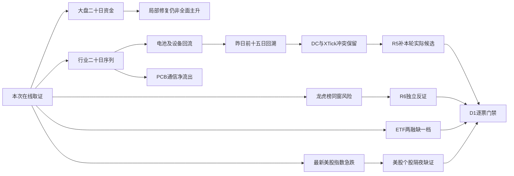

# 2026年11月6日 · **资金面**

> **数据源新鲜度**：partial；**降级状态**：true；**置信度**：0.2625。
> A股资金事实为 **2026-11-05收盘**，不是2026-11-06盘中资金；**情绪=震荡/主跌**（炸板率阈值标记，非替代R1周期结论）。
> 研究观察不授予交易权限。真实账户停买、有效零预算、仓位硬上限、T+1、人工确认及R6逐票硬否决全部不变。

## 一句话结论
**观察设备、电池回流；降级科技一体化叙事，隔夜指数急跌与个股缺证分开处理。**

## 📌 详细分析：先认市场，再认对象
市场奖励的是有持续买方的细分链，而非所有科技股。11月5日大盘主力估算净入85.39亿元，较前日500.28亿元收缩；最近五日仍净出264.98亿元、十日净出1480.04亿元。资金侧属于局部修复延续，尚不能认定全市场进入稳定主升。R1定风格、R2定主线及核心，本报告不越位排序。
电力设备连续四个已收盘交易日净入，电池五日全正；半导体设备五日和二十日累计均正，而PCB与通信昨日重新净出。这支持细分资金合力研究，不支持把设备、存储、CPO、PCB焊成一个“科技普涨”交易模板。父子行业有重叠，金额不得相加当成独立多路资金。
昨日涨停84、炸板48，炸板率36.36%达到35%阈值，情绪按纪律显式标记震荡/主跌，后续交易研究候选数减半。十只资金榜历史追踪不删半，因为它们是统计覆盖，不是十只待买票；本轮未授予任何执行资格。
本阶段先于R2/R5，只核昨日及前日资金榜并集20只、496个行业分类与龙虎榜披露对象。没有读取旧R5_candidate_pool。单一provider失联、辅助缺数不构成全局禁买；未覆盖是未知，由既有R5生产者对真实候选补必要资金与可比价格。

## 💰 市场时序：日、五日、十日不能互相替代
| 窗口 | 实际起止 | 主力净额/亿元 | 正流入日 |
|---|---|---:|---:|
| 5日 | 2026-10-30—2026-11-05 | -264.98 | 3/5 |
| 10日 | 2026-10-23—2026-11-05 | -1480.04 | 5/10 |
| 20日 | 2026-10-09—2026-11-05 | -4119.72 | 5/20 |

| 交易日 | 主力净额/亿元 | 超大单净额/亿元 | 大单净额/亿元 | 上证/深证涨跌 |
|---|---:|---:|---:|---:|
| 2026-10-30 | -396.66 | -165.51 | -231.15 | -1.44% / -2.73% |
| 2026-11-02 | +117.43 | +158.32 | -40.89 | +1.08% / +1.63% |
| 2026-11-03 | -571.43 | -304.62 | -266.80 | -0.82% / -1.21% |
| 2026-11-04 | +500.28 | +474.06 | +26.22 | +2.16% / +4.22% |
| 2026-11-05 | +85.39 | +85.15 | +0.24 | +0.10% / +1.19% |

金额来自东财成交分类估算，不是全市场账户现金流或新增入金。昨日超大单净入85.15亿元，大单仅净入0.24亿元；“主力净入”不能被解释为所有大资金一致增仓。大盘资金、板块资金、个股资金各自保留口径，互不拼总。

## 🧭 板块资金与合力：统计金额，不授主线排位
| 板块 | 昨日净额/亿元 | 5日净额/亿元 | 10日净额/亿元 | 20日净额/亿元 | 五日正流天数 |
|---|---:|---:|---:|---:|---:|
| 电力设备 | +63.10 | +130.72 | +20.33 | -313.61 | 4/5 |
| 电池 | +26.43 | +75.13 | +28.34 | -163.46 | 5/5 |
| 光伏设备 | +32.36 | +60.71 | +47.38 | +4.26 | 4/5 |
| 半导体 | +61.04 | +115.43 | -8.56 | -233.71 | 3/5 |
| 半导体设备 | +54.32 | +108.22 | +45.92 | +19.59 | 3/5 |
| 半导体材料 | +21.09 | +36.06 | +2.21 | -43.70 | 3/5 |
| 传媒 | +34.92 | +53.83 | +48.26 | -6.49 | 3/5 |
| 电子 | +12.05 | +29.18 | -360.19 | -931.54 | 3/5 |
| 印制电路板 | -61.05 | -67.90 | -208.49 | -312.85 | 2/5 |
| 通信 | -47.11 | -120.44 | -223.99 | -545.11 | 2/5 |
| 数字芯片设计 | -18.56 | -38.49 | -5.44 | -125.81 | 2/5 |
| 证券Ⅱ | -13.60 | -13.88 | -57.76 | -132.72 | 1/5 |

### 电力设备 / 电池 / 光伏：观察连续性，不把修复等同主升
- **大资金意图**: 电池五日净入75.13亿元且5/5日为正，电力设备五日净入130.72亿元，显示分类订单层面的持续回流；无法从统计额识别真实机构账户意图。
- **为什么走强**: 电力设备涨3.79%、光伏设备涨8.45%，价格与资金同向。宁德时代、阳光电源的五日资金样本均正，提供个股层支持；具体产业催化与本轮龙头地位尚待R2/R4/R5核验。
- **逻辑够不够硬**: 足以确认过去五日回流，不足以保证明日接力。电池二十日仍净出163.46亿元；若未来两日板块合计净额转负且核心承接失败，局部修复持续性假设失效。

### 半导体设备：观察细分合力，拦截“全科技同涨”推论
- **大资金意图**: 半导体设备昨日净入54.32亿元、五日108.22亿元、二十日19.59亿元，较整体半导体二十日仍负更有细分持续性；不能把父子行业金额相加。
- **为什么走强**: 设备板块涨4.33%，中微、拓荆、华峰、中科飞测、芯源微进入昨日资金前十；但中微和拓荆的XTick大额净额为负，强股价格与不同分类资金没有完全共振。
- **逻辑够不够硬**: 支持设备细分观察，不支持全部科技进攻。PCB昨日净出61.05亿元、通信净出47.11亿元；外部指数急跌又增加次日兑现压力，必须等本轮核心确权及承接，不能由榜首自动认龙。

### 传媒：观察板块回流，同时保留个股席位反证
- **大资金意图**: 传媒昨日净入34.92亿元、五日53.83亿元，存在资金回流；不能把板块总量当所有传媒股均被买入。
- **为什么走强**: 板块涨3.86%，利欧首板、慈文及福石等个股有价格扩散；慈文、福石存在同榜因机构席位净卖，文投与龙版出现上涨但主力及榜单净出。
- **逻辑够不够硬**: 同板块正向合力与逐票反证并存。R2独立筛核心，R5补产业锚，R6独立判断风险；不能因板块正流入替任何个股免审。

## 🔎 昨日前十 · 五日逐日回溯
定义：2026-11-05东财个股主力净额降序前十；回溯窗口2026-10-30至2026-11-05。50/50个资金与官方日线股票日有效，XTick也50/50逐日核验实际time。五日收益使用首日pre_close到末日close，非只算四个区间。
按末日资金选样含后验偏差，十票五日均净流入不是策略命中率，更不是未来五日收益。DC按万元转亿元，XTick按元转亿元，不平均、不加总；只交叉方向及保留冲突。
| 排名 | 对象 | 昨日DC/XTick净额/亿元 | 五日主力净额/亿元 | 五日正流天数 | 五日收益 | 态度 |
|---:|---|---:|---:|---:|---:|---|
| 1 | 中微公司 688012.SH | +14.84 / -0.18 | +30.82 | 4/5 | +11.89% | 降级 |
| 2 | 利欧股份 002131.SZ | +9.13 / +12.18 | +8.89 | 3/5 | +10.30% | 观察 |
| 3 | 宁德时代 300750.SZ | +8.10 / +6.01 | +45.47 | 5/5 | +15.27% | 观察 |
| 4 | 有研新材 600206.SH | +7.87 / +17.96 | +11.95 | 3/5 | +14.19% | 观察 |
| 5 | 拓荆科技 688072.SH | +7.44 / -2.65 | +12.57 | 3/5 | +14.23% | 降级 |
| 6 | 瑞芯微 603893.SH | +6.70 / +21.33 | +11.47 | 4/5 | +14.58% | 观察 |
| 7 | 华峰测控 688200.SH | +5.96 / +2.48 | +8.01 | 3/5 | +6.20% | 观察 |
| 8 | 中科飞测 688361.SH | +5.87 / +2.80 | +9.60 | 4/5 | +17.84% | 观察 |
| 9 | 阳光电源 300274.SZ | +5.03 / +9.00 | +19.42 | 4/5 | +26.68% | 观察 |
| 10 | 芯源微 688037.SH | +4.44 / +3.25 | +5.93 | 4/5 | +4.89% | 观察 |

前一日榜2026-11-04的十只，到11月5日有8只转净流出，与最新前十重叠0只。榜单更替提示资金轮动快，不证明同一笔钱完成换仓，也不把旧榜票当本轮R2候选。

| 对象 | 昨日DC主力逐日净额/亿元，依次为10-30、11-02、11-03、11-04、11-05 | XTick同日方向一致天数 |
|---|---|---:|
| 中微公司 | -0.34 / +5.32 / +2.82 / +8.19 / +14.84 | 3/5 |
| 利欧股份 | -1.65 / +1.37 / -0.77 / +0.81 / +9.13 | 5/5 |
| 宁德时代 | +10.90 / +7.43 / +12.85 / +6.19 / +8.10 | 5/5 |
| 有研新材 | -0.61 / +1.56 / -2.06 / +5.20 / +7.87 | 5/5 |
| 拓荆科技 | -0.30 / +1.98 / -1.30 / +4.75 / +7.44 | 2/5 |
| 瑞芯微 | -0.92 / +1.01 / +1.07 / +3.60 / +6.70 | 4/5 |
| 华峰测控 | -0.19 / +0.92 / -0.13 / +1.45 / +5.96 | 3/5 |
| 中科飞测 | +0.46 / +1.17 / -0.46 / +2.56 / +5.87 | 4/5 |
| 阳光电源 | -2.04 / +3.90 / +5.41 / +7.12 / +5.03 | 4/5 |
| 芯源微 | +0.01 / +0.50 / -0.10 / +1.09 / +4.44 | 5/5 |

以下十票全部是统计研究对象，不是首推或执行池。板型仅据昨日涨停/炸板池；龙头、纪律§2通过条数、RR与禁止清单未完成时保持未知。in_today_plan与今日核心/主线补涨/计划内试错归类均未知，不预置false或计划外。

### 中微公司 688012.SH：降级，不授开仓资格
板型：未涨停。龙头认定：未核，纪律§2通过条数未知；RR：未知，无买入/止损/目标配对；禁止清单：命中项未核全，不把未知当通过。
- **大资金意图**: 昨日DC净入14.84亿元，XTick同日-0.18亿元；方向反向，降级一致吸筹叙事，不能择有利数字。
- **为什么走强**: 昨日涨5.83%，五日资金净入30.82亿元，4/5日为正；半导体设备是研究产业映射，不是已核新增催化。
- **逻辑够不够硬**: 对已发生的资金与价格可复核，对本轮龙头身份、公告及财务合规、明日接力不充分；资金榜排名不是龙头认定。
- **买入理由**: 尚未建立。产业线索为半导体设备，但催化硬度需R2/R4/R5确认；五日资金与价格事实仅足以继续研究，不能单独进execution。
- **风险点**: 短期面临隔夜指数急跌及修复兑现；中期硬催化与财务合规尚未核全，资金分单存在口径偏差，两融最新日又缺档。
- **止损条件**: 本轮没有建立仓位，不编造交易价位。若未来两个完整交易日主力连续净出或两日累计不为正，资金持续性研究假设失效；实际交易必须由D1先配5%—10%止损距与RR≥2，未配齐不进执行。
- **可验证假设**: 未来两个完整交易日，至少一日主力净额>0且两日累计>0；跨源冲突票还须同日DC与XTick方向均转正，才能升级资金一致性判断。

### 利欧股份 002131.SZ：观察，不授开仓资格
板型：1板，开板1次，收盘封板。龙头认定：未核，纪律§2通过条数未知；RR：未知，无买入/止损/目标配对；禁止清单：命中项未核全，不把未知当通过。
- **大资金意图**: 昨日DC净入9.13亿元，XTick同日+12.18亿元；方向同向只能佐证分类成交买方更积极，不能推断实名机构锁仓。
- **为什么走强**: 昨日涨10.03%，五日资金净入8.89亿元，3/5日为正；广告营销/传媒是研究产业映射，不是已核新增催化。
- **逻辑够不够硬**: 对已发生的资金与价格可复核，对本轮龙头身份、公告及财务合规、明日接力不充分；资金榜排名不是龙头认定。
- **买入理由**: 尚未建立。产业线索为广告营销/传媒，但催化硬度需R2/R4/R5确认；五日资金与价格事实仅足以继续研究，不能单独进execution。
- **风险点**: 短期面临隔夜指数急跌及修复兑现；中期硬催化与财务合规尚未核全，资金分单存在口径偏差，两融最新日又缺档。
- **止损条件**: 本轮没有建立仓位，不编造交易价位。若未来两个完整交易日主力连续净出或两日累计不为正，资金持续性研究假设失效；实际交易必须由D1先配5%—10%止损距与RR≥2，未配齐不进执行。
- **可验证假设**: 未来两个完整交易日，至少一日主力净额>0且两日累计>0；跨源冲突票还须同日DC与XTick方向均转正，才能升级资金一致性判断。

### 宁德时代 300750.SZ：观察，不授开仓资格
板型：未涨停。龙头认定：未核，纪律§2通过条数未知；RR：未知，无买入/止损/目标配对；禁止清单：命中项未核全，不把未知当通过。
- **大资金意图**: 昨日DC净入8.10亿元，XTick同日+6.01亿元；方向同向只能佐证分类成交买方更积极，不能推断实名机构锁仓。
- **为什么走强**: 昨日涨4.42%，五日资金净入45.47亿元，5/5日为正；电池是研究产业映射，不是已核新增催化。
- **逻辑够不够硬**: 对已发生的资金与价格可复核，对本轮龙头身份、公告及财务合规、明日接力不充分；资金榜排名不是龙头认定。
- **买入理由**: 尚未建立。产业线索为电池，但催化硬度需R2/R4/R5确认；五日资金与价格事实仅足以继续研究，不能单独进execution。
- **风险点**: 短期面临隔夜指数急跌及修复兑现；中期硬催化与财务合规尚未核全，资金分单存在口径偏差，两融最新日又缺档。
- **止损条件**: 本轮没有建立仓位，不编造交易价位。若未来两个完整交易日主力连续净出或两日累计不为正，资金持续性研究假设失效；实际交易必须由D1先配5%—10%止损距与RR≥2，未配齐不进执行。
- **可验证假设**: 未来两个完整交易日，至少一日主力净额>0且两日累计>0；跨源冲突票还须同日DC与XTick方向均转正，才能升级资金一致性判断。

### 有研新材 600206.SH：观察，不授开仓资格
板型：2板，开板6次，收盘封板。龙头认定：未核，纪律§2通过条数未知；RR：未知，无买入/止损/目标配对；禁止清单：命中项未核全，不把未知当通过。
- **大资金意图**: 昨日DC净入7.87亿元，XTick同日+17.96亿元；方向同向只能佐证分类成交买方更积极，不能推断实名机构锁仓。
- **为什么走强**: 昨日涨10.00%，五日资金净入11.95亿元，3/5日为正；半导体材料是研究产业映射，不是已核新增催化。
- **逻辑够不够硬**: 对已发生的资金与价格可复核，对本轮龙头身份、公告及财务合规、明日接力不充分；资金榜排名不是龙头认定。
- **买入理由**: 尚未建立。产业线索为半导体材料，但催化硬度需R2/R4/R5确认；五日资金与价格事实仅足以继续研究，不能单独进execution。
- **风险点**: 短期面临隔夜指数急跌及修复兑现；中期硬催化与财务合规尚未核全，资金分单存在口径偏差，两融最新日又缺档。
- **止损条件**: 本轮没有建立仓位，不编造交易价位。若未来两个完整交易日主力连续净出或两日累计不为正，资金持续性研究假设失效；实际交易必须由D1先配5%—10%止损距与RR≥2，未配齐不进执行。
- **可验证假设**: 未来两个完整交易日，至少一日主力净额>0且两日累计>0；跨源冲突票还须同日DC与XTick方向均转正，才能升级资金一致性判断。

### 拓荆科技 688072.SH：降级，不授开仓资格
板型：未涨停。龙头认定：未核，纪律§2通过条数未知；RR：未知，无买入/止损/目标配对；禁止清单：命中项未核全，不把未知当通过。
- **大资金意图**: 昨日DC净入7.44亿元，XTick同日-2.65亿元；方向反向，降级一致吸筹叙事，不能择有利数字。
- **为什么走强**: 昨日涨3.09%，五日资金净入12.57亿元，3/5日为正；半导体设备是研究产业映射，不是已核新增催化。
- **逻辑够不够硬**: 对已发生的资金与价格可复核，对本轮龙头身份、公告及财务合规、明日接力不充分；资金榜排名不是龙头认定。
- **买入理由**: 尚未建立。产业线索为半导体设备，但催化硬度需R2/R4/R5确认；五日资金与价格事实仅足以继续研究，不能单独进execution。
- **风险点**: 短期面临隔夜指数急跌及修复兑现；中期硬催化与财务合规尚未核全，资金分单存在口径偏差，两融最新日又缺档。
- **止损条件**: 本轮没有建立仓位，不编造交易价位。若未来两个完整交易日主力连续净出或两日累计不为正，资金持续性研究假设失效；实际交易必须由D1先配5%—10%止损距与RR≥2，未配齐不进执行。
- **可验证假设**: 未来两个完整交易日，至少一日主力净额>0且两日累计>0；跨源冲突票还须同日DC与XTick方向均转正，才能升级资金一致性判断。

### 瑞芯微 603893.SH：观察，不授开仓资格
板型：2板，开板11次，收盘封板。龙头认定：未核，纪律§2通过条数未知；RR：未知，无买入/止损/目标配对；禁止清单：命中项未核全，不把未知当通过。
- **大资金意图**: 昨日DC净入6.70亿元，XTick同日+21.33亿元；方向同向只能佐证分类成交买方更积极，不能推断实名机构锁仓。
- **为什么走强**: 昨日涨10.00%，五日资金净入11.47亿元，4/5日为正；数字芯片设计是研究产业映射，不是已核新增催化。
- **逻辑够不够硬**: 对已发生的资金与价格可复核，对本轮龙头身份、公告及财务合规、明日接力不充分；资金榜排名不是龙头认定。
- **买入理由**: 尚未建立。产业线索为数字芯片设计，但催化硬度需R2/R4/R5确认；五日资金与价格事实仅足以继续研究，不能单独进execution。
- **风险点**: 短期面临隔夜指数急跌及修复兑现；中期硬催化与财务合规尚未核全，资金分单存在口径偏差，两融最新日又缺档。
- **止损条件**: 本轮没有建立仓位，不编造交易价位。若未来两个完整交易日主力连续净出或两日累计不为正，资金持续性研究假设失效；实际交易必须由D1先配5%—10%止损距与RR≥2，未配齐不进执行。
- **可验证假设**: 未来两个完整交易日，至少一日主力净额>0且两日累计>0；跨源冲突票还须同日DC与XTick方向均转正，才能升级资金一致性判断。

### 华峰测控 688200.SH：观察，不授开仓资格
板型：未涨停。龙头认定：未核，纪律§2通过条数未知；RR：未知，无买入/止损/目标配对；禁止清单：命中项未核全，不把未知当通过。
- **大资金意图**: 昨日DC净入5.96亿元，XTick同日+2.48亿元；方向同向只能佐证分类成交买方更积极，不能推断实名机构锁仓。
- **为什么走强**: 昨日涨7.99%，五日资金净入8.01亿元，3/5日为正；半导体设备是研究产业映射，不是已核新增催化。
- **逻辑够不够硬**: 对已发生的资金与价格可复核，对本轮龙头身份、公告及财务合规、明日接力不充分；资金榜排名不是龙头认定。
- **买入理由**: 尚未建立。产业线索为半导体设备，但催化硬度需R2/R4/R5确认；五日资金与价格事实仅足以继续研究，不能单独进execution。
- **风险点**: 短期面临隔夜指数急跌及修复兑现；中期硬催化与财务合规尚未核全，资金分单存在口径偏差，两融最新日又缺档。
- **止损条件**: 本轮没有建立仓位，不编造交易价位。若未来两个完整交易日主力连续净出或两日累计不为正，资金持续性研究假设失效；实际交易必须由D1先配5%—10%止损距与RR≥2，未配齐不进执行。
- **可验证假设**: 未来两个完整交易日，至少一日主力净额>0且两日累计>0；跨源冲突票还须同日DC与XTick方向均转正，才能升级资金一致性判断。

### 中科飞测 688361.SH：观察，不授开仓资格
板型：未涨停。龙头认定：未核，纪律§2通过条数未知；RR：未知，无买入/止损/目标配对；禁止清单：命中项未核全，不把未知当通过。
- **大资金意图**: 昨日DC净入5.87亿元，XTick同日+2.80亿元；方向同向只能佐证分类成交买方更积极，不能推断实名机构锁仓。
- **为什么走强**: 昨日涨9.02%，五日资金净入9.60亿元，4/5日为正；半导体设备是研究产业映射，不是已核新增催化。
- **逻辑够不够硬**: 对已发生的资金与价格可复核，对本轮龙头身份、公告及财务合规、明日接力不充分；资金榜排名不是龙头认定。
- **买入理由**: 尚未建立。产业线索为半导体设备，但催化硬度需R2/R4/R5确认；五日资金与价格事实仅足以继续研究，不能单独进execution。
- **风险点**: 短期面临隔夜指数急跌及修复兑现；中期硬催化与财务合规尚未核全，资金分单存在口径偏差，两融最新日又缺档。
- **止损条件**: 本轮没有建立仓位，不编造交易价位。若未来两个完整交易日主力连续净出或两日累计不为正，资金持续性研究假设失效；实际交易必须由D1先配5%—10%止损距与RR≥2，未配齐不进执行。
- **可验证假设**: 未来两个完整交易日，至少一日主力净额>0且两日累计>0；跨源冲突票还须同日DC与XTick方向均转正，才能升级资金一致性判断。

### 阳光电源 300274.SZ：观察，不授开仓资格
板型：未涨停。龙头认定：未核，纪律§2通过条数未知；RR：未知，无买入/止损/目标配对；禁止清单：命中项未核全，不把未知当通过。
- **大资金意图**: 昨日DC净入5.03亿元，XTick同日+9.00亿元；方向同向只能佐证分类成交买方更积极，不能推断实名机构锁仓。
- **为什么走强**: 昨日涨4.89%，五日资金净入19.42亿元，4/5日为正；光伏设备是研究产业映射，不是已核新增催化。
- **逻辑够不够硬**: 对已发生的资金与价格可复核，对本轮龙头身份、公告及财务合规、明日接力不充分；资金榜排名不是龙头认定。
- **买入理由**: 尚未建立。产业线索为光伏设备，但催化硬度需R2/R4/R5确认；五日资金与价格事实仅足以继续研究，不能单独进execution。
- **风险点**: 短期面临隔夜指数急跌及修复兑现；中期硬催化与财务合规尚未核全，资金分单存在口径偏差，两融最新日又缺档。
- **止损条件**: 本轮没有建立仓位，不编造交易价位。若未来两个完整交易日主力连续净出或两日累计不为正，资金持续性研究假设失效；实际交易必须由D1先配5%—10%止损距与RR≥2，未配齐不进执行。
- **可验证假设**: 未来两个完整交易日，至少一日主力净额>0且两日累计>0；跨源冲突票还须同日DC与XTick方向均转正，才能升级资金一致性判断。

### 芯源微 688037.SH：观察，不授开仓资格
板型：未涨停。龙头认定：未核，纪律§2通过条数未知；RR：未知，无买入/止损/目标配对；禁止清单：命中项未核全，不把未知当通过。
- **大资金意图**: 昨日DC净入4.44亿元，XTick同日+3.25亿元；方向同向只能佐证分类成交买方更积极，不能推断实名机构锁仓。
- **为什么走强**: 昨日涨6.31%，五日资金净入5.93亿元，4/5日为正；半导体设备是研究产业映射，不是已核新增催化。
- **逻辑够不够硬**: 对已发生的资金与价格可复核，对本轮龙头身份、公告及财务合规、明日接力不充分；资金榜排名不是龙头认定。
- **买入理由**: 尚未建立。产业线索为半导体设备，但催化硬度需R2/R4/R5确认；五日资金与价格事实仅足以继续研究，不能单独进execution。
- **风险点**: 短期面临隔夜指数急跌及修复兑现；中期硬催化与财务合规尚未核全，资金分单存在口径偏差，两融最新日又缺档。
- **止损条件**: 本轮没有建立仓位，不编造交易价位。若未来两个完整交易日主力连续净出或两日累计不为正，资金持续性研究假设失效；实际交易必须由D1先配5%—10%止损距与RR≥2，未配齐不进执行。
- **可验证假设**: 未来两个完整交易日，至少一日主力净额>0且两日累计>0；跨源冲突票还须同日DC与XTick方向均转正，才能升级资金一致性判断。

## ⚠️ 龙虎榜诱多识别：证据分层，不认定操纵
昨日原始榜单69条、63只；日榜上涨资金背离15只，多日榜风险另列0条；下跌且换手至少30%并榜净卖4只。
阈值：上涨伴当日主力/同榜净额/同榜因机构净卖至少1500万元，或高换手伴净卖。它是研究筛查阈值，不是硬门禁。按股票、榜单窗口及金额去重；机构买卖侧重复记录去重，不把机构专用等同一个账户。多日榜不能与日额相加，也不能用三日涨幅冒充昨日涨幅。
| 对象 | 涨跌 | 榜单净额/亿元 | 同榜因机构净额/亿元 | 当日主力/亿元 | 窗口/态度 |
|---|---:|---:|---:|---:|---|
| 盛达资源 000603.SZ | +10.01% | -0.84 | +0.13 | +1.01 | 日榜，降级持续接力主张 |
| 襄阳轴承 000678.SZ | +1.33% | -1.38 | 未知 | -0.86 | 日榜，降级持续接力主张 |
| 皇台酒业 000995.SZ | +10.02% | -0.31 | -1.04 | +0.31 | 日榜，降级持续接力主张 |
| 慈文传媒 002343.SZ | +10.02% | +0.95 | -0.29 | +2.37 | 日榜，降级持续接力主张 |
| 光洋股份 002708.SZ | +5.89% | -1.05 | +0.18 | +0.76 | 日榜，降级持续接力主张 |
| 福石控股 300071.SZ | +20.05% | +2.03 | -0.15 | +4.27 | 日榜，降级持续接力主张 |
| 果麦文化 301052.SZ | +5.46% | -0.64 | -0.56 | -0.03 | 日榜，降级持续接力主张 |
| 万邦医药 301520.SZ | +2.57% | +0.04 | +0.03 | -0.37 | 日榜，降级持续接力主张 |
| 联亚药业 301569.SZ | +3.22% | -0.33 | -0.44 | +0.08 | 日榜，降级持续接力主张 |
| 托伦斯 301583.SZ | +11.04% | -0.72 | +0.10 | +0.53 | 日榜，降级持续接力主张 |
| 阳光照明 600261.SH | +10.09% | +1.22 | -0.29 | +0.94 | 日榜，降级持续接力主张 |
| 万向德农 600371.SH | +3.78% | -0.89 | -0.55 | +0.26 | 日榜，降级持续接力主张 |
| 文投控股 600715.SH | +2.02% | -0.36 | 未知 | -1.12 | 日榜，降级持续接力主张 |
| 科森科技 603626.SH | +8.04% | +0.05 | -0.27 | +2.26 | 日榜，降级持续接力主张 |
| 龙版传媒 605577.SH | +6.80% | -1.08 | 未知 | -0.74 | 日榜，降级持续接力主张 |
| 冰山冷热 000530.SZ | -4.44% | -1.15 | -0.37 | -1.46 | 日榜，降级持续接力主张 |
| 金健米业 600127.SH | -0.29% | -0.31 | 未知 | -1.01 | 日榜，降级持续接力主张 |
| 大晟文化 600892.SH | -2.84% | -0.70 | 未知 | -1.79 | 日榜，降级持续接力主张 |
| 马矿股份 601123.SH | -3.98% | -0.17 | 未知 | -1.06 | 日榜，降级持续接力主张 |

襄阳轴承上涨1.33%但主力净出0.86亿元、榜单净出1.38亿元、换手32.44%，是同窗价格与资金背离。皇台酒业涨停且主力微净入，但榜单及机构净卖，属于席位冲突；不能把单边数据写成全市场已出货。慈文传媒、福石控股榜单合计净买但机构净卖，也必须保留分歧，不因题材回流删反证。

- **大资金意图**: 披露席位上涨时净卖可能是兑现或换手，只能作为线索，不足认定诱导散户或操纵。
- **为什么走强**: 其他席位、封板接力或题材扩散仍可推动价格；负榜单金额不直接解释全部成交。
- **逻辑够不够硬**: 完整盘口撤单、实际账户与事件因果均未核，确认诱多案例为空不是确认无风险；R6是唯一硬否决来源，R7保留软反证不裁决。
近三日具名实际营业部重复正净买经封板/ST过滤后，合格旗标0条，排除13条。原始hm_detail与排除对象均保留；没有把净卖日或通用专用席位当作协同，也不因无协同排除事件驱动对象。

## ⚖️ 跷跷板：负相关不等于双方已换向
从昨日净入前十与净出前十的去同序列样本中，测试20日完整序列190对。相关系数严格<-0.6的未确认换向关系2对，满足双侧相邻五日各自转号且当前相反的合格配对0对。无填充、不用10日冒充20日。

- 半导体材料 ↔ 煤炭：ρ=-0.652720。材料由负转正，但煤炭一侧前后五日都负，未满足双方方向翻转，不写成已确认跷跷板。
- 半导体材料 ↔ 煤炭开采：ρ=-0.698676。材料由负转正，但煤炭一侧前后五日都负，未满足双方方向翻转，不写成已确认跷跷板。
结果只限本次20分类样本，不宣称全496分类乃至全市场不存在轮动；煤炭与煤炭开采又是父子关系，不算两条独立风险。

## 🏦 ETF、两融与期货：按维度记录真实日期
ETF份额、个股两融均最新至2026-11-04，对应本次应有2026-11-05缺一交易档。20只对象请求最近15交易日仅14档，完整15日变化保持未知。辅助缺档只限制相应主张，不把已核板块/个股主力事实作废。
| ETF | 实际份额日 | 最近份额变化/万份 | 份额×同日收盘估值代理/亿元 | 11月5日真实净申购 |
|---|---|---:|---:|---|
| 510300.SH | 2026-11-04 | +177570.00 | +74.14 | 未知 |
| 510500.SH | 2026-11-04 | +116120.00 | +77.35 | 未知 |
| 159915.SZ | 2026-11-04 | +196800.00 | +50.40 | 未知 |
| 588000.SH | 2026-11-04 | +240300.00 | +32.20 | 未知 |

代理只覆盖四只ETF，份额差乘同日二级收盘不是一级市场真实现金流水；XTick四只未返金额，更不能填0。
IF2611.CFX与沪深300同日2026-11-05收盘未调整基差为 **-0.4112点**，完整20日序列已保留。不扣分红、融资与持仓成本，不作为确定次日方向的套利信号。
大宗窗口为2026-10-06至2026-11-05，原记录和实际席位保留；有同日未复权收盘才计算折溢价，缺价格保持未知。明确查询有效空返回才空数组，空两融结果不推定非两融标的，也不凭折价单独认定出货。

## 🌎 外部传导：最新指数急跌，核心个股隔夜仍缺证
本次必读overseas_snapshot：SPX、IXIC为2026-11-05腾讯回退报价，分别 **-4.36%、-5.52%**；SOX缺失。指数显示外部科技风险偏好明显承压，但R7没有另源独立复核，保留快照真实source与观察日。
14只核心个股实时Tushare MCP补查2026-11-04至2026-11-05，均只返回11月4日。原快照缺项由这次实际返回补历史背景，不把历史日收益搬成昨夜收益。**最新11月5日核心个股涨跌全部未知。**
| 核心个股 | 实际观察日 | 该日历史涨跌 | A股研究映射 | 11月5日个股涨跌 |
|---|---|---:|---|---|
| MU | 2026-11-04 | -7.00% | 存储 | 未知 |
| NVDA | 2026-11-04 | -3.17% | GPU/算力 | 未知 |
| AVGO | 2026-11-04 | -2.00% | CPO/互联 | 未知 |
| AMD | 2026-11-04 | +1.01% | GPU/算力 | 未知 |
| TSM | 2026-11-04 | -2.24% | 代工/设备 | 未知 |
| AAPL | 2026-11-04 | +5.31% | 消费电子 | 未知 |
| MSFT | 2026-11-04 | +6.68% | AI/软件 | 未知 |
| GOOGL | 2026-11-04 | +3.18% | AI/云 | 未知 |
| AMZN | 2026-11-04 | +6.12% | 云/算力 | 未知 |
| META | 2026-11-04 | +1.44% | AI/算力 | 未知 |
| TSLA | 2026-11-04 | -3.34% | 汽车/机器人 | 未知 |
| INTC | 2026-11-04 | -3.77% | 半导体制造 | 未知 |
| GLW | 2026-11-04 | -5.84% | 光通信 | 未知 |
| MRVL | 2026-11-04 | -7.08% | 互联/CPO | 未知 |

MU历史-7.00%、NVDA-3.17%、AVGO-2.00%、TSM-2.24%与AMD+1.01%并非本次最新隔夜变化；不能重复计作今日新增利空。AAPL、MSFT历史大涨也不能拿来抵消最新纳指急跌。

传导假设：指数风险偏好冲击可能压制今日存储、CPO、半导体链承接；A股设备和电池已有内资回流，需区分外部情绪冲击与内资是否真正撤退。下一完整交易日若设备/电池主力转负且核心收盘无法维持前日强势区，修复持续性降级；若仍净入且扩散，则外部冲击未完全破坏内资合力。研究映射不是开仓或全局停买命令。

## 🔀 资金时序与风险交接

## 关键证据
- 大盘20日资金与交易日历：data/research/20261106/R7_evidence_20261106.json::calls.market / calendar。
- 496分类20日原始序列：data/research/20261106/R7_evidence_20261106.json::calls.sector_日期；父子重叠不相加。
- 20只统计对象、昨日10只50/50资金价格与XTick股票日：data/research/20261106/R7_evidence_20261106.json::calls.flow_代码 / daily_代码 / xtick_snapshot。
- 龙虎榜及同榜因机构：data/research/20261106/R7_evidence_20261106.json::calls.lhb_20261105 / inst_20261105；三日游资窗口11月3日至11月5日。
- 最新美股补查：data/research/20261106/R7_evidence_20261106.json::calls.us_标的；原快照data/raw/20261106/overseas_snapshot.json。

## 数据源审计
| 源 | 实际观察日 | 状态 | 记录数 | 备注 |
|---|---|:--:|---:|---|
| tushareMcp.block_trade | 2026-11-05 | 🟢 | 140 | 实时MCP；底层东财或交易所披露，API数量不等于独立源数量 |
| tushareMcp.daily | 2026-11-05 | 🟢 | 5971 | 实时MCP；底层东财或交易所披露，API数量不等于独立源数量 |
| tushareMcp.daily_basic | 2026-11-05 | 🟢 | 400 | 实时MCP；底层东财或交易所披露，API数量不等于独立源数量 |
| tushareMcp.fund_daily | 2026-11-05 | 🟢 | 80 | 实时MCP；底层东财或交易所披露，API数量不等于独立源数量 |
| tushareMcp.fund_share | 2026-11-04 | 🟡 | 76 | 实时MCP；底层东财或交易所披露，API数量不等于独立源数量 |
| tushareMcp.fut_daily | 2026-11-05 | 🟢 | 20 | 实时MCP；底层东财或交易所披露，API数量不等于独立源数量 |
| tushareMcp.hm_detail | 2026-11-05 | 🟢 | 1384 | 实时MCP；底层东财或交易所披露，API数量不等于独立源数量 |
| tushareMcp.index_daily | 2026-11-05 | 🟢 | 20 | 实时MCP；底层东财或交易所披露，API数量不等于独立源数量 |
| tushareMcp.limit_list_d | 2026-11-05 | 🟢 | 132 | 实时MCP；底层东财或交易所披露，API数量不等于独立源数量 |
| tushareMcp.limit_step | 2026-11-05 | 🟢 | 22 | 实时MCP；底层东财或交易所披露，API数量不等于独立源数量 |
| tushareMcp.margin_detail | 2026-11-04 | 🟡 | 380 | 实时MCP；底层东财或交易所披露，API数量不等于独立源数量 |
| tushareMcp.moneyflow_dc | 2026-11-05 | 🟢 | 12462 | 实时MCP；底层东财或交易所披露，API数量不等于独立源数量 |
| tushareMcp.moneyflow_ind_dc | 2026-11-05 | 🟢 | 9920 | 实时MCP；底层东财或交易所披露，API数量不等于独立源数量 |
| tushareMcp.moneyflow_mkt_dc | 2026-11-05 | 🟢 | 20 | 实时MCP；底层东财或交易所披露，API数量不等于独立源数量 |
| tushareMcp.stock_basic | 2026-11-05 | 🟢 | 5578 | 实时MCP；底层东财或交易所披露，API数量不等于独立源数量 |
| tushareMcp.top_inst | 2026-11-05 | 🟢 | 4210 | 实时MCP；底层东财或交易所披露，API数量不等于独立源数量 |
| tushareMcp.top_list | 2026-11-05 | 🟢 | 421 | 实时MCP；底层东财或交易所披露，API数量不等于独立源数量 |
| tushareMcp.trade_cal | 2026-11-05 | 🟢 | 98 | 实时MCP；底层东财或交易所披露，API数量不等于独立源数量 |
| tushareMcp.us_daily | 2026-11-04 | 🟡 | 14 | 实时MCP；底层东财或交易所披露，API数量不等于独立源数量 |
| xtick.xtick_hot_money | 2026-11-05 | 🟢 | 60 | 昨日前十50/50逐日交叉，其他10票末日，均核实际time字段；不同分单阈值 |
| xtick.xtick_market_emotion | 2026-11-05 | 🟢 | 1 | 与Tushare涨跌停池范围不同，不混分母 |
| xtick.xtick_hot_bk | 2026-11-05 | 🔴 | 未知 | 仅成分股无板块资金金额 |
| datapro.dataPro_search | 未知 | 🔴 | 未知 | 4013 Agent Plan订阅已失效或未分配席位 |
| overseas_snapshot | 2026-11-04 | 🟡 | 12 | 个股旧一日；SPX/IXIC腾讯回退报价为20261105，分别标日期；SOX缺失 |

XTick全市场首次请求使用未带横杠日期返回解析错误；纠正本次自填接口格式后，逐票日请求成功，原错误与修复路径保留。Tushare在取完指数后遇连接错误，本会话确定性采集器恢复连接并只补未完成请求，没有重开研究模型会话，也没有用假数据替换失败返回。
调用路径为实时Tushare MCP及XTick MCP；DC来自东财、龙虎榜来自交易所披露分发。API数量不代表独立源数量。DataPro健康探针虽绿，业务查询实调4013，因此业务证据仍记失败。北向未抓，not_required / review_reference_only，净额未知为null，不进入时效、置信度及门禁。
置信度公式：**0.75 × 0.7 × 0.5 = 0.2625**。最新核心资金可核，但ETF/两融缺档、海外个股缺证及分单冲突均保留；单一经济成交证据面保守计分，不以排除北向自动提升为complete。manifest/health severity=2的置信度上限0.5未触及。

## 不确定性 / 反证
- 连续两日大盘正流入仍不足抹平五日、十日净流出；设备与电池的局部改善不等于全市场上升周期，亦不继承旧研究市场性停买意见。
- 11月5日炸板率36.36%，明确情绪=震荡/主跌，后续交易研究候选数减半；历史统计样本完整保留，不用删样本降低风险。
- 中微/拓荆资金口径反向不能认定确定出货，更不能忽略；后续R5/R6核同窗承接与可比证据。
- 未形成真实当前候选，RR、龙头身份与禁止清单未核全，研究观察不构成交易放行；不把未知计划归属当计划外剔除。
- 本轮资金假设窗口为11月5日收盘至11月6日盘前；当日新资金、封板及核心承接事实到达即重评，不无限继承或无限延长市场性零仓/停买。
- 没有真实账户预算输入，effective_trading_budget保持未知，不抬成正额度；所有既有硬预算含0和真实停买独立有效。
- 结构校验与渲染通过不代表资料完整；没有形成个股hard_reject，没有下单，没有修改真实交易授权。

## 与其他 R/D/E 的关系
- 依赖：本日manifest、mcp_health、overseas_snapshot；未消费同日旧R2或旧R5候选。
- R1：独立定风格与市场周期；本报告资金温度不是替代其结论。
- R2：消费板块资金事实，独立确权主线、持续性、板块封板率和核心地位；资金流排名不是龙头排名。
- R5：由既有生产者对本轮真实候选补必要资金与可比价格，不要求重开R7，不要求特定provider标签。
- R6：消费软反证，保留唯一硬否决权；本轮未覆盖是未知，不代表审核通过。
- D1：独立核市场奖励、核心地位、RR及计划内分类，真实硬预算、T+1和授权保护不变；E1可复核追踪与分单冲突。

## Sub-Agent 元数据
- skill: analyze_capital_flow_v1；链式hot_money_synergy_v1、detect_seesaw_pairs_v1在本会话内完成。
- artifact: data/research/20261106/R7_capital_flow_20261106.json；R7_capital_flow.json是同目录兼容软链接。
- model: gpt-6.1-sol
- 运行：真实盘前在线取证，非回放，无未来收益；真实生成时间见frontmatter，源观察日逐维列明。
- 状态：partial / degraded；不冒充ETF、两融、隔夜美股个股缺口已补全。
- token用量：usage_unknown，不当0，不保证低于连续任务努力目标；08:30仅observe-only交付目标。
- 生成耗时: 773 秒（JSON生成相对实际启动时点）。
