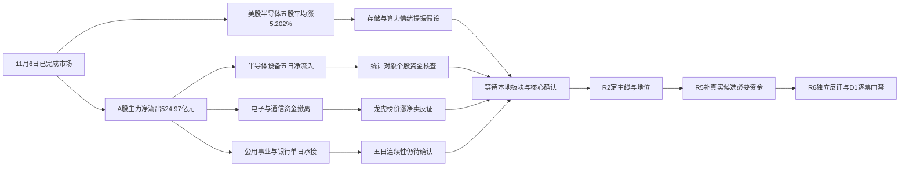

# 2026年11月9日 · 资金面

> **数据源新鲜度**：partial　|　**降级状态**：true　|　**置信度**：0.2625
> **事实归属**：A股与美股均为 2026-11-06 最新已完成交易日；周一采用周五数据正常，交易日缺口为零。不是 11 月 9 日盘中成交。

## 一句话结论

**观察：内资再流出，设备局部承接；美股科技提振尚待本地资金确认。**

## 🧭 详细分析：先认市场，再核资金

### 1. 大盘：两天修复之后再撤，不能用海外反弹覆盖内资事实

- **大资金意图**: 11月6日超大单净流出 `233.20亿元`、大单净流出 `291.77亿元`，小单净流入 `479.15亿元`；更符合大额主动成交撤离、小额承接的估算画像。这里的“大资金意图”是待验证解释，不是穿透到真实账户的资金迁移。
- **为什么走强**: 11月4日大盘主力净流入 `500.28亿元`、11月5日净流入 `85.39亿元`，但11月6日净流出 `524.97亿元`，修复未稳定延续；强的是局部承接，不是全市场合力。
- **逻辑够不够硬**: 大盘五日净流出 `393.29亿元`、十日净流出 `2007.82亿元`、二十日净流出 `4469.94亿元`。这是同一东财资金估算口径的时序证据，不把五次查询算成五个独立源；新一轮持续流入与板块核心赚钱效应同步出现才可证伪当前解释。

| 交易日 | 大盘主力净额（亿元） | 超大单净额（亿元） | 大单净额（亿元） | 上证涨跌% |
|---|---:|---:|---:|---:|
| 2026-11-02 | +117.43 | +158.32 | -40.89 | +1.08 |
| 2026-11-03 | -571.43 | -304.62 | -266.80 | -0.82 |
| 2026-11-04 | +500.28 | +474.06 | +26.22 | +2.16 |
| 2026-11-05 | +85.39 | +85.15 | +0.24 | +0.10 |
| 2026-11-06 | -524.97 | -233.20 | -291.77 | -1.10 |

来源：`R7_evidence_20261109.json::calls.market`，实时 Tushare Pro SDK 分发东财资金估算；大盘单位元转亿元。

### 2. 板块：防守承接与科技局部吸筹同时存在，不预设攻守标签

- **大资金意图**: 公用事业、银行单日净流入，但五日仍净流出，最多说明阶段承接，不能凭一天将其升级为可交易主线。半导体设备单日 `+7.40亿元`、五日 `+118.34亿元`，与半导体整体单日 `-46.30亿元` 相背，是更需下游辨认核心地位的局部资金事实。
- **为什么走强**: 公用事业上涨 `0.55%`、银行上涨 `0.99%`，而半导体设备下跌 `2.33%` 仍出现净流入，三者的量价含义不同。“设备净买”不等于设备价格已经转强；“防守上涨”也不等于有涨停接力赚钱效应。
- **逻辑够不够硬**: 半导体设备五日资金比单日防守承接更连续，但仍只有东财板块资金估算主口径。R2须另核梯队、板块效应与龙头，R5须对真实候选补资金和价格；板块净流入不能代替成员股票资金已核。

**主线 = 未由本阶段确认；持续性 = 未授予1/3/5日预测；封板率 = 未核；明日预期 = 未授予加速/分歧/退潮标签。** 这些字段属于后续主线判断，缺证不能凑数。

| 板块资金统计对象 | 昨日净额（亿元） | 五日净额（亿元） | 昨日涨跌% | 资金侧态度 |
|---|---:|---:|---:|---|
| 公用事业 | +9.59 | -26.17 | +0.55 | 观察局部承接 |
| 银行 | +8.53 | -44.07 | +0.99 | 观察局部承接 |
| 半导体设备 | +7.40 | +118.34 | -2.33 | 观察局部承接 |
| 集成电路制造 | +4.97 | +23.05 | -1.87 | 观察局部承接 |
| 电信运营商 | +4.05 | +8.64 | +2.87 | 观察局部承接 |
| 电子 | -138.64 | +2.97 | -3.40 | 降级资金强度假设 |
| 机械设备 | -58.57 | -51.30 | -2.49 | 降级资金强度假设 |
| 电力设备 | -50.06 | +104.20 | -1.75 | 降级资金强度假设 |
| 印制电路板 | -49.56 | -109.11 | -5.86 | 降级资金强度假设 |
| 通信设备 | -47.59 | -116.77 | -3.84 | 降级资金强度假设 |
| 半导体 | -46.30 | +125.28 | -3.33 | 降级资金强度假设 |

范围：`2026-10-12—2026-11-06` 共20交易日、496个东财行业分级分类。父子层级重叠，**不相加作全市场总额**。XTick SW1 分类是另一套分类，不强行按名称拼接。

## 🌏 外部传导：美股科技提振，但A股确认尚未发生

- **大资金意图**: 隔夜半导体/存储核心五股平均上涨 `5.202%`，表明海外该组股票风险偏好回升；这不证明跨境资金已流入A股，也不能从上涨直接推断机构真实买入。
- **为什么走强**: MU、AMD、TSM、NVDA与AVGO同涨，对A股存储、半导体和CPO的开盘情绪有提振映射；AAPL与MSFT仍跌，不能把局部科技弹性写成所有美股科技一致走强。硬新闻催化未在本阶段取证，不编造涨价、订单或财报原因。
- **逻辑够不够硬**: 上游快照12股已逐只用本轮 `tushare.us_daily` 核对日期、收盘与涨跌幅，均一致；同一底层源不能当独立交叉。快照没有INTC/MRVL，本轮实查补齐；真实SOX缺失，五股均值不是SOX。若A股电子/通信继续净流出，则海外映射不升级为资金确认。

| 美股核心股 | 事实交易日 | 隔夜涨跌% | 数据归属 | A股映射用途 |
|---|---|---:|---|---|
| MU | 2026-11-06 | +5.12 | overseas_snapshot已复核 | 存储风险偏好 |
| NVDA | 2026-11-06 | +2.78 | overseas_snapshot已复核 | AI算力风险偏好 |
| AVGO | 2026-11-06 | +0.74 | overseas_snapshot已复核 | 网络/ASIC/CPO映射 |
| AMD | 2026-11-06 | +11.04 | overseas_snapshot已复核 | 算力/半导体弹性 |
| TSM | 2026-11-06 | +6.33 | overseas_snapshot已复核 | 晶圆制造 |
| INTC | 2026-11-06 | +7.71 | 本轮SDK补齐，快照无此股 | 半导体情绪补充 |
| MRVL | 2026-11-06 | +5.73 | 本轮SDK补齐，快照无此股 | 光互联/网络映射 |
| GLW | 2026-11-06 | +2.61 | overseas_snapshot已复核 | 光纤/玻璃材料 |
| AAPL | 2026-11-06 | -0.52 | overseas_snapshot已复核 | 消费电子 |
| MSFT | 2026-11-06 | -0.99 | overseas_snapshot已复核 | 云/软件 |
| GOOGL | 2026-11-06 | +0.78 | overseas_snapshot已复核 | AI/云 |
| AMZN | 2026-11-06 | -0.35 | overseas_snapshot已复核 | 云/消费 |
| META | 2026-11-06 | +0.84 | overseas_snapshot已复核 | AI应用情绪 |
| TSLA | 2026-11-06 | +4.23 | overseas_snapshot已复核 | 汽车链情绪 |

指数：SPX `+0.3145%`、IXIC `+1.0875%`，均为11月6日；SOX未取到。USDCNH仅有11月5日 `6.66433`，其日历适用性未核，DXY缺失，不能写成最新汇率确认。

## 📊 昨日前十：五日回看，不冒充五日事前选股业绩

**选样日为11月6日，规则为当日全市场东财个股主力净流入降序前十。** 回看11月2—6日，资金与价格50/50个股票日有效，XTick实际日期核验50/50；这是终点选样的回溯描述，不是五日前选定十票后的已实现收益。19票是最近两日榜单并集，不是本轮R2候选。

| 代码 / 名称 | 昨日净额（亿元） | 五日净额（亿元） | 五日区间涨跌% | XTick昨日方向 | 态度 |
|---|---:|---:|---:|---|---|
| 002371.SZ 北方华创 | +6.10 | +23.80 | +16.97 | 同向 | 观察，不授开仓资格 |
| 600900.SH 长江电力 | +5.19 | -1.77 | +0.57 | 同向 | 观察，不授开仓资格 |
| 688981.SH 中芯国际 | +3.77 | +19.23 | +14.58 | 同向 | 观察，不授开仓资格 |
| 300118.SZ 东方日升 | +3.69 | +5.07 | +33.72 | 同向 | 观察，不授开仓资格 |
| 601188.SH 龙江交通 | +3.66 | +3.48 | +16.87 | 同向 | 观察，不授开仓资格 |
| 003006.SZ 百亚股份 | +3.39 | +15.17 | +0.48 | 冲突，保留两值 | 观察，不授开仓资格 |
| 688361.SH 中科飞测 | +3.36 | +12.50 | +22.79 | 同向 | 观察，不授开仓资格 |
| 688256.SH 寒武纪 | +2.88 | +3.31 | -8.76 | 同向 | 观察，不授开仓资格 |
| 002300.SZ 太阳电缆 | +2.76 | +3.64 | +12.83 | 同向 | 观察，不授开仓资格 |
| 688347.SH 华虹宏力 | +2.66 | +8.11 | +31.15 | 同向 | 观察，不授开仓资格 |

五日区间涨跌使用首日未复权 `pre_close` 到末日 `close`，非涨跌幅简单相加。XTick为主动大单/特大单口径，东财为自身资金分类估算，数值不可强求相等。

**百亚股份冲突**：东财昨日净流入 `3.39亿元`，XTick主力净流出 `0.57亿元`。并集中的芯源微、拓荆科技也有方向冲突，完整保留在JSON，不能只挑同向源。长江电力虽进入昨日资金榜，五日仍净流出 `1.77亿元`；仅凭当日防守承接不足以认定其有可交易涨停基因。

### 逐票必要四项：统计覆盖不等于候选资格

| 对象 | 板型已知范围 | 龙头认定 / 纪律通过条数 | 盈亏比 | 禁止清单命中项 |
|---|---|---|---|---|
| 北方华创 | 非收盘涨停；完整板型未知 | 未核 / 未知，不填0条通过 | RR与止损距未知，不进execution | 已核名称未命中ST/退市；其余未知，非全清 |
| 长江电力 | 非收盘涨停；完整板型未知 | 未核 / 未知，不填0条通过 | RR与止损距未知，不进execution | 已核名称未命中ST/退市；其余未知，非全清 |
| 中芯国际 | 非收盘涨停；完整板型未知 | 未核 / 未知，不填0条通过 | RR与止损距未知，不进execution | 已核名称未命中ST/退市；其余未知，非全清 |
| 东方日升 | 曾涨停未封；完整板型未知 | 未核 / 未知，不填0条通过 | RR与止损距未知，不进execution | 已核名称未命中ST/退市；其余未知，非全清 |
| 龙江交通 | 收盘封板；完整板型未知 | 未核 / 未知，不填0条通过 | RR与止损距未知，不进execution | 已核名称未命中ST/退市；其余未知，非全清 |
| 百亚股份 | 非收盘涨停；完整板型未知 | 未核 / 未知，不填0条通过 | RR与止损距未知，不进execution | 已核名称未命中ST/退市；其余未知，非全清 |
| 中科飞测 | 非收盘涨停；完整板型未知 | 未核 / 未知，不填0条通过 | RR与止损距未知，不进execution | 已核名称未命中ST/退市；其余未知，非全清 |
| 寒武纪 | 非收盘涨停；完整板型未知 | 未核 / 未知，不填0条通过 | RR与止损距未知，不进execution | 已核名称未命中ST/退市；其余未知，非全清 |
| 太阳电缆 | 曾涨停未封；完整板型未知 | 未核 / 未知，不填0条通过 | RR与止损距未知，不进execution | 已核名称未命中ST/退市；其余未知，非全清 |
| 华虹宏力 | 非收盘涨停；完整板型未知 | 未核 / 未知，不填0条通过 | RR与止损距未知，不进execution | 已核名称未命中ST/退市；其余未知，非全清 |

无首推票，无execution_pool，无新增研究观察池顶部排名。下列逐票假设只约束证据解释，不是交易指令；**in_today_plan为未知**，不能提前用计划外排除。

### 002371.SZ 北方华创：观察

- **大资金意图**: 昨日东财净额 `+6.10亿元`、五日 `+23.80亿元`；存在连续窗口承接假设，不认定真实机构建仓。
- **为什么走强**: 五日区间价格 `+16.97%`；资金与价格分别列示，不用资金榜名次代替价格转强或产业催化。
- **逻辑够不够硬**: 本阶段只有资金与价格研究，产业催化和核心地位未核；同底层源重复查询不构成独立共振，不能认定总龙、龙二或龙三。
- **买入理由**: 当前不进。待R2给出主线/地位和R4或R5给出产业/事件锚，并核实当日资金承接后，才形成可供D1审查的理由；此处无已满足的产业买入理由。
- **风险点**: 短期大盘资金再撤与个股追高回落风险并存；中期产业逻辑/业绩兑现尚未核验，且资金估算不能识别真实持仓变化。
- **止损条件**: 未持仓、无交易止损指令；研究承接假设若下一交易日收盘低于已核11月6日收盘 `560.0` 且本地同口径主力净额为负，则该承接解释降级。真实持仓退出由既有计划与D1授权决定。
- **可验证假设**: 下1—3个交易日检验同口径主力净额至少2日为正、价格收盘不跌破上述参照且所属板块净流入；任一必要条件不成立则不把资金观察升级为持续合力。

### 600900.SH 长江电力：观察

- **大资金意图**: 昨日东财净额 `+5.19亿元`、五日 `-1.77亿元`；单日承接不能覆盖五日流出，不认定真实机构建仓。
- **为什么走强**: 五日区间价格 `+0.57%`；资金与价格分别列示，不用资金榜名次代替价格转强或产业催化。
- **逻辑够不够硬**: 本阶段只有资金与价格研究，产业催化和核心地位未核；同底层源重复查询不构成独立共振，不能认定总龙、龙二或龙三。
- **买入理由**: 当前不进。待R2给出主线/地位和R4或R5给出产业/事件锚，并核实当日资金承接后，才形成可供D1审查的理由；此处无已满足的产业买入理由。
- **风险点**: 短期大盘资金再撤与个股追高回落风险并存；中期产业逻辑/业绩兑现尚未核验，且资金估算不能识别真实持仓变化。
- **止损条件**: 未持仓、无交易止损指令；研究承接假设若下一交易日收盘低于已核11月6日收盘 `29.91` 且本地同口径主力净额为负，则该承接解释降级。真实持仓退出由既有计划与D1授权决定。
- **可验证假设**: 下1—3个交易日检验同口径主力净额至少2日为正、价格收盘不跌破上述参照且所属板块净流入；任一必要条件不成立则不把资金观察升级为持续合力。

### 688981.SH 中芯国际：观察

- **大资金意图**: 昨日东财净额 `+3.77亿元`、五日 `+19.23亿元`；存在连续窗口承接假设，不认定真实机构建仓。
- **为什么走强**: 五日区间价格 `+14.58%`；资金与价格分别列示，不用资金榜名次代替价格转强或产业催化。
- **逻辑够不够硬**: 本阶段只有资金与价格研究，产业催化和核心地位未核；同底层源重复查询不构成独立共振，不能认定总龙、龙二或龙三。
- **买入理由**: 当前不进。待R2给出主线/地位和R4或R5给出产业/事件锚，并核实当日资金承接后，才形成可供D1审查的理由；此处无已满足的产业买入理由。
- **风险点**: 短期大盘资金再撤与个股追高回落风险并存；中期产业逻辑/业绩兑现尚未核验，且资金估算不能识别真实持仓变化。
- **止损条件**: 未持仓、无交易止损指令；研究承接假设若下一交易日收盘低于已核11月6日收盘 `110.9` 且本地同口径主力净额为负，则该承接解释降级。真实持仓退出由既有计划与D1授权决定。
- **可验证假设**: 下1—3个交易日检验同口径主力净额至少2日为正、价格收盘不跌破上述参照且所属板块净流入；任一必要条件不成立则不把资金观察升级为持续合力。

### 300118.SZ 东方日升：观察

- **大资金意图**: 昨日东财净额 `+3.69亿元`、五日 `+5.07亿元`；存在连续窗口承接假设，不认定真实机构建仓。
- **为什么走强**: 五日区间价格 `+33.72%`；资金与价格分别列示，不用资金榜名次代替价格转强或产业催化。
- **逻辑够不够硬**: 本阶段只有资金与价格研究，产业催化和核心地位未核；同底层源重复查询不构成独立共振，不能认定总龙、龙二或龙三。
- **买入理由**: 当前不进。待R2给出主线/地位和R4或R5给出产业/事件锚，并核实当日资金承接后，才形成可供D1审查的理由；此处无已满足的产业买入理由。
- **风险点**: 短期大盘资金再撤与个股追高回落风险并存；中期产业逻辑/业绩兑现尚未核验，且资金估算不能识别真实持仓变化。
- **止损条件**: 未持仓、无交易止损指令；研究承接假设若下一交易日收盘低于已核11月6日收盘 `10.27` 且本地同口径主力净额为负，则该承接解释降级。真实持仓退出由既有计划与D1授权决定。
- **可验证假设**: 下1—3个交易日检验同口径主力净额至少2日为正、价格收盘不跌破上述参照且所属板块净流入；任一必要条件不成立则不把资金观察升级为持续合力。

### 601188.SH 龙江交通：观察

- **大资金意图**: 昨日东财净额 `+3.66亿元`、五日 `+3.48亿元`；存在连续窗口承接假设，不认定真实机构建仓。
- **为什么走强**: 五日区间价格 `+16.87%`；资金与价格分别列示，不用资金榜名次代替价格转强或产业催化。
- **逻辑够不够硬**: 本阶段只有资金与价格研究，产业催化和核心地位未核；同底层源重复查询不构成独立共振，不能认定总龙、龙二或龙三。
- **买入理由**: 当前不进。待R2给出主线/地位和R4或R5给出产业/事件锚，并核实当日资金承接后，才形成可供D1审查的理由；此处无已满足的产业买入理由。
- **风险点**: 短期大盘资金再撤与个股追高回落风险并存；中期产业逻辑/业绩兑现尚未核验，且资金估算不能识别真实持仓变化。
- **止损条件**: 未持仓、无交易止损指令；研究承接假设若下一交易日收盘低于已核11月6日收盘 `3.81` 且本地同口径主力净额为负，则该承接解释降级。真实持仓退出由既有计划与D1授权决定。
- **可验证假设**: 下1—3个交易日检验同口径主力净额至少2日为正、价格收盘不跌破上述参照且所属板块净流入；任一必要条件不成立则不把资金观察升级为持续合力。

### 003006.SZ 百亚股份：观察

- **大资金意图**: 昨日东财净额 `+3.39亿元`、五日 `+15.17亿元`；存在连续窗口承接假设，不认定真实机构建仓。
- **为什么走强**: 五日区间价格 `+0.48%`；资金与价格分别列示，不用资金榜名次代替价格转强或产业催化。
- **逻辑够不够硬**: 本阶段只有资金与价格研究，产业催化和核心地位未核；同底层源重复查询不构成独立共振，不能认定总龙、龙二或龙三。
- **买入理由**: 当前不进。待R2给出主线/地位和R4或R5给出产业/事件锚，并核实当日资金承接后，才形成可供D1审查的理由；此处无已满足的产业买入理由。
- **风险点**: 短期大盘资金再撤与个股追高回落风险并存；中期产业逻辑/业绩兑现尚未核验，且资金估算不能识别真实持仓变化。
- **止损条件**: 未持仓、无交易止损指令；研究承接假设若下一交易日收盘低于已核11月6日收盘 `23.09` 且本地同口径主力净额为负，则该承接解释降级。真实持仓退出由既有计划与D1授权决定。
- **可验证假设**: 下1—3个交易日检验同口径主力净额至少2日为正、价格收盘不跌破上述参照且所属板块净流入；任一必要条件不成立则不把资金观察升级为持续合力。

### 688361.SH 中科飞测：观察

- **大资金意图**: 昨日东财净额 `+3.36亿元`、五日 `+12.50亿元`；存在连续窗口承接假设，不认定真实机构建仓。
- **为什么走强**: 五日区间价格 `+22.79%`；资金与价格分别列示，不用资金榜名次代替价格转强或产业催化。
- **逻辑够不够硬**: 本阶段只有资金与价格研究，产业催化和核心地位未核；同底层源重复查询不构成独立共振，不能认定总龙、龙二或龙三。
- **买入理由**: 当前不进。待R2给出主线/地位和R4或R5给出产业/事件锚，并核实当日资金承接后，才形成可供D1审查的理由；此处无已满足的产业买入理由。
- **风险点**: 短期大盘资金再撤与个股追高回落风险并存；中期产业逻辑/业绩兑现尚未核验，且资金估算不能识别真实持仓变化。
- **止损条件**: 未持仓、无交易止损指令；研究承接假设若下一交易日收盘低于已核11月6日收盘 `261.88` 且本地同口径主力净额为负，则该承接解释降级。真实持仓退出由既有计划与D1授权决定。
- **可验证假设**: 下1—3个交易日检验同口径主力净额至少2日为正、价格收盘不跌破上述参照且所属板块净流入；任一必要条件不成立则不把资金观察升级为持续合力。

### 688256.SH 寒武纪：观察

- **大资金意图**: 昨日东财净额 `+2.88亿元`、五日 `+3.31亿元`；存在连续窗口承接假设，不认定真实机构建仓。
- **为什么走强**: 五日区间价格 `-8.76%`；资金与价格分别列示，不用资金榜名次代替价格转强或产业催化。
- **逻辑够不够硬**: 本阶段只有资金与价格研究，产业催化和核心地位未核；同底层源重复查询不构成独立共振，不能认定总龙、龙二或龙三。
- **买入理由**: 当前不进。待R2给出主线/地位和R4或R5给出产业/事件锚，并核实当日资金承接后，才形成可供D1审查的理由；此处无已满足的产业买入理由。
- **风险点**: 短期大盘资金再撤与个股追高回落风险并存；中期产业逻辑/业绩兑现尚未核验，且资金估算不能识别真实持仓变化。
- **止损条件**: 未持仓、无交易止损指令；研究承接假设若下一交易日收盘低于已核11月6日收盘 `802.9` 且本地同口径主力净额为负，则该承接解释降级。真实持仓退出由既有计划与D1授权决定。
- **可验证假设**: 下1—3个交易日检验同口径主力净额至少2日为正、价格收盘不跌破上述参照且所属板块净流入；任一必要条件不成立则不把资金观察升级为持续合力。

### 002300.SZ 太阳电缆：观察

- **大资金意图**: 昨日东财净额 `+2.76亿元`、五日 `+3.64亿元`；存在连续窗口承接假设，不认定真实机构建仓。
- **为什么走强**: 五日区间价格 `+12.83%`；资金与价格分别列示，不用资金榜名次代替价格转强或产业催化。
- **逻辑够不够硬**: 本阶段只有资金与价格研究，产业催化和核心地位未核；同底层源重复查询不构成独立共振，不能认定总龙、龙二或龙三。
- **买入理由**: 当前不进。待R2给出主线/地位和R4或R5给出产业/事件锚，并核实当日资金承接后，才形成可供D1审查的理由；此处无已满足的产业买入理由。
- **风险点**: 短期大盘资金再撤与个股追高回落风险并存；中期产业逻辑/业绩兑现尚未核验，且资金估算不能识别真实持仓变化。
- **止损条件**: 未持仓、无交易止损指令；研究承接假设若下一交易日收盘低于已核11月6日收盘 `8.53` 且本地同口径主力净额为负，则该承接解释降级。真实持仓退出由既有计划与D1授权决定。
- **可验证假设**: 下1—3个交易日检验同口径主力净额至少2日为正、价格收盘不跌破上述参照且所属板块净流入；任一必要条件不成立则不把资金观察升级为持续合力。

### 688347.SH 华虹宏力：观察

- **大资金意图**: 昨日东财净额 `+2.66亿元`、五日 `+8.11亿元`；存在连续窗口承接假设，不认定真实机构建仓。
- **为什么走强**: 五日区间价格 `+31.15%`；资金与价格分别列示，不用资金榜名次代替价格转强或产业催化。
- **逻辑够不够硬**: 本阶段只有资金与价格研究，产业催化和核心地位未核；同底层源重复查询不构成独立共振，不能认定总龙、龙二或龙三。
- **买入理由**: 当前不进。待R2给出主线/地位和R4或R5给出产业/事件锚，并核实当日资金承接后，才形成可供D1审查的理由；此处无已满足的产业买入理由。
- **风险点**: 短期大盘资金再撤与个股追高回落风险并存；中期产业逻辑/业绩兑现尚未核验，且资金估算不能识别真实持仓变化。
- **止损条件**: 未持仓、无交易止损指令；研究承接假设若下一交易日收盘低于已核11月6日收盘 `173.12` 且本地同口径主力净额为负，则该承接解释降级。真实持仓退出由既有计划与D1授权决定。
- **可验证假设**: 下1—3个交易日检验同口径主力净额至少2日为正、价格收盘不跌破上述参照且所属板块净流入；任一必要条件不成立则不把资金观察升级为持续合力。

### 前日名单到昨日：防止只看成功者

| 11月5日榜单对象 | 选样日净额（亿元） | 11月6日净额（亿元） | 方向反转 |
|---|---:|---:|---|
| 中微公司 | +14.84 | +1.82 | 否 |
| 利欧股份 | +9.13 | -5.12 | 是 |
| 宁德时代 | +8.10 | -4.12 | 是 |
| 有研新材 | +7.87 | -4.11 | 是 |
| 拓荆科技 | +7.44 | -0.35 | 是 |
| 瑞芯微 | +6.70 | -3.09 | 是 |
| 华峰测控 | +5.96 | +1.22 | 否 |
| 中科飞测 | +5.87 | +3.36 | 否 |
| 阳光电源 | +5.03 | -4.31 | 是 |
| 芯源微 | +4.44 | -0.92 | 是 |

前日十票中 `7/10` 昨日转为净流出，`1/10` 仍在昨日榜前十。单日排行榜的持续性有限，不能声称同一笔资金从这些票搬去另十票。

## 🚨 龙虎榜诱多识别：风险筛查，不是操纵认定

**单日与多日严格分层**：11月6日原始榜79条，其中单日事件58条、多日累计事件21条。单日上涨净卖背离命中9只、下跌高换手净卖另列6只。不同上榜原因可能重复，同票风险按对象聚合，金额不跨事件相加；连续多日榜不冒充当日资金。

| 单日上涨风险对象 | 当日涨跌% | 换手% | 龙虎榜净额（亿元） | 东财主力净额（亿元） | 态度 |
|---|---:|---:|---:|---:|---|
| 002086.SZ 东方海洋 | +9.97 | +42.55 | +0.00 | -0.68 | 降级资金追涨解释 |
| 002088.SZ 鲁阳节能 | +10.02 | +12.43 | -0.23 | -0.27 | 降级资金追涨解释 |
| 300237.SZ 美晨科技 | +20.00 | +10.91 | -0.01 | -0.17 | 降级资金追涨解释 |
| 600127.SH 金健米业 | +6.88 | +40.55 | -1.05 | +0.51 | 降级资金追涨解释 |
| 600354.SH 敦煌种业 | +4.20 | +28.58 | -1.03 | -0.06 | 降级资金追涨解释 |
| 601566.SH 九牧王 | +2.17 | +12.45 | -0.16 | +0.02 | 降级资金追涨解释 |
| 688429.SH 时创能源 | +15.62 | +4.02 | -0.32 | +0.08 | 降级资金追涨解释 |
| 920007.BJ 酉立智能 | +7.19 | +30.88 | -0.21 | -0.06 | 降级资金追涨解释 |
| 920895.BJ 花溪科技 | +4.50 | +26.61 | -0.17 | -0.04 | 降级资金追涨解释 |

### 重点反证：金健米业“净买协同”与当日榜单净卖共存

- **大资金意图**: 金健米业当日龙虎榜净卖约 `1.05亿元`，而东财主力估算净流入 `0.51亿元`，只能解释为不同统计范围的明显冲突，不能只留下看多的一侧。
- **为什么走强**: 当日上涨 `6.88%`、换手 `40.55%`，高换手上涨同时披露席位净卖，是“价强但接力筹码可能变重”的风险组合，而非可直接接力的充分条件。
- **逻辑够不够硬**: 龙虎榜来自交易所披露，东财是全日分类估算，证据面不同但非完整账户视角；3日内某席位反复净买不能抵消当日整体披露榜净卖。R6独立判断风险是否实质成立，R7不发hard_reject。

下跌高换手净卖对象：冰山冷热（000530.SZ）、皇台酒业（000995.SZ）、慈文传媒（002343.SZ）、果麦文化（301052.SZ）、联亚药业（301569.SZ）、南方乳业（920196.BJ）。保留完整事件于JSON，不删风险。

**3日协同**：识别 `31` 个同一具名营业部—同票组合，在11月4—6日至少2个不同交易日净买。只计正净买日，剔除泛称“专用”、ST/退市名称与昨日炸板对象；同一金额跨买卖侧/重复原因去重。风险公告未由本阶段全量核验，全部标partial，仅作正向辅助。

“机构专用”不能识别真实主体：只汇总披露子集，未知机构流向保留null，不能填0。`hm_detail`原始五日记录另存，但游资别名不冒充同一营业部身份。

## 🧮 ETF、期货、两融与跷跷板

| ETF代表篮子 | 昨日份额变化（万份） | 昨日申赎金额代理（亿元） | 五日申赎金额代理（亿元） |
|---|---:|---:|---:|
| 510300.SH | +14850.00 | +6.12 | +319.56 |
| 510500.SH | -320.00 | -0.21 | +195.62 |
| 159915.SZ | +45800.00 | +11.36 | +181.41 |
| 588000.SH | -75000.00 | -9.95 | +221.03 |

**四只ETF昨日合计代理净申购7.33亿元**，并非全市场ETF净流量；创业板申购、科创50赎回同时存在。计算为份额变化乘同日未复权收盘价，不用二级成交额充当一级申赎流水。

**IF2611同日期现基差为-14.68点（约-0.36%）**：期货收盘4039.6、沪深300收盘4054.2769。只是近月收盘价差，未扣分红、资金成本及收盘时点微差，不能单独宣判市场方向。

两融：19票中11票最新有11月6日记录、6票仅到11月5日、2票有效查询空返回。空返回不证明不属于两融标的；市场汇总11月6日只有沪市一条，不能与前日三交易所总额机械比较。大宗30自然日窗口共68条原始记录；有同日未复权收盘才计算折溢价，较早日期未被20日价格窗覆盖则premium保持null，不臆造出货。

**跷跷板：未确认配对，非证明市场无轮动。** R2未就绪，采用昨日东财行业绝对净额前20做默认资金统计范围，190对均有20日对齐序列；无一对满足Pearson严格小于-0.6，因此零对满足“20日负相关且前后5日两腿反转”的双条件。不扩大为市场所有板块或本轮R2主线已检验。

**炸板纪律**：Tushare收盘涨停32、炸板14、跌停15，炸板率为 `14/(32+14)=30.43%`；XTick为涨停33、炸板14、跌停15，属口径差异，不抹平。本次未触发35%候选减半条款；也不据此宣称情绪安全。市场阶段由R1决定，本阶段仅呈现资金温度。

## 🔎 关键证据

- 证据1：五日大盘主力合计-393.29亿元，末日-524.97亿元。来源 `R7_evidence_20261109.json::calls.market`。
- 证据2：半导体设备五日+118.34亿元与半导体整体末日-46.30亿元分离。来源 `calls.sector_20261102` 至 `calls.sector_20261106`，板块金额单位为元，转亿元除以一亿。
- 证据3：昨日前十五日50/50，与XTick逐日50/50事实日期一致；百亚股份保留方向冲突。来源 `calls.flow_* / daily_*` 与 `R7_xtick_evidence_20261109.json::calls`。
- 证据4：9只单日价涨净卖背离对象，多日榜21条隔离。来源 `calls.lhb_20261106 / inst_20261106 / stock_all_resolved`。
- 证据5：上游隔夜快照12只核心股+本轮补查INTC/MRVL，共14只均为11月6日。来源 `data/raw/20261109/overseas_snapshot.json::categories.us_stocks` 与 `calls.us_*`。

## 数据源审计

| 源 | 事实日期 / 范围 | 状态 | 记录数 / 覆盖与限制 |
|---|---|:--:|---|
| Tushare Pro SDK.trade_cal | 2026-08-01—2026-11-09 | 🟢 | 核实11月9日开市、最新完成交易日11月6日 |
| Tushare Pro SDK.moneyflow_mkt_dc / Eastmoney | 2026-10-12—2026-11-06 | 🟢 | 20日；元转亿元 |
| Tushare Pro SDK.moneyflow_ind_dc / Eastmoney | 2026-10-12—2026-11-06 | 🟢 | 496分类×20日；层级重叠不相加 |
| Tushare Pro SDK.moneyflow_dc / Eastmoney | 2026-10-12—2026-11-06 | 🟢 | 19统计对象资金窗；11月6日全市场原始6032行；万元转亿元 |
| Tushare Pro SDK.daily / daily_basic / stock_basic | 2026-10-12—2026-11-06 | 🟢 | 19票价格及换手；上市表核实名称，榜单非候选池 |
| Tushare Pro SDK.top_list / top_inst / hm_detail | 2026-11-02—2026-11-06 | 🟢 | 5日披露，单日/多日分开；未披露未知 |
| Tushare Pro SDK.block_trade | 2026-10-07—2026-11-06 | 🟢 | 19对象30自然日，68条；折溢价仅同日可比价格 |
| Tushare Pro SDK.margin_detail / margin | 2026-10-19—2026-11-06 | 🟡 | 个股15交易日；11票最新、6票滞后、2票空返回；市场汇总交易所不齐 |
| Tushare Pro SDK.fund_share / fund_daily | 2026-10-12—2026-11-06 | 🟢 | 四只ETF各20份额/价格记录，非全市场 |
| Tushare Pro SDK.fut_daily / index_daily | 2026-10-12—2026-11-06 | 🟢 | IF2611与沪深300同日收盘核基差 |
| XTick MCP.xtick_hot_money | 2026-11-02—2026-11-06 | 🟢 | 19票×5日=95个股票日时间戳有效，方法交叉非账户净额 |
| XTick MCP.xtick_hot_bk / market_emotion | 情绪2026-11-06；成分实际日期未知 | 🟡 | hot_bk仅返回68组成分映射，无资金金额或事实日期；情绪涨停统计口径差异 |
| DataPro MCP.dataPro_search | 2026-11-09 | 🔴 | 本轮4013订阅失效；无独立板块第二源，不因此全局禁新 |
| overseas_snapshot + Tushare Pro SDK.us_daily | 2026-11-06 | 🟡 | 12股快照逐只复核，补INTC/MRVL共14；SOX缺失，外汇11月5日未核 |
| manifest / mcp_health | 2026-11-09 | 🟡 | global_severity=3；探针超时与实际SDK/MCP成功分别记录 |
| 北向 | 不适用 | 🟡 | not_required；只限复盘参考，不补抓、不进置信度或门禁分母 |

SDK与MCP是访问路径，不自动增加独立证据源数量；本轮未强求vibe-trading标签，已用Tushare实查大宗/两融/龙虎榜。北向“不适用”不构成降级原因。置信度依共享公式 `0.75×0.7×0.5=0.2625`，severity≥2上限0.5未触顶；这是证据置信度，不是胜率或账户预算。

## ⚠️ 不确定性 / 反证

1. 海外半导体大涨可能引发A股跳空后兑现；国内电子/通信末日流出与设备五日流入并存，必须检验本地资金而非追叙事。
2. 统计净流入不能识别真实投资者，尤其小额/大额分类、主动成交归类与披露席位范围不同；百亚股份、芯源微、拓荆科技三票方法方向冲突完整保留。
3. 本阶段未核完整公告、产业逻辑、个股六维画像、完整禁止清单、主模板或RR。没有任何“已覆盖本轮候选”或“已获买入资格”声明。XTick板块接口本轮只返回成分映射，未提供板块资金；原工具归档恢复68组，stdio辅助仅保留末组的限制已披露，不能据请求日期认证映射事实日期。辅助缺数只限制相关主张，不生成全局no_trade。
4. 适用窗口仅为11月9日盘前，开盘后本地资金/价格出现新证据须重评；这不是永久零仓建议。历史市场性零预算不继承，真实用户/账户硬预算与停买、T+1、人工确认、仓位硬上限及R6逐票hard_reject全部不变。
5. 真实SOX、DXY缺失，USDCNH日期未核；不以代理均值或滞后汇率冒充隔夜指数/汇率确认。

## 🤝 与其他 R/D/E 的关系

- 依赖：本轮 `manifest.json`、`mcp_health.json`、`overseas_snapshot.json`；实时Tushare与XTick调用。未消费本轮R2/R5，也未读取旧R5_candidate_pool。
- 供R2消费：市场/板块资金事实与窗口，R2独立决定主线、模板、持续性和龙头。
- 供R5消费：19只统计对象已核事实可按代码复用；真实本轮候选由既有R5生产者补必要资金/价格，不追加R7模型会话、不绑定特定provider。
- 供R6消费：保留上涨净卖、下跌高换手、方法冲突及未知。R6是唯一硬否决来源，本阶段不替其判断通过。
- 供D1/E1消费：研究不是买入授权；in_today_plan未知。D1完成独立逐票闸门，E1据原始选择规则检验，不能把回看收益当事前选股绩效。

## Sub-Agent 元数据

- skill: analyze_capital_flow_v1
- artifact: data/research/20261109/R7_capital_flow_20261109.json；兼容路径R7_capital_flow.json为同日软链
- evidence: data/research/20261109/R7_evidence_20261109.json；R7_xtick_evidence_20261109.json
- model: gpt-6.1-sol；本阶段单一研究会话，无模型再委派
- execution: 实际盘前实时查询，非冻结回放；真实生成时刻见frontmatter与JSON，事实日与查询日分开
- resource policy: 5000万token为连续任务努力目标非硬限；usage_unknown不补0，不保证低于目标；08:30目标observe_only，不以超时改交易权限
- 生成耗时: 995秒（从本阶段启动观察到JSON生成）
