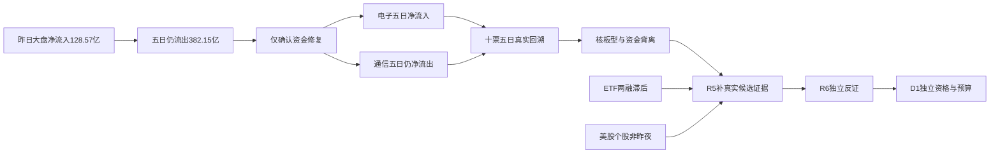

# 2026年11月10日 · 资金面

> 数据窗口：A股2026-10-13至2026-11-09；本报告是2026-11-10盘前研究。正常T-1未贴成当日盘中数据。
> 数据新鲜度：partial；降级：true；置信度：0.2625。

## 🧭 一句话结论

**观察：资金修复未成主升；电子、通信回流，但高炸板与五日流出约束接力。**

## 🔎 详细分析

市场在为局部科技回流付钱，不是在给全市场持续抬估值。昨日大盘主力净流入128.57亿元，超大单净流入130.78亿元而大单净流出2.21亿元；近5日、10日、20日仍分别净流出382.15、1600.58、3987.06亿元。资金阶段仅支持“修复”，不替R1定风格，也不替R2确认主线。

**情绪=震荡/主跌**。同口径炸板率为 `44/(54+44)=44.90%`；封板率55.10%。按纪律，后续研究候选筛选数量减半；本阶段交易候选未形成，R7授权候选0→0，不伪造基数、不削减十票事实追踪。XTick涨停57、炸板45，原始`zbl=30.3`分母未明，不拿它替换上述口径。

板块资金与个股资金分列：496个板块含不同层级、成分重叠，不能把电子、元件、PCB净额相加当独立增量。电子近5日净流入43.17亿元，通信却净流出87.23亿元；这支持“局部合力”，不支持“通信全线已反转”。

本阶段早于R2/R5。只研究昨日资金榜前十、板块序列和公开龙虎榜事件；未读取旧R5池。本轮真实候选的核心地位、必要资金与价格由后续R5补查。未知不等于无资金；缺ETF、两融或DataPro不构成全局停买，真实账户预算与逐票R6硬否决仍独立生效。

## 🧱 板块资金事实截面（非R2优先级）

单位：亿元。近5日为11月3日至11月9日，不能加总不同层级。

| 板块 | 昨日净流入 | 近5日合计 | 五日净流入天数 |
|---|---:|---:|---:|
| 电子 | 93.39 | 43.17 | 3/5 |
| 元件 | 38.42 | -97.44 | 2/5 |
| 印制电路板 | 37.63 | -81.19 | 2/5 |
| 通信设备 | 37.34 | -90.61 | 2/5 |
| 通信 | 32.46 | -87.23 | 2/5 |
| 通信网络设备及器件 | 27.56 | -67.13 | 2/5 |
| 消费电子 | 26.55 | 34.06 | 3/5 |
| 消费电子零部件及组装 | 26.13 | 31.81 | 3/5 |
| 机械设备 | 23.37 | -23.99 | 3/5 |
| 半导体 | 23.12 | 102.32 | 3/5 |

### 电子：观察资金持续性

- **大资金意图**: 昨日93.39亿元、五日43.17亿元净流入，资金在电子链保留了跨日仓位；配置还是短炒仅凭订单分档无法辨认。
- **为什么走强**: 电子昨日上涨0.91%，半导体五日净流入102.32亿元形成内部支撑，但板块层级有重叠，不能重复计量。
- **逻辑够不够硬**: 硬证据是已成交资金与价格，不是产业催化已证实；若下一交易日净流入转负且核心失去承接，则持续性假设降级。

### 通信：降级“全面反转”主张

- **大资金意图**: 昨日32.46亿元回流对冲五日87.23亿元流出，更像仓位回补，不能推定新一轮持续增持。
- **为什么走强**: 通信设备与器件回流提供板块助力；但中际旭创五日资金仍流出34.01亿元，个股不能套用板块正面结论。
- **逻辑够不够硬**: 回流事实硬，趋势确认不够硬；需下一交易日板块与核心同向增量，并由R2确认赚钱效应。

### 机械设备：观察低位板型，拒绝泛化

- **大资金意图**: 昨日23.37亿元净流入但五日仍流出23.99亿元，首板交易可能是局部试错，不是全板块启动证明。
- **为什么走强**: 雪人集团、冰山冷热同日首板且净流入；仅有资金及板型共振，尚无本阶段核验的独立产业事件。
- **逻辑够不够硬**: 不够硬到授予开仓资格；首板次日若资金转负或不封板，试错延续假设失效。

## 📊 昨日前十：五日回溯，不是未来五日收益

选样：11月9日全市场东财主力净流入前十；50/50个资金股票日、50/50个价格股票日、50/50个XTick交叉股票日。昨日入榜是后验条件，不能用回溯结果声称选股胜率。

| 对象 | 板型 | 11月3日 | 11月4日 | 11月5日 | 11月6日 | 11月9日 | 五日净额 | 五日涨跌 | 态度 |
|---|---|---:|---:|---:|---:|---:|---:|---:|---|
| 工业富联 601138.SH | 未封板 | -9.75 | 9.11 | -7.83 | -7.50 | 12.42 | -3.54 | -4.10% | 观察 |
| 寒武纪 688256.SH | 未封板 | -12.93 | 11.01 | 2.94 | 2.88 | 9.35 | 13.25 | -1.14% | 观察 |
| 新易盛 300502.SZ | 未封板 | -9.71 | 25.04 | -17.46 | -3.46 | 9.26 | 3.67 | -8.08% | 观察 |
| 雪人集团 002639.SZ | 首板 | -0.04 | 0.60 | -0.82 | -0.20 | 7.48 | 7.02 | 15.33% | 观察 |
| 中际旭创 300308.SZ | 未封板 | -27.76 | 17.40 | -22.61 | -7.73 | 6.69 | -34.01 | -17.81% | 观察 |
| 信维通信 300136.SZ | 炸板未封 | -1.39 | -0.07 | -0.79 | -0.69 | 6.26 | 3.33 | 11.14% | 观察 |
| 超声电子 000823.SZ | 首板 | 0.02 | 1.21 | -1.61 | -0.75 | 5.67 | 4.54 | 3.36% | 观察 |
| 先导基电 600641.SH | 炸板未封 | -1.99 | 2.18 | 1.99 | 1.67 | 5.28 | 9.13 | 14.93% | 观察 |
| 烽火通信 600498.SH | 炸板未封 | -0.82 | 0.38 | 0.14 | -1.17 | 4.67 | 3.19 | 7.29% | 观察 |
| 冰山冷热 000530.SZ | 首板 | -2.98 | 4.92 | -1.46 | -0.80 | 4.66 | 4.34 | 9.87% | 观察 |

金额单位亿元。工业富联、中际旭创的昨日回流并未扭转五日净流出；寒武纪虽五日净流入，价格五日仍跌1.14%，资金与收益不是同一概念。新易盛五日资金转正但价格仍跌8.08%，不能把净流入当作强势趋势确认。

### 十票逐项资格与可证伪假设

以下均是统计对象，不是首推票或执行候选。地位认定统一为“未知，纪律§2已核条数未知”，不授予龙头；RR、止损距离均未知，保持观察。禁止清单已知项为高炸板环境；其余14项未完整核验，`in_today_plan`为未知，不写false。

### 工业富联（601138.SH）· 观察

板型：**未封板**；所属：电子（XTick成分快照）；龙头认定：未知；RR：未知；禁止项：高炸板环境，逐票清单其余项待核。

- **大资金意图**: 昨日净流入12.42亿元，五日累计-3.54亿元。这里只能确认成交方向，不能还原账户真实意图。
- **为什么走强**: 昨日涨幅4.57%，XTick大单净额13.00亿元；跨源分档不同，只作方向交叉，不合并金额。
- **逻辑够不够硬**: 资金与价格已核，产业催化及板块核心地位未核；未满足从统计对象升级交易对象的证据链。

- **买入理由**: 本轮不授予买入。研究保留依据为昨日真实资金入榜与五日可比序列；产业逻辑未核，不能为满足模板补造第二条买入叙事。

- **风险点**: 五日涨跌-4.10%与资金并不等价；高炸板环境下隔日接力可能失败，且两融最新仅11月6日。

- **止损条件**: R7不输出买卖时点或虚构止损价；尚无本轮入场价，不形成执行止损。若下一交易日该票主力净额≤0且所属板块净额≤0，撤销“持续回流”研究假设；已持仓的真实止损仍由既有计划执行。

- **可验证假设**: 下一完整交易日主力净额>0且所属板块同向，并完成R5核心地位核验，才允许研究升级；任一不成立则维持观察或降级，不能因上榜直接进执行。

### 寒武纪（688256.SH）· 观察

板型：**未封板**；所属：电子（XTick成分快照）；龙头认定：未知；RR：未知；禁止项：高炸板环境，逐票清单其余项待核。

- **大资金意图**: 昨日净流入9.35亿元，五日累计13.25亿元。这里只能确认成交方向，不能还原账户真实意图。
- **为什么走强**: 昨日涨幅6.02%，XTick大单净额22.18亿元；跨源分档不同，只作方向交叉，不合并金额。
- **逻辑够不够硬**: 资金与价格已核，产业催化及板块核心地位未核；未满足从统计对象升级交易对象的证据链。

- **买入理由**: 本轮不授予买入。研究保留依据为昨日真实资金入榜与五日可比序列；产业逻辑未核，不能为满足模板补造第二条买入叙事。

- **风险点**: 五日涨跌-1.14%与资金并不等价；高炸板环境下隔日接力可能失败，且两融最新仅11月6日。

- **止损条件**: R7不输出买卖时点或虚构止损价；尚无本轮入场价，不形成执行止损。若下一交易日该票主力净额≤0且所属板块净额≤0，撤销“持续回流”研究假设；已持仓的真实止损仍由既有计划执行。

- **可验证假设**: 下一完整交易日主力净额>0且所属板块同向，并完成R5核心地位核验，才允许研究升级；任一不成立则维持观察或降级，不能因上榜直接进执行。

### 新易盛（300502.SZ）· 观察

板型：**未封板**；所属：通信（XTick成分快照）；龙头认定：未知；RR：未知；禁止项：高炸板环境，逐票清单其余项待核。

- **大资金意图**: 昨日净流入9.26亿元，五日累计3.67亿元。这里只能确认成交方向，不能还原账户真实意图。
- **为什么走强**: 昨日涨幅2.27%，XTick大单净额8.64亿元；跨源分档不同，只作方向交叉，不合并金额。
- **逻辑够不够硬**: 资金与价格已核，产业催化及板块核心地位未核；未满足从统计对象升级交易对象的证据链。

- **买入理由**: 本轮不授予买入。研究保留依据为昨日真实资金入榜与五日可比序列；产业逻辑未核，不能为满足模板补造第二条买入叙事。

- **风险点**: 五日涨跌-8.08%与资金并不等价；高炸板环境下隔日接力可能失败，且两融最新仅11月6日。

- **止损条件**: R7不输出买卖时点或虚构止损价；尚无本轮入场价，不形成执行止损。若下一交易日该票主力净额≤0且所属板块净额≤0，撤销“持续回流”研究假设；已持仓的真实止损仍由既有计划执行。

- **可验证假设**: 下一完整交易日主力净额>0且所属板块同向，并完成R5核心地位核验，才允许研究升级；任一不成立则维持观察或降级，不能因上榜直接进执行。

### 雪人集团（002639.SZ）· 观察

板型：**首板**；所属：机械设备（XTick成分快照）；龙头认定：未知；RR：未知；禁止项：高炸板环境，逐票清单其余项待核。

- **大资金意图**: 昨日净流入7.48亿元，五日累计7.02亿元。这里只能确认成交方向，不能还原账户真实意图。
- **为什么走强**: 昨日涨幅10.00%，XTick大单净额10.74亿元；跨源分档不同，只作方向交叉，不合并金额。
- **逻辑够不够硬**: 资金与价格已核，产业催化及板块核心地位未核；未满足从统计对象升级交易对象的证据链。

- **买入理由**: 本轮不授予买入。研究保留依据为昨日真实资金入榜与五日可比序列；产业逻辑未核，不能为满足模板补造第二条买入叙事。

- **风险点**: 五日涨跌15.33%与资金并不等价；高炸板环境下隔日接力可能失败，且两融最新仅11月6日。

- **止损条件**: R7不输出买卖时点或虚构止损价；尚无本轮入场价，不形成执行止损。若下一交易日该票主力净额≤0且所属板块净额≤0，撤销“持续回流”研究假设；已持仓的真实止损仍由既有计划执行。

- **可验证假设**: 下一完整交易日主力净额>0且所属板块同向，并完成R5核心地位核验，才允许研究升级；任一不成立则维持观察或降级，不能因上榜直接进执行。

### 中际旭创（300308.SZ）· 观察

板型：**未封板**；所属：通信（XTick成分快照）；龙头认定：未知；RR：未知；禁止项：高炸板环境，逐票清单其余项待核。

- **大资金意图**: 昨日净流入6.69亿元，五日累计-34.01亿元。这里只能确认成交方向，不能还原账户真实意图。
- **为什么走强**: 昨日涨幅0.90%，XTick大单净额11.38亿元；跨源分档不同，只作方向交叉，不合并金额。
- **逻辑够不够硬**: 资金与价格已核，产业催化及板块核心地位未核；未满足从统计对象升级交易对象的证据链。

- **买入理由**: 本轮不授予买入。研究保留依据为昨日真实资金入榜与五日可比序列；产业逻辑未核，不能为满足模板补造第二条买入叙事。

- **风险点**: 五日涨跌-17.81%与资金并不等价；高炸板环境下隔日接力可能失败，且两融最新仅11月6日。

- **止损条件**: R7不输出买卖时点或虚构止损价；尚无本轮入场价，不形成执行止损。若下一交易日该票主力净额≤0且所属板块净额≤0，撤销“持续回流”研究假设；已持仓的真实止损仍由既有计划执行。

- **可验证假设**: 下一完整交易日主力净额>0且所属板块同向，并完成R5核心地位核验，才允许研究升级；任一不成立则维持观察或降级，不能因上榜直接进执行。

### 信维通信（300136.SZ）· 观察

板型：**炸板未封**；所属：电子（XTick成分快照）；龙头认定：未知；RR：未知；禁止项：高炸板环境，逐票清单其余项待核。

- **大资金意图**: 昨日净流入6.26亿元，五日累计3.33亿元。这里只能确认成交方向，不能还原账户真实意图。
- **为什么走强**: 昨日涨幅12.77%，XTick大单净额10.90亿元；跨源分档不同，只作方向交叉，不合并金额。
- **逻辑够不够硬**: 资金与价格已核，产业催化及板块核心地位未核；未满足从统计对象升级交易对象的证据链。

- **买入理由**: 本轮不授予买入。研究保留依据为昨日真实资金入榜与五日可比序列；产业逻辑未核，不能为满足模板补造第二条买入叙事。

- **风险点**: 五日涨跌11.14%与资金并不等价；高炸板环境下隔日接力可能失败，且两融最新仅11月6日。

- **止损条件**: R7不输出买卖时点或虚构止损价；尚无本轮入场价，不形成执行止损。若下一交易日该票主力净额≤0且所属板块净额≤0，撤销“持续回流”研究假设；已持仓的真实止损仍由既有计划执行。

- **可验证假设**: 下一完整交易日主力净额>0且所属板块同向，并完成R5核心地位核验，才允许研究升级；任一不成立则维持观察或降级，不能因上榜直接进执行。

### 超声电子（000823.SZ）· 观察

板型：**首板**；所属：电子（XTick成分快照）；龙头认定：未知；RR：未知；禁止项：高炸板环境，逐票清单其余项待核。

- **大资金意图**: 昨日净流入5.67亿元，五日累计4.54亿元。这里只能确认成交方向，不能还原账户真实意图。
- **为什么走强**: 昨日涨幅9.98%，XTick大单净额7.96亿元；跨源分档不同，只作方向交叉，不合并金额。
- **逻辑够不够硬**: 资金与价格已核，产业催化及板块核心地位未核；未满足从统计对象升级交易对象的证据链。

- **买入理由**: 本轮不授予买入。研究保留依据为昨日真实资金入榜与五日可比序列；产业逻辑未核，不能为满足模板补造第二条买入叙事。

- **风险点**: 五日涨跌3.36%与资金并不等价；高炸板环境下隔日接力可能失败，且两融最新仅11月6日。

- **止损条件**: R7不输出买卖时点或虚构止损价；尚无本轮入场价，不形成执行止损。若下一交易日该票主力净额≤0且所属板块净额≤0，撤销“持续回流”研究假设；已持仓的真实止损仍由既有计划执行。

- **可验证假设**: 下一完整交易日主力净额>0且所属板块同向，并完成R5核心地位核验，才允许研究升级；任一不成立则维持观察或降级，不能因上榜直接进执行。

### 先导基电（600641.SH）· 观察

板型：**炸板未封**；所属：电子（XTick成分快照）；龙头认定：未知；RR：未知；禁止项：高炸板环境，逐票清单其余项待核。

- **大资金意图**: 昨日净流入5.28亿元，五日累计9.13亿元。这里只能确认成交方向，不能还原账户真实意图。
- **为什么走强**: 昨日涨幅4.20%，XTick大单净额2.03亿元；跨源分档不同，只作方向交叉，不合并金额。
- **逻辑够不够硬**: 资金与价格已核，产业催化及板块核心地位未核；未满足从统计对象升级交易对象的证据链。

- **买入理由**: 本轮不授予买入。研究保留依据为昨日真实资金入榜与五日可比序列；产业逻辑未核，不能为满足模板补造第二条买入叙事。

- **风险点**: 五日涨跌14.93%与资金并不等价；高炸板环境下隔日接力可能失败，且两融最新仅11月6日。

- **止损条件**: R7不输出买卖时点或虚构止损价；尚无本轮入场价，不形成执行止损。若下一交易日该票主力净额≤0且所属板块净额≤0，撤销“持续回流”研究假设；已持仓的真实止损仍由既有计划执行。

- **可验证假设**: 下一完整交易日主力净额>0且所属板块同向，并完成R5核心地位核验，才允许研究升级；任一不成立则维持观察或降级，不能因上榜直接进执行。

### 烽火通信（600498.SH）· 观察

板型：**炸板未封**；所属：通信（XTick成分快照）；龙头认定：未知；RR：未知；禁止项：高炸板环境，逐票清单其余项待核。

- **大资金意图**: 昨日净流入4.67亿元，五日累计3.19亿元。这里只能确认成交方向，不能还原账户真实意图。
- **为什么走强**: 昨日涨幅6.78%，XTick大单净额8.47亿元；跨源分档不同，只作方向交叉，不合并金额。
- **逻辑够不够硬**: 资金与价格已核，产业催化及板块核心地位未核；未满足从统计对象升级交易对象的证据链。

- **买入理由**: 本轮不授予买入。研究保留依据为昨日真实资金入榜与五日可比序列；产业逻辑未核，不能为满足模板补造第二条买入叙事。

- **风险点**: 五日涨跌7.29%与资金并不等价；高炸板环境下隔日接力可能失败，且两融最新仅11月6日。

- **止损条件**: R7不输出买卖时点或虚构止损价；尚无本轮入场价，不形成执行止损。若下一交易日该票主力净额≤0且所属板块净额≤0，撤销“持续回流”研究假设；已持仓的真实止损仍由既有计划执行。

- **可验证假设**: 下一完整交易日主力净额>0且所属板块同向，并完成R5核心地位核验，才允许研究升级；任一不成立则维持观察或降级，不能因上榜直接进执行。

### 冰山冷热（000530.SZ）· 观察

板型：**首板**；所属：机械设备（XTick成分快照）；龙头认定：未知；RR：未知；禁止项：高炸板环境，逐票清单其余项待核。

- **大资金意图**: 昨日净流入4.66亿元，五日累计4.34亿元。这里只能确认成交方向，不能还原账户真实意图。
- **为什么走强**: 昨日涨幅10.00%，XTick大单净额4.92亿元；跨源分档不同，只作方向交叉，不合并金额。
- **逻辑够不够硬**: 资金与价格已核，产业催化及板块核心地位未核；未满足从统计对象升级交易对象的证据链。

- **买入理由**: 本轮不授予买入。研究保留依据为昨日真实资金入榜与五日可比序列；产业逻辑未核，不能为满足模板补造第二条买入叙事。

- **风险点**: 五日涨跌9.87%与资金并不等价；高炸板环境下隔日接力可能失败，且两融最新仅11月6日。

- **止损条件**: R7不输出买卖时点或虚构止损价；尚无本轮入场价，不形成执行止损。若下一交易日该票主力净额≤0且所属板块净额≤0，撤销“持续回流”研究假设；已持仓的真实止损仍由既有计划执行。

- **可验证假设**: 下一完整交易日主力净额>0且所属板块同向，并完成R5核心地位核验，才允许研究升级；任一不成立则维持观察或降级，不能因上榜直接进执行。

## 🚨 龙虎榜诱多识别：信号不等于意图证据

昨日单日披露52条，去重47只A股；多日披露14条独立保存，另有非A股记录不纳入单日股票风险。识别8只上涨净卖、8只下跌高换手净卖，共16只风险对象。重复上榜理由不相加，避免放大净卖金额。

| 对象 | 单日涨跌 | 换手率 | 榜单净额（亿） | 风险线索 |
|---|---:|---:|---:|---|
| 阳光照明 600261.SH | -1.48% | 28.34% | -1.044 | 下跌高换手净卖 |
| 东方海洋 002086.SZ | 10.08% | 46.94% | -1.020 | 上涨净卖 |
| 润建股份 002929.SZ | -6.51% | 23.16% | -1.014 | 下跌高换手净卖 |
| 贝特利 301697.SZ | -4.26% | 71.14% | -0.545 | 下跌高换手净卖 |
| 红太阳 000525.SZ | 9.96% | 20.16% | -0.509 | 上涨净卖 |
| 邵阳液压 301079.SZ | 1.99% | 31.66% | -0.422 | 上涨净卖 |
| 万向德农 600371.SH | 9.04% | 32.78% | -0.338 | 上涨净卖 |
| 新赛股份 600540.SH | 8.30% | 31.55% | -0.328 | 上涨净卖 |
| 金健米业 600127.SH | -2.59% | 34.78% | -0.309 | 下跌高换手净卖 |
| 艾能聚 920770.BJ | -8.66% | 27.32% | -0.288 | 下跌高换手净卖 |
| 思美传媒 002712.SZ | -1.51% | 29.66% | -0.181 | 下跌高换手净卖 |
| 青岛食品 001219.SZ | 6.98% | 24.50% | -0.179 | 上涨净卖 |
| 果麦文化 301052.SZ | -4.63% | 34.15% | -0.144 | 下跌高换手净卖 |
| 宇特光电 920157.BJ | 5.95% | 24.52% | -0.017 | 上涨净卖 |
| 金钛股份 920071.BJ | 12.75% | 31.02% | -0.016 | 上涨净卖 |
| 森峰激光 920085.BJ | -18.73% | 58.66% | -0.000 | 下跌高换手净卖 |

- **大资金意图**: 榜单净卖与上涨并存是公开资金冲突，不能证明某账户故意诱多。
- **为什么走强**: 上涨净卖对象可能有榜外买盘承接、换手分歧或事件预期；缺乏逐笔筹码与事件核验，不选定唯一故事。
- **逻辑够不够硬**: 单日价格/榜单数据足以保留反证，不足以发hard_reject；后续R6独立评估。

近3交易日有22个营业部组合—股票组合满足至少2个净买入日，包含量化基金标签，不等于22只独立龙头或22路资金共识；公告风险、ST与最终封板资格未完成，均为暂存正向统计。金健米业、万向德农即使有重复净买席位，也分别出现单日负向榜单风险，禁止只展示正向协同。

## ⚖️ ETF、两融与期现

| 维度 | 实际观察日 | 事实 | 使用边界 |
|---|---|---|---|
| 510300.SH份额代理 | 2026-11-06 | 6.12亿元 | 份额差×同日价，非昨日真实申赎 |
| 510500.SH份额代理 | 2026-11-06 | -0.21亿元 | 份额差×同日价，非昨日真实申赎 |
| 159915.SZ份额代理 | 2026-11-06 | 11.36亿元 | 份额差×同日价，非昨日真实申赎 |
| 588000.SH份额代理 | 2026-11-06 | -9.95亿元 | 份额差×同日价，非昨日真实申赎 |
| IF2611－沪深300 | 2026-11-09 | -7.71点 | 同日收盘基差，未扣股息资金成本 |
| 十票两融 | 2026-11-06 | 请求15交易日，各返回14日 | 昨日未知，不能补0 |

四只ETF份额代理合计7.33亿元，仅对应11月6日；11月9日ETF净流量保持未知。20日资金跷跷板在昨日绝对资金净额前20个板块共190对中，没有同时满足相关<-0.6与前后五日相对方向反转者；这是限定样本的有效空结果，不代表全市场无跷跷板。

## 🌏 外部传导

overseas_snapshot已读取：11月9日SPX +2.35%、IXIC +2.74%有风险偏好提振意义。核心个股原快照12只、实时Tushare补查14只，均仅返回11月6日；补查扩展了INTC、MRVL，未改变时效。SOX未返回，保持未知。

| 美股核心 | 实际数据日 | 涨跌 | A股传导边界 |
|---|---|---:|---|
| NVDA | 2026-11-06 | 2.78% | 历史方向参考，不是昨夜专属催化 |
| MU | 2026-11-06 | 5.12% | 历史方向参考，不是昨夜专属催化 |
| AVGO | 2026-11-06 | 0.74% | 历史方向参考，不是昨夜专属催化 |
| AMD | 2026-11-06 | 11.04% | 历史方向参考，不是昨夜专属催化 |
| TSM | 2026-11-06 | 6.33% | 历史方向参考，不是昨夜专属催化 |
| AAPL | 2026-11-06 | -0.52% | 历史方向参考，不是昨夜专属催化 |
| MSFT | 2026-11-06 | -0.99% | 历史方向参考，不是昨夜专属催化 |
| GOOGL | 2026-11-06 | 0.78% | 历史方向参考，不是昨夜专属催化 |
| AMZN | 2026-11-06 | -0.35% | 历史方向参考，不是昨夜专属催化 |
| META | 2026-11-06 | 0.84% | 历史方向参考，不是昨夜专属催化 |
| TSLA | 2026-11-06 | 4.23% | 历史方向参考，不是昨夜专属催化 |
| INTC | 2026-11-06 | 7.71% | 历史方向参考，不是昨夜专属催化 |
| GLW | 2026-11-06 | 2.61% | 历史方向参考，不是昨夜专属催化 |
| MRVL | 2026-11-06 | 5.73% | 历史方向参考，不是昨夜专属催化 |

- **大资金意图**: 最新美股指数修复提升风险偏好，但无法从滞后个股数据推断昨夜机构对半导体或存储的增配。
- **为什么走强**: MU/NVDA/AVGO/AMD/TSM旧数据偏强，不能直接解释11月10日A股存储、CPO、半导体开盘。
- **逻辑够不够硬**: 广谱风险偏好传导有指数锚，产业链专属催化缺最新个股锚；降级专属催化主张，不否认国内已核资金。

## 🔗 关键证据

- 大盘20日序列、496板块×20日：`R7_evidence_20261110.json#/calls/market`及`sector_*`。
- 十票五日资金、价格、同日XTick：`flow_*`、`daily_*`及`R7_supplement_evidence_20261110.json`。
- 龙虎榜单日与多日按原reason区分：`lhb_20261109`；席位正负并存：`hm_*`、`inst_*`。
- 海外真实观察日期：`data/raw/20261110/overseas_snapshot.json`及补查`us_daily`。

## 数据源审计

| 源 | 抓取日期 | 状态 | 记录数/窗口 |
|---|---|:--:|---|
| Tushare/DC市场及板块 | 2026-11-10 | 🟢 | 9940；原始返回已保留 |
| Tushare/MCP昨日全市场资金榜 | 2026-11-10 | 🟢 | 6032；原始返回已保留 |
| Tushare/逐票价格资金大宗龙虎榜 | 2026-11-10 | 🟢 | 6052；原始返回已保留 |
| XTick/MCP个股资金及情绪 | 2026-11-10 | 🟢 | 50；原始返回已保留 |
| Tushare/ETF份额及两融 | 2026-11-10 | 🟡 | 未知；最新11月6日，昨日份额与两融未知 |
| Tushare/期货现货 | 2026-11-10 | 🟢 | 40；原始返回已保留 |
| overseas_snapshot及美股补查 | 2026-11-10 | 🟡 | 14；指数11月9日；个股11月6日，SOX缺失 |
| DataPro业务查询 | 2026-11-10 | 🔴 | 未知；4013订阅失效；未获取资金数据 |
| manifest/mcp_health | 2026-11-10 | 🟢 | 未知；原始返回已保留 |

SDK均为本会话实时直连Tushare，未冒充MCP；仅昨日全市场排名使用Tushare MCP实时返回。SDK与MCP同底层不算独立源，XTick按不同分档仅交叉方向。置信度采用 `0.75×0.7×0.5=0.2625`；北向不进分子/分母。主力、龙虎榜、期货是正常T-1；ETF与两融缺一交易日，整体时效标partial，不因北向缺项归零。

## ❓ 不确定性 / 反证

1. 高炸板与五日净流出反驳“已确认连续主升”；不能用单日入流掩盖。
2. 工业富联与中际旭创仍五日净流出；寒武纪资金正而五日股价负，价格承接还需验证。
3. 板块层级重叠、资金分档差异、榜单披露选择偏差会影响对合力的解释。
4. DataPro业务订阅失效，ETF/两融和美股个股有滞后；这些缺口仅限制相关主张，不形成全局禁买。
5. 本报告无市场性零仓或永久停买意见，无账户预算新认定。真实有效零预算、停买、仓位上限、T+1及逐票R6硬否决不变。

## 🤝 与其他 R/D/E 的关系

- 依赖：本日manifest、mcp_health、overseas_snapshot及本会话实时API证据；不依赖同日旧R2/R5。
- R2：消费板块资金事实，自行确认主线、持续性与地位；R7不输出伪造的1/3/5日主线预测。
- R5：对本轮真实候选补必要资金/价格及禁止清单，不要求重开R7或特定provider。
- R6：消费全部真实正反证，独立决定hard_reject；R7不替其签字。
- D1：首次计划前计划归属未知；研究意见不是开仓权限，预算来源未知不抬成正额度。

## Sub-Agent 元数据

- skill：analyze_capital_flow_v1；同一会话唯一研究执行，无另起模型。
- artifact：data/research/20261110/R7_capital_flow_20261110.json；兼容路径R7_capital_flow.json。
- 生成耗时：567秒。
- model：gpt-6.1-sol。
- 批次：premarket_full；真实盘前研究，非回放；以逐源captured_at为取证时点。
- 资源观测：usage_unknown，总token未知，不填0、不保证低于努力目标。
- 状态：partial / degraded；不是数据全项完成，不构成交易放行。
