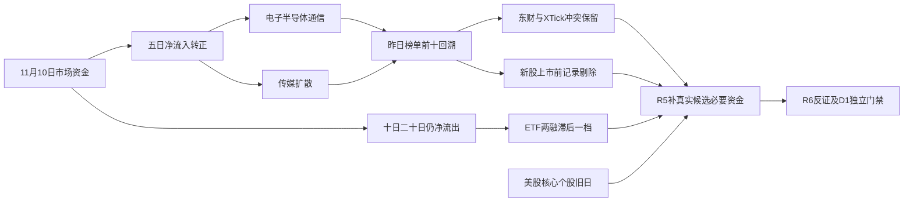

# 2026年11月11日 · 资金面

> **数据源新鲜度**: partial　|　**降级状态**: true　|　**置信度**: 0.2625
> 数据归属：A股11月10日收盘为正常T-1；ETF/两融与美股个股另标各自日期。本轮为实时盘前研究，不是冻结回放。

## 一句话结论
**观察：科技与传媒获资金奖励，五日转正但中期未修复；跨源背离与新股伪历史必须保留。**

## 📊 详细分析：先看市场奖励

| 资金维度 | 最新/累计净额（亿元） | 观察结论 |
|---|---:|---|
| 11月10日市场主力 | 172.67 | 连续第二日净流入 |
| 近5日 | 361.94 | 4日为正，修复延续 |
| 近10日 | -956.77 | 较长窗口仍流出 |
| 近20日 | -3723.00 | 不认定全面反转 |

市场在奖励电子、半导体、通信与传媒的资金合力，而不是无差别普涨。五日转正与十日、二十日为负并存，意味着“资金修复延续”成立，但“全周期主升”尚无充分证据。R7只提供资金事实，不替R1划风格、不替R2定主线。
昨日封板93只、炸板19只，按炸板÷（封板+炸板）计算为`16.96%`，未触发35%候选减半门槛。XTick为95只涨停、19只炸板，原始zbl=7.02与家数重算口径不一致，保留原始字段但不混用。

## 💰 板块资金与时序（不是主线排序）

| 板块标签 | 11月10日净流入（亿） | 5日累计（亿） | 5日正流入天数 |
|---|---:|---:|---:|
| 电子 | 92.02 | 371.44 | 4/5 |
| 传媒 | 46.88 | 64.74 | 3/5 |
| 半导体 | 40.62 | 274.38 | 4/5 |
| 通信网络设备及器件 | 35.86 | 43.68 | 3/5 |
| 机械设备 | 34.43 | 62.45 | 4/5 |
| 通信设备 | 32.25 | 42.55 | 3/5 |
| 通信 | 31.60 | 47.39 | 3/5 |
| 消费电子 | 23.11 | 81.82 | 4/5 |
| 消费电子零部件及组装 | 21.37 | 77.09 | 4/5 |
| 汽车 | 21.36 | 31.62 | 4/5 |

496个“行业”标签包含父子层级，电子与半导体、通信与通信设备不是互斥样本；绝不相加冒充新增资金。下表三项仅为资金侧分析对象，不是R2主线确认。

### {name}：观察
- **大资金意图**: 五日净流入371.44亿元且4日为正，资金从单日反抽向持续回补移动；配置动机仅是假设。
- **为什么走强**: 当日上涨3.29%且净流入92.02亿元，量价方向同向；产业催化、估值与位置尚不属本次核验。
- **逻辑够不够硬**: 单一东财底层源；DataPro失效。若次日净流出且核心不再扩散，持续性假设降级。

### {name}：观察
- **大资金意图**: 当日46.88亿元、五日64.74亿元，单日贡献偏集中，可能是短线风险偏好扩散。
- **为什么走强**: 当日涨4.53%，资金榜掌阅、慈文、中文在线出现，但榜单存在事后选择偏差，不能倒推早已确定主线。
- **逻辑够不够硬**: 传媒部分涨停票龙虎榜净卖，板块资金与榜单子集不一致；缺硬事件锚，不把共涨写成产业兑现。

### {name}：观察
- **大资金意图**: 五日274.38亿元、4日为正，比单日涨幅更支持持续回补假设。
- **为什么走强**: 当日2.97%上涨并净流入40.62亿元；瑞芯微五日涨幅高，接力盈亏比需另算。
- **逻辑够不够硬**: MU/AVGO旧美股涨幅不能证明最新隔夜提振；若A股资金转负或核心失去承接则证伪。

## 🔎 昨日前十：五日向后回溯

锚定11月10日主力净流入前十，回溯11月4日、5日、6日、9日、10日；不是未来五日收益预测。全市场两日截面用于筛选，17只榜单并集完成详细资金/价格/大宗/两融请求，不能称本轮R2/R5候选。另保留11月9日前十至10日迁移，避免把T-2榜单冒充昨日榜。
有效资金+价格为`46/50`，XTick有效逐日核验同为`46/50`；4个股票日属于上市前不适用。46个可比股票日仅33个方向一致。

| 股票 | 当日净额（亿） | 5日净额（亿） | 5日价格变动% | 有效天数 | 11月10日XTick净额（亿） |
|---|---:|---:|---:|---:|---:|
| 新易盛 300502.SZ | 13.54 | 26.92 | 6.02 | 5/5 | -0.50 |
| 中际旭创 300308.SZ | 9.84 | 3.58 | -1.92 | 5/5 | 9.35 |
| 掌阅科技 603533.SH | 6.70 | 5.37 | 14.21 | 5/5 | 8.33 |
| N钶锐 688827.SH | 6.19 | 未知 | 未知 | 1/5 | -0.48 |
| 瑞芯微 603893.SH | 6.19 | 13.52 | 29.55 | 5/5 | 9.41 |
| 立讯精密 002475.SZ | 4.58 | 17.97 | 13.71 | 5/5 | 1.78 |
| 慈文传媒 002343.SZ | 4.42 | 4.58 | 12.41 | 5/5 | 5.09 |
| 信维通信 300136.SZ | 4.31 | 9.03 | 25.75 | 5/5 | 1.26 |
| 源杰科技 688498.SH | 4.18 | 7.83 | 6.75 | 5/5 | -2.13 |
| 中文在线 300364.SZ | 3.93 | 8.53 | 18.09 | 5/5 | 3.76 |

五日价格收益取首日昨收至末日收盘，未复权、未核除权，不是实盘组合收益。东财与XTick对大单划分不同，同日背离只能记为冲突，不能抹平、取平均或宣称两源一致。

### 上市前伪历史：单独拦截错误数据
N钶锐688827.SH经stock_basic确认11月10日上市。20日资金请求返回15条，其中14条在上市前；五日窗口含4条无效历史。全部保留原始返回，但从可用序列剔除；五日累计与五日收益保持未知。该票仅有一个可核上市交易日，不把首发涨184.77%写成龙头或连续赚钱效应。

### 各统计对象的研究边界与可证伪链条

#### 新易盛 300502.SZ：观察（非候选放行）
板型：非涨停趋势板型未授予接力资格；龙头认定：未评估、纪律通过条数未知；RR/止损距离：未知，不能进execution；禁止清单：完整门禁未做，未确认项保持未知。今日计划归属未知，不写false。
- **大资金意图**: 观察到当日东财主力净流入13.54亿元；五日累计26.92亿元，回补是否持续须看后续实际资金，不推断机构真实意图。
- **为什么走强**: 五日价格变动6.02%，这里只确认价格与资金事实，位置/事件锚需R2/R5另核。
- **逻辑够不够硬**: 当日XTick主力净额为-0.50亿元，与东财方向冲突；尚无完整产业催化、核心地位与RR证据，不授予交易资格。
- **买入理由**: 不进。①板块资金侧可作为研究起点；②个股榜单提供可核资金锚，但产业逻辑与计划内类别尚未确认，不能据此买入。
- **风险点**: ①短期存在分类口径冲突或追涨回撤；②中期产业兑现与估值尚未核验，榜单选择偏差不能替代盈利证据。
- **止损条件**: 本轮未建仓，不生成执行止损价；资金假设撤销条件为下一完整交易日东财净流入≤0且收盘低于本次可核收盘183.80元。真实持仓退出由D1/执行层按既有保护决定。
- **可验证假设**: 未来1—3个交易日，东财日主力净额持续>0且XTick至少2日同号，才提升资金一致性评价；不满足则维持观察或降级，不自动买入。

#### 中际旭创 300308.SZ：观察（非候选放行）
板型：非涨停趋势板型未授予接力资格；龙头认定：未评估、纪律通过条数未知；RR/止损距离：未知，不能进execution；禁止清单：完整门禁未做，未确认项保持未知。今日计划归属未知，不写false。
- **大资金意图**: 观察到当日东财主力净流入9.84亿元；五日累计3.58亿元，回补是否持续须看后续实际资金，不推断机构真实意图。
- **为什么走强**: 五日价格变动-1.92%，这里只确认价格与资金事实，位置/事件锚需R2/R5另核。
- **逻辑够不够硬**: 当日XTick主力净额为9.35亿元，与东财方向一致但口径不同；尚无完整产业催化、核心地位与RR证据，不授予交易资格。
- **买入理由**: 不进。①板块资金侧可作为研究起点；②个股榜单提供可核资金锚，但产业逻辑与计划内类别尚未确认，不能据此买入。
- **风险点**: ①短期存在分类口径冲突或追涨回撤；②中期产业兑现与估值尚未核验，榜单选择偏差不能替代盈利证据。
- **止损条件**: 本轮未建仓，不生成执行止损价；资金假设撤销条件为下一完整交易日东财净流入≤0且收盘低于本次可核收盘471.00元。真实持仓退出由D1/执行层按既有保护决定。
- **可验证假设**: 未来1—3个交易日，东财日主力净额持续>0且XTick至少2日同号，才提升资金一致性评价；不满足则维持观察或降级，不自动买入。

#### 掌阅科技 603533.SH：观察（非候选放行）
板型：1板；龙头认定：未评估、纪律通过条数未知；RR/止损距离：未知，不能进execution；禁止清单：完整门禁未做，未确认项保持未知。今日计划归属未知，不写false。
- **大资金意图**: 观察到当日东财主力净流入6.70亿元；五日累计5.37亿元，回补是否持续须看后续实际资金，不推断机构真实意图。
- **为什么走强**: 五日价格变动14.21%，这里只确认价格与资金事实，位置/事件锚需R2/R5另核。
- **逻辑够不够硬**: 当日XTick主力净额为8.33亿元，与东财方向一致但口径不同；尚无完整产业催化、核心地位与RR证据，不授予交易资格。
- **买入理由**: 不进。①板块资金侧可作为研究起点；②个股榜单提供可核资金锚，但产业逻辑与计划内类别尚未确认，不能据此买入。
- **风险点**: ①短期存在分类口径冲突或追涨回撤；②中期产业兑现与估值尚未核验，榜单选择偏差不能替代盈利证据。
- **止损条件**: 本轮未建仓，不生成执行止损价；资金假设撤销条件为下一完整交易日东财净流入≤0且收盘低于本次可核收盘32.80元。真实持仓退出由D1/执行层按既有保护决定。
- **可验证假设**: 未来1—3个交易日，东财日主力净额持续>0且XTick至少2日同号，才提升资金一致性评价；不满足则维持观察或降级，不自动买入。

#### N钶锐 688827.SH：观察（非候选放行）
板型：首发上市无涨跌幅限制；龙头认定：未评估、纪律通过条数未知；RR/止损距离：未知，不能进execution；禁止清单：首发无涨跌幅限制风险命中。今日计划归属未知，不写false。
- **大资金意图**: 观察到当日东财主力净流入6.19亿元；五日记录不足，只能解释首日交易。
- **为什么走强**: 首发定价波动，不能按普通涨停板解释。
- **逻辑够不够硬**: 当日XTick主力净额为-0.48亿元，与东财方向冲突；尚无完整产业催化、核心地位与RR证据，不授予交易资格。
- **买入理由**: 不进。①板块资金侧可作为研究起点；②个股榜单提供可核资金锚，但产业逻辑与计划内类别尚未确认，不能据此买入。
- **风险点**: ①短期存在分类口径冲突或追涨回撤；②中期产业兑现与估值尚未核验，榜单选择偏差不能替代盈利证据。
- **止损条件**: 本轮未建仓，不生成执行止损价；资金假设撤销条件为下一完整交易日东财净流入≤0且收盘低于本次可核收盘129.20元。真实持仓退出由D1/执行层按既有保护决定。
- **可验证假设**: 未来1—3个交易日，东财日主力净额持续>0且XTick至少2日同号，才提升资金一致性评价；不满足则维持观察或降级，不自动买入。

#### 瑞芯微 603893.SH：观察（非候选放行）
板型：1板；龙头认定：未评估、纪律通过条数未知；RR/止损距离：未知，不能进execution；禁止清单：完整门禁未做，未确认项保持未知。今日计划归属未知，不写false。
- **大资金意图**: 观察到当日东财主力净流入6.19亿元；五日累计13.52亿元，回补是否持续须看后续实际资金，不推断机构真实意图。
- **为什么走强**: 五日价格变动29.55%，这里只确认价格与资金事实，位置/事件锚需R2/R5另核。
- **逻辑够不够硬**: 当日XTick主力净额为9.41亿元，与东财方向一致但口径不同；尚无完整产业催化、核心地位与RR证据，不授予交易资格。
- **买入理由**: 不进。①板块资金侧可作为研究起点；②个股榜单提供可核资金锚，但产业逻辑与计划内类别尚未确认，不能据此买入。
- **风险点**: ①短期存在分类口径冲突或追涨回撤；②中期产业兑现与估值尚未核验，榜单选择偏差不能替代盈利证据。
- **止损条件**: 本轮未建仓，不生成执行止损价；资金假设撤销条件为下一完整交易日东财净流入≤0且收盘低于本次可核收盘233.20元。真实持仓退出由D1/执行层按既有保护决定。
- **可验证假设**: 未来1—3个交易日，东财日主力净额持续>0且XTick至少2日同号，才提升资金一致性评价；不满足则维持观察或降级，不自动买入。

#### 立讯精密 002475.SZ：观察（非候选放行）
板型：非涨停趋势板型未授予接力资格；龙头认定：未评估、纪律通过条数未知；RR/止损距离：未知，不能进execution；禁止清单：完整门禁未做，未确认项保持未知。今日计划归属未知，不写false。
- **大资金意图**: 观察到当日东财主力净流入4.58亿元；五日累计17.97亿元，回补是否持续须看后续实际资金，不推断机构真实意图。
- **为什么走强**: 五日价格变动13.71%，这里只确认价格与资金事实，位置/事件锚需R2/R5另核。
- **逻辑够不够硬**: 当日XTick主力净额为1.78亿元，与东财方向一致但口径不同；尚无完整产业催化、核心地位与RR证据，不授予交易资格。
- **买入理由**: 不进。①板块资金侧可作为研究起点；②个股榜单提供可核资金锚，但产业逻辑与计划内类别尚未确认，不能据此买入。
- **风险点**: ①短期存在分类口径冲突或追涨回撤；②中期产业兑现与估值尚未核验，榜单选择偏差不能替代盈利证据。
- **止损条件**: 本轮未建仓，不生成执行止损价；资金假设撤销条件为下一完整交易日东财净流入≤0且收盘低于本次可核收盘51.68元。真实持仓退出由D1/执行层按既有保护决定。
- **可验证假设**: 未来1—3个交易日，东财日主力净额持续>0且XTick至少2日同号，才提升资金一致性评价；不满足则维持观察或降级，不自动买入。

#### 慈文传媒 002343.SZ：观察（非候选放行）
板型：1板；龙头认定：未评估、纪律通过条数未知；RR/止损距离：未知，不能进execution；禁止清单：完整门禁未做，未确认项保持未知。今日计划归属未知，不写false。
- **大资金意图**: 观察到当日东财主力净流入4.42亿元；五日累计4.58亿元，回补是否持续须看后续实际资金，不推断机构真实意图。
- **为什么走强**: 五日价格变动12.41%，这里只确认价格与资金事实，位置/事件锚需R2/R5另核。
- **逻辑够不够硬**: 当日XTick主力净额为5.09亿元，与东财方向一致但口径不同；尚无完整产业催化、核心地位与RR证据，不授予交易资格。
- **买入理由**: 不进。①板块资金侧可作为研究起点；②个股榜单提供可核资金锚，但产业逻辑与计划内类别尚未确认，不能据此买入。
- **风险点**: ①短期存在分类口径冲突或追涨回撤；②中期产业兑现与估值尚未核验，榜单选择偏差不能替代盈利证据。
- **止损条件**: 本轮未建仓，不生成执行止损价；资金假设撤销条件为下一完整交易日东财净流入≤0且收盘低于本次可核收盘9.33元。真实持仓退出由D1/执行层按既有保护决定。
- **可验证假设**: 未来1—3个交易日，东财日主力净额持续>0且XTick至少2日同号，才提升资金一致性评价；不满足则维持观察或降级，不自动买入。

#### 信维通信 300136.SZ：观察（非候选放行）
板型：非涨停趋势板型未授予接力资格；龙头认定：未评估、纪律通过条数未知；RR/止损距离：未知，不能进execution；禁止清单：完整门禁未做，未确认项保持未知。今日计划归属未知，不写false。
- **大资金意图**: 观察到当日东财主力净流入4.31亿元；五日累计9.03亿元，回补是否持续须看后续实际资金，不推断机构真实意图。
- **为什么走强**: 五日价格变动25.75%，这里只确认价格与资金事实，位置/事件锚需R2/R5另核。
- **逻辑够不够硬**: 当日XTick主力净额为1.26亿元，与东财方向一致但口径不同；尚无完整产业催化、核心地位与RR证据，不授予交易资格。
- **买入理由**: 不进。①板块资金侧可作为研究起点；②个股榜单提供可核资金锚，但产业逻辑与计划内类别尚未确认，不能据此买入。
- **风险点**: ①短期存在分类口径冲突或追涨回撤；②中期产业兑现与估值尚未核验，榜单选择偏差不能替代盈利证据。
- **止损条件**: 本轮未建仓，不生成执行止损价；资金假设撤销条件为下一完整交易日东财净流入≤0且收盘低于本次可核收盘50.83元。真实持仓退出由D1/执行层按既有保护决定。
- **可验证假设**: 未来1—3个交易日，东财日主力净额持续>0且XTick至少2日同号，才提升资金一致性评价；不满足则维持观察或降级，不自动买入。

#### 源杰科技 688498.SH：观察（非候选放行）
板型：非涨停趋势板型未授予接力资格；龙头认定：未评估、纪律通过条数未知；RR/止损距离：未知，不能进execution；禁止清单：完整门禁未做，未确认项保持未知。今日计划归属未知，不写false。
- **大资金意图**: 观察到当日东财主力净流入4.18亿元；五日累计7.83亿元，回补是否持续须看后续实际资金，不推断机构真实意图。
- **为什么走强**: 五日价格变动6.75%，这里只确认价格与资金事实，位置/事件锚需R2/R5另核。
- **逻辑够不够硬**: 当日XTick主力净额为-2.13亿元，与东财方向冲突；尚无完整产业催化、核心地位与RR证据，不授予交易资格。
- **买入理由**: 不进。①板块资金侧可作为研究起点；②个股榜单提供可核资金锚，但产业逻辑与计划内类别尚未确认，不能据此买入。
- **风险点**: ①短期存在分类口径冲突或追涨回撤；②中期产业兑现与估值尚未核验，榜单选择偏差不能替代盈利证据。
- **止损条件**: 本轮未建仓，不生成执行止损价；资金假设撤销条件为下一完整交易日东财净流入≤0且收盘低于本次可核收盘645.71元。真实持仓退出由D1/执行层按既有保护决定。
- **可验证假设**: 未来1—3个交易日，东财日主力净额持续>0且XTick至少2日同号，才提升资金一致性评价；不满足则维持观察或降级，不自动买入。

#### 中文在线 300364.SZ：观察（非候选放行）
板型：非涨停趋势板型未授予接力资格；龙头认定：未评估、纪律通过条数未知；RR/止损距离：未知，不能进execution；禁止清单：完整门禁未做，未确认项保持未知。今日计划归属未知，不写false。
- **大资金意图**: 观察到当日东财主力净流入3.93亿元；五日累计8.53亿元，回补是否持续须看后续实际资金，不推断机构真实意图。
- **为什么走强**: 五日价格变动18.09%，这里只确认价格与资金事实，位置/事件锚需R2/R5另核。
- **逻辑够不够硬**: 当日XTick主力净额为3.76亿元，与东财方向一致但口径不同；尚无完整产业催化、核心地位与RR证据，不授予交易资格。
- **买入理由**: 不进。①板块资金侧可作为研究起点；②个股榜单提供可核资金锚，但产业逻辑与计划内类别尚未确认，不能据此买入。
- **风险点**: ①短期存在分类口径冲突或追涨回撤；②中期产业兑现与估值尚未核验，榜单选择偏差不能替代盈利证据。
- **止损条件**: 本轮未建仓，不生成执行止损价；资金假设撤销条件为下一完整交易日东财净流入≤0且收盘低于本次可核收盘29.05元。真实持仓退出由D1/执行层按既有保护决定。
- **可验证假设**: 未来1—3个交易日，东财日主力净额持续>0且XTick至少2日同号，才提升资金一致性评价；不满足则维持观察或降级，不自动买入。

## ⚠️ 龙虎榜诱多识别：只留风险线索
11月10日原始榜单58条，去重按代码、理由、净额保留。股票上涨净卖背离`14`只，转债另列`1`只；下跌且换手≥20%并净卖`3`只。多理由重复行不重复计股票，三日榜与日榜不相加。

| 股票 | 涨幅% | 换手% | 披露榜单净额（亿） | 结论 |
|---|---:|---:|---:|---|
| 澳洋健康 002172.SZ | 2.43 | 31.01 | -2.05 | 观察：上涨净卖背离 |
| 雪人集团 002639.SZ | 0.94 | 30.69 | -1.77 | 观察：上涨净卖背离 |
| 闽发铝业 002578.SZ | 9.98 | 38.90 | -1.51 | 观察：上涨净卖背离 |
| 龙江交通 601188.SH | 10.02 | 32.44 | -1.11 | 观察：上涨净卖背离 |
| 浙文影业 601599.SH | 4.09 | 39.67 | -0.82 | 观察：上涨净卖背离 |
| 贝特利 301697.SZ | 7.02 | 67.62 | -0.74 | 观察：上涨净卖背离 |
| 大晟文化 600892.SH | 10.02 | 34.15 | -0.68 | 观察：上涨净卖背离 |
| 冰山冷热 000530.SZ | 10.03 | 24.45 | -0.23 | 观察：上涨净卖背离 |
| 金钛股份 920071.BJ | 0.87 | 23.60 | -0.07 | 观察：上涨净卖背离 |
| 华智数媒 300426.SZ | 19.98 | 27.56 | -0.04 | 观察：上涨净卖背离 |
| 凯众股份 603037.SH | 10.03 | 8.54 | -0.04 | 观察：上涨净卖背离 |
| 森峰激光 920085.BJ | 0.31 | 32.21 | -0.04 | 观察：上涨净卖背离 |
| 文投控股 600715.SH | 10.04 | 6.42 | -0.02 | 观察：上涨净卖背离 |
| 宇特光电 920157.BJ | 1.72 | 24.28 | -0.02 | 观察：上涨净卖背离 |
| 皇冠新材 001381.SZ | -3.26 | 42.42 | -0.17 | 观察：下跌高换手净卖 |
| 通则康威 301718.SZ | -3.62 | 57.25 | -0.66 | 观察：下跌高换手净卖 |
| 艾能聚 920770.BJ | -0.32 | 25.88 | -0.12 | 观察：下跌高换手净卖 |

福新转债111012.SH属于独立转债样本，单日与连续三日榜分开存储，不混入A股股票数。冰山冷热涨停但榜单净卖、雪人集团微涨高换手净卖，不能仅凭昨日榜单净流入继续授予强势认定。净卖只反映披露子集，不证明操纵或诱多动机；R7不发hard_reject，实质反证交R6独立判定。
同一营业部三日反复净买且最新封板的正向辅助信号共7条；公告风险未完整核验，不作为执行凭证。

| 股票 | 营业部 | 3日正净买天数 | 合计（万元） |
|---|---|---:|---:|
| 龙江交通 601188.SH | 国泰海通证券总部 | 2 | 2703.03 |
| 龙江交通 601188.SH | 开源证券西安西大街 | 2 | 6058.04 |
| 慈文传媒 002343.SZ | 东方财富证券拉萨金融城南环路 | 2 | 874.26 |
| 文投控股 600715.SH | 国泰海通证券总部 | 2 | 11888.50 |
| 金杯汽车 600609.SH | 国泰海通证券总部 | 2 | 2479.76 |
| 文投控股 600715.SH | 开源证券西安西大街 | 2 | 8596.75 |
| 金杯汽车 600609.SH | 开源证券西安西大街 | 2 | 6274.78 |

## 🔄 ETF、期货与跷跷板
IF2611与沪深300在11月10日同日收盘基差为`-9.7105`点。近月期货折价是谨慎信号，但未校正分红、时间差与到期成本，不等同资金撤退。

| ETF | 最新份额日期 | 最新可估净申赎代理（亿） | 缺口 |
|---|---|---:|---|
| 510300.SH | 2026-11-09 | 1.15 | 缺11月10日份额 |
| 510500.SH | 2026-11-09 | -7.64 | 缺11月10日份额 |
| 159915.SZ | 2026-11-09 | 未知 | 缺对应日二级收盘价 |
| 588000.SH | 2026-11-09 | -1.00 | 缺11月10日份额 |

三只可比ETF在11月9日的代理合计-7.49亿元；四只完整篮子金额保持null，不扩展为全市场ETF资金。两融最新也仅11月9日；15交易日请求返回14日，缺最新一档，空记录不等于非两融标的。

跷跷板检验：以当前绝对资金流前20个行业标签构成可复现默认宇宙，对齐20日、检验190对；相关<-0.6且最近5日相对前5日方向翻转的合格对为0对。不足或不命中不造配对；宇宙含层级重叠，不代表全市场互斥关系不存在。

## 🌎 外部传导：隔夜美股核心个股
快照生成于11月11日；最新已完成美股交易日应为11月10日。标普500为-0.38%、纳指为-0.74%（Tencent来源，fetch快照保留真实观察日），SOX缺失。14只核心股即使本轮us_daily重查也仍只有11月9日，不拿抓取时间冒充行情日期。

| 美股 | 实际交易日 | 旧涨跌% | A股映射及边界 |
|---|---|---:|---|
| AAPL | 2026-11-09 | 2.43 | 消费电子；旧资料，非最新隔夜信号 |
| MSFT | 2026-11-09 | 2.75 | 云计算；旧资料，非最新隔夜信号 |
| NVDA | 2026-11-09 | -4.27 | 算力/GPU；旧资料，非最新隔夜信号 |
| GOOGL | 2026-11-09 | 1.18 | AI/云；旧资料，非最新隔夜信号 |
| AMZN | 2026-11-09 | 2.94 | 云计算；旧资料，非最新隔夜信号 |
| META | 2026-11-09 | 5.12 | AI应用；旧资料，非最新隔夜信号 |
| TSLA | 2026-11-09 | 5.54 | 汽车/机器人；旧资料，非最新隔夜信号 |
| MU | 2026-11-09 | 6.25 | 存储；旧资料，非最新隔夜信号 |
| AVGO | 2026-11-09 | 8.78 | ASIC/CPO；旧资料，非最新隔夜信号 |
| AMD | 2026-11-09 | 13.26 | 服务器/芯片；旧资料，非最新隔夜信号 |
| TSM | 2026-11-09 | 3.51 | 晶圆/半导体；旧资料，非最新隔夜信号 |
| GLW | 2026-11-09 | 9.25 | 光纤材料；旧资料，非最新隔夜信号 |

MU与AVGO在旧日上涨、NVDA旧日下跌，只能说明旧交易日内部分化。最新指数走弱对A股科技风险偏好构成压力；是否压制存储/CPO/半导体必须看当日板块与核心承接，不能用旧个股涨幅推导今日必然提振。

## 🧭 证据传导图

## 📌 关键证据
- 市场：moneyflow_mkt_dc实时SDK返回与本会话MCP最新净额一致，但同为东财，不是独立双源。
- 板块：moneyflow_ind_dc每日496条、20日共9920条；行业金额原单位为元，除1亿转亿元；个股moneyflow_dc原单位万元，除1万转亿元，禁止混淆。
- 个股：Tushare daily、moneyflow_dc与XTick逐日原始回包均落证；stock_basic确认上市日，矛盾未被静默清洗。

## 数据源审计
| 源 | 日期 | 状态 | 记录/范围及备注 |
|---|---|:--:|---|
| Tushare live SDK / Eastmoney market-sector-stock | 2026-11-11 | 🟢 | 20日市场/496板块标签；SDK实查，不是MCP调用标签；市场最新值另与MCP核对 |
| Tushare LHB seats live SDK | 2026-11-11 | 🟢 | 最新58条原始披露记录；个股及转债、不同理由分列 |
| XTick MCP | 2026-11-11 | 🟢 | 50次股票日查询，46个有效+4个上市前无数据；分类口径不同 |
| DataPro MCP | 2026-11-11 | 🔴 | 4013 Agent Plan subscription expired; live call returned failure |
| ETF and margin live SDK | 2026-11-11 | 🟡 | 最新11月9日；159915 fund_daily空，两融无记录不判非两融标的 |
| futures live SDK | 2026-11-11 | 🟢 | 近月IF2611配同日沪深300 |
| overseas_snapshot | 2026-11-11 | 🟡 | 美股个股11月9日；标普纳指11月10日，SOX缺失 |
| Tushare us_daily live retry | 2026-11-11 | 🟡 | 实际重查14只，无11月10日记录 |
| listing-date check live SDK | 2026-11-11 | 🟢 | 确认N钶锐11月10日上市 |
| 北向 | 2026-11-11 | 🟡 | not_required；仅复盘参考，不补抓、不进置信度或门禁 |

## 🧩 不确定性 / 反证
置信度为`0.75×0.7×0.5=0.2625`：数据部分滞后、市场/板块只有东财一个底层主源；XTick存在口径冲突，不能算双源一致。global_severity=2时遵守置信度≤0.5。北向不进入公式分子或分母，排除北向不自动抬分。
DataPro失效、ETF价格缺项、辅助两融滞后仅限制对应主张，不推导全局禁新。新股伪历史与跨源背离是实质反证，不能因研究任务降级而删除。没有用户/账户预算资料，硬预算为未知，不升为正，也不继承旧市场研究的零仓建议；R7本轮不发市场性no_trade或仓位上限。

## 🤝 与其他 R/D/E 的关系
- 依赖：当日manifest、mcp_health、overseas_snapshot；未读旧R5池，也未把同日旧R2文件当本批交付。
- R2：消费板块资金时序，独立确认主线及主模板；本报告不越权授予板块交易地位。
- R5：对之后形成的真实候选补必要资金、价格、产业与RR，不需要再开R7，也不绑定特定provider。
- R6：逐票保留资金矛盾及真实反证，唯一硬否决权不变。
- D1/E1：研究观察不是开仓资格；T+1、有效零预算、用户停买、授权、人工确认及既有保护均不改变。

## Sub-Agent 元数据
- skill: analyze_capital_flow_v1
- artifact: data/research/20261111/R7_capital_flow.json
- model: gpt-6.1-sol
- 生成耗时：以实际生成时间及流水线起点计算，见JSON。
- 资源：usage_unknown，未计量不当0；5000万token为observe_only努力目标，非硬限；08:30交付目标不改交易授权。
