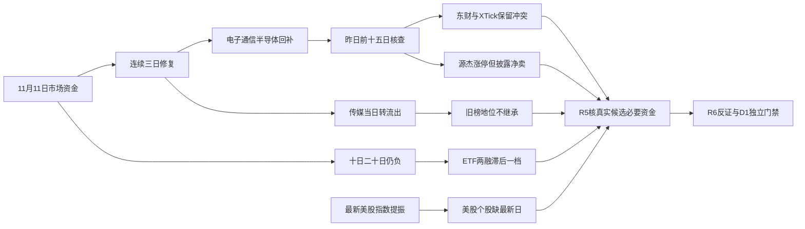

# 2026年11月12日 · 资金面

> **数据源新鲜度**: partial　|　**降级状态**: true　|　**置信度**: 0.2625
> A股主力/游资/期货实际归属11月11日收盘，属于正常T-1；ETF与两融实际11月10日，美股个股也仅11月10日。实时盘前研究，非冻结回放。

## 一句话结论
**观察：科技链获资金集中回补，传媒退分化；连续三日净流入尚未修复中期流出，涨停净卖反证保留。**

## 📊 详细分析：先认市场，再看资金奖励

| 维度 | 净额（亿元） | 资金侧判断 |
|---|---:|---|
| 11月11日市场主力 | 198.47 | 连续第三日为正 |
| 连续三日合计 | 499.71 | 修复有延续，不是单日孤立反弹 |
| 最近五日 | 60.14 | 4/5日正流入，但净额不厚 |
| 最近十日 | -988.59 | 尚未扭转中期撤资 |
| 最近二十日 | -3156.97 | 不能宣布全面主升 |

市场实际奖励电子、通信设备、半导体及其光通信/PCB方向的资金合力，而传媒当日转流出，不能沿用昨日的行业印象。资金侧阶段为“修复延续”，不是R1的全市场风格定性，也不是R2的主线确认。
最新五日累计从前一窗口361.94亿元降至60.14亿元，关键是11月4日大额流入退出滚动窗口；不能把窗口变小误写成11月11日市场净卖。主力当日超大单净额201.52亿元、大单-3.04亿元，增量主要集中在超大单口径。
昨日封板85只、炸板19只，按炸板÷（封板+炸板）计算为`18.27%`，低于35%强制减半门槛。本轮不产执行候选，不因资金反弹授予开仓资格。XTick原始zbl=3.16，与家数重算含义不同，不混用；其跌停1只与Tushare跌停列表空返回也不互相填补。

## 💰 板块资金与时序：与个股证据严格分列

| 板块标签 | 当日净流入（亿） | 五日累计（亿） | 五日正流入天数 |
|---|---:|---:|---:|
| 电子 | 177.41 | 236.23 | 4/5 |
| 通信设备 | 135.30 | 100.91 | 3/5 |
| 通信 | 133.83 | 105.37 | 3/5 |
| 通信网络设备及器件 | 104.75 | 91.05 | 3/5 |
| 元件 | 81.79 | 10.95 | 3/5 |
| 半导体 | 76.75 | 155.24 | 4/5 |
| 印制电路板 | 72.14 | 10.91 | 3/5 |
| 数字芯片设计 | 55.26 | 28.85 | 3/5 |
| 机械设备 | 42.96 | 60.55 | 4/5 |
| 通信线缆及配套 | 21.77 | 1.45 | 2/5 |

🟡 496个provider“行业”标签含父子层级，电子与半导体、通信与通信设备、元件与PCB均可能重叠，不可相加冒充独立新增资金。全表时序窗口为10月15日至11月11日，20个完整交易日；资金排名仅为可复现事实，不是R2主线优先级。

| 反向资金标签 | 当日净额（亿） | 五日累计（亿） |
|---|---:|---:|
| 医药生物 | -38.81 | -81.94 |
| 电力设备 | -30.92 | -58.31 |
| 国防军工 | -16.46 | -38.28 |
| 传媒 | -16.13 | 40.96 |
| 电池 | -15.73 | -41.92 |

### 电子：观察
资金事实：当日`177.41`亿元，五日`236.23`亿元。
- **大资金意图**: 当日回补幅度大、五日四日为正，支持科技链持续修复假设，不等于已知机构真实配置意图。
- **为什么走强**: 当日价格上涨与主力净额同向，东山精密、沪电股份等榜单事实形成局部扩散；本次未核产业订单和估值。
- **逻辑够不够硬**: 二十日市场仍负，东财是板块主体单底层源；必须以次日核心承接和资金连续性验证，不能用单日净额推断中期反转。

### 通信设备：观察
资金事实：当日`135.30`亿元，五日`100.91`亿元。
- **大资金意图**: 当日净额大于五日累计，说明资金集中回补含抵消前期流出，而不是已经五日均匀积累。
- **为什么走强**: 新易盛、中际旭创、天孚通信在昨日榜单居前，个股最新资金两分类同向；资金与价格的合力强于仅题材文字。
- **逻辑够不够硬**: 源杰科技涨停却出现披露榜净卖，行业一致性并不覆盖每个席位和每只票；缺硬事件锚，不把外部指数上涨当订单验证。

### 半导体：观察
资金事实：当日`76.75`亿元，五日`155.24`亿元。
- **大资金意图**: 五日四日为正支持回补，但长鑫科技、兆易创新当日净流入仍未修复各自五日净流出。
- **为什么走强**: 板块昨日上涨且资金为正，寒武纪和存储链榜单对象提供局部资金锚；没有逐一确认核心地位。
- **逻辑够不够硬**: 美股MU/NVDA等最新个股行情缺失，不能用旧价证明隔夜同步；产业兑现、主线地位和RR留给R2/R5独立核验。

### 传媒：观察
资金事实：当日`-16.13`亿元，五日`40.96`亿元。
- **大资金意图**: 五日仍为正但当日转流出，更像获利兑现/轮动降温的可检验假设，不作真实席位动机认定。
- **为什么走强**: 此处不是走强：板块资金转负，掌阅、慈文、中文在线由前日榜单高位转当日净流出，风险先于叙事。
- **逻辑够不够硬**: 慈文传媒的当日榜净卖与匹配机构净卖形成披露子集反证；不能由此全局否决传媒，更不能覆盖R6的独立结论。

## 🔎 昨日前十：五日向后追踪，不冒充未来绩效
锚定11月11日主力净流入前十，回溯11月5日、6日、9日、10日、11日。资金+价格有效`50/50`个股票日，XTick日期对齐有效`50/50`；方向同号`43/50`，最新一天十只均同号。五日仍有7个股票日分歧，不能将最新同向包装成所有历史均一致。
以昨日榜单事后选样，存在选择偏差；五日价格变动使用首日昨收至末日收盘、未复权且未核除权，不是实盘组合收益。排名截面不是候选：前后两日榜单并集17只完成详细核查，后续R5仍须核本轮真实候选必要资金。

| 股票 | 当日净额（亿） | 五日净额（亿） | 五日价格变动% | 最新XTick净额（亿） | 五日同号数 |
|---|---:|---:|---:|---:|---:|
| 新易盛 300502.SZ | 30.50 | 32.38 | 9.41 | 29.62 | 4/5 |
| 中际旭创 300308.SZ | 29.87 | 16.06 | 1.62 | 49.45 | 4/5 |
| 东山精密 002384.SZ | 23.16 | -5.61 | -2.41 | 33.07 | 4/5 |
| 天孚通信 300394.SZ | 16.87 | 11.96 | 5.93 | 8.23 | 3/5 |
| 长鑫科技 688825.SH | 16.57 | -20.26 | -4.58 | 18.71 | 5/5 |
| 兆易创新 603986.SH | 12.52 | -13.37 | -4.33 | 12.06 | 5/5 |
| 沪电股份 002463.SZ | 10.94 | 2.89 | 4.05 | 17.29 | 5/5 |
| 源杰科技 688498.SH | 10.42 | 16.03 | 17.22 | 13.80 | 3/5 |
| 寒武纪 688256.SH | 10.31 | 23.09 | 6.17 | 13.55 | 5/5 |
| 工业富联 601138.SH | 8.84 | 3.88 | 0.69 | 10.28 | 5/5 |

东山精密、长鑫科技、兆易创新虽进入昨日净流入前十，但五日累计仍为负；只能写资金回补，不能写已确认持续吸筹。光通信部分对象五日净额和价格同向，但源杰的龙虎榜子集反证仍成立。

### 11月10日前十迁移：不能继承昨日赢家标签

| 前日榜单对象 | 11月11日净额（亿） | 五日净额（亿） | 本轮态度 |
|---|---:|---:|---|
| 新易盛 300502.SZ | 30.50 | 32.38 | 观察，非本批候选 |
| 中际旭创 300308.SZ | 29.87 | 16.06 | 观察，非本批候选 |
| 掌阅科技 603533.SH | -5.16 | 1.24 | 观察，非本批候选 |
| C钶锐 688827.SH | -0.17 | 未知 | 观察，非本批候选 |
| 瑞芯微 603893.SH | -0.46 | 9.45 | 观察，非本批候选 |
| 立讯精密 002475.SZ | 0.16 | 11.95 | 观察，非本批候选 |
| 慈文传媒 002343.SZ | -2.26 | 3.65 | 观察，非本批候选 |
| 信维通信 300136.SZ | 0.56 | 9.65 | 观察，非本批候选 |
| 源杰科技 688498.SH | 10.42 | 16.03 | 观察，非本批候选 |
| 中文在线 300364.SZ | -1.79 | 5.29 | 观察，非本批候选 |

C钶锐688827.SH经本轮stock_basic确认11月10日上市。本次20日资金查询返回16条，14条在上市前；全部留原始证据但剔除可用序列。该票在五日窗口仅2个有效上市交易日，五日累计与五日收益为未知，不能为凑覆盖伪造上市前资金；仍有上市早期无涨跌幅限制风险。

### 每个榜单对象的边界与可证伪链条

#### 新易盛 300502.SZ：观察（不进execution）
板型：非涨停趋势对象，接力板型未确认；龙头认定：未评估，纪律通过条数未知；RR与止损距：未知；禁止清单：完整门禁未核，已观察命中项无已核命中，不等于通过。计划归属为未知，不写false。
- **大资金意图**: 仅观察当日净流入30.50亿元、五日32.38亿元，支持回补延续假设，但不推断真实机构动机。
- **为什么走强**: 五日价格变动9.41%，最新日涨幅16.98%；价格资金事实成立，产业催化与主线核心地位未在R7核验。
- **逻辑够不够硬**: 最新XTick净额29.62亿元与东财同向，五日仅4/5同号；同源API不算独立证据，单日同向不足以确认未来接力。
- **买入理由**: 不进。①科技链资金合力提供研究假设；②该票有可核资金/价格锚，但产业逻辑、今日核心/主线补涨/计划内试错类别尚未确认，不能代替交易资格。
- **风险点**: ①短期高波动、追涨回撤与分类口径冲突；②中期产业兑现和估值尚未核验，事后榜单选择偏差不能代替盈利证据。
- **止损条件**: R7未建仓、不生成执行止损价；资金假设撤销条件为下一完整交易日东财净额≤0且收盘低于本次可核收盘215.00元。现有持仓保护不由本研究改写。
- **可验证假设**: 未来1—3个交易日，东财日主力净额持续>0，XTick至少2日同号且股价不跌破上述观察收盘锚，才提高资金一致性评价；不满足则观察或降级，不自动买入。

#### 中际旭创 300308.SZ：观察（不进execution）
板型：非涨停趋势对象，接力板型未确认；龙头认定：未评估，纪律通过条数未知；RR与止损距：未知；禁止清单：完整门禁未核，已观察命中项无已核命中，不等于通过。计划归属为未知，不写false。
- **大资金意图**: 仅观察当日净流入29.87亿元、五日16.06亿元，支持回补延续假设，但不推断真实机构动机。
- **为什么走强**: 五日价格变动1.62%，最新日涨幅15.07%；价格资金事实成立，产业催化与主线核心地位未在R7核验。
- **逻辑够不够硬**: 最新XTick净额49.45亿元与东财同向，五日仅4/5同号；同源API不算独立证据，单日同向不足以确认未来接力。
- **买入理由**: 不进。①科技链资金合力提供研究假设；②该票有可核资金/价格锚，但产业逻辑、今日核心/主线补涨/计划内试错类别尚未确认，不能代替交易资格。
- **风险点**: ①短期高波动、追涨回撤与分类口径冲突；②中期产业兑现和估值尚未核验，事后榜单选择偏差不能代替盈利证据。
- **止损条件**: R7未建仓、不生成执行止损价；资金假设撤销条件为下一完整交易日东财净额≤0且收盘低于本次可核收盘542.00元。现有持仓保护不由本研究改写。
- **可验证假设**: 未来1—3个交易日，东财日主力净额持续>0，XTick至少2日同号且股价不跌破上述观察收盘锚，才提高资金一致性评价；不满足则观察或降级，不自动买入。

#### 东山精密 002384.SZ：观察（不进execution）
板型：1板；龙头认定：未评估，纪律通过条数未知；RR与止损距：未知；禁止清单：完整门禁未核，已观察命中项无已核命中，不等于通过。计划归属为未知，不写false。
- **大资金意图**: 仅观察当日净流入23.16亿元、五日-5.61亿元，尚未扭转五日净流出，不能定义为连续吸筹。
- **为什么走强**: 五日价格变动-2.41%，最新日涨幅10.00%；价格资金事实成立，产业催化与主线核心地位未在R7核验。
- **逻辑够不够硬**: 最新XTick净额33.07亿元与东财同向，五日仅4/5同号；同源API不算独立证据，单日同向不足以确认未来接力。
- **买入理由**: 不进。①科技链资金合力提供研究假设；②该票有可核资金/价格锚，但产业逻辑、今日核心/主线补涨/计划内试错类别尚未确认，不能代替交易资格。
- **风险点**: ①短期高波动、追涨回撤与分类口径冲突；②中期产业兑现和估值尚未核验，事后榜单选择偏差不能代替盈利证据。
- **止损条件**: R7未建仓、不生成执行止损价；资金假设撤销条件为下一完整交易日东财净额≤0且收盘低于本次可核收盘92.06元。现有持仓保护不由本研究改写。
- **可验证假设**: 未来1—3个交易日，东财日主力净额持续>0，XTick至少2日同号且股价不跌破上述观察收盘锚，才提高资金一致性评价；不满足则观察或降级，不自动买入。

#### 天孚通信 300394.SZ：观察（不进execution）
板型：非涨停趋势对象，接力板型未确认；龙头认定：未评估，纪律通过条数未知；RR与止损距：未知；禁止清单：完整门禁未核，已观察命中项无已核命中，不等于通过。计划归属为未知，不写false。
- **大资金意图**: 仅观察当日净流入16.87亿元、五日11.96亿元，支持回补延续假设，但不推断真实机构动机。
- **为什么走强**: 五日价格变动5.93%，最新日涨幅13.96%；价格资金事实成立，产业催化与主线核心地位未在R7核验。
- **逻辑够不够硬**: 最新XTick净额8.23亿元与东财同向，五日仅3/5同号；同源API不算独立证据，单日同向不足以确认未来接力。
- **买入理由**: 不进。①科技链资金合力提供研究假设；②该票有可核资金/价格锚，但产业逻辑、今日核心/主线补涨/计划内试错类别尚未确认，不能代替交易资格。
- **风险点**: ①短期高波动、追涨回撤与分类口径冲突；②中期产业兑现和估值尚未核验，事后榜单选择偏差不能代替盈利证据。
- **止损条件**: R7未建仓、不生成执行止损价；资金假设撤销条件为下一完整交易日东财净额≤0且收盘低于本次可核收盘144.06元。现有持仓保护不由本研究改写。
- **可验证假设**: 未来1—3个交易日，东财日主力净额持续>0，XTick至少2日同号且股价不跌破上述观察收盘锚，才提高资金一致性评价；不满足则观察或降级，不自动买入。

#### 长鑫科技 688825.SH：观察（不进execution）
板型：非涨停趋势对象，接力板型未确认；龙头认定：未评估，纪律通过条数未知；RR与止损距：未知；禁止清单：完整门禁未核，已观察命中项无已核命中，不等于通过。计划归属为未知，不写false。
- **大资金意图**: 仅观察当日净流入16.57亿元、五日-20.26亿元，尚未扭转五日净流出，不能定义为连续吸筹。
- **为什么走强**: 五日价格变动-4.58%，最新日涨幅4.00%；价格资金事实成立，产业催化与主线核心地位未在R7核验。
- **逻辑够不够硬**: 最新XTick净额18.71亿元与东财同向，五日仅5/5同号；同源API不算独立证据，单日同向不足以确认未来接力。
- **买入理由**: 不进。①科技链资金合力提供研究假设；②该票有可核资金/价格锚，但产业逻辑、今日核心/主线补涨/计划内试错类别尚未确认，不能代替交易资格。
- **风险点**: ①短期高波动、追涨回撤与分类口径冲突；②中期产业兑现和估值尚未核验，事后榜单选择偏差不能代替盈利证据。
- **止损条件**: R7未建仓、不生成执行止损价；资金假设撤销条件为下一完整交易日东财净额≤0且收盘低于本次可核收盘42.07元。现有持仓保护不由本研究改写。
- **可验证假设**: 未来1—3个交易日，东财日主力净额持续>0，XTick至少2日同号且股价不跌破上述观察收盘锚，才提高资金一致性评价；不满足则观察或降级，不自动买入。

#### 兆易创新 603986.SH：观察（不进execution）
板型：非涨停趋势对象，接力板型未确认；龙头认定：未评估，纪律通过条数未知；RR与止损距：未知；禁止清单：完整门禁未核，已观察命中项无已核命中，不等于通过。计划归属为未知，不写false。
- **大资金意图**: 仅观察当日净流入12.52亿元、五日-13.37亿元，尚未扭转五日净流出，不能定义为连续吸筹。
- **为什么走强**: 五日价格变动-4.33%，最新日涨幅6.15%；价格资金事实成立，产业催化与主线核心地位未在R7核验。
- **逻辑够不够硬**: 最新XTick净额12.06亿元与东财同向，五日仅5/5同号；同源API不算独立证据，单日同向不足以确认未来接力。
- **买入理由**: 不进。①科技链资金合力提供研究假设；②该票有可核资金/价格锚，但产业逻辑、今日核心/主线补涨/计划内试错类别尚未确认，不能代替交易资格。
- **风险点**: ①短期高波动、追涨回撤与分类口径冲突；②中期产业兑现和估值尚未核验，事后榜单选择偏差不能代替盈利证据。
- **止损条件**: R7未建仓、不生成执行止损价；资金假设撤销条件为下一完整交易日东财净额≤0且收盘低于本次可核收盘259.62元。现有持仓保护不由本研究改写。
- **可验证假设**: 未来1—3个交易日，东财日主力净额持续>0，XTick至少2日同号且股价不跌破上述观察收盘锚，才提高资金一致性评价；不满足则观察或降级，不自动买入。

#### 沪电股份 002463.SZ：观察（不进execution）
板型：1板；龙头认定：未评估，纪律通过条数未知；RR与止损距：未知；禁止清单：完整门禁未核，已观察命中项无已核命中，不等于通过。计划归属为未知，不写false。
- **大资金意图**: 仅观察当日净流入10.94亿元、五日2.89亿元，支持回补延续假设，但不推断真实机构动机。
- **为什么走强**: 五日价格变动4.05%，最新日涨幅10.00%；价格资金事实成立，产业催化与主线核心地位未在R7核验。
- **逻辑够不够硬**: 最新XTick净额17.29亿元与东财同向，五日仅5/5同号；同源API不算独立证据，单日同向不足以确认未来接力。
- **买入理由**: 不进。①科技链资金合力提供研究假设；②该票有可核资金/价格锚，但产业逻辑、今日核心/主线补涨/计划内试错类别尚未确认，不能代替交易资格。
- **风险点**: ①短期高波动、追涨回撤与分类口径冲突；②中期产业兑现和估值尚未核验，事后榜单选择偏差不能代替盈利证据。
- **止损条件**: R7未建仓、不生成执行止损价；资金假设撤销条件为下一完整交易日东财净额≤0且收盘低于本次可核收盘89.43元。现有持仓保护不由本研究改写。
- **可验证假设**: 未来1—3个交易日，东财日主力净额持续>0，XTick至少2日同号且股价不跌破上述观察收盘锚，才提高资金一致性评价；不满足则观察或降级，不自动买入。

#### 源杰科技 688498.SH：观察（不进execution）
板型：1板；龙头认定：未评估，纪律通过条数未知；RR与止损距：未知；禁止清单：完整门禁未核，已观察命中项无已核命中，不等于通过。计划归属为未知，不写false。
- **大资金意图**: 仅观察当日净流入10.42亿元、五日16.03亿元，支持回补延续假设，但不推断真实机构动机。
- **为什么走强**: 五日价格变动17.22%，最新日涨幅20.00%；价格资金事实成立，产业催化与主线核心地位未在R7核验。
- **逻辑够不够硬**: 最新XTick净额13.80亿元与东财同向，五日仅3/5同号；额外存在涨停而披露龙虎榜净卖，保留反证。
- **买入理由**: 不进。①科技链资金合力提供研究假设；②该票有可核资金/价格锚，但产业逻辑、今日核心/主线补涨/计划内试错类别尚未确认，不能代替交易资格。
- **风险点**: ①短期高波动、追涨回撤与分类口径冲突；②中期产业兑现和估值尚未核验，事后榜单选择偏差不能代替盈利证据。
- **止损条件**: R7未建仓、不生成执行止损价；资金假设撤销条件为下一完整交易日东财净额≤0且收盘低于本次可核收盘774.85元。现有持仓保护不由本研究改写。
- **可验证假设**: 未来1—3个交易日，东财日主力净额持续>0，XTick至少2日同号且股价不跌破上述观察收盘锚，才提高资金一致性评价；不满足则观察或降级，不自动买入。

#### 寒武纪 688256.SH：观察（不进execution）
板型：非涨停趋势对象，接力板型未确认；龙头认定：未评估，纪律通过条数未知；RR与止损距：未知；禁止清单：完整门禁未核，已观察命中项无已核命中，不等于通过。计划归属为未知，不写false。
- **大资金意图**: 仅观察当日净流入10.31亿元、五日23.09亿元，支持回补延续假设，但不推断真实机构动机。
- **为什么走强**: 五日价格变动6.17%，最新日涨幅7.40%；价格资金事实成立，产业催化与主线核心地位未在R7核验。
- **逻辑够不够硬**: 最新XTick净额13.55亿元与东财同向，五日仅5/5同号；同源API不算独立证据，单日同向不足以确认未来接力。
- **买入理由**: 不进。①科技链资金合力提供研究假设；②该票有可核资金/价格锚，但产业逻辑、今日核心/主线补涨/计划内试错类别尚未确认，不能代替交易资格。
- **风险点**: ①短期高波动、追涨回撤与分类口径冲突；②中期产业兑现和估值尚未核验，事后榜单选择偏差不能代替盈利证据。
- **止损条件**: R7未建仓、不生成执行止损价；资金假设撤销条件为下一完整交易日东财净额≤0且收盘低于本次可核收盘900.00元。现有持仓保护不由本研究改写。
- **可验证假设**: 未来1—3个交易日，东财日主力净额持续>0，XTick至少2日同号且股价不跌破上述观察收盘锚，才提高资金一致性评价；不满足则观察或降级，不自动买入。

#### 工业富联 601138.SH：观察（不进execution）
板型：非涨停趋势对象，接力板型未确认；龙头认定：未评估，纪律通过条数未知；RR与止损距：未知；禁止清单：完整门禁未核，已观察命中项无已核命中，不等于通过。计划归属为未知，不写false。
- **大资金意图**: 仅观察当日净流入8.84亿元、五日3.88亿元，支持回补延续假设，但不推断真实机构动机。
- **为什么走强**: 五日价格变动0.69%，最新日涨幅5.51%；价格资金事实成立，产业催化与主线核心地位未在R7核验。
- **逻辑够不够硬**: 最新XTick净额10.28亿元与东财同向，五日仅5/5同号；同源API不算独立证据，单日同向不足以确认未来接力。
- **买入理由**: 不进。①科技链资金合力提供研究假设；②该票有可核资金/价格锚，但产业逻辑、今日核心/主线补涨/计划内试错类别尚未确认，不能代替交易资格。
- **风险点**: ①短期高波动、追涨回撤与分类口径冲突；②中期产业兑现和估值尚未核验，事后榜单选择偏差不能代替盈利证据。
- **止损条件**: R7未建仓、不生成执行止损价；资金假设撤销条件为下一完整交易日东财净额≤0且收盘低于本次可核收盘45.56元。现有持仓保护不由本研究改写。
- **可验证假设**: 未来1—3个交易日，东财日主力净额持续>0，XTick至少2日同号且股价不跌破上述观察收盘锚，才提高资金一致性评价；不满足则观察或降级，不自动买入。

## ⚠️ 龙虎榜诱多识别：风险线索不等于动机认定
11月11日原始披露85条；单日事件56条、多日事件29条分列，不相加计算同一票净额。股票上涨净卖背离`21`只（包含退市整理风险对象），下跌高换手净卖`9`只；转债上涨净卖另有`1`只，不混入股票数。
净卖是披露子集，不是全市场机构净卖；没有足够事实证明操纵或诱多意图。本轮只输出观察及真实反证，不发hard_reject。top_inst匹配同一披露理由、对相同金额重复记录去重；匿名“机构专用”不能据名称判定独立机构家数，净额仅作已披露可辨记录统计。

| 上涨净卖对象 | 涨幅% | 换手% | 披露净额（亿） | 匹配机构净额（亿） | 窗口 |
|---|---:|---:|---:|---:|---|
| 慈文传媒 002343.SZ | 3.97 | 45.23 | -2.27 | -1.08 | 单日 |
| 冰山冷热 000530.SZ | 7.12 | 43.23 | -2.12 | 0.42 | 单日 |
| 光洋股份 002708.SZ | 10.01 | 18.02 | -1.33 | 0.12 | 连续多日 |
| 东方海洋 002086.SZ | 1.52 | 37.27 | -1.24 | 0.22 | 单日 |
| 福莱新材 605488.SH | 10.00 | 11.57 | -1.18 | 未知 | 连续多日 |
| 凡拓数创 301313.SZ | 4.55 | 35.45 | -1.09 | -1.01 | 单日 |
| 上海电影 601595.SH | 10.01 | 6.97 | -1.07 | -0.85 | 连续多日 |
| 通则康威 301718.SZ | 1.57 | 44.83 | -1.00 | -0.66 | 单日 |
| 上海九百 600838.SH | 2.18 | 29.22 | -0.69 | 未知 | 单日 |
| 博硕科技 300951.SZ | 5.93 | 6.85 | -0.56 | -0.12 | 连续多日 |
| 智微智能 001339.SZ | 10.00 | 17.83 | -0.56 | -0.92 | 连续多日 |
| 源杰科技 688498.SH | 20.00 | 8.24 | -0.50 | -0.89 | 单日 |
| 德龙汇能 000593.SZ | 6.42 | 7.38 | -0.45 | -0.23 | 连续多日 |
| 肯特股份 301591.SZ | 8.61 | 44.19 | -0.24 | 0.36 | 单日 |
| 龙版传媒 605577.SH | 0.46 | 13.34 | -0.24 | 未知 | 单日 |
| 宇特光电 920157.BJ | 29.99 | 56.37 | -0.18 | -0.04 | 单日 |
| 大东方 600327.SH | 9.93 | 11.70 | -0.06 | 未知 | 连续多日 |
| 文峰光电 920296.BJ | 9.67 | 43.12 | -0.03 | 0.02 | 单日 |
| 天普股份 605255.SH | 10.01 | 1.72 | -0.02 | 未知 | 连续多日 |
| 东方环宇 603706.SH | 10.00 | 8.90 | -0.01 | 未知 | 单日 |
| 萃华退 002731.SZ | 4.55 | 4.23 | -0.00 | 未知 | 单日 |

| 下跌高换手对象 | 涨幅% | 换手% | 披露净额（亿） |
|---|---:|---:|---:|
| 青岛食品 001219.SZ | -9.99 | 27.69 | -1.30 |
| 皇冠新材 001381.SZ | -3.76 | 36.98 | -0.01 |
| 百洋股份 002696.SZ | -9.00 | 27.61 | -0.20 |
| 贝特利 301697.SZ | -5.79 | 52.09 | -0.25 |
| 金健米业 600127.SH | -3.20 | 31.79 | -0.95 |
| 龙江交通 601188.SH | -6.94 | 25.82 | -0.13 |
| 浙文影业 601599.SH | -0.89 | 41.55 | -0.46 |
| 永臻股份 603381.SH | -2.24 | 33.37 | -0.18 |
| 艾能聚 920770.BJ | -5.71 | 20.24 | -0.16 |

### 源杰科技与慈文传媒：保留反证，不“一票证据替全盘”
- **大资金意图**: 不能读心。源杰科技全日东财净流入10.42亿元、XTick净流入13.80亿元，但披露榜净卖0.50亿元、匹配机构净卖0.89亿元，说明资金分类和样本层级不同；不能择其一抹掉另一面。
- **为什么走强**: 源杰科技涨停属于价格事实，不代表榜内合力持续净买；慈文传媒上涨3.97%而换手45.23%、榜单净卖2.27亿元，前日榜单地位不能机械继承。
- **逻辑够不够硬**: 慈文匹配机构净卖1.08亿元、传媒板块净额转负，形成局部同向风险；源杰则是全日净买与披露净卖并存的实质冲突，交R6独立反证，R7不硬否决。
东方海洋、凡拓数创、肯特股份在可比单日披露中出现前日净买转昨日净卖；萃华退也命中此统计，但属于退市整理，不应混作可交易观察对象。冰山冷热虽然榜单总体净卖，匹配机构子集却净买，不能笼统称机构出货。欧通转债123241.SZ单列为转债样本，非A股候选。

正向辅助：同营业部3日反复净买且最新封板/名称过滤通过共`6`条；公告风险未完整核验。协同名单包含大东方、光洋股份、宇特光电的同时，三者也有不同口径/窗口的净卖反证，正向信号不覆盖风险。

| 股票 | 营业部 | 3日正净买天数 | 合计（万元） |
|---|---|---:|---:|
| 大东方 600327.SH | 平安证券浙江分公司 | 2 | 4909.27 |
| 光洋股份 002708.SZ | 平安证券浙江分公司 | 2 | 10468.90 |
| 文投控股 600715.SH | 国泰海通证券总部 | 3 | 17116.30 |
| 文投控股 600715.SH | 开源证券西安西大街 | 2 | 8596.75 |
| 宇特光电 920157.BJ | 东方财富证券拉萨团结路第一 | 2 | 413.13 |
| 文投控股 600715.SH | 华鑫证券上海金山 | 2 | 15956.69 |

## 🔄 ETF、两融、期货与跷跷板
近月IF2611与沪深300在11月11日同日收盘基差为`-8.5093`点；前日为-9.7105点，折价略收窄。持仓量增加518手不能解释成净多资金流入；基差也未扣分红/时间差/交割成本，不当精确套利指标。

| ETF | 最新份额日期 | 同日净申赎代理（亿） | 证据边界 |
|---|---|---:|---|
| 510300.SH | 2026-11-10 | -13.47 | 份额变化×同日收盘价，非成交额 |
| 510500.SH | 2026-11-10 | -9.82 | 份额变化×同日收盘价，非成交额 |
| 159915.SZ | 2026-11-10 | -9.06 | 份额变化×同日收盘价，非成交额 |
| 588000.SH | 2026-11-10 | -0.24 | 份额变化×同日收盘价，非成交额 |

四只篮子在11月10日合计代理`-32.59`亿元。与11月11日主力回补不同日期，不能称“当天ETF与主力背离”，也不能当全市场ETF净流；只限制申赎持续性这一主张。
两融最新披露为11月10日，交易所汇总融资余额22656.62亿元，较11月9日22670.31亿元小幅下降；11月11日尚无记录。个股15交易日请求多返回14日，慈文传媒空返回不证明它不是两融标的。大宗请求30自然日，折溢价仅在已核同日收盘价存在时计算为未复权比较代理，缺同日价格保持未知，不凭折价推断出货。
跷跷板：R2未就绪，用最新绝对资金净额前20个行业标签，对齐20日无填充，检验190对。相关<-0.6且最近五日相对前五日资金差翻转的合格对为`0`对；不凑数，不代表市场不存在板块互斥。

## 🌎 外部传导：隔夜美股核心个股
本次必须消费的overseas_snapshot由11月12日fetch生成。最新已完成美股交易日为11月11日：标普500上涨1.31%、纳指上涨1.60%（快照底层Tencent），对A股科技风险偏好提供方向性提振；SOX缺失，不用纳指冒充半导体指数。
快照仅含12只核心股；本轮实查14只us_daily，补INTC和MRVL，但全部最新仍止于11月10日。下列涨跌均为旧交易日事实，不能标成11月11日隔夜涨跌。

| 核心股 | 实际行情日 | 旧日涨跌% | A股映射及边界 |
|---|---|---:|---|
| MU | 2026-11-10 | -1.10 | 存储；非最新隔夜个股信号 |
| NVDA | 2026-11-10 | -5.47 | 算力/GPU；非最新隔夜个股信号 |
| AVGO | 2026-11-10 | 3.91 | ASIC/CPO；非最新隔夜个股信号 |
| AMD | 2026-11-10 | 1.30 | 服务器/芯片；非最新隔夜个股信号 |
| TSM | 2026-11-10 | 2.02 | 晶圆/半导体；非最新隔夜个股信号 |
| AAPL | 2026-11-10 | -0.62 | 消费电子；非最新隔夜个股信号 |
| MSFT | 2026-11-10 | -2.20 | 云计算；非最新隔夜个股信号 |
| GOOGL | 2026-11-10 | -0.27 | AI/云；非最新隔夜个股信号 |
| AMZN | 2026-11-10 | 1.48 | 云计算；非最新隔夜个股信号 |
| META | 2026-11-10 | 0.00 | AI应用；非最新隔夜个股信号 |
| TSLA | 2026-11-10 | 0.46 | 汽车/机器人；非最新隔夜个股信号 |
| INTC | 2026-11-10 | -2.09 | 半导体；非最新隔夜个股信号 |
| GLW | 2026-11-10 | -3.29 | 光纤材料；非最新隔夜个股信号 |
| MRVL | 2026-11-10 | -0.14 | 光互联/芯片；非最新隔夜个股信号 |

旧日MU -1.10%、NVDA -5.47%构成旧日内存/算力压力，AVGO +3.91%、AMD +1.30%、TSM +2.02%则分化；这些不能拼成最新隔夜“存储/CPO共振”。当前可确认的是最新美股指数提振与A股昨日电子/通信资金回补两条不同层级证据；今日高溢价能否接住，仍须开盘承接和当日资金验证。

## 🧭 证据传导图

## 📌 关键证据
- 市场：moneyflow_mkt_dc实查20日；SDK与MCP最新19847323648元一致，但底层同为东财，不算独立双源。
- 板块：moneyflow_ind_dc实查496标签×20日；金额原单位元除1亿。个股moneyflow_dc原单位万元除1万，禁止将两者混算。
- 个股：全市场两日截面6032条/日，仅筛选排名；17只榜单对象有价格/资金/大宗/两融详细请求；昨日十只再经XTick50股票日核验。
- 龙虎榜：五日完整返回保留；日榜/连续榜和股票/转债分开，匹配机构并不代表全部机构；上市日由stock_basic本轮实查。

## 数据源审计
| 源 | 资料日期 | 状态 | 范围及备注 |
|---|---|:--:|---|
| Tushare live SDK / Eastmoney market-sector-stock | 2026-11-11 | 🟢 | 市场20日、496板块标签各20日；SDK实查而非MCP标签；市场最新值另与MCP同源核对 |
| Tushare LHB live SDK | 2026-11-11 | 🟢 | 五日全市场榜单；日榜/多日榜不相加，机构匹配同理由去重 |
| XTick live MCP | 2026-11-11 | 🟢 | 昨日前十50股票日独立分类核验；方向冲突原样披露 |
| DataPro MCP | 2026-11-12 | 🔴 | 握手健康不等于业务查询可用；不全局禁新 |
| ETF shares and margin live SDK | 2026-11-10 | 🟡 | 最新11月10日，低于主力/龙虎榜一档；ETF为份额变化×同日价格代理 |
| index futures live SDK | 2026-11-11 | 🟢 | 近月IF2611与沪深300同日收盘差；非精确无套利基差 |
| overseas_snapshot | 2026-11-12 | 🟡 | 标普/纳指11月11日；核心个股11月10日，SOX缺失 |
| Tushare us_daily live retry | 2026-11-10 | 🟡 | 14只均未返回11月11日；不将检索时间当行情时间 |
| stock_basic listing check live SDK | 2026-11-12 | 🟢 | 核验实查对象上市日；上市前伪资金历史不计有效覆盖 |
| manifest and mcp_health | 2026-11-12 | 🟢 | global_severity=2；真实业务错误覆盖握手状态，不覆盖原文件 |
| 北向 | 2026-11-12 | 🟡 | not_required，仅复盘参考；未知保持null，不补抓、不进置信度与门禁 |

## 🧩 不确定性 / 反证
置信度按`0.75×0.7×0.5=0.2625`计算；市场板块主体仍是东财单底层源，XTick最新同向并不能抹除五日冲突，DataPro业务查询4013优先于握手健康。global_severity=2遵守≤0.5上限。北向不进分子分母，排除北向不自动抬分。
ETF两融滞后一档、美股核心个股缺最新日、DataPro失效分别限制对应主张，不推导全局禁买、归零或机械仓位调整。源杰全日资金与披露榜净额相反、传媒转流出、新股上市前伪历史均为实质反证，不能因降级而删掉。
本轮不发市场性no_trade或仓位上限，不读旧计划继承零仓；用户/账户预算资料未提供，预算未知，不能抬成正额度。有效零预算、真实停买、T+1、逐票hard_reject、人工确认和既有授权保护全部不变。

## 🤝 与其他 R/D/E 的关系
- 依赖：当日manifest、mcp_health、overseas_snapshot及本轮实时工具返回。未读旧R5池，不把同日旧R2文件当本批覆盖。
- R2：消费板块资金事实后，独立确定主线、地位及主模板；R7不排名交易主线。
- R5：后续真实候选逐票补必要资金、价格、产业与RR；不再开R7、不要求特定provider。
- R6：保留全部实际覆盖与资金冲突，唯一hard_reject来源不变，R7不替其判断通过。
- D1/E1：研究观察不是开仓资格；首次计划形成前in_today_plan未知，不用false或plan_outside_scan预先剔除。

## Sub-Agent 元数据
- skill: analyze_capital_flow_v1
- artifact: data/research/20261112/R7_capital_flow.json
- 生成耗时：542.5秒（真实流水线起点至本次生成）。
- model: gpt-6.1-sol
- 资源：usage_unknown，未计量不当0；5000万token为observe_only努力目标，非硬限；08:30目标不改变交易授权。
