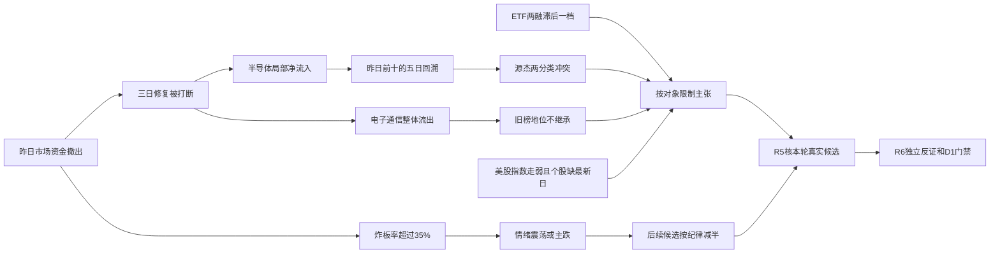

# 2026年11月13日 · 资金面

> **数据源新鲜度**: partial　|　**降级状态**: true　|　**置信度**: 0.2625
> 主力/游资/期货实际资料日为11月12日收盘，正常T-1；ETF、两融及美股核心个股为11月11日。实时盘前研究，非冻结回放。

## 一句话结论
**观察：大额撤资打断三日修复，情绪=震荡/主跌；半导体局部逆势，旧榜通信核心转流出。**

## 📊 详细分析：先认市场，再认资金奖励

| 市场维度 | 净额（亿元） | 判读 |
|---|---:|---|
| 昨日主力 | -524.11 | 超大单与大单同时流出 |
| 此前三日回补总额 | 499.71 | 已被昨日单日流出超过，修复不能直接外推 |
| 五日累计 | -549.37 | 3/5日为正但净额显著负 |
| 十日累计 | -814.35 | 中期撤资仍在 |
| 二十日累计 | -3045.78 | 不足以定义全面主升 |

上证昨日跌-0.67%，深成指-1.68%；超大单净额-254.34亿元、大单-269.78亿元。昨日不是三日回补顺延，而是资金侧修复被打断。阶段判断只用于资金温度，不替代R1风格或R2主线认定。
昨日封板37只、炸板35只，炸板÷（封板+炸板）=`48.61%`，超过35%。**情绪=震荡/主跌**，本阶段不生成研究/执行候选，候选基数0→0；十票统计回溯不是候选池，不删掉其中五票制造减半假象。后续R2/R5按纪律将候选数减半，风险证据不减半。
XTick家数为封板37、炸板36，供应商直接zbl=20.0与上述重算口径不一致；不把zbl字段直接当统一炸板率。两源炸板家数仅差一只且均指向高分歧，但口径差异仍保留。
市场奖励体现为半导体局部资金韧性、蓝色光标等营销个股的集中资金与零散首板，而不是所有科技链。板块资金与价格可能背离：半导体净流入但指数下跌，广告营销净流入但指数下跌；这恰恰说明广泛赚钱效应尚未确认。今天只做研究观察与反证交付，不授予开仓资格、不预设主模板。

## 💰 板块时序：与个股结论分列

| 板块标签 | 昨日净额（亿） | 五日净额（亿） | 昨日涨幅% | 五日正流入天数 |
|---|---:|---:|---:|---:|
| 半导体 | 23.53 | 117.72 | -0.84 | 4/5 |
| 营销代理 | 19.28 | 18.05 | -2.00 | 2/5 |
| 广告营销 | 18.86 | 18.53 | -2.02 | 2/5 |
| 半导体设备 | 17.33 | 41.79 | 0.75 | 5/5 |
| 医疗服务 | 9.70 | -19.26 | 0.07 | 2/5 |
| 集成电路制造 | 8.85 | 7.12 | 1.19 | 3/5 |
| 分立器件 | 8.57 | 31.85 | -1.53 | 4/5 |
| 银行 | 7.46 | 21.31 | 0.02 | 3/5 |
| 银行Ⅱ | 7.46 | 21.31 | 0.02 | 3/5 |
| 集成电路封测 | 5.73 | 5.54 | -0.05 | 3/5 |

| 流出侧 | 昨日净额（亿） | 五日净额（亿） | 昨日涨幅% |
|---|---:|---:|---:|
| 电子 | -79.05 | 145.13 | -1.58 |
| 通信 | -73.03 | 79.45 | -2.06 |
| 通信设备 | -68.14 | 89.17 | -2.02 |
| 机械设备 | -66.99 | -24.79 | -2.10 |
| 电力设备 | -62.39 | -183.80 | -2.02 |
| 有色金属 | -59.03 | -98.85 | -2.51 |
| 通信网络设备及器件 | -49.26 | 90.80 | -1.71 |
| 消费电子 | -45.90 | 1.50 | -2.52 |
| 消费电子零部件及组装 | -44.05 | 2.64 | -2.53 |
| 汽车 | -39.15 | -9.48 | -2.35 |

🟡 数据为10月16日至11月12日20个交易日、496个provider行业标签。银行/银行Ⅱ等重复，半导体/半导体设备等父子嵌套；这些不是496个互斥行业，不能相加。上述按净额排序仅为资金事实，不是R2主线交易优先级。
本轮未核行业涨停率、硬催化及龙头地位，因此“主线、持续性1/3/5日、行业封板率、明日加速/分歧/退潮”均不替R2填定值。资金表不能替代主线确认，未知不造数。

### 半导体：观察
资金事实：当日`23.53`亿元，五日`117.72`亿元。
- **大资金意图**: 昨日逆市场流出取得净流入，五日累计为正，支持局部资金集中假设；不能据此认定机构真实配置意图。
- **为什么走强**: 资金走强而价格下跌0.84%，寒武纪、通富微电、北方华创等实查对象有净流入，设备子板块价格为正；只能说结构韧性，不是全行业上涨。
- **逻辑够不够硬**: 市场总体大额净卖、电子大类转流出；最新美股芯片个股尚缺，产业订单与业绩没有本轮独立取证，局部逆势不是主线开仓凭证。

### 广告营销：观察
资金事实：当日`18.86`亿元，五日`18.53`亿元。
- **大资金意图**: 蓝色光标当日23.47亿超过广告营销板块18.86亿，表明集中买入与其他成分卖出可能并存；尚未核成分表，不能精确分解占比。
- **为什么走强**: 蓝色光标涨10.89%且两资金分类同向，但广告营销板块跌2.02%，资金奖励集中到个股，并非板块广泛赚钱。
- **逻辑够不够硬**: 缺AI营销订单或硬催化证据；传媒大类资金并未同步转强，单票集中不能证明主线持续。

### 医疗服务：观察
资金事实：当日`9.70`亿元，五日`-19.26`亿元。
- **大资金意图**: 当日回补与五日累计仍负并存，支持单日局部回流而非已确认连续增配。
- **为什么走强**: 澳洋健康首板与两分类净流入构成可核锚，医疗服务仅涨0.07%，不能用单票涨停替行业大面积走强。
- **逻辑够不够硬**: 产业事件、监管及盈利兑现未由R7核实；万邦医药上涨却披露榜净卖，行业内已有资金子集反证。

### 通信设备：观察
资金事实：当日`-68.14`亿元，五日`89.17`亿元。
- **大资金意图**: 从前期回补转为当日大额撤出，五日仍正只说明此前买入尚未完全抵消，不是昨日持续流入。
- **为什么走强**: 本项是转弱：通信设备跌2.02%，新易盛、中际旭创、天孚通信均由前日净流入榜转昨日流出，旧赢家地位不能机械继承。
- **逻辑够不够硬**: 全行业与实查个股资金同向转负，是实质反证；但主力统计是成交分类，不能当真实机构卖出账户证据，也不全局否决。

## 🔎 昨日前十5日追踪：事后统计，不冒充候选
锚定11月12日全市场主力净流入前十，回溯11月6日、9日、10日、11日、12日。资金+价格`50/50`股票日，XTick真实日期对齐`50/50`，方向同号`36/50`。只描述已完成交易日，不是未来五日持有收益，不声称事前选中。
全市场两日截面各6032条仅用于筛选榜单；详细核查对象为两日榜单并集18只，不是本批R2候选。股价变动为首日昨收到末日收盘、未复权且未核除权，不作组合收益。

| 昨日前十 | 昨日东财（亿） | 五日东财（亿） | 五日价格变动% | 昨日XTick（亿） | 五日同号 |
|---|---:|---:|---:|---:|---:|
| 蓝色光标 300058.SZ | 23.47 | 20.20 | 10.40 | 22.32 | 3/5 |
| 寒武纪 688256.SH | 14.06 | 34.21 | 15.15 | 23.23 | 5/5 |
| 源杰科技 688498.SH | 9.70 | 27.88 | 16.64 | -3.70 | 3/5 |
| 通富微电 002156.SZ | 8.62 | 8.66 | 6.87 | 26.48 | 5/5 |
| 吉视传媒 601929.SH | 5.92 | 5.23 | 12.40 | 7.98 | 3/5 |
| 北方华创 002371.SZ | 5.30 | 11.77 | -0.39 | 4.42 | 3/5 |
| 星网锐捷 002396.SZ | 4.59 | 5.21 | 7.11 | 4.73 | 2/5 |
| 百洋股份 002696.SZ | 4.58 | 5.43 | 6.86 | 7.77 | 4/5 |
| 澳洋健康 002172.SZ | 4.49 | 6.45 | 10.08 | 6.98 | 4/5 |
| 摩尔线程-U 688795.SH | 4.32 | 6.31 | 9.42 | 4.24 | 4/5 |

最新一天9/10只分类同向；源杰科技东财+9.70亿而XTick-3.70亿，价格跌1.55%，不能写两源一致吸筹。五日50个股票日只有36个同号，14个差异没有删掉。北方华创五日价格为负而资金为正，也说明资金榜不等于已经实现赚钱效应。

### 前一日前十迁移：旧榜单地位不继承

| 11月11日前十 | 11月12日净额（亿） | 最新五日净额（亿） |
|---|---:|---:|
| 新易盛 300502.SZ | -16.13 | 33.71 |
| 中际旭创 300308.SZ | -26.50 | 12.17 |
| 东山精密 002384.SZ | -5.70 | 5.24 |
| 天孚通信 300394.SZ | -3.58 | 13.65 |
| 长鑫科技 688825.SH | -18.57 | -13.94 |
| 兆易创新 603986.SH | -1.70 | -3.91 |
| 沪电股份 002463.SZ | -1.33 | 12.99 |
| 源杰科技 688498.SH | 9.70 | 27.88 |
| 寒武纪 688256.SH | 14.06 | 34.21 |
| 工业富联 601138.SH | -13.84 | -2.14 |

上述迁移是本轮实时复查旧榜单，不是读取旧R5_candidate_pool。18只实查对象均核上市日，本轮没有发现查询窗口早于上市日的资金记录；其他全市场截面未逐票完成上市与必要风险核验，不作全市场洁净声明。

### 十票观察链条：板型、地位、RR、禁止清单逐项保留未知

#### 蓝色光标 300058.SZ：观察，不进execution
板型：非涨停资金榜对象，接力板型未确认。龙头认定：R2未就绪，纪律通过条数未知。盈亏比RR与止损距：未知，不能获开仓资格。禁止清单：已核命中项无已确认命中，全量门禁未知；in_today_plan未知，今日核心/主线补涨/计划内试错类别尚未确认。
- **大资金意图**: 当日东财23.47亿、五日20.20亿，只支持分类资金净买假设；市场整体流出下不推断真实机构动机。
- **为什么走强**: 昨日涨幅10.89%，五日价格变动10.40%；资金与当日价格同向。营销/AI应用仅为产业映射，催化和订单未核。
- **逻辑够不够硬**: XTick当日22.32亿，最新同向但五日仅3/5同号；不因一日资金为正授予核心地位。
- **买入理由**: 不进。①行业映射仅提供待R5验证的产业假设，未核订单/业绩；②有当日和五日资金价格锚，属于研究对象而非完整买入理由。
- **风险点**: ①炸板率高、追涨回撤及资金分类差异；②产业兑现、估值与监管未独立核验，事后榜单存在选择偏差。
- **止损条件**: R7未建仓，不改既有持仓保护或生成执行价；资金假设撤销条件为下一完整交易日东财净额≤0且收盘低于本次14.76元观察锚。不是交易止损指令。
- **可验证假设**: 未来1—3个交易日中，至少2日东财净额>0且XTick同号，收盘不低于上述观察锚，才提高一致性判断；否则降级资金假设，仍须R2/R5地位、RR与独立门禁。

#### 寒武纪 688256.SH：观察，不进execution
板型：非涨停资金榜对象，接力板型未确认。龙头认定：R2未就绪，纪律通过条数未知。盈亏比RR与止损距：未知，不能获开仓资格。禁止清单：已核命中项无已确认命中，全量门禁未知；in_today_plan未知，今日核心/主线补涨/计划内试错类别尚未确认。
- **大资金意图**: 当日东财14.06亿、五日34.21亿，只支持分类资金净买假设；市场整体流出下不推断真实机构动机。
- **为什么走强**: 昨日涨幅8.11%，五日价格变动15.15%；资金与当日价格同向。AI芯片仅为产业映射，催化和订单未核。
- **逻辑够不够硬**: XTick当日23.23亿，最新同向但五日仅5/5同号；不因一日资金为正授予核心地位。
- **买入理由**: 不进。①行业映射仅提供待R5验证的产业假设，未核订单/业绩；②有当日和五日资金价格锚，属于研究对象而非完整买入理由。
- **风险点**: ①炸板率高、追涨回撤及资金分类差异；②产业兑现、估值与监管未独立核验，事后榜单存在选择偏差。
- **止损条件**: R7未建仓，不改既有持仓保护或生成执行价；资金假设撤销条件为下一完整交易日东财净额≤0且收盘低于本次973.00元观察锚。不是交易止损指令。
- **可验证假设**: 未来1—3个交易日中，至少2日东财净额>0且XTick同号，收盘不低于上述观察锚，才提高一致性判断；否则降级资金假设，仍须R2/R5地位、RR与独立门禁。

#### 源杰科技 688498.SH：观察，不进execution
板型：非涨停资金榜对象，接力板型未确认。龙头认定：R2未就绪，纪律通过条数未知。盈亏比RR与止损距：未知，不能获开仓资格。禁止清单：已核命中项无已确认命中，全量门禁未知；in_today_plan未知，今日核心/主线补涨/计划内试错类别尚未确认。
- **大资金意图**: 当日东财9.70亿、五日27.88亿，只支持分类资金净买假设；市场整体流出下不推断真实机构动机。
- **为什么走强**: 昨日涨幅-1.55%，五日价格变动16.64%；价格未同向走强，资金分类与价格存在背离。光通信器件仅为产业映射，催化和订单未核。
- **逻辑够不够硬**: XTick当日-3.70亿，最新方向冲突且五日仅3/5同号；不因一日资金为正授予核心地位。
- **买入理由**: 不进。①行业映射仅提供待R5验证的产业假设，未核订单/业绩；②有当日和五日资金价格锚，属于研究对象而非完整买入理由。
- **风险点**: ①炸板率高、追涨回撤及资金分类差异；②产业兑现、估值与监管未独立核验，事后榜单存在选择偏差。
- **止损条件**: R7未建仓，不改既有持仓保护或生成执行价；资金假设撤销条件为下一完整交易日东财净额≤0且收盘低于本次762.81元观察锚。不是交易止损指令。
- **可验证假设**: 未来1—3个交易日中，至少2日东财净额>0且XTick同号，收盘不低于上述观察锚，才提高一致性判断；否则降级资金假设，仍须R2/R5地位、RR与独立门禁。

#### 通富微电 002156.SZ：观察，不进execution
板型：非涨停资金榜对象，接力板型未确认。龙头认定：R2未就绪，纪律通过条数未知。盈亏比RR与止损距：未知，不能获开仓资格。禁止清单：已核命中项无已确认命中，全量门禁未知；in_today_plan未知，今日核心/主线补涨/计划内试错类别尚未确认。
- **大资金意图**: 当日东财8.62亿、五日8.66亿，只支持分类资金净买假设；市场整体流出下不推断真实机构动机。
- **为什么走强**: 昨日涨幅5.36%，五日价格变动6.87%；资金与当日价格同向。芯片封测仅为产业映射，催化和订单未核。
- **逻辑够不够硬**: XTick当日26.48亿，最新同向但五日仅5/5同号；不因一日资金为正授予核心地位。
- **买入理由**: 不进。①行业映射仅提供待R5验证的产业假设，未核订单/业绩；②有当日和五日资金价格锚，属于研究对象而非完整买入理由。
- **风险点**: ①炸板率高、追涨回撤及资金分类差异；②产业兑现、估值与监管未独立核验，事后榜单存在选择偏差。
- **止损条件**: R7未建仓，不改既有持仓保护或生成执行价；资金假设撤销条件为下一完整交易日东财净额≤0且收盘低于本次48.36元观察锚。不是交易止损指令。
- **可验证假设**: 未来1—3个交易日中，至少2日东财净额>0且XTick同号，收盘不低于上述观察锚，才提高一致性判断；否则降级资金假设，仍须R2/R5地位、RR与独立门禁。

#### 吉视传媒 601929.SH：观察，不进execution
板型：1板。龙头认定：R2未就绪，纪律通过条数未知。盈亏比RR与止损距：未知，不能获开仓资格。禁止清单：已核命中项无已确认命中，全量门禁未知；in_today_plan未知，今日核心/主线补涨/计划内试错类别尚未确认。
- **大资金意图**: 当日东财5.92亿、五日5.23亿，只支持分类资金净买假设；市场整体流出下不推断真实机构动机。
- **为什么走强**: 昨日涨幅10.20%，五日价格变动12.40%；资金与当日价格同向。广电传媒仅为产业映射，催化和订单未核。
- **逻辑够不够硬**: XTick当日7.98亿，最新同向但五日仅3/5同号；不因一日资金为正授予核心地位。
- **买入理由**: 不进。①行业映射仅提供待R5验证的产业假设，未核订单/业绩；②有当日和五日资金价格锚，属于研究对象而非完整买入理由。
- **风险点**: ①炸板率高、追涨回撤及资金分类差异；②产业兑现、估值与监管未独立核验，事后榜单存在选择偏差。
- **止损条件**: R7未建仓，不改既有持仓保护或生成执行价；资金假设撤销条件为下一完整交易日东财净额≤0且收盘低于本次2.81元观察锚。不是交易止损指令。
- **可验证假设**: 未来1—3个交易日中，至少2日东财净额>0且XTick同号，收盘不低于上述观察锚，才提高一致性判断；否则降级资金假设，仍须R2/R5地位、RR与独立门禁。

#### 北方华创 002371.SZ：观察，不进execution
板型：非涨停资金榜对象，接力板型未确认。龙头认定：R2未就绪，纪律通过条数未知。盈亏比RR与止损距：未知，不能获开仓资格。禁止清单：已核命中项无已确认命中，全量门禁未知；in_today_plan未知，今日核心/主线补涨/计划内试错类别尚未确认。
- **大资金意图**: 当日东财5.30亿、五日11.77亿，只支持分类资金净买假设；市场整体流出下不推断真实机构动机。
- **为什么走强**: 昨日涨幅1.99%，五日价格变动-0.39%；资金与当日价格同向。半导体设备仅为产业映射，催化和订单未核。
- **逻辑够不够硬**: XTick当日4.42亿，最新同向但五日仅3/5同号；不因一日资金为正授予核心地位。
- **买入理由**: 不进。①行业映射仅提供待R5验证的产业假设，未核订单/业绩；②有当日和五日资金价格锚，属于研究对象而非完整买入理由。
- **风险点**: ①炸板率高、追涨回撤及资金分类差异；②产业兑现、估值与监管未独立核验，事后榜单存在选择偏差。
- **止损条件**: R7未建仓，不改既有持仓保护或生成执行价；资金假设撤销条件为下一完整交易日东财净额≤0且收盘低于本次558.80元观察锚。不是交易止损指令。
- **可验证假设**: 未来1—3个交易日中，至少2日东财净额>0且XTick同号，收盘不低于上述观察锚，才提高一致性判断；否则降级资金假设，仍须R2/R5地位、RR与独立门禁。

#### 星网锐捷 002396.SZ：观察，不进execution
板型：非涨停资金榜对象，接力板型未确认。龙头认定：R2未就绪，纪律通过条数未知。盈亏比RR与止损距：未知，不能获开仓资格。禁止清单：已核命中项无已确认命中，全量门禁未知；in_today_plan未知，今日核心/主线补涨/计划内试错类别尚未确认。
- **大资金意图**: 当日东财4.59亿、五日5.21亿，只支持分类资金净买假设；市场整体流出下不推断真实机构动机。
- **为什么走强**: 昨日涨幅4.13%，五日价格变动7.11%；资金与当日价格同向。网络设备仅为产业映射，催化和订单未核。
- **逻辑够不够硬**: XTick当日4.73亿，最新同向但五日仅2/5同号；不因一日资金为正授予核心地位。
- **买入理由**: 不进。①行业映射仅提供待R5验证的产业假设，未核订单/业绩；②有当日和五日资金价格锚，属于研究对象而非完整买入理由。
- **风险点**: ①炸板率高、追涨回撤及资金分类差异；②产业兑现、估值与监管未独立核验，事后榜单存在选择偏差。
- **止损条件**: R7未建仓，不改既有持仓保护或生成执行价；资金假设撤销条件为下一完整交易日东财净额≤0且收盘低于本次25.47元观察锚。不是交易止损指令。
- **可验证假设**: 未来1—3个交易日中，至少2日东财净额>0且XTick同号，收盘不低于上述观察锚，才提高一致性判断；否则降级资金假设，仍须R2/R5地位、RR与独立门禁。

#### 百洋股份 002696.SZ：观察，不进execution
板型：1板。龙头认定：R2未就绪，纪律通过条数未知。盈亏比RR与止损距：未知，不能获开仓资格。禁止清单：已核命中项无已确认命中，全量门禁未知；in_today_plan未知，今日核心/主线补涨/计划内试错类别尚未确认。
- **大资金意图**: 当日东财4.58亿、五日5.43亿，只支持分类资金净买假设；市场整体流出下不推断真实机构动机。
- **为什么走强**: 昨日涨幅9.98%，五日价格变动6.86%；资金与当日价格同向。水产食品仅为产业映射，催化和订单未核。
- **逻辑够不够硬**: XTick当日7.77亿，最新同向但五日仅4/5同号；不因一日资金为正授予核心地位。
- **买入理由**: 不进。①行业映射仅提供待R5验证的产业假设，未核订单/业绩；②有当日和五日资金价格锚，属于研究对象而非完整买入理由。
- **风险点**: ①炸板率高、追涨回撤及资金分类差异；②产业兑现、估值与监管未独立核验，事后榜单存在选择偏差。
- **止损条件**: R7未建仓，不改既有持仓保护或生成执行价；资金假设撤销条件为下一完整交易日东财净额≤0且收盘低于本次11.68元观察锚。不是交易止损指令。
- **可验证假设**: 未来1—3个交易日中，至少2日东财净额>0且XTick同号，收盘不低于上述观察锚，才提高一致性判断；否则降级资金假设，仍须R2/R5地位、RR与独立门禁。

#### 澳洋健康 002172.SZ：观察，不进execution
板型：1板。龙头认定：R2未就绪，纪律通过条数未知。盈亏比RR与止损距：未知，不能获开仓资格。禁止清单：已核命中项无已确认命中，全量门禁未知；in_today_plan未知，今日核心/主线补涨/计划内试错类别尚未确认。
- **大资金意图**: 当日东财4.49亿、五日6.45亿，只支持分类资金净买假设；市场整体流出下不推断真实机构动机。
- **为什么走强**: 昨日涨幅10.08%，五日价格变动10.08%；资金与当日价格同向。医疗服务仅为产业映射，催化和订单未核。
- **逻辑够不够硬**: XTick当日6.98亿，最新同向但五日仅4/5同号；不因一日资金为正授予核心地位。
- **买入理由**: 不进。①行业映射仅提供待R5验证的产业假设，未核订单/业绩；②有当日和五日资金价格锚，属于研究对象而非完整买入理由。
- **风险点**: ①炸板率高、追涨回撤及资金分类差异；②产业兑现、估值与监管未独立核验，事后榜单存在选择偏差。
- **止损条件**: R7未建仓，不改既有持仓保护或生成执行价；资金假设撤销条件为下一完整交易日东财净额≤0且收盘低于本次6.66元观察锚。不是交易止损指令。
- **可验证假设**: 未来1—3个交易日中，至少2日东财净额>0且XTick同号，收盘不低于上述观察锚，才提高一致性判断；否则降级资金假设，仍须R2/R5地位、RR与独立门禁。

#### 摩尔线程-U 688795.SH：观察，不进execution
板型：非涨停资金榜对象，接力板型未确认。龙头认定：R2未就绪，纪律通过条数未知。盈亏比RR与止损距：未知，不能获开仓资格。禁止清单：已核命中项无已确认命中，全量门禁未知；in_today_plan未知，今日核心/主线补涨/计划内试错类别尚未确认。
- **大资金意图**: 当日东财4.32亿、五日6.31亿，只支持分类资金净买假设；市场整体流出下不推断真实机构动机。
- **为什么走强**: 昨日涨幅8.32%，五日价格变动9.42%；资金与当日价格同向。GPU算力仅为产业映射，催化和订单未核。
- **逻辑够不够硬**: XTick当日4.24亿，最新同向但五日仅4/5同号；不因一日资金为正授予核心地位。
- **买入理由**: 不进。①行业映射仅提供待R5验证的产业假设，未核订单/业绩；②有当日和五日资金价格锚，属于研究对象而非完整买入理由。
- **风险点**: ①炸板率高、追涨回撤及资金分类差异；②产业兑现、估值与监管未独立核验，事后榜单存在选择偏差。
- **止损条件**: R7未建仓，不改既有持仓保护或生成执行价；资金假设撤销条件为下一完整交易日东财净额≤0且收盘低于本次380.22元观察锚。不是交易止损指令。
- **可验证假设**: 未来1—3个交易日中，至少2日东财净额>0且XTick同号，收盘不低于上述观察锚，才提高一致性判断；否则降级资金假设，仍须R2/R5地位、RR与独立门禁。

## ⚠️ 龙虎榜诱多识别：线索与动机严格分离
昨日披露69条，单日事件53、多日事件16分列。股票上涨且披露净卖背离为`11`只，下跌且换手≥20%并披露净卖为`6`只；另有1只转债上涨净卖单列。
不将同票多理由/单日与三日榜相加。多日净额与当日涨幅不属同窗，只是风险筛查，不作强背离或诱多操纵认定。机构记录匹配相同披露理由，按相同金额去重复，但匿名“机构专用”也可能是不同机构，因此仅为已披露可辨子集，不是全部机构净卖或机构家数。

| 上涨净卖风险对象 | 当日涨幅% | 换手% | 披露净额（亿） | 匹配机构子集（亿） | 净额窗口 |
|---|---:|---:|---:|---:|---|
| 福建水泥 600802.SH | 9.99 | 43.75 | -3.24 | 未知 | 单日 |
| 东方海洋 002086.SZ | 10.02 | 35.14 | -0.71 | -0.41 | 单日 |
| 惠发食品 603536.SH | 10.04 | 24.03 | -0.56 | 未知 | 单日 |
| 东方新能 002310.SZ | 2.71 | 19.31 | -0.39 | 未知 | 单日 |
| 万邦医药 301520.SZ | 7.45 | 48.45 | -0.34 | -0.30 | 单日 |
| 北纬科技 002148.SZ | 10.05 | 30.01 | -0.32 | -0.16 | 单日 |
| 辰奕智能 301578.SZ | 7.12 | 27.05 | -0.13 | 0.27 | 连续多日，仅筛查 |
| 宇特光电 920157.BJ | 2.58 | 62.16 | -0.11 | 0.07 | 单日 |
| 日上集团 002593.SZ | 10.11 | 31.26 | -0.05 | -0.56 | 连续多日，仅筛查 |
| 返利科技 600228.SH | 6.76 | 10.81 | -0.04 | 未知 | 连续多日，仅筛查 |
| 慈文传媒 002343.SZ | 3.51 | 39.67 | -0.03 | -0.11 | 单日 |

| 下跌高换手净卖对象 | 跌涨幅% | 换手% | 披露净额（亿） | 匹配机构子集（亿） |
|---|---:|---:|---:|---:|
| 冰山冷热 000530.SZ | -2.93 | 40.55 | -1.67 | -1.06 |
| 日海智能 002313.SZ | -5.41 | 29.11 | -0.47 | -0.38 |
| 果麦文化 301052.SZ | -10.38 | 44.42 | -1.54 | 0.18 |
| 凡拓数创 301313.SZ | -12.64 | 38.47 | -0.12 | -0.26 |
| 文投控股 600715.SH | -1.59 | 37.66 | -2.46 | 未知 |
| 文峰光电 920296.BJ | -4.39 | 32.86 | -0.01 | -0.05 |

### 福建水泥、东方海洋与源杰科技：保留不同层级反证
- **大资金意图**: 不读心。福建水泥涨近10%而披露榜净卖3.24亿、换手43.75%，是显著的价格/榜内净买冲突；没有证据直接认定诱多动机。
- **为什么走强**: 东方海洋涨停、部分拉萨席位3日内两日净买，但昨日榜总体净卖0.71亿、机构可辨子集净卖0.41亿，说明正向席位信号与披露总体并存，不得择一覆盖。
- **逻辑够不够硬**: 源杰科技昨日未在最新榜中命中上述条件不等于无风险，实查全日分类资金一正一负且股价下跌；前日11月11日涨停披露榜净卖仍保留于五日原始证据，不能跨日贴成昨日榜。
北纬科技单日榜净卖、三日榜净买，不能合并抹掉单日派发线索。辰奕智能、宇特光电榜总体净卖但匹配机构子集为净买，不能统称“机构出货”。果麦文化、文投控股可比单日榜由前日净买转昨日净卖；文投重复理由仅计一个股票对象。
盛德转债123270.SZ当日榜净买而连续三日榜净卖，另列转债及多日窗口，不能混入A股候选。R7只发观察与反证，不发hard_reject。

### 游资三日协同：只做正向辅助

| 对象 | 同席位 | 正净买日数 | 正净买合计（万元） |
|---|---|---:|---:|
| 龙江交通 601188.SH | 东方财富证券拉萨金融城南环路 | 2 | 4107.06 |
| 龙江交通 601188.SH | 东方财富证券山南香曲东路 | 2 | 2642.18 |
| 东方海洋 002086.SZ | 东方财富证券拉萨金融城南环路 | 2 | 4207.32 |

窗口为11月10日至12日，使用hm_detail实际具名席位，不把top_list统计榜伪称营业部。得到3条正向辅助记录；其最新封板/名称过滤已核，公告风险未完整核，不能单独授予资格。龙江交通两席位正净买发生于10日和11日，未声称12日继续买入；东方海洋协同与净卖反证同时存在。

## 🔄 ETF、两融、期货与跷跷板

| ETF | 最新份额日 | 净申赎金额代理（亿） | 方法 |
|---|---|---:|---|
| 510300.SH | 2026-11-11 | -9.86 | 份额变化×同日收盘价 |
| 510500.SH | 2026-11-11 | 9.02 | 份额变化×同日收盘价 |
| 159915.SZ | 2026-11-11 | -22.66 | 份额变化×同日收盘价 |
| 588000.SH | 2026-11-11 | -2.72 | 份额变化×同日收盘价 |

四只篮子11月11日合计净申赎代理`-26.23`亿元，不是全市场ETF净流，也不是二级市场成交额；与11月12日主力资金不同日，不能据此编造当日ETF与主力共振或背离。基金份额未核拆并份等公司行为，代理与真实申赎现金有差异。
融资汇总最新为2026-11-11、22731.37亿元，前日22656.62亿元；11月12日空返回不是融资余额0。逐票请求15交易日多为14日，澳洋健康与百洋股份空返回保持未知，无名单不能写非两融标的。
大宗请求10月13日至11月12日（起止相差30自然日），仅有相同日期可核未复权收盘价时计算折溢价比较代理，早于价格核验窗口的交易不臆算；折价不是出货动机证明。
IF2611昨日同日收盘基差`-13.1254`点，较前日-8.5093点折价扩大；持仓减少3092手，不等于净空流入。临近交割换月、分红及收盘时间差未调整，不作精确套利依据。
跷跷板对最新绝对资金前20个provider行业标签检验190对，均有20日真实序列，不填充。相关<-0.6且双板块五日净额相对前五日各自反转并保持相反方向的合格对为0；这是所检样本无命中，不是全市场没有互斥。

## 🌎 外部传导：必须区分最新指数与旧个股
本轮消费11月13日fetch的overseas_snapshot。最新已完成美股交易日为11月12日：标普500跌0.35%、纳指跌0.39%（快照底层tencent.us），为风险偏好轻度压制；SOX缺失，不能拿纳指代半导体指数。
快照含12只核心股，本轮us_daily实时补查14只、补齐INTC/MRVL，但全部仍止于11月11日。下表是旧日行情，非最新隔夜个股表现。

| 核心股 | 实际行情日 | 当日涨跌%（非最新） | A股映射 |
|---|---|---:|---|
| MU | 2026-11-11 | 11.89 | 存储；只作旧日背景 |
| NVDA | 2026-11-11 | 2.87 | GPU算力；只作旧日背景 |
| AVGO | 2026-11-11 | 3.99 | ASIC/CPO；只作旧日背景 |
| AMD | 2026-11-11 | 7.32 | 服务器芯片；只作旧日背景 |
| TSM | 2026-11-11 | 4.25 | 晶圆半导体；只作旧日背景 |
| AAPL | 2026-11-11 | 2.04 | 消费电子；只作旧日背景 |
| MSFT | 2026-11-11 | -2.26 | 云计算；只作旧日背景 |
| GOOGL | 2026-11-11 | 2.11 | AI云；只作旧日背景 |
| AMZN | 2026-11-11 | -1.74 | 云计算；只作旧日背景 |
| META | 2026-11-11 | -1.97 | AI应用；只作旧日背景 |
| TSLA | 2026-11-11 | 2.91 | 汽车机器人；只作旧日背景 |
| INTC | 2026-11-11 | 7.52 | 半导体；只作旧日背景 |
| GLW | 2026-11-11 | 7.43 | 光纤材料；只作旧日背景 |
| MRVL | 2026-11-11 | 9.33 | 光互联芯片；只作旧日背景 |

11月11日MU +11.89%、NVDA +2.87%、AVGO +3.99%、AMD +7.32%、TSM +4.25%虽是半导体旧日普涨，但已非最新隔夜，不能给今日A股存储/CPO链加“新隔夜共振”。最新可核只有指数轻度下跌，以及昨日A股半导体局部逆势资金；通信资金大额转负与源杰分类冲突必须同时进入R5/R6，不能选择性采用旧利好。

## 🧭 证据传导图

## 📌 关键证据
- 市场：20日资金原值元除1亿；昨日MCP与SDK同为东财且数值一致，不计为独立双源。
- 板块：496个标签×20日真实时序；板块时序不冒充个股资金验证，父子板块不可加总。
- 个股：18个两日榜单详细对象；个股东财原单位万元除1万，XTick为元除1亿；资金分类阈值不同。
- 龙虎榜：五日披露与机构明细原始返回留存，单日/多日、股票/转债隔离，不跨理由累加净额。

## 数据源审计
| 源 | 日期 | 状态 | 范围与备注 |
|---|---|:--:|---|
| Eastmoney via Tushare live SDK | 2026-11-12 | 🟢 | 市场20日、板块496标签各20日、个股两日全市场截面；同源MCP核对不算独立源 |
| Tushare LHB live SDK | 2026-11-12 | 🟢 | 五日披露，日榜/多日榜不相加 |
| ETF share proxy live SDK | 2026-11-11 | 🟡 | 份额最新T-2，份额变化乘同日收盘价非成交额 |
| IF2611 live SDK | 2026-11-12 | 🟢 | 与同日沪深300收盘差，非精确套利基差 |
| Tushare margin live SDK | 2026-11-11 | 🟡 | 最新T-2，T-1空返回保持未知 |
| Tushare us_daily live retry | 2026-11-11 | 🟡 | 14股仅11月11日；不当最新11月12日 |
| stock_basic live listing check | 2026-11-13 | 🟢 | 实查对象上市日核验 |
| XTick live MCP | 2026-11-12 | 🟢 | 昨日十票五日，严格核时间戳与方向差异 |
| DataPro MCP | 2026-11-13 | 🔴 | 本轮业务失败，握手可用不代表数据可用 |
| overseas_snapshot | 2026-11-13 | 🟡 | 指数11月12日、核心个股11月11日，SOX缺失 |
| manifest and mcp_health | 2026-11-13 | 🟢 | global_severity=2，资金研究维度单列 |
| 北向 | 2026-11-13 | 🟡 | not_required，仅复盘参考，未知保持null，不补抓、不入置信度和门禁 |

## 🧩 不确定性 / 反证
置信度`0.75×0.7×0.5=0.2625`：市场板块主体为东财单底层源，XTick分类提供逐票交叉但存在14个历史股票日方向差异；不假装两源一致。global_severity=2遵守0.5上限；北向既不进分子也不进分母，排除它不恢复旧分数。
DataPro本轮业务4013，ETF两融滞后一档，核心美股缺最新日，分别限制对应证据和对象，不推出全局禁新或预算归零。炸板率高属于真实市场风险，后续必须降温并按候选减半，但本报告不发账户硬停买、不承接旧计划无限零仓。
真实账户预算未提供，保持未知，不能凭研究意见抬为正额度。有效零预算、真实停买、仓位硬上限、T+1、人工确认、逐票hard_reject和既有授权保护全部不变。本轮无下单、无仓位变更。

## 🤝 与其他 R/D/E 的关系
- 依赖：当日manifest、mcp_health、overseas_snapshot，以及本轮实时Tushare SDK/XTick MCP/DataPro业务返回。
- R2：在资金事实基础上独立认主线、龙头与唯一主模板；本阶段没有读取同日旧R2或旧R5池冒充新交付。
- R5：对之后形成的真实候选补必要资金、价格、产业与RR；不要求再次启动R7或特定provider。
- R6：保留资金背离和真实覆盖，hard_reject唯一来源不变；R7不替其判断通过。
- D1/E1：本报告研究观察不构成开仓权限，首次计划之前in_today_plan未知，不以false或plan_outside_scan预先剔除。

## Sub-Agent 元数据
- skill: analyze_capital_flow_v1
- artifact: data/research/20261113/R7_capital_flow.json
- 生成耗时：537.2秒。
- model: gpt-6.1-sol
- usage_unknown，未计量不当0；5000万token为连续任务observe_only努力目标，非硬限或新额度。08:30仅交付目标，不更改授权，不冒充成功。
