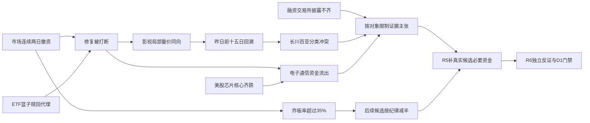

# 2026年11月16日 · 资金面

> **数据源新鲜度**: partial　|　**必要资金时效**: ok　|　**降级状态**: true　|　**置信度**: 0.2625
> 主力、游资、ETF及期货资料日为11月13日，周一正常T-1；美股核心股同为最新完成的11月13日。真实盘前取证，非冻结回放。

## 一句话结论
**观察：两日大额撤资，情绪=震荡/主跌；资金奖励影视局部合力，不支持科技链全面回流。**

## 📊 详细分析：先认市场，再认个股

| 市场维度 | 净额（亿元） | 可核含义 |
|---|---:|---|
| 昨日主力 | -600.21 | 超大单、大单同步流出 |
| 最新两日 | -1124.33 | 修复后连续撤资，不是单日小分歧 |
| 五日累计 | -624.61 | 3/5日为正，但回补不足抵撤资 |
| 十日累计 | -1017.90 | 尚未反转 |
| 二十日累计 | -3596.63 | 中期净流出延续 |

上证昨日-0.59%，深成指-2.05%；超大单-319.74亿元、大单-280.47亿元。市场没有为科技全线接力付钱，资金温度是修复被打断后的收缩，不替R1判风格。
Tushare披露封板37只、炸板21只，统一以炸板÷（封板+炸板）计算为`36.21%`。**情绪=震荡/主跌**，后续R2/R5研究候选按纪律减半。本阶段候选基数0→0，不把固定十票统计样本删半来伪装纪律，也不因候选未就绪停止研究。
XTick为封板38、炸板21，按同一公式重算`35.59%`，亦超过35%；直接zbl字段10.81语义未核，与统一公式不同，不用它冲淡真实风险。两源家数口径差一只，保留原始返回。
市场奖励的局部形态：影视院线资金与价格同向、华胜天成等首板资金集中；银行和消费有承接。半导体设备虽净买但价格下跌，不能把“净流入”自动解释成盈利效应。今日做的是观察与证据交接，不进execution；R2尚未认定主线与唯一主模板，R7不先给龙头或开仓资格。

## 💰 板块时序：与个股证据分列

| 流入标签 | 昨日净额（亿） | 五日净额（亿） | 昨日涨幅% | 五日正流入天数 |
|---|---:|---:|---:|---:|
| 影视院线 | 13.87 | 9.64 | 4.39 | 2/5 |
| 银行 | 12.26 | 25.04 | 1.43 | 3/5 |
| 银行Ⅱ | 12.26 | 25.04 | 1.43 | 3/5 |
| 半导体设备 | 10.40 | 44.79 | -3.11 | 5/5 |
| IT服务Ⅲ | 9.81 | -8.77 | -1.04 | 2/5 |
| IT服务Ⅱ | 9.81 | -8.77 | -1.04 | 2/5 |
| 白酒Ⅲ | 8.74 | -7.11 | 0.88 | 1/5 |
| 白酒Ⅱ | 8.74 | -7.11 | 0.88 | 1/5 |
| 院线 | 7.69 | 7.37 | 12.50 | 3/5 |
| 白色家电 | 7.49 | 12.95 | 0.03 | 5/5 |

| 流出标签 | 昨日净额（亿） | 五日净额（亿） | 昨日涨幅% |
|---|---:|---:|---:|
| 电子 | -235.07 | 48.70 | -3.52 |
| 元件 | -104.24 | -6.66 | -6.31 |
| 通信设备 | -100.04 | 36.72 | -3.25 |
| 通信 | -95.55 | 29.33 | -2.44 |
| 印制电路板 | -90.46 | 3.54 | -6.83 |
| 通信网络设备及器件 | -82.98 | 35.92 | -4.15 |
| 半导体 | -75.28 | 88.74 | -3.33 |
| 机械设备 | -59.50 | -25.73 | -2.56 |
| 数字芯片设计 | -52.53 | 20.08 | -2.77 |
| 电力设备 | -48.41 | -182.16 | -2.74 |

🟡 范围为10月19日至11月13日20个交易日、496个provider行业标签。银行/银行Ⅱ、白酒Ⅱ/Ⅲ重复，电子/半导体/设备父子嵌套，不能相加；净额表仅为资金事实，不是R2主线优先级。院线标签涨12.50%来自供应商原值，未独立核指数权重、成分及计算规则，不拿它替代个股涨幅或认定整个板块普遍涨停。
主线=未知（待R2）；持续性=未知（不强填1/3/5日）；行业封板率=未知；明日预期=未知（不先判加速/分歧/退潮）。资金事实已列，不以缺主线授权为由停止研究，也不越权补写主线结论。

### 影视院线：观察
资金事实：当日`13.87`亿，五日`9.64`亿。
- **大资金意图**: 当日净额与价格同向、五日累计转正，支持资金集中到影视主题的假设；不是已证明的机构配置动机。
- **为什么走强**: 板块涨4.39%，儒意电影、中国电影均首板且两分类资金同向，广泛市场下跌中体现局部联动；R7未核影片排片、票房或政策催化。
- **逻辑够不够硬**: 有板块量价与两只实查个股锚，但无硬催化、成分覆盖及封板率；慈文传媒下跌且榜内净卖是内部反证，不能泛化传媒全行业。

### 银行：观察
资金事实：当日`12.26`亿，五日`25.04`亿。
- **大资金意图**: 五日净流入25.04亿、昨日涨1.43%，支持市场收缩时资金承接假设；不按静态“老登股”标签否认真实流入。
- **为什么走强**: 资金与板块价格同向，但本轮未逐票核银行个股、涨停基因或新催化，不把板块事实转银行票开仓资格。
- **逻辑够不够硬**: 银行与银行Ⅱ完全重复，不是双源；缺银行逐票必要证据，不能把防御承接直接定义为进攻主线。

### 半导体设备：观察
资金事实：当日`10.40`亿，五日`44.79`亿。
- **大资金意图**: 五日44.79亿与当日10.40亿净买并存，但对手盘及账户动机未知；资金分类可为跌中换手承接。
- **为什么走强**: 本项并未价格走强：板块跌3.11%，长川科技跌3.01%，东财+4.82亿但XTick-1.57亿；北方华创正流入不能代表设备全部一致。
- **逻辑够不够硬**: 海外MU/NVDA/AVGO/AMD/TSM齐跌，国内电子大类大额撤出；分类冲突与价格下跌均是真实反证，设备局部净买不足以确认主升。

### IT服务Ⅱ：观察
资金事实：当日`9.81`亿，五日`-8.77`亿。
- **大资金意图**: 华胜天成当日10.78亿超过IT服务Ⅱ标签9.81亿，显示个股集中与其他成分卖出可能同时发生；尚未核成分归属不能精确拆分占比。
- **为什么走强**: 华胜天成首板、两分类同向，但IT服务Ⅱ板块跌1.04%，五日累计仍-8.77亿，不能以单票涨停替板块扩散。
- **逻辑够不够硬**: 缺硬订单与产业催化，IT服务Ⅱ和Ⅲ重复非独立证据；集中首板是研究假设而不是主线确认。

## 🔎 昨日前十5日追踪：事后统计，不冒充候选
锚定11月13日主力净流入前十，回溯11月9日至13日。东财资金+价格`50/50`股票日有效；XTick逐日真实日期对齐`50/50`；资金方向同号`37/50`，冲突不删除。不是未来五日持有收益，也不声称事前选中。
本轮实时全市场资金截面6033条、前日6032条，只用于筛选；两日前十并集20只详细实查。未使用旧R5_candidate_pool，不称本轮R2候选。五日价格为首日昨收到末日收盘、未复权且未核公司行为，不冒充策略绩效。

| 昨日前十 | 昨日东财（亿） | 五日东财（亿） | 五日价格变动% | 昨日XTick（亿） | 五日同号 |
|---|---:|---:|---:|---:|---:|
| 华胜天成 600410.SH | 10.78 | 10.02 | 12.78 | 15.52 | 4/5 |
| 文投控股 600715.SH | 5.39 | 5.90 | 44.68 | 7.99 | 4/5 |
| 长川科技 300604.SZ | 4.82 | 9.52 | 4.73 | -1.57 | 3/5 |
| 百亚股份 003006.SZ | 4.69 | 18.93 | -4.94 | -0.81 | 4/5 |
| 儒意电影 002739.SZ | 4.52 | 3.26 | 8.77 | 4.82 | 2/5 |
| 旋极信息 300324.SZ | 4.10 | 4.03 | 20.50 | 5.68 | 3/5 |
| 伊利股份 600887.SH | 3.51 | 4.77 | 0.92 | 1.79 | 3/5 |
| 中国电影 600977.SH | 3.49 | 1.10 | 6.50 | 7.03 | 5/5 |
| 长江电力 600900.SH | 3.41 | 5.74 | 0.00 | 5.12 | 5/5 |
| 格力电器 000651.SZ | 3.20 | 2.16 | 2.41 | 6.68 | 4/5 |

最新8/10只两分类同向；长川科技、百亚股份东财净流入但XTick净流出且价格下跌，不能写一致吸筹。中国电影、长江电力五日分类同号5/5也不等于符合进攻开仓条件：前者须主线地位与RR，后者五日价格不涨，保留统计事实但不推死水高股息。

### 前一日前十迁移：昨日地位不能自动继承

| 11月12日前十 | 11月13日净额（亿） | 最新五日净额（亿） |
|---|---:|---:|
| 蓝色光标 300058.SZ | -19.15 | 2.76 |
| 寒武纪 688256.SH | -3.40 | 27.93 |
| 源杰科技 688498.SH | -3.74 | 23.99 |
| 通富微电 002156.SZ | -4.27 | 4.94 |
| 吉视传媒 601929.SH | -4.76 | 1.70 |
| 北方华创 002371.SZ | 3.12 | 8.79 |
| 星网锐捷 002396.SZ | 0.02 | 5.20 |
| 百洋股份 002696.SZ | -1.37 | 2.67 |
| 澳洋健康 002172.SZ | -4.23 | 2.74 |
| 摩尔线程-U 688795.SH | -0.44 | 6.23 |

前日前十中8只昨日转净流出；蓝色光标由+23.47亿转-19.15亿，澳洋健康从首板转跌停且榜内净卖2.26亿。前日的资金/席位正向不能覆盖次日真实风险。北方华创、星网锐捷仍正但强弱不同，不能把科技全链条一刀切。20只实查对象上市日均核，未发现查询窗口早于上市日；未核的全市场对象不作洁净声明。

### 十票观察链条：不是首推或执行池

#### 华胜天成 600410.SH：观察，不进execution
板型：1板。龙头认定：R2未就绪，纪律通过条数未知。盈亏比RR/止损距：未知，不具开仓资格。禁止清单：无已确认命中，全量门禁未知。in_today_plan未知，今日核心/主线补涨/计划内试错尚未分类，不以false或plan_outside_scan预先剔除。
- **大资金意图**: 当日东财10.78亿、五日10.02亿，只支持分类净买事实，不读心认定机构动机。
- **为什么走强**: 昨日10.00%，五日价格12.78%；当日价格与东财同向。IT服务/云计算是业务映射，硬催化未取证。
- **逻辑够不够硬**: XTick当日15.52亿，最新同向但五日仅4/5同号；不能由榜单授予核心地位。
- **买入理由**: 不进。①产业映射待R5核订单/业绩，不是已确认产业买点；②当日及五日资金价格锚只使其成为研究样本，主线、地位和RR不足。
- **风险点**: ①市场连续撤资与高炸板率、个股资金分类差异；②估值、产业兑现与完整公告风险未核，事后榜单有选择偏差。
- **止损条件**: R7未建仓，不生成执行止损、不改既有持仓保护；资金假设撤销条件为下一完整交易日东财净额≤0且收盘低于本次14.30元观察锚。
- **可验证假设**: 后续1—3个交易日，至少2日东财净额>0且XTick同号、末日收盘不低于观察锚，才提高持续性判断；不满足则降级资金假设，仍不绕过主线、RR和逐票门禁。

#### 文投控股 600715.SH：观察，不进execution
板型：1板。龙头认定：R2未就绪，纪律通过条数未知。盈亏比RR/止损距：未知，不具开仓资格。禁止清单：无已确认命中，全量门禁未知。in_today_plan未知，今日核心/主线补涨/计划内试错尚未分类，不以false或plan_outside_scan预先剔除。
- **大资金意图**: 当日东财5.39亿、五日5.90亿，只支持分类净买事实，不读心认定机构动机。
- **为什么走强**: 昨日10.03%，五日价格44.68%；当日价格与东财同向。影视文化是业务映射，硬催化未取证。
- **逻辑够不够硬**: XTick当日7.99亿，最新同向但五日仅4/5同号；不能由榜单授予核心地位。文投单日榜净买4.68亿而连续三日榜净卖0.48亿，两窗口不能混算。
- **买入理由**: 不进。①产业映射待R5核订单/业绩，不是已确认产业买点；②当日及五日资金价格锚只使其成为研究样本，主线、地位和RR不足。
- **风险点**: ①市场连续撤资与高炸板率、个股资金分类差异；②估值、产业兑现与完整公告风险未核，事后榜单有选择偏差。
- **止损条件**: R7未建仓，不生成执行止损、不改既有持仓保护；资金假设撤销条件为下一完整交易日东财净额≤0且收盘低于本次3.40元观察锚。
- **可验证假设**: 后续1—3个交易日，至少2日东财净额>0且XTick同号、末日收盘不低于观察锚，才提高持续性判断；不满足则降级资金假设，仍不绕过主线、RR和逐票门禁。

#### 长川科技 300604.SZ：观察，不进execution
板型：非涨停资金榜对象，接力板型未确认。龙头认定：R2未就绪，纪律通过条数未知。盈亏比RR/止损距：未知，不具开仓资格。禁止清单：无已确认命中，全量门禁未知。in_today_plan未知，今日核心/主线补涨/计划内试错尚未分类，不以false或plan_outside_scan预先剔除。
- **大资金意图**: 当日东财4.82亿、五日9.52亿，只支持分类净买事实，不读心认定机构动机。
- **为什么走强**: 昨日-3.01%，五日价格4.73%；当日价格未走强，分类资金与价格背离。半导体测试设备是业务映射，硬催化未取证。
- **逻辑够不够硬**: XTick当日-1.57亿，最新方向冲突且五日仅3/5同号；不能由榜单授予核心地位。
- **买入理由**: 不进。①产业映射待R5核订单/业绩，不是已确认产业买点；②当日及五日资金价格锚只使其成为研究样本，主线、地位和RR不足。
- **风险点**: ①市场连续撤资与高炸板率、个股资金分类差异；②估值、产业兑现与完整公告风险未核，事后榜单有选择偏差。
- **止损条件**: R7未建仓，不生成执行止损、不改既有持仓保护；资金假设撤销条件为下一完整交易日东财净额≤0且收盘低于本次189.50元观察锚。
- **可验证假设**: 后续1—3个交易日，至少2日东财净额>0且XTick同号、末日收盘不低于观察锚，才提高持续性判断；不满足则降级资金假设，仍不绕过主线、RR和逐票门禁。

#### 百亚股份 003006.SZ：观察，不进execution
板型：非涨停资金榜对象，接力板型未确认。龙头认定：R2未就绪，纪律通过条数未知。盈亏比RR/止损距：未知，不具开仓资格。禁止清单：无已确认命中，全量门禁未知。in_today_plan未知，今日核心/主线补涨/计划内试错尚未分类，不以false或plan_outside_scan预先剔除。
- **大资金意图**: 当日东财4.69亿、五日18.93亿，只支持分类净买事实，不读心认定机构动机。
- **为什么走强**: 昨日-4.52%，五日价格-4.94%；当日价格未走强，分类资金与价格背离。卫生用品消费是业务映射，硬催化未取证。
- **逻辑够不够硬**: XTick当日-0.81亿，最新方向冲突且五日仅4/5同号；不能由榜单授予核心地位。
- **买入理由**: 不进。①产业映射待R5核订单/业绩，不是已确认产业买点；②当日及五日资金价格锚只使其成为研究样本，主线、地位和RR不足。
- **风险点**: ①市场连续撤资与高炸板率、个股资金分类差异；②估值、产业兑现与完整公告风险未核，事后榜单有选择偏差。
- **止损条件**: R7未建仓，不生成执行止损、不改既有持仓保护；资金假设撤销条件为下一完整交易日东财净额≤0且收盘低于本次21.95元观察锚。
- **可验证假设**: 后续1—3个交易日，至少2日东财净额>0且XTick同号、末日收盘不低于观察锚，才提高持续性判断；不满足则降级资金假设，仍不绕过主线、RR和逐票门禁。

#### 儒意电影 002739.SZ：观察，不进execution
板型：1板。龙头认定：R2未就绪，纪律通过条数未知。盈亏比RR/止损距：未知，不具开仓资格。禁止清单：无已确认命中，全量门禁未知。in_today_plan未知，今日核心/主线补涨/计划内试错尚未分类，不以false或plan_outside_scan预先剔除。
- **大资金意图**: 当日东财4.52亿、五日3.26亿，只支持分类净买事实，不读心认定机构动机。
- **为什么走强**: 昨日9.96%，五日价格8.77%；当日价格与东财同向。影视院线是业务映射，硬催化未取证。
- **逻辑够不够硬**: XTick当日4.82亿，最新同向但五日仅2/5同号；不能由榜单授予核心地位。
- **买入理由**: 不进。①产业映射待R5核订单/业绩，不是已确认产业买点；②当日及五日资金价格锚只使其成为研究样本，主线、地位和RR不足。
- **风险点**: ①市场连续撤资与高炸板率、个股资金分类差异；②估值、产业兑现与完整公告风险未核，事后榜单有选择偏差。
- **止损条件**: R7未建仓，不生成执行止损、不改既有持仓保护；资金假设撤销条件为下一完整交易日东财净额≤0且收盘低于本次10.05元观察锚。
- **可验证假设**: 后续1—3个交易日，至少2日东财净额>0且XTick同号、末日收盘不低于观察锚，才提高持续性判断；不满足则降级资金假设，仍不绕过主线、RR和逐票门禁。

#### 旋极信息 300324.SZ：观察，不进execution
板型：非涨停资金榜对象，接力板型未确认。龙头认定：R2未就绪，纪律通过条数未知。盈亏比RR/止损距：未知，不具开仓资格。禁止清单：无已确认命中，全量门禁未知。in_today_plan未知，今日核心/主线补涨/计划内试错尚未分类，不以false或plan_outside_scan预先剔除。
- **大资金意图**: 当日东财4.10亿、五日4.03亿，只支持分类净买事实，不读心认定机构动机。
- **为什么走强**: 昨日17.58%，五日价格20.50%；当日价格与东财同向。信息技术是业务映射，硬催化未取证。
- **逻辑够不够硬**: XTick当日5.68亿，最新同向但五日仅3/5同号；不能由榜单授予核心地位。
- **买入理由**: 不进。①产业映射待R5核订单/业绩，不是已确认产业买点；②当日及五日资金价格锚只使其成为研究样本，主线、地位和RR不足。
- **风险点**: ①市场连续撤资与高炸板率、个股资金分类差异；②估值、产业兑现与完整公告风险未核，事后榜单有选择偏差。
- **止损条件**: R7未建仓，不生成执行止损、不改既有持仓保护；资金假设撤销条件为下一完整交易日东财净额≤0且收盘低于本次3.88元观察锚。
- **可验证假设**: 后续1—3个交易日，至少2日东财净额>0且XTick同号、末日收盘不低于观察锚，才提高持续性判断；不满足则降级资金假设，仍不绕过主线、RR和逐票门禁。

#### 伊利股份 600887.SH：观察，不进execution
板型：非涨停资金榜对象，接力板型未确认。龙头认定：R2未就绪，纪律通过条数未知。盈亏比RR/止损距：未知，不具开仓资格。禁止清单：无已确认命中，全量门禁未知。in_today_plan未知，今日核心/主线补涨/计划内试错尚未分类，不以false或plan_outside_scan预先剔除。
- **大资金意图**: 当日东财3.51亿、五日4.77亿，只支持分类净买事实，不读心认定机构动机。
- **为什么走强**: 昨日2.39%，五日价格0.92%；当日价格与东财同向。乳品消费是业务映射，硬催化未取证。
- **逻辑够不够硬**: XTick当日1.79亿，最新同向但五日仅3/5同号；不能由榜单授予核心地位。
- **买入理由**: 不进。①产业映射待R5核订单/业绩，不是已确认产业买点；②当日及五日资金价格锚只使其成为研究样本，主线、地位和RR不足。
- **风险点**: ①市场连续撤资与高炸板率、个股资金分类差异；②估值、产业兑现与完整公告风险未核，事后榜单有选择偏差。
- **止损条件**: R7未建仓，不生成执行止损、不改既有持仓保护；资金假设撤销条件为下一完整交易日东财净额≤0且收盘低于本次31.74元观察锚。
- **可验证假设**: 后续1—3个交易日，至少2日东财净额>0且XTick同号、末日收盘不低于观察锚，才提高持续性判断；不满足则降级资金假设，仍不绕过主线、RR和逐票门禁。

#### 中国电影 600977.SH：观察，不进execution
板型：1板。龙头认定：R2未就绪，纪律通过条数未知。盈亏比RR/止损距：未知，不具开仓资格。禁止清单：无已确认命中，全量门禁未知。in_today_plan未知，今日核心/主线补涨/计划内试错尚未分类，不以false或plan_outside_scan预先剔除。
- **大资金意图**: 当日东财3.49亿、五日1.10亿，只支持分类净买事实，不读心认定机构动机。
- **为什么走强**: 昨日10.00%，五日价格6.50%；当日价格与东财同向。电影产业是业务映射，硬催化未取证。
- **逻辑够不够硬**: XTick当日7.03亿，最新同向但五日仅5/5同号；不能由榜单授予核心地位。
- **买入理由**: 不进。①产业映射待R5核订单/业绩，不是已确认产业买点；②当日及五日资金价格锚只使其成为研究样本，主线、地位和RR不足。
- **风险点**: ①市场连续撤资与高炸板率、个股资金分类差异；②估值、产业兑现与完整公告风险未核，事后榜单有选择偏差。
- **止损条件**: R7未建仓，不生成执行止损、不改既有持仓保护；资金假设撤销条件为下一完整交易日东财净额≤0且收盘低于本次17.05元观察锚。
- **可验证假设**: 后续1—3个交易日，至少2日东财净额>0且XTick同号、末日收盘不低于观察锚，才提高持续性判断；不满足则降级资金假设，仍不绕过主线、RR和逐票门禁。

#### 长江电力 600900.SH：观察，不进execution
板型：非涨停资金榜对象，接力板型未确认。龙头认定：R2未就绪，纪律通过条数未知。盈亏比RR/止损距：未知，不具开仓资格。禁止清单：无已确认命中，全量门禁未知。in_today_plan未知，今日核心/主线补涨/计划内试错尚未分类，不以false或plan_outside_scan预先剔除。
- **大资金意图**: 当日东财3.41亿、五日5.74亿，只支持分类净买事实，不读心认定机构动机。
- **为什么走强**: 昨日1.01%，五日价格0.00%；当日价格与东财同向。水电是业务映射，硬催化未取证。
- **逻辑够不够硬**: XTick当日5.12亿，最新同向但五日仅5/5同号；不能由榜单授予核心地位。资金榜对象不等于进攻候选，不因传统标签删掉真实承接事实。
- **买入理由**: 不进。①产业映射待R5核订单/业绩，不是已确认产业买点；②当日及五日资金价格锚只使其成为研究样本，主线、地位和RR不足。
- **风险点**: ①市场连续撤资与高炸板率、个股资金分类差异；②估值、产业兑现与完整公告风险未核，事后榜单有选择偏差。
- **止损条件**: R7未建仓，不生成执行止损、不改既有持仓保护；资金假设撤销条件为下一完整交易日东财净额≤0且收盘低于本次29.91元观察锚。
- **可验证假设**: 后续1—3个交易日，至少2日东财净额>0且XTick同号、末日收盘不低于观察锚，才提高持续性判断；不满足则降级资金假设，仍不绕过主线、RR和逐票门禁。

#### 格力电器 000651.SZ：观察，不进execution
板型：非涨停资金榜对象，接力板型未确认。龙头认定：R2未就绪，纪律通过条数未知。盈亏比RR/止损距：未知，不具开仓资格。禁止清单：无已确认命中，全量门禁未知。in_today_plan未知，今日核心/主线补涨/计划内试错尚未分类，不以false或plan_outside_scan预先剔除。
- **大资金意图**: 当日东财3.20亿、五日2.16亿，只支持分类净买事实，不读心认定机构动机。
- **为什么走强**: 昨日2.75%，五日价格2.41%；当日价格与东财同向。白色家电是业务映射，硬催化未取证。
- **逻辑够不够硬**: XTick当日6.68亿，最新同向但五日仅4/5同号；不能由榜单授予核心地位。
- **买入理由**: 不进。①产业映射待R5核订单/业绩，不是已确认产业买点；②当日及五日资金价格锚只使其成为研究样本，主线、地位和RR不足。
- **风险点**: ①市场连续撤资与高炸板率、个股资金分类差异；②估值、产业兑现与完整公告风险未核，事后榜单有选择偏差。
- **止损条件**: R7未建仓，不生成执行止损、不改既有持仓保护；资金假设撤销条件为下一完整交易日东财净额≤0且收盘低于本次39.96元观察锚。
- **可验证假设**: 后续1—3个交易日，至少2日东财净额>0且XTick同号、末日收盘不低于观察锚，才提高持续性判断；不满足则降级资金假设，仍不绕过主线、RR和逐票门禁。

## ⚠️ 龙虎榜诱多识别：线索不等于操纵动机
最新披露69条，单日事件58、多日事件11。上涨净卖筛查合计12只股票，其中同窗单日背离8只，多日仅筛查5只，含同票跨窗重叠，不能相加当总数。下跌且换手≥20%并净卖11只；转债上涨净卖0只。
日榜与连续榜不累计；连续净额与当日涨幅不同窗，不作强背离。机构记录仅匹配相同理由、去同金额重复的可辨子集；匿名同名席位可能不同主体，不冒充全部机构净额或机构家数。未披露或未匹配机构为未知，不是无机构交易。

| 上涨净卖对象 | 当日涨幅% | 换手% | 披露净额（亿） | 匹配机构子集（亿） | 窗口 |
|---|---:|---:|---:|---:|---|
| 皇台酒业 000995.SZ | 0.27 | 38.91 | -0.19 | -0.10 | 单日同窗 |
| 广百股份 002187.SZ | 9.94 | 16.08 | -0.28 | -0.28 | 单日同窗 |
| 蓝盾光电 300862.SZ | 3.56 | 39.56 | -0.06 | -1.09 | 单日同窗 |
| 华是科技 301218.SZ | 15.31 | 33.00 | -1.10 | -0.38 | 单日同窗 |
| 好当家 600467.SH | 10.08 | 18.69 | -0.09 | 未知 | 单日同窗 |
| 文投控股 600715.SH | 10.03 | 10.90 | -0.48 | 未知 | 连续多日，仅筛查 |
| 宁波中百 600857.SH | 8.67 | 11.65 | -0.38 | 未知 | 连续多日，仅筛查 |
| 大晟文化 600892.SH | 3.30 | 30.15 | -0.52 | 未知 | 单日同窗 |
| 沈鼓集团 601091.SH | 6.26 | 48.85 | -0.56 | 未知 | 连续多日，仅筛查 |
| 沈鼓集团 601091.SH | 6.26 | 48.85 | -0.69 | 未知 | 单日同窗 |
| 洪通燃气 605169.SH | 5.68 | 10.47 | -0.29 | -0.14 | 连续多日，仅筛查 |
| 森峰激光 920085.BJ | 1.32 | 28.19 | -0.05 | 0.05 | 单日同窗 |
| 宇特光电 920157.BJ | 3.08 | 44.42 | -0.14 | 0.13 | 连续多日，仅筛查 |

| 下跌高换手净卖对象 | 当日涨幅% | 换手% | 榜内净额（亿） | 机构可辨子集（亿） |
|---|---:|---:|---:|---:|
| 襄阳轴承 000678.SZ | -9.98 | 28.61 | -2.22 | -0.26 |
| 皇冠新材 001381.SZ | -8.19 | 32.10 | -0.15 | 未知 |
| 东方海洋 002086.SZ | -6.59 | 38.74 | -1.45 | -0.59 |
| 澳洋健康 002172.SZ | -10.06 | 29.96 | -2.26 | -0.39 |
| 慈文传媒 002343.SZ | -4.38 | 29.99 | -0.48 | -0.64 |
| 日上集团 002593.SZ | -9.18 | 28.73 | -0.58 | 未知 |
| 万邦医药 301520.SZ | -11.40 | 32.21 | -0.12 | -0.14 |
| 大东方 600327.SH | -10.03 | 29.64 | -0.13 | 未知 |
| 百花医药 600721.SH | -10.03 | 24.87 | -0.63 | 未知 |
| 福建水泥 600802.SH | -10.01 | 30.58 | -1.69 | 未知 |
| 南方乳业 920196.BJ | -4.62 | 23.03 | -0.05 | 未知 |

### 好当家、文投控股与澳洋健康：正反证必须同时在场
- **大资金意图**: 好当家涨停但日榜净卖0.09亿，不能读心认定操纵；同一具名席位滚动三日内两日正净买，说明局部买方与榜内总体卖方可并存。
- **为什么走强**: 文投涨停、两类全天资金为正，单日榜净买4.68亿；连续三日榜净卖0.48亿只是另一个窗口，不能抹掉单日净买、也不能删除连续兑现线索。
- **逻辑够不够硬**: 澳洋健康前日首板，昨日跌10.06%、换手29.96%、榜内净卖2.26亿，是真实的不达预期风险；前日资金正向失效，不因五日累计仍正就包装为低吸买点。
华是科技涨15.31%却日榜净卖1.10亿、机构可辨子集净卖0.38亿，是上涨资金背离；襄阳轴承跌9.98%却高换手28.61%、净卖2.22亿是下跌派发风险线索。两类分列，不将跌停派发统称上涨诱多。森峰激光、宇特光电匹配机构子集为正而榜总额为负，不能写“机构出货”。R7无hard_reject权。

### 游资三日协同：只作为正向辅助

| 对象 | 同席位 | 正净买日数 | 正净买合计（万元） |
|---|---|---:|---:|
| 好当家 600467.SH | 国泰海通证券总部 | 2 | 920.33 |

窗口11月11日至13日，实查hm_detail具名席位，封板/名称过滤后1条。好当家国泰海通证券总部净买发生在12日及13日，量化标签不等于某个自然人账户；与最新榜净卖反证并列。当日抓取公告窗口未匹配600467，不代表完整三日无减持/风险，风险调整未完成，不单独授予资格。

## 🔄 ETF、两融、期货与跷跷板

| ETF | 最新份额日 | 净申赎金额代理（亿） | 方法 |
|---|---|---:|---|
| 510300.SH | 2026-11-13 | -7.94 | 份额变化×同日价 |
| 510500.SH | 2026-11-13 | -20.42 | 份额变化×同日价 |
| 159915.SZ | 2026-11-13 | 10.18 | 份额变化×同日价 |
| 588000.SH | 2026-11-13 | -12.27 | 份额变化×同日价 |

四只宽基11月13日合计代理`-30.44`亿元，300/500/科创篮子为赎回代理、创业板为申购代理，不能写科技ETF全线回流。与同日主力撤资方向总体一致，但样本仅四只，不是全市场净申赎现金；份额拆并、收盘价与NAV差异未消除。
完整沪深北融资余额最新11月12日`22738.31`亿元；11月13日仅SSE披露`11692.64`亿元，SZSE/BSE缺席，整体余额保持null，不能把披露子集合计骤降认定去杠杆。沪市可比融资余额由11779.36亿降至11692.64亿；不外推缺失交易所。
逐票请求15个交易日，沪股部分15日、深股部分14日；澳洋健康、百洋股份、百亚股份、文投控股空返回保持未知，未核名单不写非两融。大宗请求10月14日至11月13日，原始成交保留；仅同日期未复权收盘可比时计算折溢价代理，缺比较价不臆算出货。
IF2611昨日同日基差`-28.2897`点，较前日-13.1254点折价扩大；持仓减少336手，不等于净空流入。临近交割换月、分红资金成本和收盘差未调整，不作精确套利。
跷跷板对最新绝对资金前20标签检验190对，20日真实时序不填充。相关<-0.6且各自五日净额相对前五日翻转、两者保持相反方向的合格对0。只表示所检范围无命中，不是全市场不存在互斥。

## 🌎 外部传导：最新核心股已核，不沿用旧日涨幅
消费当日overseas_snapshot，快照12只核心股均为最新完成美股11月13日；实时us_daily补查14只，补齐INTC/MRVL且同日。SPX跌0.4047%、IXIC跌0.906%；SOX缺失，核心股均值代理不是半导体指数。

| 核心股 | 实际行情日 | 当日涨跌% | A股传导假设 |
|---|---|---:|---|
| MU | 2026-11-13 | -2.52 | 存储；仅情绪映射 |
| NVDA | 2026-11-13 | -2.01 | GPU算力；仅情绪映射 |
| AVGO | 2026-11-13 | -4.76 | ASIC/CPO；仅情绪映射 |
| AMD | 2026-11-13 | -8.75 | 服务器芯片；仅情绪映射 |
| TSM | 2026-11-13 | -1.67 | 晶圆半导体；仅情绪映射 |
| AAPL | 2026-11-13 | 0.39 | 消费电子；仅情绪映射 |
| MSFT | 2026-11-13 | 0.17 | 云计算；仅情绪映射 |
| GOOGL | 2026-11-13 | -0.98 | AI云；仅情绪映射 |
| AMZN | 2026-11-13 | -0.29 | 云计算；仅情绪映射 |
| META | 2026-11-13 | 2.90 | AI应用；仅情绪映射 |
| TSLA | 2026-11-13 | -1.82 | 汽车机器人；仅情绪映射 |
| INTC | 2026-11-13 | -2.52 | 半导体；仅情绪映射 |
| GLW | 2026-11-13 | -4.30 | 光纤材料；仅情绪映射 |
| MRVL | 2026-11-13 | -4.68 | 光互联芯片；仅情绪映射 |

MU -2.52%、NVDA -2.01%、AVGO -4.76%、AMD -8.75%、TSM -1.67%齐跌，压制A股存储、CPO、半导体链风险偏好；与A股电子/通信当日撤资同向。AAPL +0.39%、MSFT +0.17%、META +2.90%说明非所有科技股同步弱，不能据芯片下跌硬否决AI应用。该映射不是隔夜因果证明，更不是对今日A股幅度预测，开盘真实资金可以证伪。

## 🧭 证据传导图

## 📌 关键证据
- 市场及板块：20日实时Tushare SDK资金，东财原始元除1亿；当日MCP与SDK一致只是同底层通道核对，不计独立源。
- 个股：20个资金榜并集详细对象；个股东财原单位万元除1万、XTick原元除1亿；50股票日含13个方向差异，全保留。
- 龙虎榜：五日top_list/top_inst/hm_detail原始返回，理由/窗口匹配，股票和转债隔离，不跨窗累计。
- 外部：当日快照逐项真实日与实时us_daily复查，最新14股齐11月13日，不把生成日等同事实日。

## 数据源审计
| 源 | 日期 | 状态 | 范围与备注 |
|---|---|:--:|---|
| Eastmoney via Tushare live SDK | 2026-11-13 | 🟢 | 市场20日、板块496标签各20日；MCP同底层不计独立交叉 |
| Tushare LHB live SDK | 2026-11-13 | 🟢 | 五日披露，单日/多日理由不累计 |
| ETF share proxy live SDK | 2026-11-13 | 🟢 | 份额变化乘同日价为代理，不是全市场ETF申赎现金 |
| IF2611 live SDK | 2026-11-13 | 🟢 | 同日沪深300收盘差，非精确套利基差 |
| Tushare margin live SDK | 2026-11-13 | 🟡 | 最新仅SSE披露；全市场可比口径须沪深北齐全，不把交易所缺席当余额归零 |
| Tushare us_daily live recheck | 2026-11-13 | 🟢 | 14只核心股实时复核，逐项真实日期 |
| stock_basic live listing check | 2026-11-16 | 🟢 | 仅详细实查对象上市日核验 |
| XTick live MCP | 2026-11-13 | 🟢 | 昨日前十五日逐日对齐，全部冲突保留 |
| DataPro MCP | 2026-11-16 | 🔴 | 本轮业务失败非握手失败 |
| overseas_snapshot | 2026-11-16 | 🟢 | 最新美股完成交易日11月13日；SOX缺失 |
| manifest and mcp_health | 2026-11-16 | 🟢 | global_severity=2，不把退场/非资金源故障转全局禁买 |
| 北向 | 2026-11-16 | 🟡 | not_required，仅复盘参考，未知null，不补抓不入评分/时效/门禁 |

## 🧩 不确定性 / 反证
置信度`0.75×0.7×0.5=0.2625`。市场板块为东财单底层，XTick逐票分类有冲突，故不伪装两源一致；partial是资料质量和辅助披露不齐，不是必要资金过期。global_severity=2遵守0.5上限，北向不计分子分母，不因排除它恢复旧正分。
市场风险真实：连续撤资、科技兑现、炸板率超35%。这不是账户硬停买来源；研究意见窗口限于本次盘前，开盘若市场净流入修复、封板承接改善且候选必要证据成立，由R1/R2/D1按新证据重评，不无限继承旧市场零仓建议。本轮不发全局no_trade、不定零仓或正预算。
DataPro业务4013、融资最新披露不齐、SOX和完整三日协同公告缺失，分别限制相关主张。必要缺证只限制相关对象，辅助缺失不归零其他已核证据。真实账户预算未提供保持未知；有效零预算/停买/仓位硬上限/T+1/人工确认/逐票hard_reject及既有执行保护不变，无下单无调仓。

## 🤝 与其他 R/D/E 的关系
- 依赖：当日manifest、mcp_health、overseas_snapshot及本轮实时Tushare SDK、MCP/XTick/DataPro返回。
- R2：据资金事实独立确认主线、龙头及唯一主模板，R7不替排序、不读同日旧R2当本轮。
- R5：形成真实候选后补必要资金、价格、产业和RR，不要求再开R7或特定provider。
- R6：只交真实反证与覆盖，唯一hard_reject权不变，R7不替其判断通过。
- D1/E1：研究不是开仓权限；首次计划之前in_today_plan未知，既有授权保护全部保留。

## Sub-Agent 元数据
- skill: analyze_capital_flow_v1
- artifact: data/research/20261116/R7_capital_flow.json
- 生成耗时：485.4秒。
- model: gpt-6.1-sol
- usage_unknown，未计量不当0；5000万token为连续任务observe_only努力目标，非硬限/新额度；08:30仅交付目标，不变更交易权限。
