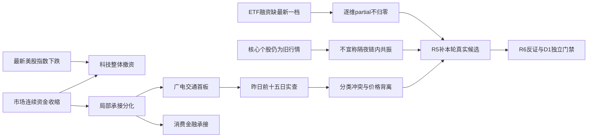

# 2026年11月17日 · 资金面

> **数据源新鲜度**: partial　|　**降级状态**: true　|　**置信度**: 0.1925
> A股主力/游资/期货事实日11月16日；ETF份额、两融及美股个股止于11月13日。真实盘前取证，非冻结回放。

## 一句话结论
**观察：资金连续收缩，局部奖励广电、交通与防守承接；科技撤资未止，隔夜个股共振未核。**

## 📊 详细分析：先认市场

| 时序 | 主力净额（亿元） | 可核含义 |
|---|---:|---|
| 昨日 | -643.79 | 超大单与大单均撤资 |
| 最新三日 | -1768.12 | 连续收缩，非单日偶发 |
| 五日 | -1396.97 | 正流入2/5日，不能称主升确认 |
| 十日 | -1779.13 | 修复尚不足扭转累计负额 |
| 二十日 | -4124.21 | 中期资金仍净流出 |

上证昨日-0.87%、深成指-2.53%；超大单-365.83亿元、大单-277.96亿元。资金侧是连续收缩，不将低位反弹等同主升，也不替R1判风格。电视广播、铁路公路量价同向，银行白酒承接真实，但核心地位、催化与接力广度尚未由R2确认。
Tushare封板32只、炸板16只、跌停60只，炸板÷（封板+炸板）=`33.33%`；XTick封板33、炸板16，同式重算`32.65%`，两源均未达到35%机械减半阈值。XTick直接zbl字段语义未核，不与重算率混用。未触发减半不代表赚钱效应恢复，跌停数量和连续撤资仍是真实反证。
今日做：观察资金事实、逐票记录分类冲突、交接R2/R5；不做：不将资金排名变成龙头排名，不定全局零仓/停买，不授予买入权限。主线=未知；持续性=未知；行业封板率=未知；明日预期=未知，均待R2依据完整证据判断。R2未选唯一主模板，R7不把五套打法拼接。

## 💰 板块资金时序：与个股分列

| 流入标签 | 昨日净额（亿） | 五日净额（亿） | 昨日涨幅% | 五日正流入天数 |
|---|---:|---:|---:|---:|
| 电视广播Ⅲ | 6.79 | 9.87 | 2.19 | 3/5 |
| 电视广播Ⅱ | 6.79 | 9.87 | 2.19 | 3/5 |
| 铁路公路 | 6.06 | 5.12 | 0.93 | 2/5 |
| 交通运输 | 5.89 | -5.44 | 0.34 | 2/5 |
| 白酒Ⅲ | 5.69 | 0.68 | 0.87 | 2/5 |
| 白酒Ⅱ | 5.69 | 0.68 | 0.87 | 2/5 |
| 食品饮料 | 5.65 | -6.80 | 0.18 | 2/5 |
| 股份制银行Ⅲ | 4.60 | 10.37 | 1.86 | 4/5 |
| 高速公路 | 4.42 | 2.27 | 1.72 | 2/5 |
| 国有大型银行Ⅲ | 4.42 | 11.81 | 2.00 | 3/5 |

| 流出标签 | 昨日净额（亿） | 五日净额（亿） | 昨日涨幅% |
|---|---:|---:|---:|
| 电子 | -250.16 | -294.85 | -5.16 |
| 半导体 | -126.67 | -61.05 | -5.99 |
| 数字芯片设计 | -76.34 | -68.43 | -6.12 |
| 通信 | -75.63 | -78.77 | -4.27 |
| 通信设备 | -71.28 | -71.90 | -4.81 |
| 元件 | -65.47 | -110.55 | -6.71 |
| 印制电路板 | -56.99 | -91.08 | -7.29 |
| 通信网络设备及器件 | -56.40 | -48.03 | -6.49 |
| 机械设备 | -55.62 | -104.72 | -3.43 |
| 有色金属 | -52.41 | -154.55 | -3.96 |

范围为2026-10-20至2026-11-16的20个交易日、496个供应商行业标签。电视广播Ⅱ/Ⅲ、白酒Ⅱ/Ⅲ重复，行业与子行业嵌套，不能相加或当成多源共振。这是净额排序事实，不是R2主线优先级。

### 电视广播Ⅲ：观察
昨日6.79亿，五日9.87亿。
- **大资金意图**: 五日累计与昨日净额均为正，支持资金局部集中到广电的假设，不证明机构动机。
- **为什么走强**: 广电标签涨2.19%，吉视传媒首板且东财、XTick最新同向，量价联动成立；同链湖北广电上涨榜内净卖，内部并不一致。
- **逻辑够不够硬**: 有板块与实查首板锚，但没有硬订单、政策或业绩催化取证，不能凭资金榜认总龙。

### 铁路公路：观察
昨日6.06亿，五日5.12亿。
- **大资金意图**: 相对普跌市场存在承接，交通子项与大类合力强度不同，不能按静态老登标签删事实。
- **为什么走强**: 铁路公路涨0.93%，龙江交通首板并有两分类同向；交通运输五日仍负，不是全行业持续进攻。
- **逻辑够不够硬**: 局部首板有资金锚，主线扩散、硬催化与核心地位未核，只保留研究假设。

### 白酒Ⅲ：观察
昨日5.69亿，五日0.68亿。
- **大资金意图**: 当日净买、五日仅微正，支持短期承接而非长期资金重新配置的确定断言。
- **为什么走强**: 贵州茅台涨1.30%、资金两分类同向，但皇台酒业上涨且榜内净卖，不能把承接与投机接力混为一谈。
- **逻辑够不够硬**: 资金与价格同向不等于有涨停基因、强催化和RR，产业需求改善本轮未证实，不授予进攻资格。

### 半导体：观察
昨日-126.67亿，五日-61.05亿。
- **大资金意图**: 昨日大额净卖且五日累计为负，是科技链整体撤资事实；不读心认定全部机构撤离。
- **为什么走强**: 本项未走强：半导体跌5.99%，设备个股北方华创东财净买、XTick净卖且价格跌，局部净买不足翻转整体风险。
- **逻辑够不够硬**: 国内量价偏弱真实；最新美股核心股未核，不能拿旧日跌幅强化为新隔夜双杀证明，海外传导只能按最新指数与未知个股分层。

## 🔎 昨日前十5日追踪：统计对象，不冒充本轮候选
以11月16日主力净流入前十作事后锚，回溯11月10日至16日。东财资金与价格有效`50/50`股票日；XTick真实日期对齐`50/50`、方向同号`38/50`。不是未来五日持有收益，不能声称事前选中。
两日资金截面分别6033/6033条用于筛选；两日前十并集18只详细实查。旧R5_candidate_pool未读取，本轮R2/R5候选覆盖为未知而非已覆盖0只。五日价格按首日昨收到末日收盘计算，未复权/公司行为未核，不是策略回测绩效。

| 昨日前十 | 昨日东财（亿） | 五日东财（亿） | 五日价格变动% | 昨日XTick（亿） | 五日同号 |
|---|---:|---:|---:|---:|---:|
| 贵州茅台 600519.SH | 5.16 | 1.78 | 0.62 | 6.69 | 4/5 |
| 北方华创 002371.SZ | 5.09 | 12.38 | 0.29 | -0.17 | 3/5 |
| 宁德时代 300750.SZ | 4.87 | -12.54 | -3.27 | 5.48 | 4/5 |
| 吉视传媒 601929.SH | 4.48 | 6.23 | 23.33 | 3.74 | 3/5 |
| 龙江交通 601188.SH | 3.96 | 1.53 | 12.89 | 6.98 | 4/5 |
| 中国平安 601318.SH | 3.78 | 0.30 | 0.09 | 4.63 | 3/5 |
| 百亚股份 003006.SZ | 3.69 | 19.41 | -5.87 | 0.04 | 4/5 |
| 共进股份 603118.SH | 3.49 | 5.42 | 19.89 | 5.61 | 4/5 |
| 工商银行 601398.SH | 2.83 | 4.59 | 5.11 | 0.53 | 4/5 |
| 长江电力 600900.SH | 2.76 | 6.71 | 2.21 | 4.79 | 5/5 |

北方华创昨日东财+5.09亿、XTick-0.17亿、价格-1.20%，属于分类冲突并伴价格弱，不能称双源吸筹。百亚股份五日净买但价格跌5.87%，净额正不等于赚钱。宁德时代昨日正流入但五日累计负，不能用一日回补覆盖历史撤资。
最新前十两分类同向9/10，只代表分类方向，不是核心地位。工商银行、贵州茅台、长江电力保留真实承接事实，但不能由榜单直接推成进攻票。

### 前一日前十迁移：旧地位不能继承

| 11月13日前十 | 11月16日净额（亿） | 最新五日净额（亿） |
|---|---:|---:|
| 华胜天成 600410.SH | -6.14 | 5.47 |
| 文投控股 600715.SH | -6.32 | -5.05 |
| 长川科技 300604.SZ | -2.86 | 6.69 |
| 百亚股份 003006.SZ | 3.69 | 19.41 |
| 儒意电影 002739.SZ | 2.26 | 5.90 |
| 旋极信息 300324.SZ | -0.82 | 3.22 |
| 伊利股份 600887.SH | 0.77 | 4.20 |
| 中国电影 600977.SH | -0.19 | 2.21 |
| 长江电力 600900.SH | 2.76 | 6.71 |
| 格力电器 000651.SZ | -0.14 | 2.03 |

前日前十中6/10昨日转净流出。华胜天成、文投控股昨日均净出超6亿元；文投虽涨停，榜内净卖亦明显，前日净买不能无限继承为当日强承接。儒意电影仍正、中国电影转负，影视内部存在分化，不能把昨日影视资金结论整体搬来。

### 十票观察链条：无首推、无执行池

#### 贵州茅台 600519.SH：观察，不进execution
板型：非涨停资金榜对象，接力板型未确认。龙头认定：R2未交付，纪律通过条数未知，不授龙头标签。盈亏比RR与止损距：未知。禁止清单：无已确认命中，全量门禁未核。in_today_plan未知；今日核心/主线补涨/计划内试错未分类，不以false预先排除。
- **大资金意图**: 昨日东财5.16亿、五日1.78亿，证明分类净额而非机构账户意图。
- **为什么走强**: 昨日1.30%，五日价格0.62%；量价当日同向。白酒消费为业务映射，硬催化未独立取证。
- **逻辑够不够硬**: XTick昨日6.69亿，当日同向、五日4/5同号。资金统计不足证实主线地位、产业兑现与RR，故仅观察。
- **买入理由**: 不进。①产业映射待R5以订单/业绩核验；②资金价格提供研究锚但主线、地位、RR未完备，不能转成买入权限。
- **风险点**: ①市场连续撤资与局部资金分类冲突，事后选样有偏差；②产业、估值及完整公告风险未核，净买不保次日接力。
- **止损条件**: R7不建仓、不改持仓止损；研究资金假设撤销条件为下一完整交易日东财净额≤0且收盘低于本次1453.90元观察锚。执行止损由D1独立门禁确定，止损距不足5%或RR不足2只能watch。
- **可验证假设**: 后续1—3个交易日至少2日东财正净额且XTick同号、末日收盘不低于观察锚，才提高资金持续性判断；不满足则降级假设，不绕过主线、RR或既有保护。

#### 北方华创 002371.SZ：观察，不进execution
板型：非涨停资金榜对象，接力板型未确认。龙头认定：R2未交付，纪律通过条数未知，不授龙头标签。盈亏比RR与止损距：未知。禁止清单：无已确认命中，全量门禁未核。in_today_plan未知；今日核心/主线补涨/计划内试错未分类，不以false预先排除。
- **大资金意图**: 昨日东财5.09亿、五日12.38亿，证明分类净额而非机构账户意图。
- **为什么走强**: 昨日-1.20%，五日价格0.29%；当日价格未强，存在净买与价格背离。半导体设备为业务映射，硬催化未独立取证。
- **逻辑够不够硬**: XTick昨日-0.17亿，方向冲突或未知、五日3/5同号。资金统计不足证实主线地位、产业兑现与RR，故仅观察。
- **买入理由**: 不进。①产业映射待R5以订单/业绩核验；②资金价格提供研究锚但主线、地位、RR未完备，不能转成买入权限。
- **风险点**: ①市场连续撤资与局部资金分类冲突，事后选样有偏差；②产业、估值及完整公告风险未核，净买不保次日接力。
- **止损条件**: R7不建仓、不改持仓止损；研究资金假设撤销条件为下一完整交易日东财净额≤0且收盘低于本次546.39元观察锚。执行止损由D1独立门禁确定，止损距不足5%或RR不足2只能watch。
- **可验证假设**: 后续1—3个交易日至少2日东财正净额且XTick同号、末日收盘不低于观察锚，才提高资金持续性判断；不满足则降级假设，不绕过主线、RR或既有保护。

#### 宁德时代 300750.SZ：观察，不进execution
板型：非涨停资金榜对象，接力板型未确认。龙头认定：R2未交付，纪律通过条数未知，不授龙头标签。盈亏比RR与止损距：未知。禁止清单：无已确认命中，全量门禁未核。in_today_plan未知；今日核心/主线补涨/计划内试错未分类，不以false预先排除。
- **大资金意图**: 昨日东财4.87亿、五日-12.54亿，证明分类净额而非机构账户意图。
- **为什么走强**: 昨日1.18%，五日价格-3.27%；量价当日同向。动力电池为业务映射，硬催化未独立取证。
- **逻辑够不够硬**: XTick昨日5.48亿，当日同向、五日4/5同号。资金统计不足证实主线地位、产业兑现与RR，故仅观察。
- **买入理由**: 不进。①产业映射待R5以订单/业绩核验；②资金价格提供研究锚但主线、地位、RR未完备，不能转成买入权限。
- **风险点**: ①市场连续撤资与局部资金分类冲突，事后选样有偏差；②产业、估值及完整公告风险未核，净买不保次日接力。
- **止损条件**: R7不建仓、不改持仓止损；研究资金假设撤销条件为下一完整交易日东财净额≤0且收盘低于本次240.50元观察锚。执行止损由D1独立门禁确定，止损距不足5%或RR不足2只能watch。
- **可验证假设**: 后续1—3个交易日至少2日东财正净额且XTick同号、末日收盘不低于观察锚，才提高资金持续性判断；不满足则降级假设，不绕过主线、RR或既有保护。

#### 吉视传媒 601929.SH：观察，不进execution
板型：1板。龙头认定：R2未交付，纪律通过条数未知，不授龙头标签。盈亏比RR与止损距：未知。禁止清单：无已确认命中，全量门禁未核。in_today_plan未知；今日核心/主线补涨/计划内试错未分类，不以false预先排除。
- **大资金意图**: 昨日东财4.48亿、五日6.23亿，证明分类净额而非机构账户意图。
- **为什么走强**: 昨日10.04%，五日价格23.33%；量价当日同向。广电网络为业务映射，硬催化未独立取证。
- **逻辑够不够硬**: XTick昨日3.74亿，当日同向、五日3/5同号。资金统计不足证实主线地位、产业兑现与RR，故仅观察。
- **买入理由**: 不进。①产业映射待R5以订单/业绩核验；②资金价格提供研究锚但主线、地位、RR未完备，不能转成买入权限。
- **风险点**: ①市场连续撤资与局部资金分类冲突，事后选样有偏差；②产业、估值及完整公告风险未核，净买不保次日接力。
- **止损条件**: R7不建仓、不改持仓止损；研究资金假设撤销条件为下一完整交易日东财净额≤0且收盘低于本次2.96元观察锚。执行止损由D1独立门禁确定，止损距不足5%或RR不足2只能watch。
- **可验证假设**: 后续1—3个交易日至少2日东财正净额且XTick同号、末日收盘不低于观察锚，才提高资金持续性判断；不满足则降级假设，不绕过主线、RR或既有保护。

#### 龙江交通 601188.SH：观察，不进execution
板型：1板。龙头认定：R2未交付，纪律通过条数未知，不授龙头标签。盈亏比RR与止损距：未知。禁止清单：无已确认命中，全量门禁未核。in_today_plan未知；今日核心/主线补涨/计划内试错未分类，不以false预先排除。
- **大资金意图**: 昨日东财3.96亿、五日1.53亿，证明分类净额而非机构账户意图。
- **为什么走强**: 昨日10.00%，五日价格12.89%；量价当日同向。公路交通为业务映射，硬催化未独立取证。
- **逻辑够不够硬**: XTick昨日6.98亿，当日同向、五日4/5同号。资金统计不足证实主线地位、产业兑现与RR，故仅观察。
- **买入理由**: 不进。①产业映射待R5以订单/业绩核验；②资金价格提供研究锚但主线、地位、RR未完备，不能转成买入权限。
- **风险点**: ①市场连续撤资与局部资金分类冲突，事后选样有偏差；②产业、估值及完整公告风险未核，净买不保次日接力。
- **止损条件**: R7不建仓、不改持仓止损；研究资金假设撤销条件为下一完整交易日东财净额≤0且收盘低于本次4.73元观察锚。执行止损由D1独立门禁确定，止损距不足5%或RR不足2只能watch。
- **可验证假设**: 后续1—3个交易日至少2日东财正净额且XTick同号、末日收盘不低于观察锚，才提高资金持续性判断；不满足则降级假设，不绕过主线、RR或既有保护。

#### 中国平安 601318.SH：观察，不进execution
板型：非涨停资金榜对象，接力板型未确认。龙头认定：R2未交付，纪律通过条数未知，不授龙头标签。盈亏比RR与止损距：未知。禁止清单：无已确认命中，全量门禁未核。in_today_plan未知；今日核心/主线补涨/计划内试错未分类，不以false预先排除。
- **大资金意图**: 昨日东财3.78亿、五日0.30亿，证明分类净额而非机构账户意图。
- **为什么走强**: 昨日1.58%，五日价格0.09%；量价当日同向。保险金融为业务映射，硬催化未独立取证。
- **逻辑够不够硬**: XTick昨日4.63亿，当日同向、五日3/5同号。资金统计不足证实主线地位、产业兑现与RR，故仅观察。
- **买入理由**: 不进。①产业映射待R5以订单/业绩核验；②资金价格提供研究锚但主线、地位、RR未完备，不能转成买入权限。
- **风险点**: ①市场连续撤资与局部资金分类冲突，事后选样有偏差；②产业、估值及完整公告风险未核，净买不保次日接力。
- **止损条件**: R7不建仓、不改持仓止损；研究资金假设撤销条件为下一完整交易日东财净额≤0且收盘低于本次54.65元观察锚。执行止损由D1独立门禁确定，止损距不足5%或RR不足2只能watch。
- **可验证假设**: 后续1—3个交易日至少2日东财正净额且XTick同号、末日收盘不低于观察锚，才提高资金持续性判断；不满足则降级假设，不绕过主线、RR或既有保护。

#### 百亚股份 003006.SZ：观察，不进execution
板型：非涨停资金榜对象，接力板型未确认。龙头认定：R2未交付，纪律通过条数未知，不授龙头标签。盈亏比RR与止损距：未知。禁止清单：无已确认命中，全量门禁未核。in_today_plan未知；今日核心/主线补涨/计划内试错未分类，不以false预先排除。
- **大资金意图**: 昨日东财3.69亿、五日19.41亿，证明分类净额而非机构账户意图。
- **为什么走强**: 昨日-0.73%，五日价格-5.87%；当日价格未强，存在净买与价格背离。卫生用品消费为业务映射，硬催化未独立取证。
- **逻辑够不够硬**: XTick昨日0.04亿，当日同向、五日4/5同号。资金统计不足证实主线地位、产业兑现与RR，故仅观察。
- **买入理由**: 不进。①产业映射待R5以订单/业绩核验；②资金价格提供研究锚但主线、地位、RR未完备，不能转成买入权限。
- **风险点**: ①市场连续撤资与局部资金分类冲突，事后选样有偏差；②产业、估值及完整公告风险未核，净买不保次日接力。
- **止损条件**: R7不建仓、不改持仓止损；研究资金假设撤销条件为下一完整交易日东财净额≤0且收盘低于本次21.79元观察锚。执行止损由D1独立门禁确定，止损距不足5%或RR不足2只能watch。
- **可验证假设**: 后续1—3个交易日至少2日东财正净额且XTick同号、末日收盘不低于观察锚，才提高资金持续性判断；不满足则降级假设，不绕过主线、RR或既有保护。

#### 共进股份 603118.SH：观察，不进execution
板型：1板。龙头认定：R2未交付，纪律通过条数未知，不授龙头标签。盈亏比RR与止损距：未知。禁止清单：无已确认命中，全量门禁未核。in_today_plan未知；今日核心/主线补涨/计划内试错未分类，不以false预先排除。
- **大资金意图**: 昨日东财3.49亿、五日5.42亿，证明分类净额而非机构账户意图。
- **为什么走强**: 昨日10.02%，五日价格19.89%；量价当日同向。通信设备为业务映射，硬催化未独立取证。
- **逻辑够不够硬**: XTick昨日5.61亿，当日同向、五日4/5同号。资金统计不足证实主线地位、产业兑现与RR，故仅观察。
- **买入理由**: 不进。①产业映射待R5以订单/业绩核验；②资金价格提供研究锚但主线、地位、RR未完备，不能转成买入权限。
- **风险点**: ①市场连续撤资与局部资金分类冲突，事后选样有偏差；②产业、估值及完整公告风险未核，净买不保次日接力。
- **止损条件**: R7不建仓、不改持仓止损；研究资金假设撤销条件为下一完整交易日东财净额≤0且收盘低于本次14.71元观察锚。执行止损由D1独立门禁确定，止损距不足5%或RR不足2只能watch。
- **可验证假设**: 后续1—3个交易日至少2日东财正净额且XTick同号、末日收盘不低于观察锚，才提高资金持续性判断；不满足则降级假设，不绕过主线、RR或既有保护。

#### 工商银行 601398.SH：观察，不进execution
板型：非涨停资金榜对象，接力板型未确认。龙头认定：R2未交付，纪律通过条数未知，不授龙头标签。盈亏比RR与止损距：未知。禁止清单：无已确认命中，全量门禁未核。in_today_plan未知；今日核心/主线补涨/计划内试错未分类，不以false预先排除。
- **大资金意图**: 昨日东财2.83亿、五日4.59亿，证明分类净额而非机构账户意图。
- **为什么走强**: 昨日2.26%，五日价格5.11%；量价当日同向。银行为业务映射，硬催化未独立取证。
- **逻辑够不够硬**: XTick昨日0.53亿，当日同向、五日4/5同号。资金统计不足证实主线地位、产业兑现与RR，故仅观察。
- **买入理由**: 不进。①产业映射待R5以订单/业绩核验；②资金价格提供研究锚但主线、地位、RR未完备，不能转成买入权限。
- **风险点**: ①市场连续撤资与局部资金分类冲突，事后选样有偏差；②产业、估值及完整公告风险未核，净买不保次日接力。
- **止损条件**: R7不建仓、不改持仓止损；研究资金假设撤销条件为下一完整交易日东财净额≤0且收盘低于本次9.05元观察锚。执行止损由D1独立门禁确定，止损距不足5%或RR不足2只能watch。
- **可验证假设**: 后续1—3个交易日至少2日东财正净额且XTick同号、末日收盘不低于观察锚，才提高资金持续性判断；不满足则降级假设，不绕过主线、RR或既有保护。

#### 长江电力 600900.SH：观察，不进execution
板型：非涨停资金榜对象，接力板型未确认。龙头认定：R2未交付，纪律通过条数未知，不授龙头标签。盈亏比RR与止损距：未知。禁止清单：无已确认命中，全量门禁未核。in_today_plan未知；今日核心/主线补涨/计划内试错未分类，不以false预先排除。
- **大资金意图**: 昨日东财2.76亿、五日6.71亿，证明分类净额而非机构账户意图。
- **为什么走强**: 昨日1.94%，五日价格2.21%；量价当日同向。水电为业务映射，硬催化未独立取证。
- **逻辑够不够硬**: XTick昨日4.79亿，当日同向、五日5/5同号。资金统计不足证实主线地位、产业兑现与RR，故仅观察。
- **买入理由**: 不进。①产业映射待R5以订单/业绩核验；②资金价格提供研究锚但主线、地位、RR未完备，不能转成买入权限。
- **风险点**: ①市场连续撤资与局部资金分类冲突，事后选样有偏差；②产业、估值及完整公告风险未核，净买不保次日接力。
- **止损条件**: R7不建仓、不改持仓止损；研究资金假设撤销条件为下一完整交易日东财净额≤0且收盘低于本次30.49元观察锚。执行止损由D1独立门禁确定，止损距不足5%或RR不足2只能watch。
- **可验证假设**: 后续1—3个交易日至少2日东财正净额且XTick同号、末日收盘不低于观察锚，才提高资金持续性判断；不满足则降级假设，不绕过主线、RR或既有保护。

## ⚠️ 龙虎榜诱多识别：公开披露背离，不认定操纵
11月16日原始70条，单日事件60、连续事件10；上涨净卖筛查13只股票，其中单日同窗11只、多日仅筛查3只，跨窗重叠不能相加；下跌高换手净卖4只，转债上涨净卖1只另列。
日榜与连续榜不累计；连续榜净额与当日涨幅不同窗，不能作强背离。机构仅取同理由可辨、去同金额重复的披露子集，匿名同名席位可能不是同一主体，不能称全部机构净卖或机构家数。未匹配机构为未知，不是机构没有交易。

| 上涨净卖对象 | 昨日涨幅% | 换手% | 榜内净额（亿） | 匹配机构子集（亿） | 窗口 |
|---|---:|---:|---:|---:|---|
| 冰山冷热 000530.SZ | 6.49 | 33.54 | -0.90 | -0.83 | 单日同窗 |
| 湖北广电 000665.SZ | 3.49 | 16.03 | -0.58 | -0.16 | 单日同窗 |
| 岳阳兴长 000819.SZ | 9.98 | 15.96 | -0.65 | 未知 | 单日同窗 |
| 岳阳兴长 000819.SZ | 9.98 | 15.96 | -0.06 | 未知 | 多日仅筛查 |
| 皇台酒业 000995.SZ | 2.29 | 31.49 | -0.15 | -0.14 | 单日同窗 |
| 兴欣新材 001358.SZ | 1.39 | 26.88 | -0.36 | -0.35 | 单日同窗 |
| 北纬科技 002148.SZ | 10.06 | 42.59 | -0.88 | 未知 | 单日同窗 |
| 华东重机 002685.SZ | 9.93 | 14.37 | -0.02 | 未知 | 多日仅筛查 |
| 尚水智能 301513.SZ | 14.21 | 45.91 | -0.18 | 0.00 | 单日同窗 |
| 文投控股 600715.SH | 10.00 | 37.82 | -3.55 | 未知 | 单日同窗 |
| 大晟文化 600892.SH | 8.35 | 35.34 | -0.11 | 未知 | 单日同窗 |
| 浙文影业 601599.SH | 0.40 | 29.81 | -0.15 | 未知 | 单日同窗 |
| 横店影视 603103.SH | 8.75 | 7.03 | -0.64 | 0.29 | 多日仅筛查 |
| 宇特光电 920157.BJ | 1.57 | 35.48 | -0.10 | -0.14 | 单日同窗 |

| 下跌高换手净卖 | 涨幅% | 换手% | 榜内净额（亿） |
|---|---:|---:|---:|
| 蓝盾光电 300862.SZ | -16.57 | 24.72 | -0.15 |
| 阳光照明 600261.SH | -9.60 | 24.06 | -0.02 |
| 沈鼓集团 601091.SH | -9.99 | 29.43 | -0.54 |
| 安达股份 920202.BJ | -10.53 | 29.78 | -0.01 |

### 文投控股、冰山冷热与广电内部背离：观察
- **大资金意图**: 文投控股涨停但全天主力-6.32亿、日榜-3.55亿，是可核兑现线索，不证明人为诱多；不能以收盘涨停抹掉卖盘。
- **为什么走强**: 冰山冷热涨6.49%但换手33.54%、日榜-0.90亿、机构可辨子集-0.83亿；湖北广电涨3.49%但日榜-0.58亿，广电标签强不等于所有成员承接强。
- **逻辑够不够硬**: 同窗价格上涨与披露子集净卖构成反证，但龙虎榜只覆盖披露买卖双方，不能外推全账户；尚水智能机构可辨子集为正、横店影视连续榜机构子集亦为正，不能都写机构出货。R7不签hard_reject。

### 游资三日协同：正向辅助，不当排除条件
窗口11月12日至16日，共发现24条同席位重复正净买统计，按当日封板与非ST条件确认0条，未确认24条保留原始事实及原因。没有合格flags只说明规则范围无命中，不代表不存在游资资金，不排除事件驱动对象。完整三日风险公告未核，不把缺口当无风险。

## 🔄 ETF、两融、期货及跷跷板

| ETF | 真实份额日 | 申赎金额代理（亿） |
|---|---|---:|
| 510300.SH | 2026-11-13 | -7.94 |
| 510500.SH | 2026-11-13 | -20.42 |
| 159915.SZ | 2026-11-13 | 10.18 |
| 588000.SH | 2026-11-13 | -12.27 |

四只篮子同日11月13日代理合计`-30.44`亿元；11月16日份额未获，不能当作昨日ETF撤资或以成交额补成净申购。份额变化×同日收盘价不是一级现金流；份额拆并/NAV差异未消除。ETF必要维度T-2缺一档，因此整体时效partial，主力/游资/期货仍正常T-1。
融资完整沪深北最新11月13日余额`22571.97`亿元；11月16日返回为空，余额保持null，不填0、不声称骤降去杠杆。逐票请求15个交易日，深沪对象本次多为14日；空返回对象未核名单，不写非两融。
大宗请求10月17日至11月16日30自然日，保留真实买卖席位与成交；仅同日期未复权收盘可比时计算折溢价代理，公司行为未核，不能由单笔折价直接认定出货。
IF2611同日收盘基差`-8.2035`点，由前日-28.2897点折价明显收敛，但期货及指数仍下跌，持仓变动-850手不等于净空流入。临近交割、换月及资金分红成本未调整，基差收敛不足推翻股票撤资证据。
跷跷板在最新绝对资金前20标签检验190对，20日真实日期不填充；相关<-0.6且两者五日方向各自翻转并相反的合格对0。仅说明所检样本无命中，不是全市场无跷跷板。

## 🌎 外部传导：最新指数与旧个股严格隔离
当日overseas_snapshot中SPX/IXIC来自tencent.us补源，真实行情日为11月16日，分别-1.92%/-2.49%；SOX缺失。快照12只核心股止于11月13日；Tushare实时补查14只仍止于11月13日，不能把文件生成日冒充行情日。

| 核心股 | 实际行情日 | 该日涨跌% | A股映射 |
|---|---|---:|---|
| MU | 2026-11-13（旧） | -2.52 | 存储 |
| NVDA | 2026-11-13（旧） | -2.01 | GPU算力 |
| AVGO | 2026-11-13（旧） | -4.76 | ASIC/CPO |
| AMD | 2026-11-13（旧） | -8.75 | 服务器芯片 |
| TSM | 2026-11-13（旧） | -1.67 | 晶圆制造 |
| AAPL | 2026-11-13（旧） | 0.39 | 消费电子 |
| MSFT | 2026-11-13（旧） | 0.17 | 云计算 |
| GOOGL | 2026-11-13（旧） | -0.98 | AI云 |
| AMZN | 2026-11-13（旧） | -0.29 | 云计算 |
| META | 2026-11-13（旧） | 2.90 | AI应用 |
| TSLA | 2026-11-13（旧） | -1.82 | 汽车机器人 |
| INTC | 2026-11-13（旧） | -2.52 | 半导体 |
| GLW | 2026-11-13（旧） | -4.30 | 光纤材料 |
| MRVL | 2026-11-13（旧） | -4.68 | 光互联芯片 |

MU/NVDA/AVGO/AMD/TSM上表是11月13日旧日涨跌，只作历史背景，不证明11月16日最新半导体共同下跌。最新纳指大跌提供A股存储/CPO/半导体风险偏好压制假设，但链内幅度、相对强弱与因果未知，须由开盘真实资金证伪或确认；不据指数风险单票硬否决，也不用核心股均值冒充SOX。

## 🧭 证据传导图

## 📌 关键证据
- 20日市场与496标签时序：实时Tushare SDK，底层东财；市场/板块原单位元除1亿，个股原万元除1万；同底层MCP复查不是第二独立源。
- 昨日前十50股票日：价格与东财完整，XTick逐日真实时间核验，38次同号、12次方向差异全保留。
- 龙虎榜：五日top_list/top_inst/hm_detail，单日/多日与股票/转债分列，不跨窗累计净额。
- 海外：逐项消费当日快照真实日，14股实时复查仍旧，不伪装最新隔夜科技共振。

## 数据源审计
| 源 | 日期 | 状态 | 覆盖与缺口 |
|---|---|:--:|---|
| Eastmoney via Tushare live SDK | 2026-11-16 | 🟢 | 市场20日、板块496标签；SDK直连实时请求，非缓存。MCP复查为同底层非独立源 |
| Tushare LHB live SDK | 2026-11-16 | 🟢 | 五日披露，单日/连续榜不累计；top_inst同理由子集不是全部机构 |
| ETF share proxy live SDK | 2026-11-13 | 🟡 | 四只份额最新11月13日T-2，未取得11月16日份额；变化乘同日价仅申赎代理 |
| IF2611 live SDK | 2026-11-16 | 🟢 | 近月合约与同日沪深300收盘差，非精确套利基差 |
| Tushare margin live SDK | 2026-11-13 | 🟡 | 沪深北完整余额最新11月13日，11月16日空返回保持未知 |
| Tushare us_daily live recheck | 2026-11-13 | 🟡 | 14只补查均止于11月13日，不冒充11月16日隔夜行情 |
| stock_basic live listing check | 2026-11-17 | 🟢 | 仅详细实查对象上市日核验 |
| XTick live MCP | 2026-11-16 | 🟢 | 昨日前十五日核真实日期；分类冲突不删除 |
| DataPro MCP | 2026-11-17 | 🔴 | 本轮业务4013，握手正常不代表数据可用 |
| overseas_snapshot | 2026-11-17 | 🟡 | SPX/IXIC最新11月16日，核心股11月13日，SOX缺失 |
| manifest and mcp_health | 2026-11-17 | 🟢 | global_severity=2，非资金源故障不转全局禁买 |
| 北向 | 2026-11-17 | 🟡 | not_required，仅复盘参考，未知null，不补抓不入评分/时效/门禁 |

## 🧩 不确定性 / 反证
置信度`0.55×0.7×0.5=0.1925`：市场板块只有东财单底层，基准不超单源上限；XTick独立分类有冲突，不能记为两源一致。ETF/融资与美股个股滞后、DataPro业务失效和SOX缺失全部保留，质量分不是全局买入闸门。北向不进入置信度分子分母，不因排除北向恢复旧分或抬高预算。
研究有效窗口限于本次11月17日盘前，市场连续收缩为当期研究事实，不是账户硬停买来源；开盘若资金回流、封板承接改善及真实候选必要证据成立，由R1/R2/D1重评，不无限继承旧计划市场零仓意见。未提供真实账户预算，保持未知，不抬成正额度。有效零预算、停买、仓位硬上限、T+1、人工确认、逐票hard_reject和已有执行保护全部不变。
辅助缺数仅限制相关主张；ETF份额缺档不能证明昨日净流出，旧美股不能证明最新半导体走势。局部银行白酒承接不是自动进攻资格，科技整体撤资也不能删掉广电交通的真实首板资金事实。R7不发hard_reject、不下单、不调仓。

## 🤝 与其他 R/D/E 的关系
- 依赖：当日manifest、mcp_health、overseas_snapshot及本次实时Tushare SDK/MCP、XTick与DataPro业务返回。
- R2：独立认定主线、核心地位与唯一主模板；R7只给资金事实与覆盖，不读同日旧R2伪装本批。
- R5：本轮真实候选形成后补必要资金、价格、产业与RR，不要求再开R7或特定provider。
- R6：独立反证与唯一hard_reject权不变，本报告的诱多线索不替其作通过/否决。
- D1/E1：首次计划前in_today_plan未知；研究观察不是开仓权限，实际执行仍走全部门禁。

## Sub-Agent 元数据
- skill: analyze_capital_flow_v1
- artifact: data/research/20261117/R7_capital_flow.json
- 生成耗时: 411.1秒
- model: gpt-6.1-sol
- usage_unknown，未计量不当0；5000万token仅连续任务observe_only努力目标，非硬限或日新额度；08:30仅交付目标，不强杀、不改变授权。
