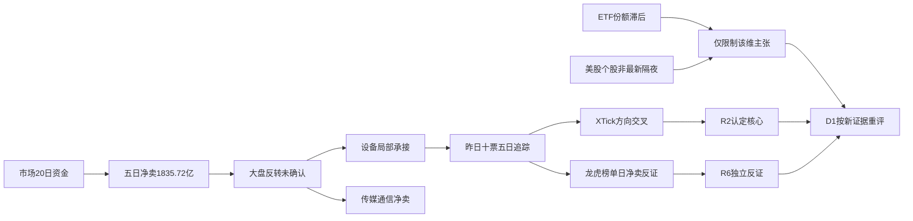

# 2026年11月18日 · 资金面

> 数据新鲜度：partial；降级：true；置信度：0.2625。A股主证据为11月17日收盘，不是今日盘中。
> 🟡 美股个股止于11月16日，ETF份额也止于11月16日；不得贴成最新隔夜/当日申赎。

## 一句话结论
**观察：大盘持续净卖，设备材料局部承接；不能把单日科技回流当全面反转。**

## 🧭 详细分析
本轮先认市场奖励：11月17日大盘主力净流出266.07亿元，5日净流出1835.72亿元，10日净流出1473.77亿元，20日净流出4259.85亿元。近4日连续净卖，昨天流出缩窄不是买盘已经反转。超大单净卖97.58亿元、大单净卖168.49亿元，小单净买300.28亿元，说明大额订单与小额订单方向不同，但订单大小不等于账户身份。
资金支持方向只落在已核事实：半导体设备昨日+19.05亿元、5日+39.53亿元且5日4天净入；材料昨日+18.83亿元、5日+5.52亿元；制造昨日+18.08亿元、5日+10.25亿元。半导体父类虽然昨日+29.63亿元，5日仍-72.04亿元；数字芯片设计昨日-29.25亿元。因此这是科技内部选择，不能外推所有科技受益。
**纪律标签：情绪=震荡/主跌。** Tushare涨停37、炸板20，按20/(37+20)计算炸板率35.09%，触发候选减半。R7没有研究选股池或执行池，前后均为0；下游若形成真实候选须减半。十票资金统计不等于候选，保留全量追踪以避免隐藏风险。XTick炸板19，对应33.93%，与Tushare20存在口径差异，采用较谨慎的已核门槛，不覆盖原返回。
本阶段早于R2/R5。已查的是11月17日和16日资金前十并集19只，未读取旧R5池；未查对象是未知，不是无资金。主线及龙头排名由R2认定，六维画像、必要价格/资金补核由后续R5完成，不要求另开R7。没有计划内外、RR、龙头资格的证据，不发开仓权限。

## 📊 板块资金与已核个股分列
### 板块：资金统计排序，不是R2主线优先级
单位均为亿元。父子板块有重复成分，不能相加；496是provider标签数，不是496个独立行业。

| 板块标签 | 昨日净额 | 五日净额 | 五日正流入天数 | 态度 |
|---|---:|---:|---:|---|
| 半导体 | +29.63 | -72.04 | 3 | 观察 |
| 半导体设备 | +19.05 | +39.53 | 4 | 观察 |
| 半导体材料 | +18.83 | +5.52 | 3 | 观察 |
| 集成电路制造 | +18.08 | +10.25 | 2 | 观察 |
| 电子 | +9.62 | -377.25 | 2 | 观察 |
| 光学光电子 | +9.40 | -34.40 | 2 | 观察 |
| 家用电器 | +6.53 | -5.09 | 4 | 观察 |
| 光学元件 | +5.14 | -3.04 | 2 | 观察 |
| 传媒 | -55.31 | -155.48 | 0 | 观察风险 |
| 数字芯片设计 | -29.25 | -116.34 | 1 | 观察风险 |
| 通信 | -27.82 | -138.19 | 1 | 观察风险 |
| 机械设备 | -25.97 | -165.12 | 1 | 观察风险 |
| 通信设备 | -25.18 | -129.34 | 1 | 观察风险 |

### 资金方向三问：设备
- **大资金意图**: 5日4天净入、累计39.53亿元，显示持续的大额订单承接；“资金押注国产设备”仅为待R4/R5验证的解释，不能从净流直接推出机构真实意图。
- **为什么走强**: 昨日设备板块涨2.19%、净入19.05亿元，北方华创昨日净入5.87亿元，价格与资金同向；但缺本轮硬事件独立确认。
- **逻辑够不够硬**: 对持续资金的事实较硬，对产业因果不足。若今日设备转净卖且核心承接失效，相对强势假设作废，不给无催化杂毛补涨资格。

### 资金方向三问：材料与制造
- **大资金意图**: 材料与制造5日已转正，但分别只有3天和2天净入，较设备更依赖最新回流，暂不能称稳定配置。
- **为什么走强**: 材料昨日涨2.67%、制造涨5.82%，有研新材和中芯国际进入净入前十形成个股响应；父类半导体5日仍负，说明局部强于整体。
- **逻辑够不够硬**: 只有资金和价格可核，硬政策/订单尚未在本轮独立取证。只有R2确认核心且次日承接延续才可升级研究判断，R7不发交易资格。

### 反向三问：传媒与通信
- **大资金意图**: 传媒昨日净卖55.31亿元、5日净卖155.48亿元；通信昨日净卖27.82亿元、5日净卖138.19亿元，显示撤离而非资金正在为整条链买单。
- **为什么走强**: 本项未走强；亏钱效应与净卖一致。不能把其他半导体方向回流直接映射到传媒或全部CPO。
- **逻辑够不够硬**: 仅能证明订单资金弱，不能证明产业逻辑已经永久证伪。若新事件与持续资金双确认，应由当轮研究重评，不无限继承停买。

### 昨日前十：五日向后看，非未来五日预测
统计锚点：11月17日；窗口：20261111—20261117，完整50/50股票日。收益以窗口首日pre_close到末日close计算，避免把4个间隔写成5日收益。

| 代码/源名称 | 昨日东财 | 五日东财 | 五日收益% | 昨日XTick | 态度 |
|---|---:|---:|---:|---:|---|
| 600206.SH 有研新材 | +14.89 | +9.87 | +1.42 | +24.08 | 观察 |
| 688981.SH 中芯国际 | +9.10 | +8.01 | +5.29 | +15.55 | 观察 |
| 688256.SH 寒武纪 | +9.01 | +21.97 | +7.97 | +0.66 | 观察 |
| 600410.SH 华胜天成 | +7.14 | +12.70 | +20.77 | +10.32 | 观察 |
| 688347.SH 华虹宏力 | +6.27 | +1.95 | +1.80 | +7.48 | 观察 |
| 002371.SZ 北方华创 | +5.87 | +19.48 | +5.58 | +1.60 | 观察 |
| 600261.SH 阳光照明 | +4.90 | -0.91 | -2.56 | +1.16 | 观察 |
| 688012.SH 中微公司 | +3.80 | +3.92 | -2.91 | +2.23 | 观察 |
| 688629.SH 华丰科技 | +3.42 | +7.97 | +23.56 | +3.97 | 观察 |
| 000725.SZ 京东方Ａ | +3.33 | -8.64 | -4.67 | +3.91 | 观察 |

两个订单分类源不按金额互证：59个有效股票日仅50个同向、9个冲突，金额不平均，不制造一致。两日榜单仅北方华创重合；11月16日前十的次日变化已逐票存JSON，不将换榜当成昨日十票都在持续走强。

### 十票研究说明与可证伪条件
以下每票都只是统计对象，不是首推/执行候选。龙头认定过几条=未知、RR=未知、禁止清单命中=未核、in_today_plan=未知；不以false提前剔除。

#### 有研新材（600206.SH）· 观察 · 1板
- **买入理由**: 当前不授予买入。研究依据一是昨日主力净入14.89亿元；依据二是5日累计+9.87亿元与价格可比较。产业催化未独立核验，不能补造第二条买入逻辑。
- **风险点**: 市场连续净卖形成系统逆风；资金榜身份不是龙头资格，且东财/XTick阈值不同，五日净额可被单日大额回流主导。
- **止损条件**: 无执行仓位与授权，不给虚构止损价。研究撤回条件为下一可核日主力净额≤0且收盘低于11月17日收盘39.33；真实入场、止损距和RR由R5/D1另核。
- **可验证假设**: 未来1—3交易日核每日净额与收盘；至少连续2日净额>0且收盘不低于上述锚点，才支持承接延续，否则维持观察或降级。

#### 中芯国际（688981.SH）· 观察 · 非收盘涨停/板型未授予
- **买入理由**: 当前不授予买入。研究依据一是昨日主力净入9.10亿元；依据二是5日累计+8.01亿元与价格可比较。产业催化未独立核验，不能补造第二条买入逻辑。
- **风险点**: 市场连续净卖形成系统逆风；资金榜身份不是龙头资格，且东财/XTick阈值不同，五日净额可被单日大额回流主导。
- **止损条件**: 无执行仓位与授权，不给虚构止损价。研究撤回条件为下一可核日主力净额≤0且收盘低于11月17日收盘113.45；真实入场、止损距和RR由R5/D1另核。
- **可验证假设**: 未来1—3交易日核每日净额与收盘；至少连续2日净额>0且收盘不低于上述锚点，才支持承接延续，否则维持观察或降级。

#### 寒武纪（688256.SH）· 观察 · 非收盘涨停/板型未授予
- **买入理由**: 当前不授予买入。研究依据一是昨日主力净入9.01亿元；依据二是5日累计+21.97亿元与价格可比较。产业催化未独立核验，不能补造第二条买入逻辑。
- **风险点**: 市场连续净卖形成系统逆风；资金榜身份不是龙头资格，且东财/XTick阈值不同，五日净额可被单日大额回流主导。
- **止损条件**: 无执行仓位与授权，不给虚构止损价。研究撤回条件为下一可核日主力净额≤0且收盘低于11月17日收盘904.8；真实入场、止损距和RR由R5/D1另核。
- **可验证假设**: 未来1—3交易日核每日净额与收盘；至少连续2日净额>0且收盘不低于上述锚点，才支持承接延续，否则维持观察或降级。

#### 华胜天成（600410.SH）· 观察 · 1板
- **买入理由**: 当前不授予买入。研究依据一是昨日主力净入7.14亿元；依据二是5日累计+12.70亿元与价格可比较。产业催化未独立核验，不能补造第二条买入逻辑。
- **风险点**: 市场连续净卖形成系统逆风；资金榜身份不是龙头资格，且东财/XTick阈值不同，五日净额可被单日大额回流主导。
- **止损条件**: 无执行仓位与授权，不给虚构止损价。研究撤回条件为下一可核日主力净额≤0且收盘低于11月17日收盘15.29；真实入场、止损距和RR由R5/D1另核。
- **可验证假设**: 未来1—3交易日核每日净额与收盘；至少连续2日净额>0且收盘不低于上述锚点，才支持承接延续，否则维持观察或降级。

#### 华虹宏力（688347.SH）· 观察 · 非收盘涨停/板型未授予
- **买入理由**: 当前不授予买入。研究依据一是昨日主力净入6.27亿元；依据二是5日累计+1.95亿元与价格可比较。产业催化未独立核验，不能补造第二条买入逻辑。
- **风险点**: 市场连续净卖形成系统逆风；资金榜身份不是龙头资格，且东财/XTick阈值不同，五日净额可被单日大额回流主导。
- **止损条件**: 无执行仓位与授权，不给虚构止损价。研究撤回条件为下一可核日主力净额≤0且收盘低于11月17日收盘172.42；真实入场、止损距和RR由R5/D1另核。
- **可验证假设**: 未来1—3交易日核每日净额与收盘；至少连续2日净额>0且收盘不低于上述锚点，才支持承接延续，否则维持观察或降级。

#### 北方华创（002371.SZ）· 观察 · 非收盘涨停/板型未授予
- **买入理由**: 当前不授予买入。研究依据一是昨日主力净入5.87亿元；依据二是5日累计+19.48亿元与价格可比较。产业催化未独立核验，不能补造第二条买入逻辑。
- **风险点**: 市场连续净卖形成系统逆风；资金榜身份不是龙头资格，且东财/XTick阈值不同，五日净额可被单日大额回流主导。
- **止损条件**: 无执行仓位与授权，不给虚构止损价。研究撤回条件为下一可核日主力净额≤0且收盘低于11月17日收盘568.75；真实入场、止损距和RR由R5/D1另核。
- **可验证假设**: 未来1—3交易日核每日净额与收盘；至少连续2日净额>0且收盘不低于上述锚点，才支持承接延续，否则维持观察或降级。

#### 阳光照明（600261.SH）· 观察 · 1板
- **买入理由**: 当前不授予买入。研究依据一是昨日主力净入4.90亿元；依据二是5日累计-0.91亿元与价格可比较。产业催化未独立核验，不能补造第二条买入逻辑。
- **风险点**: 市场连续净卖形成系统逆风；资金榜身份不是龙头资格，且东财/XTick阈值不同，五日净额可被单日大额回流主导。
- **止损条件**: 无执行仓位与授权，不给虚构止损价。研究撤回条件为下一可核日主力净额≤0且收盘低于11月17日收盘5.7；真实入场、止损距和RR由R5/D1另核。
- **可验证假设**: 未来1—3交易日核每日净额与收盘；至少连续2日净额>0且收盘不低于上述锚点，才支持承接延续，否则维持观察或降级。

#### 中微公司（688012.SH）· 观察 · 非收盘涨停/板型未授予
- **买入理由**: 当前不授予买入。研究依据一是昨日主力净入3.80亿元；依据二是5日累计+3.92亿元与价格可比较。产业催化未独立核验，不能补造第二条买入逻辑。
- **风险点**: 市场连续净卖形成系统逆风；资金榜身份不是龙头资格，且东财/XTick阈值不同，五日净额可被单日大额回流主导。
- **止损条件**: 无执行仓位与授权，不给虚构止损价。研究撤回条件为下一可核日主力净额≤0且收盘低于11月17日收盘238.5；真实入场、止损距和RR由R5/D1另核。
- **可验证假设**: 未来1—3交易日核每日净额与收盘；至少连续2日净额>0且收盘不低于上述锚点，才支持承接延续，否则维持观察或降级。

#### 华丰科技（688629.SH）· 观察 · 非收盘涨停/板型未授予
- **买入理由**: 当前不授予买入。研究依据一是昨日主力净入3.42亿元；依据二是5日累计+7.97亿元与价格可比较。产业催化未独立核验，不能补造第二条买入逻辑。
- **风险点**: 市场连续净卖形成系统逆风；资金榜身份不是龙头资格，且东财/XTick阈值不同，五日净额可被单日大额回流主导。
- **止损条件**: 无执行仓位与授权，不给虚构止损价。研究撤回条件为下一可核日主力净额≤0且收盘低于11月17日收盘90.82；真实入场、止损距和RR由R5/D1另核。
- **可验证假设**: 未来1—3交易日核每日净额与收盘；至少连续2日净额>0且收盘不低于上述锚点，才支持承接延续，否则维持观察或降级。

#### 京东方Ａ（000725.SZ）· 观察 · 非收盘涨停/板型未授予
- **买入理由**: 当前不授予买入。研究依据一是昨日主力净入3.33亿元；依据二是5日累计-8.64亿元与价格可比较。产业催化未独立核验，不能补造第二条买入逻辑。
- **风险点**: 市场连续净卖形成系统逆风；资金榜身份不是龙头资格，且东财/XTick阈值不同，五日净额可被单日大额回流主导。
- **止损条件**: 无执行仓位与授权，不给虚构止损价。研究撤回条件为下一可核日主力净额≤0且收盘低于11月17日收盘4.29；真实入场、止损距和RR由R5/D1另核。
- **可验证假设**: 未来1—3交易日核每日净额与收盘；至少连续2日净额>0且收盘不低于上述锚点，才支持承接延续，否则维持观察或降级。

## 🚩 龙虎榜诱多识别：不把多日净卖当成单日派发
11月17日原始93条、75只；51只有单日可比披露，24只仅多日榜单列未知。上涨且单日榜净卖5只，下跌且换手≥20%并净卖6只。规则筛查不是意图认定；不把5/75称全市场诱多率，不出hard_reject。

| 对象 | 同日涨幅% | 同日榜净额亿元 | 换手% | 风险线索 |
|---|---:|---:|---:|---|
| 龙江交通 601188.SH | +0.21 | -1.42 | 28.95 | 上涨/涨停但单日龙虎榜净卖背离 |
| 托伦斯 301583.SZ | +4.82 | -1.18 | 38.67 | 上涨/涨停但单日龙虎榜净卖背离 |
| 贝特利 301697.SZ | +0.22 | -1.16 | 41.90 | 上涨/涨停但单日龙虎榜净卖背离 |
| 顺钠股份 000533.SZ | +9.98 | -0.77 | 25.51 | 上涨/涨停但单日龙虎榜净卖背离 |
| 仁信新材 301395.SZ | +19.18 | -0.21 | 19.94 | 上涨/涨停但单日龙虎榜净卖背离 |
| 北纬科技 002148.SZ | -7.31 | -0.02 | 42.76 | 下跌高换手且榜单净卖 |
| 慈文传媒 002343.SZ | -9.98 | -0.31 | 23.63 | 下跌高换手且榜单净卖 |
| 文投控股 600715.SH | -9.89 | -1.06 | 22.98 | 下跌高换手且榜单净卖 |
| 福建水泥 600802.SH | -9.77 | -0.11 | 24.58 | 下跌高换手且榜单净卖 |
| 吉视传媒 601929.SH | -6.76 | -2.47 | 21.32 | 下跌高换手且榜单净卖 |
| 宇特光电 920157.BJ | -6.88 | -0.02 | 35.63 | 下跌高换手且榜单净卖 |

- **大资金意图**: 龙江交通涨幅仅0.21%、换手28.95%，榜单净卖1.42亿元，显示交易兑现线索，不足以指控诱多操纵。
- **为什么走强**: 顺钠股份上涨9.98%仍榜单净卖0.77亿元，价格强与披露净卖并存；可能派发，也可能新旧资金换手，需要次日承接区分。
- **逻辑够不够硬**: 单日价与榜同窗可核，意图不够硬；机构专用不能认账户，多理由不相加，多日榜不与单日价硬比。需要R6独立审查，不拿负净额机械否定总龙。

游资三交易日识别31个同一具名席位重复净买组合，按日期去重且只用正净买；公告/ST/开板风控未全核，均为provisional观察，不能凭协同统计开仓。

## ⚖️ ETF、期货与跷跷板
| 对象 | 事实日期 | 事实/代理 | 限制 |
|---|---|---|---|
| 510300.SH | 2026-11-16 | 份额变化×同日收盘 ≈ +55.86亿元 | 非11月17日申赎，非二级主力 |
| 510500.SH | 2026-11-16 | 份额变化×同日收盘 ≈ +8.51亿元 | 非11月17日申赎，非二级主力 |
| 159915.SZ | 2026-11-16 | 份额变化×同日收盘 ≈ +23.39亿元 | 非11月17日申赎，非二级主力 |
| 588000.SH | 2026-11-16 | 份额变化×同日收盘 ≈ +1.00亿元 | 非11月17日申赎，非二级主力 |
| IF2611.CFX－沪深300 | 2026-11-17 | -24.46点 | 未扣分红/融资成本，非主连混用 |

四只ETF最新旧日净申购代理合计88.76亿元，不能拿来抵销11月17日大盘净卖。最新申赎未知保留null。两融多数14/15日止于11月16日，两只空返回不等于非两融标的。大宗30个自然日有价量时按当日未复权收盘比较折溢价，比较价缺失保留null，不把折价自动等同出货。
跷跷板按最新资金绝对值前20标签共190对，20日相关阈值严格小于-0.6，再要求前后5日双方变号且最近相反。负相关候选0、确认0；这是已查范围的有效空结果，不代表全市场没有轮动。

## 🌐 外部传导：个股日期不能冒充隔夜
| 美股 | 实际交易日 | 涨跌% | A股映射假设 |
|---|---|---:|---|
| MU | 2026-11-16 | -7.62 | 存储/算力/半导体链风险背景 |
| NVDA | 2026-11-16 | -4.12 | 存储/算力/半导体链风险背景 |
| AVGO | 2026-11-16 | -3.92 | 存储/算力/半导体链风险背景 |
| AMD | 2026-11-16 | -5.58 | 存储/算力/半导体链风险背景 |
| TSM | 2026-11-16 | -6.34 | 存储/算力/半导体链风险背景 |
| AAPL | 2026-11-16 | -0.98 | 科技风险偏好背景 |
| MSFT | 2026-11-16 | -1.12 | 科技风险偏好背景 |
| META | 2026-11-16 | -2.38 | 科技风险偏好背景 |
| GOOGL | 2026-11-16 | -4.07 | 科技风险偏好背景 |
| AMZN | 2026-11-16 | -3.34 | 科技风险偏好背景 |
| TSLA | 2026-11-16 | -2.69 | 科技风险偏好背景 |
| GLW | 2026-11-16 | -6.93 | 科技风险偏好背景 |

11月17日SPX -1.03%、IXIC -0.74%来自snapshot中的Tencent回退，是最新指数；SOX未取得，INTC/MRVL未覆盖。五只核心半导体MCP逐只补查仍只到11月16日（均跌），不得说“昨夜半导体平均跌5.52%”。该幅度是前一美股交易日背景。A股设备/材料11月17日回流提示相对分离，但其持续性须由今日资金确认，不把过时美股跌幅用于全局禁买。

## 🔎 关键证据
- 市场/板块20日及全部个股资金原返回：`data/research/20261118/R7_live_evidence_20261118.json`；本轮现场拉取SDK真实source，不写成MCP。
- XTick交叉与真实请求时点/参数：`data/research/20261118/R7_cross_evidence_20261118.json`；epoch已按上海时区核交易日。
- 海外快照：`data/raw/20261118/overseas_snapshot.json`，按categories逐项区分指数和个股事实日期。
- 机构席位按披露理由分组、side数值重复去重；不跨理由累计、不推断真实机构身份。

## 数据源审计
| 源 | 日期 | 状态 | 记录/覆盖 | 备注 |
|---|---|:--:|---|---|
| Tushare Pro SDK live / Eastmoney market | 2026-11-18 | 🟢 | 20 | 详见JSON中的事实窗口与captured_at |
| Tushare Pro SDK live / Eastmoney industry labels | 2026-11-18 | 🟢 | 9920 | 详见JSON中的事实窗口与captured_at |
| Tushare Pro SDK live / stock funds and price | 2026-11-18 | 🟢 | 19 | 详见JSON中的事实窗口与captured_at |
| Tushare Pro SDK live / exchange龙虎榜 | 2026-11-18 | 🟢 | 386 | 详见JSON中的事实窗口与captured_at |
| xtick MCP | 2026-11-18 | 🟢 | 60 | 详见JSON中的事实窗口与captured_at |
| DataPro MCP | 2026-11-18 | 🔴 | 未知 | 4013 Agent Plan订阅失效；本轮实调返回，不沿用历史错误 |
| Tushare Pro SDK live / fund_share | 2026-11-18 | 🟡 | 76 | 份额只到20261116，缺20261117 |
| Tushare Pro SDK live / futures | 2026-11-18 | 🟢 | 20 | 详见JSON中的事实窗口与captured_at |
| overseas_snapshot us_stocks | 2026-11-18 | 🟡 | 12 | 12股均止于20261116，预期20261117；MCP复查MU/NVDA/AVGO/AMD/TSM仍未更新 |
| overseas_snapshot indices | 2026-11-18 | 🟡 | 5 | SPX/IXIC为20261117，SOX缺失、KR未核日历 |
| manifest+mcp_health | 2026-11-18 | 🟢 | 2 | 详见JSON中的事实窗口与captured_at |

## 🧪 不确定性 / 反证
置信度按0.75×0.7×0.5=0.2625，低于severity≥2的0.5上限。XTick只是局部方向交叉，不以两API同源重复增加置信度；北向not_required，不进分子/分母，不调北向。整体时效partial来自ETF仍适用资金证据落后一个交易日，市场/板块/龙虎榜/期货本身是ok，不得整体抹去已核事实。
历史资金、截面股票池与板块层级均有限制：父子板块重叠；6000余条资金截面不等于当前上市A股全集；19只逐票核实与75只榜单风险覆盖分层记录，不能说全市场个股已画像。机构/游资资金并非账户交易授权，未核催化、计划、RR与龙头认定均保持未知。
今日市场研究意见有效到开盘新数据可核后的重评窗口，不是无限停买令；没有读取或修改真实用户/账户硬预算，未知不能抬为正额度，有效零预算与所有授权/T+1/硬否决保护继续独立生效。

## 🤝 与其他 R/D/E 的关系
- 依赖：manifest、mcp_health、overseas_snapshot与本轮实时拉取；未消费同日旧R2或旧R5。
- R2：据资金持续性认定主线/核心，不把本报告资金排名等同板块优先级。
- R5：对本轮真实候选补必要资金、价格、风险收益；不要求再开R7或凑特定provider。
- R6：读同版实际证据独立反证；本报告风险线索不是hard_reject。
- D1/P2/E1：按逐维事实日期与缺口消费，交易权限与硬预算保持原保护。

## Sub-Agent 元数据
- skill: analyze_capital_flow_v1
- artifact: data/research/20261118/R7_capital_flow_20261118.json
- 生成耗时: 545 秒
- model: gpt-6.1-sol
- run mode: 真实盘前执行，非回放；资料以各captured_at为准，未从交付目标倒推。
- usage: usage_unknown，不记0，不保证低于5000万努力目标；交付目标仅observe_only。
