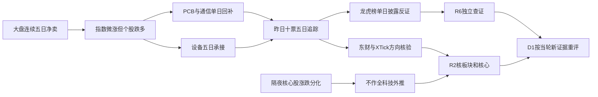

# 2026年11月19日 · 资金面

> **数据新鲜度**：partial｜**降级**：是｜**置信度**：0.26249999999999996。国内主证据为11月18日收盘，不是19日盘中。

## 🧭 一句话结论
**观察：大盘仍净卖，半导体设备有持续承接；PCB与通信暂按回补，不判全面反转。**

## 📉 大势与市场奖励
| 口径 | 11月18日 | 近5日 | 近10日 | 近20日 |
|---|---:|---:|---:|---:|
| 主力净额（亿元） | -85.04 | -2119.23 | -2059.09 | -4257.05 |

沪指 **+0.09%**、深成指 **+0.20%**，但所核日线 **1318涨 / 4133跌 / 122平**。超大单+18.86亿元、大单-103.90亿元；大盘流出较前日收窄，仍是连续5日净卖。11月17日涨停票在18日的收盘溢价中位数为 **+0.73%**（37/37），最高非ST梯队华东重机4板；说明局部接力还有奖励，不是普遍赚钱。

**情绪=震荡/主跌**（纪律标签，非R1结论）。Tushare涨停41、跌停39、炸板24，同式炸板率 **36.92%**；XTick对应43板、24炸，同式35.82%，服务自报`zbl` 18.92%系不同口径，不混用。触发候选减半纪律：本R7未建研究或执行池（0→0），资金前十不删，下游对真实候选按纪律处理。

## 📊 板块资金：与个股分列
2026-10-22 至 2026-11-18，496个东财行业标签。父子标签成分重叠，不可相加；下列是资金统计，不是R2主线排序。

| 标签 | 11月18日涨幅% | 当日净额 | 5日净额 | 10日净额 | 20日净额 | 5日净入天数 |
|---|---:|---:|---:|---:|---:|---:|
| 电子 | -0.07 | +99.84 | -454.83 | -218.60 | -754.29 | 2 |
| 印制电路板 | +3.13 | +45.17 | -146.90 | -135.99 | -345.47 | 1 |
| 通信 | +1.64 | +35.37 | -236.66 | -131.29 | -399.45 | 1 |
| 半导体 | +0.11 | +45.53 | -103.26 | +51.97 | -72.27 | 3 |
| 半导体设备 | +1.16 | +19.18 | +55.61 | +134.39 | +104.57 | 4 |
| 集成电路制造 | +1.54 | +11.18 | +27.20 | +26.66 | +30.33 | 3 |
| 半导体材料 | -0.52 | -7.29 | -5.20 | +18.98 | -6.07 | 2 |
| 有色金属 | -1.89 | -39.76 | -196.98 | -218.18 | -305.68 | 0 |
| 医药生物 | -1.80 | -33.78 | -112.04 | -193.98 | -295.97 | 1 |
| 传媒 | -3.05 | -23.44 | -162.79 | -121.83 | -145.46 | 0 |
| 电力设备 | -1.48 | -16.59 | -174.36 | -232.67 | -321.87 | 0 |

### 半导体设备与制造：观察持续性
- **大资金意图**: 设备五日4天净入、累计55.61亿元，说明大额订单承接比单日反抽更持续；能确认的是资金行为，不能确认账户身份和配置动机。
- **为什么走强**: 设备涨1.16%、制造涨1.54%，前一榜单仍有寒武纪、华虹宏力、中微公司留在前十；但半导体父类五日仍净卖103.26亿元、材料当日收跌，不能外推到全链。
- **逻辑够不够硬**: 设备5/10/20日同向，足以优先验证；产业订单和龙头地位要另核。若竞价/开盘核心失去承接且同方向不扩散，保留五日历史事实但撤回当日延续假设。

### PCB与通信：观察回补能否扩散
- **大资金意图**: PCB和通信分别净入45.17、35.37亿元，但五日均仅一日净入；更像回补，尚不足以认定持续配置。
- **为什么走强**: PCB涨3.13%，沪电股份涨停；通信涨1.64%，但中际旭创五日仍净卖79.05亿元。板块当日修复不能覆盖核心之间的差异。
- **逻辑够不够硬**: 海外AVGO上涨、NVDA和MRVL下跌，不支持把单日回补当全链转强；只有核心有承接、同方向至少再有净入与扩散，才升级研究假设。

## 🧾 已核个股：昨日前十回看5个交易日
锚点 2026-11-18，窗口 2026-11-12 至 2026-11-18；50/50股票日有效。与前一日榜单并集共核 17 只；前一榜单次日8/10仍净入，只有3只留榜。昨日前十中5/10五日净入。五日收益用首日昨收至末日收盘，净额单位亿元。

| 位次 | 代码/名称 | 当日东财 | 5日东财 | 5日收益% | 当日XTick | 5日净入天数 | 披露或板型线索 |
|---:|---|---:|---:|---:|---:|---:|---|
| 1 | 002463.SZ 沪电股份 | +13.19 | -2.82 | -10.33 | +24.70 | 1 | 收盘涨停（非盘前板型认定） |
| 2 | 688256.SH 寒武纪 | +9.60 | +21.26 | +5.44 | +7.49 | 3 | 未在所核涨停/炸板榜，不认定实战板型 |
| 3 | 688347.SH 华虹宏力 | +8.91 | +18.15 | +9.44 | +2.23 | 4 | 未在所核涨停/炸板榜，不认定实战板型 |
| 4 | 000988.SZ 华工科技 | +7.96 | +1.02 | -3.80 | +11.10 | 1 | 收盘未封（曾触板） |
| 5 | 300857.SZ 协创数据 | +6.55 | -9.60 | -14.05 | +4.70 | 1 | 上涨净卖背离 -2.67亿元 |
| 6 | 601138.SH 工业富联 | +6.48 | -41.22 | -16.73 | +8.30 | 1 | 未在所核涨停/炸板榜，不认定实战板型 |
| 7 | 300308.SZ 中际旭创 | +5.25 | -79.05 | -26.88 | +0.20 | 1 | 未在所核涨停/炸板榜，不认定实战板型 |
| 8 | 688012.SH 中微公司 | +4.97 | +7.57 | -2.33 | +0.69 | 3 | 未在所核涨停/炸板榜，不认定实战板型 |
| 9 | 002436.SZ 兴森科技 | +4.68 | -2.35 | -11.84 | +4.33 | 2 | 未在所核涨停/炸板榜，不认定实战板型 |
| 10 | 300604.SZ 长川科技 | +4.55 | +8.50 | +0.41 | +0.13 | 4 | 未在所核涨停/炸板榜，不认定实战板型 |

东财与XTick在 **57** 个可比股票日中 **49** 同向、**8** 不同向；不取均值，不因为辅助异向删除对象。沪电股份东财与XTick当日均净入、龙虎榜净买2.40亿元，但五日净额仍负；不是仅凭榜首就给持续性。大宗查30个自然日，同日未复权价可比时才算折溢价；两融仅14/15交易日，止于11月17日。

十票均为资金统计，不是观察池首推、当日候选或执行池。板型仅记录已核事实，龙头认定、必要风险/RR、止损及计划归属仍未知。

## 🚩 龙虎榜：识别诱多风险，不认定资金意图
2026-11-18 原始95条披露，82只标的；61只有单日可比榜，21只仅多日榜。上涨且单日榜净卖 **7** 只；下跌且换手不低于20%、同日榜净卖 **10** 只。不同原因不累加，“机构专用”不等于可识别机构账户。

| 对象 | 涨跌% | 单日榜净额（亿元） | 换手% | 风险线索 |
|---|---:|---:|---:|---|
| 300857.SZ 协创数据 | +18.02 | -2.67 | 9.10 | 上涨净卖背离 |
| 000530.SZ 冰山冷热 | +4.73 | -0.87 | 47.25 | 上涨净卖背离 |
| 002843.SZ 泰嘉股份 | +10.03 | -0.82 | 27.57 | 上涨净卖背离 |
| 000595.SZ 新能股份 | +5.30 | -0.45 | 9.92 | 上涨净卖背离 |
| 600202.SH 哈空调 | +1.97 | -0.43 | 28.35 | 上涨净卖背离 |
| 301391.SZ 卡莱特 | +20.01 | -0.37 | 10.15 | 上涨净卖背离 |
| 600467.SH 好当家 | +0.73 | -0.17 | 26.16 | 上涨净卖背离 |
| 002242.SZ 九阳股份 | -9.99 | -2.33 | 23.14 | 下跌高换手净卖 |
| 002584.SZ 西陇科学 | -1.01 | -1.37 | 36.25 | 下跌高换手净卖 |
| 002425.SZ 凯撒文化 | -9.89 | -0.91 | 34.07 | 下跌高换手净卖 |
| 300786.SZ 国林科技 | -5.22 | -0.73 | 33.21 | 下跌高换手净卖 |
| 002861.SZ 瀛通通讯 | -7.49 | -0.64 | 25.84 | 下跌高换手净卖 |
| 301578.SZ 辰奕智能 | -5.16 | -0.26 | 30.83 | 下跌高换手净卖 |
| 920489.BJ 佳先股份 | -6.06 | -0.14 | 21.97 | 下跌高换手净卖 |
| 920309.BJ 菊乐股份 | -29.99 | -0.11 | 63.90 | 下跌高换手净卖 |
| 301052.SZ 果麦文化 | -17.76 | -0.04 | 39.19 | 下跌高换手净卖 |
| 920202.BJ 安达股份 | -11.89 | -0.04 | 29.40 | 下跌高换手净卖 |

- **大资金意图**: 协创数据公开席位净卖2.67亿元，显示上榜卖盘兑现，但整体大额订单与披露席位并非同一总体。
- **为什么走强**: 协创数据收涨18.02%，东财+6.55亿元、XTick+4.70亿元，公开榜反向；短期承接与席位兑现可以同时存在，五日净额仍负。
- **逻辑够不够硬**: 这是真实的跨口径反证，不足以指控操纵或否定所有买盘。若下一可核日大额净卖且失守前收139.49元，撤回承接假设；若同方向扩散且价格承接，分辨新资金换手。交R6独立判定，不发硬否决。

三日同营业部重复净买识别20组；按ST/收盘未封剔除1组，其余19组经近三交易日标题扫查降级规则处理，仍仅作协同线索，不是主体身份确认。

## ⚖️ ETF、期货与跷跷板
四只ETF最新可比份额变化×收盘为 **2026-11-17 +94.82亿元**（宽基样本代理）。11月18日份额未知，不能拿旧日代理抵当日大盘净卖。IF2611与沪深300同日收盘差 **-17.77点**，固定近月、临近交割，未扣持有成本，不作机构净流量。
跷跷板：20个最新净额绝对值靠前且历史齐全的标签，190对，20日Pearson低于-0.6的有0对，再要求双方近5日相对前5日反向翻转，确认0对。有效空结果只限此样本。

## 🌐 外部传导：隔夜常规收盘，不用盘前新闻替代
2026-11-18 美东：标普500 **-0.23%**、纳指 **+0.42%**、道指 **-1.11%**，来自既有快照中腾讯回退。快照个股原表为空；本轮向腾讯补核14只，同日美东时间戳与现价/昨收校验通过。SOX两个渠道未得，11月17日USDCNH不当最新汇率。

| 股票 | 11月18日常规收盘涨幅% | 对A股的风险偏好映射（假设） |
|---|---:|---|
| NVDA | -2.89 | 算力GPU |
| AMD | +5.31 | 算力芯片 |
| AVGO | +3.64 | 网络/ASIC与光互连 |
| MU | -1.00 | 存储 |
| TSM | +0.81 | 晶圆代工 |
| MRVL | -2.15 | 网络/ASIC与光互连 |
| GLW | -0.31 | 光纤材料 |
| INTC | -0.91 | 处理器/代工 |
| AAPL | +0.15 | 消费电子 |
| MSFT | +0.40 | 云与AI需求 |
| GOOGL | +0.80 | 云与AI需求 |
| AMZN | +3.82 | 云与AI需求 |
| META | -0.40 | 平台与AI投入 |
| TSLA | +0.95 | 智能车风险偏好 |

媒体称英伟达周二美股盘后发布财报并上调展望，11月18日盘前一度+3.20%，但常规时段最终-2.89%；这是财报后的价格分歧，不用正面新闻代替市场确认。财报数据和盘后逐笔未独立核验。
**存储偏压，CPO/PCB分化，代工有温和支持；本地设备仍优先检验自身五日承接。** AMD与AVGO强、NVDA/MRVL及MU弱，纳指上涨不等于半导体一致上行。

## 🔎 关键证据与交接
- 市场、板块、个股、龙虎榜、ETF与美股个股原返回：`data/research/20261119/R7_live_evidence_20261119.json`；XTick实际交叉：`data/research/20261119/R7_cross_evidence_20261119.json`；期货、公告等：`data/research/20261119/R7_supplement_evidence_20261119.json`。
- R7早于R2/R5，仅覆盖明确列出的对象和窗口；未读旧R5候选池。R2核核心，R5补本轮真实候选的必要资金与价格，不另开R7、不绑定provider；R6保留独立反证权。
- 仅限2026-11-19盘前研究，竞价/开盘获得板块扩散、核心承接及当前风险新证据即复评，最晚当日失效；不作跨日停买。
- 预算与计划归属未知；未修改用户/账户停买、零预算、仓位硬上限、T+1、人工确认或逐票硬否决；研究不是买入权限。

## 数据源审计
| 源 | 日期 | 状态 | 备注 |
|---|---|:---:|---|
| Tushare Pro SDK / moneyflow_mkt_dc（东财） | 2026-11-19 | 🟢 | 20条/项；实际证据路径与窗口见JSON |
| Tushare Pro SDK / moneyflow_ind_dc（东财行业标签） | 2026-11-19 | 🟢 | 9920条/项；实际证据路径与窗口见JSON |
| Tushare Pro SDK / moneyflow_dc（东财） + daily | 2026-11-19 | 🟢 | 17条/项；实际证据路径与窗口见JSON |
| Tushare Pro SDK / top_list、top_inst、hm_detail（披露及标签映射） | 2026-11-19 | 🟢 | 396条/项；实际证据路径与窗口见JSON |
| XTick MCP / xtick_hot_money / 情绪及板块辅助 | 2026-11-19 | 🟡 | 57条/项；个股方向存在分歧；sw1 返回成员而非带日期净额；炸板字段口径不一致 |
| DataPro MCP | 2026-11-19 | 🔴 | 0条/项；4013 订阅已失效或未分配席位，本轮实测 |
| Tushare Pro SDK / margin_detail | 2026-11-19 | 🟡 | 238条/项；截至11月17日，14/15日 |
| Tushare Pro SDK / block_trade | 2026-11-19 | 🟢 | 67条/项；实际证据路径与窗口见JSON |
| Tushare Pro SDK / fund_share + fund_daily | 2026-11-19 | 🟡 | 76条/项；份额最后11月17日；11月18日申赎代理未知 |
| Tushare Pro SDK / fut_daily + index_daily | 2026-11-19 | 🟢 | 20条/项；实际证据路径与窗口见JSON |
| Tushare Pro SDK / 涨跌停、日线、ST、公告 | 2026-11-19 | 🟢 | 5573条/项；公告只扫指定窗口的标题，不等于法律风控审查 |
| vibe-trading MCP / get_dragon_tiger（Eastmoney 转载同一交易所披露） | 2026-11-19 | 🟢 | 1条/项；沪电股份；转载同一披露，不作独立资金面 |
| overseas_snapshot / us_stocks | 2026-11-19 | 🔴 | 0条/项；原快照 Tushare us_daily 空；已单列腾讯补核 |
| overseas_snapshot / tencent.us 美国指数 | 2026-11-19 | 🟡 | 3条/项；SPX、IXIC、DJI为11月18日；SOX缺失，腾讯 SOX 与 Tushare index_global 补查仍空 |
| tencent.us / qt.gtimg.cn（本轮直连项目快照同路径补核） | 2026-11-19 | 🟢 | 14条/项；实际证据路径与窗口见JSON |
| overseas_snapshot / Tushare fx_daily | 2026-11-19 | 🟡 | 1条/项；USDCNH 11月17日，快照未核FX时效；DXY缺失 |
| 财联社与同花顺媒体转述 | 2026-11-19 | 🟢 | 2条/项；仅核盘前报道与随后的常规收盘，不宣称财报原文已核 |
| manifest / mcp_health | 2026-11-19 | 🟢 | 2条/项；severity=2，探针可达不等于业务成功 |

## 🧪 不确定性与运行边界
0.75 × 0.7 × 0.5 = **0.2625**（severity 2，上限0.5）；这是证据质量分，不是胜率。ETF缺一交易日，使整体时效为partial；大盘、板块、龙虎榜、期货不受该缺口改写。北向不要求，不采、不计分。DataPro失效或其他辅助缺数不触发全局禁买。

## Sub-Agent 元数据
- skill: analyze_capital_flow_v1；artifact: `data/research/20261119/R7_capital_flow_20261119.json`
- 本轮生成：06:20（上海），距实际启动约648秒；真实盘前，非回放，资料时点按各源，不由交付目标倒推。
- 08:30与5000万token仅观察目标，usage未知，不记0、不保证低于目标；未启动其他模型执行者。
