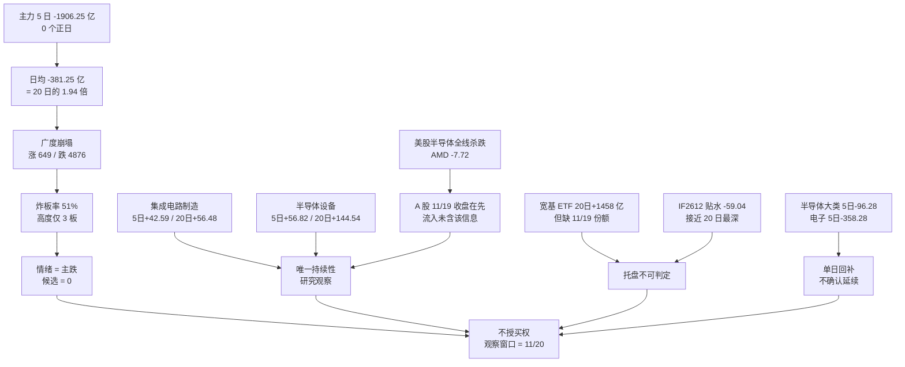

# 2026年11月20日 · **资金面**（独立补件）

> **数据源新鲜度**: partial　**降级状态**: true　**置信度**: 未授予（隔离回放未校准）
> **本件性质**: 独立资金补件，尚未被主预案消费。原 run 未发布正式 artifact，正式接收因原证缺失失败。本轮只做盘前资料事后回放，输出为字段投影，不宣称读全。

## 一句话结论

五日连续净卖且速率抬升、炸板率约五成、高度仅三板——钱只给集成电路制造与半导体设备，且隔夜美股半导体全线杀跌发生在这笔流入之后；本轮零对象取得「进」，不授买权。

## 详细分析

### 一、先认市场：这是主跌段里的单日结构性回补，不是修复启动

市场级资金（东财口径 `moneyflow_mkt_dc`，经 `derived_sector.market_agg` 投影）：

| 窗口 | 净额（亿） | 有效日 | 正日 | 日均（亿） |
|---|---|---|---|---|
| 1 日 | -311.13 | 1 | 0 | -311.13 |
| 5 日 | -1906.25 | 5 | 0 | -381.25 |
| 10 日 | -2455.62 | 10 | 3 | -245.56 |
| 20 日 | -3935.66 | 20 | 8 | -196.78 |

关键不是"流出"，而是**流出在加速**：近 5 日日均 -381.25 亿，是 20 日均值 -196.78 亿的 1.94 倍。同时宽度崩塌——11/19 涨 649 / 跌 4876 / 平 48（共 5573），下跌占比 87.5%，涨跌比 1:7.51；炸板率两套口径分别为 51.06%（Tushare：涨 23/跌 68/炸 24）与 50.94%（xTick：26/72/27），均远超 35% 阈值；最高板 3 板且 `jj4t5=0.0`（无四板以上）；昨涨停收盘溢价中位数 -0.71%。

按纪律，炸板率≥35% 即判 `情绪=震荡/主跌` 且候选数砍半——本轮砍半后为 0，任何对象都不取得开仓资格。这不是"谨慎"，是当日证据的直接结果。

### 二、再认板块：钱只给三个细分，不给"半导体"三个字

这是本件最重要的一处证伪。

| 板块 | 单日净额 | 单日涨幅 | 5 日净额 | 5 日正日 | 20 日净额 | 判定 |
|---|---|---|---|---|---|---|
| 半导体设备 | +18.55 | +1.07% | **+56.82** | 4/5 | **+144.54** | 相对支持（唯一双正且 13/20 正） |
| 集成电路制造 | +24.23 | +5.00% | **+42.59** | 3/5 | **+56.48** | 相对支持（价与资金同步） |
| 集成电路封测 | +14.94 | +2.65% | +4.85 | 3/5 | -12.68 | 观察（长周期仍负） |
| 半导体（大类） | +30.51 | **-0.63%** | **-96.28** | 3/5 | +12.88 | 冲突→不支持整体回流 |
| 数字芯片设计 | -19.60 | -2.40% | -158.12 | 1/5 | -129.64 | 拦截 |
| 电子（大类） | +17.50 | -1.74% | **-358.28** | 3/5 | **-573.34** | 不支持 |
| 通信网络设备及器件 | +13.39 | **-3.11%** | **-124.00** | 2/5 | -160.01 | 不支持（单日回补） |
| 印制电路板 | +4.36 | -1.60% | -115.02 | 2/5 | -279.08 | 不支持 |
| 计算机 | **-55.15** | -3.71% | -85.62 | 1/5 | -270.29 | 拦截（当日最大流出） |
| 传媒 | -23.71 | -4.85% | -148.74 | 0/5 | -132.20 | 拦截（5 日 0 正日） |
| 国防军工 | -15.26 | -2.56% | -71.30 | 0/5 | -186.49 | 不支持 |
| 银行 | -19.29 | -0.62% | -43.02 | 2/5 | -87.87 | 不支持（权重也无承接） |

三处必须点破：

1. **半导体大类的 +30.51 亿是假象级数字**。它价格跌 0.63%、5 日净流出 96.28 亿，单日流入只覆盖 5 日流出的 31.7%。内部同时有数字芯片设计 -19.60 亿、5 日 -158.12 亿。所以「半导体回流」是一个把三个细分（制造/设备/封测）的流入硬拼成大类叙事的错误。
2. **通信网络设备及器件 +13.39 亿伴随 -3.11% 的跌幅**，5 日 -124 亿、20 日 -160 亿。资金在进、价格在跌、中期在出——这是单日回补的典型形态，不能当作光模块链修复确认。
3. **电子大类 5 日 -358.28 亿、20 日 -573.34 亿**，是可视板块里流出最重的方向，而它的单日却是 +17.50 亿。单日反转与中期趋势相反时，本件一律以中期为准。

### 三、个股层：单日最强与诱多样本必须分开记

xTick 热点股（`derived_xt.xtick_hot_money_1119`，单位亿元）全部满足「主力净额 ≈ 超大单净额 ± 大单」，说明结构上是**超大单在扫、大单在派**：

| 代码 | 名称 | 主力净额 | 超大单 | 大单 | 结构读法 |
|---|---|---|---|---|---|
| 688981 | 中芯国际 | 15.60 | 15.81 | -0.22 | 超大单单腿 |
| 300502 | 新易盛 | 11.46 | 11.73 | -0.27 | 超大单单腿，5 日仍 -28.26 |
| 688012 | 中微公司 | 6.76 | 6.56 | +0.20 | 唯一大单与超大单同向 |
| 688347 | 华虹宏力 | 6.72 | 6.28 | +0.44 | 两 provider 同向，5 日 4/5 正 |
| 300308 | 中际旭创 | 5.58（东财 10.49） | 5.89 | -0.31 | 口径量差 1.88 倍，5 日 -42.06 |
| 600584 | 长电科技 | 4.09 | 4.12 | -0.02 | 中性 |
| 002916 | 深南电路 | 1.91 | 2.36 | -0.45 | 大单净卖 |
| 300604 | 长川科技 | 1.02 | 0.96 | +0.06 | 量级不足 |

「超大单买、大单卖」不是一致做多，是分歧盘。这一条直接否定「主力合力」的说法。

龙虎榜层给出 7 只上涨净卖、7 只下跌净买、3 只涨停但龙虎榜净卖：

| 代码 | 名称 | 涨幅 | 换手 | 龙虎榜净额（亿） | 主力净额（亿） | 判定 |
|---|---|---|---|---|---|---|
| 000678 | 襄阳轴承 | +9.99% | 32.73% | +1.93 | +6.78（占成交 27.67%） | 观察（当日三项同向，但 5 日仅 +0.47 → 事件非趋势） |
| 002242 | 九阳股份 | +10.01% | 23.74% | +1.06 | +2.90 | 观察（四维同向的少数样本，但属家电、非主线） |
| 002685 | 华东重机 | +4.07% | 51.33% | +0.37 | **-6.82** | 拦截（本轮最大上涨净卖） |
| 600410 | 华胜天成 | -0.71% | 29.59% | -0.94 | **-5.38** | 拦截（单一游资 +0.62 亿接入，量级不对等） |
| 002148 | 北纬科技 | +4.26% | 49.48% | -0.41 | -2.19 | 拦截（上涨净卖，席位与主力互斥） |
| 688801 | 燧原科技 | -20.00% | 28.35% | -1.32 | -2.79 | 拦截（龙虎榜与主力同向净卖） |
| 603078 | 江化微 | +9.99% | 12.79% | **-0.96** | +2.01 | 冲突（涨停+主力买，龙虎榜却在卖） |
| 301391 | 卡莱特 | +19.97% | 16.57% | -0.01 | +0.48 | 观察（20cm 涨停但榜单净卖，合力不足） |
| 603324 | 盛剑科技 | +10.00% | 7.04% | -0.13 | +0.15 | 观察（最高板成员，无资金合力→高度股不接力） |
| 301052 | 果麦文化 | -11.16% | 35.64% | +0.44 | -0.75 | 冲突（跌 11% 龙虎榜与机构协同在买→接刀风险） |

游资层量级极小：8 个具名席位合计 +0.77 亿，对比单只个股主力动辄 5–7 亿、板块级几十亿，属小额分散。章盟主同时买襄阳轴承（+1.93 亿）与北纬科技（东财 -2.19 亿），同一席位与同一日的个股资金方向相反——席位行为不能直接翻译成"游资进攻"。协同信号里 8 条可视高等级中，3 条是「深股通专用」「机构专用」这类通用/机构标签，不是具名游资，不能计入游资合力；另有 148 条在投影中省略，本件不宣称全量。

### 四、ETF 与期货：宽基申购与个股流出背离，但缺了最关键的那一天

份额证据（`derived_etf`，最新披露日 20261118，单位亿份/亿元）：

| 代码 | 跟踪 | 单日份额变动 | 单日金额代理 | 5 日累计 | 20 日累计 |
|---|---|---|---|---|---|
| 510300 | 沪深300 | +13.41 | **+54.42** | +144.77 | +590.79 |
| 159915 | 创业板 | +21.61 | +50.31 | +103.02 | +371.74 |
| 510050 | 上证50 | +0.22 | +0.62 | -6.68 | +100.54 |
| 510500 | 中证500 | -0.34 | -2.15 | **-23.52** | +135.89 |
| 588000 | 科创50 | -3.63 | -4.80 | **-58.31** | +260.17 |
| 512760 | 半导体 | -0.72 | -0.60 | -0.43 | -0.87 |
| 合计 | — | — | **+97.81** | +158.85 | **+1458.26** |

必须分开说的三件事：

- **ETF 20 日 +1458.26 亿与个股主力 20 日 -3935.66 亿方向相反**。但这是两个不同口径（申赎代理 vs 主力净额），不能相加、不能互为印证，只能说存在"宽基被申购、个股被卖"的背离结构。
- **申购在减速**：5 日日均 31.77 亿 vs 20 日日均 72.91 亿，只剩 43.6%。且近 5 日只有沪深300 与创业板净申购，中证500（-23.52）、科创50（-58.31）、上证50（-6.68）已转净赎回，半导体 ETF 5 日/20 日双负。**托盘不普遍，且不覆盖科技成长全体。**
- **最关键的一天缺了**：份额只到 20261118，而 11/19 是指数杀跌、涨 649/跌 4876 的那一天。11/19 是否出现托盘，本件无法判断，也不预填盘后数据。

期货：IF2611 贴水 -13.84 点，较 11/03 的 -5.47 再扩 8.37 点，但 20261120 是它的交割日，收敛含机械成分；IF2612 贴水 -59.04 点，接近 20 日区间最深（-61.44）。远月维持深度贴水意味着中期谨慎定价没有改善；基差含分红与资金成本，不单读方向。

另一个必须记录的冲突：`derived_aux.etf_detail` 与 `derived_etf` 对同一基金同日给出相差 10,000 倍的份额与金额（前者合计 0.0097 亿，后者 97.81 亿）。用总份额基数检验——510300 最新 496.84 亿份，13.41 亿份对应 2.70% 日变动（合理），13.41 万份对应 0.00027%（不合理）；且 97.81/10000 = 0.00978 ≈ 0.0097。**结论：derived_aux 的 ETF 分块存在系统性万倍缩放错误，本轮以 derived_etf 为唯一可用口径。** 若误用错误块，会把 97.8 亿净申购读成不足 1 百万，直接抹掉本轮最重要的宽基证据。

### 五、外部传导：美股半导体全线杀跌，且发生在 A 股收盘之后

美股 20261119 常规收盘（`us_quotes.parsed`，报价时间 16:00:01 ET）：AMD **-7.72%**、MRVL -4.86%、AMZN -3.87%、GOOGL -3.46%、NVDA -3.30%、META -3.27%、TSM -2.90%、TSLA -2.43%、MU -2.10%、AVGO -2.09%、GLW -2.02%、MSFT -1.78%、AAPL -0.92%，仅 INTC +1.92% 逆势；IXIC -2.25%、DJI -2.19%。**usSPX 与 usSOX 在本投影中 `parse=no_timestamp`、数值为 null——标普与费半缺失，记缺口，不用笔记自述的 -2.02% 冒充可核。**

时点关系是本段的核心：A 股 11/19 收盘 15:00 CST，早于美股 11/19 常规收盘（16:00 ET ≈ 次日 05:00 CST）。**也就是说，A 股 11/19 在集成电路制造/设备/封测与光模块上的净流入，是在美股这轮杀跌完整形成之前完成的，并未对该信息定价。** 对 11/20 而言，这是新增的外部反向证据，直接对冲前一日最集中的那笔流入。

### 六、五问的答案（宽基托盘与市场跟随）

1. **承接在哪里**：沪深300、中证500、科创50 三组均已查（各 1 只代表产品），另加 上证50、创业板、半导体；**中证1000 缺数**。单只产品不外推为整个指数。
2. **三种证据分开**：ETF 场内成交额未在投影提供 → 本轮不能回答"放量"；份额差为净申赎代理（亿份，逐产品乘收盘价得金额）；持有人披露未提供 → **当日具名买方未知，不指认汇金，也不排除套利/调仓**。
3. **托完谁跟**：**证据不足**。ETF 份额只到 11/18，个股宽度是 11/19，两者不同日不能对齐；个股中位数涨幅缺数（原 run 脚本未执行）。既不能证明"ETF 带动修复"，也不能倒写"个股先改善"。
4. **下一窗口**：20261120 全天 + 11/20 盘后披露的 11/19、11/20 份额。**首选**：沪深300/创业板净申购延续且个股中位数转正 → 修复扩散；**备选**：份额转净赎回且宽度不修 → 主跌延续；**推翻首选**：11/19 份额披露为净赎回，或 11/20 上涨家数 <1500。
5. **对下游的意义**：指数方向偏弱；短线情绪主跌/震荡、接力窗口关闭；大小盘不支持齐托盘（近 5 日只有两个宽基在申购）；仓位倾向研究层面为零新增，附条件见下。

### 七、本轮判定与适用限制

- **零对象取得「进」**。相对支持级别的只有 半导体设备（BK1326）、集成电路制造（BK1329），且定位是**研究观察**，不构成开仓资格、不构成仓位建议。
- **市场级零新增倾向**：来源为 5 日加速净卖 + 宽度极端 + 炸板率约 51%，事实时点 20261119 收盘、冻结留存 06:14:55–06:18:33，窗口为 20261120 单日盘前；重评条件为「11/20 收盘后主力净额转正且 5 日正日 ≥2」或「涨停回到 40 家以上且炸板率 <35%」。本意见不绑定真实账户硬预算，也不改变既有停买。
- **T+1 保留**：11/19 的资金、龙虎榜、基差都是 T-1 信息；11/20 的任何资金结论最早只能在 11/20 收盘后取得。不得以 11/19 净流入当作 11/20 当日资金确认。
- **硬否决**：R6 产物未在本投影提供，本件不代 R6 判断、不新增、不解除任何 hard_reject；已核硬否决记为未核，不作本轮实证。

## 关键证据

- **证据 1**：主力 5 日净卖 -1906.25 亿且 0 个正日，5 日日均 -381.25 亿为 20 日均值 -196.78 亿的 1.94 倍 · 来源 `derived_sector.market_agg`（东财/Tushare）
- **证据 2**：11/19 涨 649 / 跌 4876 / 平 48，下跌占比 87.5%；炸板率 51.06%（Tushare）与 50.94%（xTick 重算）双记不合并 · 来源 `derived_sector`、`derived_lhb`、`derived_xt`
- **证据 3**：5 日与 20 日同时为正的板块只有 半导体设备（+56.82/+144.54）与 集成电路制造（+42.59/+56.48）· 来源 `derived_sector`
- **证据 4**：半导体大类单日 +30.51 亿但价格 -0.63%、5 日 -96.28 亿，仅覆盖 5 日流出的 31.7%；同大类数字芯片设计 -19.60 亿、5 日 -158.12 亿 · 来源 `derived_sector`
- **证据 5**：通信网络设备及器件 +13.39 亿伴随 -3.11%、5 日 -124.00 亿；印制电路板 +4.36 亿、5 日 -115.02 亿 → 单日回补 · 来源 `derived_sector`
- **证据 6**：xTick 8 只热点股全部满足"主力 ≈ 超大单 ± 大单"，生态是超大单扫货、大单派发 · 来源 `derived_xt`
- **证据 7**：龙虎榜 7 只上涨净卖、7 只下跌净买、3 只涨停但榜单净卖；华东重机龙虎榜 +0.37 亿 vs 主力 -6.82 亿 · 来源 `derived_lhb.flags_up/flags_down/bias_up`
- **证据 8**：8 个具名席位合计仅 +0.77 亿；章盟主同时买襄阳轴承（+1.93 亿）与北纬科技（主力 -2.19 亿）· 来源 `derived_lhb.seats`
- **证据 9**：ETF 六只单日合计 +97.81 亿、20 日 +1458.26 亿，但 5 日速度降至 20 日的 43.6%，中证500/科创50/上证50 近 5 日转净赎回，半导体 ETF 5 日/20 日双负 · 来源 `derived_etf`
- **证据 10**：`derived_aux.etf_detail` 与 `derived_etf` 相差 10,000 倍，后者与总份额基数及笔记自述的 +97.8 亿一致 · 来源 `derived_aux` vs `derived_etf`（本件算术校验）
- **证据 11**：IF2611 -13.84 点（11/20 交割，收敛机械）、IF2612 -59.04 点接近 20 日最深 · 来源 `derived_aux.basis`
- **证据 12**：美股半导体全线下跌，AMD -7.72%、MRVL -4.86%、NVDA -3.30%；费半 SOX 与标普 SPX 在本投影无解析值 · 来源 `us_quotes.parsed`

## 数据源审计

| 源 | 状态 | 冻结留存（非观察时刻） | 记录数 | 备注 |
|---|---|---|---|---|
| derived_sector | 🟢 ok | 2026-11-20 06:14:55 | 496（投影可视 8+8+8） | 数据归属 20261023–20261119；省略 488 行 |
| us_quotes | 🟡 partial | 2026-11-20 06:14:37 | 16 | 14 只个股 + 2 指数；usSPX/usSOX 无解析值 |
| derived_lhb | 🟢 ok | 2026-11-20 06:15:46 | 79 去重（47 单日可比 / 32 多日不可比） | 123255.SZ turnover_rate 为 null（缺失）；席位省略 45 |
| derived_etf | 🟡 partial | 2026-11-20 06:16:23 | 6 | 份额最新 20261118，缺 20261119 |
| derived_aux | 🔴 partial | 2026-11-20 06:16:05 | 8+ 可视 | ETF 分块万倍缩放错误；两融 20261119 空表；协同省略 148 |
| derived_xt | 🟢 ok | 2026-11-20 06:17:30 | 8+2 省略 | 热点股与市场情绪各一套；口径与 Tushare 不等价 |
| R7.log（owner 笔记） | ⚫ stale | 2026-11-20 06:18:33 | — | 非正式产物，未落盘；数值一律 B 档未核 |
| 北向 | ⚪ not_required | — | 0 | 全部 null，不进置信度分子分母 |
| 大宗 / 期权链 | ⚪ 未执行 | — | 0 | 结构化投影无字段；仅笔记自述 3 只大宗，量级百万级 |

主源缺 11/19 两融与 ETF 份额 → `degraded=true`、`input_freshness=partial`；已核证据分维使用，不全局归零。

## 不确定性 / 反证

本件最大的反证来自自己的 ETF 证据：20 日 +1458 亿净申购与个股 -3936 亿净流出方向相反，若 11/19 份额披露显示大跌日仍在净申购，则"主跌延续"的首选判断会被削弱——但这个数据本轮拿不到，所以只能标注为不可检验，而不是倾向任何一方。

第二重反证来自口径：同一批个股在东财与 xTick 下普遍同号不同量（中际旭创 10.49 vs 5.58、长川 6.71→1.02），海光甚至符号相反（+4.32 vs -7.00）。这意味着本件对所有个股只敢作方向陈述，不敢作量级排序；若把两个 provider 混用平均，会得到一批看起来精确但没有意义的数字。

第三重是自我批判：`mf_net_rate_pct` 在部分多日条目上与 `mf_net_yi/amount_yi` 不自洽（江化微 6.93% vs 标 15.77%，福莱新材 -0.97% vs -3.69%），分母口径未在投影说明。因此"主力占成交比"这一列本件不用于跨对象比较，只在单日自洽条目上引用。

第四重：本件把"集成电路制造/设备"列为相对支持，但这只是**相对**——两个细分 20 日净流入合计约 200 亿，抵不过市场 5 日 -1906 亿的零头。它们的意义是"钱在这两个口袋里"，不是"市场有钱"。

第五重：本轮的 ETF 分块万倍错误说明派生层不完全可信，其余派生字段虽经算术自洽检验（496=8+488、190=C(20,2)、97.81≈10.49 亿份额×价、50.94%=27/53），仍不能排除未检验字段存在同类问题。这是隔离回放拿不到正式 artifact 的直接代价。

## 与其他 R/D/E 的关系

- **依赖**：`R7/derived_sector.json`、`derived_xt.json`、`derived_lhb.json`、`derived_etf.json`、`derived_aux.json`、`us_quotes.json`（A 档）；`R7/R7.log`（B 档，仅作口径与线索）。本轮 **无 R2 板块排名、无 R5 候选画像、无 R6 反证、无 R1 风格、无 R3 情绪、无 R4 消息**，故个股层结论仅覆盖资金榜与龙虎榜，不是候选池覆盖。
- **被消费**：D1（canghai-plan）按 `staleness_status=partial` 处理（两融/ETF 一档降级），并须知本件**未授买权、未给仓位比例**；E1（canghai-review）复盘时须先解决 C1（ETF 万倍）与 C2（海光符号）两处冲突再引用。
- **不越界声明**：本件不含风格判断（R1）、不含板块排序（R2）、不含个股画像（R5）、不含 hard_reject（R6）。文本中的"拦截/不支持"仅为资金面态度，不是交易禁令，也不是 R6 结论。

## Sub-Agent 元数据

- skill: `analyze_capital_flow_v1`
- artifact: 本件为隔离研究，JSON 见上，**未落盘到 `data/research/20261120/`**
- 生成耗时: 不适用（非工具执行路径）
- model: deepseek-v4.1-flash
- batch: `premarket_full_isolated_replay` ｜ staleness: `partial` ｜ degraded: `true` ｜ confidence: `null`
- 本件标为「独立资金补件，尚未被主预案消费」