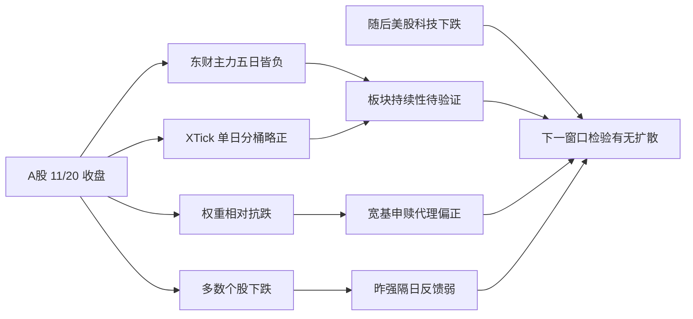

# 2026年11月23日 · 资金面

> 盘前全量｜已完成日 A股 11/20、美股 11/20（当地）｜部分降级｜置信度 0.2625

## 一句话结论

**权重相对抗跌，短线接力未修复；PCB 单日回流，半导体局部韧性未成板块合力。**

## 📉 大势与市场奖励

| 主力净额（东财；亿元） | 1日 | 5日 | 10日 | 20日 |
|---|---:|---:|---:|---:|
| 10/26—11/20 截至期末 | -520.88 | -1826.91 | -2451.52 | -4459.34 |
| 11/16—11/20 逐日（由早到晚） | -643.79 | -266.07 | -85.04 | -311.13 / -520.88 |

市场只给少数强势与部分权重奖励：11/20 **313 涨 / 5,236 跌 / 23 平**，个股中位数 **-5.08%**，28 涨停、58 跌停、7 炸板（与封板池合计口径炸板率 20%）。11/19 涨停池 23/23 有有效报价，11/20 **收盘反馈中位数 -5.08%**，正收益占比 30.4%；不是 11/23 竞价溢价。资金温度呈**主跌特征**，不是 R1 的正式风格/阶段裁决。

- **大资金意图**: 东财分桶里，超大 / 大单分别 -172.81 / -348.07 亿、小单 +488.12 亿；与风险资金减仓、对手盘承接相容，但订单规模不等于投资者身份或真实持仓变化。
- **为什么走强**: 强的是上证50相对表现，非普涨。沪深300 -0.76%，中证1000 -4.89%，昨强也没跑赢全体中位数；目前没看到有效扩散。
- **逻辑够不够硬**: 宽度与昨强反馈直接可比；市场主力方向并非双源一致。XTick 5,574 只 `Most+Big` 加总 **+23.59 亿**，东财市场 **-520.88 亿**。样本与分桶不同，不能抹掉冲突或把它当可相加的流量。

## 🧭 板块资金（不等于已核个股）

东财行业 **496** 个，496 个完整 20 日；单日正 51、5 日正 45、20 日正 32、5 日与 20 日双正 14。概念另算：554 个，516 个完整 20 日，双正 9；标签成分重叠，不加总为市场净额。XTick 申万 68 个返回标签含加权/重复分类，成分聚合仅作 T-1 截面参照：电子 -61.55 亿，与东财电子同负，金额不互换。20 日跷跷板：行业当日绝对主力前20配对，`ρ<-0.6` 且最近/前5日相对差翻转同时满足者 0 对；不外推至其他行业。

| 代表行业 | 11/20 涨跌 | 1日（亿） | 5日（亿） | 20日（亿） |
|---|---:|---:|---:|---:|
| 电子 | -5.76% | -130.35 | -253.56 | -770.21 |
| 半导体 | -6.86% | -109.45 | -130.45 | -165.26 |
| 印制电路板 | -0.10% | +20.39 | -4.17 | -234.57 |
| 元件 | -1.21% | +18.72 | -17.88 | -306.77 |
| 半导体设备 | -6.59% | -0.78 | +45.64 | +152.71 |
| 集成电路制造 | -3.91% | -6.78 | +36.30 | +35.83 |
| 生活用纸 | -4.84% | +3.08 | +13.95 | +61.49 |
| 个护用品 | -4.71% | +3.01 | +13.68 | +60.71 |
| 美容护理 | -4.60% | +1.49 | +9.71 | +44.66 |

### 印制电路板：观察单日回流，不确认主线
- **大资金意图**: `+20.39 亿` 与元件同步回流，且超声电子有单日榜净买；和少数弹性品种被交易相容，不能识别持续配置。
- **为什么走强**: PCB 指数仅 `-0.10%`，相对电子抗跌；却是 5 日、20 日均负，不能将日内活跃等同多数成分接力或硬催化。
- **逻辑够不够硬**: 行业中期反证明确；若指数重新转弱、已核强票失去同伴则撤销回流扩散假设。若次日行业与核心同步且多个成分跟随，才进入持续性复核。

### 半导体设备 / 集成电路制造：观察中期资金韧性，不确认趋势
- **大资金意图**: 两组 5/20 日均正，支持结构性配置假设；半导体大类与数字芯片设计的撤出说明并非整条产业链一致押注。
- **为什么走强**: 强在历史累计，不在 11/20 价格；两组均回撤，隔夜海外同链再下跌。中微公司资金靠前是个股证据，不代表设备板块普涨或地位已确认。
- **逻辑够不够硬**: 单一直接分类资金时序；需板块价格止跌与核心、同伴同向，不能从存储/CPO跨市场价格直接推导订单。

### 防御消费：观察对照，不作为进攻线
- **大资金意图**: 生活用纸、个护、美容护理多窗为正，和弱市防御性换仓相容，不能识别实际机构买方。
- **为什么走强**: 资金相对抗跌；未验证硬催化和可接力核心，净买不等于获得短线奖励。
- **逻辑够不够硬**: 仍是板块单口径。若宽度和高弹性板块普遍修复，防御相对优势可能收敛。

## 🔍 已核个股：昨日前十与龙虎榜

按东财 `moneyflow_dc` 11/20 截面 6,035 条去重证券记录选前十；逐日 11/16—11/20 **50/50** 有效（亿元）。XTick 另列 11/20，9/10 同向；新易盛方向相反，不为其挑选有利口径。均是资金样本，不是 R2/R5 候选、观察池首推或买入资格；`in_today_plan` 未知。

| # / 证券 | 11/16 | 11/17 | 11/18 | 11/19 | 11/20 | 5日 | 正日 | XTick 11/20 |
|---|---:|---:|---:|---:|---:|---:|---:|---:|
| 1 冰山冷热 000530.SZ | -1.20 | +2.93 | -1.85 | -0.96 | +8.93 | +7.85 | 2 | +8.79 |
| 2 新易盛 300502.SZ | -11.00 | -5.25 | -3.72 | +13.59 | +8.34 | +1.96 | 2 | -4.65 |
| 3 紫金矿业 601899.SH | +0.71 | -1.38 | -9.42 | -0.47 | +8.20 | -2.36 | 2 | +2.76 |
| 4 超声电子 000823.SZ | -0.14 | -0.40 | +1.13 | -1.09 | +8.11 | +7.62 | 2 | +8.60 |
| 5 贵州茅台 600519.SH | +5.16 | +2.20 | -2.52 | +0.26 | +7.97 | +13.08 | 4 | +11.48 |
| 6 东方海洋 002086.SZ | -2.49 | +0.87 | -1.54 | +1.24 | +5.63 | +3.72 | 3 | +5.31 |
| 7 长江电力 600900.SH | +2.76 | +0.40 | -0.24 | -0.29 | +4.75 | +7.38 | 3 | +7.77 |
| 8 中国平安 601318.SH | +3.78 | +0.48 | -2.09 | -1.39 | +4.66 | +5.45 | 3 | +7.89 |
| 9 中微公司 688012.SH | -2.33 | +3.80 | +4.97 | +8.01 | +4.39 | +18.85 | 4 | +8.22 |
| 10 华微电子 600360.SH | -0.25 | -0.02 | +0.47 | -0.11 | +3.96 | +4.04 | 2 | +7.05 |

5 日持续性上，**中微公司 / 贵州茅台** 均 4 天为正；**紫金矿业** 11/20 排名前三但 5 日 -2.36 亿，不能叫持续流入。逐票大宗 30 自然日与两融 15 交易日返回及日期在 JSON；接口未返回折溢价，不据此判断出货，无两融行不等于非融资标的。

11/20 龙虎榜 73 条 / 62 个去重代码（含 1 转债代码），5 日回看逐日披露。XTick 可配对 72 条均同号（同样依据交易所披露，不是 72 个独立事件）。筛到 **9 只收涨资金背离**，另有 **4 只收跌高换手净卖**。单日与累计披露不加总；榜单席位仅是披露部分，“诱多”是风险线索，不推断操纵意图、不硬否决。

| 代表性反证 | 收盘涨跌 | 换手 | 榜单净额（亿） | 当日东财主力（亿） | 披露窗口 |
|---|---:|---:|---:|---:|---:|
| 襄阳轴承 | +1.43% | +33.28% | -2.70 | -2.12 | 1d |
| 粤芯半导体 | +1.97% | +34.28% | -1.68 | -0.57 | 1d |
| 盛剑科技 | +10.00% | +17.14% | -0.42 | +0.38 | 3d |
| 超声电子 | +9.98% | +19.95% | +4.41 | +8.11 | 1d |

- **大资金意图**: 襄阳轴承、粤芯半导体是高换手收涨、披露榜和单日主力同卖，卖盘借强释放的解释有据；盛剑科技三日榜净卖、当日主力却正，不能等同单日净卖。
- **为什么走强**: 收盘涨幅未消除筹码分歧；超声电子在单日榜和全日主力同正，是确实存在的相反样本，不为弱市总判断删掉。
- **逻辑够不够硬**: 同窗口双负比三日榜对单日更强，但都只作风险反证；用下一窗口板块同伴与成交承接复核，不把个股净额替代地位、公告或 R6 硬否决。3 日同席位复买线索 14 组，已排 ST/炸板样本，公告只扫本地窗口，保守降档，不单独当成接力信号。

## 🏦 宽基、期货与两融

| 跟踪指数 | 11/20 指数涨跌 | 对应ETF | 11/20成交（亿） | 1日份额金额代理（亿） | 5日代理（亿） |
|---|---:|---|---:|---:|---:|
| 沪深300 | -0.76% | 510300.SH/159919.SZ | +416.54 | +371.94 | +722.90 |
| 中证1000 | -4.89% | 512100.SH/159845.SZ | +132.35 | +76.74 | +142.93 |
| 科创50 | -3.12% | 588000.SH/588080.SH | +154.09 | +48.30 | +160.69 |
| 中证500 | -3.93% | 510500.SH | +115.83 | +88.13 | +197.43 |
| 上证50 | +0.45% | 510050.SH | +243.38 | +216.73 | +230.05 |

- **大资金意图**: 8 只样本日度份额代理 +801.86 亿、5 日 +1454.00 亿。各产品单位为份，先比相邻复权因子，再以当日收盘估值后加总；成交额是双边交易。未核当日买方、首次可知时刻和持有人披露，不指认汇金，也不排除套利、调仓等解释。
- **为什么走强**: 沪深300两只同步，159919 全日成交为过去5日均值 7.02 倍；中证1000两只样本份额方向不一致，科创50两只增加也没换来科技普遍承接。日线只支持“权重相对抗跌”，不能识别尾盘或因果顺序。
- **逻辑够不够硬**: 11/20 实际合约 IF2612/IF2703 各贴水 85.56/169.56 点，近月持仓增加 2,992.0，到期月另列；不能从持仓直接识别多空。11/20 两融仅上交所已披露；沪深北最新完整 11/19 为 22,222.85 亿，未拿单所合计代全市场。ETF 只是有限样本，不推全市场真净申赎。

## 🌐 外部传导 · 11/20 美股收盘

标普 -3.70%、纳指 -5.28%、道指 -1.93%。12 只来自本次 `overseas_snapshot`，INTC/MRVL 为 Tushare 同日直补；SOX 未核到，8股等权 -11.68% 仅是具名代理，不替代官方指数。美股收盘在 A 股收盘之后，周五 A 股收盘未包含这段全时段反馈。

| 链条 | 已核个股（收盘涨跌） | 传导边界 |
|---|---|---|
| 半导体/存储 | NVDA -14.01% / MU -13.89% / AMD -13.25% / TSM -9.48% / INTC -7.97% | 存储、算力、设备/制造开盘情绪承压 |
| 互连/CPO/光纤 | AVGO -12.19% / MRVL -11.69% / GLW -10.94% | 风险溢价与接力压力，不是订单证据 |
| 大盘成长 | AAPL -1.90% / MSFT -2.77% / GOOGL -2.70% / AMZN -4.10% / META -5.93% / TSLA -7.64% | 全部下跌，跌幅较核心芯片缓和 |

- **大资金意图**: 跨美股科技链同步下跌支持风险偏好下移假设；只有价格，没有持仓或出货主体证据。
- **为什么走强**: 相对强仅指部分平台股跌幅较浅；存储与芯片共同下挫，不支持 A 股科技链靠外部催化加速。
- **逻辑够不够硬**: 同日收盘可验证，但隔夜价格不能推算 A 股竞价。若 A 股核心主动承接且同伴扩散，隔夜负向映射下调；汇率数据日历未核且缺可比涨跌，不下方向结论。

## ⚠️ 不确定性与下一观察窗口

**首选：指数权重相对承接，未扩散到短线。** 2026-11-23 竞价后第一个有可比宽度的窗口复核：上涨家数过半且中位数转正、昨强负反馈与跌停收敛、核心与至少两只同伴同向，才上调修复判断。备选是承接扩散后上调；若权重也失去相对承接，则下调至普弱。资金研究意见仅覆盖当前盘前窗口，不将宽基承接外推为固定仓位，不改变真实停买、有效硬预算（含 0）、仓位硬上限、T+1、人工确认及逐票硬否决。账户预算没核，保持未知。D1 用新证据独立重评，不把旧零仓或本次意见变成长期停买。

## 数据源审计

| 源 | 日期 | 状态 | 备注 |
|---|---|:--:|---|
| Tushare Pro `moneyflow_mkt_dc/ind_dc/dc` | 2026-11-20 | 🟢 | 大盘/板块20日；截面 6,035；前十50/50 |
| Tushare Pro `daily/index_daily/limit_list_d` | 2026-11-20 | 🟢 | 5,572 只有效宽度、报价与涨跌停；SSE交易日历核对 |
| Tushare Pro `top_list/top_inst/hm_detail` | 2026-11-20 | 🟢 | 11/16—11/20 五日；协同实际用末三日 |
| XTick `/doc/hot/money`、`/doc/hot/bk`、`/doc/order/longhubang` | 2026-11-20 | 🟡 | 5,574 只股票；68 板块标签；全市方向分歧，榜单可配对项同向 |
| Tushare Pro `fund_share/fund_daily/fund_adj/fund_basic/fut_daily` | 2026-11-20 | 🟢 | 8 只产品、3 期货合约；日频代理，主体/尾盘未知 |
| Tushare Pro `margin/margin_detail/block_trade` | 2026-11-20 | 🟡 | 全市场两融未齐；前十逐票15交易日与30自然日返回存证 |
| DataPro MCP | 2026-11-20 | 🔴 | 业务报 4013；服务健康不代表数据授权可用 |
| `overseas_snapshot` + Tushare 直补 | 2026-11-20 | 🟡 | 14 股完整，3 美股指数；SOX 无记录 |
| fetch manifest / mcp_health / 公告标题 | 2026-11-23 | 🟡 | 全局 severity=2；本地公告非候选全量核验 |

## 🔗 与其他阶段的关系

本阶段早于 R2/R5；只披露已核对象、实际来源和窗口，未读旧 R5 池替代本轮候选。R2 消费板块时序；既有 R5 对新一轮正式候选补必要资金，R6 用适用的同版证据判断，D1 独立决策，无须再开 R7 或指定供应商。北向仅供复盘参考，本批不采集、不计分、不触发门禁。

## 🧾 运行元数据

- `analyze_capital_flow_v1` · `data/research/20261123/R7_capital_flow.json`
- 实际盘前取数，不是回放；快照使用本轮 fetch，运行/源时间分列。资源用量未充分计量，不补零或保证低于努力目标。
