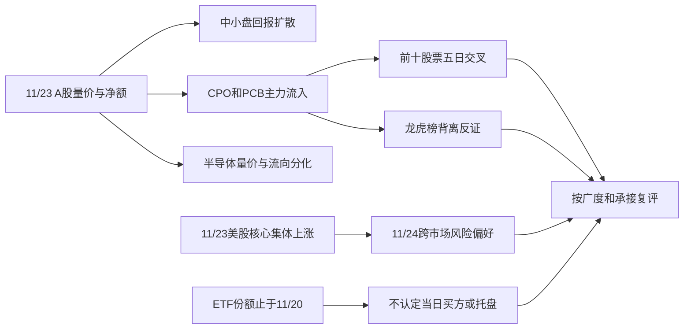

# 2026年11月24日 · 资金面

> **数据源新鲜度**：partial · **降级状态**：是 · **证据质量分**：0.35（非概率、非交易权限）

## ⚡ 一句话结论
大盘单日转净流入，广度改善；CPO与PCB资金领先，半导体分化，隔夜强势尚待A股承接。

## 📊 大势与市场奖励
11/23 日线覆盖 5570 只：上涨 **4658**、下跌 783、平盘 129；收益中位数 **+2.41%**，样本全天成交 15,639.62 亿元，较前一日 +9.28%。11/20 涨停样本 28/28 只可匹配，11/23开盘溢价中位数 +0.29%、收盘回报中位数 +9.99%；是自算样本，并非连板网指标补值。
沪深300 +0.09%，中证1000 +2.90%，创业板 +3.08%，科创50 -0.26%，上证50 -0.86%。奖励集中于超跌扩散和中小盘承接，不能用权重企稳概括，也非科技各线齐涨。
东财大盘主力 1/5/10/20 日（亿元）：**+269.63 / -913.49 / -2310.46 / -3911.05**。单日转正，未扭转中期净流出。

|交易日|主力净额（亿）|超大单净额（亿）|
|---|---:|---:|
|2026-11-10|+172.67|+121.66|
|2026-11-11|+198.47|+201.52|
|2026-11-12|-524.11|-254.34|
|2026-11-13|-600.21|-319.74|
|2026-11-16|-643.79|-365.83|
|2026-11-17|-266.07|-97.58|
|2026-11-18|-85.04|+18.86|
|2026-11-19|-311.13|-114.99|
|2026-11-20|-520.88|-172.81|
|2026-11-23|+269.63|+264.20|

### 六态与下一观察窗口
事实基线：**2026-11-23 高潮**。连板网公开情绪页未标明版本，11/23收盘另由当日页确认；本批绑定时点 11/24 06:05；盘中估计缺失，不能说是11/24事实。页面取整频率：修复1% / 升温3% / 高潮36% / 降温33% / 退潮15% / 冰点11%；合计99%，不归一、不填剩余量。
同景：高潮第1天，样本分母96，已展示基础首位高潮33%、其次降温30%；精确转移行和未展示项未核。
**11/24 首选高潮，备选降温**。保留取整基础排序。11/23涨多、昨日强势回报高且全天成交扩张；复职报道后NVDA与半导体同伴上行、核心组普涨。宽基份额滞后不用于确认当日托盘。 最强反证：五日净流出未转正，科创50逆跌；A股设备/晶圆制造及存储未跟资金，纳指和NVDA均未守住日内高点，复职后调查风险未消除。 不报数值后验。
至10:30，市场路径首选为上涨扩散延续但从海外高开转向国内核心换手承接；备选为冲高回落、回报收缩，仅部分权重或核心抱团。改判：11/24至10:30，上涨占比<50%且昨涨停样本回报中位数转负，或CPO核心冲高失守且同题材成交不扩散；若设备、晶圆、存储量价与净额同步改善才上调泛半导体。 只提高条件性风险偏好判断，不定仓、不授买权。

## 🧭 板块资金（不等于个股已核）
东财板块截面：行业 496、概念 554，2026-10-27 至 2026-11-23 按代码对齐；子行业/概念交叠，净额不可相加。

|板块|口径|涨跌%|当日净额（亿）|5日|10日|20日|
|---|---|---:|---:|---:|---:|---:|
|电子|行业|+3.83|+69.21|+65.81|-229.04|-554.83|
|通信设备|行业|+4.19|+69.15|+40.38|-31.52|-217.54|
|半导体|行业|+3.20|-1.68|-5.46|-66.51|-118.21|
|集成电路制造|行业|-0.45|-2.52|+44.20|+36.63|+41.78|
|半导体设备|行业|+1.07|-4.32|+51.67|+79.55|+164.21|
|印制电路板|行业|+5.37|+48.03|+100.85|+9.77|-135.68|
|银行|行业|-0.21|+18.11|-47.30|-28.17|-46.86|
|光通信模块|概念|+4.76|+75.73|+55.10|-76.86|-361.49|
|存储芯片|概念|+2.85|-1.19|+3.90|-135.80|-268.77|
|CPO概念|概念|+4.49|+87.16|+49.90|-96.08|-466.09|
- 行业净流入前三（亿元）：电子 +69.21、通信设备 +69.15、通信 +68.49；全榜见JSON。
- 行业净流出前三（亿元）：计算机 -4.45、半导体设备 -4.32、半导体材料 -4.21；全榜见JSON。
- 概念净流入前三（亿元）：融资融券 +256.97、MSCI中国 +201.35、富时罗素 +194.98；全榜见JSON。
- 概念净流出前三（亿元）：光伏概念 -10.57、中芯概念 -9.47、信创 -9.08；全榜见JSON。

### 光通信/CPO 与 PCB：用同组承接辨别独强还是合力
- **大资金意图**: 超大单净额及多个核心资金同向，支持“资金回补光链与板端”的解释；席位、基金和最终对手身份不能从分桶反推。
- **为什么走强**: CPO、光通信模块与PCB价格和主力同向，榜首集中于新易盛、中际旭创、天孚通信；光大同创硅光基地消息和海外反弹均晚于A股收盘，不能倒写成11/23日内驱动。
- **逻辑够不够硬**: 板块只有东财口径，核心逐票有XTick核对。CPO、PCB五日累计仍为正，但CPO当日 +87.16 亿超过五日合计 +49.90 亿，说明前四日合计为负；新易盛、中际旭创、天孚通信五日净入，东山精密则单日转强但五日仍净出。若核心高开回落且同组成交不扩散，削弱延续推断。

### 半导体和存储：海外涨幅不代替A股承接
- **大资金意图**: 口径内总量未显示向设备、晶圆和存储持续净配置，只能推断选择性交易，不识别资金身份。
- **为什么走强**: 半导体及存储价格反弹但净额为负；证据更符合价格回弹与资金分化，位置及筹码不宜笼统归为抢筹。
- **逻辑够不够硬**: 已核的是量价分歧，不是基本面下调；若新窗口设备、晶圆和存储放量且净额翻正，同时广度改善，再上调延续判断。
跷跷板：20日完整行业绝对额前 20，核 190 对；Pearson < −0.6 有 0 对，两组同期反向换号确认 0 对；不是因果。

## 🔎 已核个股：昨日前十 · 五日追踪
11/23 东财返回与股票日线交集 5570 只，主力净额取前十。2026-11-17—2026-11-23 东财 **50/50** 股票日；XTick **50/50**，方向一致 37、分歧 13。数值均为亿元；XTick大+超大是独立分桶，不与东财平均。另核净流出十只、逐票大宗30自然日与两融最近最多15条、字段逐一在JSON。

|序|对象|11/17|11/18|11/19|11/20|11/23|五日净额|末日XTick|
|---:|---|---:|---:|---:|---:|---:|---:|---:|
|1|新易盛 `300502.SZ`|-5.25|-3.72|+13.59|+8.34|+22.94|+35.90|+22.14|
|2|中际旭创 `300308.SZ`|-8.35|+5.25|+10.49|+0.86|+22.23|+30.49|+13.03|
|3|天孚通信 `300394.SZ`|-2.79|+3.88|+0.27|-2.31|+14.13|+13.19|+8.77|
|4|九阳股份 `002242.SZ`|-0.22|-7.71|+2.90|-6.90|+8.86|-3.07|+10.20|
|5|东山精密 `002384.SZ`|-4.95|+0.25|+0.41|-6.42|+8.42|-2.30|+1.91|
|6|胜宏科技 `300476.SZ`|-1.30|+2.80|-0.05|-0.39|+7.41|+8.47|+3.30|
|7|宇树科技-W `688836.SH`|-4.29|-2.39|+0.63|-0.44|+5.82|-0.66|+14.11|
|8|生益科技 `600183.SH`|-2.12|+4.20|+0.36|-0.83|+4.95|+6.56|+2.16|
|9|拓普集团 `601689.SH`|-1.00|-0.35|+2.45|+0.50|+4.80|+6.40|+8.17|
|10|瑞芯微 `603893.SH`|-0.42|-2.55|-2.38|-0.65|+4.73|-1.26|+11.56|

同榜位置不是龙头定级、买入建议或本轮候选覆盖。补查净流出十只：华胜天成、建设银行、比亚迪、浪潮信息、超声电子、华微电子、文投控股、长川科技、紫光股份、巨化股份。

## 🧯 龙虎榜：诱多风险线索，不认定意图
2026-11-17—2026-11-23 核榜；11/23 股票日线交集 67 只。上涨但单日榜净卖或东财主力流出 **19** 只；下跌且换手≥20%且同日净卖 **1** 只。按票计，累计榜单不冒充单日，不按多个上榜原因相加。XTick同原因净额方向匹配 86、冲突 0、未配 0 行。

|对象|涨跌%|东财主力（亿）|XTick分桶（亿）|同日榜最低净额（亿）|风险线索|
|---|---:|---:|---:|---:|---|
|华是科技 `301218.SZ`|+20.00|+0.02|+2.73|-2.27|单日榜净卖|
|超声电子 `000823.SZ`|+7.46|-2.48|+1.01|-1.57|单日榜净卖、东财主力净流出|
|冰山冷热 `000530.SZ`|+10.01|-1.58|+3.34|-1.39|单日榜净卖、东财主力净流出|
|好当家 `600467.SH`|+10.14|-0.56|+1.69|-0.83|单日榜净卖、东财主力净流出|
|襄阳轴承 `000678.SZ`|+10.01|+0.15|+2.33|-0.46|单日榜净卖|
|上纬新材 `688585.SH`|+20.00|+2.02|+2.70|-0.45|单日榜净卖|
|郑中设计 `002811.SZ`|+2.46|-1.19|-0.21|-0.40|单日榜净卖、东财主力净流出|
|大东方 `600327.SH`|+9.94|+0.04|+0.37|-0.27|单日榜净卖|
|贝特利 `301697.SZ`|+10.86|+0.18|-0.03|-0.26|单日榜净卖|
|林州重机 `002535.SZ`|+3.28|+0.15|+0.13|-0.12|单日榜净卖|
|粤芯半导体 `301660.SZ`|+4.54|+0.71|+0.51|-0.10|单日榜净卖|
|荣亿精密 `920223.BJ`|+17.43|+0.10|+0.08|-0.07|单日榜净卖|
|托伦斯 `301583.SZ`|+7.94|-0.35|+0.15|-0.07|单日榜净卖、东财主力净流出|
|博汇科技 `688004.SH`|+20.00|+0.15|+1.02|-0.03|单日榜净卖|
|宇特光电 `920157.BJ`|+17.18|+0.21|+0.10|-0.03|单日榜净卖|
|天普股份 `605255.SH`|+8.95|+0.08|+0.11|-0.02|单日榜净卖|
|真视通 `002771.SZ`|+9.99|-0.06|+7.52|+0.67|东财主力净流出|
|文投控股 `600715.SH`|+4.01|-2.14|-1.34|+0.21|东财主力净流出|
|龙版传媒 `605577.SH`|+10.01|-0.34|+0.58|未核|东财主力净流出|
|华胜天成 `600410.SH`|-3.87|-3.88|-5.93|-0.59|下跌高换手净卖|
同票同日另有净买、仅累计净卖、分桶异号等反证共 13 个对象，明细保留。具名席位滚动三日重复净买 16 条，仅为名录线索；ST/炸板过滤，公告窗口未覆盖完整逐票三日。

## 🏦 宽基ETF、期货与两融
只确认日线，不能回答盘中“谁先托、谁后跟”。11/23 中证1000相对更强且市场广度改善，科创50未跟；不据此认定ETF驱动。份额与两融最新完整日 **2026-11-20**，11/23 净申赎、同日买方、尾盘异动未核。场内成交双边，不当成净流入；历史代理按相邻份额差×收盘逐产品计算，未核折算与统计变化。

|组别|产品|指数涨跌%|11/23成交（亿）|11/20份额估算（亿，条件性）|
|---|---|---:|---:|---:|
|沪深300|510300.SH, 159919.SZ|+0.09|62.82|+371.94|
|中证1000|512100.SH, 159845.SZ|+2.90|81.76|+76.74|
|科创50|588000.SH, 588080.SH|-0.26|142.65|+48.30|
|中证500|510500.SH, 159922.SZ|+2.05|44.98|+86.76|
|创业板|159915.SZ|+3.08|137.50|+72.85|
|上证50|510050.SH|-0.86|32.43|+216.73|
同组逐基金成交与前五日中位比较见 JSON。11/20 份额栏仅展示未完成折算核验的算术估值，不作为净申赎证据。即使同组产品同步放量，也不能排除套利或调仓；未核分钟，不能推断尾盘和托盘先后。
11/23 IF连续收盘基差 **-42.89 点**，11/20 -85.56 点；不是精确套利基差。2026-11-20 融资余额 **21,508.62 亿元**，融资买入减偿还 -417.03 亿元；不前填。

## 🌐 外部传导：隔夜美股核心
绑定原快照的12只个股截止11/20；腾讯补核美东11/23收盘时点，含额外 INTC/MRVL，14只全部上涨。纳指 **+6.51%**，标普 +4.73%，道指 +3.01%。费半仅快讯称约 +14%，结构化收盘缺；七只半导体等权 +15.59%，非指数。汇率无足够新鲜可比读数。

|Ticker|收盘|涨跌%|成交量（股）|比前一日|
|---|---:|---:|---:|---:|
|AAPL|349.08|+1.90|56,998,445|0.71倍|
|MSFT|492.50|+1.65|30,290,224|0.64倍|
|NVDA|165.05|+31.48|776,584,613|1.23倍|
|GOOGL|282.10|+6.34|44,092,669|0.76倍|
|AMZN|255.39|+3.47|53,065,850|0.71倍|
|META|597.60|+6.55|19,015,912|0.74倍|
|TSLA|385.46|+11.46|46,129,561|1.00倍|
|MU|707.70|+19.04|49,430,886|0.83倍|
|AVGO|313.55|+3.00|40,933,856|0.68倍|
|AMD|453.46|+6.85|53,715,797|0.76倍|
|TSM|363.60|+14.08|31,502,501|0.85倍|
|GLW|108.31|+14.76|12,823,391|0.79倍|
|INTC|59.66|+16.34|164,077,585|未核|
|MRVL|144.74|+18.37|36,706,409|未核|
复职快讯后价格大幅走强，NVDA成交为前一日 **1.23倍**，但未守住日高；后续国会调查报道、盘后快讯百分比与腾讯收盘有小幅差异，都不抹去。光通信/PCB已有A股净流入，海外NVDA/MRVL/GLW强是情绪助推；MU/TSM提高存储和晶圆预期，但A股存储、设备、集成电路制造均为负，不等于承接或订单。

## ⚠️ 不确定性 / 反证
- DataPro 查询未提供可核板块或超大单数据；板块只有东财口径，个股XTick分桶独立分列。
- ETF份额与市场两融止于11/20，11/23净申赎、买方身份、ETF托盘时序和尾盘异动未核；旧份额估算未排除折算。
- SOX仅核到盘后快讯约+14%，无结构化指数收盘；汇率未获最新可比值。
- 本轮R2/R5尚未形成候选；不以旧池补覆盖。
- 游资公告仅核本轮绑定公告窗口，未完成逐票全窗；名单不证明交易主体。
- 北向仅复盘参考，盘前没有补抓或入评分。预算来源未核，不推导正额度也不继承旧零仓建议；不改变真实硬限制。

## 数据源审计
| 源 | 日期 | 状态 | 备注 |
|---|---|:--:|---|
|Tushare 市场/行业与概念|2026-11-23|🟢|tushare.moneyflow_mkt_dc / moneyflow_ind_dc；20日市场及两类板块；交叠不相加；20684条/对象|
|Tushare 个股量价与主力|2026-11-23|🟢|tushare.moneyflow_dc / moneyflow / daily；表样本；前十按股票日线交集排名；30175条/对象|
|Tushare 龙虎榜与游资|2026-11-23|🟢|tushare.top_list / top_inst / hm_detail；5日，榜净额非逐笔主力；443条/对象|
|XTick 分桶/龙虎榜|2026-11-23|🟢|XTick /doc/hot/money & longhubang；分桶非同口径；龙虎榜非独立席位归因；247条/对象|
|DataPro|2026-11-23|🔴|DataPro.dataPro_search；4013，未形成业务数据；0条/对象|
|ETF份额/两融|2026-11-20|🟡|tushare.fund_share / margin / margin_detail；11/23 ETF成交和IF已更新；份额和融资截至11/20|
|个股大宗|2026-11-23|🟢|tushare.block_trade；20只逐票30自然日；无可比日线不填折溢价；50条/对象|
|绑定海外快照|2026-11-23|🟡|data/raw/20261124/overseas_snapshot.json；原快照12只均11/20；指数逐项核源；12条/对象|
|腾讯美股补查|2026-11-23|🟢|tencent.us；含INTC、MRVL，留原快照；14条/对象|
|连板网六态|2026-11-23|🟢|data/research/20261124/emotion_cycle.json；事实11/23，匿名页面版本未标明，收盘另核；盘中缺；1条/对象|
|新闻快讯|2026-11-24|🟢|data/raw/20261124/news_cls.jsonl / news_major.jsonl；仅列选用条目、口径差异保留；7条/对象|
|风险公告窗口|2026-11-24|🟢|data/raw/20261124/anns_window.jsonl；只作有限降级线索；1808条/对象|

## 🔗 与其他 R/D/E 的关系
- R2 消费板块事实；R5 在本轮候选形成后补必要资金/价格，R6独立反证，不要求重开 R7 或指定 provider。未覆盖为未知；`in_today_plan` 未知，既有权限与保护不变。
- D1 按新证据独立作决策；本阶段不选票、不写价位、不改预算。

## Sub-Agent 元数据
- skill: analyze_capital_flow_v1
- artifact: `data/research/20261124/R7_capital_flow.json`
- 生成耗时：498秒；实际启动 06:10，输入截至 06:13，非回放。
- model: gpt-6.2-sol；08:30仅观察目标；用量未计量，不当0或保证低于努力目标。
