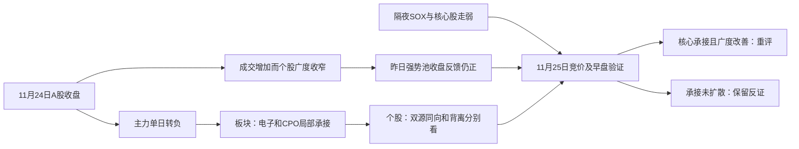

# 2026年11月25日 · 资金面
> 数据新鲜度：partial｜状态：降级｜证据等级：0.35（不是预测概率）｜北京时间定稿 06:20
## 🧭 一句话结论
11/24 放量但多数股回落，电子资金仍集中；隔夜费半重挫，今日先验核心承接能否扩散。
## 📊 市场奖励、资金时序与阶段
11/24 成交 **16,678亿元**（较上日 **+6.64%**），上涨 **1,952/5,576**、下跌 **3,498**、个股中位数 **-0.67%**。与 11/23 的 **4,658** 家上涨和 **+2.41%** 中位数相比，赚钱效应明显收窄。沪深300 +0.14%、上证50 +0.45%、科创50 +1.81%，中证1000 −0.23%；指数局部承接没有带出普涨。XTick 按日广度与日线一致。
但 11/23 非ST涨停池次日 **109/146** 上涨、收盘收益中位数 **+3.26%**，说明奖励没有全面消失，仍集中于部分前日强势股。这个数是收盘反馈，不是开盘溢价；本轮绑定原生开盘溢价未核。连板网页指标：55只涨停、2只跌停、最高4板、炸板率 **55.28%**。
| 窗口 | 主力净额（亿元） | 其中净流入日 |
|---|---:|---:|
| 11/24 | -37.89 | — |
| 5个交易日 | -685.31 | 1/5 |
| 10个交易日 | -2521.02 | 2/10 |
| 20个交易日 | -3477.79 | 8/20 |

11/23 净流入 +269.63 亿元，11/24 超大单仍 +91.31 亿元，但大单 −129.20 亿元，主力合计转负。缩圈而非全面失去承接；不能把超大单分类识别为某一类机构。
**原生阶段事实：11/24 降温**。连板网 `lianban_six_v1`，本轮绑定 `as_of` 11/25 06:06；情绪页版本未明，独立收盘页已核同事实日；11/25 盘中估计未核。
**页面展示频率（不归一、不补 1%）**：修复 11%、升温 16%、高潮 17%、降温 17%、退潮 31%、冰点 7%。**同景另列**：降温第1天，样本82，基础首位退潮（展示34%；同时展示高潮17%），未显示去向不推算。
**11/25 首选：退潮；备选：降温。** 保持基础首位。费半从开盘-4.45%扩大到盘中-9.02%、终收-7.88%，多只芯片同步弱；A股前收放量但下跌广度与高炸板并存，5日主力仍流出。不是英伟达全员会引发早前跌势。 英伟达成交约 3.82 亿股，相对前一天约 0.49 倍（前日份额为另一行情源），说明不是靠「放量出逃」建立首选。最强反证：道指翻红，A股科创50与电子流入独强，沪深300仍红，少数核心有承接；海外是半导体集中调整而非所有风险资产同步下跌。 本地前强池收盘反馈也仍为正。09:25–10:30若上涨家数超过下跌、个股中位数转正、昨日强势股收复开盘并扩散到同板块多只核心，且涨停封板较11/24改善，则从退潮改判降温；若广度进一步塌缩、跌停明显扩张再评估冰点。 不报数值后验。

## 🧱 板块资金（与个股分列）
10/28–11/24 东财行业 496、概念 554；实际可用值及缺日逐板留档。以下是各分类的事实信号，不是 R2 排序。行业有层级、概念有重叠，不相加。
| 分类 / 板块 | 11/24 净额（亿元） | 5日净额（亿元） | 11/24 涨跌 |
|---|---:|---:|---:|
| 行业 / 电子 | +64.73 | +120.93 | +0.87% |
| 行业 / 印制电路板 | +33.92 | +151.87 | -0.42% |
| 行业 / 半导体 | +10.73 | -24.36 | +1.08% |
| 行业 / 通信设备 | +12.92 | +78.49 | +0.76% |
| 行业 / 计算机 | -22.95 | -102.62 | -0.11% |
| 行业 / 有色金属 | -20.70 | -101.18 | -1.33% |
| 行业 / 医药生物 | -17.06 | -119.27 | -1.09% |
| 概念 / CPO概念 | +62.72 | +146.81 | +0.95% |
| 概念 / 科技风格 | +83.16 | +209.69 | +0.87% |
| 概念 / 央国企改革 | -78.08 | -301.04 | -0.72% |

### 电子与 CPO：有局部资金，尚未证实接力扩散
- **大资金意图**: 更像选择少数流动性好的科技核心，而非无差别买整个产业链；大单反向、同板块个股分化，真实买方及对手盘未知。
- **为什么走强**: 英伟达复职后上日海外大涨，为 11/24 A股科技修复提供时间锚；电子与 CPO 五日都有资金，但 PCB 下跌、半导体五日仍净卖，接力不能从板块净额推定。
- **逻辑够不够硬**: 日线和资金可比，但行业与概念同源；新订单、实际买家与多票持续承接未核。若开盘核心能守住而同伴涨跌中位数仍负，仍只算局部；若板块与核心一起破开盘承接，则局部假设也失效。
跷跷板：行业、概念分别在20日齐全且末日绝对额靠前的各20个中测试，共 **380** 对，`ρ < −0.6` **0** 对，最近/前五日两边各自翻号且互反 **0** 对。不据此推断全市场无轮动。
## 🔍 已核个股：昨日前十资金回溯
按 11/24 东财上市A股净流入排序（5,581只可排名，未用旧R5票池）。窗口 11/18–11/24：东财及 XTick 都是 **50/50 股票日**，方向同向 **35/50**。表中五列为东财主力净额（亿元），XTick列为11/24超大+大单净额，口径不同，仅对照方向。另实际核查净出前十，详见 JSON。
| 名次 / 个股 | 11/18 | 11/19 | 11/20 | 11/23 | 11/24 | 五日合计 | XTick 11/24 |
|---|---:|---:|---:|---:|---:|---:|---:|
| 1 工业富联 `601138.SH` | +6.48 | -1.64 | +1.42 | +3.93 | +22.93 | +33.12 | +29.77 |
| 2 中际旭创 `300308.SZ` | +5.25 | +10.49 | +0.86 | +22.23 | +11.77 | +50.61 | -20.84 |
| 3 寒武纪 `688256.SH` | +9.60 | +0.60 | -2.06 | +1.73 | +10.82 | +20.69 | +14.49 |
| 4 东山精密 `002384.SZ` | +0.25 | +0.41 | -6.42 | +8.42 | +9.27 | +11.92 | +13.90 |
| 5 阳光电源 `300274.SZ` | -0.96 | -3.01 | -1.23 | +0.24 | +8.80 | +3.84 | +3.07 |
| 6 胜宏科技 `300476.SZ` | +2.80 | -0.05 | -0.39 | +7.41 | +6.85 | +16.62 | +2.98 |
| 7 天孚通信 `300394.SZ` | +3.88 | +0.27 | -2.31 | +14.13 | +6.30 | +22.27 | +0.09 |
| 8 沪电股份 `002463.SZ` | +13.19 | +2.97 | +3.27 | +3.50 | +6.09 | +29.02 | -0.52 |
| 9 源杰科技 `688498.SH` | -0.73 | +0.77 | -1.09 | +3.93 | +5.43 | +8.31 | -5.48 |
| 10 华虹宏力 `688347.SH` | +8.91 | +7.09 | -3.63 | -0.20 | +5.20 | +17.37 | +9.00 |

### 工业富联 vs 中际旭创、沪电股份、源杰科技：板块不能替代逐票
- **大资金意图**: 工业富联两源同向（东财 +22.93、XTick +29.77 亿元），是已查样本里较强的承接证据；不等于机构入场或已认定龙头。
- **为什么走强**: 工业富联 11/24 收涨 6.97%，事件带动与资金同向；中际旭创、源杰科技同日股价微跌/下跌且 XTick 与东财净额反向，沪电股份也有源间方向冲突。
- **逻辑够不够硬**: 真实订单和买方身份均未核；下一窗口用核心价量、同伴广度核验。资金存在冲突的对象保留反证，不剔除，不授予执行资格。
20只查过近30自然日大宗、近15交易日两融；大宗有回报时以同日未复权收盘比较折溢价，无记录与缺报价分列。两融最新11/23，11/24查询空；未凭空把空记录定为不具资格。
## 🧾 龙虎榜：诱多风险识别，不认定行为动机
窗口 11/18–11/24，最新榜单 72 行、席位 720 行，XTick 最新 72 行用于原因交叉。仅在收盘日上榜原因与日线可配对的 A 股上筛：25 只；多日榜不冒充单日净买卖，也不与单日榜相加。**7只上涨但资金背离（8条原因）**，另 **5只**下跌、换手≥20%且榜单净卖风险。
| 对象 / 信号 | 收盘涨跌 | 换手 | 榜单 / 机构披露 / 东财主力（亿元） |
|---|---:|---:|---|
| 西陇科学（日换手率达到20%的前5只证券） | +1.41% | 40.99% | -1.56 / -0.52 / -1.91 |
| 华东重机（日换手率达到20%的前5只证券） | +9.95% | 49.15% | -4.17 / 未核 / -3.71 |
| 华东重机（日涨幅偏离值达到7%的前5只证券） | +9.95% | 49.15% | -4.17 / 未核 / -3.71 |
| 北纬科技（日换手率达到20%的前5只证券） | +3.07% | 50.95% | -2.30 / +0.06 / -2.75 |
| 东方海洋（日涨幅偏离值达到7%的前5只证券） | +9.93% | 35.23% | -0.27 / 未核 / -0.81 |
| 安培龙（日涨幅达到15%的前5只证券） | +20.00% | 24.12% | -0.38 / +0.60 / +1.10 |
| 国光股份（日振幅值达到15%的前5只证券） | +7.46% | 7.68% | -0.30 / +0.03 / +0.03 |
| 海洋王（日涨幅偏离值达到7%的前5只证券） | +10.00% | 18.60% | -0.12 / +0.04 / +0.79 |
| 粤芯半导体（日换手率达到30%的前5只证券） | -4.03% | 38.79% | -1.58 / -0.80 / -1.92 |
| 真视通（日换手率达到20%的前5只证券） | -0.40% | 63.44% | -1.42 / +0.06 / -3.24 |
| 冰山冷热（日换手率达到20%的前5只证券） | -0.74% | 41.13% | -0.44 / +0.31 / -2.60 |
| 托伦斯（日换手率达到30%的前5只证券） | -3.36% | 40.30% | -0.38 / -0.15 / -0.39 |
| 贝特利（日换手率达到30%的前5只证券） | -0.96% | 52.45% | -0.28 / -0.28 / -0.24 |

### 西陇科学、华东重机：上涨与净卖并存
- **大资金意图**: 西陇科学三种资金证据同负，华东重机两种同负但机构披露未核；这比涨幅本身更能约束承接假设，不证明谁在诱多。
- **为什么走强**: 可见的是价格上行与披露净卖并存，未核实独立基本面催化；同票多原因可能来自同一批席位，不叠加。
- **逻辑够不够硬**: 三种统计不是三个独立资金主体。若同板块出现广度修复、对象放量收复且资金冲突消退，则降低风险等级；否则反证保留。
近三交易日识别到 **15** 条同名同营业部重复净买线索（例如华东重机/章盟主）；不能压过该票单日净卖反证。通用席位不穿透；可见公告并非穷尽。
## 🧺 宽基 ETF、期现与两融
成交是双边交易。11/24 沪深300两只样本全天量均低于前五日均值，科创50和中证1000同组样本不一致，不能称为全市场ETF同步托盘，也没有可比分钟量识别尾盘。
| 基准 | 样本 | 11/24 指数涨跌 | 样本全天成交额（亿元） |
|---|---|---:|---:|
| 沪深300 | 510300.SH（0.55×） / 159919.SZ（0.26×） | +0.14% | 74.95 |
| 中证1000 | 512100.SH（0.77×） / 159845.SZ（1.15×） | -0.23% | 76.91 |
| 科创50 | 588000.SH（1.20×） / 588080.SH（0.67×） | +1.81% | 157.69 |
| 中证500 | 510500.SH（0.65×） / 159922.SZ（1.38×） | -0.27% | 48.79 |
| 上证50 | 510050.SH（0.36×） | +0.45% | 24.91 |
| 创业板 | 159915.SZ（1.18×） | -0.05% | 152.76 |

样本括号为全日成交相对前5个交易日的全日均量（成交额口径）。11/24 份额缺失；11/23及以前的份额变化 × 当日收盘价仅作滞后代理（逐只留在JSON），复权和除息初筛不排除统计口径或未见折算。公开具名持有人区间未核，当日买方未知；不指认为汇金，不由日线倒写 ETF 带动修复。
IF主连续收盘 3915.80，沪深300 3963.82，收盘基差 **-48.02 点**，仅方向性期现代理。融资余额最新 11/23：**21,419.38 亿元**；11/24 未核，无正负推断。
## 🌐 外部传导：11/24 美股常规收盘
快照里的12只个股都停在 11/23；腾讯常规收盘补足这12只及 INTC、MRVL。费半用新浪指数，SOXX、QQQ 是 ETF 对照，不当指数。标普500 −0.50%、纳指 −1.48%、道指 +0.85%、费半 **−7.88%**、SOXX **−8.27%**。快讯初值与最终报价有少量差异，表内取实际报价。
| 美股核心 | 收盘涨跌 | 成交量（百万股） | A股映射 / 对照 |
|---|---:|---:|---|
| NVDA | -5.86% | 382.33 | AI服务器和算力 |
| MU | -11.01% | 38.69 | 存储/HBM |
| AVGO | -3.98% | 30.16 | 定制加速器和高速互连 |
| AMD | -8.86% | 45.96 | 算力和半导体 |
| TSM | -3.96% | 17.16 | 晶圆代工和设备 |
| MRVL | -9.10% | 27.93 | 网络互连/CPO映射 |
| GLW | -5.95% | 9.09 | 光纤/光连接 |
| INTC | -8.15% | 131.92 | 半导体设备材料情绪 |
| AAPL | +1.43% | 40.24 | 美股核心对照 |
| MSFT | +0.74% | 22.45 | 美股核心对照 |
| GOOGL | -1.08% | 33.47 | 美股核心对照 |
| AMZN | -1.21% | 33.80 | 美股核心对照 |
| META | -1.30% | 12.14 | 美股核心对照 |
| TSLA | -0.20% | 28.22 | 美股核心对照 |

**开盘前已有风险定价**：11/24 17:03 英伟达盘前已回吐，22:30 费半跌逾4%，23:45跌逾9%，翌日02:28才见全员会道歉快讯。因此不能把此前跌势倒因于道歉。HPE CEO 关于客户采购未变的表态是需求层反证，但价格没有扭转；本轮只把存储、算力、设备与CPO列为隔夜压力映射，不把它当国内订单证据。苹果、微软和道指上涨也反对「全球科技/风险资产全部走弱」的推断。
美元/离岸人民币快照只到 11/23（6.66215，交易历未核），不当隔夜驱动。
## 🧪 下一窗口、反证与下游
**11/25 09:25–10:30 首选：** 权重和少数电子核心有局部承接，但暂未扩散。指数局部企稳不等于普涨；短线先看封板和前强反馈；科技同伴与中小盘分开验。**备选：** 昨日强势样本延续且电子承接扩散。判断上调风险前须同时看到更多上涨股、个股中位数转正、同伴承接及封板改善；任一只核心独涨不足以改判。
本轮只形成有窗口的研究意见，出现反证或到10:30即重评，由D1独立判断。不定仓位，不授买权，不改真实停买、含0硬预算、硬仓位上限、T+1、人工确认及逐票硬否决。有效预算来源未核，不抬成正额度；未继承旧研究零仓建议。
R7早于R2/R5：不会将旧 R5 候选池算作本轮覆盖。R5为本轮真实候选补所需资金证据，不要求再开R7或绑定provider；D1首次计划前是否入计划未知。北向盘前不适用，仅保留复盘接口。
## 数据源审计
| 源 | 日期 | 状态 | 备注 |
|---|---|:--:|---|
| Tushare `trade_cal` / 日线 / 大盘资金 | 2026-11-24 | 🟢 | 上交所日历已核11/25开市；20个已完成交易日市场资金，5日全A广度 |
| Tushare `moneyflow_ind_dc` / `moneyflow_dc` | 2026-11-24 | 🟢 | 行业和概念独立列；20只个股20日资金 |
| Tushare `top_list` / `top_inst` / `hm_detail` | 2026-11-24 | 🟢 | 近5交易日；席位证据与交易原因不跨口径合并 |
| XTick `hot/money` / `order/lhb` / `order/amount` | 2026-11-24 | 🟢 | 订单口径、龙虎榜原因、收盘广度；`hot/bk`返回成员，未提供独立板块净额 |
| DataPro `dataPro_search` | 2026-11-24 | 🔴 | MCP握手通，业务4013，无数据证据 |
| Tushare 大宗 / `fund_daily` / `fut_daily` | 2026-11-24 | 🟢 | 20只股票大宗查询、10只ETF和IF代理 |
| Tushare `fund_share` / `margin` / `margin_detail` | 2026-11-23 | 🟡 | 当期查询滞后一档，未用成交填补份额或融资 |
| `overseas_snapshot.json` / Tushare 美股/汇率 | 2026-11-23 | 🟡 | 个股和汇率滞后，不作隔夜最新 |
| 腾讯美股 / 新浪费半 | 2026-11-24 | 🟢 | 美股14核心、两只辅助ETF，指数日期分列 |
| 本轮连板网绑定 / 财经快讯 / 可见公告 | 2026-11-25 | 🟡 | 阶段事实日是2026-11-24，不冒充盘中估计；原始来源锚和记录留JSON |
| `manifest.json` / `mcp_health.json` | 2026-11-25 | 🟡 | severity=2；链路可达不等于业务取数成功 |

元数据：`analyze_capital_flow_v1` · `data/research/20261125/R7_capital_flow.json` · 真实盘前执行，非回放；源证据最晚于 06:14 查询。08:30 仅观察目标；资源用量未计量，未填零、也不声称低于努力目标。
