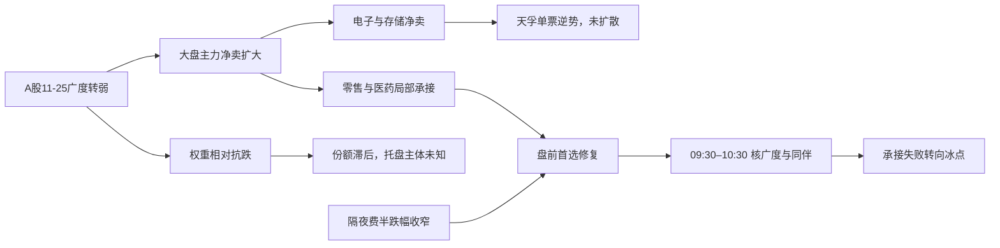

# 2026年11月26日 · 资金面

> **数据源新鲜度**：部分降级｜**资料质量分**：0.42（不是胜率）｜A股事实日 11-25｜盘前时序不是回放。

## ⚡ 一句话结论
**大盘净卖放大、资金向局部防御集中；隔夜抛压收窄，开盘先检验局部修复，不预判全面反转。**

## 🌐 市场奖励：相对抗跌不等于普遍赚钱
11-25，上证 **-2.03%**、深成指 **-3.24%**、创业板 **-4.19%**。A股返回日线 `5,573` 只中 `586` 涨、`4,926` 跌、`61` 平，上涨占比 `10.5%`（11-24 `35.0%`），中位 `-3.77%`；成交 `13,926.60亿`，较前日 `-16.50%`。跌时缩量不是抛压已消失。
同口径涨停 `51`、跌停 `43`、炸板 `30`，炸板率 `37.0%`，5板中京电子；高标存在，但11-24涨停池 `55/55` 可比，开盘溢价中位数 `+0.03%`、收盘反馈中位 `-4.47%`（仅 `19` 只翻红）。这两个溢价窗口不能互换。

| 窗口 | 主力净额（亿元） | 读法 |
|---|---|---|
| 11-25 | -489.68 | 超大与大单均净卖，约 −241.66 / −248.03 亿 |
| 11-19～11-25 | -1,089.95 | 11-23单日流入不能改写累计净卖 |
| 近10交易日 | -3,209.18 | 与5日同向 |
| 10-29～11-25 | -4,197.77 | 时序长期仍净卖 |

## 🧭 板块资金：零售局部合力，科技不等于全链承接
金额均为亿元。东财行业含多级，概念成分重叠；XTick用不同分类/成分和订单桶，发生方向分歧不择源抹平。
| 分类/板块 | 11-25涨跌% | 东财1日 | 东财5日 | 东财10日 | 东财20日 | XTick同名桶（不等口径） |
|---|---|---|---|---|---|---|
| 行业／食品饮料 | -0.68 | +6.25 | -6.88 | -7.73 | -34.20 | +18.31 |
| 行业／商贸零售 | -0.68 | +4.73 | -3.19 | -28.95 | -38.06 | +10.28 |
| 行业／百货 | +1.84 | +4.35 | +6.61 | -3.21 | -2.01 | 未核 |
| 行业／渔业 | +2.98 | +3.71 | +4.59 | +5.39 | +5.27 | 未核 |
| 行业／化学制药 | -0.16 | +4.69 | -20.72 | -71.24 | -119.69 | 未核 |
| 概念／流感 | +0.43 | +8.75 | -18.12 | -45.69 | -68.91 | +16.85 |
| 概念／新零售 | -0.59 | +11.22 | -11.77 | -53.90 | -97.77 | +26.85 |
| 行业／通信 | -4.36 | -28.81 | +10.04 | -226.62 | -308.53 | +11.69 |
| 概念／CPO概念 | -5.10 | -61.58 | +32.49 | -351.37 | -517.46 | 未核 |
| 行业／电子 | -6.72 | -209.37 | -188.28 | -643.11 | -698.97 | -118.67 |
| 行业／半导体 | -7.97 | -126.22 | -196.11 | -299.37 | -226.14 | 未核 |
| 概念／存储芯片 | -7.19 | -116.69 | -180.92 | -349.98 | -389.75 | -82.34 |

- **行业资金榜**：流入前三 食品饮料 +6.25、白酒Ⅲ +6.12、白酒Ⅱ +6.12；流出前三 电子 -209.37、半导体 -126.22、数字芯片设计 -63.94。排名仅为资金统计，非R2优先级。

- **概念资金榜**：流入前三 新零售 +11.22、流感 +8.75、中药概念 +8.62；流出前三 融资融券 -484.90、基金减仓 -310.48、MSCI中国 -299.40。排名仅为资金统计，非R2优先级。

### 零售、医药：先看扩散，不把净流入当反转
- **大资金意图**: 订单结构与回避高波动、换向低相对波动一致，但不能识别配置人或对手盘。
- **为什么走强**: 百货涨 `1.84%` 且五日正流入；流感单日转正而五日仍净卖，新零售资金为正但价格仍跌，说明相对承接先于全面价格确认。
- **逻辑够不够硬**: XTick商贸零售成分仅 `36/99` 涨，不能证成板块普涨；后续若涨价扩散不见且独立净额翻负，撤回合力判断。

### 科技：电子承压，通信口径相反
- **大资金意图**: 更像行业净卖下对少数容量个股再配置。天孚通信两口径同日同向，不代表电子与存储的卖压解除。
- **为什么走强**: 天孚通信逆势 `+7.65%`，但CPO概念 `-5.10%`、净卖 `61.58亿`，通信东财净卖和XTick成分净买并存；它是容量观察锚，不是板块强势结论。
- **逻辑够不够硬**: 电子和存储双源方向一致、通信不同。若天孚守住11-25收盘 `130.87` 且至少两只可比同伴同步走强、板块净额改善，才修订“未扩散”；不把这个检验价当交易止损。

**跷跷板**：R2未形成，替代样本为东财行业T-1绝对净额前20，20日数据完整 `20/20`，两两 `190` 对，相关系数低于 −0.60 `0` 对且反转 `0` 对；局部防御和科技一日相反不构成统计配对。

## 🔎 已核个股：11-25资金前十，回溯11-19～11-25
前十以东财当日金额排序（仅当日有Tushare A股日线）。表内金额为亿元；XTick以超大与大单买卖差合计，与东财不强行合并。
| 排名·个股 | 11-25涨跌% | 东财5个交易日（从早到晚） | 东财5日 | XTick 11-25 | XTick 5日 |
|---|---|---|---|---|---|
| 1·天孚通信 300394.SZ | +7.65 | +0.27 / -2.31 / +14.13 / +6.30 / +10.86 | +29.25 | +12.99 | +18.91 |
| 2·青山纸业 600103.SH | +9.88 | +3.32 / -1.16 / +2.27 / -1.58 / +5.98 | +8.84 | +9.21 | +19.14 |
| 3·贵州茅台 600519.SH | +1.02 | +0.26 / +7.97 / +4.69 / -2.95 / +3.55 | +13.52 | +13.30 | +37.04 |
| 4·百亚股份 003006.SZ | -7.89 | +2.67 / +3.53 / +3.17 / +3.36 / +3.32 | +16.05 | -0.21 | +0.17 |
| 5·京东方Ａ 000725.SZ | +0.23 | +0.59 / +2.50 / +3.14 / -0.72 / +3.27 | +8.78 | -0.12 | +3.46 |
| 6·好当家 600467.SH | +10.09 | +0.12 / +1.81 / -0.56 / -0.21 / +2.60 | +3.77 | +5.07 | +9.39 |
| 7·荣联科技 002642.SZ | +10.05 | +0.06 / +0.86 / +1.03 / -2.19 / +2.14 | +1.90 | +5.67 | +11.81 |
| 8·平安银行 000001.SZ | +0.81 | -2.49 / -1.33 / +2.20 / +1.34 / +1.97 | +1.69 | +1.18 | +5.30 |
| 9·长江电力 600900.SH | +1.01 | -0.29 / +4.75 / +3.14 / -3.02 / +1.82 | +6.40 | +1.53 | +12.28 |
| 10·TCL科技 000100.SZ | +1.03 | +0.23 / -2.24 / -0.24 / +0.96 / +1.68 | +0.39 | +1.14 | +5.69 |

东财 `50/50`、XTick `50/50` 股票日，方向一致 `34/50`。百亚股份价格 `-7.89%`、京东方仅 `+0.23%`，且两票11-25 XTick主力为负：前十排名不是吸筹证明。十票另查10-27～11-25大宗和近15交易日两融，各票原始结果另列；大宗未核可比收盘的溢价不填，两融未更新或无历史不等于非融资标的。

## ⚠️ 龙虎榜：分开识别上涨背离和下跌净卖
五日龙虎榜保留原披露；T-1共 `77` 条理由记录，按当日日线过滤后核 `59` 只A股。上涨背离 `8` 只、下跌高换手净卖 `8` 只。不把上榜原因净额相加，不认定诱多动机、行为或硬否决。
| 个股 | 涨跌% | 换手% | 榜净额区间（亿） | 东财主力 / XTick（亿） | 分组 |
|---|---|---|---|---|---|
| 果麦文化 301052.SZ | +2.77 | 41.99 | -1.48 ～ -1.48 | +0.54 / -0.61 | 上涨与榜单净卖同现 |
| 冰山冷热 000530.SZ | +9.54 | 38.70 | -0.94 ～ -0.94 | -1.36 / +0.95 | 上涨与榜单净卖同现 |
| 中京电子 002579.SZ | +10.00 | 42.49 | -0.73 ～ -0.55 | -2.12 / +0.38 | 上涨与榜单净卖同现 |
| 百傲化学 603360.SH | +10.00 | 8.21 | -0.56 ～ -0.56 | +0.17 / +0.19 | 上涨与榜单净卖同现 |
| 宁波东力 002164.SZ | +9.98 | 7.80 | -0.25 ～ -0.25 | +0.64 / +5.62 | 上涨与榜单净卖同现 |
| 菊乐股份 920309.BJ | +2.09 | 32.71 | -0.15 ～ -0.15 | +0.01 / -0.01 | 上涨与榜单净卖同现 |
| 真视通 002771.SZ | +8.08 | 62.33 | -0.14 ～ -0.14 | -0.76 / +0.18 | 上涨与榜单净卖同现 |
| 华胜天成 600410.SH | +4.37 | 31.33 | +1.24 ～ +1.24 | -2.27 / -1.82 | 上涨但双口径主力净卖 |
| 凡拓数创 301313.SZ | -3.02 | 30.85 | -1.84 ～ -1.84 | -0.83 / -0.71 | 下跌高换手伴龙虎榜净卖，不等于诱多 |
| 东方海洋 002086.SZ | -4.41 | 45.75 | -1.70 ～ -1.70 | 未核 / -2.13 | 下跌高换手伴龙虎榜净卖，不等于诱多 |
| 艾芬达 301575.SZ | -10.26 | 44.08 | -0.74 ～ -0.74 | -1.37 / -0.43 | 下跌高换手伴龙虎榜净卖，不等于诱多 |
| 文投控股 600715.SH | -9.87 | 28.79 | -0.72 ～ -0.72 | -2.05 / -0.80 | 下跌高换手伴龙虎榜净卖，不等于诱多 |
| 华晟智能 920067.BJ | -12.78 | 62.33 | -0.43 ～ -0.43 | -0.29 / -0.47 | 下跌高换手伴龙虎榜净卖，不等于诱多 |
| 宇特光电 920157.BJ | -0.07 | 21.66 | -0.36 ～ -0.36 | +0.08 / +0.03 | 下跌高换手伴龙虎榜净卖，不等于诱多 |
| 一彬科技 001278.SZ | -3.99 | 22.42 | -0.19 ～ -0.19 | -0.18 / +0.29 | 下跌高换手伴龙虎榜净卖，不等于诱多 |
| 阳光照明 600261.SH | -9.90 | 23.99 | -0.01 ～ -0.01 | -0.57 / -1.27 | 下跌高换手伴龙虎榜净卖，不等于诱多 |

- **大资金意图**: 席位买卖是披露片段，不等于主力动机。中京电子虽封5板，但各上榜理由均净卖，东财主力负、XTick小幅正；次日兑现风险与真实承接需要分开。
- **为什么走强**: 高位辨识度仍奖励抱团，换手 `42.49%`；涨停没有消除榜单卖压，盘后异动公告不等于确认新催化。
- **逻辑够不够硬**: 正反证同时保留；若核心封板反馈稳、同伴扩散且卖压在同口径成交里被吸收，弱化背离；若高标失守且放量无承接，强化风险。

具名营业部三日重复净买协同 `13` 条，另 `5` 条因ST或当日炸板剔除；窗口内减持/异动/风险公告降一级。披露同源，不计额外投票。

## 🧺 宽基承接与杠杆：相对抗跌已核，托盘未核
| 跟踪组 / 本轮样本 | 指数11-25涨跌% | ETF当日成交额（亿） | 份额代理5日（亿，止于11-24） | 11-25净申赎 |
|---|---|---|---|---|
| 沪深300／510300.SH、159919.SZ、510330.SH | -1.65 | 212.78 | +725.42 | 未核 |
| 中证1000／512100.SH、159845.SZ、560010.SH | -4.44 | 82.57 | +159.99 | 未核 |
| 科创50／588000.SH、588080.SH、588050.SH | -5.12 | 183.65 | +141.48 | 未核 |
| 中证500／510500.SH、159922.SZ | -3.63 | 99.52 | +183.05 | 未核 |
| 上证50／510050.SH | -0.82 | 72.96 | +222.80 | 未核 |
| 创业板指／159915.SZ | -4.19 | 122.08 | +150.28 | 未核 |

IF当月 `-74.24点`、IM连续 `-107.15点`，不据负基差单断避险方向。沪深300与上证50相对抗跌，中证1000、科创50及全市场中位仍显著偏弱；**权重相对承接未扩散至小盘和科技**。这是全天相对价格观察，不是ETF领先个股的时序结论。双边成交不等于净申赎；13只产品的尾盘同段和主动主体未核；不能据滞后份额指认汇金，也不能排除调仓或套利。
两融SSE/SZSE/BSE汇总最新 11-24：融资余额 `21,422.00亿`；11-25未核。

## 🌏 外部传导：美股开盘急跌，收盘明显收窄
美东11-25：SPX `-0.25%`、IXIC `-0.62%`、DJI `+0.33%`、SOX `-0.65%`。底表个股停在11-24；下表为同一隔夜收盘补核，不是全美股市场广度。
| 个股 | 隔夜收盘涨跌% | 量 / 前一交易日 | 对应链 |
|---|---|---|---|
| NVDA 英伟达 | -3.91 | 0.93 | 算力GPU |
| AAPL 苹果 | +0.43 | 1.29 | 消费电子 |
| MSFT 微软 | -1.25 | 1.13 | 云与AI资本开支 |
| GOOGL 谷歌-A | -2.13 | 1.20 | 云与AI资本开支 |
| AMZN 亚马逊 | -3.12 | 1.82 | 云与AI资本开支 |
| META Meta Platforms | +3.40 | 1.53 | 云与AI资本开支 |
| TSLA 特斯拉 | -1.18 | 1.18 | 汽车与风险偏好 |
| AMD 超威半导体 | -1.75 | 1.11 | 算力GPU |
| INTC 英特尔 | -0.60 | 0.97 | CPU／代工 |
| TSM 台积电 | -1.96 | 1.31 | 晶圆代工 |
| AVGO 博通 | -0.07 | 1.07 | ASIC／互联 |
| MU 美光科技 | -4.53 | 1.34 | 存储 |
| GLW 康宁 | -1.60 | 0.99 | 光通信材料 |
| MRVL 迈威尔科技 | -0.49 | 1.01 | 数据中心互联 |

**存储优先检验弱势是否延续**：MU跌 `4.53%` 且量比前日约 `1.34`；CPO看 NVDA、GLW、MRVL 均负且A股仅天孚逆势，不能把指数回升当全链转强。AVGO近持平、AMD与TSM仍跌，设备、代工及算力分开看；FX底表未核最新隔夜。

## 🧩 绑定阶段与下一窗口
**事实：11-25「冰点」**。连板网 Qingxu 版次 `unknown`，as_of 11-26 `06:06`；同事实日 Today 收盘版已旁证，非11-26盘中估计。观察连贯6个交易日。
页面显示转移行：修复 53%、升温 2%、高潮 12%、降温未显示、退潮 4%、冰点 26%；显示值合计97%，不归一、不补余量。**同景**是「冰点≥4天」的 `5` 例，页面显示首位冰点 60%、高潮 20%，其余未核；不把它当总体转移概率。
**11-26独立预判：首选「修复」，备选「冰点」。** 与总体显示排序一致、偏离小样本同景首位：11-25 21:31核心PCE同比报3.3%（预期3.2%），随后纳指低开约3.32%；02:39英伟达被列负面信用观察、04:09否认其受调查的报道未撤销该观察。消息发布后，纳指收跌仅0.62%、费半从盘初跌约7%收窄至0.65%，道指翻红，说明部分卖压被接住；消息不能解释全部反弹，信用观察前后的分钟归因未核。
**最强反证**：11-25 A股仅586/5573上涨、跌停43、昨日涨停池收盘反馈中位数-4.47%；美股14只核心仅2只上涨，NVDA和MU仍跌近4%与4.5%。同景五例中显示冰点居首。
**改判窗口**：11-26开盘至10:30：若上涨占比仍低于20%、个股中位数低于-1.5%、且天孚通信领涨但CPO同伴不转强或中京电子5板后反馈坍塌，向冰点改判；若上涨占比持续超过40%、个股中位数收窄至-0.5%以上且昨涨停池转正、容量核心至少带动同组两只同步改善，维持修复判断。阈值是盘前检验条件，不是交易门槛。
外部收窄支持区分指数企稳与接力修复；先看零售/防御和CPO容量核心，同伴未跟则不提高研究风险偏好。不报后验概率，不定仓、不授买权。

## 🧱 不确定性 / 反证
- DataPro业务4013；改用东财与XTick分开作证。
- 11-25 ETF 份额未出，尾盘同段、具名买方未核。
- 11-25 两融余额未回；十票中部分15日明细不可得，不判非标的。
- 海外底表个股滞后一档；最新收盘独立补查，离岸汇率当期未核。
- 旧R5池不是本轮候选，不读取不计覆盖；本轮候选必要资金由R5补。
- 大宗仅据已核十票及实际日期；未取得全部同日可比收盘。
- 北向仅复盘参考，不抓取、不纳入时效或评分。市场性旧意见不继承，有效账户预算（含0）、仓位上限、T+1、人工确认、逐票硬否决均不变；预算来源未知不填正额度。

## 🔗 与其他 R/D/E 的关系
- R2使用板块侧；R5对本轮真实候选补必要证据，不要求重开R7或特定provider。D1独立判断；首次成案前 `in_today_plan=null`。
- R6保留实质反证；R7龙虎榜观察只在本次已核对象和窗口内生效。

## 数据源审计
| 源 | 日期 | 状态 | 备注 |
|---|---|---|---|
| 本轮 manifest / mcp_health | 2026-11-26 | 🟢 | 全局 severity=2；DataPro连通探测非业务返回 |
| tushare.moneyflow_mkt_dc / daily / index_daily | 2026-11-25 | 🟢 | 大盘20日，日线广度和强势池反馈5日 |
| tushare.moneyflow_ind_dc | 2026-11-25 | 🟢 | 行业与概念分开；各板块实际交易日见JSON |
| tushare.moneyflow_dc / moneyflow | 2026-11-25 | 🟢 | 当日A股排名，前十五日追踪；moneyflow总净额非主力 |
| xtick./doc/hot/money + /doc/hot/bk | 2026-11-25 | 🟢 | 历史日期为YYYY-MM-DD；大+超大单差×成分，非东财同口径 |
| tushare.top_list / top_inst / hm_detail + XTick /doc/order/lhb | 2026-11-25 | 🟢 | Tushare五日原表、XTick T-1理由核对；同披露不当两份独立证据 |
| tushare.block_trade / margin / margin_detail | 2026-11-24 / 25 | 🟡 | 前十大宗查询；两融只至11-24 |
| tushare.fund_daily / fund_share / fund_adj / fund_div / fut_daily | 2026-11-24 / 25 | 🟡 | 日线与期货11-25；份额11-24 |
| XTick /doc/kline/market + Tushare fund_mins | 2026-11-25 | 🔴 | 历史5分钟未取得，尾盘不判 |
| DataPro.dataPro_search | 2026-11-25 | 🔴 | 本轮业务4013；非东财或XTick供应方 |
| overseas_snapshot / tushare.us_daily | 2026-11-24 / 25 | 🟡 | 美股底表个股11-24；3个指数已有腾讯回补；FX未核 |
| tencent.us / sina.gb_sox | 2026-11-25 | 🟢 | 美东11-25，14只核心个股近收盘时标、实际费半 |
| lianban:qingxu / lianban:today | 2026-11-25 | 🟢 | 11-25阶段收盘版旁证，本轮状态与散列绑定 |
| 新闻与公告 | 2026-11-25 | 🟢 | 实际快讯及公告锚点在JSON；分开消息与价格 |

## Sub-Agent 元数据
- skill: `analyze_capital_flow_v1` · model: `gpt-6.2-sol`
- artifact: `data/research/20261126/R7_capital_flow.json`
- 真实定稿：11-26 06:21（CST）；启动时钟不作为资料来源。08:30是观察型目标，使用量未知，不作达标保证。

