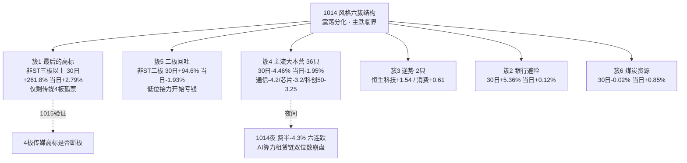

# 2026年10月15日（周四） · 风格研判

> **数据源新鲜度**：ok
> **降级状态**：false（global_severity=2，weflow/qmt down，不影响风格判定）
> **置信度**：0.70
> **行情口径**：20261014（周三）收盘 + 1014 夜美股

## 一句话结论

**震荡分化型（退潮加速、临近主跌临界的防御降维日）**，情绪浓度 **35（恐惧区）**，全场只剩内容/传媒一条抱团活口，建议总仓上限 **35%**，主跌确认前不开新仓、不接硬件飞刀。

## 一、先认市场：1014 发生了什么

昨天（1013）那张"退潮后的扩散修复"答卷，只活了一个交易日，就在 1014 被市场当场撕毁。这是今天盘前必须先承认、且不能粉饰的第一件事。

盘面给出的是一组方向高度一致的退潮数字：涨停从 67 家近乎腰斩到 **36 家**，跌停从 8 家扩到 **11 家**，炸板 24 家、**炸板率 40%**，一脚踩过 35% 的砍半纪律线；全市场 5563 只股票里只有 979 只上涨、4496 只下跌，涨跌比 0.22，涨跌幅中位数 **-1.94%**，跌幅超过 3% 的多达 **1614 只**，而涨幅超过 9.9% 的只剩 47 只。成交额 1.43 万亿，缩量 2625 亿。指数这一次不再像 1013 那样"零参与搭台"，而是带头下杀——上证 -0.89%、深成 -1.97%、创业板 -3.10%、科创50 -3.29%、沪深300 -1.36%，双创领跌。前一天还是"戏在题材、指数搭台"，一天之后就变成指数和题材一起退潮，这是性质的变化，不是普通调整。

情绪周期模型（预计算 `emotion_cycle.json`）给出的阶段仍是**高位震荡、置信度 0.75**，判据是炸板率 40% ≥ 25% 但涨停溢价 +2.06% 尚未转负。这里要特别警惕一个"指数化陷阱"：+2.06% 的溢价是被少数几只高位连板票拉起来的；把 1013 涨停池那 67 只票拿到 1014 收盘逐一算，中位数其实是 **-1.70%**（均值 -0.01%）。也就是说，平均数字还没翻绿，但绝大多数隔日接力盘已经在实打实亏钱。这是一轮情绪周期走到后段最典型的体感——指数没说崩，账户已经在亏。模型没有硬切到"主跌"，但数据已经贴在主跌的门槛上，所以今天的处理不是按常规高位震荡给仓位，而是按"主跌临界"先降维，把确认权交给盘中。

## 二、六簇聚类：从"高标派发+大本营止血"到"普跌+孤岛"

用 20260826 到 20261014 这 30 个共同交易日的日收益序列，对 22 个同花顺风格板块和 20 只 ETF 做相关距离的六簇层次聚类，1014 的结构比 1013 明显恶化，可概括为"高标孤岛、二板补跌、大本营硬件领跌、防御微红"。

第一簇是"最后的高标"，只有非 ST 三板以上这一只篮子，30 日 +261.8%、当日还能 +2.79%。但拆开看，撑住它的已经不是一片高标，而只剩慈文传媒、百洋股份、新经典这几只 4 板票，且清一色挤在传媒和鱼粉涨价上——这是余温，不是冲锋。第二簇是非 ST 二板，30 日 +94.6% 却在当日 -1.93%，前一天还 +1.65% 的二板位第二天就补跌，意味着资金连低位接力都开始亏钱，高低切的"低位"这一端也在塌陷。

第三簇是 36 只标的组成的主流大本营，当日平均 -1.95%、30 日 -4.46%，内部几乎全绿，最惨的恰是 1013 白天资金刚刚回流的硬件方向：通信 ETF -4.20%、芯片 ETF 华夏 -3.30%、芯片 -3.18%、半导体 -3.16%、科创50 -3.25%，1013 元件、CPO、PCB 的涨幅被一根阴线全部吞回。更有指示意义的是大资金类指数——昨日资金前十 -5.24%、昨日成交前十 -5.47%、深股通前十 -3.88%、沪股通前十 -3.26%，这不是板块轮动，轮动是钱从 A 搬到 B；这是钱在从桌上撤走。全场真正收红的只有银行（+0.12%）、煤炭（+0.85%）、消费（+0.61%）和白天受美团、小米拉动的恒生科技（+1.54%），而银行 30 日 +5.36% 已是所有大类里唯一正收益的避险舱，且当日涨幅微弱、显出疲态。

打板系列把这种退潮讲得更直白：非 ST 三板以上 +2.79%、打二板以上 +2.10% 是仅剩的赚钱层，非 ST 二板 -1.93%、打首板 -0.09%、打板整体 -0.49% 全部走弱。资金只肯在最高、最孤的几只票上做最后抱团，连首板试错都不再奖励——这与 1013"首板堆量、二板赚钱"的扩散结构正好相反。

## 三、20 只 ETF：硬件二次下跌，避险舱独红

ETF 横切印证了同一件事。20 只 ETF 当日仅恒生科技 +1.54%、煤炭 +0.85%、消费 +0.61%、银行 +0.12% 微红，其余全绿。科技硬件是重灾区，通信 -4.20%、芯片华夏 -3.30%、芯片 -3.18%、半导体 -3.16%、科创50 -3.25%；周期里光伏 -1.86%、有色 -1.88%、新能源 -2.08%，地产 -1.62%。30 日维度上，银行 +5.36% 是唯一收正的大类，垫底的是有色、新能源、芯片、半导体、通信这批硬科技与资源，下降通道在 1014 加速。

需要提醒的是，这 20 只 ETF 里没有传媒、AI 应用、CPO 这类标的，所以 ETF 视角会系统性漏掉当天唯一的活口——内容线。判断主线强弱，必须回到强板块榜和天梯，不能只看 ETF。但 ETF 清楚地告诉我们：**机构仓位和指数方向在撤，活着的只是一小撮题材抱团**。而前一日逆势独走的恒生科技，当晚就要直面美股科技的夜跌，1015 大概率补跌。

## 四、主线代理：唯一的活口是内容，但它是孤岛不是旗帜

从强板块榜（`limit_cpt_list`，非 R2 真实判定，仅作代理）看，1014 涨停家数 up_nums ≥ 8 的板块从上一日的 20 个塌到**只剩储能 1 个**（且是孤立题材）。up_nums = 7 的五个板块里，有四个是同一条内容线——人工智能、文化传媒、机器人、西部大开发；再往下 IP 经济、AIGC、AI 应用、DeepSeek 各 6 家，传媒、短剧游戏、虚拟现实、知识产权各 5 家。也就是说，全场的封板资金高度收敛到"AI 内容应用 / 传媒"这一条线上，最高 4 板的三只票也都在这条线加鱼粉涨价。

我据此把主线数量判为**独主线**，但必须说清这是退潮期的"抱团孤岛"，不是主升期那种能统领全场、带出梯队的旗帜。一条健康主线应当有龙头高度、有二线接力、有板块外溢；而这里只有 4 板高度、二线（二板位）已经在亏钱、硬件这条昨天的主线直接熄火。更关键的是，这条孤线当晚就撞上纳指 -1.85% 和美股科技普跌，1015 开盘要独自接受外盘负反馈检验。它能不能活，不取决于自身逻辑硬不硬，而取决于 4 板高标断不断——这正是颜哥群里 Jason 反复说的"等新华传媒断板"那个观察点。

## 五、外盘：CPI 超预期，加息重燃，费半六连跌

隔夜（1014 夜）外盘给的是四重压制，这是今天最硬的外部约束。

美国 9 月 CPI 同比 **3.7%**（预期 3.6%、前值 3.4%，五个月最大涨幅），核心 CPI 同比 2.6%（预期 2.5%），汽油单月 +9.1% 贡献了半数涨幅。数据一出，CME 显示美联储 10 月加息 25bp 的概率从 21.6% 直接跳到 **43.7%**，花旗转而押注 12 月加息，美银甚至预计到 2027 年 6 月前加息三次，美元指数创 2025 年 5 月以来新高。股市随之收跌：道指 -0.09%、标普500 -1.10%、纳指 -1.85%，罗素2000 -1.9% 进入回调。

震中仍是 AI 算力与半导体。**费城半导体 -4.3%，六连跌**，六个交易日累计约 -10%，创 2025 年 5 月以来最长连跌，成分市值合计蒸发逾 1 万亿美元；AI 算力租赁链双位数崩盘——CoreWeave -15.3%、戴尔 -11.4%、Ciena -10.3%、NBIS -10.1%、伟创力 -9.5%；英伟达 -3.11%、AMD -5.74%、英特尔 -4.48%、台积电 -3.06%、美光 -3.40%、博通 -2.89%。苹果靠折叠屏预期独涨 +0.44%，成为第二家收盘市值站上 5 万亿的公司。商品方面，现货黄金 -1.37% 报 4103.8、白银 -6.08%、铜 -1.61%，WTI 原油 +1.01% 报 95.09（美伊与霍尔木兹紧张），国内夜盘沪锡 -3.39%、焦煤 -4.86%、焦炭 -3.14%；离岸人民币 6.6960 小跌 34 点，在岸 6.6978，汇率仍稳。欧股逆势收涨约 0.4%，是当晚少数缓冲。

对 A 股的含义很直接：其一，费半六连跌、算力租赁链崩盘，而 A 股硬件 1014 白天已经先跌，这不是 1013 那种"外盘小跌、A 股白天可以脱钩"的情形，而是"A 股先跌、外盘夜续跌"的负反馈接力，硬件链 1015 二次低开难免，任何反抽都是减仓点，严禁左侧接飞刀；其二，加息预期重燃叠加强美元，给全球成长股估值压顶，科创、创业板、AI 映射都承压，北向存在流出压力（本次无实时北向数据）；其三，纳指下跌也会拖累前一天唯一逆势的内容/传媒情绪；其四，真正可能受益的只有油气开采（原油涨价，1014 A 股油气已逆势领涨）和红利低波等少数避险方向，但它们是孤立脉冲，不构成可接力的主线。韩国综合 5 日 -13.43% 的东北亚警报也未解除。今晚 23:30 美联储主席沃什在曼谷的讲话是下一个变量，若放鹰会再补一锤。

## 六、KOL 与舆情：老钱空仓看戏，游资抱团孤苗

5 个群 445 条消息的温差，和量化数据完全同构。颜哥群（老钱）全天就是避险基调，Jason 反复讲"继续看戏，等新华传媒断板""很多标的融资盘可能会爆仓，注意风险""看戏，暴跌之后爆买"，群里多位直接报"空仓"；他的方法论是"一只票成功了之后要休息一段时间，1-3 个月做一只""短线基本都是散户追涨杀跌，被量化收割"。晚间群里被美国 CPI 和"看来一次加息不够了"的宏观担忧主导，有人说"大 A 提前崩是料事如神"。颜晓滨本人在厦门调研，没有给任何进攻号召。

三个题材群（摩天轮 98、一手新闻 163、专注核心 122 条）仍在高频挖苗，但方向高度收敛到 AI 内容应用、游戏、IP、短剧、AIGC 和鱼粉涨价，几乎没人再提算力硬件——游资也在从硬件切向内容，而且只做低位首板。公众号端，证券时报的头条直接是"深夜，全线跳水！美联储，加息预期升温"。老钱空仓等爆仓点、游资抱团内容孤苗、官媒头条偏空，三者叠加说明：**市场当前没有合力，只有抱团**。而抱团在退潮期是最不稳的结构。

## 七、五维判定与仓位

综合涨停强度（36 家）、连板结构（最高 4 板且孤立）、炸板健康度（40%）、指数表现（双创 -3%），四维情绪分约 **35**，落在恐惧区；用五维加权法交叉校验约 45.6，但那套用的是 1014 盘中之前的杠杆环境，没有计入隔夜 CPI 暴击，故以四维 35 为准。仓位上限取 **0.35**：主跌临界、唯一活口待开盘验证，给的是最低档防御权限，而不是 40 分以上对应的常规仓位。

**今日操作纪律**：主跌临界期降维，总仓 ≤35%；不开新仓做硬件，不追 4 板以上孤高标；唯一内容活口也只允许在"低开后放量分离走强、且 4 板高标不断"得到确认后，用小仓位做龙一，否则空仓等待。上修条件是加息预期被消化、炸板率回落 30% 以下、涨停重回 50 家以上、二板位重新赚钱。

## 八、风险与反证（什么情况下我是错的）

向下风险是主线，触发即降仓：若 1015 竞价 4 板传媒高标核按钮断板、跌停扩到 20 家以上、创业板续跌超 2%，或 1013 涨停池的中位溢价从 -1.7% 继续走坏，则震荡分化正式切入主跌，仓位立即压到 0.20 以下乃至空仓。其次是外盘硬件二次负反馈与强美元抽水，费半六连跌之后 A 股硬件低开续跌概率高，接飞刀风险最大；今晚沃什若放鹰会再压成长股估值。第三是唯一内容线一旦断板而无新题材承接，抱团瓦解会带补跌；30 日仍 +97%~+262% 的高标篮子派发空间巨大，融资盘若被动平仓可能形成连锁。

也要诚实写下反向证据，避免一味看空：其一，情绪周期模型并未硬判主跌（溢价名义值 +2.06% 仍为正），36 家涨停也还没到崩溃退潮型"跌停多 + 炸板率 >50%"的标准，若 1015 内容线低开高走、硬件抗住外盘不再创新低，存在"外崩我不崩"弱转强、走成最后一跌后反弹的可能；其二，格芯 210 亿美元建厂、SK 海力士称 2030 年 AI 基建性能增 20 倍、华为麒麟 9050 量产等产业利好在累积，一旦宏观钝化即可成为反攻弹药；其三，欧股当晚逆势收涨、人民币仍稳在 6.69 区，没有形成全球流动性危机。因此我给的是"降维观察"，不是"宣告主跌"——主跌是否坐实，以盘中 4 板、跌停数、溢价三个信号为准，在信号确认前，活下来比抄到底重要。

## 九、数据源审计

| 源 | 状态 | 记录数 | 备注 |
|---|---|---|---|
| tushare.ths_daily（22 风格板块） | 🟢 ok | 22 | 截至 1014 收盘，本次实时拉取 |
| tushare.fund_daily（20 ETF） | 🟢 ok | 20 | 截至 1014 收盘 |
| limit_list_d / limit_step / limit_cpt_list | 🟢 ok | 71 行 | 涨停36/跌停11/炸板24/最高4板 |
| index_daily（8 宽基）+ daily（全市场） | 🟢 ok | 5563 | 双创 -3%、中位 -1.94% |
| index_global / us_daily | 🟡 partial | 19 | 仅至 1013 夜；1014 夜以财联社快讯补 |
| news_cls | 🟢 ok | 2966 | CPI/费半/加息概率/商品收盘 |
| wechat_cli_5groups | 🟢 ok | 445 | 5/5 群，颜哥群 42 条 |
| wechat_official_rss | 🟢 ok | 86 | 取阅 RSS 接替三刀源 |
| emotion_cycle（预计算） | 🟢 ok | 1 | 高位震荡 conf 0.75 |
| 商品期货 / 北向实时 / weflow / qmt | 🔴 missing | — | 商品以夜盘新闻补；北向、weflow、qmt 缺失 |

## 与其他 R/D/E 的关系

- **依赖**：`data/raw/20261015/`（manifest、style_snapshot、overseas_snapshot、news_cls、wechat 两源）、`data/research/20261015/emotion_cycle.json`
- **被消费**：R2（`style`、`main_lines_count`、`position_cap_suggestion`，退潮临界须压低候选数）、R3（`sentiment_score=35` 基准）、R6（与 R2 主线一致性反证）、D1（总仓上限 0.35 + 主跌触发条件）

## Sub-Agent 元数据

- skill：analyze_style_v1
- artifact：data/research/20261015/R1_style.json
- 聚类：scripts/analysis/r1_style_cluster.py（30 日窗口，6 簇，Pearson 相关距离，平均法）
- 快照：scripts/fetch/run_style_snapshot.py（22 板块 + 20 ETF + 5 指数 + 14 美股）
- model：ark-code-latest
- 生成耗时：约 12 分钟（含实时取数）
