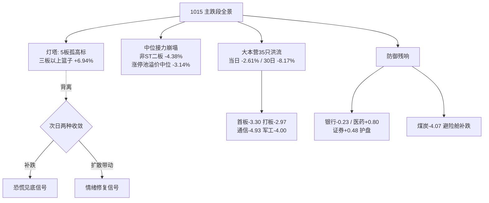

# 2026年10月16日（周五） · 风格研判

> **数据源新鲜度**：ok
> **降级状态**：false（global_severity=2，weflow/qmt down，不影响风格判定）
> **置信度**：0.72
> **行情口径**：20261015（周四）收盘 + 1015 夜美股与商品

## 一句话结论

**崩溃退潮型（主跌段放量恐慌日）**，情绪浓度 **28（恐惧区，逼近极恐）**，全场只剩 **5 板孤高标一座灯塔**，建议仓位上限 **25%**——主跌坐实，不开新仓、不接飞刀、不抄下跌中继，只等放量降速与跌停收敛的右侧信号。

## 一、先认市场：1015 把"主跌临界"四个字走成了现实

昨天我在这份研判里写的是"震荡分化、主跌临界"，并给了一条明确的触发线：竞价高标核按钮、跌停扩到二十家以上、创业板续跌超过两个点，就正式切入主跌。1015 一天之内，市场用更粗暴的方式回答了这个问题。

全市场五千五百六十五只股票，只有四百三十只上涨，五千一百零八只下跌，涨跌比 0.08——也就是说每十二只股票里只有一只红的。跌幅中位数不是百分之零点几，而是 **-3.04%**；跌幅超过 3% 的有两千八百四十二只，超过 5% 的八百三十八只，跌幅超过 9.9% 的四十一只。涨停三十六家与前一日持平，但跌停从十一家跳到 **二十六家**，翻了一倍还多。两市成交一万六千四百五十七亿，较 1014 的一万四千二百六十四亿 **放量两千一百九十三亿**。这个放量的方向必须看清楚：这不是缩量磨底的死寂，是带量下杀、止损盘和恐慌盘真实离场的声音。

指数层面，权重与小盘的裂口拉到了极端。上证 -1.59%、深成 -2.43%、创业板 -2.92%，而真正承接抛压的是中小盘——中证 1000 跌 3.28%、中证 500 跌 3.02%，只有上证 50 靠护盘力量收窄到 -0.42%。前一天还在领跌的科创 50（-1.50%）和芯片篮子反而跌得"少"了，这不是抗跌，是前两日已经先跌透后的数值现象，30 日维度它们仍在 -12% 到 -16% 的下降通道里。

唯一需要诚实交代的反常数字是炸板率：16.3%，表面看比 1014 的 40% "健康"得多。但这个数字在主跌日的语义是反过来的——敢去封板的资金已经极少，撬板失败的样本天然就少。低炸板率在这里不是情绪稳定的证据，而是无人敢战的证据，不能拿高位分歧期的尺子来量。

## 二、六簇聚类：一座灯塔，一片洪流

把 22 个同花顺风格板块和 20 只 ETF 放在截至 1015 收盘的 30 个共同交易日上做相关距离的层次聚类、切成六簇，画面比任何单日数字都更冷。

**第一簇是"最后的高标"**，只有两个打板族篮子——昨日打二板以上表现与昨日非 ST 三板以上表现，30 日累计 +172.8%，当日还涨了 3.59%，其中三板以上篮子单日 +6.94%。这是全场唯一的亮光。但请务必看清它的性质：在五千一百只股票下跌的日子里维持正收益，靠的是天梯顶端极少数几只连板票（5 板 2 只、3 板 2 只、2 板 2 只），这是一座与广度极端背离的**灯塔**，不是一面引领进攻的旗帜。这种背离在历史上只有两个结局：要么灯塔补跌、恐慌见底，要么灯塔带动情绪修复——在信号出来之前，它本身不构成买入理由。

**第二簇是"二板补跌"**，非 ST 二板篮子单日 -4.38%。前一天它还只跌 1.93%，中位接力层在 1015 被正式埋掉。接力盘的亏损可以用更硬的数字验证：1014 的 36 只涨停票，1015 收盘平均 -2.13%、**中位数 -3.14%、只有 38.9% 收红**——比前一日 -1.70% 的中位数又恶化了一大截，打板隔日接力已经是系统性亏钱。

**第三簇是 35 只标的组成的"主流大本营"**，当日平均 -2.61%、30 日 -8.17%，几乎吞噬了全部风险资产。昨日打首板 -3.30、昨日打板 -2.97，意味着连最低位的首板接力都在亏钱；业绩扭亏篮子 -5.96，说明这条线也没有被当成避风港；大资金指标昨日成交前十 -4.26、近端次新 -2.70、百元股 -3.48；行业 ETF 里通信 -4.93、军工 -4.00、有色 -3.63、房地产 -3.28、光伏 -3.25、新能源 -2.60。没有轮动，只有踩踏。

剩下三簇是防御的残响：银行（-0.23，30 日 +5.0%，仍是唯一正收益大类）与医药（+0.80）、消费（-0.30）、证券（+0.48）构成微弱的护盘盘；而煤炭单日 -4.07% 独立成"补跌簇"——前一天还是避险舱的资源，1015 被流动性抽血拖下水，说明这场下跌里连"躲"的地方都在一个个关闭。

## 三、20 只 ETF：大小盘裂口极值，护盘资金是真实的，但它买的是权重

ETF 截面把资金的去向说得很直白。当日只有三只收红：医药 +0.80、证券 +0.48，以及严格说微跌的银行 -0.23；30 日维度银行 +5.00% 依旧是全场唯一正收益的大类资产。跌得最重的清一色是高贝塔与硬科技：通信 -4.93（30 日 -16.10%，持续垫底）、军工 -4.00、中证 1000 -3.74、有色 -3.63、房地产 -3.28、光伏 -3.25、中证 500 -3.02、恒生科技 -3.04。芯片 -1.64、半导体 -2.10、科创 50 -1.37 的"相对抗跌"只是提前跌透，30 日仍在 -12% 到 -15%。

最值得记下的结构性现象是上证 50（-0.59%，30 日 -2.77%）与中证 1000（-3.74%，30 日 -9.94%）之间的裂口，以及盘后一条消息：**沪深 300ETF 易方达成交额环比暴涨近 23 倍**，深夜又有"中国资产拉升"的官媒标题。这不是散户行为，是有组织的左侧护盘/抄底资金在买权重。它真实存在，也是 1016 可能出现指数级技术反抽的唯一依据——但在主跌段，第一次权重护盘反抽的历史功能通常是给仓位重的人一个减仓窗口，而不是趋势反转的发令枪。

## 四、主线代理：封板榜已经散了，只剩一座孤高标

强板块榜上，涨停家数不少于 8 家的板块只有两个，而且都是华为概念、一带一路这类装着几百只股票的大杂烩标签，不具备任何统领性；数字经济、西部大开发、中报预增各 7 家，腾讯概念、军工、机器人、数据中心、PCB、DeepSeek、IP 经济各 5 家，前一日还集中在 AI 内容一条线上的文化传媒方向降到 4 家。对比 1014，封板资金不是换了方向，是**散了**——从"抱团孤岛"进一步退成"孤高标 + 满地碎票"。天梯顶端 5 板的两只票延续的是前两日同一抱团方向的余温，3 板、2 板各只有两只，梯队薄得不成形。

所以主线数量的代理答案仍是"独主线"，但实质已经是无主线状态下的高标孤岛。老钱群里 Jason 对下一步的路径说得很具体：传媒高标断板、AI 传媒这一段结束，接下来接力的候选是**三季报业绩**——业绩超增长的"大跌大买"，业绩差的继续跌。这个方向能否在周末发酵出板块效应，是下周情绪有没有新锚点的关键观察项；在它走出来之前，它只是假设，不是仓位。

## 五、外盘：白天亚太先崩，夜里美国 PPI 再烫，美股低开翻红

1015 的外盘是分两层演的。白天，恐慌在亚太交易时段先炸开：韩国综合指数 **-7.57%**（近五个交易日累计约 -19%），日经 225 **-4.90%**，创今年 3 月以来最大单日跌幅，爱德万测试、东京电子等半导体设备股领跌，SK 海力士盘中一度跌超 12%、创 4 月底以来新低；港股恒生 -1.03%、恒生科技 -2.72%。这一跌的根源与 A 股主跌同源——美国 CPI 之后的加息恐慌，叠加上市场对 AI 资本开支可持续性的怀疑（CoreWeave 信用风险指标创纪录、AI 算力租赁链前一夜双位数崩盘）。

夜里美国又递上一份更烫的数据：9 月 PPI 环比 +1.3%，是 2022 年 3 月以来最大升幅，同比 +6.3%，核心环比 +0.7%、同比 +5%，四项全部超过彭博调查的所有经济学家预期；摩根大通有人称若美联储真的加息，终端利率可能到 6%，CDX 投资级信用利差一度创 4 月以来新高。美股因此低开，纳指期货盘中跌超 2%——但随后抄底资金进场，三大指数**低开高走全部翻红**：道指 +1.08%、标普 +0.33%、纳指 +0.08%；高通 +3.35、美光 +1.87 反弹，而英伟达 -1.84、英特尔 -2.80 继续弱。

商品与汇率讲的是另一个故事：现货黄金 +1.56% 报 4169 美元创新高、白银 +3.30%，WTI 原油 +3.03% 报 97.97 美元（霍尔木兹与红海袭击升级），铜 -1.42%；离岸人民币逆势走强 66 点到 6.6894。综合起来，外盘给 1016 的是一张混合牌：亚太恐慌的余波和 PPI 的加息压力还在，但美股夜盘的弱修复与人民币走强会弱化 A 股二次低开的烈度，更可能是低开震荡、权重护盘试探反抽，而不是续崩；同时必须明白，纳指翻红是超跌技术修复，不是加息逻辑被证伪——成长股的估值顶没有解除。

## 六、KOL 与舆情：老钱在等"爆仓之后爆买"，官媒在左侧喊话

五个群 358 条消息，颜哥群的口径比 1014 又冷了一档。核心发言人 Jason 全天的关键词是"打爆融资盘了，吃瓜""学会休息，暴跌之后就是爆买""不用急，先看看戏，还没到临界点""最近可能还要暴跌，做好大跌准备"，夜盘看到美股科技续跌后又补一句"死扛的基本要被打爆，继续看戏"。颜晓滨本人盘中做过一次指数回升的预测，主线观点维持不变：AI 应用、AI 医疗相对稳，**硬科技不建议、会继续阴跌，与逻辑和业绩关系不大，主要是筹码结构问题**。群里有人已报空仓，也流传着"三天收不回 3750 点则牛市结束"的破位论——上证 1015 收 3707，这条民间心理位已经被击穿，周末舆论如何发酵需要盯。题材三群仍在高频挖苗（DeepSeek 融资、AI 制药、PCB 业绩、三季报预增），但方向散乱、无合力，与封板榜的散乱互相印证。

公众号端出现了明显的对冲叙事：一边是"美联储加息预期升温"，另一边是"深夜中国资产拉升""券商：短期扰动不改产业升级""沪深 300ETF 成交环比暴涨 23 倍""资金抄底"。老钱在等融资盘出清后的买点，官媒与权重资金在左侧护盘，游资没有合力——三方力量同框，恰好就是主跌段后段的标准舆论画像。

## 七、五维判定与仓位

- **风格（五选一）**：**崩溃退潮型**。"跌停多"与"大盘明显下跌"两条硬命中（跌停 26 家、中位 -3.04%、5108 只下跌、放量 2193 亿），炸板率字面虽只有 16.3%，但主跌日的低炸板率是无人敢封的反向信号。
- **情绪浓度**：**28/100（恐惧区，逼近极恐）**。四维法里涨停强度因封板散乱只给 12 分、孤高标结构给 8 分、炸板项按语义反向只给 6 分、指数项为 0；五维加权校验约 40 分，但它同样高估了炸板率、且没有纳入 0.08 的涨跌比与 -3.14% 的接力溢价中位数，故取 28。
- **情绪周期**：预计算模型给出高位震荡（置信度仅 0.45，主跌得分已到 0.33），其炸板率权重过大；R1 依据广度、跌停数与接力溢价的全面转负，**修正为主跌段**。
- **主线**：**独主线（实质为无主线的高标孤岛）**，下一候选方向是三季报业绩线，尚待验证。
- **仓位上限**：**25%**。主跌段位执行纪律最低档，不开新仓、不追 5 板孤高标、不接硬件飞刀；存量仓借权重反抽减仓，现金等右侧。

## 八、风险与反证（什么情况下我是错的）

第一，若 1016 竞价 5 板高标被核按钮、跌停扩到四十家以上、中证 1000 或创业板续跌超 2%，则主跌二浪确认，仓位应立刻压到 15% 以下甚至空仓——高标簇与广度的极端背离大概率以高标补跌收敛。第二，亚太崩盘的传导未必结束，韩国五个交易日约 -19%、SK 海力士单日 -12%，A 股硬件链任何低开反抽都是减仓点。第三，PPI 同比 +6.3% 比 CPI 更烫，若周末再有联储放鹰消息，周一下行缺口风险大，夜美股翻红不能被当作修复确认。第四，也是我最可能错的地方：**沪深 300ETF 成交 23 倍的护盘资金 + 夜美股翻红 + 黄金之外人民币逆势走强**，可能共同促成 1016 的权重反抽日，若反抽放量且午后小票跟涨、跌停收敛到十家以内，那今天这个"主跌"定性就过于悲观了——届时应承认这是恐慌一步出清而非下跌中继，并允许在业绩线前排上用极小仓位试错。第五，融资盘强平连锁（≤-5% 达 838 只）可能制造最后的非理性坑，那反而是老钱所说"暴跌之后爆买"的时间窗，但触发信号必须是放量降速后的企稳，不是现在。

## 九、数据源审计

| 源 | 状态 | 数据口径 | 记录数 | 备注 |
|---|---|---|---|---|
| tushare.ths_daily（22 风格板块） | 🟢 ok | 1015 收盘实时 | 22 | 30 日窗口无缺格 |
| tushare.fund_daily（20 ETF） | 🟢 ok | 1015 收盘实时 | 20 | 30 日窗口无缺格 |
| limit_list_d / limit_step | 🟢 ok | 1015 收盘实时 | 涨停36/跌停26/炸板7 | 炸板率 16.3% |
| limit_cpt_list | 🟢 ok | 1015 收盘实时 | 强板块榜 | up≥8 仅 2 个 |
| index_daily / daily | 🟢 ok | 1015 收盘实时 | 5565+8 | 成交 16457 亿 |
| index_global（亚太） | 🟢 ok | 1015 白天 | 韩/日/港等 5 | 韩 -7.57 / 日 -4.90 |
| 美股 1015 夜收盘 | 🟡 新闻口径 | 财联社收评快讯 | 3 指数+个股 | tushare 仅至 1014 |
| 商品 / 汇率 | 🟡 新闻口径 | 财联社尾盘快讯 | 金/银/油/铜/CNH | fut/fx_daily 无数据 |
| news_cls | 🟢 ok | 至 1016 05:51 | 2980 | PPI/美股/商品完整 |
| 五群消息 | 🟢 ok | 1015 全天 | 358 | 颜哥群 65 |
| 公众号 RSS | 🟢 ok | 盘前 | 87 | 含 ETF 抄底/官媒护盘 |
| 北向实时 / weflow / qmt | 🔴 缺失 | — | — | 不影响段位判定 |

## 与其他 R/D/E 的关系

- **依赖**：无（R1 是研究链路起点；消费 data/raw 原始数据、style_snapshot（本次生成）、emotion_cycle 预计算横切）
- **被消费**：R2（style=崩溃退潮型须降维，候选数砍半甚至只出观察名单）、R3（情绪基准 28）、R6（与 R2 一致性反证）、D1（position_cap=0.25，主跌段不开新仓的硬约束）

## Sub-Agent 元数据

- skill: analyze_style_v1
- artifact: data/research/20261016/R1_style.json
- 人读产物: chzl_kg/投研交易/风格研判/20261016.md
- 生成耗时: 约 25 分钟（盘前 · 含 style_snapshot 实时抓取、量化统计、30 日 6 簇聚类）
- model: ark-code-latest
