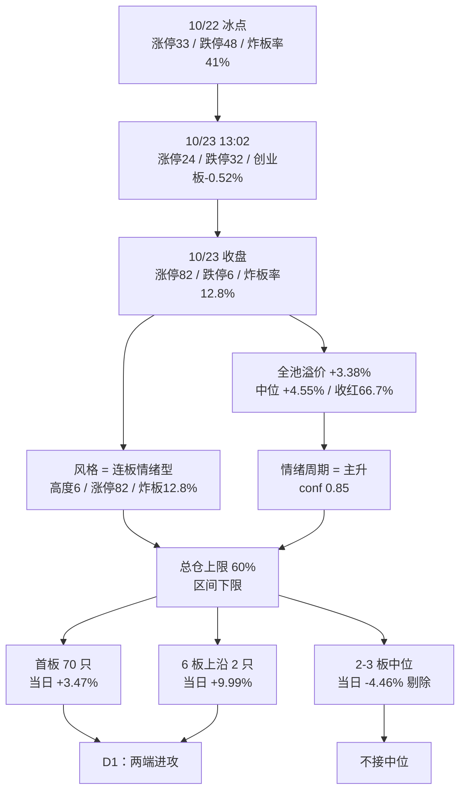

# 2026年10月26日 · 风格研判

## 一句话结论

今日可以进攻，但只给区间下限的仓位：风格判定为**连板情绪型**，情绪浓度 **77**，代理主线 **1 条（泛 AI 生态）**，总仓上限 **60%**。只做首板与最高标两端，不接 2–3 板中位——周五中位二板是全场唯一亏钱的接力层。

## 先把市场认清楚：一根从冰点里拔出来的阳线

判断今天，必须先看清楚周五下午发生了什么。10 月 22 日是这一轮的冰点：涨停只有 33 家，跌停 48 家，炸板率 41.07%，非 ST 最高连板 5 板，当天没有任何进攻资格。10 月 23 日上午还在延续这个方向，到 13:02 时上证 -0.75%、创业板 -0.52%、涨停 24 家、跌停 32 家、炸板率 29.41%——按任何一个盘中的时点停下来看，那天都还是一场杀跌。然后下午两点之后，盘面被整个翻了过来：收盘涨停 82 家、跌停 6 家、炸板率 12.77%，上证 +0.89%、深成 +2.79%、创业板 +4.16%。两个小时里，涨停从 24 家变成 82 家，跌停从 32 家变成 6 家，创业板从下跌半个点变成上涨四个点。

这种翻转不是普通的反弹，它是资金在冰点位置上的一次集中扫货。全市场 5572 只股票，涨 4526 家、跌 909 家，涨跌比 4.98，中位涨幅 +1.56%，涨幅超过 9.9% 的有 147 只，跌幅超过 5% 的只有 95 只。前一天涨停的 33 只股票，第二天平均 +3.38%、中位 +4.55%，六成六收红——把十天前那个"追涨停第二天平均亏 1.64%"的账，在这一天一次性还了回来。

但是位置必须一起读。创业板 20 日 -18.62%、10 日 -11.80%；科创 50 二十日 -16.23%、10 日 -7.67%；深成指二十日 -12.95%；上证二十日 -4.78%，周五收盘 3690 点。也就是说，这一根阳线长在一条已经走了二十个交易日的下降通道末端，它不是主升中段的加速，而是主跌末端的第一次修复。看清楚这一点，才知道为什么后面给的是 60% 而不是 80%。

## 风格与周期：硬条件全中，但性质是"修复型连板情绪"

五选一里，周五机械命中**连板情绪型**的三条硬条件，一条不缺：连板高度 6 板（剔 ST 后两只，一只 6 连板、一只 16 天 8 板）、涨停 82 家（≥50）、炸板率 12.77%（<20%）。四项独立指标同向确认：昨日涨停溢价 +3.38%（中位 +4.55%、收红率 66.7%）、市场广度 4.98、147 只涨幅≥9.9%、跌停仅 6 家。

情绪周期模型用同一批数据做硬规则判定，结论也是**主升**，置信度 0.85：溢价 +3.38% 已经越过 +3% 的门槛，高度 6 板越过 5 板，炸板率 12.77% 远低于 25% 的分歧线——赚钱效应和高度在同一天共振，没有分歧。需要说明的是，仓库预计算的情绪周期文件给的是同一阶段但只有 0.45 的置信度，因为里面的溢价用的是 intraday_fallback 口径（+0.29%）；本次用 10 月 22 日全部 33 只涨停股在 10 月 23 日的真实涨幅复算，均值 +3.38%、中位 +4.55%，以全池复算为准。

可是"主升"这三个字容易被误读。它描述的是温度，不是位置。三个与标签相反的事实必须写在同一个框里：第一，天梯是断的——6 板两只之后，4 板、5 板完全真空，直接掉到 3 板 1 只、2 板 9 只、首板 70 只。这是哑铃，不是金字塔，接力资金在中位没有缓冲区。第二，30 日维度 42 个标的里只有 7 只收正、35 只收负，主流大本营的 36 个标的三十日平均 -11.68%。第三，周五是深 V 而不是全天强势，上午的钱还在夺路而逃。所以风格归连板情绪型，性质写清楚：**主跌末端的第一根修复阳线**。

仓位也由此确定。连板情绪型的区间是 60%–80%，本次取区间下限 60%：修复第一日、4–5 板真空、外盘费半周跌 3.3% 且 12 月加息概率 68.9%、唯一主线内部三条分支高度同源没有分散——四条理由都指向"给够，但不满"。上限 80% 留给三个条件同时成立之后：次日溢价继续为正、炸板率维持在 20% 以下、4 板或 5 板有人补位。

情绪浓度取 **77**。四维规则算出来是 86.9（涨停家数 40 分、连板高度 15 分、封板质量 17.45 分、指数 14.44 分），五维加权只有 68.4（涨停强度 82、跌停压制 88、连板结构 70、炸板健康 48.9、杠杆外资 45），两法差 18.5 分。差异的原因很实在：规则值按家数、高度、指数给分，天然高估反转日；五维法把"炸板之后的隔日承接"和"杠杆资金"算进去，更接近真实的赚钱效应——本周主力资金累计净流出 849.99 亿元，这个维度不可能给高分。最终在规则值上扣 10 分趋势折价，落在两者中枢偏上，得 77。定性是贪婪，但是修复性的贪婪。

## 六簇讲的故事：两端在涨，中间在亏，防御在撤

30 个共同交易日（2026-09-02 至 2026-10-23），22 个同花顺风格板块加 20 只 ETF 共 42 个标的，42×30 共 1260 个单元格一个不缺，没有补零、没有前向填充。用相关距离和平均连接做层次聚类，指定 6 簇，实际得到 6 簇。

按三十日收益排序，最上面是高标抱团簇，只有两只：昨日打二板以上表现 +39.25%、昨日非ST三板以上表现 +171.14%，簇均值 +105.2%，周五当天仍然 +7.03%——这是全场唯一"趋势与当日同向"的资产，高位最肥的那批筹码还在涨。大资金意图在这里毫不含糊：最强的钱没有走，还在往上加。它为什么能走强？因为连板高度本身在提供稀缺性——6 板的两只票上方没有 4 板、5 板，任何想做高度的资金只能往最高处挤。逻辑够不够硬？硬，但脆：这两只 6 板的封单分别只有 3452 万和 9479 万，其中一只当天开板五次、换手 28.1%，另一只换手 33.4%，都是靠换手维持的高度，不是靠一字锁死的高度。硬逻辑的背面是没有缓冲。

第二簇只有一只，昨日非ST二板表现，三十日 +56.16%，但周五当天 **-4.46%**，是 42 个标的里当日最弱的一个。这是本次研判最重要的一条信号：同属打板族，三板以上 +9.99%、打二板以上 +4.07%、打首板 +3.47%、打板整体 +2.63%，唯独非 ST 二板 -4.46%。资金只接最高的标和最前面的一板，中间那层被彻底抛弃。换句话说，2–3 板的中位在今天不是"还没轮到"，而是"结构性亏钱位"。这条信号直接决定了今天的执行口径：不接中位。

第三簇是银行 ETF，三十日 +1.51%，是 42 只里唯一收正的 ETF，但周五当天 -1.62%，逆势领跌。第四簇是创历史新高，三十日 -2.45%，周五 -0.07%，几乎完全不动——强势股根本不参与这轮反弹。第五簇是煤炭 ETF，三十日 -9.19%，周五 +0.25%，油价创六个月新高也拉不动它。第六簇是主流大本营，36 只标的，三十日平均 -11.68%，周五平均 +2.21%，42 只里当天只有 4 只下跌（银行、非 ST 二板、创历史新高、昨日资金前十）。

把六簇连起来读，是一句话：**三十日下降通道里的超跌反弹，防御端在撤、强势端不涨、高标与首板两头强、中位断档**。这是"修复型连板情绪"的完整画像，不是"扩散型主升"。所谓防御端在撤，银行从唯一正收益变成当日领跌，说明红利避险的资金正在被搬去抄超跌；所谓强势端不涨，创历史新高当日几乎零涨幅，说明这轮反弹是"跌得多的弹得多"，不是"强者恒强"。

## 22 个风格板块：哑铃结构

把 22 个板块按三十日收益排开，最上面是昨日非ST三板以上 +171.14%、昨日非ST二板 +56.16%、昨日打二板以上 +39.25%，然后是高贝塔值 +5.06%、昨日打首板 +3.46%、昨日打板 +1.25%；最下面是昨日成交前十 -25.93%、同花顺热股 -24.73%、昨日高振幅 -22.63%、业绩扭亏 -22.52%、深股通成交前十 -22.37%、百元股 -16.87%。这份榜单的分层非常干净：赚钱的只有"接力最前排"和"接力最高处"，凡是靠成交额、靠热度、靠振幅被选出来的样本股，三十日都是重灾区。

当日方向则几乎全线转正：36 个主流标的平均 +2.21%，近端次新股 +4.19%、昨日成交前十 +3.97%、百元股 +3.39%、昨日打首板 +3.47%、半导体 +3.47%、科创50 +3.27%，只有银行 -1.62%、非 ST 二板 -4.46%、创历史新高 -0.07%、昨日资金前十 -0.11% 四只为负。这个排序和三十日跌幅排序高度重合——跌得最多的一批弹得最猛，是典型的贝塔修复，而不是新主线的重新定价。

涨停的结构也支持"哑铃"这个判断。82 家涨停里，首板 70 家、2 板 9 家、3 板以上 3 家：底部极宽，顶部极窄，中间几乎空。行业分布上，专用设备 8 家、软件开发 7 家、汽车零部件 6 家、IT 服务 6 家、通用设备 5 家、自动化设备 5 家、半导体 4 家——机械自动化加软件是主战场，这正是"机器人+AI 应用"的实体映射。

## 20 只 ETF：唯一收正的那只正在被卖

20 只 ETF 里，三十日只有银行 +1.51% 收正。第二梯队是医药 -1.06%、消费 -1.93%、房地产 -2.28%、上证 50 -4.98%；另一端是有色 -20.70%、通信 -19.88%、芯片华夏 -18.09%、半导体 -17.10%、芯片 -16.32%、科创 50 -16.24%、恒生科技 -16.23%。AI 硬件与资源是这轮下跌的双重重灾区。

周五当日，20 只里 18 只上涨：半导体 +3.47%、科创 50 +3.27%、芯片华夏 +3.06%、芯片 +3.01%、新能源 +2.84%、中证 1000 +2.62%、中证 500 +2.59%、恒生科技 +2.53%，只有银行 -1.62% 真正下跌，煤炭 +0.25% 基本走平。弹性顺序与跌幅顺序几乎完全一致，再次说明这是"超跌反弹"。检验点很明确：如果下周半导体、通信 ETF 的 5 日收益不能转正，这轮反弹就只是空头回补。

## 外盘与宏观：硬件被卖，软件被买，油价在捣乱

美股 10 月 23 日三大指数收跌：标普 500 报 7623.68（-0.52%，5 日 -0.47%）、纳指综合 25955.34（-0.21%，5 日 -0.71%）、道指 52215.16（-1.23%）。指数层面看不出什么，周度结构才是重点：费城半导体指数累跌 3.3%、存储芯片指数 -3.4%、半导体设备 -2.1%、AI 赢家指数 -3.2%，而 AI 软件先驱指数 **+4.7%**、费城银行 +1.1%、科技七巨头 -1.6%。硬件继续被卖，软件被买——这和 A 股周五"软件开发 7 家涨停、AI 应用 21 家、DeepSeek 14 家"的方向完全一致，是本次唯一内外共振的分支。

个股层面，英伟达 -0.59%（5 日 -1.48%）、博通 -0.48%（5 日 -2.15%）、Meta -0.96%（5 日 -9.40%）、谷歌 -1.24%（5 日 -5.98%）走弱，美光 +2.46%、迈威尔 +2.26%、AMD +1.74%、台积电 +1.49% 反弹，特斯拉 5 日 +4.93% 是全组最强。亚太仍在调整：恒指 23093.37（+0.69%，5 日 -4.03%）、日经 5 日 -4.03%、韩国综合 5 日 -2.08%。

宏观三条线都要算进来。其一，CME 显示 10 月维持利率不变概率 90%，但 12 月加息 25bp 的概率高达 68.9%——这是一个仍在加息通道里的市场，成长股估值的天花板被压着。其二，布伦特原油创近六个月新高，WTI 12 月合约 103.27 美元，中东（胡塞、伊朗）风险升级，对油气煤炭是事件驱动、对成长是估值压制，同时还会分流本就不多的风险偏好。其三，黄金白银大跌，避险资产的定价也在重排。此外还有两条产业信息值得记住：亚马逊 AWS 容量售罄至 2027 年，野村称存储短缺持续到 2028 年——AI 算力的需求侧没有证伪，被卖的是估值和筹码，不是订单。

外盘对周一的净影响是"硬件承压、软件友好、油价捣乱"。它不支持全面进攻，只支持结构性做应用、软件与机器人；半导体与存储必须等费半止跌。

## 舆情：一端怕悬崖，一端喊物理 AI

周末五个群共 102 条，两类声音温差极大。谨慎端来自 KOL 主群：群内转述的券商策略判断是"上证先到 3850 附近，然后再度二次探底形成底部"，本人认可"差不多"；同群还在转"再退半步就是悬崖，两年牛市攒下的信心会毁于一旦"、"九天吐回全年收益，超 1200 只量化私募净值跌至水下"、以及"还是要高抛低吸"。要注意，3850 高于当前 3690，也就是说连最谨慎的一派都认为还有反弹空间，分歧只在反弹之后。

亢奋端来自题材群与机构群：物理 AI 被刷屏——机器人数据采集（家居、物流、工业场景入口，有公司具身数据集登上 HuggingFace 机器人榜首）、数采硬件（3D 相机、光学动捕、电子皮肤）、"O 链 + T 链共振"、物理 AI 模型专家会、"白 + 黑"组合、AI 应用反弹买什么、光模块上游材料的强通胀逻辑（有光器件公司单季营收同比 +116%），以及磷化铟、铌酸锂的强推。官媒侧补充了三条：国办印发"适应人工智能技术发展助力构建就业友好型发展方式"、人民日报头版、东部战区发布台湾光复纪念日主题海报。

卖方一致度极高，这本身是双刃剑。一致度高意味着周一没有预期差：物理 AI 这条线只有分歧之后的回封和首板有赔率，一致高开就是兑现窗口。这跟"只做两端"的结构约束是同一件事。

## 判定与传导路径

## 数据源审计

| 源 | 状态 | 抓取日期 | 记录数 | 备注 |
|---|---|---|---|---|
| 同花顺风格板块日线 | 🟢 ok | 2026-10-23 | 22 | 30 个共同交易日零缺口 |
| ETF 日线 | 🟢 ok | 2026-10-23 | 20 | 30 个共同交易日零缺口 |
| 涨停/跌停/炸板 | 🟢 ok | 2026-10-23 | 100 | 82/6/12，炸板率 12.77% |
| 连板天梯 | 🟢 ok | 2026-10-23 | 12 | 6 板 2 只，4–5 板真空 |
| 全市场日行情 | 🟢 ok | 2026-10-23 | 5572 | 涨 4526 / 跌 909 |
| 宽基指数 | 🟢 ok | 2026-10-23 | 8 | 创业板 +4.16% |
| 涨停概念排行 | 🟢 ok | 2026-10-23 | 20 | 20 条全部为泛 AI 家族 |
| 美股个股 | 🟢 ok | 2026-10-23 | 14 | 收盘价与 5 日动量 |
| 外盘指数 | 🟡 degraded | 2026-10-23 | 5 | 费半/恒生科技代码无返回 |
| 汇率 | 🔴 error | — | 0 | 全空，仅能引用新闻口径 |
| 商品期货 | 🔴 skipped | — | 0 | 油价用 10-23 夜盘新闻 |
| 群聊/公众号/电讯 | 🟢 ok | 2026-10-25 | 102 / 48 / 2418 | 主群 9 条，机构群 28 条 |
| weflow 情绪源 | 🔴 error | 2026-10-26 | 0 | server not found |

## 不确定性与反证

这一次最大的不确定性不在数据，而在"一天"和"一段"的区别。所有支持进攻的证据——82 家涨停、+3.38% 溢价、4.98 的广度、12.77% 的炸板率——都来自同一根阳线，它们在时间上是同源的，不构成相互独立的多重验证。真正独立的反证有三个：三十日维度 35/42 收负、20 日创业板 -18.62%、4–5 板真空。如果周一开盘半小时承接不住，这四条漂亮数据会在两小时内全部翻转，就像它们在周五下午两小时内全部出现一样。

所以给出可执行的证伪条件，而不是给自己留解释空间：炸板率回到 35% 以上、或涨停跌破 50 家、或昨日涨停溢价转负，三条中任一条成立，本判定当日作废，风格降级为震荡分化，仓位上限从 60% 砍到 30% 以下；若跌停回到 30 家以上，直接按崩溃退潮处理。反过来，若 4 板或 5 板出现补位、溢价维持为正、炸板率继续低于 20%，才允许把上限向 80% 抬。

还有一层自我批评：本次把 22 个板块 + 20 只 ETF 全部拉齐，覆盖率是 100%，但这不代表判断更准。42 个标的里有 22 个是"昨日某类表现"这种衍生风格板块，它们本身就在描述情绪，用它们去解释情绪有循环论证的风险；真正独立的信息其实只有涨停家数、溢价、炸板率、天梯、广度这五组。ETF 视角也缺东西——20 只 ETF 里没有机器人、没有物理 AI、没有数据要素，周五最强的两条线在 ETF 里根本不存在，所以 ETF 的强弱不能代表真实题材温度。

## 与其他 R/D/E 的关系

R1 只给温度和预算，不给板块和个股。下游 R2 会在这条"泛 AI 单一主线"的框架下做真实的板块打分与龙头筛选；R3 可以直接引用 77 分作为情绪基准，但要同时读到"修复第一日"这个注脚；R6 拿这份产出做一致性反证时，最该攻击的点就是"单日反转能否延续"；D1 拿到的边界是总仓 60%、只做首板与最高标两端、不接 2–3 板中位，任何单票仍需独立通过开仓资格与禁止清单。

## Sub-Agent 元数据

- skill: analyze_style_v1
- artifact: data/research/20261026/R1_style.json
- 计算脚本: scripts/research/r1_compute_20261026.py / r1_assemble_20261026.py
- 行情口径: 20261023 收盘（20261026 为开市日，盘前）
- 生成耗时: 约 20 分钟（含两次在线抓取，首次 45 天回溯不足 30 个交易日，改为 62 天后重取）
- model: deepseek-v4.1-flash
