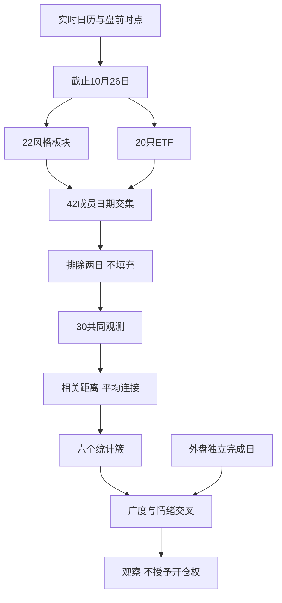

# 2026年10月27日 · 风格研判

> 本文是10月27日盘前研究，A股数据归属10月26日收盘；统计样本名称不是交易推荐。数据新鲜度为partial，数据降级但执行已完成。

## 一句话结论

观察：震荡分化、高位震荡，研究仓位上限40%；不授予开仓权限。

## 市场究竟在为什么付钱

上证指数收涨0.1909%，但深证成指下跌1.1945%、创业板指下跌1.7088%。看起来温和的指数，背后是5570条全市场日线里2252只上涨、3157只下跌、161只持平。因此，“指数没跌多少”不能直接翻译成普遍容易赚钱。55家涨停与26家跌停同时存在，最高连板只有4板，23家炸板对应29.49%的统一炸板率；市场仍有局部活跃，但亏钱扩散也真实存在。

前一交易日82家涨停样本在10月26日全部有行情，开盘相对前收的平均溢价为3.0387%，收盘平均溢价则为2.6569%。这两个数字的分母相同、时点不同，不能混为一个“涨停溢价”。本次按仓库情绪周期实现使用开盘溢价，得到高位震荡，与本地已生成的盘前阶段一致；没有照搬该模块中“阶段等于固定打法”的行动文案。

- **大资金意图**: 相对承接更多落在与广谱风险样本分离的少数统计簇，而不是所有成长方向同步上行。这里只能从收益分离推断风险预算的相对选择，没有资金账户证据，不把意图假说写成净流入事实。
- **为什么走强**: 最新日的相对强势与整段样本期的上涨不是一回事。一组ETF当日共同上涨，而多数高热度及科技样本仍弱，支持“分化中的承接”，不支持“全市场主升”。
- **逻辑够不够硬**: Tushare与XTick都显示最高4板，按相同分母重算炸板率分别为29.49%和28.05%，方向一致；但涨跌停数量口径不同，且缺少指定KOL昨夜有效长文本，故置信度只有0.392，不因外盘反弹放大。

内部四维热度公式给出66分，它衡量涨停与高度等热度，不是胜率。风格规则基线会因为55家涨停、4板高度而落入主线扩散，但周期、广度与深市表现均不支持机械使用这一标签，本次明确降级为震荡分化型。情绪=震荡。29.49%尚未触发35%的硬阈值；后续若达到35%，下游必须将候选数减半并保持震荡/主跌标识。R1没有个股候选，当前候选数始终为零。

仓位上限40%是研究风险预算，不是要求立即调仓到40%的指令，更不是开仓资格。真实主线与地位由R2确认，R6硬否决和D1逐票门禁独立保留。涨停题材统计前20条中有10条达到8家涨停，仅能提供“三主线以上”的重叠代理标签；六簇也绝不是六条主线。研究观察继续，不以禁止新仓为由停止筛选，不由情绪阶段预设固定交易打法。

## 方法：先对日期，再计算相似性

22个同花顺风格板块、20只ETF名单逐项取自现有快照脚本的常量，没有执行其写入raw的main，也没有使用旧聚类脚本按位置截取数组的逻辑。先在线读取交易日历，确认10月27日开市、前一个交易日为10月26日，再用上证日线交叉核对。所有国内行情请求上限固定为10月26日，因此盘前没有引入27日收盘或未来数据。

42个成员都实时取回了历史数据。但是“昨日非ST三板以上表现”在10月14日、20日缺行，按这两个日期单独重试仍为空。因此最近30个连续开市日只有41个成员完整；若强行声称最近30连续交易日42成员齐全，就是错误。本次采取用户要求的共同日期口径：以交易日期为键，取42成员有限收益与交易所开市日的交集，排序后取最近30个共同有效交易日。实际窗口为9月3日至10月26日，跨度含32个开市日，共同剔除10月14日、20日，不填充任何数据。22/22板块、20/20ETF、42/42总体覆盖均为100%。

收益矩阵为42乘30，板块用pct_change、ETF用pct_chg，Pearson相关系数转为1减相关系数的距离，再用average linkage层次聚类，以cut_tree精确切成6个非空簇。没有把NaN相关性改成零。所有成员使用完全相同的30个日期，相关矩阵、层次树和分区在局部Pydantic校验时重新计算并核对。成员日收益、完整共同日期、相关矩阵及层次树均在JSON中，证据行情另有同目录JSON可复算。

下文的“30观测复合收益”只连乘被选中的30个日收益；由于中间共同删掉两日，它不是9月3日至10月26日的完整持有收益，也不是可投资组合回测。ETF使用供应商未复权日收益，表现类指数成分动态更换，其高收益尤其不能当作固定成分可复制的收益。聚类比较波动同步性，不按收益高低分组，簇编号也没有排名含义。

## 六簇告诉我们的分离，而不是六张买入清单

### 簇1：广谱风险资产同振

这一簇含33个成员：百日新高、同花顺热股、行业龙头、近端次新股、百元股、昨日资金前十、昨日成交前十、昨日高振幅、沪股通成交前十、深股通成交前十、高贝塔值、昨日打板表现、昨日打首板表现、增发预案指数、增持计划、减持计划、回购计划、业绩扭亏、沪深300、中证500、中证1000、科创50、通信ETF、芯片ETF、半导体、军工ETF、恒生科技、光伏ETF、新能源、煤炭ETF、有色ETF、芯片ETF华夏、房地产。成员30观测复合收益的等权均值为-12.32%，最新共同日收益均值为-1.39%。33个成员同属相关性最大的宽簇，但并非同等强弱。科技ETF、交易热度及高价样本回撤居前，地产及部分打板样本当日为正，说明共同市场因子之上仍有明显残差；相关聚类不能等同于产业主线。

### 簇2：历史新高的独立残差

这一簇含1个成员：创历史新高。成员30观测复合收益的等权均值为-4.02%，最新共同日收益均值为-1.05%。创历史新高单独成簇，是其日收益协方差形态相对其他样本更独立，不是今日突破得到确认；共同观测复合收益与最新日收益均为负，不给出强势交易推论。

### 簇3：高连板样本的选择效应

这一簇含2个成员：昨日打二板以上表现、昨日非ST三板以上表现。成员30观测复合收益的等权均值为+99.96%，最新共同日收益均值为+2.30%。两个高连板表现指数同簇，说明高连板筛选样本共振而非广谱风险偏好回升。成分每日动态筛选、幸存者偏差及缺失日期会放大复合收益，不能复制为持有策略收益。

### 簇4：非ST二板的独立高波动

这一簇含1个成员：昨日非ST二板表现。成员30观测复合收益的等权均值为+63.48%，最新共同日收益均值为+8.37%。昨日非ST二板表现独立成簇，最新日涨幅很高，说明低级连板样本与高连板、广谱市场有独立波动。独立成簇只是相似性结论，既不验证龙头地位，也不构成首板或二板买入通道。

### 簇5：大盘与医消的相对承接

这一簇含4个成员：上证50、证券ETF、医药ETF、消费ETF。成员30观测复合收益的等权均值为-1.89%，最新共同日收益均值为+0.94%。上证50、证券ETF、医药ETF、消费ETF同簇且最新日均为正，与风险资产宽簇相对分离，是当日相对承接而非四个行业构成同一产业主线。窗口平均复合收益仍为负，不宣告持续反转。

### 簇6：银行的独立相对强势

这一簇含1个成员：银行ETF。成员30观测复合收益的等权均值为+3.58%，最新共同日收益均值为+1.77%。银行ETF独立成簇，共同观测复合收益和最新日收益均为正，可作为相对防御承接的统计证据；单成员簇没有簇内一致性可检验，不把银行静态认定为永远的进攻或防守。

其中最大的簇容纳33个成员，恰好说明风险资产共同波动因子仍强，而不是每一种样本都有独立行情。高连板表现的两成员簇，以及非ST二板单成员簇，与广谱样本分离；这是热度集中和筛选机制的共同结果，不能把极高的样本复合收益直接解释为全市场赚钱效应。另两个小簇相对承接较强，但其中单成员簇不具备簇内一致性证据。今天能回答的是“分化在哪里”，不能回答任何一只股票是否有龙头地位。

## 外盘：昨夜反弹真实，持续性尚未被证明

Tushare美国指数与14只美国样本原始日线均停留在10月23日，不能冒充昨夜。因此重新在线请求Yahoo行情：美国10月26日完整交易时段已在北京时间27日凌晨结束，标普500上涨0.6964%，纳指综合上涨0.8247%，费城半导体上涨2.8203%。但它们各自5个交易日的价格变动仍为-0.1815%、-0.9894%、-2.0578%，短线反弹与此前回撤并存。14只美国观察样本全部补齐至26日，等权平均当日涨幅为1.7623%；这里只展示篮子统计，不转化为个股名单或交易推荐。

亚洲锚点不作强行同步：恒生指数26日上涨0.5129%，韩国综合下跌1.4563%，日经225下跌0.8031%。恒生科技原始接口为空，在线替代符号得到26日价格3857.53，但仅一条，故不能计算日涨幅、5日或月度动量。样本中的“恒生科技”ETF是境内交易ETF，与恒生科技指数不是同一条序列，不能用ETF日涨幅伪装成外盘指数涨幅。

美元指数在线完成日记录对应26日，当日变动为+0.2171%，20个交易日价格变动为+0.8211%。离岸人民币只取到约6.66731的单条在线报价，没有前值；它是连续市场报价，不是已完成外汇日线，既不计算当日升贬，也不计算月度动量。外盘没有被硬塞进A股共同日期矩阵，跨时区观察只作为风险背景。

为了保留宏观坐标，实时抓取了境内黄金、铜和原油主力连续期货作为价格代理。20个完成交易日价格变动分别为-9.0604%、-1.3775%、+0.0137%。它们不是海外现货，且未剔除连续合约换月影响。美元偏强与金铜偏弱不足以在软着陆、降息预期、衰退三种叙事中唯一识别原因；人民币月度序列又缺失，所以宏观环境保留unconfirmed，而不是用一组价格替宏观机制下结论。

## 文本新鲜度与反证

本地manifest与健康检查均为27日盘前生成，全局severity为2。公众号兼容文件来自RSS，81篇文章的发布时间覆盖26日至27日凌晨；群聊输入544条，消息日期为26日，最新到当晚。文本文件新鲜不等于每类研究证据都完整：指定KOL群在昨夜、方向关键词、长文本及非图片链接筛选后，可用文本为零，因此没有编造该KOL对情绪、仓位或方向的观点，也没有把普通群成员发言冒认成KOL原话。公众号属于舆情输入，不把其中未独立核验的事件当成这次风格分类的硬证据。

最重要的反证有三条。第一，26家跌停与多数样本下跌，使涨停热度不足以证明广谱修复；若广度继续恶化，即使高连板样本表现仍亮眼，也要重新评估市场温度。第二，删掉两个共同缺失日可能改变相关结构和复合收益，下一次数据补齐必须重跑全矩阵，不能只给单个成员追加数值。第三，六簇是指定数量的切分，没有做重采样稳定性检验；不能把小簇和单成员簇的独立性写成长期稳定的资金阵营。

本次未满足的条件还包括：五维参考情绪法缺少杠杆外资维度，不能用中性50补齐或计算“差15分”校验；恒生科技和人民币缺连续历史；宏观代理不等于现货；表现指数成分未按历史时点还原。数据不全使研究status为degraded，但实时抓取、计算、局部校验与目标产出均已实际完成，execution_status为completed，不将两者混写成执行失败。

## 数据源审计

| 源 | 日期 | 状态 | 审计说明 |
|---|---|:---:|---|
| Tushare MCP | 2026-10-27 | 🟢 | 日历、上证、ETF探测、涨跌停、天梯实时成功；MCP与SDK是同源，不重复计算独立源 |
| Tushare SDK同花顺板块 | 2026-10-26 | 🟡 | 22个板块均取回；一个成员缺两日，定日重试仍空；30共同日期无缺失 |
| Tushare SDK ETF | 2026-10-26 | 🟢 | 20个ETF均取回，使用与板块相同的30个日期 |
| XTick情绪MCP | 2026-10-26 | 🟡 | ISO日期重试成功；涨停59、跌停27、炸板23、高度4；原zbl口径未核实，不直接引用 |
| Tushare外盘原接口 | 2026-10-23 | 🟡 | 美国日线延迟；部分指数与汇率原符号为空，未把空值当零收益 |
| Yahoo在线替代 | 2026-10-26 | 🟡 | 美国3指数及14样本补齐；恒生科技与离岸人民币仅报价，动量保留缺口 |
| Tushare SDK期货 | 2026-10-26 | 🟡 | 金铜油各78条，使用境内连续期货价格代理，未去换月影响 |
| fetch manifest | 2026-10-27 | 🟢 | 已读取，global_severity=2，不等同全部主数据缺失 |
| mcp_health | 2026-10-27 | 🟢 | 已读取；实际调用结果优先于健康快照 |
| wechat_official_20 | 2026-10-27 | 🟢 | 81篇RSS兼容输入，最晚发布于27日凌晨；不逐条背书新闻事实 |
| wechat_cli_5groups | 2026-10-26 | 🟡 | 544条新鲜消息；指定KOL昨夜有效方向长文本为0，群名与身份匿名化 |

## 校验边界与下游使用

未在仓库中检索到R1专用Pydantic模型，也没有为了本次产出改动项目schema。采用局部R1LocalContract，嵌套校验Cluster、Member和Source，约束风格枚举、仓位范围、日期先后、42个唯一成员、22加20覆盖、每成员30个有限收益、恰好六簇、成员及簇统计一致性。校验器重新计算相关矩阵、平均连接层次树和六簇分区，并复核置信度公式。JSON在写盘前实际通过Pydantic校验，随后对目标文件再次校验；局部JSON Schema另存在同目录。此结果不代表项目级R1模型注册完成，也不代表全项目测试通过。

R2消费市场风格与主线数量代理，但必须独立判主线及地位；R3可把66作为热度基准而非胜率；R6保留唯一硬否决权，本报告不覆盖其结论；D1消费研究风险上限但不能跳过现有预算、禁止清单和逐票门禁。本报告未输出买卖点、个股候选或执行授权，因此每票思维链条款不适用。

元数据：analyze_style_v1，R1；模型gpt-6.1-sol。机器产物为data/research/20261027/R1_style.json。研究数据截止A股20261026，外盘按各市场完成日及报价类型单列；置信度公式为0.70×0.70×0.80=0.392。本次仅运行目标产物及相关仓库只读检查，不运行全项目测试，不提交或推送代码。
