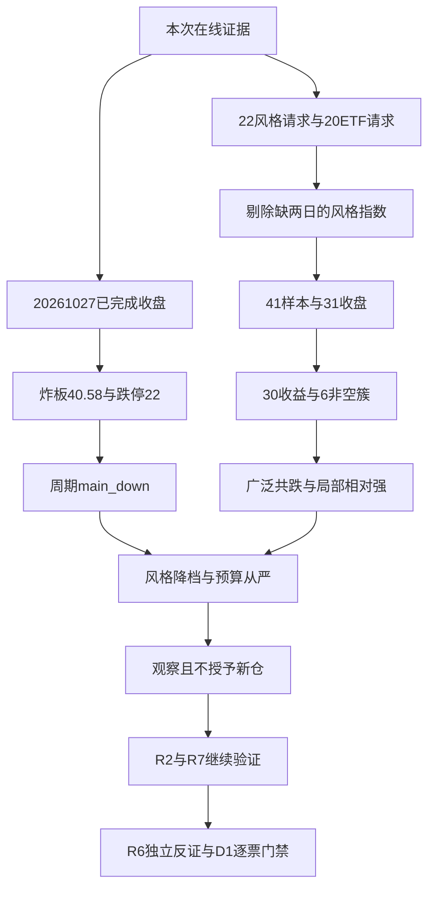

# 2026年10月28日 · 风格研判

## 一句话结论

观察：震荡分化型，情绪=主跌；风险预算总仓上限20%，不授予新仓，研究继续。

## 从市场温度到风险预算

2026年10月28日盘前，市场仍在对少数短线结构给出历史累计溢价，却没有给全市场风险承担提供相应回报。这里必须把“过去三十日曾经赚钱”和“昨天接进去还能不能赚钱”分开。10月27日收盘涨停41家、跌停22家、炸板28家，炸板率按28除以41与28之和计算为40.58%；全市场5570条日线中只有606条上涨，4922条下跌，中位跌幅2.9749%。这种广度不足以支撑全面进攻。研究态度为观察，交易权限不由R1授予。

五选一的基础规则本来会因为涨停超过30家、最高连板5板而落到主线扩散型，但这正是仅看家数与高度容易失真的地方：炸板率超过35%，且跌停已经达到22家。调用当前项目情绪周期函数并传入真实跌停数后，温度为主跌，而不是无分歧主升。本次研究因此把最终风格降为震荡分化型，显式标记情绪=主跌；没有达到“炸板率大于50%”的崩溃风格硬条件，不能为了渲染风险强行称作崩溃退潮。基础风格、最终降档和原因应同时保留，避免下游只见标签不见矛盾。

55只前一日涨停股在10月27日全部匹配到日线，平均溢价为1.3578%，中位0.8159%，收红比例50.91%。这构成对悲观判断的重要反证：强股池没有全面失去赚钱效应。可是这一小池子的正溢价不能覆盖近九成市场下跌、炸板率40.58%的事实。按现有R1四维公式计算情绪分为51.7174，四舍五入为52；该公式并不直接惩罚跌停家数和市场广度，因此52只能理解为狭窄的强股情绪温度，不能当作全市场中性或放松仓位的理由。缺少杠杆外资输入，五维校验不计算，更不以假定中位数补齐。

本次样本范围来自项目既有22个同花顺风格指数和20只ETF定义。交易日历在线回溯至2026年9月7日，31个收盘观测产生2026年9月8日至10月27日的30个交易日收益。昨日非ST三板以上表现缺10月14日和10月20日，逐日重试仍为空，故不把跨缺口价格变化冒充单日收益，也不提前移动窗口以装作全覆盖；该指数保留在请求覆盖审计中，但不进入主聚类。其余21个风格指数与20只ETF组成41乘30的完整收益矩阵，1230个收益格均没有补零、前向填充或跨日拼接。

六簇复用已有脚本的相关距离和平均连接层次聚类，以cut_tree明确切出恰好六个非空簇，大小依次为35、1、1、1、2、1。第一簇纳入多数风格与ETF，三十日成员累计收益均值为-15.7897%，10月27日平均-2.6255%。它的意义是大范围共同风险，而非35个独立主题；相关性聚类按波动路径分组，不是按收益高低或资金净流入分组。昨日打首板表现和高贝塔值虽然三十日收益为正，仍可因共同的日波动路径进入这一个大簇，不能把簇名当作每个成员收益的替代。

第二簇只有昨日打二板以上表现，三十日+27.1267%，当日-0.5080%；第三簇只有昨日非ST二板表现，三十日+59.4739%，当日-0.6317%。历史累计领先但最新一天都回落，说明不能把长窗口优势直接外推到今日接力。尤其风格指数成分动态更新，指数的三十日涨幅不是某只股票、固定组合或真实可执行交易策略的利润，本次既不据此推荐高位票，也不把二板标签静态视为可买。

第四簇为银行ETF，三十日+4.9102%，当日+1.3889%；第五簇为医药与消费两只ETF，三十日均-2.2436%，当日均-1.8129%；第六簇为煤炭ETF，三十日-4.6457%，当日+0.3314%。这只是风险偏好与相对抗跌性的跨资产观察，不是行业配置建议。全样本当日仅两项上涨，三十日35项为负；20只ETF中仅银行ETF三十日为正，防御端的相对收益不能自动转换成已确认的进攻主线，更不能宣称大资金净流入，因为本次没有取得可直接证明这一点的净流量。

ETF价格收益使用fund_daily原始收盘，未把分红再投资、复权或基金净值收益混入，因此这里是价格风格证据而非总回报评价。宽基上证50当日-0.8039%，创业板-3.4145%、科创50-4.8058%，说明成长弹性在下跌日变成损失放大器。大资金意图只能提出“相对收缩风险、偏好低波动”的待证假设；为什么相对走强，只能由相对价格表现回答；逻辑够不够硬，则须承认价格证据不能单独证实资金主动换仓，后续需要R7验证。

外盘必须以日期隔离。在线接口的标普500与纳指综合只到美国当地10月26日，分别+0.6964%和+0.8246%，14只美股观察样本也只到10月26日；它们不是本次10月28日盘前的最新隔夜收盘，不据此描述昨夜美股上涨。亚洲外盘可核实到10月27日：恒指-0.7345%、日经+1.7346%、韩国综合+3.0875%，区域方向不一致，也不能据此称为全球风险偏好一致回升。SOX与HSTECH直接指数、离岸人民币和美元指数缺失，金铜油月度动量未取得，宏观环境坐标保留未知。

主线数量只能保留limit_cpt_list里up_nums不低于8的8个条目这一代理事实，并按现行字段映射main_lines_count=3、main_lines_label=三主线以上。概念条目可能重叠，这不是8条独立主线，也没有证明任何一条已达到交易资格；应同时保留confirmed_tradable_mainline_count=null，等待R2与资金交叉确认。本次风险预算取总仓上限20%，是面对广度、炸板与数据缺口的保守研究判断，不修改既有持仓，不要求一次性清仓，更不预设“主跌就只能用某个固定通道”。研究继续，R1不授予新仓权限。

炸板率既已超过35%，下游研究到交易的候选预算必须减半；R1本身没有个股候选，所以不虚构候选数。每票止损距离不足5%或RR不足2仍只能观察，具体止损区间及其他门禁由真实下游契约独立执行；R6是唯一hard_reject来源，本研究不生成或覆盖硬否决。若下一已完成交易日广度明显恢复、昨日涨停溢价继续为正、炸板率降至25%以下，则当前主跌温度应重新评估；反之若窄池溢价也转负，当前谨慎判断进一步得到支持。这些是可证伪条件，不是买卖点。

## 推理深度与反证边界

**大资金意图**：价格证据只支持“风险收缩、相对偏向低波动”的假设，不支持把假设写成已经测得的资金净流入。35项大簇的共同下跌与少数防御观察样本相对抗跌，可以作为R7验证的线索，不能代替R7的资金证据。

**为什么走强**：这里的“强”首先是相对强，不等于普涨。历史短线风格指数累计为正而最新一天回落，说明价格路径与即时接力温度并不一致；少数ETF上涨也只是价格事实。没有催化、资金与R2确认，不能提升为交易主线。

**逻辑够不够硬**：全市场广度、涨跌停、炸板率以及完整样本收益矩阵可复核；资金动机、外部隔夜传导和修复持续性仍不能确认。当前周期函数判main_down，与本报告“情绪=主跌”一致；只与基础风格规则的“主线扩散型”存在张力，已按情绪温度优先降档，不把阶段焊接成固定打法。

## 22个风格指数与20只ETF的覆盖审计

第1簇共35项，30日累计价格收益的成员均值-15.7897%，最新一日均值-2.6255%。成员观察如下，均不是买入名单。

百日新高（883416.TI，30日-15.8524%，5日-4.5387%，10月27日-1.7494%）；同花顺热股（883910.TI，30日-28.5574%，5日-5.9280%，10月27日-1.7056%）；创历史新高（883911.TI，30日-12.8496%，5日-8.8148%，10月27日-5.0621%）；行业龙头（883917.TI，30日-7.8822%，5日-2.1888%，10月27日-1.7319%）；近端次新股（883907.TI，30日-16.5711%，5日-3.2415%，10月27日-1.8097%）；百元股（883916.TI，30日-24.7797%，5日-7.9624%，10月27日-4.3226%）；昨日资金前十（883901.TI，30日-10.9378%，5日-8.1455%，10月27日-3.5182%）；昨日成交前十（883902.TI，30日-34.0982%，5日-8.9828%，10月27日-2.8832%）；昨日高振幅（883906.TI，30日-23.4680%，5日-5.4735%，10月27日-2.1557%）；沪股通成交前十（883908.TI，30日-17.8571%，5日-2.9160%，10月27日-1.7759%）；深股通成交前十（883912.TI，30日-30.8666%，5日-9.6772%，10月27日-3.0367%）；高贝塔值（883926.TI，30日+7.6987%，5日+2.1988%，10月27日-0.3298%）；昨日打板表现（883978.TI，30日+3.3304%，5日+2.6756%，10月27日-0.7981%）；昨日打首板表现（883994.TI，30日+6.8175%，5日+4.7387%，10月27日-0.0010%）；增发预案指数（883903.TI，30日-15.7625%，5日-6.4412%，10月27日-3.3294%）；增持计划（883915.TI，30日-9.8365%，5日-4.0483%，10月27日-2.7457%）；减持计划（883921.TI，30日-12.4520%，5日-5.0569%，10月27日-3.2502%）；回购计划（883929.TI，30日-12.4971%，5日-4.6473%，10月27日-2.3196%）；业绩扭亏（883936.TI，30日-26.1576%，5日-6.1996%，10月27日-4.0055%）；沪深300（510300.SH，30日-11.0272%，5日-2.2986%，10月27日-1.3400%）；上证50（510050.SH，30日-5.1690%，5日-0.5214%，10月27日-0.5559%）；中证500（510500.SH，30日-15.8796%，5日-4.8610%，10月27日-3.1556%）；中证1000（512100.SH，30日-15.6603%，5日-5.0872%，10月27日-3.2234%）；科创50（588000.SH，30日-22.5806%，5日-6.8454%，10月27日-4.4171%）；通信ETF（515880.SH，30日-29.5421%，5日-9.8299%，10月27日-3.6364%）；芯片ETF（512760.SH，30日-22.7872%，5日-7.0295%，10月27日-4.4289%）；半导体（512480.SH，30日-23.6527%，5日-7.7201%，10月27日-4.4944%）；证券ETF（512880.SH，30日-8.3410%，5日-1.4778%，10月27日-2.0568%）；军工ETF（512660.SH，30日-12.0765%，5日-5.4206%，10月27日-3.9848%）；恒生科技（513180.SH，30日-16.8126%，5日-6.6798%，10月27日-1.4523%）；光伏ETF（515790.SH，30日-14.5477%，5日-2.6462%，10月27日-1.9635%）；新能源（516090.SH，30日-17.1975%，5日-3.9409%，10月27日-2.2556%）；有色ETF（512400.SH，30日-22.7564%，5日-3.9841%，10月27日-0.2759%）；芯片ETF华夏（159995.SZ，30日-25.5357%，5日-7.6412%，10月27日-4.6857%）；房地产（512200.SH，30日-6.4935%，5日-2.4555%，10月27日-3.4367%）。

第2簇共1项，30日累计价格收益的成员均值+27.1267%，最新一日均值-0.5080%。成员观察如下，均不是买入名单。

昨日打二板以上表现（883996.TI，30日+27.1267%，5日-1.2016%，10月27日-0.5080%）。

第3簇共1项，30日累计价格收益的成员均值+59.4739%，最新一日均值-0.6317%。成员观察如下，均不是买入名单。

昨日非ST二板表现（883997.TI，30日+59.4739%，5日+1.0512%，10月27日-0.6317%）。

第4簇共1项，30日累计价格收益的成员均值+4.9102%，最新一日均值+1.3889%。成员观察如下，均不是买入名单。

银行ETF（512800.SH，30日+4.9102%，5日+1.1547%，10月27日+1.3889%）。

第5簇共2项，30日累计价格收益的成员均值-2.2436%，最新一日均值-1.8129%。成员观察如下，均不是买入名单。

医药ETF（512010.SH，30日-1.8519%，5日-1.5915%，10月27日-2.8796%）；消费ETF（159928.SZ，30日-2.6354%，5日+0.1506%，10月27日-0.7463%）。

第6簇共1项，30日累计价格收益的成员均值-4.6457%，最新一日均值+0.3314%。成员观察如下，均不是买入名单。

煤炭ETF（515220.SH，30日-4.6457%，5日-3.4290%，10月27日+0.3314%）。

第22个请求的风格指数为昨日非ST三板以上表现（883999.TI），指定31日收盘网格只有29个值，缺20261014与20261020。它计入请求与缺口审计，不进入41样本主聚类；不报其完整30日收益，不将跨缺口涨跌幅当成一天。22个请求并不等于22个有效风格样本。

## 来源、日期与缺口

🟢 tushare.ths_daily：本次在线证据抓取于2026-10-28，存档680条记录。22项有返回，21项窗口完整，1项缺两日；不是全覆盖。 记录数按接口返回累计，不能当作独立资产数量；来源均可在data/research/20261028/_r1_live_evidence.json逐项复核。

🟢 tushare.fund_daily：本次在线证据抓取于2026-10-28，存档620条记录。20项均有31个指定收盘值。 记录数按接口返回累计，不能当作独立资产数量；来源均可在data/research/20261028/_r1_live_evidence.json逐项复核。

🟡 tushare.index_global：本次在线证据抓取于2026-10-28，存档191条记录。5/7有返回；美股两指数仅至10月26日，亚洲三指数至10月27日。 记录数按接口返回累计，不能当作独立资产数量；来源均可在data/research/20261028/_r1_live_evidence.json逐项复核。

🟡 tushare.us_daily：本次在线证据抓取于2026-10-28，存档546条记录。14/14有返回，但均只至10月26日，不作最新隔夜。 记录数按接口返回累计，不能当作独立资产数量；来源均可在data/research/20261028/_r1_live_evidence.json逐项复核。

🔴 tushare.fx_daily：本次在线证据抓取于2026-10-28，存档0条记录。两项均为空。 记录数按接口返回累计，不能当作独立资产数量；来源均可在data/research/20261028/_r1_live_evidence.json逐项复核。

🟢 tushare.limit_list_d：本次在线证据抓取于2026-10-28，存档146条记录。20261027收盘口径；前日涨停池为20261026。 记录数按接口返回累计，不能当作独立资产数量；来源均可在data/research/20261028/_r1_live_evidence.json逐项复核。

🟢 tushare.limit_step：本次在线证据抓取于2026-10-28，存档12条记录。20261027收盘口径；前日涨停池为20261026。 记录数按接口返回累计，不能当作独立资产数量；来源均可在data/research/20261028/_r1_live_evidence.json逐项复核。

🟢 tushare.daily：本次在线证据抓取于2026-10-28，存档5570条记录。20261027收盘口径；前日涨停池为20261026。 记录数按接口返回累计，不能当作独立资产数量；来源均可在data/research/20261028/_r1_live_evidence.json逐项复核。

🟢 tushare.index_daily：本次在线证据抓取于2026-10-28，存档248条记录。20261027收盘口径；前日涨停池为20261026。 记录数按接口返回累计，不能当作独立资产数量；来源均可在data/research/20261028/_r1_live_evidence.json逐项复核。

🟢 tushare.limit_cpt_list：本次在线证据抓取于2026-10-28，存档20条记录。20261027收盘口径；前日涨停池为20261026。 记录数按接口返回累计，不能当作独立资产数量；来源均可在data/research/20261028/_r1_live_evidence.json逐项复核。

交易日历来自同次Tushare在线trade_cal，只取20261027及以前已完成交易日。证据是本次会话现取现存，本轮续办按主控要求直接消费，未重复拉取，也未以旧日市场文件替换。XTick补查先因紧凑日期格式报错，改用ISO日期后仍为空；Tushare逐日重试883999.TI两处缺口也为空，重试审计见_r1_retry_evidence.json。

美股14只观察样本均只至20261026，不能称“昨夜”或“最新隔夜”；本报告不输出这些美股个股推荐。亚洲三项外盘为20261027实际日期。SOX与HSTECH直接指数、USDCNH与DXY缺失，黄金／铜／原油月度动量未取得。公众号与KOL在线文本未取得，未读取旧观点填空。五维情绪校验缺杠杆外资，不计算两法分差。上述缺口全部保留degraded=true，不能因Pydantic通过而改为数据完整。

## 前置约束、研究权限、下游与校验

本报告仅依赖本次live、retry和computed三份证据JSON。R2消费风格与代理主线数，R3可用52作有局限的情绪基准，R5／R7补充逐票画像及资金验证，R6检查一致性并独占hard_reject权，D1将20%作为风险预算上限而非自动开仓命令。没有个股候选，因此每票板型、龙头认定、止损价和RR字段不适用；下游仍须独立满足止损距及RR门禁。未运行全流水线，未读取或修改计划、执行、偏好或人类论点。

本次schema_origin=inline_from_analyze_style_v1_contract，repo_model_absent=true。仓库没有R1／ResearchUnit生产Pydantic模型的事实不变；按主控本轮澄清，仅在内存中按analyze_style_v1明文JSON契约建立严格模型，额外校验本次30收益、41样本、6非空簇条件。必填、枚举、真实日期、带时区生成时间、数值范围、未知字段拒绝、覆盖与簇成员唯一性均已真实校验；不修改生产代码，也不宣称通过不存在的仓库生产模型。先前计算证据中的blocked_model_absent是当时发布状态，本轮授权后的校验结果见_r1_validation.json。

## 判断链路

本图只说明证据如何限制结论，不给出固定阶段打法，也不把研究观察等同交易授权。

## Sub-Agent 元数据

本次角色为主控明确委派的R1，skill为analyze_style_v1，模型为gpt-6.1-sol。机读产物为data/research/20261028/R1_style.json，人读产物为chzl_kg/投研交易/风格研判/20261028.md，校验记录为data/research/20261028/_r1_validation.json。恢复阶段无新增抓取，沿用本次会话在线证据；未修改代码、skill或长期记忆。
