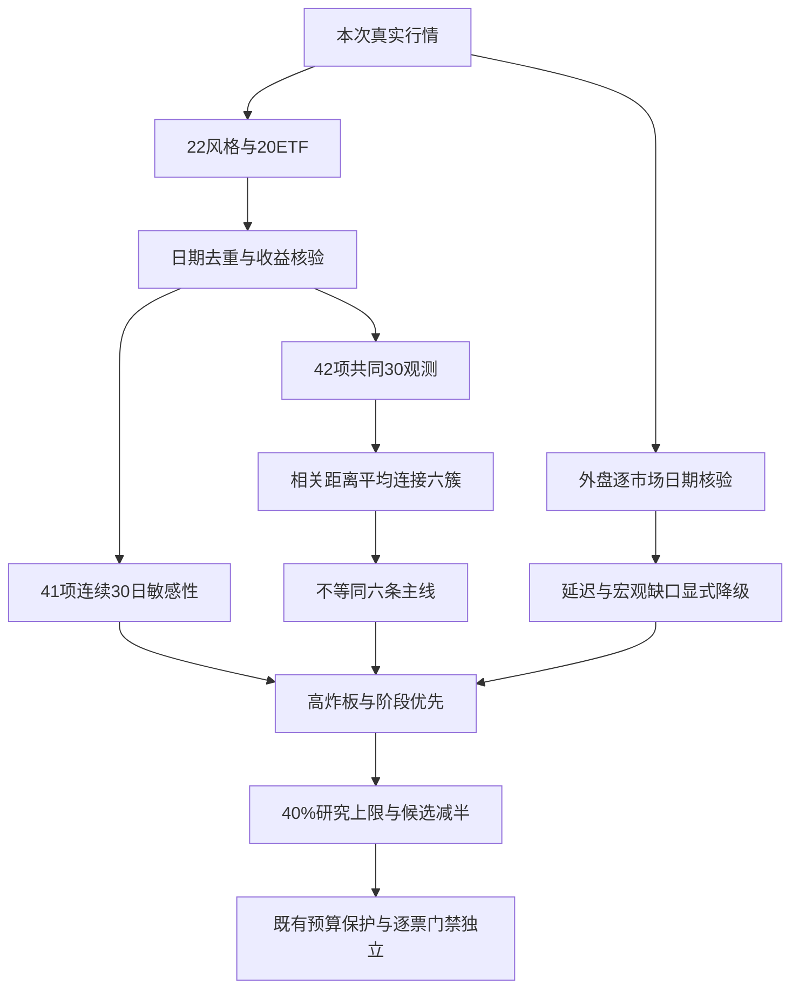

# 2026年10月29日 · 风格研判

> ⚠️ **数据源时间错位**：文件名是今日盘前研究任务日，内盘证据属于昨日已收盘交易日；外盘按各自当地归属日分别列示。今日尚未开盘，不能把昨日标签写成今日已发生的阶段。本报告为真实当时生成的盘前研究，不是历史回放。

## 🧭 一句话结论

观察：扩散修复与高位震荡并存。情绪83分不是主升确认，研究仓位上限40%，下游候选上限减半，不授予买权。

## 🌡️ 先认市场：为什么指数强，仍不能把温度叫主升

市场在为短期风险偏好恢复付钱，却还没有给出低分歧、可连续兑现的统一答案。昨日涨停72家，跌停5家，炸板69家；按相同统计宇宙计算，炸板率是69除以141，即48.94%。三只主要宽基指数的日涨幅分别为0.9091%、2.0225%和3.3990%，全市场5570条日行情中有4156家上涨、1239家下跌。广度和指数同时修复是真实证据，但近半数触板失败同样是真实证据。不能只拿第一组数字给进攻加权，而把第二组数字当噪声。

五档核心风格沿用本地消费者可读的“主线扩散型”，不在枚举后拼接故事。它对应本地规则的涨停不少于30家、最高连板不少于3板；此次72家已经超出旧文档30—50家的示例区间，所以这是明确披露的扩散近似，不是严格命中全部旧条件。非ST最高5板，天梯为5板1家、3板2家、2板5家，4板缺层。前一日涨停群体有41家能够完整匹配下一日收盘反馈，均值为2.3255%，中位数2.0270%；这里计算的是收盘对前收盘的涨跌，不是竞价溢价，也不是开盘可成交收益。

阶段因此只标“高位震荡”。本次实际调用仓库情绪函数，使用昨日归属日、48.94%炸板率、5板高度、72家涨停和正但未达3%的平均反馈，得到high_chop。跌停没有达到主跌阈值，反馈尚为正，不能过度描述成全面主跌；但高炸板率也排除了低分歧主升。情绪=震荡。下游候选上限必须在其既有基准上乘0.5并向下取整；R1不产生任何候选，不因候选约束停止研究覆盖。

情绪分按仓库四维公式计算：涨停强度贡献40分，高度贡献12.5分，封板承接贡献10.2128分，三指数均值经截断贡献20分，合计82.7128后取整为83。这说明公式中的涨停和指数因子已经饱和，不说明所有风险都在改善。杠杆和外资分项没有取得，五维参考分没有计算，更没有填一个“中性50”伪装交叉验证。数字上的高分必须服从可直接验证的炸板风险，而不是反过来压低风险。

- **大资金意图**: 价格与广度支持风险偏好回升的假设，但场内ETF涨价不等于份额申购；没有把价格联动写成已确认主力净流入。资金归因仍由R7独立验证。
- **为什么走强**: 指数和上涨家数共振、昨日涨停群体仍有正反馈，能解释修复；但此前窗口的回撤与当日炸板说明这不是无条件趋势延续。
- **逻辑够不够硬**: 两家行情源对高炸板风险方向一致，晚间复盘对上涨家数也有交叉；然而价格、群聊和文章不能替代逐票核心地位及新日资金确认。只有新增承接证据通过既有决策者重评，才能改写结论。

## 🧪 30日到底是什么：不拿缺失日冒充满窗口

本次从固定名单新取22个风格指数和20只ETF，所有42项都有真实行情，最后一行均属于昨日收盘。读取旧快照或运行会写入data/raw的快照入口都没有发生。请求回溯至7月，是为了提供足够的共同交易日与前收盘核验，不是把自然日数量叫交易日。

主分析使用42项共同有效的30个单日收益观测，日期从9月7日到10月28日。它不是最近连续30个交易日：883999.TI在10月14日与10月20日没有源记录，补查问财也只返回最新行情，没有那两天的日期化历史字段，故不能补回。所有样本统一剔除这两天，并向前延伸两个共同有效日。最近连续30个上交所交易日本应从9月9日开始，二者差异明确保留；逐日日期数组、各样本30个收益、原始行情与距离矩阵均已冻结在机读产物中。

收益直接使用源pct_change或pct_chg，并以每行close/pre_close减一核验，容差0.015个百分点。没有用跨缺口的两次收盘价计算“单日收益”，没有前填、补零或按数组位置硬拼。表中“观察复合”是这30个离散单日收益的连乘，不是9月7日至10月28日端点持有收益，也不是一套实际可买策略的月收益。ETF使用未复权场内价格，分红、申赎流与净值总收益不在该指标中；动态成分指数也不能被当作固定持仓组合。

为避免缺口处理支配结论，另外用41个完整样本，在最近连续30个交易日重新聚为6簇。缺的仅是上述一个风格指数；这不是把少一个样本偷报成42项完成，而是独立的敏感性检查。

## 🧩 六簇：统计形状不是六条主线

方法沿用项目相关距离层次聚类思路，但先进行严格日期对齐。每个样本沿时间去均值并除以自身标准差，Pearson相关等价包含这一步标准化；距离为1减相关，平均连接合并。主聚类是确定性的，无需随机种子；200次日期重抽样的稳定性检查使用随机种子42。按任务固定截为6簇，不挑一个“看起来最漂亮”的K，也不宣称6是最优。

### 第1簇：共振修复大簇

这一簇有36项，观察复合等权均值为-10.99%，最后一日均值+1.83%，成员日波动标准差均值1.90个百分点。簇内平均两两相关为0.642。36项的相关共振并不等于36个独立机会；观察复合均值仍负，当日反弹不能证明月度趋势反转。

成员为：百日新高、昨日资金前十、昨日成交前十、增发预案指数、昨日高振幅、近端次新股、沪股通成交前十、同花顺热股、深股通成交前十、增持计划、百元股、行业龙头、减持计划、高贝塔值、回购计划、业绩扭亏、昨日打板表现、昨日打首板表现、消费ETF、芯片ETF华夏、上证50、沪深300、中证500、医药ETF、中证1000、房地产、有色ETF、半导体、军工ETF、芯片ETF、证券ETF、恒生科技、光伏ETF、通信ETF、新能源、科创50。这里只是固定研究名单的实证归组，不构成行业配置或买入推荐。

### 第2簇：新高背离孤点

这一簇有1项，观察复合等权均值为-8.23%，最后一日均值-0.23%，成员日波动标准差均值2.61个百分点。单例没有可定义的簇内两两相关，因此机读为null，不填零。仅一个样本，当日仍负；不能用孤点簇证明新高风格获资金持续认可。

成员为：创历史新高。这里只是固定研究名单的实证归组，不构成行业配置或买入推荐。

### 第3簇：多板高波动簇

这一簇有2项，观察复合等权均值为+105.58%，最后一日均值+1.59%，成员日波动标准差均值4.39个百分点。簇内平均两两相关为0.410。两个动态成分风格指数呈高复合收益但相关仅约0.41；成分每日变化，非固定组合可得回报。

成员为：昨日打二板以上表现、昨日非ST三板以上表现。这里只是固定研究名单的实证归组，不构成行业配置或买入推荐。

### 第4簇：二板独立孤点

这一簇有1项，观察复合等权均值为+71.14%，最后一日均值+2.33%，成员日波动标准差均值3.45个百分点。单例没有可定义的簇内两两相关，因此机读为null，不填零。单样本表明与大簇回报路径不同，不代表独立交易主线。

成员为：昨日非ST二板表现。这里只是固定研究名单的实证归组，不构成行业配置或买入推荐。

### 第5簇：低波相对强孤点

这一簇有1项，观察复合等权均值为+4.04%，最后一日均值-0.46%，成员日波动标准差均值1.00个百分点。单例没有可定义的簇内两两相关，因此机读为null，不填零。观察复合为正、当日为负；相对抗跌与今日进攻不是同一命题。

成员为：银行ETF。这里只是固定研究名单的实证归组，不构成行业配置或买入推荐。

### 第6簇：独立走弱孤点

这一簇有1项，观察复合等权均值为-5.81%，最后一日均值-0.17%，成员日波动标准差均值1.72个百分点。单例没有可定义的簇内两两相关，因此机读为null，不填零。当日及观察复合均负；独立性不是正向交易信号。

成员为：煤炭ETF。这里只是固定研究名单的实证归组，不构成行业配置或买入推荐。

轮廓系数为0.3283，树状距离保真度的cophenetic相关为0.9012。两者不能混为一谈：后者说明层次树保留了距离结构，不证明组内经济叙事正确。6簇的规模是36、1、2、1、1、1，四个单例暴露了强制六分的脆弱性。200次重抽样的ARI均值为0.6636，中位数0.6606，10%—90%分位为0.4705—0.8847，稳定性只能称中等。

41项连续窗口检查的轮廓系数为0.3999，与主分析在共同41项上的ARI为0.6712。日期与样本改变后部分归组会变，尤其单例；因此只把“大部分样本共振修复、少数高波风格路径独立”作为研究描述，不把簇号做交易标签。主线数量字段写3，来自强度排名表20个重叠概念均达到源up_nums不小于8的封顶代理，含义是“三条以上潜在线索”；没有逐一去重并取得资金确认前，不等于三条已确认可交易主线，更与六簇没有一一对应关系。

## 📋 固定名单逐项覆盖附录

以下名称仅用于复核用户指定风格指数和ETF，未产生个股或具体产业推荐。全部样本新取成功；“共同30”指主分析的离散共同观测，不暗示连续窗口已齐。日期以机读源为准，所有42项最后观察日均为10月28日。

| 类型 | 代码 | 名称 | 源行数 | 共同观测 | 末日% | 观察复合% | 簇 | 最近连续30日缺口 |
|---|---|---|---:|---:|---:|---:|---:|---|
| 风格 | 883416.TI | 百日新高 | 80 | 30 | +0.5817 | -13.87 | 1 | 无 |
| 风格 | 883901.TI | 昨日资金前十 | 80 | 30 | +0.6895 | -2.11 | 1 | 无 |
| 风格 | 883902.TI | 昨日成交前十 | 80 | 30 | +4.3839 | -23.24 | 1 | 无 |
| 风格 | 883903.TI | 增发预案指数 | 80 | 30 | +2.8905 | -11.05 | 1 | 无 |
| 风格 | 883906.TI | 昨日高振幅 | 80 | 30 | +2.2252 | -18.77 | 1 | 无 |
| 风格 | 883907.TI | 近端次新股 | 80 | 30 | +2.0548 | -12.37 | 1 | 无 |
| 风格 | 883908.TI | 沪股通成交前十 | 80 | 30 | +0.4377 | -13.85 | 1 | 无 |
| 风格 | 883910.TI | 同花顺热股 | 80 | 30 | +2.0103 | -22.08 | 1 | 无 |
| 风格 | 883911.TI | 创历史新高 | 79 | 30 | -0.2274 | -8.23 | 2 | 无 |
| 风格 | 883912.TI | 深股通成交前十 | 80 | 30 | +4.5950 | -19.92 | 1 | 无 |
| 风格 | 883915.TI | 增持计划 | 80 | 30 | +1.7857 | -6.96 | 1 | 无 |
| 风格 | 883916.TI | 百元股 | 80 | 30 | +4.2819 | -17.21 | 1 | 无 |
| 风格 | 883917.TI | 行业龙头 | 80 | 30 | +0.6601 | -6.42 | 1 | 无 |
| 风格 | 883921.TI | 减持计划 | 80 | 30 | +2.3457 | -9.15 | 1 | 无 |
| 风格 | 883926.TI | 高贝塔值 | 80 | 30 | +1.4143 | +10.07 | 1 | 无 |
| 风格 | 883929.TI | 回购计划 | 80 | 30 | +2.1600 | -10.72 | 1 | 无 |
| 风格 | 883936.TI | 业绩扭亏 | 80 | 30 | +1.4296 | -24.46 | 1 | 无 |
| 风格 | 883978.TI | 昨日打板表现 | 80 | 30 | +1.8969 | +7.26 | 1 | 无 |
| 风格 | 883994.TI | 昨日打首板表现 | 80 | 30 | +1.9644 | +10.29 | 1 | 无 |
| 风格 | 883996.TI | 昨日打二板以上表现 | 80 | 30 | +1.7178 | +38.48 | 3 | 无 |
| 风格 | 883997.TI | 昨日非ST二板表现 | 80 | 30 | +2.3343 | +71.14 | 4 | 无 |
| 风格 | 883999.TI | 昨日非ST三板以上表现 | 70 | 30 | +1.4578 | +172.68 | 3 | 20261014,20261020 |
| ETF | 159928.SZ | 消费ETF | 80 | 30 | -1.6500 | -5.09 | 1 | 无 |
| ETF | 159995.SZ | 芯片ETF华夏 | 80 | 30 | +4.0800 | -17.92 | 1 | 无 |
| ETF | 510050.SH | 上证50 | 80 | 30 | +0.1400 | -4.54 | 1 | 无 |
| ETF | 510300.SH | 沪深300 | 80 | 30 | +0.7000 | -8.55 | 1 | 无 |
| ETF | 510500.SH | 中证500 | 80 | 30 | +2.0700 | -12.53 | 1 | 无 |
| ETF | 512010.SH | 医药ETF | 80 | 30 | +0.8100 | -2.08 | 1 | 无 |
| ETF | 512100.SH | 中证1000 | 80 | 30 | +2.4100 | -11.79 | 1 | 无 |
| ETF | 512200.SH | 房地产 | 80 | 30 | +0.5200 | -4.11 | 1 | 无 |
| ETF | 512400.SH | 有色ETF | 80 | 30 | +0.6200 | -16.82 | 1 | 无 |
| ETF | 512480.SH | 半导体 | 80 | 30 | +4.1800 | -16.59 | 1 | 无 |
| ETF | 512660.SH | 军工ETF | 80 | 30 | +0.8900 | -10.14 | 1 | 无 |
| ETF | 512760.SH | 芯片ETF | 80 | 30 | +4.0200 | -15.63 | 1 | 无 |
| ETF | 512800.SH | 银行ETF | 80 | 30 | -0.4600 | +4.04 | 5 | 无 |
| ETF | 512880.SH | 证券ETF | 80 | 30 | -0.8000 | -8.58 | 1 | 无 |
| ETF | 513180.SH | 恒生科技 | 80 | 30 | +1.0500 | -17.01 | 1 | 无 |
| ETF | 515220.SH | 煤炭ETF | 80 | 30 | -0.1700 | -5.81 | 6 | 无 |
| ETF | 515790.SH | 光伏ETF | 80 | 30 | +0.5700 | -10.39 | 1 | 无 |
| ETF | 515880.SH | 通信ETF | 80 | 30 | +5.4500 | -18.79 | 1 | 无 |
| ETF | 516090.SH | 新能源 | 80 | 30 | +0.5100 | -13.83 | 1 | 无 |
| ETF | 588000.SH | 科创50 | 80 | 30 | +2.5800 | -16.81 | 1 | 无 |

## 🌍 外盘不是一个统一的“隔夜时间”

本次抓取时纽约当地已在10月28日常规收盘之后。Tushare的标普与纳指日线却只返回10月27日，不能把查询结束日10月28日当作源已入库日期。官方问财备用查询明确返回10月28日的收盘价和涨跌幅，才将三个美股指数纳入该日收盘观察；纳指的两个别名返回值相同，选定IXIC.GI一项，未把重复代码算成两份证据。备用源没有供应商发布时间，所以能够证明“本次查询已取得”，不能证明更早某一分钟已经可得。

恒生科技的原请求HSTECH为空，本次查询源全目录后发现其实际代码为HKTECH，再单独拉取；机读同时保留原请求与映射依据，没有静默改代码。香港有本次当地日历确认，日韩仅有各自10月28日日线收盘返回，没有各自交易日历，因此只称“最后观察日”，不认证最新应有交易日。没有用正在进行的盘中报价冒充收盘。

| 市场锚点 | 源代码 | 实际观察日 | 收盘 | 当日% | 来源与状态 |
|---|---|---|---:|---:|---|
| 标普500 | SPX.GI | 20261028 | 7743.9800 | +0.2768 | hithink-zhishu-query；收盘已核 |
| 纳指综合 | IXIC.GI | 20261028 | 26549.8500 | +0.2721 | hithink-zhishu-query；收盘已核 |
| 费城半导体 | SOX.GI | 20261028 | 11684.0000 | +1.7548 | hithink-zhishu-query；收盘已核 |
| 恒生指数 | HSI | 20261028 | 23094.8300 | +0.2322 | tushare.index_global；收盘已核 |
| 恒生科技 | HKTECH | 20261028 | 3853.7200 | +1.4022 | tushare.index_global；收盘已核 |
| 韩国综合 | KS11 | 20261028 | 6012.4400 | +6.6349 | tushare.index_global；日线收盘，最新交易日日历未核 |
| 日经225 | N225 | 20261028 | 63954.1900 | +1.0840 | tushare.index_global；日线收盘，最新交易日日历未核 |

美股风险偏好回升可作为外部温度，不替代内盘承接。日本和韩国的源日涨幅差异很大，不应平均成一条全球强弱信号，更不能据此直接授予某个产业或股票买权。R1外盘范围采用七个市场指数与宏观报价，不输出外盘个股推荐。

宏观坐标保留未决。黄金美元与离岸人民币有历史报价，但都只到10月27日，日线时区与切点也未认证；用各自最近31个有价日期计算30个价格间隔的动量，和A股共同30观测不是同一窗口。铜、美国原油CFD、美元篮子为空；美元篮子即使有报价也不能冒充ICE美元指数。问财复合宏观请求误解析，简化后原油返回国内INE合约而非NYMEX，也已剔除，不能为了补齐表格就换市场。

| 宏观项 | 源代码 | 最后观察日 | 报价 | 30价格间隔动量% | 状态 |
|---|---|---|---:|---:|---|
| 黄金美元报价 | XAUUSD.FXCM | 20261027 | 4063.08000 | -6.7618 | 源日线滞后/切点未核 |
| 美元离岸人民币报价 | USDCNH.FXCM | 20261027 | 6.66485 | -0.6875 | 源日线滞后/切点未核 |
| 铜CFD | Copper.FXCM | 缺失 | 缺失 | 不可算 | 源空；未补零 |
| 美国原油CFD | USOil.FXCM | 缺失 | 缺失 | 不可算 | 源空；未补零 |
| FXCM美元篮子（非ICE DXY） | USDOLLAR.FXCM | 缺失 | 缺失 | 不可算 | 源空；未补零 |

因此不在“软着陆、降息预期、衰退”中强行选一档。外盘七指数已覆盖，宏观只完成两项报价历史，海外油、铜、ICE美元指数仍缺，这是本次status=degraded的重要原因。

## 🗣️ 文本只作交叉，不把图片和群友变成KOL

本地公众号输入95篇、群聊614条已检查，重点研究群15条。昨夜可以归属重点KOL且符合情绪、仓位、资金等条件的实质方向长文为0；活动邀请、图片和链接不能替代方向判断，其他群友盘中的多头表述也不能冒充昨夜KOL意见。公众号晚间复盘使用“震荡修复、放量反弹”等描述，其中4156家上涨与本次daily独立计算相符。文本支持修复语境，但不能降低69家炸板的客观权重。

## 🛡️ 研究仓位不是交易授权

40%的研究上限来自三重取小：本地扩散风格区间按83分插值得77%，极高分防过热上限60%，本次高位震荡且炸板不低于35%的保守研究约束40%。最后一项是本次明示的研究裁量，不伪称仓库已存在某个自动固定仓位算法。任何已有批准预算、更低仓位约束、零交易预算、不交易决定与保护开关都继续独立生效；有效预算必须再取最小。本报告不触发交易，不撤单、不清池，也没有“必须清仓”的机械动作。

阶段只定温度，不预先固定首板、低吸或接力通道。R2仍研究真实主线与核心，R4仍核催化，R5仍对真实研究候选做画像，R7验证资金，R6保留唯一硬否决来源。若新日反馈与昨日相反，必须送达D1重新评价，而非拿昨日阶段永久封死新研究，也不能以一句“修复了”跳过现有门禁。

## 数据源审计

| 源 | 日期 | 状态 | 实际覆盖与限制 |
|---|---|:--:|---|
| tushare.ths_daily | 2026-10-28 | 🟡 | 22/22本次成功；一项连续窗口缺两日，共同30观测均完成 |
| tushare.fund_daily | 2026-10-28 | 🟢 | 20/20，未复权场内价格；不是份额资金流 |
| tushare.index_daily / daily | 2026-10-28 | 🟢 | 三指数与5570条全市场日行情，原始个股不进入R1输出 |
| tushare.limit_list_d / limit_step | 2026-10-28 | 🟢 | 72涨停、5跌停、69炸板、8项天梯；上一日41家可配对 |
| tushare.limit_cpt_list | 2026-10-28 | 🟡 | 20项强度代理有重叠，非真实主线去重 |
| xtick.market_emotion | 2026-10-28 | 🟡 | 73涨停、6跌停、69炸板，重算48.59%；原zbl不作炸板率 |
| tushare.index_global | 2026-10-28 | 🟡 | 亚洲4锚点；美股主源只到前一当地交易日，已由备用补齐 |
| hithink-zhishu-query | 2026-10-28 | 🟢 | 三美股指数日期化收盘；缺失风格历史补查不成功 |
| tushare.us_tradecal / hk_tradecal / trade_cal | 2026-10-29 | 🟡 | 美港与A股日历已取；日韩各自日历未取得 |
| tushare.fx_daily | 2026-10-27 | 🟡 | 黄金及人民币历史足量但不认证最新切点 |
| 铜 / 海外油 / ICE美元指数 | 2026-10-29 | 🔴 | SDK与问财替代尝试未取得可接受数据；错误市场返回已剔除 |
| vibe.iwencai_search | 2026-10-29 | 🔴 | MCP access key未配置；官方问财已配置客户端可用 |
| wechat_official_20 | 2026-10-29 | 🟢 | 95篇本地文本，行情量化不来自旧快照 |
| wechat_cli_5groups | 2026-10-29 | 🟡 | 614条；重点群15条，昨夜有效KOL方向句0 |
| fetch manifest / mcp_health | 2026-10-29 | 🟡 | severity=2，仅作输入健康记录，不替代本次请求 |

精确请求/回包时间、每项源日、原始字段和输入文件hash保留在JSON与frontmatter，正文不把抓取时钟写成交易观察时钟。美股备用收盘是本次取得的10月28日日期化字段，原源27日旧值也保留用于审计；不存在把业务任务日猜成资料来源日期的处理。

## ⚖️ 不确定性与可证伪条件

最重要的反证不是再加一个涨幅排名，而是新日赚钱效应能否持续：如果反馈转负、上涨广度回吐且炸板仍高，昨日扩散只能视为反抽；如果炸板显著下降、正反馈持续并出现真实资金确认，则应请求D1重新评价温度与可交易主线。这里是两套待验证剧本，不是已经发生的盘中事实。六簇中的高收益成分风格还受动态编制影响，不可拿172%的观察复合作为可赚取收益承诺。主线持续性、封板率与加速/分歧/退潮的逐板块结论属于R2，不由匿名R1编造。

置信度为0.392：基准0.70，数据完整与新鲜度因子0.70，两家行情风险方向一致取0.80，三者相乘。低置信度不意味着没有完成计算，完成计算也不意味着数据缺口可以消失。R1没有任何股票对象，每票买入/止损思维链不适用，不为满足模板制造推荐票。

## 🔗 与其他R/D/E的关系

依赖本次新抓行情、当日本地manifest/健康/文本，不依赖昨日研究结论。R2消费匿名风格、代理主线数和研究上限；R3消费83分基准及其公式局限；R6核一致性，D1继续执行独立预算与逐票门禁，E1依据冻结输入复盘。没有代替主控写汇总，也不声称主控验收。

## 🧾 Sub-Agent元数据与校验

模型为gpt-6.1-sol，技能为analyze_style_v1。研究JSON与冻结行情先经过实际Pydantic 2.11.7模型验证才写入；仓库未发现已有R1 Pydantic类，因此本次在profile scratch按现行契约定义模型，路径和hash写入R1_validation.json，不冒充已有生产schema验收。机读style保持五枚举，候选倍率、窗口日期、42样本及6簇分区、置信度与炸板率等均执行了断言。自然语言报告另验证frontmatter，并运行仓库写作契约检查器；没有修改任何业务代码或数据源快照。

机读主产物为data/research/20261029/R1_style.json；可复算证据为同目录R1_evidence.json；实际验证记录为R1_validation.json。status=degraded表示已交付可消费研究但宏观、连续窗口、部分来源时点等仍有明示缺口，不代表全部研究条件完备。
