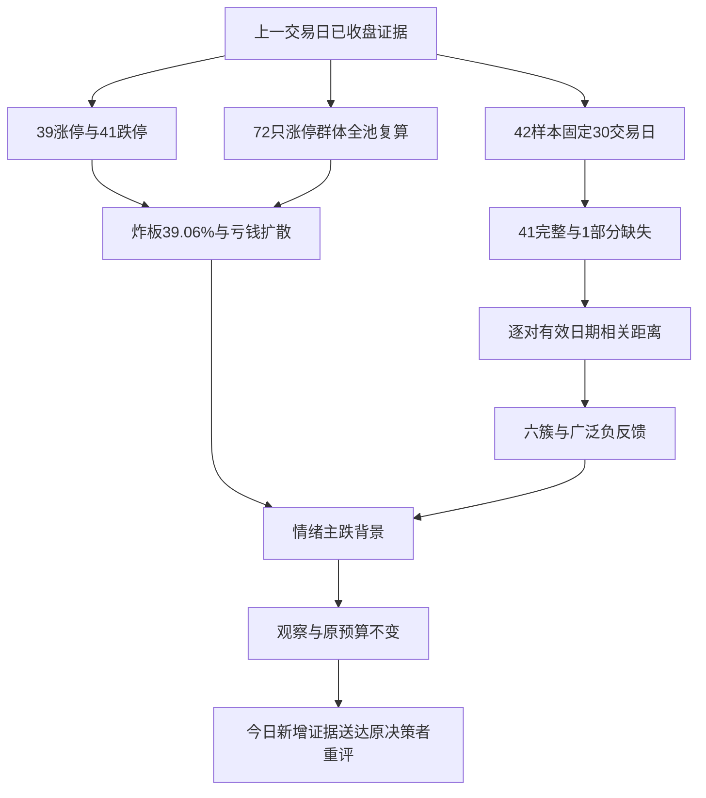

# 2026年10月30日 · 风格研判

## 一句话结论

观察：震荡分化型，情绪=主跌背景；研究总仓上限20%，有效零交易预算不变。

## 🌡️ 市场在为什么付钱

截至上一交易日收盘，市场奖励的不是普遍承担风险，而是少数连续强势样本与部分相对稳健资产的独立表现。最容易产生错觉的地方，恰恰是把它们的上涨外推为整个市场的复苏。上证50上涨0.36%，但创业板指下跌4.45%，科创50下跌4.27%；全市场5570条有效日线中，781只上涨、4728只下跌、61只平盘，上涨占比只有14.02%，涨跌幅中位数为-2.599%。这是一个指数内部、风格内部和持有人体感都严重分裂的交易日，不是一个凭借指数局部抗跌就能恢复进攻的环境。

因此，本次五选一风格落在“震荡分化型”，而不是“连板情绪型”或“主线扩散型”。39家涨停、最高4板，在家数与高度上触及扩散型的部分条件，但扩散还必须有持续赚钱效应支撑。41家跌停已经多于涨停，25家炸板使炸板率达到39.06%；与此同时，前一日72家涨停股在观察日的平均收盘反馈为-0.94%，中位数为-2.40%。局部梯队仍存在，市场整体却在惩罚多数参与者。“崩溃退潮型”要求的炸板率超过50%也没有满足，所以不能为了表达悲观而强塞标签。这里保留“震荡分化”的风格描述，同时明确情绪=主跌，用两个不同层次的字段表达结构与温度。

主线数量只给代理，不给交易许可。涨停强度排名中，有两项达到单项涨停不少于8家的阈值，因此机读字段记“双主线”；它们可能重叠，既不是六个统计簇中的两个，也不是R2已经确认的两条可交易主线。主线=未确认，持续性=未确认；观察日全市场触板封住比例为60.94%，这不是任何具体主线的封板率。后续预期按“继续分歧”准备风险剧本，但不把剧本写成已经发生的事实，也不编造1、3、5日的主线持续时间。

## 🧭 现在处在哪一段：先纠正溢价，再判断温度

本次最重要的反证不是某个新题材，而是上游情绪预计算中的口径冲突。上游文件使用+1.89%的溢价，进而把观察日判为高位震荡；本次实时重新提取10月28日收盘涨停集合，与10月29日日线逐一配对，72只全部匹配，得到平均-0.9373%、中位-2.3998%。随后又按这72个代码单独请求同日行情，均值与中位数完全一致。本报告采用可重算的全池收盘反馈，而不是沿用上游正溢价；上游为什么得到不同结果，现有证据不足以定论，不能擅自诊断成某个程序错误。

在把41家跌停一并送入现有情绪周期函数后，观察日阶段为main_down。这里说的是10月29日已发生的温度，不是宣布10月30日还会照着昨日下跌。零交易预算、既有不交易决定与保护开关继续有效；研究也继续覆盖真实对象。今日一旦出现广度、封板承接和资金的反向证据，必须交给原决策者重新评估，而不是由R1自动打开买入通道，更不能因为昨日的标签永久停止研究。

情绪分数仍按仓库既有四维公式得到48分：涨停家数项26分、连板高度项10分、封板健康项12.1875分、指数项0分，合计48.1875后四舍五入。这个分数不直接纳入跌停数量，也没有完整刻画全市场中位数，因而会比真实持仓体感温和。不能把“48分接近中性”解释为已经脱离风险区。五维参考校验缺少杠杆与外资的可比项，本次不填一个假设中值凑出交叉评分；温度判断优先于这个描述性总分。

## 🧩 三十个交易日，六个簇，不是六条主线

本次固定窗口为9月10日至10月29日最后30个A股交易日，22个同花顺风格板块和20只ETF全部纳入，没有为了让矩阵好看而减少来源。其中41条序列完整，昨日非ST三板以上表现缺10月14日和10月20日，仅有28个有效观察。主模型按日期对齐，用逐对有效日期的Pearson相关距离和平均连接层次聚类，切成恰好六簇；缺值不填零、不前向填充，也不把缺失日前后的多日价格变化压成一个交易日的收益。它的完整30日累计必须留空，134.75%只表示28个已观测单日收益的复合，不能和完整窗口回报等量比较。

最尖锐的一端，是单独成簇的昨日非ST三板以上表现和昨日非ST二板表现。前者观察日上涨6.47%，但窗口缺两天；后者完整30日上涨57.78%，观察日上涨3.05%。这说明少数接力样本仍有极强反馈，却没有证明接力模式对全体参与者都有效。动态成分风格指数不是一只可以按图买入的固定组合，指数的高累计还会受到篮子筛选与持续换样的影响。它描述的是奖励集中到了哪里，不是承诺历史收益可以被复制，更不能据此跳过逐票的地位、风险收益比与禁止清单审核。

另一个两成员簇由昨日打二板以上表现和ETF-18组成，二者30日分别为+31.34%和-2.78%，观察日分别为+8.23%和+0.92%。相关聚类比较的是每日涨跌的共同变化，不是累计收益的相等，更不是产业关联。这种经济含义并不直观的配对，是提醒读者不要替统计结果编故事。它们同簇不等于同一资金在操作，也不等于一个可以相互替代的配置方向。

ETF-10与ETF-16分别成为两个单成员簇。前者完整30日上涨5.37%、观察日上涨1.72%，后者30日下跌8.37%、观察日上涨1.65%。一个是窗口内也有正收益，另一个只是观察日相对走强，强弱性质不同。最后的36成员大簇，30日平均下跌16.04%，观察日平均下跌3.00%，容纳了绝大多数样本。它说明共同下跌仍比共同上涨更普遍，不能因为其余几个小簇有鲜明名字，就把大簇里的亏钱现实从判断中删掉。

本次还做了另一种日期口径的敏感性检查：如果退回“最近30个共同有数据的日期”，窗口会向前延伸到9月8日，已不再是最后连续30个交易日。两种口径的聚类调整兰德指数为0.801805，说明大结构相近，具体归簇仍对日期选择敏感。主报告坚持原定30交易日窗口，另一个结果只作反证，不拿它替换主结果，也不把六簇均分成看似整齐的六类。

## 🔎 从二十只ETF看承接，而不是从名字猜风格

二十只ETF中，观察日只有5只上涨，完整30日只有2只上涨，观察日等权平均下跌2.04%。其中ETF-06单日下跌7.95%，完整30日下跌31.63%；ETF-19单日下跌4.95%，30日下跌25.02%。另一侧ETF-10虽然相对坚挺，但ETF-02仅小涨0.17%、窗口内仍跌4.99%。所以，“部分大权重抗跌”和“市场已经有可复制的普遍溢价”之间仍有明显距离。这里按R1边界使用中性编号，基金代码只作为复核标识，不披露具体行业方向，更不把任何基金列为买入对象。

从风格板块看，同花顺热股完整30日下跌29.44%，昨日成交前十下跌34.34%，昨日资金前十下跌16.51%；观察日后两者分别下跌6.00%与6.83%。这些数字比“热度还在”更重要：拥挤、成交和资金榜单，并没有自动转化成次日正反馈。昨日打首板表现当日下跌2.57%，昨日打板表现下跌2.23%，与少数高阶样本的上涨形成鲜明反差。研究必须保留这种分层，不能把低位、首板、总龙等词当成阶段标签的机械出口。

若问大资金意图，现有价格证据支持的是“局部承接与广泛风险收缩并存”的假说，而不是已经确认的净流入结论。两市主要指数成交额合计比前日下降约4.49%，只能说明成交收缩，不能推出资金是谁、流向了哪里。价格、成交额和基金申赎是不同证据；R7的资金确认不能由R1用价格反推代写。

- **大资金意图**: 相对稳健样本和少数高阶反馈仍被定价，但多数样本共同下跌；这一解释只是价格结构假说，不是已核实的机构净买入。
- **为什么走强**: 小样本正反馈与大范围负反馈同时存在，强的是局部相对表现，不是全市场可复制的赚钱效应；缺少逐笔资金、真实申赎和独立事件验证，不能进一步归因。
- **逻辑够不够硬**: 涨跌停、全池反馈、广度与ETF方向互相支持风险收缩判断；这些量化证据大多来自同一上游，不能按接口数冒充独立源数量。若今日反馈和广度同步反转，应推翻昨日延续的假设。

## 🌐 外盘与宏观：新抓到的不等于新行情

外盘本次在线拉取了7个指数请求、14个海外权益样本以及汇率与三类商品数据。5个指数有返回，但美国两个主要指数和14个海外权益样本均只到10月28日；针对10月29日再次查询仍为空。因此，标普500的+0.28%、纳指综合的+0.27%只是前一可得交易日的背景，不能包装成10月30日盘前的昨夜结论。14个权益样本同日平均上涨1.38%，也只作为滞后背景，不据此给今日风险偏好加分。两个专项外盘指数请求及其备用代码均为空，缺口原样保留，不用境内跨境基金替代并冒充原指数。

亚洲指数的最新可得日期为10月29日：恒生指数下跌0.59%，韩国综合下跌1.24%，日经225上涨1.10%。方向分化本身已经提醒我们，不能用一个“外盘普涨”或“外盘普跌”概括全球环境。各市场30个本地观察日的累计也不是完全相同的日历窗口；它们没有被混进A股42样本聚类，更没有被当成能够同日成交的一揽子组合。

商品采用境内黄金、铜和原油连续期货，最新可得数据到10月29日，30个本地观察日价格变化分别为-8.92%、-2.18%、-1.44%。它们不是现货价格，也不是严格对应单一合约的可交易回报，换月会带来偏差。离岸人民币经备用代码取得50条报价，但最新只到10月28日，买卖收盘报价中点的30个观察日变化为-0.84%；美元综合指标仍为空。汇率观察日包含不同于A股的交易日安排，不能把这30个观察日冒称统一的月度周期。

这些数据不足以把宏观环境硬塞进“软着陆、降息预期、衰退”三选一。商品回落既可能反映需求，也可能反映供应、风险溢价或换月；缺少新鲜汇率与利率的独立证据，无法辨别。因此宏观坐标保持未确认，仅说明外围验证不足，绝不借宏观标签推导具体行业的开仓资格。

## 🗣️ 舆情只交叉验证，不替代收盘数据

本地同日抓取包包含83篇公众号文本、5个匿名群合计312条消息。优先群有84条消息，但未检出符合“昨夜、长文本、情绪关键词、可归属观点”条件的方向句，不能因为文件非空就宣称取得了昨夜KOL共识。白天能够核对到“市场很差、下午可能修复”的表述；它是盘中期待，不是收盘确认，更不是昨夜仓位指令。其余群中相同的推广长文跨群转发，属于重复传播，不能累计成多个独立观点。

公众号里一类文本讨论宽基承接与结构分裂，另一类明确提示右侧信号不足、避免把下跌中继当作底部。这些观点和本次量化方向大体一致，但也有中期乐观的表述。报告只提取“短线承接尚未确认、长期观点不等于今日许可”的倾向，不复述具体行业与个股，不把评论者的判断当成资金事实。舆情材料来自本地当日抓取，行情来自本次在线请求，二者时序与获取方式分别披露。

## 🛑 今天做什么、不做什么

明确态度是“观察”，而不是“进”。本次研究总仓上限给20%，这是综合广度恶化、负反馈、样本集中和外围数据不齐后的保守研究判断，不是仓库新设的自动策略，也不指令现有持仓立刻降到20%。现有有效零交易预算更严格，继续为零；本报告不新增交易授权、不下单、不撤单、不清池、不指令多票一次性减仓。仓位管理若要变化，仍须由原决策链按既有T计划、预算、保护开关和逐票门禁裁决，R6的硬否决权不变。

观察日炸板率39.06%已经超过35%，因此所有下游候选数量上限应在各自原基准上乘0.5向下取整。缩减的是进入后续裁决的候选上限，不是把研究来源减半。本阶段本来就不负责输出股票候选，所以没有临时造票，也没有把不交易偷换成不研究。

若今日修复，需要把昨日涨停群体的新反馈、涨跌广度、封板承接及真实资金确认一并交给原决策者。若上述量化证据继续恶化，则维持风险收缩剧本；若广度与反馈同时转正、炸板显著回落，则触发重评，而不是由R1宣布自动开仓。具体地位、板型、盈亏比和禁止项留给R2、R5与D1逐票审核；没有合格对象可以为空，不能因为流程需要数量而用中位和跟风补位。

## 关键证据

| 观测 | 数值与口径 | 来源 |
|---|---|---|
| 涨停／跌停／炸板 | 39／41／25，非ST口径 | Tushare实时请求 |
| 炸板／触板封住 | 39.06%／60.94%，全市场触板口径 | U与Z家数复算 |
| 最高连板与分布 | 4板2家、3板2家、2板6家 | limit_step |
| 前日涨停股反馈 | 72／72，均值-0.9373%、中位-2.3998% | limit_list_d与daily配对、另请求复核 |
| 广度 | 781涨、4728跌、61平；中位-2.599% | daily 5570条 |
| 情绪分数 | 48，未直接计入跌停惩罚 | 仓库四维公式 |
| XTick独立交叉 | 39／42／26，按家数重算40% | XTick MCP；不使用zbl作炸板率 |

## 📚 覆盖附录

下表保留全部42个研究样本。累计使用接口公布的单日涨跌幅复合，ETF为未复权价格口径，不含现金分红再投资。星号项只有28个观测，不展示为完整30日收益；其28观测复合为134.75%。这张表是证据覆盖，不是方向推荐清单。

| 风格样本／基金证据编号 | 有效日 | 30日价格复合 | 观察日 | 簇 |
|---|---:|---:|---:|---:|
| 百日新高 | 30 | -16.91% | -1.92% | 1 |
| 昨日资金前十 | 30 | -16.51% | -6.83% | 1 |
| 昨日成交前十 | 30 | -34.34% | -6.00% | 1 |
| 增发预案指数 | 30 | -16.49% | -3.53% | 1 |
| 昨日高振幅 | 30 | -22.58% | -3.62% | 1 |
| 近端次新股 | 30 | -16.76% | -5.87% | 1 |
| 沪股通成交前十 | 30 | -18.93% | -2.05% | 1 |
| 同花顺热股 | 30 | -29.44% | -2.48% | 1 |
| 创历史新高 | 30 | -6.75% | +0.49% | 1 |
| 深股通成交前十 | 30 | -30.65% | -4.79% | 1 |
| 增持计划 | 30 | -10.71% | -2.39% | 1 |
| 百元股 | 30 | -24.87% | -5.64% | 1 |
| 行业龙头 | 30 | -8.58% | -0.87% | 1 |
| 减持计划 | 30 | -12.92% | -3.09% | 1 |
| 高贝塔值 | 30 | +4.27% | -2.96% | 1 |
| 回购计划 | 30 | -13.68% | -3.57% | 1 |
| 业绩扭亏 | 30 | -27.96% | -3.03% | 1 |
| 昨日打板表现 | 30 | +0.69% | -2.23% | 1 |
| 昨日打首板表现 | 30 | +3.83% | -2.57% | 1 |
| 昨日打二板以上表现 | 30 | +31.34% | +8.23% | 2 |
| 昨日非ST二板表现 | 30 | +57.78% | +3.05% | 3 |
| 昨日非ST三板以上表现* | 28 | 缺失 | +6.47% | 4 |
| ETF-01（510300.SH） | 30 | -11.34% | -0.99% | 1 |
| ETF-02（510050.SH） | 30 | -4.99% | +0.17% | 1 |
| ETF-03（510500.SH） | 30 | -16.63% | -2.73% | 1 |
| ETF-04（512100.SH） | 30 | -16.29% | -2.95% | 1 |
| ETF-05（588000.SH） | 30 | -22.62% | -4.51% | 1 |
| ETF-06（515880.SH） | 30 | -31.63% | -7.95% | 1 |
| ETF-07（512760.SH） | 30 | -22.05% | -4.69% | 1 |
| ETF-08（512480.SH） | 30 | -22.98% | -5.02% | 1 |
| ETF-09（512880.SH） | 30 | -10.36% | -1.92% | 1 |
| ETF-10（512800.SH） | 30 | +5.37% | +1.72% | 5 |
| ETF-11（512010.SH） | 30 | +0.29% | +0.27% | 1 |
| ETF-12（512660.SH） | 30 | -13.65% | -0.20% | 1 |
| ETF-13（513180.SH） | 30 | -15.93% | -2.08% | 1 |
| ETF-14（515790.SH） | 30 | -15.43% | -1.71% | 1 |
| ETF-15（516090.SH） | 30 | -17.66% | -1.28% | 1 |
| ETF-16（515220.SH） | 30 | -8.37% | +1.65% | 6 |
| ETF-17（512400.SH） | 30 | -23.23% | -2.20% | 1 |
| ETF-18（159928.SZ） | 30 | -2.78% | +0.92% | 2 |
| ETF-19（159995.SZ） | 30 | -25.02% | -4.95% | 1 |
| ETF-20（512200.SH） | 30 | -8.55% | -2.33% | 1 |

六簇的数量和均值如下。部分缺失簇的完整30日均值留空，不用28观测结果顶替；簇编号只是算法标识，没有排名含义。

| 簇 | 成员数 | 完整30日均值 | 观察日均值 |
|---|---:|---:|---:|
| 4 · 高阶反馈部分观测簇 | 1 | 缺失 | +6.47% |
| 3 · 二板反馈独立簇 | 1 | +57.78% | +3.05% |
| 2 · 局部相关配对簇 | 2 | +14.28% | +4.57% |
| 5 · 相对稳健独立簇 | 1 | +5.37% | +1.72% |
| 6 · 单日抗跌独立簇 | 1 | -8.37% | +1.65% |
| 1 · 广泛承压簇 | 36 | -16.04% | -3.00% |

## 数据源审计

| 源 | 获取日期 | 状态 | 记录数与备注 |
|---|---|:--:|---|
| manifest | 2026-10-30 | 🟢 | 1；接口可用；行情归属日见正文及JSON |
| mcp_health | 2026-10-30 | 🟢 | 1；接口可用；行情归属日见正文及JSON |
| wechat_official_20 | 2026-10-30 | 🟢 | 83；接口可用；行情归属日见正文及JSON |
| wechat_cli_5groups | 2026-10-30 | 🟢 | 312；接口可用；行情归属日见正文及JSON |
| priority_kol_overnight | 2026-10-30 | 🔴 | 0；优先群84条，但未检出昨夜合格方向句，不把白天观点当昨夜共识 |
| tushare.ths_daily | 2026-10-30 | 🟡 | 22；22条均返回；一条固定30交易日内仅28观察 |
| tushare.fund_daily | 2026-10-30 | 🟢 | 20；接口可用；行情归属日见正文及JSON |
| tushare.market_metrics | 2026-10-30 | 🟢 | 5570；接口可用；行情归属日见正文及JSON |
| xtick.market_emotion | 2026-10-30 | 🟢 | 1；接口可用；行情归属日见正文及JSON |
| tushare.index_global | 2026-10-30 | 🟡 | 5；请求7项返回5项；美国日线仅20261028，专项指数两项空 |
| tushare.us_daily | 2026-10-30 | 🟡 | 14；14个样本均仅20261028，20261029重试为空 |
| tushare.fx_daily | 2026-10-30 | 🟡 | 1；离岸报价仅20261028；美元综合指标为空 |
| tushare.fut_daily | 2026-10-30 | 🟢 | 3；接口可用；行情归属日见正文及JSON |

## 不确定性 / 反证

最强反证是：少数高阶样本仍然大幅上涨，局部抗跌ETF也真实存在，所以不能把整个市场说成所有通道都失效。反过来，这些正样本尚不足以推翻41家跌停、负的全池反馈和绝大多数样本共同走弱。统计簇的边界对窗口敏感，动态成分指数有选择效应，商品连续合约有换月偏差，美国最新收盘缺失，昨夜优先KOL观点缺失；因此本次置信度为0.44625，是有明示折扣的判断信心，不是统计置信区间，也不是策略胜率。

本次生成发生在真实10月30日盘前，未进行历史回放。A股行情截止10月29日，海外和汇率逐项保留原始行情日；抓取时间不等于行情时间。没有把外部交付目标当作来源时间，也没有估算未计量的token用量为零。报告可以按冻结的收益矩阵与日期列表复核，但不能据此声称当时缺失的数据后来也已知。

## 与其他 R/D/E 的关系

R2消费风格与主线数量代理，负责去重、确认主线和核心地位；R3可用48分作有偏差的量化基准，不能忽略其跌停维度缺失；R6复核本报告与后续选股是否一致，并独占硬否决权；R7验证价格结构背后的真实资金；D1消费研究仓位约束，并继续执行更严格的零交易预算。E1复盘时应按本次真实行情截止和生成时间对照，不能用补齐后的外盘数据覆盖当时的缺口。

## Sub-Agent 元数据

skill为analyze_style_v1，模型为gpt-6.1-sol。机读artifact为data/research/20261030/R1_style.json。量化字段采用本仓库有效的research_unit_v1及五枚举契约，不采用与之冲突的历史精简风格枚举。生成时间、证据抓取时间和可复算收益矩阵均保存在JSON及本文frontmatter；本阶段单会话完成，未另启模型会话。
