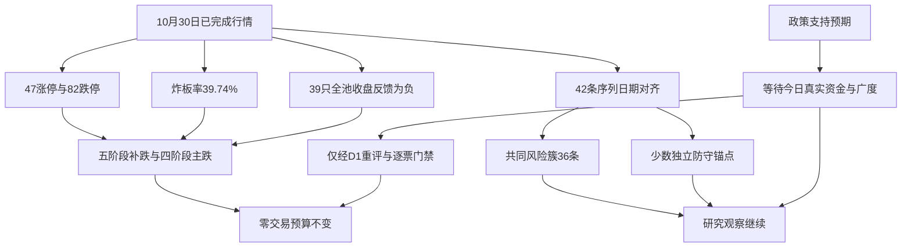

# 2026年11月2日 · 风格研判

> ⚠️ **数据源时间错位**：业务日期为2026-11-02，境内与外盘行情基准均为2026-10-30已完成日线。本文是真实抓取后生成的迟到研究，不是事前已交付的预测，也不是冻结知识回放；没有采用今天的竞价或盘中数据。
>
> 数据源新鲜度：partial。降级：是。置信度：0.392。今日态度：研究观察，交易不进；有效零交易预算不变。

## 一句话结论

震荡分化型，情绪=主跌；补跌后修复未确认，研究继续，交易不进，研究总仓上限0%。

## 🌡️ 市场此刻为什么付钱

先认市场，再谈机会。这一轮收盘证据给出的答案并不是“市场没有上涨”，而是“少数上涨尚不能覆盖多数持仓的损失”。47家收盘涨停和5板高度仍会给人市场有温度的印象，但同一天有82家跌停，5571只股票中只有893只上涨、4602只下跌，1483只跌幅达到或超过5%，全市场中位数为-3.13%。因此，市场在样本层面更多奖励相对防守，而不是奖励广泛承担风险。这里的“奖励”是相对价格表现，不是已经证实的大额净流入。

隔日反馈揭示了比涨停数量更重要的事。10月29日涨停的39只股票，在10月30日全部匹配到行情；它们开盘平均仍有+0.96%的溢价，收盘平均却变为-0.68%，中位数-0.28%，其中35.90%跌幅达到或超过5%。开盘还能兑现的希望，没有保持到收盘。因此不能用开盘溢价替代收盘持有体验，更不能仅凭周末情绪回暖，断言今天的接力已经恢复盈利。

炸板率采用明确的收盘口径：31只收盘未封住，除以47只收盘涨停加31只收盘未封住，共78只，得到39.74%。47只中有21只盘中打开后回封、26只未打开过；26不是全部封板数，21也不能再加一次分母。备用源返回49只涨停、86只跌停、31只未封住，按其自身计数为38.75%。两路统计范围尚未统一，但都指向风险收缩；本文不挑较好看的分母，也不把接口另一个含义未核实的百分数字段当炸板率。

- **大资金意图**: 价格结构支持“减少共同风险暴露、保留少数防守锚点”的解释，但缺少直接账户与净流量证据，因此意图属于待验证假设，不写成已发生的资金搬家。
- **为什么走强**: 少数独立收红主要是相对强，而不是整个市场变强；收盘广度、接力反馈与多数样本方向均不支持把它概括为新一轮普涨。
- **逻辑够不够硬**: 两路在线统计对风险方向一致，硬度足以维持不放宽授权；它们不证明今天不能修复，政策预期若转化为真实承接，仍须完成新的决策重评。

## 🧭 温度、标签与那个不该照单全收的“主升”

原有预计算文件写着“主升”，但它自己的证据链先用82家跌停判为补跌，随后又因上一状态不允许直接跳转而把结果改成主升。这不是82家跌停消失了，而是状态约束改变了标签。本次调用既有情绪函数，保留82家跌停、47家涨停、5板高度和39.74%炸板率，并以已对齐的收盘反馈复算、不强加昨日阶段，得到五阶段中的“补跌”。为了兼容R1四阶段接口，主字段记为main_down，细分字段保留capitulation。这是映射与披露，不修改算法，也不覆盖原文件。

五选一风格最终记为“震荡分化型”，并明确情绪=主跌。47家涨停与5板高度表面接近主线扩散型，但没有形成可交易扩散的充分证据；梯队为5板1只、3板2只、2板6只，4板断层，亏钱效应明显压过高度。严格的崩溃退潮型要求炸板率超过50%，本日没有达到，不能为了强调风险伪造命中；防御观望型要求涨停少于20家，也没有达到。因此这是周期风险优先后的降级归类，不是声称全部机械阈值严丝合缝。

沿用既有规则情绪公式，涨停项31.33分、高度项12.50分、炸板健康项12.05分、指数项0分，合计55.88，四舍五入为56。这个分数没有直接惩罚82家跌停，也没有纳入收盘反馈，所以56分与主跌标签可以同时出现。它是有局限的状态量，不是交易许可。五维参考法所需杠杆和外资维度没有可靠输入，本文不填“中性值”凑满，也不声称新公式已经验证。

主线数量字段写“三主线以上”，仅因为上游概念统计中有3个标签满足涨停家数至少8的代理条件。标签存在成分重叠，它既不是三条独立主线，也不是六个统计簇的另一种说法。真正可交易主线数量仍未知，留给R2确认；本文不输出具体行业或股票。

## 🧩 三十个交易日里，六簇究竟说明什么

窗口严格取上交所2026-09-11至2026-10-30的30个交易日，不是30个自然日。22个风格板块与20只ETF共42条序列均保留。完整矩阵应有1260格，实际1258格；B19在10月14日与20日缺失，逐日在线补查仍为空。因此相关距离使用28至30个成对共同观测，不补零、不向前借值，也不将两日跨期收益塞成单日收益。B19完整30日收益标未知，观测到的28日复合收益不能冒充30日收益。

第一簇是36条序列构成的共同风险收缩簇，30日平均收益-17.48%，基准日平均-2.90%。它把大多数表现序列放在一起，说明此前的共振下行并未因少数上涨而解除。**大资金意图**是降低共同风险的假设；**为什么走强**这个问题在这里应改问为什么仍弱，答案是单日与窗口方向同负；**逻辑够不够硬**，相关性和均值足以证明样本共同波动，却不能证明交易主体是谁，也不能将36条序列视为36份独立资金证据。

第二簇包含B15、B19两条高位接力序列，基准日分别-9.41%与+0.65%，平均-4.38%。B15完整30日为+22.57%，B19缺两日，不能拿一个残缺窗口计算两者共同30日均值。**大资金意图**更像高位风险在内部重新分配；**为什么走强**只适用于其中微涨的一条，不能把另一条的大幅亏损掩盖；**逻辑够不够硬**，相反的当日反馈说明同簇不等于同日同强，尤其不支持“最高处任何位置都能进”。

第三簇只有B16，完整30日+52.76%，基准日却为-2.84%。**大资金意图**可以解释成此前拥挤收益的兑现，但还没有流量证据；**为什么走强**主要是历史窗口留下的高累计值，不是当日继续赚钱；**逻辑够不够硬**，这种每日换成分的表现序列复合结果不是一个可连续持有的组合收益，更不是实盘接力胜率。历史高分不能抵消最新负反馈。

余下三个单成员簇分别是E10、E16、E18，基准日为+0.68%、+0.73%、+2.42%，对应完整30日+4.72%、-6.17%、+1.36%。它们是防守锚点甲、乙、丙，不据此点名行业或授予买权。对于甲，**大资金意图**是相对避险的假设，**为什么走强**有窗口与当日同正支撑，**逻辑够不够硬**仍缺净流入确认；对于乙，**大资金意图**可能是短期轮动，**为什么走强**仅限当日，**逻辑够不够硬**受到30日仍负的约束；对于丙，**大资金意图**可能是风险偏好向低相关样本迁移，**为什么走强**有当日较强表现，但**逻辑够不够硬**仍不能由单个相关簇回答持续性。三者共同证明“并非所有价格都在跌”，不证明“防守端已经形成可交易主线”。

用共同完整的28日重新聚类后，全部861对成员的同簇关系一致率为100.00%。这是对缺失处理的敏感度检查，不是预测胜率。六簇是预先指定的切分数；36/2/1/1/1/1这种不均衡结构，也提醒我们主要信息可能只是共同风险与少数离群点，而非六个稳定风格世界。

## 🧺 二十只ETF的交叉验证

ETF样本中，基准日只有4只上涨，完整30日只有3只为正。权重型宽基相对抗跌，高弹性宽基承压更重，说明当日不是对所有风险资产一视同仁。上证指数跌1.44%、创业板指跌4.13%，高弹性宽基指数跌5.48%，与ETF样本中多数共跌的方向一致。ETF价格包含跟踪误差与折溢价，不能拿它与指数的差额直接推导资金流量；多个样本还存在高度成分重叠，不能机械累计成独立投票。

下表列出全部20只样本，不删掉难解释的成员。为遵守R1不推具体行业的边界，正文使用固定E编号；编号依既有注册表顺序排列，源代码映射与原始行情均保留在本次在线证据文件，可逐项审计。它们都是观察样本，不是执行池候选。

| 样本 | 基准日 | 近5交易日 | 近30交易日 | 完整日数 |
|---|---:|---:|---:|---:|
| E01 | -1.12% | -2.72% | -11.95% | 30 |
| E02 | -0.31% | -0.25% | -5.12% | 30 |
| E03 | -2.85% | -8.05% | -18.56% | 30 |
| E04 | -3.43% | -8.57% | -18.66% | 30 |
| E05 | -5.03% | -13.65% | -25.98% | 30 |
| E06 | -6.70% | -15.96% | -35.63% | 30 |
| E07 | -4.92% | -13.25% | -25.38% | 30 |
| E08 | -4.89% | -13.88% | -26.22% | 30 |
| E09 | -1.13% | -5.04% | -11.85% | 30 |
| E10 | +0.68% | +5.19% | +4.72% | 30 |
| E11 | +0.53% | +0.27% | +2.19% | 30 |
| E12 | -3.63% | -7.45% | -16.78% | 30 |
| E13 | -0.43% | -3.91% | -14.77% | 30 |
| E14 | -3.18% | -6.69% | -17.21% | 30 |
| E15 | -2.07% | -5.03% | -18.84% | 30 |
| E16 | +0.73% | +2.73% | -6.17% | 30 |
| E17 | -1.97% | -6.20% | -23.72% | 30 |
| E18 | +2.42% | +1.96% | +1.36% | 30 |
| E19 | -5.09% | -13.86% | -28.51% | 30 |
| E20 | -1.68% | -4.63% | -9.06% | 30 |

## 🌍 外盘与宏观：有逆风，不编造统一叙事

外盘数据本次在线返回到10月30日，不是沿用先前报告中的旧日期。标普当日-1.82%、纳指-2.86%、道指-1.09%；各自本地30交易日为-0.92%、-4.09%、+0.17%。这更接近高弹性风险承压，而不是所有资产同步崩溃。亚太样本中，一条市场宽基当日上涨1.46%，另两条分别下跌3.48%与2.12%；地域并不整齐，因此不能把外盘压缩成“全球全跌”。

14只外盘观察股票基准日全部下跌。本文不点名个股，也不把这14只代表为整个海外市场。极端单样本约跌28.58%，来自未复权日线价格口径，未核实公司事件和复权因素；它只是一条需审慎处理的价格证据，不能直接外推为产业衰退，更不能拿它替代缺失的专门指数。两个专门指数在线为空，明确留作缺口。

跨资产补查拿到了境内黄金、铜、原油连续期货价格代理：30交易日分别-10.66%、-3.70%、-3.46%，基准日分别-1.39%、-0.56%、+1.59%。这些是境内未复权连续合约，存在换月影响，不是国际即期价格；30交易日也不等于自然月。两条汇率序列仍为空，因此宏观三档坐标记未知，不硬判软着陆、降息或衰退。对今天的意义仅是外部尚未给出统一的风险偏好顺风，不能据此推行业或股票。

## 🗣️ 周末文本：预期先动，资金是否跟上尚未发生

当日上游快照含67条群聊记录与47篇公众号文章。匿名核心投资群的倾向是两层并存：一层担心集中筹码出清、杠杆与流动性压力，另一层认为政策支持预期可能提供反弹契机；机构交流文本仍要求等待量能与外部环境改善。公众号亦有资本市场工具与回购支持的会议预告，以及稳信心相关报道。这些信息支持“今天可能修复”的研究假设，不等于会议已完成、政策已落地或资金已净流入。

文本没有在本会话重抓原站，属于清晨上游输入，只作观点交叉，不能标成实时在线资金证据。群聊可能转发同一报道，不把转述当作多路独立确认；没有从群里摘取点位、技术形态、具体行业或个股来替代本阶段量化结论。

## 🚦 今天做什么、不做什么

研究继续，交易不进。研究总仓上限0%，有效零交易预算、既有不交易决定及所有授权保护不变。这不要求对已有持仓一次性清仓，也不改写已有做T或持仓管理计划。R1不提供股票，因此没有候选板型、龙头认定、盈亏比或禁止清单结论；这些不能用“不适用”包装为已经过关，必须由后续逐票门禁完成。

39.74%的炸板率已超过35%纪律线，因此显式标注情绪=主跌。R1候选数本来就是零，砍半后仍为零；该规则不清空R2、R4或R5的研究观察。阶段只定温度，不预设首板、接力或低吸的固定通道，更不因昨天补跌永久关闭今天的重评。

今天的反证路径是双向的。若真实广度改善、昨日涨停反馈转正、梯队承接与资金确认形成共振，昨日补跌不再足以描述当前状态，证据必须送达D1重评；但没有重新完成授权与逐票闸门前，研究观察不自动变成买权。若少数防守锚点也转弱、亏钱广度继续扩大，则原风险判断得到加强。这里列的是待核问题，不冒充已经看到今天盘面。

## 数据源审计

| 源 | 日期 | 状态 | 记录与口径 |
|---|---|:--:|---|
| 在线风格板块 | 2026-10-30 | 🟡 | 22/22；B19两日缺失，逐日重查仍空 |
| 在线ETF | 2026-10-30 | 🟢 | 20/20；30日完整，不填充 |
| 在线涨跌停与天梯 | 2026-10-30 | 🟢 | 47/82/31；最高5板，收盘分母78 |
| 备用市场情绪MCP | 2026-10-30 | 🟡 | 49/86/31；独立分母80，范围待核 |
| 在线全市场日线 | 2026-10-30 | 🟢 | 5571条；昨日涨停池39/39匹配 |
| 在线宽基日线与日历 | 2026-11-02 | 🟢 | 八条指数；日历确认业务日开市，行情截至上一收盘 |
| 在线外盘宽基 | 2026-10-30 | 🟡 | 六条有值，两条专门指数为空 |
| 在线外盘观察股票 | 2026-10-30 | 🟢 | 14条，仅汇总风险，不推个股 |
| 在线跨资产代理 | 2026-10-30 | 🟡 | 黄金、铜、原油三条境内连续期货，非国际即期 |
| 在线汇率 | 2026-10-30 | 🔴 | 两条均空，宏观三档未知 |
| manifest.json | 2026-11-02 | 🟡 | severity=2，清晨上游运行状态 |
| mcp_health.json | 2026-11-02 | 🟡 | 历史健康记录非本次可用性保证；本次已实际调用市场工具 |
| wechat_official_20 | 2026-11-02 | 🟡 | 47篇上游快照，本次未重抓原站 |
| wechat_cli_5groups | 2026-11-02 | 🟡 | 67条上游快照，群名匿名化 |
| 预计算情绪周期 | 2026-11-02 | 🟡 | 状态机改写与原始补跌证据冲突，未原样采纳 |

## 不确定性 / 反证

本文最容易犯的错，是把昨天的坏行情当作今天不会修复的证明，或把周末的好消息当作今天已经修复的证明。两者都没有发生在本文采用的数据中。我们只确认风险基准很差、局部防守存在，以及政策预期值得验证；没有证实当前增量资金、连续承接或可交易主线。

另一项局限是样本设计：固定ETF名单不等于全市场，动态表现指数也不是可持有组合；平均相关强行切成六簇，单成员簇可能只反映少数时点的低相关。B19缺两格限制其累计收益解释，双源涨跌停范围不同限制精确横比。置信度按0.70×0.70×0.80得到0.392，反映部分数据与双源约束，不是盈利概率，不因迟交或投入资源多而提高。

## 与其他 R/D/E 的关系

本阶段依赖当日抓取清单、健康记录、公众号与群聊快照，并单独在线重拉市场日线。R2消费风格与主线代理数量，但应独立确认真实主线；R3可按10月30日对齐情绪分56，不将其当今天实时温度；R6保留独立反证与唯一hard_reject权，本报告不替其否决；D1消费零上限和风险背景时仍应保留今日新增证据的真实重评通道，E1按同一基准日核对，不混淆开盘溢价和收盘反馈。

## Sub-Agent 元数据

skill为analyze_style_v1，本会话为唯一R1研究者；没有启动Hermes CLI、delegate_task或另一模型会话。确定性脚本只负责取证、计算和校验，不替代当前会话的研究判断。模型为gpt-6.1-sol。实际生成时间见frontmatter，已晚于交付目标；资源计量总额未知，不记为零、不保证低于努力目标。

机读产物：data/research/20261102/R1_style.json。在线原始证据：data/research/20261102/R1_live_evidence.json。计算明细：data/research/20261102/R1_computed_evidence.json。全部市场事实可由本轮响应重算，原有预计算文件和交易配置未修改。
