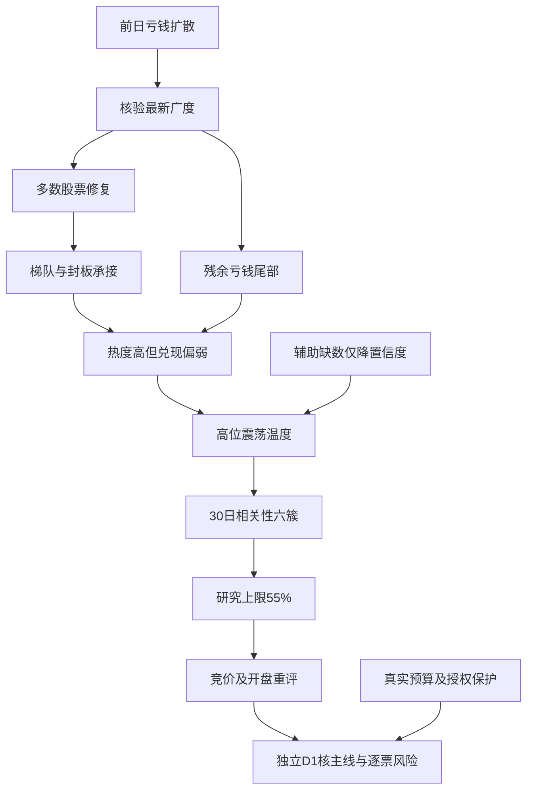

# 2026年11月3日 · 风格研判

> ⚠️ **数据源时间错位**：文件服务于11月3日盘前，国内证据属于11月2日收盘；30日窗口为9月14日至11月2日。今天的延续性尚未发生，不能把昨日修复写成今日主升。
> 数据新鲜度：partial；降级交付；置信度：0.476。降级来自局部缺数和外盘日线滞后，不代表市场性禁买。

## 一句话结论

连板情绪型中的高位震荡修复，情绪89；研究仓位上限55%，不等于买入许可。

## 🌊 先看市场：大面积止亏，尚未兑现为全面追涨收益

这一轮最重要的事实，不是某个名字涨了多少，而是市场奖励机制与前一个交易日已经不同。10月30日，5571只有日线记录的股票中，仅893家上涨、4602家下跌，涨跌幅中位数为−3.13%；11月2日，相同规模的样本变为4681家上涨、818家下跌、72家平盘，中位数回到+2.02%。至少从横截面看，修复已经从局部反弹扩展到多数股票。非ST跌停从82家收缩至8家，涨停从47家增加至125家。把旧市场的零仓意见原封不动搬过来，会漏掉这一轮实实在在的亏钱效应收敛。

但这不是说，昨天买得越急，今天就越容易赚钱。以10月30日收盘涨停的47只股票作为完整固定样本，11月2日开盘溢价均值为+2.72%，收盘反馈均值为+2.83%，收盘反馈中位数只有+1.53%。更接近“开盘买进去后有没有兑现”的开盘至收盘回报，均值仅+0.13%，其中只有20只录得正值。大部分修复溢价已在开盘体现，不能把前一日持有者得到的跳空收益，当成后进资金同样可以取得的利润。这正是当前市场奖励与追涨体验分离的地方。

上证、深证和创业板分别上涨1.08%、1.63%、1.87%，而中证500、中证1000和科创50分别上涨2.46%、2.73%、3.11%，明显强于沪深300的0.79%和上证50的0.75%。这说明修复并非只有权重单方面托住指数；中小盘和弹性资产确有响应。日线样本合计成交额约1.7952万亿元，相较前一交易日增加约6.37%。这里的成交额是有日线股票样本的加总，不与多个重叠指数成交额再相加；量能改善也不等同于已核实的净增量入市资金。

因此，本报告的态度是：**进**市场研究与新证据核验，**观察**修复能否转成连续赚钱，**不进**只凭涨停数量追随的判断。今日是否存在可交易主线、哪种资金合力已经确认，仍须由R2和D1独立认定；没有确认，不因R1温度升高而获得逐票开仓资格。

## 🌡️ 再看温度：风格确实热，阶段仍然要防分歧

收盘涨停125家、最高6板、炸板率18.30%，精确命中“连板情绪型”的三项判据。炸板率的分母是125家收盘封住加28家收盘未封，即28÷153；封板率为81.70%。125家收盘涨停中，有83家曾开板后回封，42家未开板。把未开板42家当成全部封板，会把回封成功的样本错误剔除，从而扭曲情绪判断。XTick独立查询返回131家涨停、10家跌停、31家未封和6板高度，支持修复与高度活跃的方向，但与非ST主源并非已验证相同母体，不合并数值。其原始zbl字段为8.16，定义未核，不当成同一炸板率；用计数重算是19.14%。

梯队也没有表面数字那么圆满：6板1只、4板1只、3板3只、2板6只，5板空缺；125家涨停中114家是首板。高度仍在，低位扩散也在，但“中间每一级都有人接住”的连续性尚不存在。按照既有情绪周期函数，用开盘溢价+2.72%、6板、18.30%炸板和8家跌停复核，阶段为高位震荡；即使换用+2.83%的收盘反馈作敏感性检查，阶段也未改变。该结论描述11月2日，不是在宣布11月3日必然仍震荡，更不固定映射某一种打法。

情绪89分来自现存规则公式：涨停强度40分、梯队15分、封板承接16.34分、三大指数17.64分，合计88.98后取整。这个分数对涨停数存在饱和，对残余亏钱尾部没有单独扣分，因此只说明昨日期末温度高。它不是次日胜率，也不是满仓依据。另一个五维参考公式所需的杠杆、外资等输入不全，本轮未计算，不能以零填补。即使修复广泛，仍有63只日内跌幅达到或超过5%、154只跌幅达到或超过3%，风险尾部并未消失。

## 🧭 三个研究问题：钱在奖励什么，而不是故事说得多响

- **大资金意图**: 广度、中小盘弹性和量能共同回升，与市场由集中降风险转向修复风险敞口相容；但价格表现不能识别真实交易者身份。本轮未取得足以确认机构净买入的资金账本，不能把托底预期写成机构已实际加仓。
- **为什么走强**: 可观测的是前日82家非ST跌停后缩至8家、上涨比例从约16%升至84%，与流动性支持政策的报道形成时序上的修复解释；这只支持“亏钱效应减轻、预期改善”，不证明政策资金已经到账，也不证明单一政策就是全部涨幅的因果来源。
- **逻辑够不够硬**: 国内广度、梯队和亏钱效应是硬观测，XTick对高度与修复方向提供第二量化源；政策目前主要是转载文本，不能重复计为多份独立资金证据。若今天多数股票转跌、接力兑现转负，即使报道仍偏积极，修复延续假设也应被推翻。

## 🧩 三十日与六簇：同涨不等于同一条主线，单日大涨也不等于月内翻身

聚类覆盖全部22个同花顺风格指数和20只ETF，以A股交易日历固定9月14日至11月2日的30个交易日，按同日期日收益的相关距离做平均连接层次聚类，固定切为6簇。不是把每个序列最近30条直接拼在一起，更不是删掉缺数日期后把更早的行情补进来。有一个风格指数在10月14日、10月20日缺数，定点补查仍为空，因此保留28个观测值，不填零、不向前填充，其完整30日累计收益明确为空。相关系数采用至少28个重叠日期；用所有样本共同完整的28日再聚类，两两同簇关系一致率为100%，这只是缺数敏感性检查，不是回测验证。

六簇中，最大的共同风险修复簇包含36个样本，30日平均仍为−14.77%，最近一日才回升1.65%，33个样本上涨。它更像共同风险暴露在同一天被修复，而不是三十六个独立赛道同时建立新主升。昨日资金前十、昨日成交前十当日仅涨0.47%、0.44%，30日却分别下跌12.90%、37.21%；百日新高与创历史新高当日分别上涨0.91%、0.85%，近5日仍为负。市场尚未重新普遍奖励“昨天成交最大、昨天最热、已经新高”这些标签，不能机械回到旧拥挤方式。

最突出的是二板以上延续反馈簇，当日均值约+9.98%；另一非ST二板单成员簇上涨4.19%，其完整30日累计为+60.14%。这说明少数接力层级的反馈与大多数风险资产不同，并非所有情绪路径同强。尤其缺数的非ST三板以上指数，28个已观测日复利为+163.12%，不能写成30日涨幅；同簇的完整30日均值只来自另一成员，不能拿来替它背书。这些风格指数是动态更换成分的篮子，本身不可直接成交，极端累计也不能当作可复制的打板策略收益或对一只股票的买入理由。

另外三个簇都是单一ETF。一个月内为正而当日转负，一个月内与当日均负，另一个月内与当日同正。20只ETF中16只当日上涨，仍有4只逆势下跌，说明修复不是无差别齐涨。单成员簇没有组内合力可验证，更不能把固定六簇解释为六条交易主线。为遵守R1不推具体行业和个股的边界，下表ETF用稳定编号和基金代码核对，保留完整覆盖但不输出行业方向推荐；板块命名与逐票选择留给R2。

## 🌍 外盘：晚间的“全线上涨”不是最终风险截面

本轮实时查询的Tushare美股日线仍停留在10月30日，14只核心样本的当日等权平均为−5.91%，只用于说明旧日风险背景，绝不冒充11月2日隔夜走势。美国主要指数另外调用现有外盘辅助函数实时补查，并核对报价中真实美东日期为11月2日：标普报价−0.51%、纳指−1.07%、道指+0.41%。这是收盘后可见报价截面，并未认证为官方收盘值。它至少表明，昨晚早些时候报道的全面上涨没有在最新截面中维持同样结构，不能把新闻发布时的盘中数字搬进今天当最终结果。

亚洲日线属于11月2日：恒生上涨0.42%，韩国综合上涨2.24%，日经下跌0.33%，区域并非同向共振。其各自30个交易间隔的价格变动分别为−4.92%、−11.59%、−0.63%，日期按各市场日历独立，不冒充A股同30日日期矩阵。SOX和HSTECH日线为空；黄金、铜、原油月度动量未获得合格输入，美元指数重查仍空；有效人民币标识返回的最新日期为11月1日，日界线与新鲜度未核。故“软着陆、降息预期、衰退”三档宏观坐标本轮保持未知，不由利率新闻强行补成某一档，也不因为辅助坐标未知就全局禁买。

## 🗣️ 文本只作语境，不替代市场投票

本次读取当日抓取的88篇公众号记录及464条群聊。优先匿名群严格按“昨夜、长文本、情绪或主线等关键词、非图片链接”筛选，没有可归为已验证KOL的合格长文。放宽到短句后，能看到对后市乐观的表达，也能看到对托底效果和利益分配的质疑；身份未核，不能把几句乐观话升级为名人共识，更不能把群内清仓短句当作用户账户停买指令。其他群较多内容是行业或个股推介，本阶段不抽取成推荐。

公众号关于支持资本市场工具的转载，为修复提供了可检验的流动性预期：预期能否转为实际操作、实际融资与实际买入，仍有传导链条。文本发布日期、盘中行情时刻和最新外盘报价时刻不同，必须分开。量价事实已经证实“修复发生过”，却尚未证实“今天接力一定赚钱”；这两句话不能互换。

## ⚖️ 研究上限55%，预算与授权另算

本轮研究仓位上限为55%。非零的依据，是84%的上涨广度、跌停数量快速收缩、6板高度仍在以及弹性指数参与；未给出更激进上限的依据，是昨日涨停池后进资金兑现偏弱、30日共同风险簇仍深度为负、梯队中间空档以及外盘风险报价分化。55%是证据约束下的研究裁量，不是由89分机械换算，也不是因为辅助源掉线打折成预算。它既不是目标持仓，也不是要求现有账户立即减至55%，更不是任何一只股票的买入授权。

适用窗口从本轮真实生成时刻起，到今日开盘前结束，竞价完成即交P1与独立D1重评。若开盘后上涨广度低于50%、昨日涨停反馈转负、跌停重新达到20家，或中位数转负且亏钱尾部扩散，原建议失效，需要按新增事实重新判断。若同口径非ST炸板率达到35%，必须显式标记“情绪=震荡/主跌”，D1候选数砍半；本报告不自建、清空任何个股池。反过来，若广度维持65%以上、接力兑现增强且炸板率低于20%，再有真实资金和主线确认，D1同样可以重评；不能把昨日高位震荡变成永久禁令。

已读取用户签署规则中的总仓硬上限80%、单票15%、单板块40%、最多5只。账户有效交易预算、账户停买与人工确认状态未由R1取得，保持未知，既不猜成正额度，也不把旧计划的零值抄为本次市场研究零仓。任何有真实来源、仍有效的零预算与停买，连同T+1、R6逐票硬否决、人工确认和既有授权保护，仍独立生效。D1需核实并取交集；研究端没有抬高硬预算或解除保护的权限。

## 📎 完整样本附录

下列数据单位均为百分比，累计为供应商日收益复利。ETF是未复权价格回报，不是净值含分红总回报；风格指数是动态篮子描述，不是个股或策略绩效。编号用于审计定位，不是推荐顺序。

### 22个风格指数

| 编号 | 风格观测篮子 | 最近一日 | 近5日 | 完整30日 | 有效观测 | 簇 |
|---|---|---:|---:|---:|---:|---:|
| B01 | 百日新高 | +0.91% | -4.73% | -13.21% | 30/30 | 1 |
| B02 | 同花顺热股 | +1.47% | -4.66% | -27.47% | 30/30 | 1 |
| B03 | 创历史新高 | +0.85% | -4.34% | -4.49% | 30/30 | 1 |
| B04 | 行业龙头 | +1.94% | -1.08% | -5.37% | 30/30 | 1 |
| B05 | 近端次新股 | +1.97% | -6.53% | -14.87% | 30/30 | 1 |
| B06 | 百元股 | +2.27% | -8.53% | -25.40% | 30/30 | 1 |
| B07 | 昨日资金前十 | +0.47% | -8.47% | -12.90% | 30/30 | 1 |
| B08 | 昨日成交前十 | +0.44% | -9.45% | -37.21% | 30/30 | 1 |
| B09 | 昨日高振幅 | +2.47% | -5.53% | -20.49% | 30/30 | 1 |
| B10 | 沪股通成交前十 | -0.28% | -5.73% | -19.20% | 30/30 | 1 |
| B11 | 深股通成交前十 | +0.02% | -9.40% | -34.02% | 30/30 | 1 |
| B12 | 高贝塔值 | +1.58% | -2.73% | +5.04% | 30/30 | 1 |
| B13 | 昨日打板表现 | +1.74% | -1.13% | +3.71% | 30/30 | 1 |
| B14 | 昨日打首板表现 | +1.38% | -0.76% | +5.24% | 30/30 | 1 |
| B15 | 昨日打二板以上表现 | +9.98% | +9.12% | +40.62% | 30/30 | 2 |
| B16 | 昨日非ST二板表现 | +4.19% | +6.08% | +60.14% | 30/30 | 3 |
| B17 | 昨日非ST三板以上表现 | +9.98% | +31.53% | 未知 | 28/30 | 2 |
| B18 | 增发预案指数 | +2.18% | -5.69% | -15.72% | 30/30 | 1 |
| B19 | 增持计划 | +2.15% | -3.84% | -8.13% | 30/30 | 1 |
| B20 | 减持计划 | +2.59% | -5.08% | -10.63% | 30/30 | 1 |
| B21 | 回购计划 | +2.22% | -5.61% | -12.08% | 30/30 | 1 |
| B22 | 业绩扭亏 | +3.35% | -6.19% | -25.92% | 30/30 | 1 |

B17缺10月14日、10月20日，完整30日累计未知；28个已观测日复利+163.12%只保留为非完整描述，不参与完整30日均值。

### 20只ETF

| 编号 | 基金代码 | 最近一日 | 近5日 | 完整30日 | 有效观测 | 簇 |
|---|---|---:|---:|---:|---:|---:|
| E01 | 510300.SH | +0.49% | -2.26% | -10.79% | 30/30 | 1 |
| E02 | 510050.SH | +0.31% | -0.25% | -3.71% | 30/30 | 1 |
| E03 | 510500.SH | +2.40% | -4.35% | -15.17% | 30/30 | 1 |
| E04 | 512100.SH | +2.67% | -4.63% | -14.60% | 30/30 | 1 |
| E05 | 588000.SH | +2.61% | -8.76% | -23.12% | 30/30 | 1 |
| E06 | 515880.SH | +0.69% | -12.13% | -35.58% | 30/30 | 1 |
| E07 | 512760.SH | +2.59% | -7.58% | -22.40% | 30/30 | 1 |
| E08 | 512480.SH | +2.50% | -7.87% | -23.12% | 30/30 | 1 |
| E09 | 512880.SH | +4.57% | -1.48% | -4.95% | 30/30 | 1 |
| E10 | 512800.SH | -0.90% | +2.43% | +4.51% | 30/30 | 4 |
| E11 | 512010.SH | -0.80% | -2.10% | +2.48% | 30/30 | 1 |
| E12 | 512660.SH | +2.24% | -4.75% | -13.97% | 30/30 | 1 |
| E13 | 513180.SH | +2.35% | -0.62% | -12.45% | 30/30 | 1 |
| E14 | 515790.SH | +2.84% | -3.50% | -13.24% | 30/30 | 1 |
| E15 | 516090.SH | +2.38% | -2.77% | -15.46% | 30/30 | 1 |
| E16 | 515220.SH | -1.45% | +1.07% | -5.59% | 30/30 | 5 |
| E17 | 512400.SH | -0.72% | -4.49% | -21.07% | 30/30 | 1 |
| E18 | 159928.SZ | +2.07% | +2.98% | +4.88% | 30/30 | 6 |
| E19 | 159995.SZ | +2.04% | -8.69% | -25.83% | 30/30 | 1 |
| E20 | 512200.SH | +0.54% | -6.29% | -5.71% | 30/30 | 1 |

### 六簇统计

| 簇 | 样本数 | 完整30日样本数 | 完整样本30日均值 | 最近一日均值 | 当日上涨数 |
|---|---:|---:|---:|---:|---:|
| 1 | 36 | 36 | -14.77% | +1.65% | 33 |
| 2 | 2 | 1 | +40.62% | +9.98% | 2 |
| 3 | 1 | 1 | +60.14% | +4.19% | 1 |
| 4 | 1 | 1 | +4.51% | -0.90% | 0 |
| 5 | 1 | 1 | -5.59% | -1.45% | 0 |
| 6 | 1 | 1 | +4.88% | +2.07% | 1 |

## 关键证据

广度、涨跌停、梯队与指数均来自本轮实时Tushare查询，存于R1_live_evidence.json；固定涨停池的开盘、收盘及开盘至收盘反馈，连同30日矩阵和外盘补查结果存于R1_computed_evidence.json。XTick独立交叉、日期格式初次失败及修正后的真实响应存于R1_source_crosscheck.json。正式JSON的E1—E10对应正文全部核心推断。

公众号政策语境主要来自当日wechat_official_20.jsonl第12、27、55、63行；早期海外盘中上涨语境来自第4行。匿名优先群短文本语境来自wechat_cli_5groups.jsonl第36、47—49、54行。文本不作为已执行资金或用户授权的证据。

## 数据源审计

| 源 | 日期 | 状态 | 备注 |
|---|---|:--:|---|
| Tushare风格指数日线 | 2026-11-02 | 🟡 | 22/22覆盖，21条完整；1条缺2日，已定点重查 |
| Tushare基金日线 | 2026-11-02 | 🟢 | 20/20完整30日，价格回报口径 |
| Tushare全市场日线 | 2026-11-02 | 🟢 | 5571条；上一日同规模样本交叉 |
| Tushare涨跌停及梯队 | 2026-11-02 | 🟢 | 非ST涨停125、跌停8、未封28；梯队高度6 |
| Tushare国内指数及日历 | 2026-11-02 | 🟢 | 8指数；30日交易窗口；11月3日开市 |
| XTick市场情绪 | 2026-11-02 | 🟢 | 1条；支持高度与修复方向，计数母体不同 |
| Tushare海外指数及核心样本 | 2026-10-30 | 🟡 | 5指数及14核心样本有数据；美股日线滞后，亚洲最新为11月2日 |
| 现有外盘函数实时HTTP补查 | 2026-11-02 | 🟢 | 3指数，核验真实报价日；非官方收盘认证 |
| Tushare部分海外指数 | 2026-11-03 | 🔴 | SOX/HSTECH日线空，未猜补 |
| Tushare汇率重查 | 2026-11-01 | 🟡 | 人民币序列有数据但日期边界未核；美元指数空 |
| 跨资产月度动量 | 2026-11-03 | 🔴 | 黄金/铜/原油未得合格输入，宏观三档保持未知 |
| wechat_official_20 | 2026-11-03 | 🟢 | 88篇，本日fetch；转载不冒充原始官方核验 |
| wechat_cli_5groups | 2026-11-03 | 🟡 | 464条，5匿名群；严格优先KOL长文无合格项 |
| manifest及mcp_health | 2026-11-03 | 🟢 | 全局severity=2，不直接映射仓位 |
| WeFlow可选辅助 | 2026-11-03 | 🔴 | 上游404，不扩展为全局禁买 |
| 真实账户预算及停买授权 | 2026-11-03 | 🟡 | R1未取得；未知不等于正预算 |

## 不确定性 / 反证

最大的反证不是“情绪太热所以一定跌”，而是修复尚未给后进资金提供足够兑现：涨停池开盘至收盘仅+0.13%，短线收益高度集中，单日广度并不能证明未来持续。另一方面，若明日盘面继续给出正向广度、接力兑现和真实资金确认，也不能为了维护“高位震荡”标签而拒绝更新。六簇与概念强度代理都不等于真实主线：涨停概念榜20项全部达到8家阈值，但概念间交叉持股严重且尚未去重，因此JSON中的“三主线以上”只是截断代理，绝不是确认恰好三条，更不是二十条独立机会。

置信度为0.85×0.7×0.8=0.476。国内市场事实完整、第二源验证方向，给出较高基准；外盘滞后和跨资产缺口降低新鲜度，多源计数未完全同母体，不能给最高一致度。同源SDK与MCP只计一源，转载政策也不重复计为独立量化资金源。降置信度只表达认识边界，不把不确定性自动变成no_trade。

## 与其他 R/D/E 的关系

本报告依赖本日fetch输入、实时数据工具及已存在情绪周期产物，并自行复核关键市场数值，不等待R2。R2继续按真实资金合力研究主线与核心，R5继续做真实候选画像；R3须按11月2日对齐情绪分，不能拿89分与11月3日盘中状态直接混比。R6保留逐票硬否决的独立性。D1负责核实真实预算、当日计划关系、核心地位与必要风险，竞价和盘中新证据必须送达该决策链。本阶段没有个股候选，逐票板型、龙头、盈亏比与禁止清单不适用；这不构成对后续研究候选的提前排除。

## Sub-Agent 元数据

skill为analyze_style_v1；机读产物为data/research/20261103/R1_style.json。研究由当前唯一阶段会话直接完成，未启动另一模型会话或委派同一技能。使用模型gpt-6.1-sol。本次为真实盘前查询，不是冻结输入回放；国内事实归属日与实际生成日分列，资源usage保持unknown而非0。从首项环境核验到正式产物生成耗时516秒；真实生成时间见frontmatter和JSON的temporal_context。08:30仅为观测性交付目标，不改变交易权限或保护。
