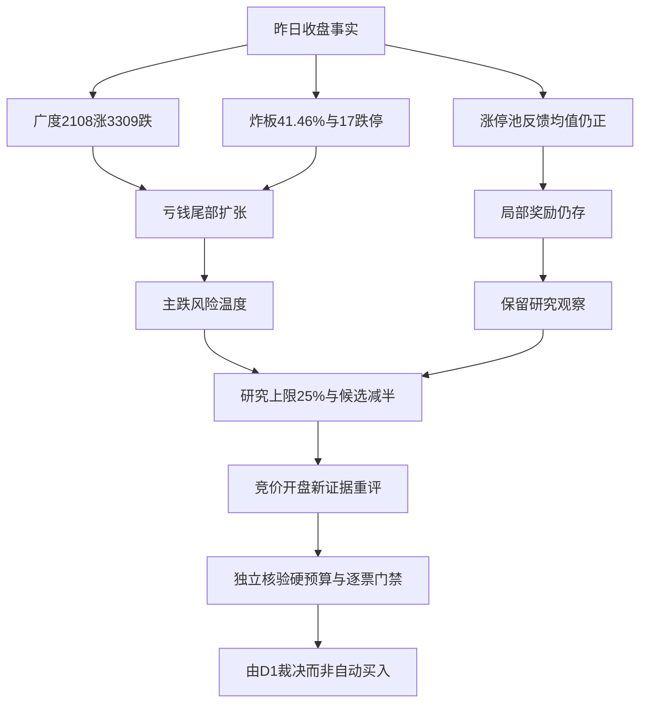

# 2026年11月4日 · 风格研判

## 一句话结论

形态归主线扩散型，风险温度却是主跌；降级，研究仓位上限25%，观察不停止。

## 先回答市场究竟在为什么付钱

昨天的市场奖励的不是“普涨”，而是少量幸存者和相对修复。全市场5570只有行情记录的股票中，上涨2108家、下跌3309家、平盘153家，涨跌比仅0.64，中位数跌0.65%。涨幅至少5%的137家，对面是跌幅至少5%的637家，亏损尾部约为盈利尾部的4.65倍。前一天上涨4681家、跌818家，中位数涨2.02%，对照之下，昨天不是一段已经确认的扩散，而是一次普涨之后的显著分化。成交额约1.72万亿元，较前日收缩4.46%；这个数字说明成交规模，不证明机构净买入。

涨停48家、跌停17家、收盘未封住34家。这里的炸板率严格用34除以48加34，得到41.46%；开板后重新封住的股票仍属于收盘涨停，绝不以“从未打开过”替代全部封板。XTick给出52家涨停、17家跌停、35家未封住，按同样分母重算约40.23%，风险方向一致，数量口径却不完全相同，因此不混用。其返回的另一个百分数定义不明，也没有拿来代替炸板率。

赚钱效应需要再拆一层。前日125只涨停股，有124只取得昨日行情；其中63只收红，收盘反馈均值涨0.95%，中位仅涨0.13%，11只跌幅至少5%。同一批股票平均开盘溢价却达2.21%。这说明正溢价还在，但从开盘到收盘明显被兑现，不能把“开盘有奖”读成“全天容易赚钱”。缺失的一只没有补零，也未猜测停牌或退市原因。涨停池均值为正与全市场亏钱扩张同时成立，正是本轮判断不能只看一个情绪分的原因。

## 风格名字与市场温度为何不一致

按五选一的形态条件，48家涨停落在30至50区间，最高4板落在3至5区间，剔除特殊处理及退市样本后，连板名单有二板12家、三板1家、四板2家，故归入“主线扩散型”。这只是统计形态，不是确认真实主线，也不是可交易资格。最高标没有达到六板，炸板率远高于20%，不满足连板情绪型；炸板率又未超过50%，不硬套崩溃退潮型。

但阶段必须优先于名字。17家跌停与41.46%炸板率共同命中主跌条件，所以明确标记“情绪=主跌”。这描述的是11月3日收盘，不是宣称今天已经发生下跌。原规则情绪分为56分：涨停强度32分、梯队10分、封板健康约11.71分、三个指数平均涨跌项约2.06分。这套分数没有直接惩罚跌停和637只大幅亏损，容易让中性分掩盖尾部风险，因此不拿它推出仓位或交易方向，也不声称有新的封板公式经过验证。

主线数量只能给代理值。涨停概念统计有6项达到至少8家涨停，按标签截成“三主线以上”；这些项目存在重叠，不是六条独立主线。R1不输出具体行业，不替R2认定核心地位。真实可交易主线有几条，仍须由R2结合梯队、合力与资金确认；未确认之前，本报告不授予开仓资格。

## 三十个交易日与六簇告诉我们的事

本次以9月15日至11月3日最近30个上证交易日为主窗口，覆盖22个同花顺风格指数和20只ETF。1260个预期收益单元实际取得1258个：“昨日非ST三板以上表现”在10月14日和10月20日没有记录。缺失不是零收益。主分析用成对有效日期计算相关性，最低28个观测，按一减皮尔逊相关作为距离、平均连接做层次聚类，实际切出六簇。另把窗口向前扩到9月11日，取30个共同有效日期做敏感性检查，成员分组不变；这个不连续日期集合只用于复核，绝没有冒充主窗口。

最大的一簇装下35个样本，昨日平均跌1.65%，30日未复权端点均值跌16.25%。这说明共同承压是大底色；六簇不是六种同样强的机会。二板反馈指数单独成簇，30日涨48.56%，昨日基本持平；高位接力两指数成一簇，昨日平均涨3.64%。二者分离，提示承接高度存在差别，但不能据此推导固定的高位接力通道，更不能凭一个动态指数认定任何股票为总龙。

22个风格样本可以从四组读完。创新高与地位组中，百日新高昨日跌0.30%、30日跌12.53%，创历史新高跌0.80%、30日跌7.44%；行业龙头昨日涨0.62%，但30日仍跌4.65%。热度与拥挤组里，同花顺热股昨日跌0.99%、近端次新跌1.17%、百元股跌6.21%、昨日成交前十跌5.28%、昨日高振幅跌2.08%、高贝塔值跌0.88%。资金排序组中，昨日资金前十反而涨0.76%，沪股通与深股通成交前十分别跌3.44%和4.99%；成交排序只是股票组合标签，绝不能据此宣称北向实时净流出。

接力组最有辨识度：昨日打板表现涨0.22%，打首板涨0.27%，打二板以上涨4.91%，非ST二板近乎持平，非ST三板以上涨2.38%。资本行为与业绩标签组则未形成保护，增发预案跌2.70%、增持计划跌1.19%、减持计划跌2.08%、回购计划跌2.64%、业绩扭亏跌2.66%。政策、回购与反转叙事不等于价格已经认可。至此22个风格标签均已覆盖，没有为凑数量补入其他指数。

高位动态指数30日端点变动非常大，非ST三板以上达199.27%，却缺两日日收益；它不能写成完整30日链乘收益，更不是投资者可复制的199%持仓回报。每日换样、幸存者选择与成分集中都可能放大表现。全池42个样本中，只有9个30日端点收益为正，昨日也只有16个上涨，不能让这一簇遮住其余33个样本的30日亏损。

20只ETF以基金代码辨认，不输出行业推荐。五只宽基样本中，510300、510050昨日分别涨0.17%、0.45%，510500、512100、588000分别跌1.18%、1.52%、3.57%；大体量权重相对稳，小盘与高弹性承压。其余共振承压样本，515880跌7.36%，512760跌4.67%，512480与159995均跌4.88%；512660跌0.10%，513180涨0.42%，515790涨1.02%，516090涨1.55%，512400涨0.14%，512200涨0.72%，512010涨1.34%。这些同属大簇却单日方向不同，说明30日相关不能代替今天的强弱排序。

另有三组ETF值得作为风格反证而非买入标的来读。512800独立成簇，30日涨2.80%，昨日跌0.57%，长期相对强不意味着当天仍被追逐；515220也独立成簇，30日跌4.56%、昨日跌0.41%，没有出现一致避险买入。512880与159928共簇，昨日分别涨0.99%和2.46%，30日分别跌3.42%和涨7.61%，是一组相对修复而非全市场扩散。以上20只基金的逐项日、五日、30日端点值均保存在机读文件。ETF收益未复权，不当作含分红总回报，价格端点与日涨幅链乘的微小差异单列保留。

## 外盘是反向证据，不是国内风险的橡皮擦

本次直拉Tushare，美股指数仍只更新到11月2日；不能把它们写成昨夜。流水线本轮采集器的另一备源已取得11月3日完成交易的数据：SPX涨0.36%，IXIC涨0.83%，DJI跌0.38%。这给今天的修复情景增加依据，却不是全球风险偏好同步回升。港股主要指数有同日记录；韩国指数同日跌3.59%，但当地交易日历未验证，只作有限参考。日经记录停在11月2日，缺下一天记录的原因未核清，不擅自写成休市。两个外盘指数接口为空，12条美股个体行情全部滞后一天，不拿个体的旧行情拼成隔夜方向。

跨资产另补拉了黄金、铜和原油的固定12月合约，近20个有记录交易日分别约跌6.34%、跌2.89%、涨2.38%。这些是国内固定合约的月度代理，不是国际现货，也没有换月拼接。黄金与铜都弱、油仍偏强，并不足以在软着陆、降息预期、衰退之间下定论；汇率月度接口本次为空，宏观坐标保留未知。跨资产仅作为情绪前置，不映射股票或行业。

本轮372条群聊和88篇RSS已读。指定KOL群69条中，盘后有效文字强调融资去杠杆与踩踏风险；严格按“昨夜”筛选，没有合格方向长句，不能拿早晨的政策乐观表态冒充昨夜结论。RSS里的稳市场预期与大幅回撤叙述并存，说明托底预期尚未转化为普遍赚钱的事实。群消息缺少可核验的自发言身份字段，只采用显式署名的指定KOL文字；不把聊天里的交易喜报当作市场广度证据。

## 研究建议、硬预算与下一次重评

本轮研究仓位上限为25%，态度是“降级”，不是全局no_trade。依据是国内真实亏损尾部与高炸板率，而不是辅助源缺失；仍保留正的涨停池反馈、少数相对修复与外盘反弹这些反证，所以不机械给零。25%不是精算的最优值，更不是要求账户立刻加到或减到这一比例。现有持仓如何处理，不由R1越权下达调仓命令。

用户已签署文件记载总仓硬上限80%、单票15%、单一方向40%、至多五只；本轮没有取得账户有效交易预算或真实停买状态，因此二者保持未知。未知不当零，也不抬成正额度。任何既有有效零预算、真实停买、T+1、人工确认和逐票R6硬否决继续有效；D1独立核实并与研究建议取交集。旧研究的零仓意见没有被无限继承，本报告也不产生新的交易授权。D1第一次计划形成前，是否在今日计划内保持未知。

本建议从真实生成时点起仅适用今日盘前，到09:25届满；竞价与开盘证据抵达即须由D1重评，不以昨日主跌替代今天观察。若炸板率仍不低于35%、跌停仍不少于12家且尾部扩张，维持降级；正常候选数量目标减半，研究观察不停止。若炸板降到25%以下、涨跌比超过1、涨停池实时反馈中位数转正且大跌尾部收缩，则打开“重新评估”的流程，而非自动买入。窗口到期又没有新证据时，本研究建议失效，不能自动变成永久停买或正额度。

- **大资金意图**: 从大成交组合重挫、权重相对稳与少量高位幸存者并存，提出“降低拥挤风险、保留局部弹性”的解释；这是价格结构推断，没有主力净流量证据，不能当成已经观测的资金指令。
- **为什么走强**: 相对强来自少量组合和接力样本，并非普遍走强；对照全市场中位数为负、强势标签多数仍负，更合理的表述是风险收缩中的选择性承接。
- **逻辑够不够硬**: 国内核心量化与XTick对主跌风险方向一致，足以限制常态进攻；不足以确认真实主线或预测今日必跌。最新外盘反弹、正的隔日反馈都是反证，必须进入重评，不能被主跌标签过滤。

## 数据源审计

| 源 | 日期 | 状态 | 覆盖及限制 |
|---|---|:--:|---|
| Tushare实时SDK：全市场日线 | 2026-11-04 | 🟢 | 基准日11月3日，5570条；前日5571条作对照 |
| Tushare实时SDK：涨跌停及梯队 | 2026-11-04 | 🟢 | 涨停48、跌停17、未封住34；连板原始18条 |
| Tushare实时SDK：指数及概念统计 | 2026-11-04 | 🟢 | 8只宽基指数、20条统计；主线数仅代理 |
| Tushare实时SDK：风格与ETF | 2026-11-04 | 🟡 | 22+20个样本，1258/1260格，缺两日成对处理 |
| XTick历史情绪 | 2026-11-04 | 🟢 | 首次日期格式报错后以横杠日期成功；数量口径不同 |
| 外盘本轮采集器及实时补拉 | 2026-11-04 | 🟡 | 最新美国三指数来自备源，个体行情滞后，部分指数为空 |
| Tushare实时SDK：固定商品合约 | 2026-11-04 | 🟢 | 黄金、铜、原油各40条，仅宏观情绪代理 |
| Tushare实时SDK：汇率 | 2026-11-04 | 🔴 | 两条月度序列为空，未补零，宏观坐标未知 |
| 本轮公众号RSS兼容文件 | 2026-11-04 | 🟢 | 88篇，观点与客观价格证据分开 |
| 本轮群聊兼容文件 | 2026-11-04 | 🟡 | 372条，指定KOL群69条；昨夜无合格方向长句 |
| manifest与mcp_health | 2026-11-04 | 🟡 | severity=2；辅助社交与账户源不可用，不触发市场性禁买 |

## 不确定性与反证

本报告置信度0.448，由0.80基准乘0.70部分新鲜度、再乘0.80双源一致度得到。Tushare多个接口不是多个独立提供商，情绪阶段的0.88规则置信度也没有直接冒充本报告整体置信度。降级意味着完整性与可解释性有限，不意味着市场没有研究价值。最大的反证是今天能否在外盘修复支持下，获得真实的开盘承接、广度回升与亏钱收缩；若出现，本报告的盘前谨慎程度必须被重新审视。六簇中的单成员样本、动态换样与两日缺数都提示：相关结构是研究工具，不是稳定可交易因子。

## 与其他研究和决策的关系

上游是本轮manifest、健康状态、群聊、公众号、外盘采集，以及本阶段新拉取的量化证据。R2消费风格和主线数量代理，但独立确认主线；R3可用56分作对应基准日状态而非今日方向；R6保留反证和唯一硬否决；D1核实有效预算、在窗口内外按新证据独立裁决。R1没有股票候选，因此不虚构板型、龙头地位、盈亏比与禁止清单结果。

## Sub-Agent 元数据

skill为analyze_style_v1，版本1.2，方法为本会话直接研判与确定性统计。模型为gpt-6.1-sol，未启动任何其他模型会话或重复阶段代理。机读产物为data/research/20261104/R1_style.json；主窗口计算证据为R1_cluster_30sessions.json。真实生成时刻在frontmatter中记录，本阶段生成耗时约582秒。本次是正常盘前运行，不是冻结输入回放；总token用量未取得，保持未知，5000万为观察性连续任务努力目标而非硬限额。08:30为观察性交付目标，不改变风险规则或交易权限。
