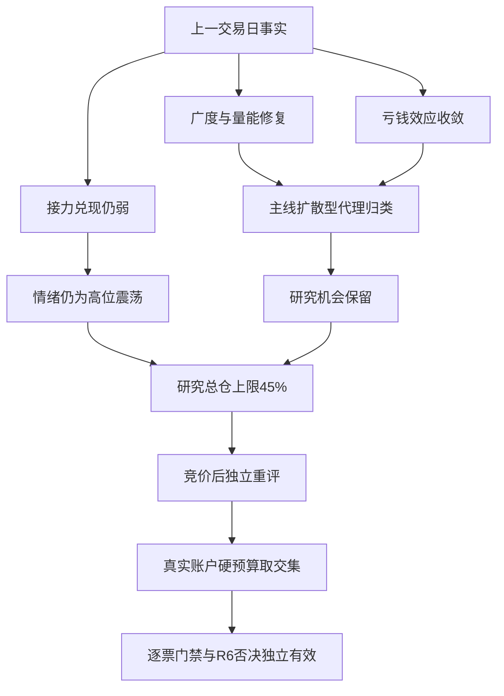

# 2026年11月5日 · 风格研判

> ⚠️ **数据源时间错位**：这是11月5日盘前研究，国内事实来自11月4日收盘；美股日线仅至11月3日。不是对11月5日已发生盘面的描述，也不是冻结输入的历史回放。
> 数据新鲜度：partial；降级交付；置信度：0.476。所有市场统计均由本轮实时接口获取，公众号与群聊为本轮fetch文本。

## 一句话结论

**主线扩散型，情绪仍属震荡；指数修复不等于接力修复，研究总仓上限45%，竞价后重评。**

## 详细分析

### 一、市场先奖励什么，而不是先找谁涨得多

市场在为广谱修复和高弹性回补付钱，而不是为旧高位连续接力付钱。上一交易日上涨4667家、下跌779家，涨幅中位数1.88%，118家收盘涨停、9家跌停，成交额较前日增加19.64%；亏钱效应收敛，有研究机会。反证是前日涨停池收盘均值-0.32%、中位数-2.34%，开盘至收盘均值-1.99%，最高连板降至3板，旧高位风格样本下跌7.00%。因此风格归主线扩散型，情绪周期仍是高位震荡，不能把大阳线等同于主升重启。情绪83只描述20261104，不预测今天。研究总仓上限45%，根据本轮修复强度与接力风险形成，竞价后独立重评；真实账户预算未知，不新增权限。

这不是一次只有权重撑住的修复。全市场有行情记录的5572只股票中，4667只上涨、779只下跌、126只平盘，上涨占比83.76%；上涨至少5%的有1119只，下跌至少5%的仅46只。前一日下跌至少5%的股票尚有637只，本次已明显收敛。股票日线成交额合计约20518.90亿元，较前日增加19.64%。这组数据支持“有真实研究机会”，不支持以辅助源缺失宣布全局不交易。这个分母是当日有交易记录的股票，不包含停牌，不把固定ETF样本当作市场广度。

指数也确认了修复方向，但不能代替盈利质量。上证上涨2.16%，深证成指上涨4.22%，创业板指上涨6.40%；大盘权重基准上涨1.45%，中盘、小盘基准分别上涨4.66%、4.67%，另一高弹性创新基准上涨9.92%。因此当日的奖励集中在高弹性回补，而不是一概偏爱防御，也不是所有创新高样本都更强。风格表象很热，资金身份及中长期配置意图却不能仅凭价格确认。

- **大资金意图**: 放量、广度改善与高弹性相对占优，和风险暴露回补的假设一致；没有逐类资金流证据，不能把它断言为某类机构持续加仓。
- **为什么走强**: 深跌样本出现同步反弹，前日大面积亏钱收敛，支持从风险压缩转向修复的解释；没有证据把这一天延伸成连续主升。
- **逻辑够不够硬**: 全市场日线、涨跌停和指数三个观测面一致，XTick也确认高度只有3板；但这些价格指标存在同源及成分关联，不能按三份独立资金证据计数。

### 二、赚钱效应必须问隔日兑现，而不止看收盘红盘

118只是非ST收盘涨停数，不是全天从未开板数。65只涨停股曾开板后回封；收盘未封住的炸板股另有33只。炸板率按33除以118加33，得到21.85%。不能把65只回封再算作33只炸板，也不能用open_times等于0筛掉回封股后重算涨停。XTick给出121只涨停、10只跌停、33只炸板，和主源有覆盖差异；其zbl字段9.62没有核实同一分母，未拿它替换21.85%。

真正需要警惕的是，11月3日48只涨停股在11月4日全部匹配到了日线：开盘溢价均值+1.75%，中位数只有+0.26%；到收盘，均值变成-0.32%，中位数为-2.34%；开盘到收盘平均回报-1.99%。只有18只收盘反馈为正，13只较前收盘下跌至少5%。这说明“全市场大涨”和“上一批情绪参与者赚钱”并不是一件事。旧筹码被兑现的压力，并未因指数大阳线自然消失。

梯队在11月2日、3日、4日从6板降至4板、再降至3板。最新非ST天梯为3板6只、2板6只；连板参与者仍有研究价值，但高位持续性不能认证。30日高收益的旧高位风格，最新一日下跌7.00%；低阶接力样本却上涨2.92%。这种分离要求D1核地位与接力，不允许把过去一个月赢得最多，直接翻译成今天可买。

- **大资金意图**: 新增风险偏好与旧高位兑现并存的假设，比“所有情绪股无差别加速”更符合证据；不能据此给任何个股定性出货。
- **为什么走强**: 广谱样本修复，低阶样本相对抗压；旧高阶样本反而走弱，说明当日修复对不同筹码位置有选择。
- **逻辑够不够硬**: 涨停池48/48匹配，开盘与收盘反馈分列，且风格样本给出同向反证。若今天昨日涨停池从开盘到最新价的均值和中位数转正，这项担忧必须重评，不能变成永久禁令。

### 三、30日六簇揭示的是共振结构，不是六条交易主线

窗口严格取11月4日结束的30个A股交易日，从2026年09月16日起；22个同花顺风格指数与20只ETF共42项全部覆盖。41项有完整30个日收益，“昨日非ST三板以上表现”缺10月14日和10月20日，重查仍为空。该项30日收益保留未知，不补零、不前填、不把28日复利冒充30日收益。

为了保留42项观察覆盖，主聚类采用日期对齐后的成对Pearson相关距离与平均联结，缺数相关对只用28个共同观测。完整41项另外独立聚成六簇，与主聚类在同一41项上的调整兰德指数为1.00。这证明本次缺两日没有改变其余样本的分组关系，不证明簇标签有稳定预测力。六簇是指定参数，不是统计自动发现六种天然风格；簇号也不是排名。

第一簇占36项，最近一日平均上涨4.21%，而完整30收益均值为-12.14%。因此它首先刻画广谱回补，不足以认证主升。第二簇有2项旧高阶接力样本，最新均跌7.00%，其中只有1项30日收益完整，完整成员30日为+37.02%；不能把这个数当两项的完整30日平均。第四簇只有低阶接力样本，30日+49.22%、最新+2.92%。另三个单样本簇当日分别-1.41%、-0.41%、-0.68%，显示此前相对独立的部分观察样本并未共享这次修复。

20只ETF中17只上涨、3只下跌，支持观察池的风险偏好扩散，却不等于全市场85%上涨，也不替代全市场83.76%的事实。ETF仅以编号和代码留作复算索引，不转化为方向推荐。具体主线及核心地位仍由R2与R7确认，R1不输出具体行业名称或个股。

### 四、风格热度与阶段温度，不能互相偷换

五类中本次归为**主线扩散型**，不是连板情绪型：118只涨停远超示例30—50的数量范围，只有3板高度，而且21.85%炸板率未达连板情绪型所需的低于20%。因此这是活跃扩散梯队的扩展代理归类，不声称逐条精确命中示例阈值。强概念数量只使用既有skill代理：接口20项均满足up_nums至少8，映射“三主线以上”。题材重叠、字段口径与榜单截断决定它不等于20条独立可交易主线，真正可交易主线数仍未知。

情绪周期先用标准开盘溢价口径判为**高位震荡**；替换成单列的收盘反馈后，敏感性判定仍然是高位震荡。已存在的预计算文件同为high_chop，其开盘溢价+1.75%与本轮一致，没有所谓两个premium值互相矛盾：它们定义不同。阶段只是上一交易日温度，不把“阶段—固定打法”焊死，也不能拿昨天标签停止今天的研究。

情绪83分来自原规则版公式：涨停强度40分、梯队7.5分、封板承接15.6291分、三指数平均涨幅贡献20分，合计83.1291后取整。指数分已经封顶，这个公式也未直接纳入跌停惩罚；故它只是热度，不能掩盖负接力。没有采用已撤销的新封板公式，更没有宣称某个新分数公式已经回测验证。11月4日炸板率未达35%，本轮不自动砍半候选；11月3日41.46%的历史炸板率不能冒充今天的实时读数。一旦当日实际达到35%，情绪标为震荡/主跌，候选上限按基数减半；R1本身不生成股票池。

### 五、外盘只按真实资料日期说话

恒生指数、韩国综合与日经225有11月4日观测，分别为+1.67%、+0.62%与-1.42%，亚洲风险并未全线同步。标普500和纳指综合最新仍为11月3日，分别+0.36%和+0.83%，各自30观测日为-2.52%与-6.87%。14项美股观察样本也仅至11月3日，其中12项上涨，日收益中位数+2.17%、30观测日中位数-13.07%。这些只能说明较早一轮外盘修复，没有拿到11月4日美股收盘，就不能写“昨夜外盘确认”。本轮MCP补查和按日期重查均未补出最新数据。

两项直接外盘风险指数锚点连续查询为空。汇率则不是一概缺失：经实时外汇目录核验，找回离岸人民币FXCM序列，但最新也只到11月3日，30个该品种观测日美元兑离岸人民币买价收盘变动-0.56%；报价终结时刻尚未核实，不能充作最新隔夜值。美元指数仍空。这种补查恢复了部分宏观坐标，但没有消灭新鲜度问题。

境内黄金、铜、原油主力期货序列截至11月4日，30观测日价格变化分别为-6.70%、-0.80%、-23.74%。它们不是海外现货，也可能受主力换月影响；三者一起走弱不足以唯一判定软着陆、降息预期或衰退。因此宏观环境保持未确认，而不强塞到三档之一，不推具体方向，更不由辅助缺口自动推出全局no_trade。

### 六、45%是有时效的研究建议，不是账户新增额度

本轮的**观察**态度是：承认广度修复，继续研究，拒绝把指数大涨直接当作旧高位接力的通行证。45%的研究总仓上限来自两组相反事实的权衡：涨家、量能、跌停和大跌家数改善，足以排除以本轮市场事实为由的零仓研究建议；但48只前涨停池负兑现、梯队继续收缩，使它不配正常主升的高暴露。这个45%是可解释的研究裁量，不是回测最优比例，也不是由83分机械换算。

建议从真实生成时点开始，最迟到11月5日09:30失效；D1在竞价结束后必须独立重评，不能自动续期。如果开盘后涨家占比仍至少60%，昨日涨停池开盘至最新价的均值和中位数均为正，且扩散与资金持续性确认，可触发上行重评，仍不自动提高权限。若涨家占比降至40%以下、涨停池最新反馈均值不高于-1%、炸板率达35%或跌停达20家，应检查亏钱是否扩散，再形成新的下行判断。这些是重评触发器，不是替代逐票风控的下单条件。

真实用户或账户硬预算、本日停买状态没有在本阶段取得权威证据，故均保留未知，既不从旧计划或旧研究抄成0，也不擅自补成正额度。所有有效零预算、仓位硬上限、T+1、人工确认及逐票hard_reject原样有效。D1首次成计划前，in_today_plan保持未知；R1没有候选票，也没有越权使用plan_outside_scan剔除对象。研究不授予买权；R6硬否决仍独立有效。本阶段不调整持仓、不输出价位、板型或逐票盈亏比。

## 关键证据

| 证据 | 本轮事实 | 来源及边界 |
|---|---|---|
| E01 | 🟢 上涨4667、下跌779；中位数+1.88% | daily，当日有行情5572项 |
| E02 | 🟢 收盘涨停118、跌停9、未封炸板33；炸板21.85% | limit_list_d，非ST口径 |
| E03 | 🟡 前涨停池收盘均值-0.32%、中位数-2.34% | 48/48匹配，不与开盘溢价混算 |
| E04 | 🟢 三大指数齐升，量能扩张 | index_daily，与亏钱效应分开 |
| E05 | 🟡 42项六簇；41项30收益完整，1项28收益 | 日期对齐，不补数 |
| E06 | 🟡 XTick最高3板，涨跌停覆盖略异 | 不替换主源分母 |
| E07 | 🟡 企稳不等于连续反弹 | 当次公众号第77条，仅作定性反证 |

## 风格判断传导

## 观察样本复算索引

以下仅为研究覆盖审计，既不是股票候选，也不是ETF执行池。风格名称保留原风格属性，ETF仅以代码和中性编号识别；30日未知不填成零。日收益为供应商价格收益，ETF未计算分红再投总回报。簇1共36项，簇2共2项，其余各1项。

| 样本 | 类型或识别码 | 最新日收益 | 30日收益 | 簇 |
|---|---|---:|---:|---:|
| 百日新高 | 883416.TI | -0.73% | -10.53% | 1 |
| 同花顺热股 | 883910.TI | +1.42% | -25.33% | 1 |
| 创历史新高 | 883911.TI | +0.96% | -5.60% | 1 |
| 行业龙头 | 883917.TI | +1.90% | -1.98% | 1 |
| 近端次新股 | 883907.TI | +7.15% | -11.25% | 1 |
| 百元股 | 883916.TI | +9.85% | -23.92% | 1 |
| 昨日资金前十 | 883901.TI | +2.11% | -9.80% | 1 |
| 昨日成交前十 | 883902.TI | +8.26% | -33.78% | 1 |
| 昨日高振幅 | 883906.TI | +3.68% | -18.72% | 1 |
| 沪股通成交前十 | 883908.TI | +4.66% | -18.08% | 1 |
| 深股通成交前十 | 883912.TI | +8.39% | -30.02% | 1 |
| 高贝塔值 | 883926.TI | +0.12% | +3.20% | 1 |
| 昨日打板表现 | 883978.TI | -0.98% | +2.74% | 1 |
| 昨日打首板表现 | 883994.TI | -0.71% | +4.71% | 1 |
| 昨日打二板以上表现 | 883996.TI | -7.00% | +37.02% | 2 |
| 昨日非ST二板表现 | 883997.TI | +2.92% | +49.22% | 4 |
| 昨日非ST三板以上表现 | 883999.TI | -7.00% | 未知 | 2 |
| 增发预案指数 | 883903.TI | +4.70% | -13.97% | 1 |
| 增持计划 | 883915.TI | +2.87% | -5.85% | 1 |
| 减持计划 | 883921.TI | +3.56% | -9.23% | 1 |
| 回购计划 | 883929.TI | +5.43% | -8.19% | 1 |
| 业绩扭亏 | 883936.TI | +5.01% | -23.39% | 1 |
| ETF01 | 510300.SH | +2.03% | -7.69% | 1 |
| ETF02 | 510050.SH | +1.35% | -1.20% | 1 |
| ETF03 | 510500.SH | +4.40% | -12.22% | 1 |
| ETF04 | 512100.SH | +4.62% | -12.30% | 1 |
| ETF05 | 588000.SH | +10.29% | -18.18% | 1 |
| ETF06 | 515880.SH | +8.19% | -33.25% | 1 |
| ETF07 | 512760.SH | +10.05% | -18.75% | 1 |
| ETF08 | 512480.SH | +9.97% | -19.92% | 1 |
| ETF09 | 512880.SH | +0.59% | -2.42% | 1 |
| ETF10 | 512800.SH | -0.68% | +3.70% | 6 |
| ETF11 | 512010.SH | +2.64% | +5.44% | 1 |
| ETF12 | 512660.SH | +3.39% | -8.96% | 1 |
| ETF13 | 513180.SH | +2.08% | -9.76% | 1 |
| ETF14 | 515790.SH | +4.46% | -7.75% | 1 |
| ETF15 | 516090.SH | +3.55% | -10.72% | 1 |
| ETF16 | 515220.SH | -0.41% | -4.74% | 5 |
| ETF17 | 512400.SH | +5.91% | -14.87% | 1 |
| ETF18 | 159928.SZ | -1.41% | +6.59% | 3 |
| ETF19 | 159995.SZ | +10.00% | -22.40% | 1 |
| ETF20 | 512200.SH | +0.44% | -3.23% | 1 |

## 数据源审计

| 源 | 日期 | 状态 | 记录数与说明 |
|---|---|:--:|---|
| Tushare国内市场 | 2026-11-05 | 🟢 | 5572；广度、亏钱效应、梯队齐全 |
| Tushare风格与ETF | 2026-11-05 | 🟡 | 42；41项30收益完整，1项28收益 |
| Tushare外盘 | 2026-11-05 | 🟡 | 19；5指数有数据、2指数空；美股样本14项滞后 |
| Tushare汇率与宏观 | 2026-11-05 | 🟡 | 4；3期货序列可用、汇率滞后、美元指数空 |
| XTick情绪 | 2026-11-05 | 🟢 | 1；涨停统计口径差异，未混分母 |
| fetch_manifest | 2026-11-05 | 🟢 | 1；severity=2 |
| mcp_health | 2026-11-05 | 🟢 | 1；Tushare可用 |
| 公众号 | 2026-11-05 | 🟢 | 85；第77条提供企稳与持续反弹的区分 |
| 群聊 | 2026-11-05 | 🟢 | 646；目标KOL昨夜合格长文本0 |
| weflow_snapshot | 2026-11-05 | 🔴 | 0；可选源未产出；不据此禁买 |
| hotlist_signals | 2026-11-05 | 🔴 | 0；可选退潮提示未产出；不作正向证据 |

表中的日期是本轮获取或核验日期，不是统一行情归属日；国内行情归11月4日，美股与汇率归11月3日。公众号共85条，群聊共646条；目标KOL昨夜合格长文本为0，没有以其他人的发言补位。公众号第77条仅支持“企稳与持续反弹要区分”的语气判断，不转述具体方向。图片、链接占位和图表正文未作为已理解证据。资料缺口只降低置信度，不自动造成市场性禁买。

## 不确定性 / 反证

第一，广谱放量可能是连续反弹的第一天；若次日广度、接力和资金共同延续，本轮偏谨慎判断必须上修，不能为了维护旧观点拒绝市场新证据。第二，旧高位样本下跌可能受小样本成分影响，不能据它指控所有核心都在出货。第三，相关聚类不识别资金身份，成分重叠与极端反弹会造成表面共振；强制六簇的单样本簇尤其不能附会为独立主线。第四，外盘滞后、美元指数空与主力期货换月，使宏观三档定位不足；这影响外部风险置信度，不推翻已获取的国内广度。

本轮置信度按0.85×0.7×0.8计算为0.476：国内必要事实完整，部分外盘与单风格覆盖不完整，独立量化源只算Tushare与XTick两源。同一家供应商的不同接口不能当多源证明，公众号也不充作第三份量化确认。质量分不映射0仓。R1没有股票首推，逐票四段思维链与RR在本阶段不适用，不为凑格式造票。

## 与其他 R/D/E 的关系

R2消费风格、热度与数量代理，但自行确认真实主线和核心；R3使用11月4日情绪分作为对齐基准；R7验证资金持续性，不能把价格回补自动当资金连续流入。R6可按上游事实独立反证并保留唯一硬否决权。D1将本轮45%市场研究上限与真实用户/账户预算分别核验、取交集，竞价后以新证据重评；E1按实际事实日复盘，不拿11月5日结果倒填盘前认知。

## Sub-Agent 元数据

- skill: analyze_style_v1@1.2
- artifact: data/research/20261105/R1_style.json
- 计算证据: data/research/20261105/_r1_live_inputs.json、_r1_supplement.json、_r1_computed.json
- 模型: gpt-6.1-sol；当前会话为唯一研究与判断执行者，未启动其他模型或重复阶段会话。
- 研究状态: degraded，原因是样本缺两日及外盘等辅助覆盖不足，不是市场性no_trade。
- Schema来源: skill明文契约的内存Pydantic严格模型；仓库未检得生产R1模型，不声称通过不存在的生产模型。
- 时间语义: 真正盘前生成；行情归属日分列，未冻结旧输入重演，未伪装事前预测。
- 资源观测: token usage未知，不按0计；努力目标非硬限，交付时点仅观察，不撤单、不改池或权限。
