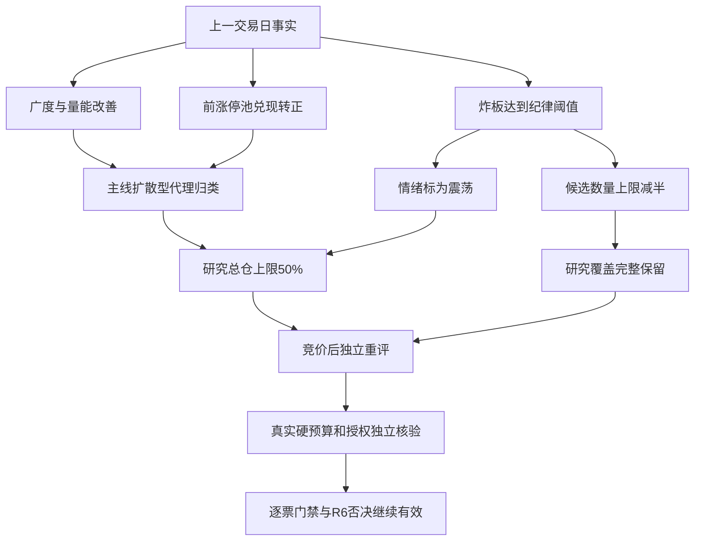

# 2026年11月6日 · 风格研判

> **资料时间边界**：这是当日盘前实时研究，国内事实截至11月5日收盘，美股日线与汇率截至11月4日，不是11月6日已发生盘面，也不是历史回放。
> 数据新鲜度 partial；降级交付；置信度 0.544。研究判断不构成买入权限。

## 一句话结论

**主线扩散型，情绪=震荡；兑现改善而封板分歧加大，研究总仓上限50%，候选上限减半，竞价后重评。**

## 详细分析

### 一、市场奖励开始从单日修复走向兑现，但仍不能放弃辨别

市场正在奖励广谱修复与部分隔日接力，而不是无差别追逐成交最热样本。上一交易日上涨4869家、下跌625家，中位涨幅2.02%，前日118只涨停股收盘反馈均值+4.49%、中位数+4.26%，开盘至收盘均值+2.56%，亏钱效应继续收敛。然而涨停118降至84，未封炸板33增至48，炸板率36.36%，封板质量转差。风格归主线扩散型，情绪仍是高位震荡，情绪分76只描述11月5日。研究总仓上限50%，根据广度、兑现改善与炸板分歧的相反证据形成，最迟今日09:30失效，竞价后独立重评。真实用户或账户预算未知，研究建议不新增权限；候选数量依纪律减半，研究覆盖保留。

这一次，市场并不是只有指数好看。11月5日5571只有交易日线的股票中，4869只上涨、625只下跌、77只平盘，上涨占比87.40%，中位涨幅2.02%。上涨至少5%的592只，对应下跌至少5%的44只，亏钱尾部继续收敛。股票日线成交额合计约21350.99亿元，比前日增加4.06%。这是有广度、有量能、也有隔日赚钱反馈的修复，不能以外盘或辅助渠道缺失宣布全局不交易。

指数结构却提醒我们，市场仍有选择。上证上涨0.10%，深证成指上涨1.19%，创业板指上涨0.87%；大盘权重基准上涨0.09%，中盘和小盘基准分别上涨1.80%、2.12%，另一高弹性创新基准上涨1.68%。普涨与中小盘相对占优同时成立，但不等于机构持续加仓得到确认。风格样本中，高贝塔值当日上涨2.91%，行业龙头上涨1.07%，创历史新高反而下跌0.36%，昨日成交前十下跌2.47%，昨日资金前十下跌0.51%。市场奖励的是选择性修复，不是单纯成交热度或一切创新高。

- **大资金意图**: 广度扩大、成交增加、中小盘相对占优，符合风险暴露继续回补的假设；没有分身份资金证据，不能把价格上涨直接命名为机构连续建仓。
- **为什么走强**: 前一轮深跌后的修复已扩展到更多股票，接力兑现也转正，解释力强于“只有权重护盘”；具体产业催化与核心地位仍交R2、R7验证。
- **逻辑够不够硬**: 全市场日线、涨停池反馈与指数结构一致支持修复，但同源指标与成分重叠不能算三份独立资金确认；若今天广度与接力同时转弱，必须撤销持续修复假设。

### 二、赚钱反馈变好，与封板成功率变差，是同时存在的事实

11月4日118只涨停股在11月5日全部匹配到日线。开盘相对前收盘的溢价均值为+1.94%，中位数+1.39%；到收盘，反馈均值提高到+4.49%，中位数+4.26%；从开盘买入到收盘的平均价格变化为+2.56%。其中96只收盘反馈为正，4只较前收盘下跌至少5%。相比前一批涨停池收盘均值-0.32%、开盘到收盘均值-1.99%，兑现质量发生实质改善。不能沿用前一轮“接力普遍亏钱”的判断不变，更不能把上游缺数填入的-0.5%当成本轮真实溢价。

但涨停池的入口质量没有同步改善。收盘涨停从118只减少至84只，收盘未封住的炸板股从33只增至48只。84只收盘涨停中，36只曾打开后回封，它们仍然属于收盘封板；48只未封住的炸板是另一个集合。按48除以84加48，炸板率为36.36%，封板率为63.64%。这里的分母是132个触板后最终状态样本，不是全市场，也不是某条真实主线的封板率。不能用open_times等于零筛掉36只回封后，冒充全部收盘涨停。

XTick对应统计为86只涨停、0只跌停、49只炸板、最高4板，按其独立分母得到的炸板率约36.30%，方向一致。它的zbl字段为12.4，定义未核实，未拿来替换主源炸板率。Tushare的跌停查询为空，MCP重查亦空，并有XTick零跌停交叉支持，本报告将0限定在这些接口的覆盖范围，不把它写成所有交易板、所有特殊处理股票绝无跌停。

梯队由前一日最高3板回升为4板，最新非ST天梯为4板2只、3板2只、2板17只。高度有所恢复但还不是6板以上的强连板环境。昨日打板、打首板、打二板以上风格分别上涨4.15%、4.30%、5.21%，而非ST二板样本下跌0.55%；高阶另一项恰好缺最新数据，因此不能宣布高低阶已全线共振。市场奖励真实存在，但参与位置、样本定义和封板质量仍决定体验。

- **大资金意图**: 前涨停池获得正反馈与触板失败增多并存，更符合资金有选择地接力、同时淘汰部分试图跟涨筹码的假设，不支持给所有高位样本授予通行证。
- **为什么走强**: 隔日开盘之后仍有平均正回报，说明上涨不只来自开盘一次性溢价；但涨停收缩、炸板增多，意味着从普涨进入封板接力仍有摩擦。
- **逻辑够不够硬**: 118/118完整匹配，收益口径分列，XTick也确认高炸板。反证是单日兑现尚不足以保证下一批继续盈利，且最新缺证样本不可用旧日涨跌代替。

### 三、30个交易日、42项与六簇：共振结构不等于六条主线

本轮窗口为9月17日至11月5日的30个A股交易日，22个预定风格指数和20只ETF全部纳入。41项有完整30个收益观测，昨日非ST三板以上表现缺10月14日、10月20日及11月5日，重查仍缺。因此它的最新日、5日与30日收益均保留未知；没有补零、前向填充，也没有把27日复利冒充30日收益。完整41项只有8项30日收益为正，说明短期修复还不能认证所有中期损失已经收回。

聚类采用日期对齐后的日收益序列，距离为一减Pearson相关系数，平均联结，指定六簇。缺数样本涉及的相关对使用27个共同有效观测；完整41项另行重聚六簇，与主聚类在同一41项上的调整兰德指数为1.00。这只是本轮样本完整性敏感性结果，不是未来分簇稳定性或收益预测证明。不同日期的相邻行没有强行拼接，ETF也没有参与成分或行业推荐。

最大的第四簇有36项，最新一日平均上涨1.70%，完整30日平均收益仍为-12.34%，刻画的首先是广谱回补。第五簇有两项高阶接力观察样本，但只有一项拥有最新日和完整30日数据，其日收益+5.21%、30日+40.16%都不能代表两项平均一致走强。第一簇单独容纳非ST二板样本，30日+41.95%、最新日-0.55%，提示累计赢家与当日奖励并不相同。第二、第三、第六簇分别是独立ETF样本，当日-3.14%、-0.34%、+1.44%；它们是相关结构中的分离，不是三个天然独立主线。

20只ETF当日16涨、3跌、1平，为观察池风险偏好提供交叉信息，不替代全市场87.40%的上涨占比。表尾保留全部42项编号和收益便于复算；ETF只以中性编号及代码呈现，不输出具体行业推荐。本阶段不回答哪条产业主线可交易，更不以某簇30日收益高替代核心地位与必要风险审核。

### 四、情绪分降到76，不等于赚钱效应转弱

五类风格中，本轮仍归**主线扩散型**，但这是数量超出示例区间的扩展代理归类：84只涨停超过30—50只的示例，4板梯队符合扩散的近似结构，而炸板36.36%与高度不足6均不满足连板情绪型的严格条件。风格枚举不能掩盖温度，情绪周期仍判**高位震荡，情绪=震荡**。没有必要仅因炸板过35%就强写主跌：国内广度、隔日兑现和跌停统计均不支持亏钱扩散至全局主跌。

本轮使用原规则公式，涨停强度40分、梯队10分、封板承接12.7273分、三指数平均涨幅贡献13.6055分，合计76.3328后取整76。它只描述11月5日热度。指数涨幅比前日温和且炸板增加，足以让这个分数下降；与此同时，涨停池兑现却变好。两者不是矛盾，而是分数不能包办市场判断的直接例子。原公式未直接计入跌停惩罚，也没有融资外资维度，不声称五维参考公式或已撤销的新封板公式经过验证。

上游预计算情绪文件给出high_chop，但premium=-0.5%明确是缺数后的保守填值。本次用完整118只池重算开盘溢价+1.9446%，并单列收盘反馈+4.4865%，两种口径的阶段敏感性复算都仍为high_chop。报告采用阶段一致的结论而拒绝消费虚拟溢价和固定打法文案，不修改上游文件。阶段只定温度，通道仍须由D1按当日奖励和资金确认选择。

主线条数仅用skill既有代理：返回20项的up_nums都不低于8，数量标签截为“三主线以上”。但up_nums甚至大于cons_nums，字段口径不能直接解释为同一成分分母下的涨停数，概念也可能高度重叠。因此真实可交易主线条数、其持续性与逐主线封板率尚未由R1认证，交R2独立判断，不在本报告编造具体主线、持续天数或明日加速结论。

### 五、外盘内部也在分离，最新隔夜尚未取得

亚洲市场有11月5日数据：恒生指数上涨3.67%，韩国综合下跌5.28%，日经225下跌1.79%；三者自身最近30个收益观测分别为-1.16%、-21.91%、-4.77%。这种分化本身就是风险信息，不能用一个外部上涨指数概括“外盘支持风险偏好”。尤其韩国综合单日大跌，要求下一轮核外部冲击是否真实传入本地，而不是预设今天必跌或必修复。

美股综合指数与14项股票观察样本均仅到11月4日。标普500当日+1.58%、纳指综合+1.44%，但30观测日分别为-0.23%、-4.45%；14项样本中只有6项上涨，日收益中位数-2.12%、30观测日中位数-12.93%。这支持指数与内部结构分离的描述，不支持“最新隔夜全面走强”。本轮按11月5日定日SDK和MCP补查仍为空；两项直接风险指数锚点亦未取得，不用相关ETF冒充指数补齐。

实时外汇目录恢复了离岸人民币FXCM序列，但最新也只到11月4日，美元兑离岸人民币买价收盘为6.66623，30个本品种收益观测变化-0.70%；报价终结时刻未核实，不能当11月6日实时汇率。境内黄金、铜、原油主力期货截至11月5日的30观测日变化分别为-5.35%、-1.23%、-24.51%。它们不是海外现货，存在换月和基差影响。这些证据不足唯一归入软着陆、降息预期或衰退，宏观坐标保留未确认，不因缺证强填乐观或悲观结论。

公众号第66条的政策文本支持“维稳机制仍有政策支撑”的倾向；第67条是上一交易日早盘广度报道，不当收盘统计；第89条描述较早一轮外盘内部劈叉，其价格分离可由本轮样本交叉，但政治与资金因果没有独立核验，未当事实推导。482条群聊中，目标KOL盘中短句有偏积极但强调持续性验证；昨夜可归属长文为个股调研宣传，非合格市场风格长文。未用其他群员或图片占位补成昨夜KOL结论。

- **大资金意图**: 外部样本的内部价格分离只支持风险暴露再分配假设，不能直接断言跨境资金正在同向流入A股。
- **为什么走强**: 部分指数回补与内部样本下跌共存，宏观叙事不能替代真实资料日期；最新隔夜未齐，本轮不能解释其尚未取得的走势。
- **逻辑够不够硬**: 本次实时返回与当次文本支持分化，最新外盘与部分直接风险指数仍缺证，所以降低置信度；若补齐后出现反向冲击，应及时重评而非维护旧外盘判断。

### 六、50%只是一项有期限的市场研究建议

本轮态度为**观察**：承认修复和兑现改善，继续研究，不把普涨翻译成无差别追涨。研究总仓上限50%来自本次两组相反事实的权衡：87.40%的上涨占比、118只前涨停池正兑现与亏钱尾部收敛，不能推出市场性零仓；36.36%的炸板率、涨停数量收缩、外部风险分化和中期回撤尚未消除，也不支持充分主升暴露。这个比例是有证据解释的研究裁量，不是回测最优仓位，也不是把情绪76机械换算成预算。

建议自真实生成时刻有效，最迟11月6日09:30失效；竞价结束后D1/P1必须独立重评。若开盘后涨家占比仍至少60%、昨日涨停池开盘至最新价的均值与中位数均为正、炸板率低于25%且资金持续性确认，可触发上行重评；这不自动增加额度。若涨家占比低于40%、涨停池最新反馈均值不高于-1%、炸板率超过40%或跌停达到20家，则核亏钱是否扩散并形成新的下行建议，不由单项分数机械映射零仓。

11月5日炸板率已达到35%纪律线，必须把下游研究候选上限按正常基数乘0.5并向下取整，情绪显式标震荡。减半的是候选数量上限，不是已研究覆盖，本轮22加20项全部保留；R1不生成股票候选，不假造一个正常基数或执行池。今日若有新证据，仍须由相应决策者完成真实重评，不凭新标签撤销纪律。

真实用户或账户硬预算、当日停买状态在本阶段没有取得权威来源，因此保留未知，既不沿用旧effective_trading_budget=0，也不擅自补成正额度。所有有效零预算、仓位硬上限、T+1、人工确认、逐票hard_reject及既有授权与保护不变；R6保留唯一硬否决来源地位。D1首次成计划前in_today_plan未知，不以false或plan_outside_scan预先剔除研究对象。R1没有个股首推，板型、龙头认定、RR和逐票禁止项四段在本阶段不适用，后续仍须独立过闸。

## 关键证据

| 证据 | 当轮事实 | 边界 |
|---|---|---|
| E01 | 🟢 上涨4869、下跌625，中位+2.02%；量能增加4.06% | 当日有行情5571只，非上市总数 |
| E02 | 🟡 涨停84、跌停统计0、未封炸板48；炸板36.36% | 非ST主源，触板分母132，回封36含在84内 |
| E03 | 🟢 前涨停池收盘均值+4.49%、中位+4.26% | 118/118匹配；开盘到收盘均值+2.56% |
| E04 | 🟢 广度强于权重指数，中小盘占优 | 价格结构不是机构身份确认 |
| E05 | 🟡 42项六簇，41项30日完整，1项27日 | 不填充，完整样本敏感性ARI=1.00 |
| E06 | 🟡 XTick最高4板、跌停0、炸板率另算36.30% | 不混覆盖、不采用未核实zbl字段 |
| E07 | 🟡 政策稳定倾向与外部结构分离 | 当次文本，仅定性交叉，不编宏观因果 |

## 风格判断传导

## 观察样本复算索引

以下为22项风格属性与20项ETF覆盖审计，不是交易推荐。日收益为11月5日供应商价格日收益；30日为指定日期窗口内日收益连乘，ETF未计算分红再投。缺最新日的项目严格留空，不把它的上一条数据搬到当前日。

| 样本 | 识别码 | 最新日收益 | 5日收益 | 30日收益 | 有效日数 | 簇 |
|---|---|---:|---:|---:|---:|---:|
| 百日新高 | 883416.TI | +0.96% | -1.78% | -10.49% | 30 | 4 |
| 同花顺热股 | 883910.TI | +0.96% | -1.15% | -25.01% | 30 | 4 |
| 创历史新高 | 883911.TI | -0.36% | +0.29% | -11.02% | 30 | 4 |
| 行业龙头 | 883917.TI | +1.07% | +4.55% | -1.38% | 30 | 4 |
| 近端次新股 | 883907.TI | +0.91% | +5.89% | -12.03% | 30 | 4 |
| 百元股 | 883916.TI | +1.70% | +1.81% | -25.19% | 30 | 4 |
| 昨日资金前十 | 883901.TI | -0.51% | +3.52% | -13.40% | 30 | 4 |
| 昨日成交前十 | 883902.TI | -2.47% | -4.96% | -37.21% | 30 | 4 |
| 昨日高振幅 | 883906.TI | +2.39% | +1.87% | -18.39% | 30 | 4 |
| 沪股通成交前十 | 883908.TI | +0.50% | -0.91% | -19.53% | 30 | 4 |
| 深股通成交前十 | 883912.TI | -0.95% | -4.29% | -32.26% | 30 | 4 |
| 高贝塔值 | 883926.TI | +2.91% | +1.29% | +3.63% | 30 | 4 |
| 昨日打板表现 | 883978.TI | +4.15% | +3.40% | +4.80% | 30 | 4 |
| 昨日打首板表现 | 883994.TI | +4.30% | +3.72% | +6.27% | 30 | 4 |
| 昨日打二板以上表现 | 883996.TI | +5.21% | +2.28% | +40.16% | 30 | 5 |
| 昨日非ST二板表现 | 883997.TI | -0.55% | +3.61% | +41.95% | 30 | 1 |
| 昨日非ST三板以上表现 | 883999.TI | 未知 | 未知 | 未知 | 27 | 5 |
| 增发预案指数 | 883903.TI | +2.54% | +2.67% | -13.76% | 30 | 4 |
| 增持计划 | 883915.TI | +2.25% | +3.44% | -5.02% | 30 | 4 |
| 减持计划 | 883921.TI | +2.79% | +3.10% | -8.56% | 30 | 4 |
| 回购计划 | 883929.TI | +1.86% | +2.55% | -7.69% | 30 | 4 |
| 业绩扭亏 | 883936.TI | +1.49% | +3.08% | -23.44% | 30 | 4 |
| ETF01 | 510300.SH | +0.48% | +2.04% | -7.80% | 30 | 4 |
| ETF02 | 510050.SH | +0.24% | +2.05% | -1.69% | 30 | 4 |
| ETF03 | 510500.SH | +1.85% | +4.53% | -12.02% | 30 | 4 |
| ETF04 | 512100.SH | +2.23% | +4.43% | -12.04% | 30 | 4 |
| ETF05 | 588000.SH | +1.34% | +5.03% | -20.48% | 30 | 4 |
| ETF06 | 515880.SH | -1.61% | -7.36% | -37.39% | 30 | 4 |
| ETF07 | 512760.SH | +2.76% | +5.16% | -20.03% | 30 | 4 |
| ETF08 | 512480.SH | +3.50% | +5.54% | -20.73% | 30 | 4 |
| ETF09 | 512880.SH | +0.00% | +5.03% | -3.07% | 30 | 4 |
| ETF10 | 512800.SH | -0.34% | -1.80% | +3.83% | 30 | 3 |
| ETF11 | 512010.SH | +2.31% | +6.13% | +7.87% | 30 | 4 |
| ETF12 | 512660.SH | +0.29% | +2.06% | -9.58% | 30 | 4 |
| ETF13 | 513180.SH | +5.30% | +10.00% | -5.33% | 30 | 4 |
| ETF14 | 515790.SH | +4.27% | +9.56% | -5.13% | 30 | 4 |
| ETF15 | 516090.SH | +4.66% | +10.34% | -6.96% | 30 | 4 |
| ETF16 | 515220.SH | -3.14% | -4.63% | -7.88% | 30 | 2 |
| ETF17 | 512400.SH | +1.84% | +5.12% | -14.69% | 30 | 4 |
| ETF18 | 159928.SZ | +1.44% | +7.12% | +9.13% | 30 | 6 |
| ETF19 | 159995.SZ | +2.63% | +4.00% | -23.68% | 30 | 4 |
| ETF20 | 512200.SH | +2.65% | +2.65% | -1.68% | 30 | 4 |

## 数据源审计

| 源 | 本轮核验日期 | 状态 | 记录数及说明 |
|---|---|:--:|---|
| 国内市场 | 2026-11-06 | 🟢 | 5571；广度、兑现、梯队完整；D空经独立源零跌停交叉 |
| 风格与ETF | 2026-11-06 | 🟡 | 42；41项完整30收益，1项27收益且缺最新日 |
| 外部指数与样本 | 2026-11-06 | 🟡 | 19；5项指数有数据、2项空；14项美股至11月4日 |
| 汇率与商品 | 2026-11-06 | 🟡 | 4；汇率至11月4日；3境内期货至11月5日；美元指数空 |
| XTick情绪 | 2026-11-06 | 🟢 | 1；高度4板、跌停0交叉；炸板分母不混用 |
| fetch_manifest | 2026-11-06 | 🟢 | 1；severity=2不等于市场停买 |
| mcp_health | 2026-11-06 | 🟢 | 1；Tushare可用，辅助渠道部分down |
| 公众号 | 2026-11-06 | 🟢 | 90；第66、67、89条只取宏观和风格倾向 |
| 群聊 | 2026-11-06 | 🟢 | 482；昨夜目标KOL无合格市场风格长文 |
| weflow_snapshot | 2026-11-06 | 🔴 | 0；可选源404；未产出 |
| hotlist_signals | 2026-11-06 | 🔴 | 0；可选源未产出，不作为正向或否决依据 |

表中核验日期不是统一行情日期。国内事实归11月5日，美股与汇率归11月4日；前者是正常盘前T-1事实，后者距所需隔夜仍缺一轮。单风格缺最新日属于受影响样本缺证，未扩散为其他41项不可研究。公众号90条、群聊482条均为本轮fetch资料；源存活不等于每条内容均适合风格判断。可选源未产出、旧渠道停用与真实市场退潮严格区分。

## 不确定性 / 反证

最大的反证有两个方向。若广度、隔日兑现和资金继续共振，50%的研究暴露可能偏谨慎，届时应按新证据重评，不为了维护旧观点拒绝上涨。反过来，触板失败从33增加到48，可能意味着普涨之后的资金更挑位置；若下一批兑现转负，今日的正反馈不能替明天兜底。两种剧本均是待验证假设，不是凭空的概率预测。

聚类依赖固定样本、成分重叠和短窗口，36项同簇并非36份独立证据；高阶缺数尤其不能用同簇另一项代替。外盘亚洲分离且最新美股尚缺，宏观环境不能唯一定位。主线数量字段只保留协议代理，无法独立确认真实可交易主线。置信度按0.85乘0.8再乘0.8为0.544，是资料把握而非赚钱概率；辅助质量折扣既不压成0仓，也不提高账户授权。

## 与其他 R/D/E 的关系

R2独立确认真实主线、持续性和核心地位，不把三主线以上代理当入场许可；R3用11月5日的76分对齐，不拿今日结果反填昨日热度；R7验证资金持续性，不能以价格上涨代替资金身份。R6按原始事实独立反证，硬否决不被R1过滤。D1将有时效的50%研究上限与真实账户硬预算分别核验，竞价后重评并维持逐票保护；E1按对应资料日期检验判断，不混比较日期。

## Sub-Agent 元数据

- skill: analyze_style_v1@1.2
- artifact: data/research/20261106/R1_style.json
- 计算证据: data/research/20261106/_r1_live_inputs.json、_r1_supplement.json、_r1_computed.json、_r1_mcp_crosscheck.json
- 模型: gpt-6.1-sol；本会话为唯一研究与决策执行者，没有再次启动模型或同技能会话。
- 状态: degraded；资料缺口单独披露，不是市场性no_trade。
- 校验: 按skill契约构造Pydantic严格模型，嵌套样本与六簇逐项验证；不声称不存在的生产模型接口。
- 时间语义: 真实当日盘前生成，不是冻结输入回放；精确生成时刻在frontmatter，资料日逐源列示。
- 资源: token usage未知，不按0计，不保证低于努力目标；交付目标仅观察，不强杀、不撤单、不清池、不改变交易保护。
