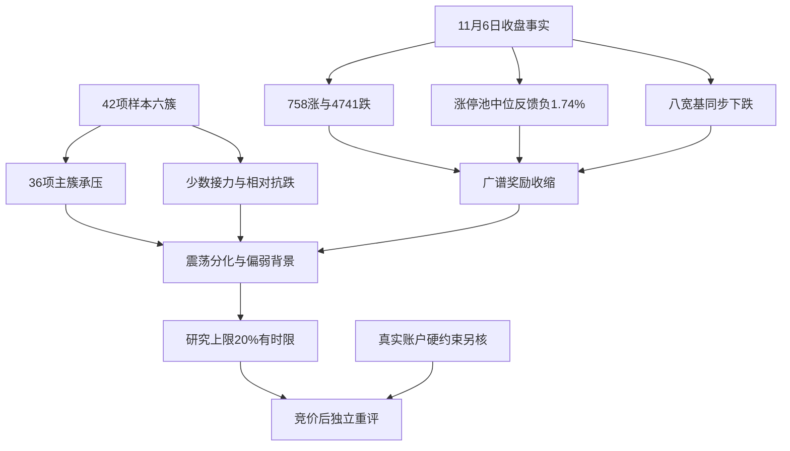

# 2026年11月9日 · 风格研判

## 一句话结论

震荡分化型，情绪=震荡偏弱；研究总仓上限20%，竞价后重评，不是账户预算或买入权限。

## 🌊 先问市场在为什么付钱

周五收盘给出的答案，不再是普遍买入风险都能得到报偿。全市场5573只有日线记录的股票中，758家上涨、4741家下跌、74家平盘，上涨占比只有13.60%，中位数下跌1.87%。跌幅达到5%的395家，远多于涨幅达到5%的79家；跌超3%的1517家，也远多于涨超3%的146家。前一天还是4869家上涨，如今广度反向，成交额又从约21351亿元降到16716亿元，收缩21.71%。这组事实首先要求降低对普遍赚钱效应的预期，而不是在少数强势样本里寻找能覆盖全市场的乐观理由。

接力是否赚钱，要看真实前日涨停池的反馈，而不只是今天最高有几板。11月5日的84只收盘涨停股票，在11月6日全部匹配到日线：开盘溢价均值为-0.37%、中位数为-1.19%；收盘相对前收反馈均值为-0.06%、中位数为-1.74%，只有30只收盘为正、10只跌超5%。从开盘到收盘的平均收益仍有+0.36%，说明开盘后确有局部承接，但不能拿这个口径替代隔夜持有反馈，更不能用接近零的收盘均值掩盖多数样本亏损。此前118只涨停池的收盘反馈均值为+4.49%，兑现环境的变化是真实的。

涨停收缩到32只、跌停升到15只，非ST连板高度由4板到5板，两者并不矛盾：资金可以在普跌中把少量前排继续推高，但这更接近收益集中，不是风险偏好全面抬升。14只收盘未封的炸板样本，对应炸板率14÷46=30.43%、封板率69.57%。收盘涨停中22只曾开板后回封，10只没有开过板；后者不能替代全部32只收盘封板。炸板率较前日36.36%下降，主要背景却是触板总数从132只骤降到46只，不能据比率回落就宣告情绪修复。

因此本轮风格取“震荡分化型”。32只涨停在该档数量区间内，但高度仍有5板，确实不完全命中“无明显连板龙头”的示例；这里明确采用广度、兑现与主线合力的综合裁量，不伪装成严格阈值命中。机械规则凭32只涨停和5板会归“主线扩散型”，然而真实广度和接力中位数均不支持“扩散”的经济含义。另一方面，炸板率未超过50%，不符合崩溃档完整判据，也不能为了表达谨慎而改写观测事实。

## 🌡️ 温度不代替方向，方向不代替授权

情绪浓度为48分，仅描述11月6日。按现有规则原公式，涨停强度贡献21.33分、连板高度12.50分、封板项13.91分、三指数项0分，合计47.75后四舍五入。上证跌1.10%、深成跌2.57%、创业板跌3.96%，八条宽基无一上涨，较大权重指数的跌幅较小也没有扭转个股普跌。该公式没有直接纳入跌停与市场广度，因而分数看起来中性，绝不表示真实风险中性；亏钱效应必须独立呈现。

用真实84只涨停池的开盘溢价重算情绪周期，程序阶段为高位震荡：炸板率30.43%超过25%，开盘溢价未到+3%，而跌停15家尚未达到20家的主跌硬判据，也没有同时达到35%的软判据。上游预计算把缺失溢价填作-0.5%，本轮没有照抄，而是用-0.3691%替换后重算，阶段结果恰好不变。形式标签保留“高位震荡”，广度和深跌样本则给出偏弱、接近主跌风险的背景。这个区别不是文字游戏：它防止把上一交易日温度误当今天已经发生的走势，也防止按阶段机械指定打法。

本次研究总仓上限定为20%。依据是普跌、缩量与多数接力样本失利，而不是旧计划的零预算，也不是缺辅助源的质量惩罚。仍然保留非零研究上限，是因为收盘有32只涨停、前排梯队未消失、少数风格有真实正收益；它们允许保留研究空间，却不足以支持常态风险敞口。20%是审慎裁量而非回测最优数字，不是立即调整持仓的命令。本轮没有取得可认证的用户或账户当日硬预算，相关字段保留未知；未知不是正额度，真实停买、有效零预算、T+1、人工确认及R6逐票否决均原样约束最终执行。

这一市场建议从真实生成时刻生效，竞价结束后必须重评，最迟今天09:30失效。如果开盘后上涨占比持续回到50%以上，昨日涨停反馈中位数转正，且板块核心与资金形成共振，应把新证据送达D1重新判断，而不是让旧20%永久占位；如果跌停达到20家、炸板率达到40%，或涨停池反馈中位数跌破-3%，也应重新评估是否进一步降档，甚至形成有窗口的市场性零建议。上述阈值只是启动重评，不是自动买卖按钮。本轮30.43%未触发35%的候选数量减半硬线，但研究端不选股，不代表清空下游观察对象。

## 🧭 三十日六簇：收益在收缩，不是六条主线

22个同花顺风格板块与20只既定ETF全部进入研究，固定30个A股交易日，收益日期为9月18日至11月6日。每个交易日以当日收盘除以前收计算价格收益，再按日相关距离做平均连接层次聚类，明确切成六簇。ETF仅以E01至E20编号披露，源代码留在JSON核验；它们是风格测量工具，不是R1的板块推荐。外盘另按各自30个原生交易观测计算，不混进42项聚类，也不把不同市场的休市日补成零。

六簇里最大的主簇包含36项，完整样本平均30日收益为-13.95%，周五平均下跌2.41%。热度、成交集中、新高和大部分ETF同在这一组，说明多数价格变化仍由共同风险因子主导，并非六条互不相干的进攻方向。昨日成交前十风格30日跌40.57%、周五跌5.31%，同花顺热股30日跌27.43%、周五跌3.55%，而行业龙头风格分别为-1.97%和-0.97%；相对表现意味着市场对纯热度与成交拥挤的惩罚更明显，不能把“最热”直接翻译为“最值得承担隔夜风险”。

接力异常强的第二簇由昨日打二板以上与昨日非ST三板以上两个风格组成。前者30日涨44.51%、周五涨10.02%，五日涨24.21%；后者在窗口内缺10月14日、10月20日、11月5日和11月6日，最新只到11月4日。因此第二簇的当日正收益只有一个可观测成员，不能写成两项同时大涨，也不披露为完整30日收益。昨日非ST二板另成一簇，30日涨37.14%，周五却跌0.22%。这组对比说明，事后风格指数的收益集中与真实涨停池多数失利完全可能并存；成分动态更换、权重和可成交性均未验证，指数上涨不是能按同样收益买到的承诺。

其余三个簇各只有一只ETF。E10的30日收益为+4.78%、周五+0.69%，E18分别为+9.09%和+0.14%，而E16分别为-7.07%和-0.26%。相对抗跌有真实证据，但单例簇不是板块合力，E16尤其不能因为独立成簇就被误判为防御赢家。20只ETF中只有两只周五上涨，外推进攻主线显然过早。剔除缺失项后，41个完整样本重做六簇，任意样本对的同簇关系一致率为100%；这是本轮结构的敏感性检查，不是未来预测准确率。

## 🌍 外盘给修复线索，不给无条件乐观

美国市场最新可用为11月6日，标普500涨0.31%、纳指涨1.09%，但各自30个原生交易观测累计仍跌4.73%和9.20%。固定14只外盘核心股票篮子中11只上涨，等权当日涨3.29%，30日等权平均仍跌20.06%。这支持“急跌后的局部回补”这一解释，不足以确认持续主升。同期恒生指数跌1.27%、日本主要指数跌5.96%、韩国主要指数跌6.02%，跨市场分化很大。两个额外国际指数接口返回空，未用核心股均值假装补成指数；日韩市场日历新鲜度未独立认证，日期与限制均已保留。

跨资产部分先查元数据再查正确代码：境内黄金、铜和原油主力连续序列最新到11月6日，30个原生交易区间的收盘动量分别为-6.70%、-3.91%和-17.98%；周五收盘相对前收分别为-1.99%、-2.02%和+3.16%。原油月度弱而当日反弹，本身就提醒不能把单一方向讲成稳定宏观趋势。这些是境内连续合约，含币种、交易时段和换月影响，不冒充国际现货。FXCM黄金与美元离岸人民币序列最新只至11月5日，其30个原生观测动量分别为-2.19%和-0.60%，不能冒充最新隔夜报价。

金、铜、油月度代理偏弱可以对应增长压力，也可能由风险溢价回吐与交易结构变化驱动；汇率变化不等于跨境资金实际流向。缺少独立增长及利率期货实证，软着陆、降息预期和衰退三种坐标本轮均不作已确认结论。昨夜公众号一面讨论海外反弹，一面提示通胀与地缘反复，这只能作为情绪前置。五个焦点群均超时，KOL倾向保留未知，不借旧观点填空。辅助信息不足降低置信度，但不能把全部A股研究转换成自动no_trade。

## 🔎 推理与反证

- **大资金意图**: 可观测价格更支持风险收缩与少数前排集中，而非全市场扩张；这一判断来自广度、拥挤风格回撤及两只ETF相对抗跌的共同结果。未取得本阶段真实资金账户流，不能把价格相关性说成已确认的净流入。
- **为什么走强**: 真正仍强的是少数接力风格和相对抗跌样本，而不是指数与多数股票；强势样本的动态成分、可成交性及单例簇限制尚未消除，因此不能据一个10.02%风格指数推导接力普遍赚钱。
- **逻辑够不够硬**: 全市场广度、84/84完整匹配的涨停池、八宽基和42项风格样本均有真实接口证据，但同源不等于独立多源。XTick支持15只跌停与5板高度，涨停33只相对Tushare32只有统计差异；XTick的zbl原值3.49没有可认证分母，未当炸板率。若今天广度、接力中位数与资金同步修复，当前谨慎假设必须让位给新证据。

不能掩盖最关键的缺口：主线数量目前未知。强势概念表虽然有3行up_nums达到8，但21行全部出现up_nums大于cons_nums，字段不足以认证真实涨停集中度，概念又彼此重叠。本轮保留原始代理数供审计，主线数写null而非3，也不偷换成无主线。主线是否成立、持续性与逐票地位由R2及D1用新证据完成，本R1没有资格给出具体板块或个股结论。由于不产生股票候选，每票板型、龙头、盈亏比和禁止清单均属本阶段不适用；不能为了凑写作字段造票。

## 📎 全样本核验附录

以下是观察样本而非推荐池。收益均为百分比价格收益，非分红再投资收益；缺日不填充、不跨日拼接。簇号仅用于本轮，单例簇不具有自动产业解释。

| 风格样本 | 簇 | 有效日 | 30日收益 | 11月6日收益 |
|---|---:|---:|---:|---:|
| S01 百日新高 | 1 | 30 | -10.82% | -0.03% |
| S02 同花顺热股 | 1 | 30 | -27.43% | -3.55% |
| S03 创历史新高 | 1 | 30 | -13.12% | -2.43% |
| S04 行业龙头 | 1 | 30 | -1.97% | -0.97% |
| S05 近端次新股 | 1 | 30 | -14.42% | -3.49% |
| S06 百元股 | 1 | 30 | -28.00% | -4.07% |
| S07 昨日资金前十 | 1 | 30 | -15.30% | -1.71% |
| S08 昨日成交前十 | 1 | 30 | -40.57% | -5.31% |
| S09 昨日高振幅 | 1 | 30 | -20.68% | -2.93% |
| S10 沪股通成交前十 | 1 | 30 | -21.27% | -2.98% |
| S11 深股通成交前十 | 1 | 30 | -36.06% | -5.44% |
| S12 高贝塔值 | 1 | 30 | +2.75% | -1.09% |
| S13 昨日打板表现 | 1 | 30 | +3.73% | -0.97% |
| S14 昨日打首板表现 | 1 | 30 | +5.68% | -1.08% |
| S15 昨日打二板以上表现 | 2 | 30 | +44.51% | +10.02% |
| S16 昨日非ST二板表现 | 3 | 30 | +37.14% | -0.22% |
| S17 昨日非ST三板以上表现 | 2 | 26 | 未知 | 未知 |
| S18 增发预案指数 | 1 | 30 | -15.85% | -2.55% |
| S19 增持计划 | 1 | 30 | -6.83% | -1.73% |
| S20 减持计划 | 1 | 30 | -10.74% | -2.21% |
| S21 回购计划 | 1 | 30 | -9.73% | -2.60% |
| S22 业绩扭亏 | 1 | 30 | -23.91% | -3.10% |

| ETF观察编号 | 簇 | 有效日 | 30日收益 | 11月6日收益 |
|---|---:|---:|---:|---:|
| E01 | 1 | 30 | -9.00% | -1.69% |
| E02 | 1 | 30 | -1.89% | -0.96% |
| E03 | 1 | 30 | -13.70% | -2.28% |
| E04 | 1 | 30 | -13.57% | -2.25% |
| E05 | 1 | 30 | -21.82% | -2.36% |
| E06 | 1 | 30 | -40.96% | -5.59% |
| E07 | 1 | 30 | -21.79% | -3.04% |
| E08 | 1 | 30 | -22.58% | -3.00% |
| E09 | 1 | 30 | -3.07% | -1.17% |
| E10 | 4 | 30 | +4.78% | +0.69% |
| E11 | 1 | 30 | +5.65% | -1.26% |
| E12 | 1 | 30 | -10.60% | -1.83% |
| E13 | 1 | 30 | -5.90% | -1.35% |
| E14 | 1 | 30 | -5.67% | -1.19% |
| E15 | 1 | 30 | -8.57% | -2.58% |
| E16 | 5 | 30 | -7.07% | -0.26% |
| E17 | 1 | 30 | -15.22% | -3.21% |
| E18 | 6 | 30 | +9.09% | +0.14% |
| E19 | 1 | 30 | -25.31% | -3.03% |
| E20 | 1 | 30 | -3.63% | -1.64% |

## 数据源审计

| 源 | 日期 | 状态 | 备注 |
|---|---|:--:|---|
| manifest | 2026-11-09 | 🟡 | severity=3原值保留；质量状态不等于市场禁买 |
| mcp_health | 2026-11-09 | 🟡 | 旧探针报down，本轮日历与涨停MCP和SDK成功实调 |
| tushare.daily | 2026-11-06 | 🟢 | 5573行；另核前两日广度与成交 |
| tushare.limit_list_d / limit_step | 2026-11-06 | 🟢 | 收盘涨停32、跌停15、未封14；非ST统计 |
| tushare.index_daily | 2026-11-06 | 🟢 | 八宽基完整，成交变化不相加 |
| tushare.ths_daily | 2026-11-06 | 🟡 | 22项覆盖，S17最新11月4日且窗口缺4日，重查仍空 |
| tushare.fund_daily | 2026-11-06 | 🟢 | 20项各30日完整；仅价格收益，不声称ETF净流入 |
| tushare.limit_cpt_list | 2026-11-06 | 🟡 | 21行计数关系异常，3项代理不认证为主线数 |
| tushare.index_global | 2026-11-06 | 🟡 | 5项返回、2项为空；日韩日历未认证 |
| tushare.us_daily | 2026-11-06 | 🟢 | 固定14项匿名汇总；不是全美市场广度 |
| tushare.fut_basic / fut_daily | 2026-11-06 | 🟢 | 元数据确认3项境内主力连续，非国际现货 |
| tushare.fx_obasic / fx_daily | 2026-11-05 | 🟡 | 金汇仅到11月5日；海外原油与美元指数仍缺 |
| overseas_snapshot | 2026-11-09 | 🟡 | 已核上游时点与缺口；主要市场数值由本轮实调复核 |
| xtick.market_emotion | 2026-11-06 | 🟡 | 高度及跌停相符；涨停多1只，zbl口径不直接采纳 |
| wechat_official_20 | 2026-11-08 | 🟡 | 38篇，核心源8/10，未把转引稿当独立多源 |
| wechat_cli_5groups | 2026-11-09 | 🔴 | 五焦点群全部超时，KOL观点未知，群名匿名 |
| emotion_cycle预计算 | 2026-11-09 | 🟡 | 输入归属11月6日；默认溢价已由本轮真值重算替代 |

## 与其他 R/D/E 的关系

本轮只依赖本阶段真实行情、抓取清单、公众号与上游情绪预计算核验，不借尚未完成的R2给自己补主线。R2消费风格与主线数量未知项，R3消费48分的对应基准日，R6可对分类裁量、集中收益和仓位建议形成独立反证，D1及P1负责取得新证据并在有效窗内重新裁决。下游首次计划尚未形成时，in_today_plan保持未知；研究未授予任何买入权限，也未修改原硬预算或逐票硬否决。

## Sub-Agent 元数据

skill为analyze_style_v1@1.2；模型为gpt-6.1-sol；机读产物为data/research/20261109/R1_style.json。本轮为11月9日真实盘前运行，不是冻结输入回放；外盘事实日、行情收盘时刻与真实生成时刻分开记录。仅由本会话研究，未启动其他模型会话。资源用量仍为usage_unknown，不作零用量或低于努力目标的保证。生成与交付校验见机读时戳及本次工具返回；降级是证据覆盖披露，不是伪装全源完成。
