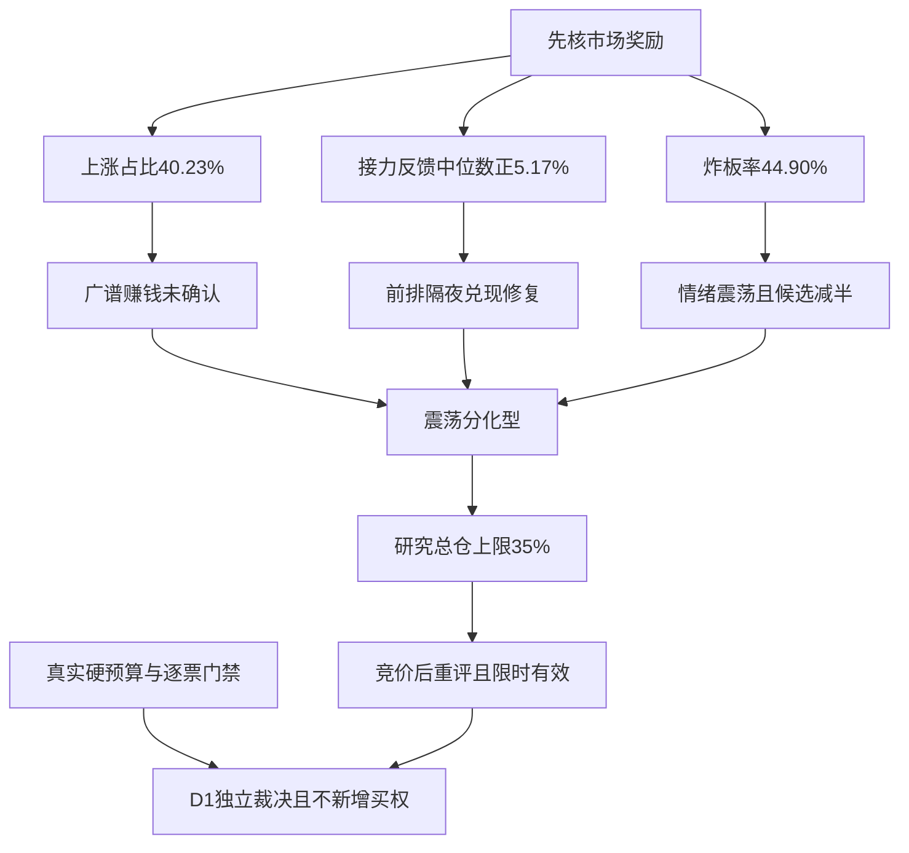

# 2026年11月10日 · 风格研判

> 国内事实基准为11月9日收盘，外盘另标日期。本轮为真实盘前研究，不是回放预测。数据新鲜度partial，降级交付，置信度0.392。

## 一句话结论

震荡分化型，情绪=震荡；接力修复但封板差，研究总仓上限35%，竞价后重评，不构成买权。

## 🌊 市场开始为什么付钱

市场的奖励从普跌中的少数幸存，转为前排接力的隔夜修复，但尚未扩散到大多数股票。11月9日全市场5573只有日线记录的股票，2242家上涨、3148家下跌、183家平盘，上涨占比40.23%，中位数仍跌0.31%。相较上一交易日758家上涨，广度确有改善；跌超5%的样本由395家降至35家，涨超5%的由79家增至231家，深跌尾部明显收缩。不过，全市场成交额从约16716亿元进一步降到14946亿元，缩量10.59%。这说明恐慌缓解并不等于新增风险资金已经充分入场，多数股票仍未赚钱。

更有辨识度的是前日涨停池。11月6日的32只收盘涨停股，在11月9日全部匹配到日线，开盘溢价均值+4.06%、中位数+4.78%，收盘反馈均值+4.17%、中位数+5.17%，21只收盘正收益、2只跌超5%。与此前84只涨停池收盘中位数-1.74%对照，接力兑现恢复是本轮最硬的积极证据。但开盘至收盘均值只有+0.24%，意味着相当一部分收益在开盘前已经兑现。昨日持有人获得溢价，不等于今天追买者还能获得同样回报，更不等于所有中位跟风都得到市场奖励。

收盘54只涨停、1只跌停，说明封板数量增加、极端下杀减少；与此同时，44只触板后收盘未封，炸板率为44÷98=44.90%，封板率仅55.10%。54只封板中，29只曾开板后回封，25只未开板，不能把25只误认为全部收盘封板。非ST梯队是6板1只、2板8只，最高高度上移，却存在明显中间层断层。机会与脆弱性都集中在前排，不能用最高板把断层和高炸板率抹掉。因此，本轮明确标记情绪=震荡，并把下游候选数量上限减半；这不是停止研究，也不是把来源砍半。

## 🌡️ 风格判断与研究仓位

五档中，本轮取“震荡分化型”。54只涨停、6板确实超出了该档20至40只涨停的示例，因而这是基于经济含义的裁量，不冒充完整阈值命中。“连板情绪型”要求炸板率低于20%，显然不成立；“崩溃退潮型”要求更高炸板率并伴随指数明显下跌，也不成立；“主线扩散型”需要被认证的梯队合力，而不是只看涨停增加。上证涨0.32%，深成和创业板均跌约0.27%，八条宽基四涨四跌，各自成交额都收缩。结合个股多数下跌、量能不足和高炸板，本轮更接近修复中的分化，而非全面进攻。

情绪分72，仅描述11月9日。沿用现有规则原公式，涨停强度贡献36分，连板高度15分，封板项11.02分，三指数项9.63分，合计71.65后取整。原公式没有直接纳入广度、跌停与真实涨停池反馈，因此72分不是次日看涨概率，也不是自动加仓理由。情绪周期以真实开盘溢价+4.0611%重新计算，仍为高位震荡：54只涨停与44.90%炸板触发高位钝化条件。上游预计算把缺失溢价填为-0.5%，本轮没有沿用该默认值，也未继承算法输出中固定的阶段打法。

本次研究总仓上限为35%，态度是降级，而非全局不进。支持保留研究空间的是接力反馈显著转正、深跌样本收缩，以及最新隔夜外部风险偏好修复；限制仓位的是上涨不到半数、继续缩量、炸板接近一半及梯队断层。35%是本次事实下的审慎裁量，不是经过回测认证的最优值，也不是立即调仓指令。本轮没有取得可认证的用户或账户当日硬预算，相关字段保留未知；未知不能抬为正额度，真实停买、有效零预算、仓位硬上限、T+1、人工确认和R6逐票否决全部原样生效。研究上限与硬预算不得互相冒充。

这一建议从真实生成时刻生效，竞价结束后必须用新证据重评，最迟09:30失效，不自动续期。上涨占比持续超过50%、昨日涨停反馈保持正值、封板率回到65%以上且有核心资金共振，是启动提高研究上限重评的条件，不是自动买入按钮；炸板升至50%以上、跌停达到20家、或涨停池反馈中位数低于-3%，则触发降档重评，必要时另形成有时限的市场性零建议。本轮并未形成市场性零仓，也未从旧计划或旧研究无限继承停买。

## 🧭 三十日六簇揭示了什么

22个同花顺风格板块与20只固定ETF全部进入研究，收益窗口为9月21日至11月9日的30个A股交易日，按每日收盘相对前收计算价格收益，以一减Pearson相关系数作为距离，用平均连接层次聚类切为六簇。外盘不混入42项聚类，而按各自30个原生交易观测另算。ETF在本文用E01至E20编号，机读文件保留代码映射，作用是测量风格，不是推荐具体方向。

最大的一簇仍有36项，完整样本平均30日收益-15.88%，当日均值仅+0.25%。这个结果说明，大部分工具仍受共同风险因子支配，单日回补尚未推翻月度弱势。同花顺热股当日涨1.50%、高贝塔涨1.27%、近端次新涨1.99%，而百日新高跌0.23%、创历史新高跌1.16%、行业龙头跌0.44%。市场当日奖励更接近弹性回补与接力修复，不是对所有历史强势或龙头标签一视同仁。昨日资金前十与成交前十仍分别跌1.11%和0.30%，不能拿昨天拥挤的位置替代今天真实承接。

第二簇包含昨日打二板以上与S17。前者完整30日涨41.89%、当日涨2.15%；S17在窗口内缺10月14日、10月20日、11月5日、11月6日和11月9日，最新只到11月4日，故完整30日收益和当日收益都保留未知。该簇的当日表现只有一个可观测成员，不能说两项同时走强。第三簇昨日非ST二板完整30日涨31.15%，当日却跌1.09%，再次提示较强历史收益并不保证当天接力成功。动态风格指数存在成分更换、权重及不可成交性问题，它与真实前日涨停池的统计不是同一件事。

其余三簇分别只有E10、E16、E18。E10的30日收益+5.99%、当日+0.91%；E16的30日收益-3.20%、当日+3.42%；E18的30日收益+7.82%、当日-0.71%。相对抗跌、单日修复与历史累计领先不能混为一谈。20只ETF逐项结果保留在附表，不按表现挑掉落后样本。41项具有完整30日收益，S17只按25个有效重叠日期参与相关计算，没有填零、前填或后填；剔除它后重新切六簇，完整样本的成对同簇关系一致率为100%。这只是本次缺项敏感性检查，不是样本外预测稳定性的认证，六簇更不是六条产业主线。

## 🌍 外盘修复与宏观坐标的边界

实时重拉的国际日线存在可见时差：亚太最新到11月9日，恒指跌0.13%，韩国综合跌0.81%，日经涨2.33%；美股日线和固定14项股票观察篮子仍只到11月6日，定日重查仍为空。不能把旧美股日线写成昨夜行情。本轮另外核对今日凌晨收盘快讯：道指涨2.15%、标普涨2.34%、纳指涨2.77%。这为隔夜风险偏好修复提供方向证据，但快讯内容来源字段是sina，文件名不能证明财联社原发，也不能拿同文件多篇转载凑多独立源；这些数字不拼接进旧日线形成30日收益。

同批收盘快讯称，国际原油两项基准分别跌4.38%和5.85%，美元指数跌0.63%。风险资产上涨、油价与美元回落，与风险溢价缓和相容，却不足以单独确认软着陆或降息。国内金、铜、油主力连续30个原生观测的收盘动量分别为-6.93%、-3.76%、-13.32%；它们并非国际现货，换月及币种差异会影响解释。FXCM黄金与离岸人民币最新标签为11月8日，30观测动量分别为-0.73%和-0.50%，周日标签和供应商日界线未独立认证，不当11月9日隔夜收盘。软着陆、降息预期、衰退三档机制都保留未确认，不能为了给出宏观故事而补造增长或利率定价证据。

当日fetch的腾讯备用闭市快照另报标普+2.35%、纳指+2.74%、道指+2.15%，与新闻方向一致，但前两项有细微来源差异。本轮分源保留，不混算、不挑数求一致，不把HTTP最新点补进Tushare旧历史序列。E12另存原值和源日期；日韩虽有11月9日观测，市场日历新鲜度未独立认证。

## 🗣️ 文本与独立反证

五个群共407条、公众号83篇均可读，主量化并未因辅助源缺失停摆。但重点群71条中没有符合昨夜、长文本和方向关键词要求的合格方向句，不能把盘中聊天冒充昨夜KOL判断。其他群八条符合时间与关键词的长文包含重复推广和复盘转发，热闹不等于八个独立共识。公众号复盘的缩量轮动、脉冲后承接不足，与本轮量化分化相容，观点仍只是交叉材料，不升级为已发生的资金净流入。

主线数量保留未知。实时概念接口有20行，原始满足up_nums不低于8的代理为11，但20行全部出现up_nums大于cons_nums，字段语义和范围未经认证，不能把11直接写成主线数量，也不能因此写无主线。R2须独立确认主线；R1不把六簇替代板块合力。XTick交叉为57涨停、2跌停、45炸板、6板，与Tushare数量有范围差异，方向上同为修复与高分歧并存；其zbl字段30.3不等于按45和57计算的炸板率，本轮不采该字段。辅助差异降低置信度，但不独立触发全局禁买。

- **大资金意图**: 从价格与成交结果只能提出“缩量环境中集中前排兑现、同时保留相对抗跌敞口”的假设，不能断言净流入或机构身份；需要R7用实际资金数据验证。
- **为什么走强**: 接力隔夜溢价、深跌尾部缩小和外部风险偏好回升支持修复，但成交额与广度尚未共振，因此只能解释局部走强，不能解释为全面主升。
- **逻辑够不够硬**: 广度、真实涨停池和梯队有可复核观测，Tushare与XTick方向交叉；主线合力、最新外盘完整日线与KOL方向仍不足。若竞价与盘中新广度、反馈、封板率反向，本判断必须重评，不能靠叙事续命。

## 关键证据

E01至E04记录全市场涨平跌、涨停炸板分母、前日涨停池三种收益口径与八宽基。E05保存六簇和42项逐日收益矩阵；E06、E07分别保存各外盘业务日期及金铜油汇原生窗口；E08、E09披露文本资格与主线代理异常；E10披露XTick范围差异；E11仅引用闭市快讯补充最新隔夜方向。原始抓取时间与事实时点在JSON分别记录，不以流水线启动时刻替代行情时刻。

## 📋 样本覆盖附表

下表仅为风格测量审计，单位为百分比，不是板块或ETF推荐。未知不填零。每项均为研究观察，in_today_plan未知；R1不产生个股候选，逐票板型、龙头认定、盈亏比和禁止清单不在本职责内，不能把样本表升级为执行池。

| 编号 | 测量对象 | 有效日数 | 30日收益% | 当日收益% | 簇 |
|---|---|---:|---:|---:|---:|
| S01 | 百日新高 | 30 | -12.93 | -0.23 | 1 |
| S02 | 同花顺热股 | 30 | -29.63 | +1.50 | 1 |
| S03 | 创历史新高 | 30 | -15.53 | -1.16 | 1 |
| S04 | 行业龙头 | 30 | -3.32 | -0.44 | 1 |
| S05 | 近端次新股 | 30 | -18.33 | +1.99 | 1 |
| S06 | 百元股 | 30 | -29.52 | +0.99 | 1 |
| S07 | 昨日资金前十 | 30 | -29.74 | -1.11 | 1 |
| S08 | 昨日成交前十 | 30 | -41.72 | -0.30 | 1 |
| S09 | 昨日高振幅 | 30 | -22.70 | +0.60 | 1 |
| S10 | 沪股通成交前十 | 30 | -21.54 | +0.60 | 1 |
| S11 | 深股通成交前十 | 30 | -37.15 | +0.61 | 1 |
| S12 | 高贝塔值 | 30 | +1.88 | +1.27 | 1 |
| S13 | 昨日打板表现 | 30 | +5.58 | +3.15 | 1 |
| S14 | 昨日打首板表现 | 30 | +8.29 | +3.82 | 1 |
| S15 | 昨日打二板以上表现 | 30 | +41.89 | +2.15 | 2 |
| S16 | 昨日非ST二板表现 | 30 | +31.15 | -1.09 | 3 |
| S17 | 昨日非ST三板以上表现 | 25 | 未知 | 未知 | 2 |
| S18 | 增发预案指数 | 30 | -17.19 | +0.41 | 1 |
| S19 | 增持计划 | 30 | -8.21 | -0.12 | 1 |
| S20 | 减持计划 | 30 | -11.90 | +0.46 | 1 |
| S21 | 回购计划 | 30 | -11.01 | +0.02 | 1 |
| S22 | 业绩扭亏 | 30 | -25.76 | -0.68 | 1 |
| E01 | E01号ETF | 30 | -9.86 | +0.15 | 1 |
| E02 | E02号ETF | 30 | -2.22 | +0.24 | 1 |
| E03 | E03号ETF | 30 | -15.56 | -0.26 | 1 |
| E04 | E04号ETF | 30 | -15.50 | -0.23 | 1 |
| E05 | E05号ETF | 30 | -23.91 | +0.08 | 1 |
| E06 | E06号ETF | 30 | -41.34 | +1.98 | 1 |
| E07 | E07号ETF | 30 | -24.55 | +0.12 | 1 |
| E08 | E08号ETF | 30 | -25.55 | +0.00 | 1 |
| E09 | E09号ETF | 30 | -4.73 | -0.30 | 1 |
| E10 | E10号ETF | 30 | +5.99 | +0.91 | 4 |
| E11 | E11号ETF | 30 | +4.56 | -0.76 | 1 |
| E12 | E12号ETF | 30 | -11.03 | +1.08 | 1 |
| E13 | E13号ETF | 30 | -8.14 | -0.39 | 1 |
| E14 | E14号ETF | 30 | -9.94 | -1.87 | 1 |
| E15 | E15号ETF | 30 | -11.85 | -1.68 | 1 |
| E16 | E16号ETF | 30 | -3.20 | +3.42 | 5 |
| E17 | E17号ETF | 30 | -15.88 | +0.62 | 1 |
| E18 | E18号ETF | 30 | +7.82 | -0.71 | 6 |
| E19 | E19号ETF | 30 | -27.69 | +0.12 | 1 |
| E20 | E20号ETF | 30 | -8.21 | -1.14 | 1 |

## 数据源审计

| 源 | 日期 | 状态 | 备注 |
|---|---|:--:|---|
| fetch_manifest | 2026-11-10 | 🟢 | 1项/条；已实读或实调 |
| mcp_health | 2026-11-10 | 🟢 | 1项/条；全局severity=2；R1实际Tushare实调成功，其他服务状态不自动转为禁买 |
| tushare.market | 2026-11-10 | 🟢 | 5573项/条；已实读或实调 |
| tushare.ths_daily | 2026-11-10 | 🟡 | 22项/条；S17缺5日，最新11月4日；定日重查仍空 |
| tushare.fund_daily | 2026-11-10 | 🟢 | 20项/条；已实读或实调 |
| tushare.index_global/us_daily | 2026-11-10 | 🟡 | 19项/条；美股仅至11月6日，11月9日重查为空；两外盘指数空。亚太最新11月9日 |
| tushare.fx_daily/fut_daily | 2026-11-10 | 🟡 | 5项/条；期货11月9日；金汇FXCM标签11月8日，不能认证最新隔夜；两国际油价日线及美元指数缺失 |
| xtick.market_emotion | 2026-11-10 | 🟢 | 1项/条；范围与Tushare不同，采用Tushare主口径；zbl字段不直接采用 |
| wechat_official_20 | 2026-11-10 | 🟢 | 83项/条；已实读或实调 |
| wechat_cli_5groups | 2026-11-10 | 🟢 | 407项/条；五群可读，但重点群无合格昨夜长方向句，观点不能强补 |
| news_cls | 2026-11-10 | 🟢 | 2219项/条；内容src=sina；文件名不证明财联社原发，转载独立性受限 |
| overseas_snapshot | 2026-11-10 | 🟡 | 1项/条；已实读；腾讯备用有11月9日美股闭市快照，与新闻涨幅略有差异；历史日线缺口仍在，整体degraded |

## 不确定性 / 反证

置信度按既有三因子契约计算：0.70×0.7×0.8=0.392。市场主量化可得，但部分风格日线、美股最新序列、金汇日界线、主线代理和重点KOL方向仍有缺口，故新鲜度取partial；Tushare与XTick为双源方向交叉，不把公众号和同源转载叠加成三源。这是资料覆盖和判断置信度，不是禁止交易的质量闸门。最强反证是隔夜外部修复若传导为国内放量、广度与封板率同步改善，本轮分化判断可能过于谨慎；相反，若前排溢价开盘兑现后快速流失，35%仍可能偏高。因此限时重评比无条件沿用一个比例更重要。

## 与其他 R/D/E 的关系

本轮依赖当日fetch清单、健康检查、公众号和群消息，只将上游emotion_cycle作为口径对照并以真实溢价重算，未改写上游。R2接收风格、未知主线数量与候选减半要求，仍须覆盖真实研究对象；R3按对应基准日对齐情绪分；R5和R7按D1所选主模板及实际证据取权，不把五种打法合成一套。R6保留独立逐票硬否决。D1核真实预算、窗口和逐票门禁后独立形成计划；首次计划前in_today_plan未知，不能预设false排除本批研究。E1复盘应对齐11月9日的状态描述与11月10日的待验证假设，不拿72分当方向预测。

## Sub-Agent 元数据

- skill: analyze_style_v1@1.2
- artifact: data/research/20261110/R1_style.json
- model: gpt-6.1-sol
- 生成耗时: 471秒（从本轮真实启动至产物读回校验）。
- 执行方式: 本会话唯一研究者，既有API与确定性辅助计算；未启动其他模型、Hermes CLI或delegation。
- 资源与时点: 08:30仅观察性交付目标；token用量未知，不当0，不保证低于努力目标；未改变任何交易授权与保护。
