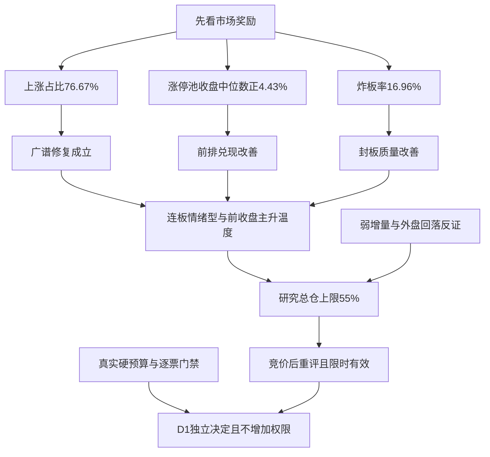

# 2026年11月11日 · 风格研判

> 国内基准为11月10日收盘，最新隔夜另标日期。本轮真实盘前取证，不是回放预测；数据新鲜度partial，降级交付，置信度0.392。

## 一句话结论

连板情绪型，前收盘主升温度；广度与接力修复，研究总仓上限55%，竞价后重评，不构成买权。

## 🌊 先看市场在为什么付钱

市场已经不再只奖励少数幸存的前排。11月10日，5573条股票日线中4273家上涨、1149家下跌、151家平盘，上涨占比76.67%，涨跌幅中位数+1.31%。相比上一交易日2242家上涨、中位数-0.31%，这是真实的广度扩张；涨幅至少5%的样本由231家增至468家，跌幅至少5%的由35家降至9家，尾部亏钱效应继续收缩。全市场成交额约15167亿元，较前日增加1.48%，但没有出现与广度相匹配的大幅放量。市场奖励修复已经成立，增量资金驱动的持续全面进攻却仍需要证据，不能把两者合为一个结论。

接力的证据同样比前日扎实。前日54只收盘涨停股全部匹配到当日日线，开盘溢价均值+4.11%、中位数+3.61%，收盘反馈均值+4.91%、中位数+4.43%；其中48只收盘正收益，没有跌幅至少5%的样本。开盘至收盘均值为+0.87%，较前日+0.24%改善，说明日内承接也有修复。不过，主要优势依然在开盘前兑现，隔夜持有者的收益不等于今日新买者的可得收益。R1认可的是已经发生的奖励结构，不是授权任何位置追价，更不把没有地位的跟风提升为核心。

非ST主口径93只收盘涨停、0只跌停、19只触板后收盘未封，炸板率19除以112为16.96%，封板率83.04%。93只涨停里36只曾开板回封、57只未开板，不能把57只当作全部封板。最高7板，2板15只、3板4只，梯队的低层确有增厚，但4至6板仍断层。与前日44.90%的炸板率相比，封板质量有实质改善；本轮不满足炸板率达到35%的候选减半条件，不能把旧条件无限续期。若盘中新炸板率重新达到35%，则须明确改标情绪=震荡/主跌并把下游候选上限减半，不是减少研究来源或停止研究。

## 🌡️ 风格、温度和有限期研究上限

本轮完整命中“连板情绪型”：高度7板不低于6板、涨停93家不低于50家、炸板16.96%低于20%。情绪周期使用真实开盘溢价+4.11%重算为主升，但这个标签只描述11月10日收盘的温度，不是11月11日已经发生的行情。原算法含有固定阶段打法的动作句，本轮没有沿用。既有情绪原公式四项贡献为40、17.50、16.61、14.00分，合计88.11后取整为88，仅表示基准日热度；公式没有直接包含广度、跌停或涨停池兑现，因此这些因素单列，不能拿88分替代风险判断。

指数结构解释了为什么不能因热度上升就把风险推满。上证涨0.08%、深成涨0.86%、创业板涨1.46%；八条宽基七涨一跌，上证50跌0.58%，中证1000涨1.22%。大权重和高弹性之间出现收益差异，市场并非无差别买入所有“龙头”标签。上证成交额下降1.26%，创业板下降1.43%，中证1000上升5.00%，也说明资金承接并不均匀。指数金额相互重叠，不能加总成所谓全市场资金流入；上涨与成交也不能直接识别机构身份。

本次研究总仓上限为55%，态度是观察，不设全局市场性禁买。广度扩张、亏损尾部收缩、接力正反馈以及83.04%的封板率，支持恢复研究风险空间；量能仅小增、权重偏弱、梯队断层，以及最新外盘转跌，又不支持不加区别地放大敞口。55%是这些本轮事实下的审慎裁量，不是回测认证最优值，也不是仅因情绪分超过80就机械套表。它不沿用昨日35%，更不从旧计划零预算推导为零仓。本轮读到用户签署文件中的静态总仓80%、单票15%、单方向40%、最多5只硬上限，但没有取得可认证的当日账户有效预算或停买状态，后两者仍未知，未知不能抬成正额度。真实停买、有效零预算、T+1、人工确认、既有授权与R6逐票硬否决全部独立生效。

这一研究建议从真实生成时刻起适用，竞价结束后必须重评，最迟09:30失效，不自动延长。若上涨占比保持60%以上、涨停池反馈持续为正、封板率维持75%以上并有实际增量资金确认，交D1重评上限；这些不是自动开仓按钮。若涨停反馈转负或中位数低于-3%、炸板率达到35%、跌停达到20家、上涨占比跌破50%，则触发降档重评，必要时另形成有事实来源、适用时段和失效条件的市场性零建议。本轮未形成市场性零仓，不修改任何交易权限，也不是要求一次性调仓。

## 🧭 三十日六簇：热度修复并未抹去月度风险

22项固定同花顺风格测量与20只固定ETF全部覆盖，收益窗口是9月22日至11月10日的30个A股交易日。按逐日收盘相对前收计算价格收益，以一减Pearson相关系数为距离，用平均连接层次聚类切为六簇。41项有完整30日收益；S17缺6日，最新只到11月4日，本轮定日重查仍空，所以该项完整30日收益与当日收益都保留未知。为保留42项研究覆盖，相关计算只使用真实共同观测，最少24日即窗口80%，没有填零、前填或后填；再剔除S17，用41项完整样本重切六簇，成对同簇关系一致率100%。这说明本次缺项没有改变完整样本的关系，不说明样本外预测稳定，也不说明S17拥有完整窗口。

最大簇有35项，完整30日平均收益仍为-15.95%，当日均值+1.73%。这意味着广泛回补与月度共同风险可以同时成立，单日强不能抹去前期回撤。同花顺热股当日+4.31%、高贝塔+4.24%、创历史新高+6.73%，行业龙头标签只有+0.36%，百日新高+1.91%。市场更奖励热度、弹性和部分新高表现，而不是对“龙头”三个字不加区分地付钱。新高和弹性回补是否能持续，还要用下一轮实际溢价、承接和资金确认，不能从指数标签倒推个股地位。

第二簇是昨日打二板以上与S17，前者完整30日+47.05%、当日+9.98%；S17当日未知，该簇当日均值仅一个可观察成员，不能说两项同时走强。第三簇只有昨日非ST二板，30日+31.19%、当日+5.45%，与真实涨停池回报同向，但动态风格指数会换成分，且不可直接成交，不是可复制的策略净值。第四簇E09和E18当日平均-0.24%，第五簇E10为+0.45%，第六簇E16为-2.07%。历史相对抗跌、当天走强与持续主线是不同层次，不能把六簇命名为六条产业主线。

20只ETF没有按表现筛掉落后者，逐项结果列于覆盖附表；正文使用固定编号，代码仅在JSON作可复算映射，不推荐具体产业方向。42项中35项当日上涨、6项下跌、1项缺失，这只是固定风格篮子的广度，不能取代全市场76.67%的股票上涨比例。ETF收益不提供份额、净值或真实申赎证据，不据此编造净流入。风格板块名称是用户指定的测量标签，不是R2产业主线推荐，本轮不输出任何个股。

## 🌍 外部风险从助攻变为约束

最新隔夜与国内基准日必须分开。Tushare实时历史里，美股指数和14项匿名固定股票篮子只到11月9日，最新定日重查仍为空；亚太指数已到11月10日，恒指+0.44%、韩国综合+4.39%、日经+2.87%，日韩独立日历新鲜度未认证。美股旧历史不能冒充11月10日收盘：旧股票篮子当日均值+5.12%，属于此前反弹，不是最新隔夜。各外盘30个原生观测窗口各自保留日期，也不冒充30个A股交易日。

本轮另读当日fetch备用腾讯闭市快照，标普-0.38%、纳指-0.74%、道指-0.30%；凌晨收盘稿同向，sina稿纳指为-0.73%，10jqka稿为-0.74%。微小差异分源保留，不挑一个凑一致，也不把快照最新一点拼到旧日线中形成30日收益。新闻文件名不证明财联社原发，转载也不能堆成多个独立验证。外部从强反弹转为回落，构成国内热度延续的真实反证，但不是因某个数据服务缺失就全局禁买。

金、铜、油的国内主力连续30个原生观测收盘动量分别为-5.86%、-4.28%、-17.34%，最新油价连续合约当日收盘比前收约跌5.36%。它们不是国际现货，主力换月与币种会影响解释；FXCM黄金与离岸人民币最新标签11月9日，30观测动量分别-1.55%、-0.53%，日界线未独立认证，不能写成最新隔夜。最新美元指数闭市稿则报上涨0.56%、收102.230，偏鹰新闻只能作为风险线索。本轮没有官方增长、就业原表或利率期货定价，软着陆、降息预期、衰退三档宏观机制均未确认，不能把油价下跌直接讲成衰退，也不能机械续讲降息。

## 🗣️ 文本交叉与逻辑强度

五群494条、公众号84篇全部可读；重点群32条中，没有满足昨夜时段、长文本和方向关键词的合格方向句，盘中转述的大额资金数字不能冒充昨夜KOL意见。公众号收评一方面记录多数股票上涨，另一方面提示存量轮动、前排辨识度集中和后排承接偏弱，属于对量化判断的有用反证，不应只摘乐观标题。观点和复盘文章不升级为本轮实际资金净流入。

主线数量保留未知。概念接口20行全部出现up_nums大于cons_nums，原始满足up_nums不低于8的代理为20，字段语义异常，不能把20认证为主线数量，也不能转而写无主线。R2仍须独立核产业合力。XTick交叉给95涨停、0跌停、19炸板、7板，与主源93涨停存在范围差异，但强度与质量改善方向一致；其zbl为7.02，不等于按95和19计算的炸板率，本轮弃用该比率。资料缺口只降低置信度，不独立形成市场性禁买。

- **大资金意图**: 从广度、成交结构和前日涨停兑现，只能提出风险资金从避险转向高辨识度与高弹性的修复假设，不能确认净流入或机构身份。最大的35项共同风险簇说明风险偏好仍是重要共同因子，资金真实性由R7继续核验。
- **为什么走强**: 已观测的支撑是上涨占比扩张、亏损尾部缩小、真实涨停池正反馈与更好的封板质量；部分热度和新高测量强于大权重标签。没有必要靠未认证的催化故事解释全部上涨。
- **逻辑够不够硬**: 主量化可复核且XTick方向交叉，国内修复不是空话；但量能小增、梯队断层和隔夜反向限制延续性。竞价后广度、反馈或封板率反向，就必须重评55%的研究建议，不用高情绪分为旧结论续命。

## 关键证据

E01至E04依次保存全市场广度、触板分母与梯队、前日涨停池三种收益口径、八宽基。E05保存42项逐日收益及六簇，E06与E07分别记录外盘各自业务日和金铜油汇窗口，E08披露文本资格，E09保留主线代理异常，E10保存XTick范围差异，E11和E12分存最新闭市稿与备用快照。不以流水线启动时刻、文件抓取时刻代替行情事实时刻。

## 📋 样本覆盖附表

以下都是风格测量，不是执行池；未知不填零。全部in_today_plan未知，本轮不因D1首次计划尚未形成而预先排除样本。无个股推荐，逐票板型、龙头认定、盈亏比和禁止清单不适用于本测量表，不能把它升级为开仓资格。

| 编号 | 测量对象 | 有效日数 | 30日收益% | 当日收益% | 簇 |
|---|---|---:|---:|---:|---:|
| S01 | 百日新高 | 30 | -13.65 | +1.91 | 1 |
| S02 | 同花顺热股 | 30 | -27.77 | +4.31 | 1 |
| S03 | 创历史新高 | 30 | -11.48 | +6.73 | 1 |
| S04 | 行业龙头 | 30 | -4.02 | +0.36 | 1 |
| S05 | 近端次新股 | 30 | -17.48 | +1.72 | 1 |
| S06 | 百元股 | 30 | -28.49 | +1.95 | 1 |
| S07 | 昨日资金前十 | 30 | -29.34 | +2.35 | 1 |
| S08 | 昨日成交前十 | 30 | -41.35 | +1.81 | 1 |
| S09 | 昨日高振幅 | 30 | -22.12 | +2.95 | 1 |
| S10 | 沪股通成交前十 | 30 | -22.59 | +0.24 | 1 |
| S11 | 深股通成交前十 | 30 | -35.46 | +2.36 | 1 |
| S12 | 高贝塔值 | 30 | +3.94 | +4.24 | 1 |
| S13 | 昨日打板表现 | 30 | +6.39 | +4.04 | 1 |
| S14 | 昨日打首板表现 | 30 | +9.61 | +4.14 | 1 |
| S15 | 昨日打二板以上表现 | 30 | +47.05 | +9.98 | 2 |
| S16 | 昨日非ST二板表现 | 30 | +31.19 | +5.45 | 3 |
| S17 | 昨日非ST三板以上表现 | 24 | 未知 | 未知 | 2 |
| S18 | 增发预案指数 | 30 | -16.59 | +2.26 | 1 |
| S19 | 增持计划 | 30 | -8.52 | +1.50 | 1 |
| S20 | 减持计划 | 30 | -11.66 | +2.20 | 1 |
| S21 | 回购计划 | 30 | -10.02 | +2.51 | 1 |
| S22 | 业绩扭亏 | 30 | -25.88 | +1.97 | 1 |
| E01 | E01号ETF | 30 | -10.26 | +0.12 | 1 |
| E02 | E02号ETF | 30 | -3.70 | -0.62 | 1 |
| E03 | E03号ETF | 30 | -15.27 | +0.88 | 1 |
| E04 | E04号ETF | 30 | -15.15 | +1.06 | 1 |
| E05 | E05号ETF | 30 | -23.56 | +0.75 | 1 |
| E06 | E06号ETF | 30 | -40.31 | +2.91 | 1 |
| E07 | E07号ETF | 30 | -23.77 | +1.20 | 1 |
| E08 | E08号ETF | 30 | -24.81 | +1.29 | 1 |
| E09 | E09号ETF | 30 | -5.90 | -0.20 | 4 |
| E10 | E10号ETF | 30 | +5.96 | +0.45 | 5 |
| E11 | E11号ETF | 30 | +0.52 | -0.51 | 1 |
| E12 | E12号ETF | 30 | -12.41 | -0.19 | 1 |
| E13 | E13号ETF | 30 | -7.94 | +0.39 | 1 |
| E14 | E14号ETF | 30 | -9.76 | +0.82 | 1 |
| E15 | E15号ETF | 30 | -11.61 | +0.49 | 1 |
| E16 | E16号ETF | 30 | -7.64 | -2.07 | 6 |
| E17 | E17号ETF | 30 | -15.67 | +0.07 | 1 |
| E18 | E18号ETF | 30 | +6.53 | -0.28 | 4 |
| E19 | E19号ETF | 30 | -27.31 | +0.96 | 1 |
| E20 | E20号ETF | 30 | -10.84 | +1.24 | 1 |

## 数据源审计

| 源 | 日期 | 状态 | 备注 |
|---|---|:--:|---|
| fetch_manifest | 2026-11-11 | 🟢 | 1项/条；severity=2不是市场禁买信号 |
| mcp_health | 2026-11-11 | 🟢 | 1项/条；Tushare和XTick本轮实际可用；其他服务缺口不触发全局禁买 |
| tushare.daily/limits/ladder/index | 2026-11-11 | 🟢 | 5573项/条；日线全市场5573条，93只主口径收盘涨停；日历确认11月11日开市 |
| tushare.ths_daily | 2026-11-11 | 🟡 | 22项/条；S17窗口缺6日，最新11月4日；定日重查空，不填补 |
| tushare.fund_daily | 2026-11-11 | 🟢 | 20项/条；固定20项均有完整30日收益 |
| tushare.index_global/us_daily | 2026-11-11 | 🟡 | 19项/条；五指数和14股票篮子可用；美股历史至11月9日，最新定日重查空；两指数空 |
| tushare.fx_daily/fut_daily | 2026-11-11 | 🟡 | 5项/条；三境内主力连续至11月10日；金汇FX至11月9日，日界线未认证；美元指数与国际油价历史缺失 |
| xtick.market_emotion | 2026-11-11 | 🟢 | 1项/条；先用紧凑日期报解析错，再用ISO日期成功；涨停95与主源93范围差异；zbl不用作炸板率 |
| wechat_official_20 | 2026-11-11 | 🟢 | 84项/条；只摘要情绪，不输出具体产业或股票 |
| wechat_cli_5groups | 2026-11-11 | 🟢 | 494项/条；五群可读；重点群无合格昨夜长方向句 |
| overseas_snapshot | 2026-11-11 | 🟡 | 1项/条；美股最新指数由腾讯备用补充，历史股票仍滞后，不把fetch时间当行情时间 |
| news_cls | 2026-11-11 | 🟢 | 2688项/条；src混合sina/10jqka；凌晨收盘稿补方向，不以文件名认证财联社原发 |
| tushare.limit_cpt_list | 2026-11-11 | 🟡 | 20项/条；20行全出现up_nums>cons_nums，主线代理留未知 |

## 不确定性 / 反证

置信度按0.70×0.7×0.8=0.392记录。主量化本轮重拉成功，双源对热度改善一致但范围有差异；部分风格缺日、最新外盘历史、金汇日界线、主线数量和重点KOL方向仍不足，故降级交付，不是给市场打质量禁买分。最强反证有两个方向：若国内在外盘回落后仍能放量、广度和兑现共振，本轮55%可能过谨慎；若高开兑现后涨停池反馈转负，且封板迅速恶化，55%也可能偏高。所有反证须交现有决策者重评，发现机会不自动买入，旧判断也不能替代重评。

## 与其他 R/D/E 的关系

R2消费本轮风格、未知主线数量与有限期研究上限，仍需独立覆盖和确认主线，不把六簇当产业地图。R3对齐11月10日的88分基准，不把它当今日预测。R5、R7按后续选定的一套主模板取证，不把五种打法焊在一起。R6保留唯一实质逐票硬否决权；D1核真实硬预算、有效窗口与逐票门禁再形成计划。E1区分已观测的国内修复和11月11日待验证的承接，研究建议不产生买权。

## Sub-Agent 元数据

- skill: analyze_style_v1@1.2
- artifact: data/research/20261111/R1_style.json
- model: gpt-6.1-sol
- 执行方式: 本会话唯一阶段研究者；实时API与确定性辅助，没有Hermes CLI、delegation或其他模型会话。
- 资源与时点: 08:30仅观察性交付目标；token用量未知，不当0，不保证低于努力目标；实际生成时刻见frontmatter。
