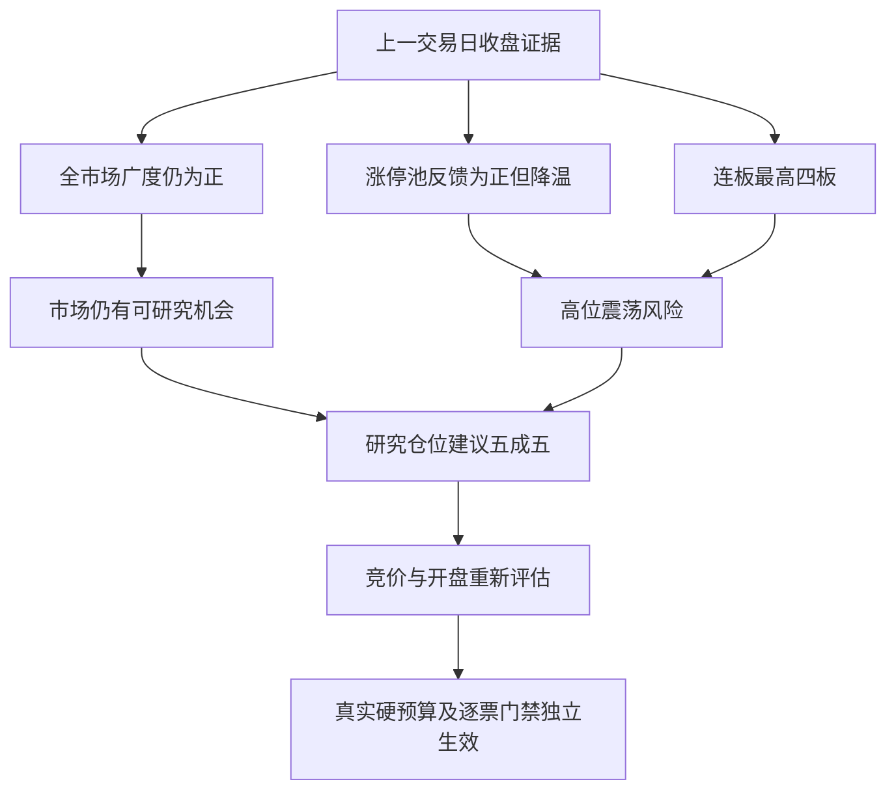

# 2026年11月12日 · 风格研判

> 数据源新鲜度：partial；降级交付；置信度：0.68。国内市场基准为2026年11月11日收盘，本报告不把昨日状态写成今日已发生行情。

## 一句话结论

主线扩散型，情绪周期为高位震荡；市场仍有研究机会，研究仓位上限55%，竞价重新评估。

## 🌊 先认市场：市场仍在付钱，但奖励已经变得挑剔

昨天不是普遍亏钱的一天。全A有日线记录的5574只股票中，3538只上涨、1827只下跌、209只持平，上涨占比63.47%，涨跌幅中位数为正0.59%。非ST口径收盘涨停85家、跌停零家，前一日涨停池的收盘反馈也为正。这些事实说明市场上存在可研究的机会，不能因辅助数据不齐而宣布全局不交易。

但上涨并不等于扩散加速。前一交易日有4273只上涨，上涨占比76.67%；昨天涨停数从93家回落到85家，最高连板从七板降到四板，而日线成交额合计增加11.34%。量能增加、上涨覆盖反而缩小，说明新增交易更集中，不能理解成所有股票都获得了相同承接。上证上涨0.46%、创业板指上涨3.11%，两者的差异也提示：指数修复的力度并不均匀，不能用一个强指数掩盖全市场结构。

本轮五选一归为主线扩散型，是因为四板高度之下仍有完整梯队：首板66家、二板12家、三板5家、四板2家。85家涨停超出技能表30至50家的示例区间，因此这不是全部条件精确命中的结论，而是沿用既有规则的扩展边界归类。主线数量只给“三主线以上”的粗代理：强度榜覆盖20项，均达到既有涨停数阈值，但概念高度重叠，绝不是确认了20条独立主线。真实主线、持续性和次日预期由R2独立核验，R1不输出具体题材。

## 🔥 赚钱效应：有正反馈，不能把降温写成不赚钱

昨天19家触板后未封住，炸板率为19除以85加19，即18.27%，对应封板率81.73%。收盘涨停的85家中，45家曾开板后回封，40家未曾打开。未开板的40家只是其中一部分，不能被拿来替代全部收盘封板数，也不能据此夸大炸板率。

更重要的是实际接力反馈。前一日93家非ST收盘涨停股票，昨天93家全部匹配到行情，开盘平均溢价为正2.01%、中位数为正0.85%，收盘平均反馈为正2.92%、中位数为正2.79%。其中64家收盘上涨，28家下跌，另有1家持平，4家收盘亏损至少5%。这既否定了“打板普遍不赚钱”的笼统描述，也说明平均正收益背后仍有明显尾部风险。开盘溢价较此前一轮观测的正4.11%下降，收盘反馈也从正4.91%下降，接力赚钱效应确实在放缓。

上游预计算情绪周期曾把缺失溢价填为负0.5%。本轮拦截该数值作为实测证据，用真实开盘均值正2.01%重算，阶段仍为高位震荡，但理由已经不同：它是高热度中的反馈放缓，不是负溢价下的普遍亏钱。本报告不复制原函数附带的固定打法文字，也不覆盖上游文件。

情绪浓度为85分，严格使用现有原公式：涨停强度40分、连板高度10分、封板承接16.35分、两指数平均表现18.94分，合计85.29后取整。公式中的涨停项在60家封顶，指数项又受到较强指数带动，所以高分不等于广度继续扩张，更不是今日买入信号。亏钱尾部、权重差异和梯队收缩必须单独呈现，不能让单项分数接管仓位或通道。

## 🧭 三十日、六簇：修复明显，趋势确认仍不充分

本轮对22个既定风格板块和20只ETF全部进行了查询。目标窗口为2026年9月23日至11月11日的连续30个交易日，使用同日收益率相关距离与平均连接层次聚类，得到六簇。当前有效样本为21个风格板块加20只ETF，共41个；“昨日非ST三板以上表现”最新记录停在11月4日，窗口内缺7日，Tushare重查与XTick补查都未补齐。本轮没有补零、前值填充，也没有为了凑满42个样本把窗口悄悄退回旧日期。这是明确的覆盖缺口，不是完整42样本验收通过。

六簇并非六条主线。其中35个样本落在同一个大簇，窗口平均累计收益为负14.80%，最后一天平均上涨1.99%；另有一个二板以上表现单样本簇，窗口累计为正44.77%、最后一天为正1.11%，以及一个非ST二板表现单样本簇，分别为正34.09%和正4.23%。其余三簇由四只匿名ETF样本组成，包含两个单样本簇和一个双样本簇。这种分布反映的是共同修复与风格差异，并不证明六条独立、稳定、可以交易的路径。

41个有效样本中，昨天30涨11跌，等权平均上涨1.75%，而窗口累计收益的样本均值仍为负10.84%。资金成交活跃的风格样本当天修复幅度较突出，首板表现为正2.53%，非ST二板表现为正4.23%，但百日新高表现接近持平。市场奖励更接近成交集中后的修复和短线承接，而不是对所有新高形态的普遍认可。滚动成分指数的复利也不是可实际买入组合的收益，不能据累计涨幅授予开仓资格。

- **大资金意图**: 从放量而广度收窄、成交活跃样本修复更强推断，资金更可能在集中恢复风险敞口，而非全面铺开。这里只是基于收益与成交结构的解释，不冒充已核实的资金净流向。
- **为什么走强**: 可核实的支撑是较强指数、正向涨停池反馈与多数样本当日修复；但大簇三十日累计仍为负，不能把一次修复直接升级为持续主升。
- **逻辑够不够硬**: 国内行情事实较硬，资金意图和后续持续性仍需验证。MCP与SDK属于同一供应商，不能算两份独立支持；若竞价承接、市场广度和涨停池反馈同时转弱，本次修复解释就必须降级。

## 🌍 外盘与公开情绪：比较证据，不机械服从温度

本轮新拉取的美国宽基历史和14个匿名美股样本仍止于11月10日，不能拿其最后一天涨跌描述11月11日美股。已运输的外盘快照另有明确标识的HTTP宽基回补，11月11日标普500上涨1.31%、纳指上涨1.60%、道琼斯上涨0.49%；本轮读取了该快照，但没有直接二次核验其HTTP供应商，因此不会把它无缝拼入Tushare三十日收益序列。同期恒生指数下跌0.98%，韩国综合和日经225分别上涨2.60%和1.31%，外部风险偏好并非单一方向。

跨资产月度观察使用同一合约两端收盘价，不拼接主力换月：黄金约负3.56%、铜约负3.89%、原油约负16.03%；离岸人民币报价止于11月10日，三十自然日变化约负0.28%，表示人民币小幅走强。黄金宽窗口请求超时后，已用两端日期补核。美元指数仍无序列。这组变化不足以唯一确定软着陆、降息或衰退，宏观档位保留未知，不从商品表现推导具体股票方向。

连板网运输的公开正文前缀将11月11日标为连续第二天高潮，温度约80.28度，近三日轨迹为修复39度、高潮91度、高潮80度。其同景31次，次日上证上涨率54%，降温去向41%、继续高潮38%。本轮只采纳“升温后存在降温风险”的参照，与广度、涨停数和接力反馈回落进行比较；不把54%当成选票胜率，不把网站温度替换本轮85分。网站高潮标签与独立高位震荡判断保留口径分歧。公开版本是收盘还是盘中估计尚未知，partial保持不变；本轮只读已运输前缀，未声称网页、会员内容或原文件全文已读。

指定群没有合格的昨夜方向长文本。昨日盘中匿名发言里，同时存在修复尚待确认与大票启动的倾向，只能作为弱交叉参考，不能归因为指定KOL昨夜观点。公众号收评对放量修复的描述与行情数据相符，但公众号与行情复述不是额外的独立投票，也不承担选票职责。

## ⚖️ 今日研究边界与反向剧本

本轮态度是“观察”：保留市场研究，不自动全局禁买，也不授予任何个股买权。市场性仓位上限建议为55%，不是账户可用额度，更不是必须立刻调整到55%。正广度、零非ST跌停和正涨停池反馈，使零仓研究建议缺乏足够依据；但广度收窄、最高连板下降和反馈降温，也不足以支持研究上限直接给到80%。55%是这些相互制约证据下的本轮裁决，并非由情绪分或第三方统计机械换算。

建议只在本次盘前证据窗口内有效，竞价形成后必须重评。若广度、正反馈与真实资金承接共同改善，不能无限继承高位震荡；若接力反馈转负、跌停扩散或炸板显著增加，也不能因为昨日修复就坚持原判断。炸板率达到35%时，按既有纪律显式记情绪为震荡或主跌，并由下游将候选数量减半；R1本轮没有个股候选，不做板型、价位、估值或个股盈亏比判断。

真实用户或账户停买、硬预算包括零预算、仓位硬上限、T+1、人工确认和R6逐票硬否决均独立有效。本轮未核实这些账户来源，因此有效交易预算保留未知，不能把55%抬成正额度，也不能把旧计划中的零额度直接抄成市场研究零仓建议。今天做的是核市场奖励、保留研究并准备延续与降温两套剧本；不做的是计划外出手、按单项温度选通道或因高热度跳过逐票门禁。

## 数据源审计

| 源 | 日期 | 状态 | 备注 |
|---|---|:--:|---|
| manifest / mcp_health | 2026-11-12 | 🟢 | 已读；全局severity为2，不据此机械禁买 |
| Tushare日线 / 涨跌停 / 天梯 / 指数 | 2026-11-11 | 🟢 | 实时查询；5574条全A行情，93家前日涨停池全匹配；MCP与SDK同源 |
| 同花顺风格 / ETF | 2026-11-11 | 🟡 | 22加20全部查询；连续30交易日有效41个样本，六簇；一条风格序列缺7日 |
| XTick风格补查 | 2026-11-12 | 🔴 | 备源返回空，未作为正证据 |
| 公众号运输文件 | 2026-11-11 | 🟢 | 88条标题摘要筛选，3篇正文有限投影，非88篇全文已读 |
| 群聊运输文件 | 2026-11-11 | 🟡 | 共496条；指定群相关筛选，无合格昨夜方向文本，不冒充KOL观点 |
| 预计算情绪周期 | 2026-11-11 | 🔴 | 溢价负0.5%为缺失兜底，拦截为观测；R1内用实测正2.01%重算 |
| 外盘历史与当前宽基快照 | 2026-11-11 | 🟡 | 美国历史止于前一日，最新宽基来自明确标识的HTTP回补，未直接二次核验 |
| 黄金 / 铜 / 原油 / 汇率 | 2026-11-11 | 🟡 | 同合约月度端点已核；汇率止于前一记录日，美元指数缺失，宏观档位未知 |
| 连板公开情绪参考 | 2026-11-11 | 🟡 | 仅运输的截取正文，版本未知；不升级partial，不重复加权 |

## 不确定性 / 反证

最强反证不是“数据不够所以不做”，而是放量修复可能仍然缺乏持续增量：若后续无法维持正反馈，当前集中修复可能转成冲高回落。反过来，昨日正反馈已经真实存在，也不能被高位震荡标签抹掉。三十日聚类存在一条风格缺失，强制六簇又有多个单样本簇，无法宣称稳定性或预测能力；这些缺口降低置信度，不构成统一停研或自动清池的理由。

## 与其他R/D/E的关系

依赖本轮fetch运输、实时Tushare查询与本轮预计算情绪周期的审计，不读取R2结果倒推市场。R2消费风格与主线数量代理，R3消费对应基准日情绪分，R6核查反证，D1在竞价后重评研究仓位并独立核实真实预算，E1按相同指标日复盘。本轮不写计划、执行、账户设置或研究汇总。

## Sub-Agent元数据

skill：analyze_style_v1。模型：gpt-6.1-sol。本阶段由当前会话独立完成，未再次启动模型会话。主产物为data/research/20261112/R1_style.json，置信度0.68，状态degraded；辅助量化与来源审计保存在同日研究目录。JSON写盘前经Pydantic校验。上图已用阅读端对应Mermaid 11.4.0实际渲染，生成SVG为16648字节，回执见R1_render_validation.json。实际完成时点和适用窗口保留在JSON，usage未计量，不当作零。
