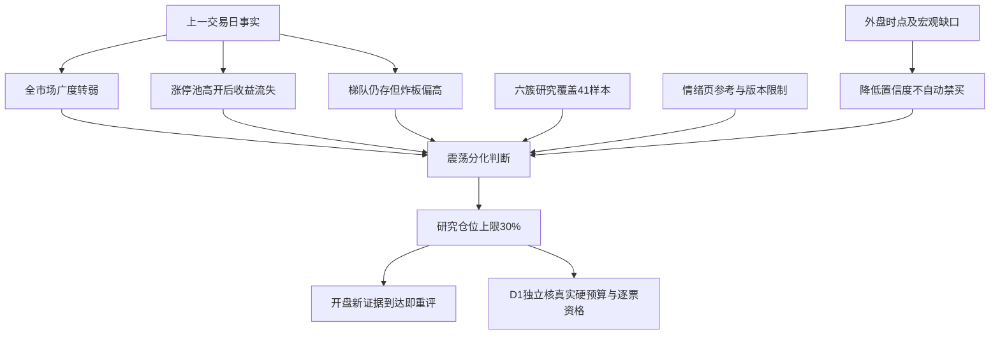

# 2026年11月13日 · 风格研判

> 数据源新鲜度：partial。研究降级：是。置信度：0.72。市场基准日：2026-11-12收盘。

## 一句话结论

震荡分化型，情绪=震荡；研究仓位上限30%，不授予开仓权限。

## 详细分析

市场现在付钱给什么，先看真实持有后的收益，而不是只数还剩几只高标。昨日5573只股票中，875只上涨、4635只下跌、63只持平，下跌比例83.17%，收益中位数−1.61%，跌幅达到5%的有231只。这一广度与上涨不多的41个风格及ETF有效样本互相印证，但后者绝不代替全市场广度。上证指数跌0.67%、深证成指跌1.68%、创业板指跌2.44%，沪深指数成交额较前一交易日增加18.15%。放量下跌不等于已经确认机构出货，却足以反驳“市场只是无量休息”的解释。

更直接的接力反馈来自前日85只非ST涨停股：昨日开盘平均溢价+2.17%、中位数+1.16%，到收盘平均变为−0.87%、中位数−2.05%，53只收盘反馈为负。这里比较的是同一批股票，85只全部匹配，没有用幸存者替换全池，也没有把开盘溢价与收盘收益混为一个premium。市场曾经给过高开兑现窗口，却没有给大部分接力持有者稳定收益，这是本轮控制研究仓位的核心理由。

梯队没有全部坍塌：最高5板有2只，4板和3板各2只，2板5只；收盘涨停37只、跌停5只，说明局部地位与承接尚未消失。但35只收盘未封住的炸板，使炸板率达到35÷(37+35)=48.61%，对应全局封板率51.39%。37只封板里26只开过板后回封，11只未开板；不能只用11只计算封板成功。XTick回报37涨停、5跌停、5板，与主源吻合，但炸板数为36只，zbl为20，口径无法等同，因此不用这个字段覆盖48.61%，也不把它当第二份独立资金支持。

因此，本轮选择“震荡分化型”，而不是看到37只涨停和5板就判全面扩散。这个判断承认梯队仍在，不假称没有连板核心；同时，炸板率尚未超过50%、跌停仅5只，也不足以把全市场直接判为崩溃。用真实全池平均收盘反馈重算既有情绪周期函数，结果为high_chop，即高位震荡，主跌风险待核。预计算文件中的−0.5%溢价是缺数占位，不是观测，本轮已拒绝沿用；既有阶段对应的固定打法同样不直接搬到研究结论。

情绪分50沿用仓库原公式：涨停贡献24.67分，梯队12.50分，炸板承接10.28分，指数2.23分，合计49.67后四舍五入。这个公式没有直接计入全市场收益中位数和接力收益尾部，故“50分”并不等于风险中性，更不等于可以机械配置六七成仓位。分数只描述11月12日，不预测11月13日。强概念计数中有3项达到8只涨停门槛，分别9、8、8只，故字段保留“三主线以上”代理标签；它们可能成分重叠，非R2已确认的三条独立主线，持续性及逐项封板率也尚未知。

## 三十日窗口里，强与弱不是同一种钱

本轮按既定清单请求22个同花顺风格指数和20只ETF。22个风格指数都尝试了实时读取，其中“昨日非ST三板以上表现”最新数据停在11月4日；再次读取仍然陈旧，XTick两次补查也为空。它的最近一日−7.00%属于11月4日，不属于昨日，不能填零或向前复制。故实际同日有效样本为21个风格指数加20只ETF，41个样本按共同交易日2026-09-24至2026-11-12的30个日收益对齐，以1减收益相关系数为距离、平均连接法形成实际6簇。外盘不混入这41个A股及ETF样本，收益无缺日补值。

六簇并不意味着六条主线。第1簇包含1个样本，当日等权+0.34%，30日等权累计+6.26%。第2簇包含1个样本，当日等权-1.43%，30日等权累计-7.23%。第3簇包含2个样本，当日等权-0.26%，30日等权累计-1.12%。第4簇包含1个样本，当日等权+3.88%，30日等权累计+48.43%。第5簇包含35个样本，当日等权-1.33%，30日等权累计-15.64%。第6簇包含1个样本，当日等权-3.65%，30日等权累计+28.17%。其中35个样本落在同一大簇，表明广泛暴露在共同波动下，而非已经分散风险；大簇当日−1.33%、30日−15.64%，反映风险偏好尚未普遍修复。单样本簇并不稳定，换一个窗口或样本可能重组，不把聚类赋予因果解释。

风格之间最值得解释的背离，是“昨日打二板以上表现”当日+3.88%、30日+48.43%，而“昨日非ST二板表现”当日−3.65%、30日+28.17%。前者上涨不能证明所有高标都被奖励；样本、ST范围和动态成分不同，也不能据此断言低位或高位必然更安全。首板表现−1.46%、打板整体−1.42%、行业龙头−1.47%、百日新高−2.04%、创历史新高−3.25%，说明普通追强与突破标签都没有获得普遍正反馈。资金前十和成交前十分别−1.41%、−1.40%，也不能把“成交活跃”直接翻译为“明日接力收益确定”。ETF仅以固定匿名样本编号保留完整数值，避免R1变成板块推介；全部20只均有30个同日观测。

其余已核风格的昨日表现同样完整进入JSON：同花顺热股−2.19%，近端次新股+0.02%，百元股−1.03%，昨日高振幅−2.42%，沪股通成交前十−0.12%，深股通成交前十−2.04%，高贝塔值−1.08%，增发预案指数−1.81%，增持计划−1.36%，减持计划−1.53%，回购计划−1.49%，业绩扭亏−2.18%。这些是供应商动态风格指数，而非可直接买入的固定组合；累计指数涨幅也不是本账户可复制的策略收益。

## 外盘与情绪参考，哪里能用，哪里不能用

本轮实时Tushare美股日线仍只到11月11日，14个匿名风险样本和两个美股指数历史反弹不能冒充11月12日隔夜利好。同日已运输外盘快照里的三大美股指数则为11月12日报价：标普500约−0.35%、纳斯达克综合约−0.39%、道琼斯约−0.36%；其来源为原运输链的HTTP回退，非本轮独立MCP复核，原报价与获取时点都保留在JSON。恒生指数昨日−1.26%、韩国综合−0.61%、日经225−0.70%，仅作外部风险锚，不据此推出任何板块或股票。两项外盘指数序列为空、两项实时FX序列为空；黄金、铜、原油、汇率月度动量均不足，软着陆、降息预期或衰退坐标保留未知。缺辅助数据降低置信度，不自动得到零仓或no_trade。

连板网只比较本轮绑定的qingxu全局情绪公开前缀，没有打开其主线或个股专题。已运输内容为3600字，原正文5738字，后2138字不声明已读。页面事实日是11月12日，抓取日是11月13日，收盘版还是盘中估算未知。其11月10日91°、11日82°、12日31°的降温轨迹，与本轮广度恶化及接力收益转负一致，所以采纳为温度交叉参考。网站称“退潮期”，本地函数称“高位震荡”，是两套定义的标签分歧，不强行消除；网站31.59°不替换规则分50。同景166次、次日上证均值−0.07%、上涨比例48%，描述的是指数，不是选票胜率，不据此增加预算、修改阈值或获得买权。

群聊五组均有运输记录，共350条；主KOL可核的盘中短句指向反弹阻力，但没有符合昨夜长文本条件的记录，不把盘中话改写成昨夜观点。95篇公众号运输文本中，收评和复盘倾向反弹反复、日内炸板增加，与客观数据方向一致。涉及未核人事新闻、监管截图及原因归属的叙事不当硬事实使用，观点也不等于真实资金流入流出。消息同源转载与主源行情不能重复算独立支持。

- **大资金意图**: 价格结果显示广泛风险暴露回撤、局部高标仍有收益，符合资金更挑剔的假设；没有账户级资金证据，不能把意图写成已经证实的撤退或进攻。
- **为什么走强**: 少数风格样本仍正收益，可能来自存量地位与样本差异；但83.17%股票下跌和接力收盘反馈转负，否定“高标上涨等于全市场合力”。
- **逻辑够不够硬**: 广度、涨停池全覆盖反馈和封板计数足够支持风险降温；外盘时点、宏观和情绪网页版本仍有缺口，不足以确认全面崩溃、固定打法或任何个股资格。

## 今天做什么，不做什么

明确态度是降级市场进攻温度、保留研究观察，不进未经D1确认的执行层。研究仓位上限取30%，理由是广度极弱、接力反馈从高开转为收盘负值且炸板接近一半；没有取零，是因为5只跌停并非全面失序，37只封板和存续梯队仍保留局部可研究收益。这个值不是最低持仓要求，不要求账户立即调仓，也不从旧effective_trading_budget继承任何数字。真实用户或账户停买、有效零预算和既有硬上限都未由R1重新取得，必须保持未知并由D1按原来源独立核验。

这份市场建议只适用于本次生成后至今日开盘，竞价及开盘新广度、接力反馈和承接变化到达时即重评；开盘到期后不无限沿用，也不因到期自动恢复满额。若亏钱效应继续扩散，重新评估温度与上限；若接力反馈、广度和封板承接共同修复，也按新证据重新评估，不能永远锁在旧低仓位。炸板率已越35%纪律线，情绪明确为震荡，下游按既有纪律把候选数量减半；研究池和可交易池分开，禁新仓不等于停止研究。R1没有候选票，因此板型、龙头认定、RR与禁止项不适用于本报告，留给后续逐票门禁，不能凭本报告代填通过。

## 数据源审计

| 源 | 日期 | 状态 | 覆盖及限制 |
|---|---|:--:|---|
| manifest / mcp_health | 2026-11-13 | 🟢 | 全局severity=2，质量状态不是市场禁买结论 |
| Tushare daily | 2026-11-12 | 🟢 | 本轮实时5573条，前日涨停池85/85匹配 |
| Tushare limit_list_d / limit_step | 2026-11-12 | 🟢 | 37封板、35炸板、5跌停，最高5板；非ST统计 |
| Tushare index_daily / limit_cpt_list | 2026-11-12 | 🟢 | 三个指数；20项强概念，3项达到代理门槛 |
| Tushare ths_daily / fund_daily | 2026-11-12 | 🟡 | 请求22+20，21+20有效；6簇及30日共同日期均已验证 |
| 陈旧风格样本S17 | 2026-11-04 | 🟡 | 两次实时读取仍陈旧，剔除聚类，不补零 |
| XTick补查S17 | 2026-11-13 | 🔴 | 两次空响应，不能修复覆盖缺口 |
| XTick market_emotion | 2026-11-12 | 🟡 | 涨跌停和高度一致，炸板多1只，zbl定义未核 |
| wechat_official_20 | 2026-11-12 | 🟢 | 95篇运输文本，择取全局情绪段；非全文重新抓取 |
| wechat_cli_5groups | 2026-11-12 | 🟡 | 350条/五组，主KOL昨夜长文本缺，盘中短句单列 |
| 运输外盘指数快照 | 2026-11-12 | 🟡 | 混合Tushare/HTTP来源，保留原报价与时点 |
| 实时美股历史序列 | 2026-11-11 | 🟡 | 14个匿名样本滞后，两个美股指数亦滞后 |
| 实时FX / 跨资产月动量 | 2026-11-13 | 🔴 | FX空响应，商品运输源跳过，宏观坐标未知 |
| lianban:qingxu | 2026-11-12 | 🟡 | partial；3600/5738字公开前缀，edition未知，同源不重复加权 |

## 不确定性 / 反证

最重要的反证是跌停只有5只、最高5板梯队仍在，不能把分化日扩大解释为全面崩溃；部分ETF与高连板风格正收益也说明市场奖励没有消失，只是集中并不稳定。相反，85只涨停池的收盘均值尚未跌破既有周期函数的−1%判据，不能因为中位数更弱就静默修改函数阈值强判主跌。这个均值与中位数分歧是需要后续验证的风险，不是可以忽略的噪音。六簇中35样本成团也有样本重叠影响，不能证明35份独立共识。网页版本、陈旧样本和外盘缺口保持未知，不将它们升级为收盘事实或硬否决。

## 与其他 R/D/E 的关系

本轮依赖当日manifest、健康检查、情绪预计算、群聊与公众号运输文本，并以实时Tushare补齐核心事实。R2消费风格和主线数量代理，仍须独立确认主线及核心；R3可比较基准日情绪分，不误作当日预测；R6保留真实硬否决权，本报告不以质量缺口代投否决票。D1独立消费本版JSON的有效窗口、事实证据、真实硬预算核验缺口与专题裁决，逐票决定通道和执行资格；E1按对应交易日复盘，不将本报告当冻结事前回测。

## Sub-Agent 元数据

skill: analyze_style_v1。model: gpt-6.1-sol。method: llm_v1。

主产物：data/research/20261113/R1_style.json。配套证据：data/research/20261113/R1_market_evidence.json。

专题context_sha256：cd0ef532404581e40839bf615fd39f282d104cf9265867a54527f0c2abe91d5a。实际生成时点在frontmatter，专题包截止与市场实时抓取时点分开保留；usage未知，不按零报告。
