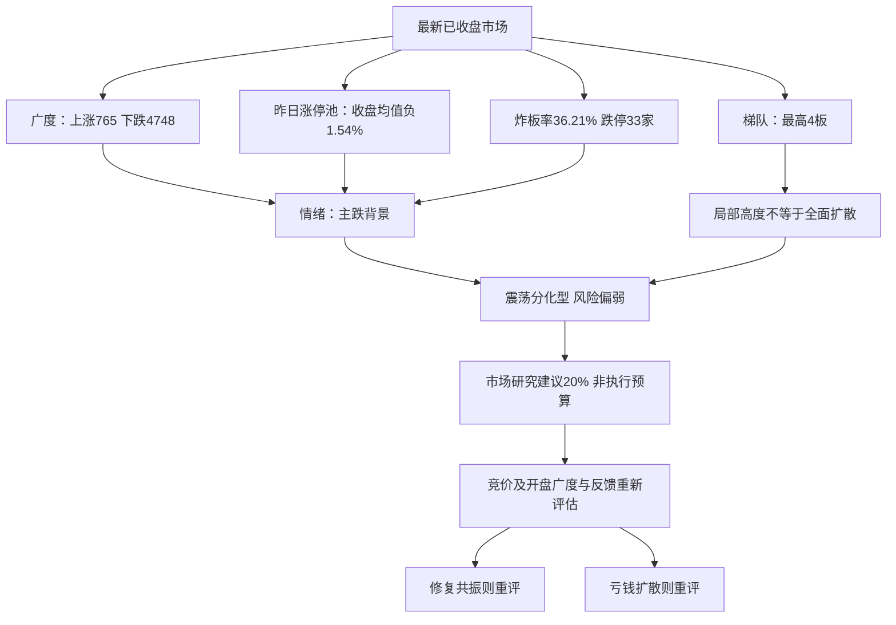

# 2026年11月16日 · 风格研判

## 一句话结论

震荡分化型，情绪=主跌背景；市场研究仓位建议20%，开盘新证据到达即重评，不是执行预算。

## 市场现在为什么付钱

先把时钟摆正：今天是交易日，但盘前并没有今天已经发生的赚钱效应。本报告判断的事实底座，是11月13日收盘。那一天5571家有日线的股票中，765家上涨、4748家下跌，中位跌幅2.00%；跌幅达到5%的有571家，而涨幅达到5%的只有94家。上证指数跌0.59%，创业板跌3.32%，上证50反而微涨0.11%。这不是全面没有亮点，而是指数权重的相对稳定遮不住多数个股的亏钱：资金奖励的是少量相对抗跌与局部承接，不是广泛承担风险。

最值得警惕的不是指数阴线，而是接力反馈的时间差。11月12日涨停的37家，下一交易日全部匹配到行情，开盘平均还有0.84%溢价，收盘平均却变成-1.54%，中位数-4.27%，16家跌幅达到5%。仅凭竞价高开判断情绪修复，会把兑现误读成承接。同时，收盘涨停37家、跌停33家，未封住的炸板21家；炸板率是21除以58，即36.21%，封板率63.79%。已经打开但最终回封的仍算涨停，不能用“从没开板”替代收盘封板。情绪明确写作“主跌背景”，候选缩量纪律继续生效；R1本身不出候选票，数量为零，不拿这条纪律替代完整研究覆盖。

风格最终落在震荡分化型，而不是机械认定主线扩散。37家涨停、最高4板确实碰到了扩散型的数量门槛，但4板只有1家、3板2家、2板4家，数量之外还缺普遍核心带动。行业龙头风格指数跌0.78%，热股风格跌5.07%，创新高风格跌3.23%，不足以支持“高度带动全市场”的推断。炸板尚未超过50%，也不硬套崩溃退潮型。系统原四维情绪公式计算47分，四项分别约24.67、10.00、12.76与0.07；这个公式没有跌停与收盘池反馈项，所以47分只是旧口径的状态描述，不是中性可以买，更不能凭分值给预算。

情绪算法的冲突必须保留。用真实开盘溢价重算，现有规则输出高位震荡；换成明示不同定义的收盘反馈，规则输出主跌。旧预计算的-0.5%其实是缺失替代，不是观测。本报告不改算法、不混合这两个时间窗，独立以收盘广度、收盘接力与跌停扩散判风险偏弱。第三方公开页把11月13日标成连续第二天冰点、温度约18.98，与收盘亏钱方向一致；但页面版次未知，31次同景的次日指数上涨率仅48%。它提醒准备修复剧本，而不证明今天已经修复，更不是选票胜率或仓位加分项。JSON仅保留运输投影的必要原文与完整来源索引，不声称网页或会员全文已读。

## 三十日结构：保留分化，不拿旧窗口冒充今天

本次确实逐一查询了22个同花顺风格板块和20只ETF。最新30个交易日固定为9月28日至11月13日：其中一个高连板风格序列缺9日，最新仅到11月4日，按缺失区间重新查询仍为空。因此它进入缺口披露，但不参与聚类，最终是21个风格样本加20只ETF，共41个完整序列、六个簇。没有补零、前填，也没有让整组样本退回11月4日。计算采用供应商逐日涨跌幅，不跨缺失日拿收盘价变化冒充单日涨幅；发现过的旧窗口中间结果已经作废并移除。

| 簇 | 完整成员数 | 11月13日均值 | 30日复合收益均值 |
|---|---:|---:|---:|
| 1 | 1 | +1.36% | +6.94% |
| 2 | 1 | +0.51% | -7.05% |
| 3 | 2 | +0.61% | +1.22% |
| 4 | 1 | -0.24% | +46.20% |
| 5 | 35 | -2.65% | -16.07% |
| 6 | 1 | -1.03% | +22.53% |

六簇并不等于六条可交易主线。最大的35成员簇当日跌2.65%，覆盖大多数风格与ETF；另有若干独立单成员簇，说明相关性不完全一致，但不能将小簇的相对收益直接解释成增量资金主攻。41个完整样本当日只有4个收红、37个下跌，与全市场广度相符。昨日打板风格跌1.74%、首板风格跌1.65%、二板风格跌1.03%，二板以上风格跌0.24%，均不支持只凭板位作正向开仓结论。高连板缺失样本不参与这些比较。30日长期差异只解释风格相关性，不用于给仓位机械扣点。

主线数量字段按契约使用涨停集中度代理：达到8家涨停门槛的条目有5个，枚举压成“三主线以上”。这些条目可能重叠，不能说已经确认五条独立主线；这里也不点名任何板块。真实主线、持续性与核心地位交R2核验，代理数量不授开仓资格。

## 外盘与观点的温差

外盘本轮直接取到6个指数与14个权益风险样本，行情归属日均为11月13日。标普跌0.40%、纳指跌0.91%、道指涨0.10%，恒指跌1.55%、韩国跌0.98%、日经涨0.53%；主要美股指数五日累计仍有修复，不能把最后一天回落夸大成全线崩盘。14个权益风险样本中11个下跌，等权当日均值-2.22%，用于描述外部风险，不输出个股。两个专门指数没有取到，不用权益等权数冒充指数实值。

黄金与离岸汇率有供应商报价，10月13日至11月13日变化分别为-5.55%与-0.37%。铜、原油及美元指数在改用供应商目录中的代码重查后仍空，故宏观“软着陆／降息预期／衰退”坐标保持未知，不用消息标题强填。五群81条与公众号53条文本同时存在修复预期和退潮叙事，部分公开内容反映指数弱、局部韧性。转发的同一观点不加倍计票，链接标题与个人猜测不升格成一手事实；辅助缺口压低置信度，不替代市场判断。

## 研究建议与反向剧本

市场研究仓位建议取20%。理由只来自本轮：13.73%的上涨占比、负收盘接力、33家跌停与36.21%的炸板，支持低风险暴露；但37家封板、尚存4板梯队及少量正收益样本，又不足以认定全部机会归零。因此态度是“观察”，不是全局禁买，也不是批准20%资金入场。20%是未声称最优的研究判断，并非把某个标准仓位折半，也不是按30日跌幅、冰点第几天、情绪分或severity封顶。预算来源未知仍为未知，真实用户／账户零预算、T+1、人工确认与逐票否决全部保留，D1只统一做一次预算。

本建议有效到今日开盘早段复核窗口结束，竞价及开盘新事实出现即可提前失效。若多数个股转涨、涨停池反馈中位转正，且核心带动与封板质量同步改善，就必须把修复证据送交D1重新定预算，不能让昨日主跌标签永久关闭研究。反过来，若大幅下跌家数、跌停与炸板继续扩散，20%也不是最低仓位，应以新事实重评为更低甚至零建议。两套剧本都依赖真实盘面，不能靠“二冰次日该反弹”预设答案。

- **大资金意图**: 盘面与权重相对表现更像降低广泛风险敞口、保留局部承接；这只是行为解释，没有用净流入数据证明任何具体资金主体意图。
- **为什么走强**: 目前只是少数样本相对强，绝大多数仍跌；正收益小簇不能替代核心带动，也不能把下跌后的修复预期当已发生的走强。
- **逻辑够不够硬**: 广度与完整涨停池反馈可复算，足够支撑谨慎；不足以断言今天继续跌。第三方低温是有限交叉，真正反证是开盘广度、反馈和核心带动同时改善。

图已用Mermaid 10.9.3及Chromium实际渲染为SVG。实际Web／Obsidian阅读端版本未核验，不声称部署端集成验收通过。

## 数据源审计

| 源 | 日期 | 状态 | 备注 |
|---|---|:--:|---|
| manifest／mcp_health | 2026-11-16 | 🟡 | 已读；severity=2不等于市场禁买 |
| Tushare交易日历 | 2026-11-16 | 🟢 | 确认开市，前收盘为11月13日 |
| Tushare全市场daily | 2026-11-13 | 🟢 | 5571条，广度与37只前日池完整匹配 |
| Tushare涨跌停／炸板／天梯 | 2026-11-13 | 🟢 | 37／33／21；最高4板 |
| XTick情绪 | 2026-11-13 | 🟡 | 38／34／21；范围差1家，zbl分母未知 |
| Tushare风格板块 | 2026-11-13 | 🟡 | 22个已查询，21个完整，1个缺9日 |
| Tushare ETF | 2026-11-13 | 🟢 | 20个全覆盖，30日序列无填充 |
| Tushare外盘 | 2026-11-13 | 🟡 | 6指数及14风险样本；2专门指数缺失 |
| Tushare跨资产 | 2026-11-13 | 🟡 | 黄金／汇率可用，铜油及美元指数未得 |
| wechat_cli_5groups | 2026-11-15 | 🟢 | 5个匿名群、81条；未读图片视频文件 |
| wechat_official_20 | 2026-11-15 | 🟡 | 53条；部分内容截断，非链接全文阅读 |
| 连板全局情绪公开投影 | 2026-11-13 | 🟡 | 抓取于11月16日，partial，版次未知 |
| emotion_cycle预计算 | 2026-11-16 | 🟡 | 溢价使用替代值已拒；保留真实开收盘口径对照 |

## 不确定性与交接

置信度为0.5040，按0.90×0.70×0.80计算。主要弱点是41／42而非42／42的聚类覆盖、外部宏观缺口与公开情绪版次未知；跨供应商数据来自同一市场，不冒充两份独立样本。这些都是覆盖信息，而不是机械扣仓理由。聚类是历史相关结构、并非收益预测；逐票板型、龙头条款、盈亏比与禁止清单不适用于R1无票输出，必须由下游对象研究和D1逐票补齐，不能把R1当门禁通过证明。

R2消费风格与主线代理后独立核主线；R3区分47分规则描述与本轮主跌风险；R6只读本轮JSON内嵌证据并保留独立否决权；D1核有效窗口和真实硬约束后一次形成预算。主JSON已嵌入专题上下文身份、哈希、全部来源索引和逐源采纳理由，不为下游另开raw旁路。本阶段不改计划、执行、账户或用户偏好文件。

## Sub-Agent 元数据

- skill: analyze_style_v1
- artifact: data/research/20261116/R1_style.json
- model: gpt-6.1-sol
- 真实生成时间见frontmatter；本轮为盘前实跑，非回放。
- 生成耗时由真实启动与生成时间相减记录在主JSON；usage未计量，不能当作0。
