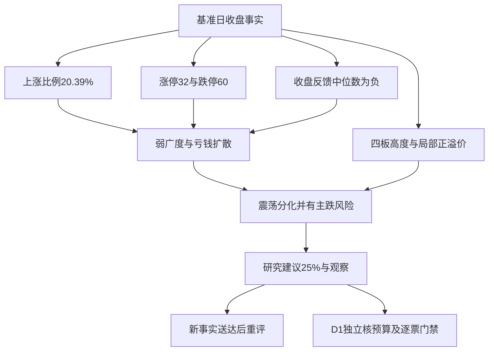

# 2026年11月17日 · 风格研判

今天的盘前判断是：**震荡分化型，情绪偏主跌风险，研究仓位建议25%，不是交易授权。** 数字描述的是11月16日收盘状态，不代表今天已经开盘，更不是对今天涨跌的确定预测。主线数量暂记“双主线代理”，并不意味着已确认两条可交易主线。

## 市场在为什么付钱

市场没有奖励普遍持有风险资产，而是奖励少数逆势承接与局部接力。全市场5572只有成交行情的股票中，1136家上涨、4344家下跌、92家平盘，上涨比例只有20.39%；跌幅至少5%的有1021家，而涨幅至少5%的只有88家。上证指数跌0.87%，深证成指跌2.53%，创业板指跌4.37%。这些同窗事实说明，指数之间的强弱差不是普涨的前奏证据，而是风险偏好收缩中的分化。前一交易日上涨765家，本次上涨家数回升，但还不足以把亏钱扩散解释成修复已确认。

32家收盘涨停与60家收盘跌停并存，接力高度为4板，下面是3板2家、2板8家，按涨停与连板集合核对可得首板21家。这不是没有活口，但尚未形成高标带动全市场的确认。16家收盘未封住，炸板率按16除以32加16计算，为33.33%。另有18家收盘涨停曾经开板后回封，它们仍属于32家收盘涨停，不能因为开板次数大于零就再加进炸板分子。XTick交叉口径为涨停33家、跌停63家、炸板16家，按同一分母重算32.65%，存在样本范围差异；不把它返回的未明定义百分比直接当炸板率。

赚钱效应最需要拆开看。11月13日37家涨停中，36家在11月16日有日线，开盘相对前收均值为+2.36%，收盘涨跌均值为+0.99%，中位数却为−1.45%；仅17家收红，8家跌幅至少5%。余下1家缺当日日线，不补零、不擅称停牌。正均值与负中位数同时存在，说明少数强势样本托住了均值，不能将局部胜者的收益误认为多数参与者的体验。昨日打板表现跌0.79%、昨日打首板表现跌0.72%，而昨日非ST二板表现涨3.25%，正是这种局部接力尚存、扩散承接不足的风格差。

- **大资金意图**: 从当日收益结构只能推断风险收缩与选择性承接，不能由收益数据认定具体机构净买入。整体承接偏向少数低波动样本，最活跃成交风格反而显著受损。
- **为什么走强**: 少数接力风格和逆势样本仍有正收益，但并未带动广度与多数前日涨停股同步转强；这更接近局部胜出，不是全市场进攻确认。
- **逻辑够不够硬**: 广度、跌停和隔日反馈相互支持弱势分化，正溢价均值则构成真实反证。它足以支持谨慎研究建议，不足以支持全局永久禁买或宣布修复完成。

## 三十日聚类告诉我们的边界

按9月29日至11月16日的30个实际交易日对齐，22个同花顺风格指数均返回了历史记录，但“昨日非ST三板以上表现”最新仅到11月4日，且目标窗口内缺10个交易日，因此只让21个风格指数与20只ETF进入相关距离的平均连接层次聚类，实际得到6簇。没有把旧记录向前搬，也没有用不同日期的最近30行冒充共同窗口。ETF在本报告以固定序号表示，映射沿用既有抓取脚本的顺序；不以此推荐行业方向或交易标的。

六簇的结构比名字重要。35个成员的大簇当日平均跌3.37%，30日累计收益的成员均值为−16.09%；另一个二板接力独立簇当日涨3.25%，较宽泛的二板以上表现独立簇只有+0.03%。其余三簇分别是一个当日+2.23%的ETF独立簇、一个当日+1.44%的ETF独立簇，以及两个成员当日平均+0.78%的小簇。这里有逆势强度，也有多数样本同跌的事实，但六个相关簇不是六条主线，更不是六份独立资金确认。

30日累计收益仅用于描述路径。日更成分的接力风格指数不是固定股票组合，不可把累计涨幅当成持有同一批股票的可复制回报，也不能拿历史高涨幅替今天的多数亏钱效应辩护。研究仓位建议没有因为30日大簇下跌额外扣点或折半。

## 情绪口径与外部环境

沿用现行规则公式，涨停强度贡献21.33分、梯队贡献10分、炸板健康贡献13.33分、三项指数均值贡献0分，合计44.67，取整45分。这是基准日状态描述；该公式没有直接纳入60家跌停及负反馈尾部，不能拿45分替代风险判断，也不声称它是选票胜率。

预计算文件的开盘溢价−0.5%明确属于缺数替代值，本轮不采纳为事实。用实算开盘均值与收盘反馈分别调用既有阶段函数，均归为高位震荡，因为函数在“溢价为正且炸板率低于40%”时对多跌停情景作了区分处理。本报告保留high_chop算法标签，同时把60家跌停、1021家跌幅至少5%明确列为主跌风险，不能因算法标签而忽略亏钱扩散，也不把阶段固定映射成某种打法。

本轮实际比较了运输的连板网全局情绪公开前缀，而非会员全文。其11月16日标注退潮第1天、温度约26.75度，公开同景166次，次日上证上涨比例48%、均值−0.07%。这与亏钱扩散方向相符，强化了“尚未确认全面修复”的解释；与本地规则的高位震荡标签存在口径差异，保留而不强行统一。页面版本未说明是盘中预估还是收盘，且运输仅含原文前3600字符，不能升级成收盘定论；48%也不是候选股胜率。同源页面与本地存档只算一个来源。

外盘在线补核显示，美东11月16日标普500跌1.92%、纳斯达克跌2.49%、道琼斯跌1.41%；实际报价日期已核对，不使用Tushare尚停留在11月13日的美股指数冒充昨夜收盘。同日恒生指数涨0.49%，韩国综合跌3.59%，日经225跌2.42%。这是外部风险偏好承压但并非所有市场同步下跌，不能直接导出A股今天的方向。两个额外外盘指数及两项汇率序列为空；黄金、铜、原油月度动量本轮未取得可核序列，三档宏观坐标保留未知，不靠新闻叙事补成数据。

辅助文本的作用也有限。公众号82条记录中，本轮选读第3条收评全文，其整体下跌、亏钱效应扩散表述与量化一致，不将它引用的行情再算一份独立量化确认。五群共199条，指定机构群关键词命中仅两条，分别是盘前链接和盘中短句，均不满足昨夜可归因长文本要求，因此不制造KOL共识。文本缺口只影响覆盖与置信度，不自动形成no_trade。

## 今天做什么、不做什么

本次研究仓位建议为25%。这个数是弱广度、跌停明显多于涨停、涨停池负中位数和较厚亏损尾部共同约束下的低暴露研究判断；仍保留非零建议，是因为真实均值溢价为正、存在完整的2至4板梯队与局部逆势强度，并非全市场承接完全消失。它不是“状态降级打折后的剩余额度”，不是旧政策区间下限，也不是账户预算。25%是模型研究裁量，没有被验证为最优比例。

态度是**观察**：继续由R2筛选有合力与地位的研究对象，不把代理双主线当成已确认可交易主线，不因逆势片段就授予新仓权限。本轮R1不出个股候选，因而逐票板型、盈亏比、禁止清单及执行资格交各自阶段核验。没有由R1新增全局禁买；用户或账户真实停买、有效零预算、T+1、人工确认和逐票否决均保持独立生效。已核配置为market_decided，固定总仓、单票及单板块百分比均为显式null；这不代表账户可用资金已知，更不代表授权杠杆。

本建议从报告实际生成时生效，最迟到今日午间休市前失效；竞价后和开盘新增事实送达D1时应重评。若广度、前日涨停反馈中位数、梯队晋级与核心带动同步改善，可上调市场判断；若跌停和大跌尾部扩大、正溢价均值转负或最高梯队失去承接，应下调。不能将本次25%无限期继承，也不能在多阶段被重复打折。最终预算由D1独立形成一次，真实账户硬限制仍须单独核验。

## 数据源审计

| 源 | 日期 | 状态 | 覆盖与限制 |
|---|---|:--:|---|
| Tushare在线风格与ETF | 2026-11-16 | 🟡 | 请求22+20；21+20满足共同30日窗口；缺项未填零 |
| Tushare在线广度、涨跌停、天梯 | 2026-11-16 | 🟢 | 日线5572条；涨跌停不含ST，不能称所有证券完整统计 |
| Tushare前日涨停池反馈 | 2026-11-16 | 🟡 | 37家匹配36家；开盘、收盘口径分别披露 |
| XTick情绪交叉 | 2026-11-16 | 🟡 | 涨停33、跌停63、炸板16；口径不同不平均拼接 |
| Tushare外盘与汇率 | 2026-11-16 | 🟡 | 亚洲三项可用；美股源滞后；另两指数及汇率空，商品月度动量缺失 |
| 既有外盘HTTP补核 | 2026-11-16 | 🟢 | 三项美股指数；报价美东日期已核 |
| wechat_official_20 | 2026-11-17 | 🟢 | 82条；本轮仅选读收评第3条全文，未声称通读全池 |
| wechat_cli_5groups | 2026-11-17 | 🟡 | 199条；指定群无合格昨夜长文本，不伪造观点 |
| 连板网全局情绪 | 2026-11-16 | 🟡 | 公开前缀，版本未知；本轮仅采纳弱情绪参考，不授予权限 |
| manifest / mcp_health | 2026-11-17 | 🟡 | 全局severity=2仅为覆盖状态，非市场停买依据 |

## 不确定性与反向剧本

最重要的反证不是外部看多文字，而是局部接力仍提供正收益，市场并未完全失去风险承接。如果今天多数涨停反馈转正、广度与梯队同步修复，弱势解释就必须重评，而不能继续援引昨天60家跌停阻止研究。反过来，若正溢价均值仅靠少数极强样本维持，大多数样本继续亏损，算法高位震荡标签会低估真实承接恶化。两种剧本都需要今天的新事实，不能用历史同景概率提前裁决。

## 与其他阶段的关系

本报告消费当日抓取元数据、在线量化、辅助文本与本轮绑定的全局情绪投影；不消费旧计划的交易额度，不等待R2，也不反向读取R2候选。R2、R3、R6和D1应消费同版R1主JSON；专题的来源索引、哈希、时点与逐源裁决已内嵌，不要求下游另开原始资料旁路。

## Sub-Agent 元数据

skill为analyze_style_v1，模型为gpt-6.1-sol，方法为在线取证后的LLM研究判断；聚类与统计由确定性脚本计算。主产物为data/research/20261117/R1_style.json，证据产物为data/research/20261117/R1_style_evidence.json。本报告没有模拟账户、没有产生买入权限，也没有修改执行规则。
