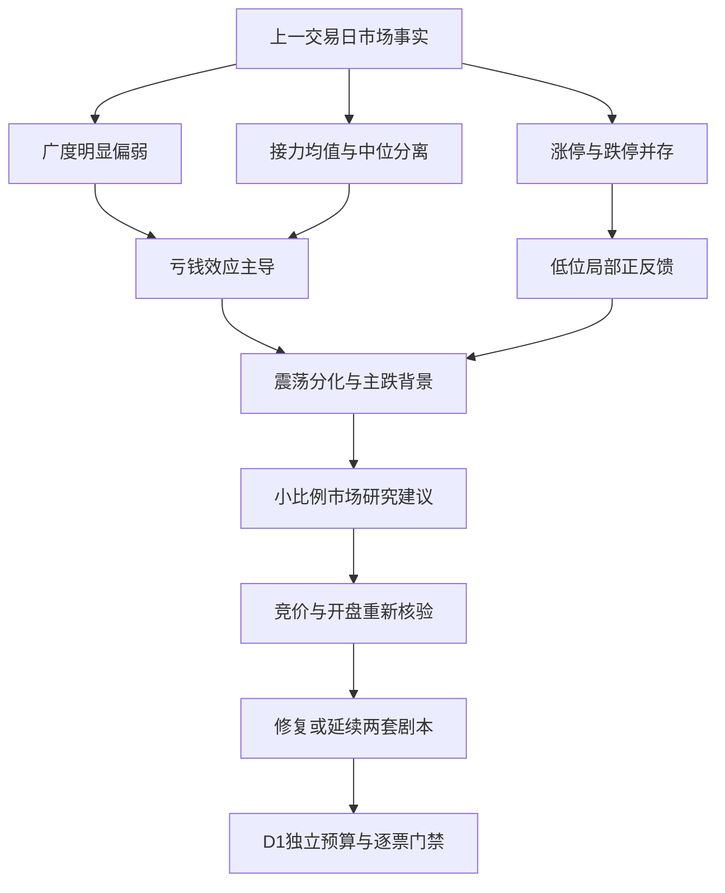

# 2026年11月18日 · 风格研判

## 一句话结论

震荡分化型，情绪=主跌；低位局部有回报，高位接力降级。研究仓位建议20%，竞价后重评，不是交易预算。

## 市场在为什么付钱

先认市场，再认样本。昨日5573只日线样本中，1326只上涨、4119只下跌、128只平盘，中位数下跌1.312%，跌幅至少5%的有536只，涨幅至少5%的只有105只。37家收盘涨停与67家跌停同时存在，说明机会没有消失，却远没有形成普遍可复制的赚钱效应。20家收盘未封住，按20除以37加20计算，炸板率为35.09%；盘中打开后重新封住的仍计涨停，不能只把从未开板的股票当封板。情绪=主跌，这个判断说的是前一交易日已发生的风险，不是断言今天必然继续下跌。

真正决定风险偏好的，是接力者拿到了什么。前日32只涨停样本在昨日全部匹配，平均开盘溢价为-0.3045%，收盘反馈均值只有+0.2326%，中位数为-0.4499%，其中16只收盘下跌。正均值与负中位数并存，说明少数幸存者足以掩盖普通参与者的痛感。最高连板只到三板，一只三板、五只二板，没有证据支持全市场高度和带动已经重建。风格样本也给出相同分层：昨日打首板表现+1.0148%，二板及以上-3.8980%，非ST二板-3.7757%。市场尚在奖励少量低位活口，而不是奖励广泛抬高接力层级。

指数表现不能代替广度。上证下跌0.4994%，创业板下跌1.1990%，中证1000下跌1.1716%；上证50上涨0.0646%，科创50上涨0.6182%。部分指数抗跌与多数股票承压并不矛盾。资金前十风格样本+0.2866%，成交前十却-3.0449%，热股风格-4.3033%，意味着有承接的对象与仅有热度的对象不能混为一谈。这是根据价格反馈推断的资金偏好，不是已验证的主力净流入事实。

- **大资金意图**: 从权重相对稳定、成交热度失效和局部首板回报的组合看，资金更像在压缩风险暴露、挑少量有承接的结构，而不是发动全面进攻；没有逐笔资金证据，动机只列为假设。
- **为什么走强**: 真正正反馈集中在部分低位和承接风格；中高位接力与多数股票仍弱。局部正反馈是修复线索，不是修复已确认。
- **逻辑够不够硬**: 广度、涨跌停与风格收益在同一交易日相互印证，但行情来自同一供应商，不算三个独立来源。若今天广度翻转、接力中位数转正并出现核心与助攻共振，昨日偏弱判断就必须重评。

## 风格与温度：不让一个分数掩盖亏钱效应

五选一归入震荡分化型，而不是主线扩散型。37家涨停和三板高度仅表面命中部分扩散条件；67家跌停、35.09%炸板和高位负反馈否定了广泛扩散。也不把它写成崩溃退潮型，因为炸板率尚未超过该类型要求的50%，不能为了强调风险跳过分类条件。风格标签与情绪阶段描述不同，保留“震荡分化型、情绪=主跌”的组合，比把整个盘面压成一个词更诚实。

恢复口径的规则情绪分为52，四项贡献分别为24.6667、7.5000、12.9825和6.3547，来自涨停数量、连板高度、未炸板比例和三项主要指数平均表现。这个公式没有直接纳入67家跌停和536只大跌样本，因此52只能描述公式结果，不能解释为安全中性，更不能变成加仓理由。杠杆外资项未完整计量，五维参考校验不填零拼分。

周期口径也要分开。预计算把缺失溢价用-0.5%占位，本轮不采纳这个数字，重新得到开盘-0.3045%。既有周期函数在开盘负溢价口径下判主跌，而改用收盘微正均值会判高位震荡。这里保留冲突，不修改算法，也不沿用函数里机械的阶段打法。对研究取舍来说，负中位数、极弱广度和亏钱扩散仍然比微正均值更有解释力；今天是否反转，交给今天的数据回答。

## 三十日六簇：保留缺口，不把过去当今天

22个既有同花顺风格样本与20只既有ETF全部发起本轮活接口请求。目标为2026年9月30日至11月17日的30个A股交易日，按交易日逐格对齐，不按“最近30条”错位拼接。主方法为Pearson相关距离与平均连接层次聚类。ETF在本报告仅用固定匿名编号展示，不输出具体行业名称或股票；编号与取数清单顺序一致，完整映射与请求保留在本轮证据文件中。

42项里，昨日非ST三板以上风格样本在目标窗口只返回19个交易日，缺11日，昨日也没有值。因此严格的42乘30完整矩阵并不存在。该样本当日收益、30日收益和主聚类编号均保留未知；19个已观测交易日的复合值也不冒充30日回报。主聚类采用其余41项的完整30日数据，明确形成六簇，而不是补零、前填或删掉缺口后声称全部完成。

六簇的含义是共振关系，不是六条主线。第一簇只有ETF_10，30日+8.95%、昨日-0.11%；第二簇只有ETF_16，30日-5.57%、昨日-1.51%；第三簇为ETF_09与ETF_18，平均30日+2.96%、昨日+0.05%。第四簇是二板及以上风格样本，30日+48.49%、昨日-3.90%；第五簇容纳35项，平均30日-17.10%、昨日-0.84%；第六簇为非ST二板风格，30日+16.89%、昨日-3.78%。高累计收益与当日大幅负反馈并存，恰恰说明不能把历史赢家直接认作今天的市场奖励。

为了不隐藏第42项，另做全42项共同19个交易日的六簇敏感性计算，共同日期截止11月4日。它与主结果分簇有变化，说明缺数会影响结构，不代表当下资金发生了六次轮动，更不能拿旧样本末日代替昨日。30日结构只回答背景，不从累计跌幅推导仓位扣点。概念统计前20项里有7项达到既有涨停数量代理条件，因此五维字段记“三主线以上”；成分重叠、代理样本截断和真实持续性都未解决，它不是7条已确认可交易主线。R2需独立核主线与地位，R1不命名方向、不授资格。

## 外盘与公开情绪：弱背景，不能变成反弹保证

本轮Tushare请求中，恒生、韩国和日本指数最新为11月17日，分别下跌1.0342%、2.5884%和1.3436%。美国三项主要指数重试仍只到11月16日，不把这些旧日跌幅写成前夜收盘；最新美国市场冲击保留未知。原有海外快照的部分腾讯回退数字虽已看到，但本轮获准活接口未独立核验，不混成第二票支持。离岸人民币改用已有规范代码重查，仍只返回11月16日；美元指数为空，缺失没有补零。

作为宏观前置，国内黄金、铜和原油连续合约最近21个交易期间的收盘动量约为-7.77%、-5.70%和-18.53%。这些是国内连续期货而非海外现货，含换月影响，只能提示风险偏好承压。它们不足以独立区分软着陆、降息预期或衰退，宏观坐标保持未知，也不据此提出任何板块。

运输的连板全局情绪前缀显示，11月17日为连续第四个冰点，温度15.91；历史同景只有4次，次日指数上涨率50%、平均+0.20%。本轮只把低温连续性作为弱背景采用，与67家跌停和低梯队对照一致；它与规则情绪分52不是同一尺度，不平均、不重复加权。四冰既不是今天必修复的承诺，也不是今天仍主跌的事实。来源仍为partial，公开页版本未知，保留的运输正文为3600字前缀、原文标识5635字，没有声称会员内容或全部资料已读。

文本只作反向剧本。匿名机构群晚间观点偏等待右侧；筛选的公众号意见一派期待冰点后反核，另一派警告下降过程可反复冰点。两派都不能代替价格确认。群内自发言、图片、链接和撤回消息不作KOL结论，作者身份没有独立核验；本轮是筛选摘录，不声称86篇全文研读。真正的反向剧本应当是：今天广度与接力能否同时改善，而不是冰点已经持续几天。

## 仓位建议、计划边界与失效条件

市场研究建议为20%。它是对当前可见机会广度的定性表达：37家涨停与首板风格正反馈不支持“市场完全无机会”，但67家跌停、536只大跌和高位接力失血又不支持广泛暴露，所以只给较小的结构性研究量级。20%不是历史公式的最优解、必须用满的额度或新的硬上限，也不是先从某个旧仓位按30日跌幅、四冰、52分、severity或degraded逐项扣出来的结果。

这个建议只适用于报告生成后至今日开盘前的研究窗口；竞价事实一到就应由P1和D1重评，开盘前仍未重评则不能无限延用。若上涨家数反超下跌、昨日涨停池中位反馈转正且核心与助攻共同修复，应重新评估扩大机会，不让昨日低温形成永久禁令；若亏钱效应继续扩散，就重新评估收缩直至零。以上是重评条件，不是新增自动交易阈值。本轮没有发布市场性全局禁买，也没有使用今日尚未发生的竞价或盘中事实。

态度是“降级”：广泛高位接力不进，真实结构性修复保留观察，研究不停止。炸板率已达到35%的既有纪律，向下游传递候选输出数量减半，研究覆盖和来源不减半；本阶段没有候选名单，逐票板型、龙头认定、RR和禁止清单不适用，不造股票来凑验收。本轮未核真实用户或账户的硬预算与停买来源，因此预算与授权保持未知，绝不把研究20%写成可用资金，也不抬高任何有效零预算。D1一次统一预算和逐票分配，R6保留研究硬否决权，既有T+1、人工确认及所有执行保护不变。

## 数据源审计

| 源 | 事实日期 | 状态 | 覆盖与限制 |
|---|---|:--:|---|
| manifest与mcp_health | 2026-11-18 | 🟢 | severity为2，质量信息不等于市场禁买 |
| Tushare日线 | 2026-11-17 | 🟢 | 5573条；前日32只涨停池全部匹配 |
| Tushare涨跌停与天梯 | 2026-11-17 | 🟢 | 37涨停、67跌停、20炸板；天梯6只均与本轮非ST涨停池交叉核验 |
| Tushare指数日线 | 2026-11-17 | 🟢 | 8项指数，不以指数代替全市场广度 |
| Tushare概念代理统计 | 2026-11-17 | 🟢 | 前20项中7项达到代理条件，非真实主线判定 |
| Tushare风格板块与ETF | 2026-11-17 | 🟡 | 22加20全部取数，41项完整30日，1项缺11日；两个版本六簇均留存 |
| Tushare海外指数与汇率 | 2026-11-16至2026-11-17 | 🟡 | 亚洲同日，美国与离岸汇率滞后，部分指数及美元项空 |
| Tushare连续期货 | 2026-11-17 | 🟢 | 黄金、铜、原油国内连续合约；非国际现货与非复权月度因果 |
| 公众号RSS | 2026-11-17 | 🟡 | 文件86篇，关键词筛选摘要，不冒充全文阅读或独立行情验证 |
| 匿名群文本 | 2026-11-17 | 🟡 | 文件300条，焦点群11条筛选，发言身份未核，排除自发言和占位 |
| 连板全局情绪 | 2026-11-17 | 🟡 | 单来源partial前缀，公开版本未知，小样本不构成胜率 |

## 不确定性与下游关系

本报告最重要的反证，是局部首板回报和少数指数上涨：它们可能成为修复起点，也可能只是亏钱扩散中的幸存者。昨日全局弱并不能先验否定今天新机会；同样，今天若仅指数拉升而接力中位反馈继续负，也不能宣布修复完成。上游预计算溢价占位、周期不同口径冲突、缺日聚类和外盘滞后都已写入机读报告。没有任何一项辅助缺口被升级为硬否决。

本轮依赖抓取清单、数据健康、运输的公开情绪与定性文本，并以本会话活行情复算形成研究判断。R2消费风格与主线数量代理，R3消费同日情绪基准，R6检查一致性，D1消费有期限的市场建议并独立核真实约束；下游只通过同版R1主JSON消费专题裁决，不另开raw旁路。

## Sub-Agent 元数据

skill为analyze_style_v1；model为gpt-6.1-sol。本会话独立研究，没有另启模型或委派同阶段。机读产物为data/research/20261118/R1_style.json；取数及计算凭据在同目录R1_live_evidence.json、R1_external_supplement.json与R1_computed_evidence.json。实际生成日期为2026年11月18日，国内事实截止前一交易日收盘，未回放或冒充盘中事实。Token用量未知，不当作零，也不保证低于努力目标。Mermaid 11.4.0已实际解析并渲染为可见SVG，渲染结果为18877字节，未用正则存在检查冒充渲染通过。
