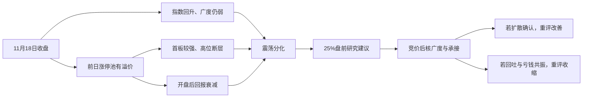

# 2026年11月19日 · 风格研判

> **盘前研究，非当日实况。** A股事实锚定11月18日收盘；11月19日竞价和盘中尚未观测。主要市场数据已核，部分风格与外盘覆盖降级，不构成禁买。

## 一句话结论

**震荡分化型，情绪=震荡。** 先手首板局部修复，追价和中高位接力仍受罚。市场研究仓位建议 **25%**，竞价后重评，不是可用额度。

## 🧭 市场在为什么付钱

昨日上证、深成指、创业板分别上涨 `0.09%`、`0.20%`、`0.85%`，科创50涨 `2.20%`，中证1000却跌 `0.65%`。指数翻红没带动多数股票：5,573只日线样本中，1,318只上涨、4,133只下跌、122只平盘，中位数 `−1.20%`。沪深成交约 `1.37万亿元`，较前日少约 `880亿元`；含北交所的Tushare样本口径缩量 `5.96%`。反证是，大跌至少5%的样本从536只降到286只，跌停从67家降到39家，涨至少5%的从105只增至152只。**抛压减轻是真的，普遍赚钱尚未发生。**

| 市场反馈 | 11月18日观测 | 对风格的含义 |
|---|---|---|
| 收盘封板 | 41家涨停，其中19家开过后回封；24家触板未封 | 炸板率 `24/(41+24)=36.92%`，回封仍计涨停 |
| 前日涨停全池 | 37只全匹配；开盘均值 `+3.19%`，收盘均值 `+1.57%`、中位 `+0.73%`，19只收红 | 昨日持有者有溢价，但从开盘持到收盘均值 `−1.46%`，隔夜回报不能外推为追价回报 |
| 分层接力 | 前日首板31只，收盘中位 `+1.71%`、7只晋级；前日连板6只，中位 `−1.01%`、仅1只晋级 | 资金较愿意承接部分低位先手，不普遍奖励抬高层级 |
| 非ST梯队 | 33首板、7二板、无三板、1四板；上一日唯一最高标封住晋级 | 顶部有韧性，但三板断层。最高标存活与低位活跃同时发生，不能据此证明它带动全市场 |

- **大资金意图**: 相对强的指数与局部回封，叠加缩量和多数个股下跌，更像存量资金集中争夺少数机会，而非增量普遍扩仓。没有逐笔身份或净流向证据，不把价格表现当成已证实的资金意图。
- **为什么走强**: 昨涨停池有真实隔夜溢价，强势集中在首板和少数前排；正反馈从开盘到收盘衰减，中位接力未跟上。不能把一个四板或单一宽基领涨当成全市场接力修复。
- **逻辑够不够硬**: Tushare涨跌家数获xTick同日快照逐项印证；xTick涨跌停报43/44而非41/39，覆盖口径不拼接，原生炸板字段也不替换同分母计算。证据足以区分局部与普涨，不足以确认今日延续或因果归属。

## 🌡️ 风格与温度

五档取**震荡分化型**。41家涨停略超该档示例，但4板之下缺三板，广度与高位反馈否定“主线扩散”；也未满足连板情绪型所需高度与封板稳定性。跌停仍多，却没有超过50%的炸板与主要指数普跌，不判崩溃退潮；同时不属于涨停稀少的防御观望档。概念统计代理的20行全有`up_nums≥8`，却也全数`up_nums>cons_nums`，字段窗口与成分重叠不能消解。主线数量保留未知，不写“无主线”，也不把聚类数冒充主线数。

情绪浓度按既有四项公式为 **62**，描述11月18日，不是今日方向。计算用到涨停数、最高板、未炸板比例和三个指数的平均涨幅，本身没有计入广度与跌停压制。内部周期用真实开盘溢价重算为**高位震荡**，改用收盘反馈作敏感性重算仍相同；预计算的“主跌”使用缺值占位 `−0.5%`，不当实测，不继承相应固定打法。

连板公开前缀把11月18日标为退潮第1天、温度约 `23.04°`，与多数下跌、亏钱仍在同向；但本轮实测隔夜溢价转正、跌停减少，因此不同意把“退潮”外推为全盘继续主跌。网页所列上证年线下方同景166次，次日均值 `−0.07%`、上涨率 `48%`，没有给出可靠的单向优势。它提高了对修复广度的验证要求，保留“局部修复被兑现”的反向剧本，不改变仓位数值、不与内部62分混算。11月19日06:00抓取，网页版本未知；本轮只采用运输的公开前缀，切断后的阶段转移行、会员或脚本内容未采用。

## 📊 三十日六簇：背景，不是当日指令

固定22个同花顺风格样本、20只ETF，按10月8日至11月18日的30个A股交易日对齐，以日收益的`1−Pearson相关`为距离，平均连接切成六簇。20个风格样本和20只ETF足窗，两只风格样本分别缺1日和12日，11月18日定日重查仍无。缺口不补零、不前填；以40项严格30日成交日序列作为主聚类。全42项另用截至11月4日的18个共同观测日重做六簇，其末日不是昨日，不能将差异全归因于风格轮动。

| 簇 | 样本数 | 30日平均复合收益 | 11月18日平均收益 |
|---|---:|---:|---:|
| C1 | 34 | -16.94% | -0.06% |
| C2 | 2 | +1.44% | -0.41% |
| C3 | 1 | +7.17% | -0.22% |
| C4 | 1 | -6.08% | +0.34% |
| C5 | 1 | -15.58% | -0.17% |
| C6 | 1 | +9.27% | -2.18% |

主簇34项里昨日仅13项上涨；20个可比较风格样本、20只ETF各只有7项上涨。百日新高、近端次新风格分别跌 `2.12%` 与 `3.56%`，前日首板篮子涨 `0.64%`、非ST二板篮子跌 `2.18%`。篮子构造不同，不用它替换逐股配对的涨停池；二者共同指向的是**回报有层级，不是广撒网**。长期均值只描述背景，不用于机械减仓。

## 🌐 外盘是背景，不是替代确认

盘前快照中，11月18日美股常规收盘标普 `−0.23%`、纳综 `+0.42%`、道指 `−1.11%`。这是带时点的报价回退，Tushare美股主日线仍只到11月17日，二者不算两票当夜支持，也不拼成30日序列。恒生 `−0.91%`、韩国综合 `+1.99%`、日经 `+0.28%`，方向不齐；韩国交易日历未独立认证。两个海外成长代理、美元指数和可用的主要美股盘后反应有缺口，离岸人民币最新仅11月17日。境内黄金、铜、原油连续收盘的各自30期动量约 `−10.83%`、`−7.96%`、`−18.97%`，含换月影响；这些不足以判定软着陆、降息预期或衰退，宏观坐标留未知。

公众号收评与实测一致：指数回升与缩量普跌可以同时发生。群聊定向筛看未获得有可靠署名和时点的隔夜方向句；一条看似有催化的转述时间早于本轮隔夜窗口，不拿来确认实际或盘后价格。OCR有“没有增量资金”的定性判断，仅作反证线索，不能把OCR中的涨跌停数字或操作态度升级为事实。没有独立来源证明外盘已给A股普遍接力背书。

## ⚖️ 研究建议与反向剧本

本轮以 **25%** 作为市场研究仓位建议：前日涨停全池的收盘中位转正、跌停减少、上一日最高标晋级，说明机会不是零；但约四分之三样本下跌、炸板超过三分之一、三板断层、盘中追价均值为负，说明回报尚不足以支撑广泛暴露。这个比例是对可见机会规模的定性判断，不是从30日跌幅、阶段天数、情绪分、来源缺口或旧预算扣出来的，也不是最低必须使用的额度。R1不输出板块或票；仅传递既有震荡期候选规模收缩纪律，不用它折半仓位、不建立候选池。

首要剧本是低位局部修复、高位持续分化。向上改判需看到上涨家数持续压过下跌家数、昨涨停池中位反馈为正且没有快速回吐、顶部承接与后排助攻同步扩散；单看指数翻红不改判。向下则观察溢价转负、顶部转弱且亏钱扩散、炸板抬升；若这些共振，交D1按新证据重评，必要时另定有时限的零建议。本版只适用于11月19日盘前，09:25竞价数据到齐即重评，最迟09:30失效。真实用户或账户停买、硬预算（含零）、硬上限、T+1、人工确认和逐票否决不变；硬预算本轮未知，由D1核验后一次统一预算。

## 数据源审计

| 源 | 日期 | 状态 | 备注 |
|---|---|:--:|---|
| Tushare 日历、全市场日线、宽基 | 2026-11-18 | 🟢 | 两交易日各5,573只；日历确认11月19日开市 |
| Tushare 涨跌停、梯队、概念代理 | 2026-11-18 | 🟡 | 极值与梯队可用；概念计数不能认证独立主线 |
| Tushare 风格日线、ETF | 2026-11-18 | 🟡 | 22+20实调，40项足窗，2项不补缺 |
| xTick 广度及交易情绪 | 2026-11-18 | 🟢 | 涨跌平与主源一致；涨跌停保留各自口径 |
| Tushare 外盘、汇率、境内连续期货及快照报价 | 2026-11-18 | 🟡 | 最新日期逐项列在JSON；美股快照回补，汇率和盘后不完整 |
| 公众号RSS兼容文件 | 2026-11-19 | 🟢 | 91条中筛查收评，不声明全篇研读；兼容文件与RSS同源 |
| 匿名群聊和图像OCR | 2026-11-19 | 🟡 | 301条群消息及60条OCR记录；方向句及署名有限，只作定性线索 |
| 连板全局情绪公开前缀 | 2026-11-18 | 🟡 | 部分采用；匿名公开内容、版本未知，11月19日盘前运输 |
| manifest / MCP健康 | 2026-11-19 | 🟡 | 全局severity=2是覆盖信息，不自动禁买 |

## 🔗 交接

R1只交市场风格、奖励与应证伪的假设。R2需独立核扩散和核心，R3可用62作为上一日基线；D1按竞价与盘中事实更新研究建议并独立核预算，不能把本报告当作开仓决定。

## Sub-Agent 元数据

analyze_style_v1@1.2 · `data/research/20261119/R1_style.json` · gpt-6.2-sol · 本轮真实盘前生成，非回放；用量覆盖不足，未把未知用量记为0，也不保证低于努力目标。
