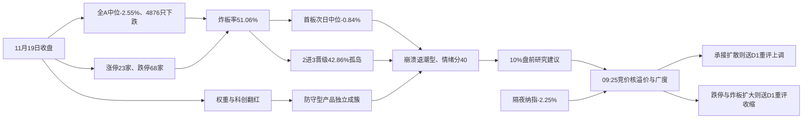

# 2026年11月20日 · 风格研判

> **盘前研究，非当日实况。** A股事实锚定11月19日收盘，隔夜外盘取11月19日美股已完成收盘。核心行情双源可核，风格与外盘覆盖有缺口，本轮不发布市场性禁买。

## 一句话结论

**崩溃退潮型，情绪=主跌（分40）。** 高位二板尚有承接，首板与追价普遍受罚。市场研究仓位建议 **10%**，竞价后重评，最迟09:30失效，不是可用额度。

## 🧭 市场在为什么付钱

11月19日，权重与科创把指数按住，个股却在补跌。上证跌 `0.28%`、深成指跌 `0.71%`、创业板跌 `0.79%`，而沪深300微涨 `0.03%`、上证50涨 `0.32%`、科创50涨 `1.83%`，中证1000跌 `1.88%`。5,573只日线样本里只有649只上涨、4,876只下跌、48只平盘，中位 `−2.55%`，跌超5%的732只，跌超9%的141只。沪深成交 `1.31万亿元`，比前一交易日缩 `4.74%`。这是连续第五个全A中位为负的交易日：11月13日 `−2.00%`、11月16日 `−2.12%`、11月17日 `−1.31%`、11月18日 `−1.20%`、11月19日 `−2.55%`，成交额同期从 `1.67万亿元` 一路缩到 `1.31万亿元`。**指数没跌，钱却在往外走。**

| 市场反馈 | 11月19日观测 | 对风格的含义 |
|---|---|---|
| 收盘封板 | 23家涨停（18首板、2二板、3三板），68家跌停，24家触板未封 | 炸板率 `24/(23+24)=51.06%`，较前日36.92%跳升 |
| 封板质量 | 23只涨停中17只在13时后首封，11只开板后回封 | 尾盘偷袭占多数，封板不厚，不构成可依赖的强度 |
| 前日涨停全池 | 41只全池匹配；开盘均值 `+1.99%`、中位 `+1.97%`，27只正；收盘均值 `+0.12%`、中位 `−0.71%`，19正22负 | 隔夜有溢价，但溢价在日内被吃掉，开盘到收盘中位 `−2.81%` |
| 分层接力 | 首板33只收盘中位 `−0.84%`、日内中位 `−2.82%`；连板8只收盘中位 `+6.97%`、日内中位 `−0.44%` | 层级越高越有承接，首板几乎没有第二天 |
| 晋级率 | 1进2 约 `6.06%`（xTick同日 `5.71%`）；2进3 `42.86%`（两源一致） | 中位断层：低位上不去，少数高位反而被抱住 |
| 前日最高标 | 4板1只，开 `+10.04%`、收 `+4.07%`、开盘到收盘 `−5.43%` | 最高标以高开兑现为主，接力盘吃的是回撤 |

- **大资金意图**: 权重护盘与科创相对强，同时缩量与近4,900只下跌并存，更像存量资金把仓位往确定性资产上换，而不是增量在抄底。没有席位与净流向证据，不把"上证50翻红"当成资金意图已证实的证据。
- **为什么走强**(指权重与高位连板): 位置上是连续五日下跌后的防守位，催化上缺少硬事件，筹码上高位连板已被洗过一轮，因此承接集中在少数存量共识票；首板的位置优势反而被日内回撤吃掉。
- **逻辑够不够硬**: 广度与涨跌停是双源逐项一致的硬事实（Tushare 649/4,876/48 与 xTick 完全相同，成交额同口径），晋级率两源一致；但"谁在买"的归属无证据，护盘能否延续只能靠竞价和盘中承接验证，不能靠指数颜色。

- **大资金意图**: 指高位二板承接——3只三板与7只原二板里晋级3只，说明有一小撮资金仍在按"低位断层后做高度"的老结构下注，对手盘是首板接力与日内追价者。
- **为什么走强**: 位置在中位断层处（2进3空档），催化弱，筹码相对干净，所以形成局部孤岛；这不是普涨的起点。
- **逻辑够不够硬**: "二板表现"风格篮子当日 `+4.18%`、独立成簇（30日 `+8.92%`），与逐股晋级率同向，属可核证据；但样本量只有8只连板、1只最高标，孤岛结构随时可能被一根跌停打散，证伪路径就是次日二板溢价转负。

## 🌡️ 风格与温度

五档取**崩溃退潮型**。判据命中两条硬条件：跌停68家远多于涨停23家，炸板率 `51.06%` 越过50%。第三条"大盘明显下跌"存在口径分歧——上证只跌 `0.28%`，权重和科创还是红的——但全A中位 `−2.55%`、近4,900只下跌在广度意义上就是明显下跌，这里做的是裁量披露，不是改阈值。反过来说，连板情绪型要求高度≥6、涨停≥50、炸板<20%，三条全不满足；主线扩散型要求涨停30-50、高度3-5且有梯队，涨停数不足且梯队是断的；震荡分化型的"无明显连板龙头"也不成立，毕竟还有3只三板。所以不取这三档。

情绪浓度按既有四项公式为 **40**（涨停项 `15.33`、高度项 `7.50`、未炸板项 `9.79`、指数项 `7.02`）。它描述的是11月19日的状态，不含广度与跌停压制，也不是今日方向。

内部周期用实测溢价重算为**补跌**。上游预计算的 `emotion_cycle.json` 同样判补跌、置信0.8，但它的溢价字段缺数，按 `−0.5%` 占位；本轮把前日涨停池逐股配对算出开盘溢价 `+1.99%`（中位 `+1.97%`），因此"不是开盘即崩、而是日内走弱"这一层被还原出来。上游文件不改，它的 `phase_action` 也不被继承为固定打法。

连板公开面把11月19日标为**冰点期连续第5天、温度 `4.625°`**，与本轮连续五日普跌、跌停68家、炸板51%同向，作为温度交叉支持采纳。但同景样本只有5次，次日上证均值 `+0.20%`、上涨率 `50%`，没有单向优势，不据此上调或下调；页面版次未知、事实日为11月19日、公开前缀在3,600字处截断，前缀外的阶段转移、会员与脚本内容未采用。

## 📊 三十日六簇：背景，不是当日指令

固定22个同花顺风格样本、20只ETF，按10月9日至11月19日的30个A股交易日对齐，以日收益的 `1−Pearson相关` 为距离，平均连接切成六簇。20个风格样本与20只ETF足窗；两只风格样本缺数（其中一只缺两日含11月19日、另一只缺十三日），不补零不前填，主矩阵用严格的40项。全42项另用截至11月4日的17个共同观测日重做六簇，其末日不是昨日，差异不能全归因于风格轮动。

| 簇 | 样本数 | 30日平均复合收益 | 11月19日平均收益 | 当日上涨数 |
|---|---:|---:|---:|---:|
| C1 | 34 | -15.93% | -1.10% | 7 |
| C2 | 2 | +3.09% | +0.35% | 2 |
| C3 | 1 | +6.55% | +0.11% | 1 |
| C4 | 1 | -8.86% | -1.19% | 0 |
| C5 | 1 | -13.63% | -0.61% | 0 |
| C6 | 1 | +8.92% | +4.18% | 1 |

主簇34项是绝大多数资产，30日平均 `−15.93%`，昨日只有7项上涨；22个风格样本仅3项收红，20只产品仅8项收红。真正独立的只有三块：C2（2项）与C3（1项）30日为正、昨日仍小涨，指向低波动与权重防御端；C6（1项，"昨日非ST二板"风格）当月最强、当日 `+4.18%`。C4与C5在30日与当日双负。**这是典型的两端结构：钱往防守走，情绪只在最高处留了一个小口子。** 长期均值只描述背景，不用于机械减仓，也不把簇数当主线数。

## 🌐 外盘是背景，不是替代确认

最需要点出的是一处方向冲突。11月19日晚间媒体在美股盘中发稿，记纳指涨 `1.54%`、标普涨 `0.81%`、道指涨 `0.05%`；但美股当日已完成收盘为纳指 `−2.25%`、标普 `−2.02%`、道指 `−2.19%`，取向完全反转。本轮取已完成收盘：**隔夜外部风险偏好实质恶化，A股今日面临低开与闷杀风险**。恒生同日 `−1.95%` 与A股走弱同向；韩国综合 `+1.39%`，其交易日历未独立认证。美股个股日线仍停在11月18日，离岸人民币最新也只到11月18日，商品类按策略跳过，所以软着陆／降息预期／衰退这三档宏观坐标一律留未知，不硬套。

公众号收评与实测对得上：超4,800股下跌、成交缩量646亿、权重与科创逆势收红；其"超70只跌停"是媒体口径，Tushare同日为68只，差异来自覆盖范围，不作拼接。群聊夜盘有"可能反弹"的预期，也有一条偏低吸但明确回避筹码未整理方向的观点，署名与时点都不可靠，只作定性反证。OCR 本轮不取数字口径。**没有任何独立来源证明外盘已经给A股普遍接力背书。**

## ⚖️ 研究建议与反向剧本

本轮以 **10%** 作为市场研究仓位建议。理由是本轮可见机会的规模真的很小：41只前日涨停池只有5只延续或晋级，首板收盘中位 `−0.84%`、日内中位 `−2.82%`，跌停68家、炸板 `51.06%`、成交额缩到 `1.31万亿元`。能给钱的只有两处——2进3的少数高位承接，以及防守型权重——两者都不足以支撑广泛暴露，但也不是零：所以给的是"极小规模"，不是零、也不是上一版25%折半。这个数值不来自30日跌幅、冰点第5天、情绪分或覆盖等级，也不是最低必须使用的额度；真实用户／账户的停买、硬预算（含零）、硬上限、T+1、人工确认与逐票否决全部不变，硬预算本轮未知，由D1核验后一次统一。

首要剧本是**补跌延续、机会极窄**。向上改判需要三件事同时出现：上涨家数持续多于下跌、前日涨停池次日收盘中位转正且回吐有限、二板以上承接与首板晋级同步扩散；单看权重翻红或科创领涨不算。向下则看跌停继续增加、炸板维持50%以上、涨停池溢价转负且日内回撤扩大，若共振就交D1按新证据重评，必要时另发附时限的零建议。本版只适用于11月20日盘前，09:25竞价数据到齐即重评，最迟09:30失效。

## 数据源审计

| 源 | 日期 | 状态 | 备注 |
|---|---|:--:|---|
| Tushare 日历、全市场日线、宽基指数 | 2026-11-19 | 🟢 | 5,573只两日对齐；日历确认11月20日开市 |
| Tushare 涨跌停、梯队、概念代理 | 2026-11-19 | 🟡 | 涨跌停与梯队可用；概念计数不能认证独立主线 |
| Tushare 风格日线、ETF | 2026-11-19 | 🟡 | 22+20实调，40项足窗，2项不补缺 |
| xTick 广度、涨跌停与成交额 | 2026-11-19 | 🟢 | 涨平跌与成交额和Tushare逐项一致；涨跌停保留各自口径 |
| 海外快照（指数回退报价、个股、汇率） | 2026-11-19 | 🟡 | 美股指数为已完成收盘；个股与汇率滞后一日；商品跳过 |
| 公众号 RSS 兼容文件 | 2026-11-19 | 🟢 | 95条中筛收评，不声明全篇研读；与 RSS 同源 |
| 匿名群聊与图像 OCR | 2026-11-19 | 🟡 | 249条群消息；方向句少且冲突，只作定性线索 |
| 连板全局情绪公开前缀 | 2026-11-19 | 🟡 | 部分采用；公开前缀、版次未知、同景样本仅5次 |
| 情绪周期预计算 | 2026-11-19 | 🟡 | 溢价按占位处理；本轮实测替换，不改上游 |
| manifest / MCP 健康 | 2026-11-20 | 🟡 | 全局severity=2是覆盖信息，不自动禁买 |

## 不确定性 / 反证

最大的不确定有三处。其一，风格判定的第三条件依赖裁量：上证只跌 `0.28%`，如果只认指数口径，这更像震荡分化；本轮用全A中位与涨跌家数作广度口径，理由写在上文，但这是一次显式判断而非阈值允许。其二，外盘是单源回退报价，且与媒体盘中报道方向相反，隔夜冲击的真实传导只能等竞价验证。其三，连板公开面版次未知、样本只有5次，只能作温度参照。

也有反向证据不能忽略：跌停虽多，前日涨停池开盘仍是正的（27/41为正）；防守型产品独立成簇且30日为正；公告端出现密集回购与增持，属资金面背景但未转化为价格确认。这些说明"零机会"不成立，所以给10%而不是零。

R1 不输出板块、不输出个股，因此不适用个股思维链四段；本报告的"买入理由／止损"类内容由 D1 在逐票判断时生成，R1 只负责市场奖励与风险温度。

## 🔗 交接

R1只交市场风格、奖励结构与待证伪假设。R2需在候选初筛前独立核扩散、核心与逆势结构，并把本轮"高位孤岛 vs 广度崩塌"当对照；R3可用40分作为上一日基线（若其并跑，读磁盘版本或自算）；D1按竞价与盘中事实重评本研究建议，独立核预算，不能把本报告当开仓决定；R6可反证"补跌是否已到尾声"。

## Sub-Agent 元数据

analyze_style_v1@1.2 · `data/research/20261120/R1_style.json` · deepseek-v4.1-flash · 本轮为真实盘前生成，非回放；冻结输入为11月19日收盘及11月19日美股收盘，知识截止为本轮运输上下文；用量未计量，不记为0，也不保证低于努力目标。
